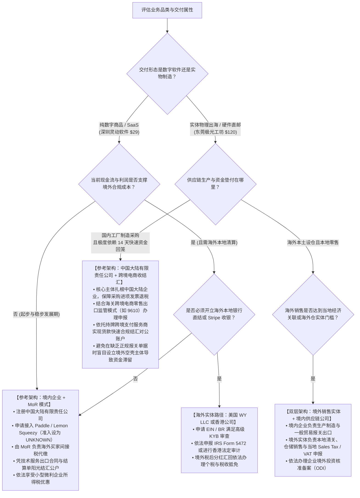

# 第一部分 收款方案选择｜我的生意应该选择哪种收款方案？

---

## 引言：从一笔 29 美元的订单说起

> **阅读提示**：本文是面向中国大陆个人开发者、独立站经营者与中小商家的商业支付方案科普与决策分析，不构成针对特定主体或账户的开户获批承诺、法律意见或资金到账保证。文中提及的资质门槛、产品协议、费率报价、结算周期与案例推演，如未特别标注官方文件生效版本，均应以相关机构当时签署生效的法律合同及商户准入要求为准；任何未经证实的前提条件均标为假设或 UNKNOWN。

假设你是一位中国大陆的创作者或创业者，刚刚搭建好自己的独立网站，或者将自主开发的软件、原创设计模板上架。一天夜里，提示音响起：一位来自美国纽约的顾客点击了“立即购买”，屏幕上显示了一笔 29 美元的支付成功提示。

对于刚涉足商业经营的新手来说，这个瞬间极具成就感。但在金融系统的底层，这段旅程才刚刚开始：
- 这 29 美元现在到底在谁的手里？是在你的银行卡里，还是在某个支付公司的服务器账面上？
- 顾客付的是美元，你要怎样才能把它变成能在国内缴纳房租、支付采购款的人民币？
- 如果三天后这位顾客以“未收到商品”或“信用卡被盗刷”为由发起拒付，这笔损失由谁承担？
- 为什么有的卖家开通了账户并收到了几千美元，但在点击“提现”时，账户却被冻结，甚至要求提供不存在的海外实体水费账单？

商业支付系统的核心目的只有三个：**收钱更快、更省、更安全**。但许多卖家在起步时，往往把精力耗费在“听说某个支付品牌名气大”或者“某家手续费便宜 0.5%”上，最终陷入账户封禁、资金截留或无法合规结汇的困境。

选择收款方案不是去超市挑选现成的货架商品，而是一场**法律责任主体、商品合规资质、买家支付习惯与银行外汇监管之间的精密匹配**。

在进入具体的产品与费率之前，你必须建立起一套清晰的四步决策直觉：
1. **看清订单本质**：到底是谁在向谁卖什么？谁出具发票？谁背负售后法律责任？
2. **核验刚性资格**：以你当前的真实主体（大陆个人、个体工商户、大陆企业还是真实境外公司），哪些方案有官方通道支持（YES），哪些绝对行不通（NO），哪些还在假设之中（UNKNOWN）？
3. **测算实际到手与时间**：从顾客扣款到资金真正落在国内银行账户，扣除各层损耗后到底还剩多少？能否在你的供应链断流之前到账？
4. **搭建真正独立的主备防线**：当主通道突发风控或网络故障时，你的生意能否一秒切到备用通道继续收钱，而不是全店停摆？

带着这四步直觉，我们从最根本的生意画像开始。

---

## 1. 我的生意收钱时，首先要考虑什么？

### 1.1 卖什么、卖给谁、在哪里卖，会影响怎么收钱吗？

**直接回答：不仅会影响，而且直接决定了你的收款通道生死。** 

金融支付行业与普通互联网软件不同，它高度依赖于全球各国的反洗钱法、外汇管制、消费者保护法和国际信用卡组织的风险规则。支付机构在为你提供收银台之前，必须对你做严格的风险定价与准入审查。你卖的商品形态、目标买家所在的国家、销售发生的渠道，都会直接套上不同的合规枷锁。

为了看清这一点，我们先将前面提到的那笔 29 美元订单拆解开来，看清几个在后续选择中反复出现的底层概念。

#### 核心术语的白话解析

1. **法定销售责任方（Merchant of Record，简称 MoR / 法律卖方）**
   - **通俗解释**：当顾客在网上付款时，**在法律层面上究竟是把钱付给了谁？** 谁的名称会印在顾客的信用卡账单明细上？谁有义务为这笔交易向买家开具正规收据或发票？如果发生法律纠纷、消费者权益索赔或跨境间接税申报，谁去承担责任？
   - **为什么重要**：如果你是法律卖方，你就必须自己面对海外各国纷繁复杂的数字增值税（如欧盟 VAT、美国销售税）和退款索赔；如果由第三方（如电商平台或专门的软件 MoR）担任法律卖方，它替你扛下目标国面向消费者的间接税（Sales Tax / VAT）计算、代扣与代缴责任。**但必须清醒认识到**：MoR 的税务代缴仅覆盖其承担名义卖方的零售交易间接税，并不免除供应商作为软件研发主体自身的企业所得税、知识产权侵权责任、商品交付与本国财税合规义务；相应的，它会拿走更严苛的准入审核权和更高的服务抽成。
2. **收单与收单服务商（Acquiring / PSP）**
   - **通俗解释**：收单服务商（Payment Service Provider）是帮商家把钱从顾客的银行卡或电子钱包里“抓取”出来的中介桥梁。它连接着 Visa、Mastercard 等卡组织或本地钱包，核验顾客账户余额，完成扣款，并将处理成功的交易记录在商家的商户后台。
   - **为什么重要**：收单机构承担着垫付和反欺诈风险，因此它最在乎商家的跑路风险和虚假交易。你卖实物还是卖虚拟软件，在收单机构眼里的风险等级完全不同。
3. **资金结算与提现（Settlement & Payout）**
   - **通俗解释**：**交易成功不等于资金入袋**。顾客付款成功后，扣除手续费的款项首先只是支付公司后台的一个“账面可结算数字”。将这个数字真正调拨、电汇或转账到你具有完全支配权的商业银行实体账户中的过程，才叫资金结算与提现。
   - **为什么重要**：很多新手以为后台显示余额就代表赚到了钱，直到提现时才发现受制于最低起提门槛、外汇入账审核或指定银行账户类型要求。
4. **商品履约形态（实物 vs 纯软件 vs 数字模板/服务）**
   - **实体货物**：有实体物流运单号、报关单和签收证明。收单机构最关注的是发货时效、物流丢包率和海运周期的退款风险。
   - **软件/SaaS**：无需物流，通过代码或授权码即时交付。全球税务机关重点监控跨国数字服务增值税；收单机构关注持续订阅的自动扣款失败率。
   - **数字设计模板/虚拟素材/付费文件**：极易产生“下载后立即恶意申请退款”或“侵犯知识产权”的争议。大部分国际主流收单机构将无物流证明的纯数字下载列入高风险或限制业务（Restricted Businesses）。
   - **B2B 专业服务/外包**：单笔金额大、频次低，通常依赖线下商业合同与验收凭据，强行使用零售网页收银台极易触发反洗钱大额风控。

为了让任何经营者都能在 3 分钟内摸清自己的底牌，在挑选任何支付品牌之前，必须完整填写以下**“七维业务画像卡”**。

```
┌────────────────────────────────────────────────────────────────────────┐
│                        商家收款七维业务画像筛选卡                         │
├───────────────────┬────────────────────────────────────────────────────┤
│ 维度               │ 你的具体业务现状（请务必对照真实情况核验）                 │
├───────────────────┼────────────────────────────────────────────────────┤
│ 1. 合同销售责任人  │ 谁是法律卖方？自己直面买家 / 平台代售 / 软件 MoR   │
│ 2. 真实经营主体    │ 大陆自然人 / 个体工商户 / 大陆企业 / 真实境外企业   │
│ 3. 商品与履约形态  │ 实体货 / 软件 SaaS / 数字模板素材 / 咨询服务 (一次性/订阅)│
│ 4. 顾客群体与地区  │ 中国大陆 / 北美 / 欧洲 / 东南亚 (主流付款工具偏好)   │
│ 5. 销售与收银渠道  │ 自建独立站 / 跨境电商平台 / 软件分发托管 / 线下合同  │
│ 6. 订单结构与现金流│ 客单价区间 / 预估月订单量 / 供应链垫资周转极限天数  │
│ 7. 资金合法终点    │ 哪个主体名下的哪家银行对公/对私账户？何种货币落地？  │
└───────────────────┴────────────────────────────────────────────────────┘
```

这七个维度紧密咬合：你的真实主体决定了你能签什么合同，你的商品决定了收单机构愿不愿准入，你的资金终点决定了钱能不能合法变成可支配现金。离开这七个维度去谈“哪家支付最好”，没有任何商业意义。

---

### 1.2 哪些条件必须满足，哪些可以按费用和方便程度来选择？

**直接回答：商业支付的选择必须严格遵循两层逻辑——先看“硬性准入门槛（生死线）”，再看“软性经营优化（效益线）”。**

许多失败的案例，都是因为创始人本末倒置：为了省下 1% 的交易手续费，去选择一个自身主体根本无法合规开户的海外通道；或者为了省事跳过外汇合规审查，最后导致银行拒绝入账。

#### 硬性准入的三态判定法：YES / NO / UNKNOWN

在评估任何一种收款方案时，对每一个关键节点必须严格打上以下三态标记之一：

- **YES（已核准通过）**：官方现行公开规则明确支持你的具体主体、具体商品类目和资金回国路径，且对应产品权限在你的真实账户中**已经完成审核、核验通过**。
- **NO（明确排除）**：官方协议明确禁止，或主体、商品资质客观上无法满足。例如：中国大陆自然人身份试图注册 Stripe 香港商户；或者在明确禁止无授权虚拟资产的通道上销售搜集的素材包。**遇到 NO 必须立即一票否决，绝不存侥幸心理。**
- **UNKNOWN（待核实/待验证）**：处于申请流程中、尚未核验官方最新细则协议、未确认目标银行能否对公入账、未进行小额全流程打款测试。

> **核心戒律**：
> 只要在“**产品受理资格、合法资金出口、退款承揽责任**”中任何一个环节存在 **UNKNOWN**，该方案就**绝不能作为已经就绪的主用方案上线**！在商业决策中，不能把“听说可以申请”等同于“实际已经获批”，更不能把“别人能用”等同于“自己的主体和商品能用”。

#### 三大硬条件（一票否决项：决定方案能不能活）

1. **真实主体与资质合规性**：
   - 支付公司审核的不仅是姓名，而是穿透到最终受益人（UBO）的真实商业背景。
   - 大陆身份证、个体工商户执照、大陆有限责任公司、真实境外企业，对应的是完全不同的金融风控池。严禁通过伪造海外地址、租赁离岸壳公司来包装身份，这在国际金融反洗钱（AML）体系下属于高危违规行为。
2. **商品类目与交付形态准入**：
   - 每一个支付服务商都有详细的“禁止与限制业务清单”（Restricted Businesses，如 [S01]）。实物商品通常需要提供供应链资质与物流轨迹；虚拟软件通常需要提供知识产权证明、官网服务条款（Terms of Service）与隐私政策。
3. **资金终点的合法合规闭环**：
   - 资金从海外进入国内，必须满足国家外汇管理部门对跨境电商或服务贸易的收结汇合规要求。你的银行受款账户名称必须与经营主体或经备案的结汇主体保持逻辑一致，且具备阳光申报结汇的通道。

#### 四大软条件（效益优化项：在硬条件全部为 YES 的方案中做选择）

当你有两个或以上的合法通路都达到 YES 时，才轮到软性指标登场：

1. **综合资金留存率**：包含交易扣点、固定笔费、退款处理费、提现批次费、货币兑换点差（FX Markup）的全链条综合测算。
2. **资金周转时效（Cash Flow Velocity）**：从顾客付款到资金进入国内商业银行并可随时支取的总天数，能否覆盖供应商付货款的极限周期（如 14 天）。
3. **顾客结账顺畅度与转化率**：目标客群是否信任该收银台？结账步骤是两步内完成，还是需要频繁跳转多层验证？
4. **技术接入与长期维护成本**：是开箱即用的插件集成，还是需要自建团队维护底层 API 与 Webhook 状态同步？

记住：**用硬条件做减法，用软条件做择优。** 绝不能为了追求软条件的最优，而踏破硬条件的红线。

---

## 2. 商家常见的收款模式有哪些？

### 2.1 自己收款、在平台卖货、让第三方作为卖方，收钱有什么不同？

**直接回答：商业交易的钱款流转并非千篇一律。根据“谁是面向消费者的法律卖方”、“谁控制收银台”以及“谁承担税务与售后”，主要分为四种截然不同的收款模式。**

为了建立直观认知，我们通过一个对比矩阵和具体的业务流转来理清它们的分工：

```
┌───────────────────────────────────────────────────────────────────────────────────┐
│                           四类商业销售与收款模式核心对比表                           │
├──────────────┬──────────────────┬──────────────┬──────────────────┬───────────────┤
│ 模式类型      │ 法律卖方 (MoR)   │ 收银台控制权 │ 跨境数字税/退款  │ 最典型适配业务│
├──────────────┼──────────────────┼──────────────┼──────────────────┼───────────────┤
│ 1. 电商平台  │ 视平台与合同而定 │ 平台全权控制 │ 平台代扣或按规处理│ 亚马逊/淘宝等 │
│ 2. 自营收单  │ 商家自己 (You)   │ 商家全权控制 │ 商家自行申报/承担│ 独立站品牌出海│
│ 3. 软件 MoR  │ 第三方 MoR 公司  │ MoR 托管提供 │ MoR 全球代扣代缴 │ 纯软件/SaaS出海│
│ 4. B2B 对公  │ 商家自己 (You)   │ 线下/无即时卡│ 凭合同发票银行结算│ 大额传统外贸/服务│
└──────────────┴──────────────────┴──────────────┴──────────────────┴───────────────┘
```

#### 模式一：第三方电商平台模式（Marketplace）
- **运作逻辑**：你入驻 Amazon、eBay、Shopee 或国内的淘宝、京东。顾客在平台的商品流中选购，点击的是平台的结算中心。
- **资金流向**：顾客付款给平台 $\to$ 平台汇总资金，扣除平台佣金、广告费、仓储履约费 $\to$ 达到固定结算周期（如 14 天）后，平台将卖家应得货款通过合规跨境提现通道（如 Amazon 全球收款 [S11] 或第三方合作虚拟账户）打款给卖家。
- **商家的权力边界**：你**绝对无法**在亚马逊或淘宝页面上挂上自己的私有 Stripe 或 PayPal 账号让顾客付款。平台的收银台是封闭的，你只能在平台允许的资金出口中选择合规的提款路径。

#### 模式二：自营独立站收单模式（Direct Merchant / PSP）
- **运作逻辑**：你使用 Shopify、WooCommerce 或自建代码搭建独立站。顾客直接访问你的域名。
- **资金流向**：你作为面向顾客的**法定销售责任人**，接入经过官方审核批准的支付服务商（如合规收单机构提供的 Visa/Mastercard 信用卡通道，或 PayPal 商家账户）。顾客在你的收银台完成支付 $\to$ 收单机构扣除单笔处理手续费 $\to$ 结算到你的商户账户余额 $\to$ 你根据自身资金规划自主发起提现至商业银行。
- **商家的权力边界**：你拥有收银台的完全设计与优化自主权，掌握完整的买家一手数据；但你必须**全额独立承担**产品质量责任、售后退款、信用卡拒付抗辩，以及目标市场的财税合规义务。

#### 模式三：软件/数字产品 MoR 模式（Merchant of Record，如 Paddle、Lemon Squeezy）
- **运作逻辑**：这是近年来在出海独立开发者和 SaaS 软件圈极为流行的模式。
- **白话实质**：**名义经销商与法定代售方**。虽然软件是由你研发的，但当美国或欧洲顾客购买时，合同关系是：**你先将软件权益在瞬间批发给 MoR 公司，MoR 公司再以自己的名义零售给最终消费者**。
- **资金与合规分工**：
  - 顾客的信用卡账单上显示的扣款方是 Paddle 或 Lemon Squeezy，而不是你的个人或公司名字。
  - MoR 替你承担了最令独立开发者头疼的“跨国数字间接税”（如欧盟数十个国家的 VAT、美国数十个州的销售税，详见 [S08]），由 MoR 的税务团队统一计算、代扣并在当地申报代缴。
  - 相应的，MoR 扣取的服务费率显著高于普通收单通道（通常在 5% + $0.50 甚至更高，详见 [S07]）。随后，MoR 按月将“供应商分成款”电汇至你的银行账户。
- **边界与限制**：MoR **绝非万能解药**。Paddle 等机构核心支持的是纯代码、纯软件与 SaaS 服务（详见 [S06]）。在商户准入审核（Merchant Underwriting）时，平台重点考察业务的持续交付能力与技术属性。虽然其公开产品税务分类（Product Tax Categories）中包含了数字商品（Digital Goods）、电子书及设计素材等选项，但拥有税类并不等同于保证任何个人上传的设计素材都能获批开户；对于纯静态设计素材、一次性数字文件等非纯软件类目，商户仍需逐案提交版权证明与详细交付说明由人工审核（当前客观判定为 UNKNOWN）。绝不能想当然认为“后台有税类就能百分之百准入”。

#### 模式四：企业对企业（B2B）真实合同与发票银行收款
- **运作逻辑**：针对客单价几千至数万美元的大额批发外贸、海外技术咨询或定制化企业软件交付。
- **核心方式**：不需要在网页上放一个即时信用卡支付网关，而是依据双方签署的正式商业合同（Contract）与形式发票（Proforma Invoice），由海外买家通过商业银行国际电汇（SWIFT Wire Transfer）直接汇款至卖家合规开立的境内外汇对公账户，或合规第三方跨境企业名义账户。
- **为什么大额外贸通常不首选在线信用卡？** 虽然部分零售网关在技术上允许大额信用卡扣款，但如果一笔 $5,000 的订单走零售信用卡收银台，仅 3%–4% 的手续费就会损失 $150–$200，且面临买家发卡行单笔限额拦截、高额拒付抗辩风险；更重要的是，国内银行在处理大额涉外资金入账与经常项目结汇时，仍需企业提供具有真实贸易背景的商业合同、海关报关单或跨境服务备案。相比之下，传统的商业银行电汇（TT/SWIFT）单笔固定电汇费通常仅 $15–$35，且单据链条天然契合银行外汇合规审查。因此，大额 B2B 交易的基石依然是商业合同、形式发票与对公银行电汇。

---

### 2.2 Visa、PayPal、Stripe和银行账户分别是做什么的？

**直接回答：新手最致命的认知混乱，就是把“卡网络、电子钱包、收单机构、虚拟账户与商业银行”混为一谈。它们在支付生态中各司其职，拥有完全不同的职能与权力。**

为了彻底打破概念迷雾，我们以那笔 29 美元的跨国交易为例，完整推演一次资金的“接力跑”。

```
┌─────────────────────────────────────────────────────────────────────────────────┐
│                    一笔 29 美元交易的正向支付接力与逆向责任链                      │
├─────────────────────────────────────────────────────────────────────────────────┤
│                                                                                 │
│ 【正向支付跑道】                                                                 │
│  [买家手持 Visa卡] ──①信息校验──> [Visa 国际卡组织] ──②额度确认──> [买家发卡银行]   │
│                                                                   │ 扣款         │
│  [商家银行账户] <──⑤合规结汇── [持牌跨境资金账户] <──④扣费结算── [合规收单机构/受邀网关] <──┘│
│   (最终可用现金)                 (如WorldFirst等受款桥梁)       (核算交易扣手续费) │
│                                                                                 │
│ ─────────────────────────────────────────────────────────────────────────────── │
│                                                                                 │
│ 【逆向追责倒灌】                                                                 │
│  [买家发起拒付] ──①调单申请──> [买家发卡行] ──②强制扣划──> [Visa卡组织]         │
│                                                                   │ 追索         │
│  [商家掏钱补足/扣信用] <──⑤冻结追偿── [商家商户余额] <──④加收争议费── [收单机构] <─┘│
│                                (瞬间扣减本金+争议费)                            │
└─────────────────────────────────────────────────────────────────────────────────┘
*注：上图展示的是一种合规架构下的资金与责任接力示意（例如具备资质的商户通过合规收单机构结算至持牌跨境服务商），并不代表任意中国大陆主体均可直接开通上述机构；争议处理费依收单机构与币种而定，通常每笔约 $15–$25 美元不等。*
```

#### 顺向接力链：29 美元如何一步步流转？

1. **Visa / Mastercard / 银联：卡网络与规则制定者（Card Schemes）**
   - **它们不是银行，也不开设商家后台**。它们是全球支付的信息高速公路与协议标准。Visa 负责在毫秒之内将纽约顾客的刷卡请求，安全投递给顾客的开户行确认额度，并确保清算报文准确无误。
2. **PayPal / 支付宝 / 微信支付：消费者数字钱包与支付网关（Wallets & Gateways）**
   - 顾客在钱包里绑定了银行卡或存放了零钱余额。在结账时，顾客只需输入账号密码或扫码，无需反复掏出物理信用卡。
   - **重大误区澄清**：很多中国大陆个人在日常生活中是 PayPal 消费者（能用其在海淘时付款买东西），就**误以为自己自然拥有开通 PayPal 商家收款后台的资格**。这是两套完全独立的法律协议。消费者买东西与合规商家收商业款，风控审核标准有着云泥之别。
3. **Stripe / PayPal 商家产品 / 国内合规收单服务商：商家的收单先锋（Acquirers / PSP）**
   - 这是直接为商家服务的机构。它提供软件代码（API/SDK），嵌入在你的网站结账页。当顾客提交订单，它负责将交易递交给卡组织清算，对交易进行反欺诈风控扫描，在成功扣款后扣除自身的服务费，将净额记在商家的商户管理后台中。
4. **WorldFirst（万里汇）/ 连连国际 / Wise：跨境合规虚拟收款账户（Cross-Border Payout Providers）**
   - 很多中国大陆卖家没有境外的本地银行实体账户，直接接收国际电汇成本极高且容易遭遇外汇合规障碍。
   - 类似 WorldFirst [S04] 的持牌跨境资金服务商，能够为大陆卖家生成一个名义上的境外本地银行虚拟受款账号（例如一个花旗银行或摩根大通的虚拟账号），用于合规接收电商平台或 Shopify Payments 的打款，并协助卖家按国家外汇管理规定，将资金阳光合规结汇为人民币转回国内。
   - **重大误区澄清**：**拥有一个 WorldFirst 或 Wise 的境外虚拟银行账号，绝不等于你在当地注册了一家实体公司，也绝不意味着你具备了开立当地通用 Stripe 商户的法律资格！** 银行受款账户和商户收单资格是两个完全不同维度的金融概念。
5. **商业银行（中国银行、招商银行、工商银行等）：资金归宿与法定义务终点**
   - 最终把钱装进你口袋的法定金融机构。只有资金进入了由你的真实经营主体或经合法合规备案的商业银行账户，且银行完成国际收支申报与结汇之后，这笔钱才算真正完成了商业闭环，成为你可以用来进货、发工资、消费的合法现金。

#### 逆向责任链：当发生退款与拒付时，责任如何倒灌？

收款不仅仅是顺向收钱，更是逆向兜底。如果交易发生异常，金融系统的反向追责极为残酷：

- 顾客在收到账单 120 天内，可以向发卡行提出争议（拒付，Chargeback）。
- 发卡行根据卡组织规则发起调单，收单机构（Stripe/PayPal）会**瞬间无条件从你的商户账面余额中划走这笔 29 美元**，并且通常会向你额外加收一笔不可退还的“争议处理费”（Dispute Fee，通常为每笔 $15 至 $25 美元，详见 [S02]）。
- 如果你此时后台余额为零怎么办？收单机构会要求你绑定的结算银行账户或信用卡进行补扣；若商户长期欠费或涉嫌严重违规欺诈，收单机构依据国际卡组织规则（如 Mastercard MATCH / Visa VMAS 清单制度）可将商户主体及法人列入风险商户名单，可能导致未来在主流收单机构申请开户受限或被要求缴纳高额保证金。
- **清醒结论**：谁是销售责任主体，谁就在支付底层对最终的退款和拒付承担无限兜底责任。

---

## 3. 我这样的卖家能用哪些收款方案？

### 3.1 我是个人还是公司、卖什么、卖到哪里，会限制能用的方案吗？

经营主体的法律形态、商品的交付属性以及目标买家所在的国家或地区，对商业收款方案的可用性构成极其明确的刚性约束。商户注册主体决定了金融机构与支付服务商（PSP）的准入资格，商品属性界定了国际卡组织的风控等级与履约标准，而买家地域则限定了收银台必须支持的本地化清算网络。三者交织，直接构成了出海商户方案选型的客观准入边界。

#### 一、法定经营登记义务与 PSP 商业准入资格的本质解耦

在跨境创业起步阶段，许多经营者常将“支付机构或电商平台是否要执照”与“国家法律是否要求办照”混为一谈。必须首先建立清晰的法律与商业分水岭：**法定经营登记义务（Statutory Registration Obligation）与支付服务商（PSP）商业准入资格属于两套独立运作的监管与商业体系。**

##### 1. 法定经营登记义务：你是否有权“无照经营”？
在中国大陆境内开展商业活动，市场主体的设立受到国家行政法规的刚性约束：
- **《中华人民共和国电子商务法》第十条**明确规定：“电子商务经营者应当依法办理市场主体登记。但是，个人销售自产农副产品、家庭手工业产品，个人利用自己的技能从事依法无须取得许可的便民劳务活动和零星小额交易活动，以及依照法律、行政法规不需要进行登记的除外。” [J01]
- **登记豁免需要看真实交易，而不是只看营销形式。**《网络交易监督管理办法》第八条规定，个人从事网络交易活动，**年交易额累计不超过人民币 10 万元**且符合适用条件的，属于《电子商务法》第十条所说的零星小额交易免登记情形；**依法须取得行政许可的经营活动等例外仍须遵守相关要求**。超过标准或不符合其他豁免条件时应依法登记。雇人、投广告、采购转售或开设独立站是判断业务性质的参考事实，不能各自单独作为法定的“自动失去豁免”条件；纯境外网站交易是否落入该办法适用范围，应结合经营场所、实际主体、交易方式和监管规则确认，不能直接承诺免登记 [J01]。
- **合规边界界定**：部分海外第三方创作者平台或软件市场在初期允许自然人凭个人身份证件入驻，仅属于境外商业机构自身设定的商业风控策略，**绝不构成对中国大陆经营者法定市场主体登记与纳税申报义务的法律豁免**。

##### 2. 支付服务商（PSP）商业准入逻辑：为什么收单机构严格审查主体？
国际主流收单机构（如 Stripe、PayPal、Shopify Payments）与国际卡组织（Visa、Mastercard）的准入审核，核心遵循国际金融反洗钱（AML）、反恐怖融资（CTF）与“了解你的客户 / 企业”（KYC/KYB）监管规则：
- 支付机构向商户开放信用卡与电子钱包收单通道，在垫付清算资金的同时，实质上承担了持卡人在 120 天乃至更长争议期内发起拒付（Chargeback）的垫付与代偿风险。
- 自然人违约责任追索成本高、抗风险资金储备有限；而依法设立的企业法人拥有公示的法定代表人、存管的对公商业银行账户及可依法穿透的最终实益拥有人（Ultimate Beneficial Owner, UBO）。因此，收单机构通常根据注册地区、主体形式、产品风险、业务历史及合同确定商户可开通的产品、定价和交易限额；**注册企业不保证低费率、无限制收单或成功获批**。

##### 3. 商业演进阶段的情景假设参考（非强制监管门槛）
> **特别说明**：以下按月度交易额划分的阶段，仅为作者根据中小企业运营实践设定的商业演进情景假设（Heuristic Scenarios），用于说明不同业务规模下的成本效益权衡，**并非法定监管门槛或强制行政标准**。商户应结合自身毛利率、备货资金与风险承受能力自行决策。

1. **起步验证期（业务情景假设：月流水低于 $2,000 美元）**：
   - *商业诉求*：以最低试错成本验证海外市场需求。
   - *方案考量*：可以中国大陆自然人身份，优先入驻具备合法个人入驻机制的海外创作者市场（Marketplace）或合规跨境电商平台；在无实体办公场地、无雇工的前提下，利用个人合法技能开展微型验证，避免在尚未验证市场前盲目花钱设立境外公司背负高昂维保成本。
2. **商业化爬坡期（业务情景假设：月流水 $2,000 ~ $20,000 美元）**：
   - *商业诉求*：搭建品牌独立站、建立自主收银台、防范个人与对公资金混同风险、开具合法发票。
   - *方案考量*：设立**中国大陆有限责任公司**（优先）或**个体工商户**。大陆有限公司设立程序便捷、支持开立银行对公外汇账户、可享受国家对小型微利企业的所得税优惠政策（年应纳税所得额不超过 300 万元的部分，减按 25% 计入应纳税所得额，按 20% 税率缴纳企业所得税，实际有效税负仅约 5% [J02]），能够合规接入境内持牌跨境支付服务商并办理阳光结汇。
3. **全球化扩张期（业务情景假设：月流水高于 $50,000 美元且确需海外本土清算）**：
   - *商业诉求*：接入海外本土特定支付方式、降低跨国结算费率、实现原币留存或海外本地供应链履约。
   - *方案考量*：在具备稳定商业现金流与充足利润空间的前提下，审慎评估设立**真实的境外实体（如中国香港公司、美国公司、新加坡公司）**，并依法办理相关境外投资与税务合规申报。

---

#### 二、出海四类经营主体的全维度权责与准入对比

出海创业者在选择主体时，必须全盘权衡民事责任、税负、银行开户与外汇监管。以下矩阵系统梳理了四类常见经营主体的法律与财税特征：

| 比较维度 | 大陆自然人 | 大陆个体工商户 | 中国大陆有限责任公司 | 真实境外合法公司 |
|:---|:---|:---|:---|:---|
| **法律责任形态** | 以本人名义经营形成的债务，一般由本人财产承担 | 通常以个人财产承担；家庭经营等情形依法适用家庭财产责任 | 股东原则上以认缴出资额为限承担责任，但出资瑕疵、人格混同、个人担保等情形有例外 | 按注册地及具体实体类型判断；有限公司股东通常享有限责，但税务、董事责任和担保等有例外 |
| **所得税合规体系** | 按实际收入性质判断综合所得、经营所得或其他类别，不能仅凭“个人收款”归类 | 按经营所得核算，查账/核定与优惠以实际条件为准 | 法定企业所得税通常 25%；符合小型微利企业条件时适用约 5% 的有效税负口径 [J02] | 按税务居民身份、利润来源、实体税务分类和当地规则判断；香港、新加坡、美国的名义税率不能直接比较最终实缴税 |
| **银行账户体系** | 境内个人借记卡<br>（严禁混入公款商业经营款） | 个人结算账户或<br>个体工商户对公人民币账户 | 国内商业银行<br>人民币对公账户与经常项目外汇账户 | 境外属地商业银行公户<br>（需满足商业实质与面签核验） |
| **外汇管理边界** | 年度等值 5 万美元结售汇**便利化额度**不等于所有经营性外汇收支上限；经营性交易按真实背景与规定办理，不得虚构用途用于资本项下投资 [J04] | 按具体经营活动及跨境电商政策，提供订单等真实交易凭证办理收结汇 | 凭真实贸易/服务交易和适用银行规定办理经常项目收付汇，不意味着所有场景“无上限、无审核” | 境外资金留存、境内资金划转及股息归属按主体与法规判断；中国税收居民个人境外股息通常涉及 20% 税率及合法抵免 [J03] |
| **收单通道准入** | 仅能申请服务商**明确接受该地区自然人**的产品；以合同核验 | 可申请接受该主体类型的商户产品；各 PSP 需单独审核 | 可申请支持中国大陆公司的合规收单/跨境结汇服务；不自动取得任何境外 Stripe 账户资格 | 只有在**注册地及业务实际满足服务商规定**且通过 KYB 后，才可能开通当地 PSP（如 Stripe），并非注册即获批 |

---

#### 三、跨境收单全链路“四大风控断点”解析

初涉跨境商业的经营者常存在一种认知误区：“只要找代理代办一张海外营业执照，我就能畅通无阻地收全球信用卡了”。在国际银行与支付合规实践中，各环节具有极高的独立风控审查门槛，呈现出**层层递进的风控断点**：

> **核心风控断点链条**：  
> `境外公司注册成功 ≠ 境外商业银行开户通过 ≠ 收单服务商 (PSP) 准入获批 ≠ 资金平稳结算与阳光提现`

1. **断点一：境外公司注册成功 ≠ 商业银行开户通过**
   - 注册海外公司通常仅需向当地注册署递交设立表格与法定秘书地址，程序化审批门槛较低；
   - 但向当地正规商业银行（如汇丰、渣打、星展、花旗）申请企业银行公户时，银行通常会依客户风险等级要求披露最终受益人、业务模式、资金来源、交易对手、实际经营地点及相关证明；**实体办公室租约、本地雇员社保或既有流水不是所有银行、所有公司统一必须提交的材料**。只有注册地址、缺乏可证明的业务及资金来源，可能提高审核难度；是否批准取决于该银行当期政策。
2. **断点二：开通虚拟账户 ≠ 收单机构（PSP）准入获批**
   - 部分卖家退而求其次，开通了某些跨境金融科技平台的虚拟收款账号（如带有 Routing Number 的收款账号），并在收单平台后台成功填报；
   - 然而，后台成功填写并不等同于通过了实质合规审查。Stripe 等收单机构对商户法律实体的实际运营地有严格要求，虚拟银行账号仅作为出金资金容器，绝不替代商户实体的合法经营展业资格。
3. **断点三：后台生成收银台 ≠ 能长期稳定收款**
   - 在未提交深度资质前，部分收单机构可能会分配一个处于试用或低权限状态的账号，前台看似能够扣款；
   - 一旦累积交易额达到风控阈值（如短期内出现多笔交易、或流水突破一定额度），风控系统会触发高级审查并暂停出金（Payout Hold），可能要求提供最终受益人身份证明、企业经营地址证明、业务合同、税务资料等；**公证护照、本地水电费账单及是否接受共享办公或注册代理地址，均取决于具体服务商**。材料不符可能导致限制出金或终止账户。
4. **断点四：可用余额到账 ≠ 资金安全调回国内**
   - 境外收单账户沉淀了外币营业款后，若试图将资金提取回中国境内，必须经过境内商业银行的外汇真实性核验。银行根据国家外汇管理局经常项目管理规定，要求企业提供与资金完全吻合的跨境出口海关申报记录、国际物流签收轨迹或服务贸易技术出口合同。缺乏贸易真实性凭证的款项，可能面临银行合规拦截、挂账或原路退汇，产生高额中转行费用。

---

#### 四、主流境外管辖区设立实务与当地实质要求

若企业经过充分商业可行性评估，确需设立境外实体以支撑海外本地化业务，应全面了解主流管辖区的设立路径、法定责任、税务申报与长期维护负担：

##### 1. 中国香港特别行政区（Hong Kong SAR）
- **实体形态**：私人股份有限公司（Private Company Limited by Shares）。
- **公司秘书法定资格**：依据香港《公司条例》（第622章），每家香港公司必须委任一名公司秘书。若为自然人，必须通常居于香港；若为法人团体，必须在香港有注册办事处或营业地点。若委托外部商业机构提供公司秘书服务，该受托机构必须持有香港公司注册处依据《打击洗钱及恐怖分子资金筹集条例》（第615章）颁发的**信托或公司服务提供者（TCSP）牌照** [J07]。
- **财务审计与利得税报表提交要求**：
  - 依据香港《税务条例》（第112章）及《公司条例》（第622章），正常经营的香港公司每年须由香港执业会计师（CPA Practising）出具财务审计报告，并在递交利得税报表（BIR51）时随附经审计财务报表 [J07]；
  - **法定休眠公司豁免例外**：依据《公司条例》第 5 条，符合条件的公司经股东通过特别决议宣告为**“不活动公司（Dormant Company）”**并向公司注册处申报后，在没有任何会计交易的休眠期间，依法豁免编制审计报告。香港税务局官方指引（IRD: https://www.ird.gov.hk/e_pfr/ ）明确说明，符合《公司条例》定义的不活动公司属于递交税表时免附审计账目的法定例外 [J07]。休眠资格须按《公司条例》对“会计交易”的定义与相关例外判断；**开展真实销售收款通常不符合继续维持休眠的要求**，应及时核对恢复正常财务报告及审计义务，不能把所有银行账户记账活动一概视为相同法律后果。

##### 2. 美国（United States：特拉华州 Delaware 与怀俄明州 Wyoming）
- **实体形态**：有限责任公司（LLC）或股份有限公司（C-Corporation）。
- **联邦税号与税务分类**：设立后需向美国国内收入局（IRS）申请联邦雇主识别号（EIN）。未选择作为公司纳税的外国单一成员 LLC 在联邦所得税层面属于“被视同忽略实体（Disregarded Entity, DE）”。
- **Form 5472 法定申报义务与触发条件**：
  - 依据美国《国内收入法典》第 6038A、6038C 条及 IRS Form 5472 说明（https://www.irs.gov/instructions/i5472 ），以下主体在纳税年度内发生**应报告关联交易（Reportable Transactions）**时，必须填报 Form 5472 [J08]：
    1. 外资持股达 25% 的美国公司（25% Foreign-Owned U.S. Corporation）；
    2. 全资属于外国非居民纳税人的被视同忽略实体（Foreign-Owned U.S. Disregarded Entity，如单一外国非居民持有的单成员 LLC，就 6038A 申报要求而言视同国内公司处理）。
  - **关联交易范围**：包括向外国所有人或关联方支付的资金汇出入、借贷、服务费、许可费、利润分配、以及设立时的资本金注入或资产划转。**满足上述申报主体及应报告关联交易条件的外国人全资持有美国被忽略实体**，一般须将 Form 5472 随 Pro-forma Form 1120 按 IRS 指定方式报送；25% 外资持股美国公司的所得税申报与 5472 附报方式另按自身税务分类处理 [J08]。
  - **法定违规罚则**：若未按期申报或未依法保存相关关联交易备查簿册，IRS 列明的**每项申报失责基本罚款可达 25,000 美元**，在收到通知后持续不整改还可能追加处罚；应按该年度应提交的每份 Form 5472 及具体罚则核实，而非一律以“每年/每关联方”简单相乘。若该年度确无触发的应报告关联交易且符合适用规定，不能仅凭实体存在便断言必须申报，但仍应保留关联交易及资本往来的核查记录。

##### 3. 新加坡（Singapore）
- **实体形态**：私人有限公司（Private Limited Company, Pte. Ltd.）。
- **监管机关**：新加坡会计与企业管制局（ACRA, Accounting and Corporate Regulatory Authority）。
- **法定董事职责与挂名董事权责边界**：
  - 新加坡《公司法》要求必须至少委任一名**新加坡本地常住董事（Ordinarily Resident Director）**（公民、永久居民或合规准证持有者）。若公司无符合资格的本地常住董事，才需安排合规的常住董事人选；部分跨境创办者会使用专业机构的挂名董事服务，但**并非每家外资公司都必须购买该服务**；
  - 依据 ACRA 官方董事法定职责指引（https://www.acra.gov.sg/manage/companies/legal-requirements-common-offences/directors-duties/ ），挂名董事与普通执行董事承担完全相同的法定义务与信义义务（Fiduciary Duties），包括确保公司按期呈报年度报告（Annual Return）、维护法定登记册、妥善保管财务记录。违反法定职责将面临 ACRA 行政罚款（最高可达 5,000 新币）、取消董事任职资格乃至刑事指控 [J09]；
  - **清偿责任边界澄清**：私人有限公司具有独立的法人地位。挂名董事依职权履行法定义务，**并不对公司的一般商业债务承担个人连带清偿责任**（除非董事个人提供了明确的连带保证担保，或在破产清算中被法院裁定参与了欺诈性交易 Fraudulent Trading）[J09]。挂名董事服务费与押金实质是对其承担的法定合规与监管风险的商业定价。
- **小公司法定审计豁免标准**：
  - 依据新加坡《公司法》第 205C 条及 ACRA 审计豁免指引（https://www.acra.gov.sg/manage/companies/legal-requirements-common-offences/preparing-financial-statements/audit-exemptions/ ），符合“小公司（Small Company）”标准的新加坡私人公司，可免于法定审计，仅需编制符合准则的未经审计财务报表（Unaudited Financial Statements）[J09]；
  - **资格判定标准**：**既有公司**一般核查最近连续两个财政年度是否至少满足下列三项量化标准中的任意两项；**新成立不足两个财政年度的公司**可按当前财政年度判定是否符合“小公司”标准 [J09]：
    1. 全年总营业收入不超过 1000 万新币（$\le$ S$10 million）；
    2. 财政年度末总资产总额不超过 1000 万新币（$\le$ S$10 million）；
    3. 全职雇员人数不超过 50 人（$\le$ 50 employees）。
  - **集团条件限制**：若该公司属于企业集团的一部分，则**整个集团的规模标准也必须符合适用的小型集团（Small Group）规则**方可享受审计豁免；新设集团及合并报表情形须按 ACRA 的相应年度判定规则，而不是机械要求新公司提供尚不存在的两个历史年度。审计豁免资格不是一经获得即永久生效，若企业或集团连续两年未能满足条件，将重新被强制要求进行年度审计。

##### 4. 英国（United Kingdom，可参考管辖区）
- **实体形态**：私人股份有限公司（Private Limited Company, Ltd），由英国公司注册处（Companies House）管辖。
- **境外卖家向英国客户直销的增值税（VAT）规则**：
  依据英国税务海关总署（HMRC）最新指引《Charging VAT on goods sold direct to customers in the UK》（https://www.gov.uk/guidance/charging-vat-on-goods-sold-direct-to-customers-in-the-uk ）[J10]：
  - **注册起征点差异**：**英国本土企业的一般 VAT 注册门槛在 2026 年为过去 12 个月应税营业额超过 £90,000，或预计未来 30 天将超过该额**；非英国设立应税主体（NETP）通常不能套用这一门槛，若在英发生需注册的应税供应，可能从首笔起承担注册义务；零税率、豁免供应、平台作为纳税责任人的情形以及英国境内是否成立机构须分别核对 [J10]；
  - **货物自英国境外发货直邮英国消费者（Consignment Value 托运货值界限）**：
    1. **托运货值 $\le$ £135**：若通过独立站直接履约销售（未通过在线交易市场 OMP），海外卖家必须在英国注册 VAT，并在销售结账环节向英国消费者收取增值税（进口口岸环节免征进口增值税）；若通过亚马逊等在线市场（OMP）销售，则由 OMP 负责向消费者代扣代缴英国 VAT [J10]；
    2. **托运货值 $>$ £135**：不适用前述结账点代扣规则，货物在英国口岸进口时按一般进口货物清关，由进口商（买家或以 DDP 完税后交货的卖家）在海关缴纳进口增值税与相应关税；
  - **货物在销售时已位于英国境内（如海外仓备货）**：海外卖家直接向英国买家销售已在英国境内的货物，必须自第一笔销售起注册英国 VAT 并申报纳税（若通过 OMP 销售则由平台代扣代缴）；
  - **税率边界**：英国增值税分为标准税率（20%）、减低税率（5%）与零税率（如部分出版物、儿童衣物）。因此不能将直销规则简化为“所有商品一律缴纳 20%”，商户应结合自身商品品类与清关模式合规核算。

---

#### 五、设立与长期持有的总拥有成本（TCO）精算对比

出海商户在评估境外实体时，不仅要看一次性注册费用，更要测算涵盖法定规费、专业秘书、地址租用与年度财税合规的**总拥有成本（Total Cost of Ownership, TCO）**。

> **TCO 首年与长期综合持有成本评估模型**：  
> **TCO = 当期政府规费 + 一次性设立与专业服务费 + 注册地址及必要人员/代理费 + 年度申报、记账与适用审计费 + 银行及跨境运营成本。** 不同年度应分别计算，避免将首年设立费用每年重复计入。
> 
> *价格基准：下表政府收费仅在注明项目、缴费方式和期间时按官方公开收费核对；其余代理、地址、董事、审计和申报服务费均为**教学预算区间（MODEL_ASSUMPTION，尚未取得对应供应商报价）**，不表示“2026 年市场公允价”或政府规定。汇率仅用于展示假设：1 USD≈7.2 RMB、1 HKD≈0.92 RMB、1 SGD≈5.4 RMB，不是实时汇率。银行开户、审计复杂度、专业服务、税务和额外监管许可可能显著改变总成本。*

| 成本组成项目 | 香港公司（HK Ltd） | 美国公司（WY LLC） | 新加坡公司（SG Pte. Ltd.） | 费用属性与说明 |
|:---|:---|:---|:---|:---|
| **1. 设立时政府规费** | 私人股份公司 NNC1：电子提交 HK$1,545；纸质提交 HK$1,720。2026/4/1–2027/3/31 的一年期商业登记证连同征费 HK$2,350（按证书适用期间核对）[J07] | 怀俄明 LLC 官方申请费 US$100；网络提交另按规定计支付处理费 [J11] | ACRA 名称申请 S$15 + 公司登记 S$300，共 S$315 [J09] | 【官方规费】<br>按具体办理方式、注册类别和适用年度变动；并非所有项目统一收费 |
| **2. 注册地址与代理** | 法定秘书+注册地址<br>约 HK$2,000 ~ $4,000/年 | 注册代理人（Registered Agent）<br>约 $100 ~ $300/年 | 本地法定注册地址租赁<br>约 SG$300 ~ $800/年 | 【第三方商业服务费】<br>满足当地必须的法定实体要件 |
| **3. 本地常住董事 / 服务费** | 无一般性的本地董事国籍要求（法定公司秘书及地址规则另核） | 无一般性的本地董事国籍要求（注册代理规则另核） | **须有符合条件的常住董事**；如聘商业挂名董事，假设 S$2,500–5,000+/年及可能押金，实际应报价确认 [J09] | 【常住董事为公司治理要求】<br>付费挂名董事不是所有公司的法定必购服务 |
| **4. 周年年报申报** | 私人公司 NAR1 按时提交官费 HK$105；若委托秘书代办另付服务费 [J07] | 怀俄明 LLC 最低年度 license tax 为 US$60，或按州内资产公式计算后取较高者；网上提交另有处理费 [J11] | 新加坡 Annual Return 申报费以 ACRA 当期项目收费核验，不能将代理服务费当作法定费用 [J09] | 【法律义务与可能产生的代理费用】<br>逾期后果按当地实际规则判断 |
| **5. 财税审计与报表** | 香港执业会计师（CPA）审计<br>约 HK$6,000 ~ $15,000+（视流水） | Form 5472 / 1120 专业申报<br>约 $500 ~ $1,500 美元/年 | 未经审计财务报表（Unaudited）编制<br>约 SG$1,000 ~ $2,500 新币/年 | 【年度合规核心支出】<br>若触发强制审计则成本大幅上升 |
| **首年预算区间（教学假设）** | 假设 HK$12,000–25,000<br>（约 ¥11,000–23,000） | 假设 US$1,200–2,500<br>（约 ¥8,600–18,000） | 假设 S$5,000–10,000<br>（约 ¥27,000–54,000） | 【非官方报价】<br>仅供判断预算规模，是否包含税务登记、审计、银行审核及专项申报须另行核实 |
| **次年起预算区间（教学假设）** | 假设 HK$10,000–20,000<br>（约 ¥9,200–18,400） | 假设 US$1,000–2,200<br>（约 ¥7,200–15,840） | 假设 S$4,500–8,500<br>（约 ¥24,300–45,900） | 【非官方报价】<br>随合同报价、业务规模、是否适用审计豁免等变化 |

> **关键财务提示**：决定是否设立境外实体，**绝不能仅看账面总营业额（Gross Turnover），而必须以净利润率（Net Margin）与可用现金流周转为核心衡量基准**。若企业毛利率较低或起步阶段净利润不足 10 万元人民币，单一境外实体的合规维保支出即可吃掉大半净利润，反而对主营业务形成严重的资金拖累。

---

#### 六、两大贯穿案例的主体选择决策树与落地推演

为帮助商户实现从“法规认知”到“商业落地”的闭环，我们结合全书贯穿的两大真实镜像商业情景展开推演：



##### 1. 案例 A 深度演示：深圳灵动软件工作室（$29.00 无形交付）
- **业务特征**：自主研发设计软件，单价 $29.00 美元买断或月费订阅。在线发码交付，无物理海关报关单。月销量 100 笔，月流水 $2,900.00 美元（年流水约 $34,800 美元，折合人民币约 25 万元）。
- **主体决策研判**：
  - *境外实体成本测算*：若设立境外公司（如香港或美国公司），每年刚性维保成本约 8,000 至 20,000 元人民币，占其全年总营收的比例高达 **3.2% 至 8.0%**（**¥8,000 ÷ ¥250,000 = 3.2%；¥20,000 ÷ ¥250,000 = 8.0%**），严重侵蚀小微团队的早期利润；同时一人团队难以承担复杂的美国 Form 5472 关联交易申报或香港执业会计师法定审计；
  - **参考落地架构建议**：**以中国大陆有限责任公司为主体，申请接入合规的记录商户（MoR，如 Paddle 或 Lemon Squeezy）**：
    - *税务与合规隔离*：MoR 在名义上作为面向海外消费者的法定销售商，自动处理欧洲 VAT、美国各州销售税的代扣代缴；灵动软件无须自行在全球数十个税区分别注册税号，有效控制了境外间接税合规风险；
    - *资金阳光收结汇*：灵动软件作为软件供应商，按结算周期向 MoR 提供商业形式发票（Commercial Invoice）并结算服务款项，资金通过境内商业银行对公外汇账户合规收结汇入账；
    - *所得税优惠*：在境内依法核算为技术服务出口收入，符合条件可享受国家对小型微利企业的所得税减免政策（年应纳税所得额不超过 300 万元部分实际有效税负仅约 5% [J02]），现金流透明可控。  
    *注：MoR 服务商对商户资质、软件知识产权及业务品类实行独立风控审核，商户能否获批属于 UNKNOWN 状态，商户应以实际申请评估为准。*

##### 2. 案例 B 深度演示：东莞极光工坊（$120.00 实物制造直邮）
- **业务特征**：自主设计机械键盘，涉及精密模具、PCB 贴片、轴体采购与工人薪酬。每把键盘出库硬成本 600 元人民币（客单价 $120.00 美元）。企业核心约束是**必须在 14 天内将回款结算为人民币，用于向供应链厂家垫付下一批订单的采购定金**。
- **主体决策研判**：
  - *严重误区规避*：若极光工坊在中介误导下注册美国 LLC 或香港公司用于独立站收单，货款虽然进入境外账户，但由于货物通过直邮小包裹发往海外买家，商户若未按海关跨境电商监管方式办理报关，将无法向国内银行提供证明大宗货物出口的有效单据。将货款从境外汇回境内商业银行时，可能面临经常项目贸易真实性审核延迟或资金挂账；境内工厂由于现金流无法及时周转，供应链将面临断裂风险；
  - **参考落地架构建议**：**以中国大陆有限责任公司作为核心经营主体，接入合规的跨境电商收结汇通道**：
    - *单证链条合规匹配*：国内采购物料索取 13% 增值税专用发票；针对独立站小包裹出口，在符合条件的监管试点区域依法办理跨境电商零售出口（如 9610 清单核放模式）海关申报，实现海关申报清单、跨境物流妥投轨迹与支付机构收款数据“三流合一”，既满足银行外汇真实性审核，又可在政策支持区域依法办理出口退税或“无票免税”；
    - *保障资金周转时效*：境内持牌跨境支付服务商在完成交易与物流数据验真后，可在合理结算周期内将资金合规结汇为人民币对公入账，保障企业 14 天现金流生命线。

---

#### 七、境内投资人设立境外主体的法定边界与境外分红税收抵免

出海企业在跨国布局中，必须严格恪守中国外汇管制与对外投资法律底线，摒弃逃避监管的违法侥幸：

##### 1. 企业境外直接投资（ODI）的法定适用条件
- **适用范围与办理顺序**：境内企业拟对境外开展依法属于 ODI 管理范围的新设、并购、股权控制或其他投资，应分别核对发改委第 11 号令、商务部 2014 年第 3 号令及资本项目外汇管理规定，确定**核准还是备案、办理机关、是否涉及敏感行业与资金出境**；相应批准/备案完成后，再按银行规定办理外汇登记和汇出。企业出海提供产品或收取真实销售款不等于自动触发 ODI [J05]；
- 不得将本应办理的 ODI 核准或备案程序绕开后直接以虚假的经常项目名义汇出资本；具体资金汇出须按交易性质、适用豁免与获批文件核验。

##### 2. 境内自然人境外投资与“37 号文登记”的法定适用条件
- **37 号文法定适用情形**：依据国家外汇管理局《关于境内居民通过特殊目的公司境外投融资及返程投资外汇管理有关问题的通知》（汇发〔2014〕37号），中国境内居民个人以**其合法拥有的境内企业资产或权益，或者以合法拥有的境外资产或权益**，在境外设立特殊目的公司（SPV）并开展返程投资（如通过红筹架构获得境外风险投资后在境内设立外商独资企业 WFOE）时，**必须在出资前向外汇银行申请办理 37 号文登记** [J06]；
- **个人设立境外实体需逐案判断**：是否适用 37 号文，取决于 SPV 定义、境内权益或境外权益、投融资安排、返程投资及当期外汇政策，不能以“纯离岸公司”名称推定当然免登记。个人年度便利化购汇/结汇额度不得以虚假交易用途用于资本项目投资；如需投资汇出，应咨询银行和外汇主管部门确认合规路径 [J04][J06]。

##### 3. 境外利润分红回流与个人所得税税收抵免
- **法定税率与纳税义务**：对于**中国税收居民个人**实际取得并依法归类为境外股息、红利的所得，通常适用 **20% 的个人所得税税率**；分红所得的确认及申报义务不能只以是否汇回中国银行账户判断。非居民身份、分红性质及可能适用的税收协定应分别核实 [J03]；
- **境外所得税额抵免**：依据《财政部 税务总局关于境外所得有关个人所得税政策的公告》（**财政部 税务总局公告 2020 年第 3 号**），居民个人在境外依法实际缴纳且符合抵免条件的**个人所得税**，可按所得类别及国家（地区）的适用限额申请抵免；**境外公司自身缴纳的企业所得税不当然等于个人股东可以抵免的税额**。境外所得年度申报期限及材料依该公告执行，通常为取得所得次年 3 月 1 日至 6 月 30 日；是否仍须在中国补税由实际抵免额核算确定 [J03]。

---

### 3.2 怎么确认顾客付的钱能合法到账，退款时也有人负责？

**直接回答：不要相信任何截屏上的数字。验证一笔收款能否真正成为安全可用的资金，必须通过严格的“六节点审查”，并在退款逆境下通过压力测试。**

#### 典型警示案例
曾有一位独立开发者在海外论坛看到“免公司开通某收单”的教程，成功在网站挂上收款接口。第一个月跑出了 80 笔订单，后台累计了 2,320 美元。该开发者非常兴奋，提前透支信用卡给外包支付了工资。然而在点击“申请全额提款”的第二天，系统来信要求补充“当地实体商业办公场所租约及法人水电煤气账单”。因无法提供，账户被立即冻结，款项扣押 180 天以备买家退款，项目瞬间陷入债务泥潭。

这就是典型的**只看前端扣款，未验末端到账**造成的灾难。

#### 六节点“钱真正进银行”完整审查法

在你的收款通道正式向公众收费前，必须逐一验证以下六个节点：

```
  [节点 1: 业务准入] ──> [节点 2: 责任主体] ──> [节点 3: 捕获状态]
         │
         ▼
  [节点 6: 银行入账] <── [节点 5: 调拨门槛] <── [节点 4: 账面净额]
```

1. **节点 1：交易准入审查（Transaction Admission）**
   - 顾客使用的付款方式、所购商品类别、顾客所在国家是否 100% 落在该支付服务商明确公开支持的业务范围内？是否存在未报备的违禁词？
2. **节点 2：销售责任与开票主体审查（Legal Invoicing）**
   - 面向顾客的收据或发票上，谁的名字被列为卖方？如果当地税务局审查数字服务税，谁来出具报税凭单？发生欺诈索赔时谁去应诉？
3. **节点 3：交易捕获状态审查（Payment Capture）**
   - 支付系统后台显示的真实交易状态是什么？是仅仅完成了“预授权”（Authorized，买家信用额度被冻结但资金未划扣），还是已经成功“捕获”（Captured）？有没有被风控系统打上“挂起复核”（Pending Fraud Review）？
4. **节点 4：账面可结算净额核算（Net Settleable Balance）**
   - 在扣除当笔收单手续费、固定笔费、可能存在的平台交易费（如 Shopify 抽取的技术费）以及风控预留金（Rolling Reserve）之后，系统账面上到底有多少钱被划入了“可支配待提现（Available for Payout）”余额？
5. **节点 5：资金调拨门槛与周期审查（Payout Threshold & Schedule）**
   - 提取这笔钱是否有刚性最低门槛？例如，特定电汇通道最低起提额是否为 $150？提款批次手续费是多少（例如每笔固定扣除 $35）？提现到账周期是 T+2、T+7 还是月结？受款账户的法定英文名称是否与商户主体完全一致？
6. **节点 6：银行合规结汇与落地使用审查（Bank Inward Remittance）**
   - 国内最终受款银行是否允许接收这笔涉外款项？是否需要提供销售合同、订单明细甚至物流报关证明方可解付？换汇汇率是按现汇买入价还是包含了隐藏点差？钱到账后，是否可以立刻自由支取用于经营？

#### 逆向责任审查：退款时，谁在承受刀刃？

商业经营中退款不可避免。成熟卖家必须预设退款发生时的连锁反应：
- **费用不退规则**：绝大多数国际主流收单机构（如 PayPal、Stripe）在处理全额退款给买家时，**最初收取的单笔交易手续费通常是不予退还的**（详见 [S02]/[S14] 规则说明）。这意味着退款不仅让你损失了销售额，你还要自掏腰包补贴那几美元的支付处理费。
- **储备金兜底**：必须在银行端保留至少满足预估退款率（通常为总流水的 3%-5%）的可用流动资金作为防波堤。

---

## 4. 不同方案的手续费、到账速度和风险怎么比？

### 4.1 一笔订单扣完手续费和提现等费用，到手还能剩多少？

**直接回答：千万不要只看支付官网首页宣传的“2.9%”或“3.4%”。从顾客刷卡到最终进入国内银行，资金经历的是一个“四层金额逐步剥皮”的数学过程。离开四层金额模型去比手续费，算出来的都是假账。**

#### 四层金额递减数学模型

每一笔商业收款，都必须严格区分以下四个金额：

$$G \;\xrightarrow{\text{交易扣费}}\; T \;\xrightarrow{\text{风控扣留}}\; A \;\xrightarrow{\text{提现结汇}}\; B$$

- **$G$（Gross Order Amount，顾客支付毛额）**：买家在结账时实际掏出的总金额（注意核算含税还是未税口径）。
- **$T$（Transaction Net Amount，交易净额）**：$G$ 扣除收单机构单笔百分比手续费、单笔固定费用及销售平台抽成后的剩余金额。
- **$A$（Available Amount，符合提现条件的可用余额）**：$T$ 经过风控滚动预留金（Rolling Reserve）暂扣、退款抵扣与争议准备金调整后，**系统允许商家发起提款的真实可用额**。（注意：金额存在并不等于已达起提门槛）。
- **$B$（Bank Deposited Amount，商业银行实际可支配到账额）**：$A$ 扣除批次提现固定电汇费、中转行扣费，并扣除货币转换汇兑点差（FX Markup）后，**最终打入你银行卡、可以自由支取的人民币/外汇实际金额**。在未核实银行落地扣费前，$B$ 的最终值必须严谨标记为 UNKNOWN。

#### 一笔 29 美元订单的经典金融推演（以特定符合双协议的 PayPal 中国大陆企业商户为例）

我们以公开官方费率最为透明的 **PayPal 中国大陆特定商业用户协议产品** 为例进行精确数学拆解（数据依据官方来源 [S02]）：

- **输入条件**：单笔国际商业交易 $G = \$29.00$。
- **官方适用费率**：基准国际商业交易费率为 **$4.40\% + \text{USD } \$0.30$**。
- **单笔交易处理费计算**：
  $$\text{手续费} = \$29.00 \times 4.40\% + \$0.30 = \$1.276 + \$0.30 = \$1.576$$
  四舍五入到美分约为 **$\$1.58$**。
- **交易处理后净额（$T$）**：
  $$T = \$29.00 - \$1.58 = \$27.42$$
- **实测费率冲击**：
  $$\text{单笔实际综合费率} = \frac{\$1.58}{\$29.00} \approx 5.45\%$$
  **看见真相**：由于 $0.30 美元固定笔费的存在，对于小客单价订单，你实际支付的手续费占比高达 **5.45%**，远高于卖家第一感觉以为的 4.40%！

> **补充思考：低客单价受固定笔费的非线性侵蚀**
> 固定笔费（如 $0.30 或 $0.50）对不同客单价的影响截然不同：
> - 若客单价为 **$50.00**，按 4.40% + $0.30 计算，手续费为 $\$50 \times 4.4\% + \$0.30 = \$2.50$，实际费率占比仅为 **5.00%**；
> - 若属于小额数字内容，客单价仅为 **$5.00**，手续费则为 $\$5 \times 4.4\% + \$0.30 = \$0.52$，实际费率占比飙升至 **10.40%**！
> 面对微型数字商品（如几美元的代码片段或壁纸），卖家不能盲目套用标准单笔信用卡收单。通常可行的优化路径包括：① 将零散单品打包为套餐（如满 $20 起售）以提高单笔客单价；② 向收单机构申请微型交易的专门小额费率（Micropayments。例如，PayPal 中国大陆跨境商户的小额费率须事先申请获批，国际小额付款为 6% + $0.05；若单笔 $4.00，手续费为 $4 × 6% + $0.05 = $0.29，低于同一示例按标准 4.40% + $0.30 计算的约 $0.48；获批后该费率适用于该账户收到的全部商业交易，不能只挑个别订单使用。详见 [S02]）；③ 在符合监管合规的前提下设计预付额度（Token/Credits）；④ 或借助成熟第三方集约化平台销售（由平台承担底层支付聚合成本）。

#### 批次提款与固定电汇费的规模效应（零散提现是财务自杀）

现在，你的商户后台里有了这笔净额 $T = \$27.42$。你能立刻把它提到招商银行或工商银行账户里吗？

根据特定官方政策（依据来源 [S02]/[S05]），大陆企业 PayPal 账户通过美元电汇提现至大陆银行账户，**每批次固定收取提现费 USD $35.00，且单笔电汇最低起提门槛为 USD $150.00**。

我们来做一组纯粹的条件化数学推演（假设期间无退款，且尚未扣除国内中转行费用与汇兑损耗）：

```
┌───────────────────────────────────────────────────────────────────────────────────────┐
│                    不同订单规模下的批次提现损耗敏感性推演表                              │
├───────┬────────────┬─────────────┬─────────────┬──────────────┬───────────────────────┤
│ 订单量│ 累计净额 T  │ 满足$150门槛?│ 扣$35电汇费 │ 剩余提现额   │ 每单均摊固定提现费成本 │
├───────┼────────────┼─────────────┼─────────────┼──────────────┼───────────────────────┤
│ 1 单  │  $27.42    │  NO (未达标)│ 无法申请提现│ $0 (全卡后台)│  N/A (无法变现)       │
│ 5 单  │ $137.10    │  NO (未达标)│ 无法申请提现│ $0 (全卡后台)│  N/A (无法变现)       │
│ 6 单  │ $164.52    │  YES (跨过) │ 扣除 $35.00 │ $129.52      │  $5.83 / 单 (损耗21%) │
│ 10 单 │ $274.20    │  YES (达标) │ 扣除 $35.00 │ $239.20      │  $3.50 / 单 (损耗13%) │
│ 100 单│ $2,742.00  │  YES (充裕) │ 扣除 $35.00 │ $2,707.00    │  $0.35 / 单 (损耗1.3%)│
└───────┴────────────┴─────────────┴─────────────┴──────────────┴───────────────────────┘
```

**极其震撼的商业现实**：
- 如果你一个月只卖了 **5 单**，虽然后台有 $137.10 美元，但因为**达不到 $150 美元的最低起提标准**，本月银行真正可动用的到账现金 $B = \$0$！
- 如果你刚卖到 **6 单**（$164.52）就急急忙忙提现，扣掉 $35 之后只剩 $129.52。光是这笔提款固定费，就吃掉了你该批待提现净额的 **21.27%–21.28%**（$35.00 ÷ $164.52 ≈ 21.274%，按分币先舍后除或直接计算各为 21.27% 或 21.28%；而占该批 6 单销售总流水毛额 $174.00 的比例亦高达 **20.11%**）！
- 只有当订单规模放大到 **100 单** 时，每单均摊的固定提现费才被稀释到可忽略不计的 **$0.35 美元**（约 1.2%）。

> **红线警示**：
> 上述推演严格基于**特定大陆企业账户的官方电汇政策**，**绝对不能直接套用到中国大陆自然人账户**！自然人账户的提现渠道、银行审核权限和外汇申报要求完全不同，必须按本人签署的具体用户协议逐项审查。

#### 为什么不同主体与不同模式的公开报价不能直接放在一起比大小？

很多卖家喜欢把各大支付工具的官网费率拉一张大表格比排名，这是极其业余的做法，因为**不同合同报价包含的法律义务与隐性成本完全不同**：

1. **Stripe 香港标准定价（3.4% + HK$2.35 + 0.5% 跨境费，详见 [S14]）**：
   - 看似比 PayPal 便宜，但：**第一**，你必须拥有真实香港实体和合规证明，维护这个实体的年审审计成本你有没有算进去？**第二**，若最终需将港币/美元转回国内并涉及货币转换，Stripe 官方明确加收高达 **2.0% 的货币兑换费**；一旦发生买家拒付，每笔争议加收 HK$85.00。
2. **Paddle 软件 MoR 标准定价（5.0% + $0.50，详见 [S07]）**：
   - 同样一笔 $29 订单，Paddle 扣除：
     $$\$29 \times 5\% + \$0.50 = \$1.45 + \$0.50 = \$1.95$$
     扣除后商家拿 $27.05。看似比普通收单更贵，但它**直接承担了全球几十个国家的软件增值税申报义务**。如果你自己收单，去购买 Avalara 或 TaxJar 等专业税务合规软件，每年的订阅费起步就是数千美元。对于小团队纯软件出海，这多出来的 1.5% 手续费本质上是在购买“免除跨国税务暴雷”的商业保险。
   - 此外，Paddle 标准结算采用月度打款，最低提现门槛通常为 $100，特定 SWIFT 电汇可能会扣除 $15 美元及中转银行费用（详见 [S15]）。
3. **Shopify 独立站的“双层收费陷阱”（详见 [S09]）**：
   - 如果你在 Shopify 独立站使用第三方支付机构（如第三方信用卡收单网关），Shopify 会根据你的店铺订阅套餐等级，**在第三方支付公司手续费之外，额外向你收取 0.5% 至 2.0% 的“第三方交易费（Third-Party Transaction Fee）”**！
   - 举例：假设第三方收单收 3.5%，Shopify 额外再收 2.0%（$29 \times 2\% = \$0.58$），你的这笔订单仅通道佣金就被剥去了 **5.5%**！

---

### 4.2 除了手续费，还要比较哪些会影响成交和到账的因素？

**直接回答：手续费只是浮在海面上的冰山一角。支付成功率、14 天现金流回笼速度、风控冻结风险与独立迁移成本，才是决定中小商家生死的深海暗礁。**

#### 因素一：支付成功率与转化率（成功率高 3%，对盈利的贡献常能抵消费率劣势）

许多新手为了省 0.5% 甚至 1% 的费率，去接一些技术积淀较浅、海外发卡行信任度低的小众收单通道，结果因风控算法死板误杀或清算路由不稳定，导致大量正常买家刷卡被拒。

我们通过一组**简化的情景演算**来直观感受成功率对真实盈利的拉动（本例为教学假设模型，非特定通道实测数据）：
- 假定同一款客单价 $29 的商品，有 100 位具备真实付款意愿的买家进入结账页。
- **通道 A（优质通道假设）**：综合费率 4.5%，支付成功率 88%。
  - 成功支付订单：88 笔。
  - 产生销售毛额：$88 \times \$29 = \$2,552.00$。
  - 扣除支付手续费：$\$2,552.00 \times 4.5\% = \$114.84$。
- **通道 B（低价通道假设）**：综合费率 3.5%（费率名义低 1%），支付成功率 85%（因通道风控误杀或路由问题少成了 3 单）。
  - 成功支付订单：85 笔。
  - 产生销售毛额：$85 \times \$29 = \$2,465.00$。
  - 扣除支付手续费：$\$2,465.00 \times 3.5\% = \$86.275$（按分币四舍五入为 $\$86.28$）。
- **严谨财务差额比对**：
  - 通道 A 比通道 B **多付出的支付手续费**：$\$114.84 - \$86.28 = \$28.56$（若采用未舍入中间值 $\$86.275$ 计算则差额为 $\$28.565$）。
  - 通道 A 比通道 B **多带来的销售毛额**：$3 \text{ 单} \times \$29 = \$87.00$。
  - **盈亏平衡临界点测算**：
    多出来的 $87 是流水毛额而非纯利，它需要扣除商品的进货履约等变动成本。要让这多出的 $87 利润恰好抵消 $28.56 的手续费差额，该商品在扣除支付费前的毛利率平衡点为：
    $$\text{平衡毛利率} = \frac{\$28.56}{\$87.00} \approx 32.83\% \quad (\text{若以未舍入中间值 } \frac{\$28.565}{\$87.00} \text{ 计算约为 } 32.833\% \text{，四舍五入同样约为 } 32.83\%)$$
    - **若商品毛利率高于 32.83%（例如纯软件、原创数字内容或高溢价品牌商品，毛利率通常在 50% 至 80% 以上）**：多成交 3 单带来的额外毛利润（例如在 60% 毛利率下为 $\$87 \times 60\% = \$52.20$），不仅能轻松抹平 $\$28.56$ 的手续费差额，还能为商家带来净增利润，同时沉淀了 3 位真实客户。此时，通道 A 明显优于通道 B。
    - **若业务属于极薄毛利的代发货（例如毛利率仅 15%）**：多出 3 单的毛利（$\$87 \times 15\% = \$13.05$）不足以弥补多付出的手续费，低费率反而更具优势。
    - *注：实际商业中还需考虑单笔固定笔费、退款率与拒付抗辩成本，决策时应以自身真实产品毛利结构为准。*

#### 因素二：14 天资金周转极限（周期死锁足以摧毁一切低费率）

在实体跨境电商和制造贸易中，**现金流转速度就是生命线**。

- 假设你是一家跨境实物电商，供应商要求每两周（14 天）必须结算一次采购款，海运物流商要求出提单前结清人民币。
- **方案 X（教学测算假设）**：号称费率仅 2.0%，但结算账期是滚动 **T+14**，加上跨国电汇与国内银行合规审核，资金到账周期长达 **18 至 22 天**（假设值）。
- **方案 Y（教学测算假设）**：费率 3.2%，但支持 **T+2** 快速结算，资金预估 4 天内即可稳健回流国内银行账户（假设值）。
- **残酷现实**：如果你选了方案 X，在第 14 天时，由于回款还在太平洋金融系统的管道里“漂流”，你无法给工厂支付下一批货的定金，工厂停工断货，店铺 Listing 权重暴跌。**在周转危机面前，省下来的手续费毫无意义，快速稳健的回款才是活下去的氧气。**

#### 因素三：风控预留金与异常冻结（Rolling Reserve）

支付机构为了防范商家卷款跑路或大规模质量问题拒付，常会对新开商户或特定品类设立**滚动预留金（Rolling Reserve）**：
- 例如：每笔交易强制暂扣 10%，锁定 90 天至 180 天后才逐步释放。
- 这意味着你账面上的 $A$ 金额在很长一段时间内会大幅缩水，直接占用大笔流动资金。
- 此外，如果某月拒付率超过卡组织规定的红线（如每 100 笔订单中拒付超过 1 笔，即拒付率 > 1%），支付通道可能会对账户实行无预警冻结（Hold），冻结周期往往长达半年。

#### 因素四：主备迁移成本（单点故障是生意的噩梦）

如果你的网站只有一套收款接口，一旦该支付账号突发风控审核（要求补充资料并暂停交易 7 天），你的整个网站收银台瞬间瘫痪，所有广告投放直接打水漂。是否具备平滑、低成本切换到备用方案的能力，是成熟商业架构的必备考量。

---

## 5. 到底该怎样选定主用的收款方案？

### 5.1 怎么从真正能用的方案里选主用和备用？

**直接回答：选定主备方案绝非碰运气，必须遵循严密的“四轮过滤决策法”。只有通过前三轮硬指标筛选的方案，才有资格进入第四轮，构建互不干扰的独立主备体系。**

#### 四轮过滤决策法详解

```
┌────────────────────────────────────────────────────────────────────────┐
│                        四轮过滤决策法执行流程                            │
├────────────────────────────────────────────────────────────────────────┤
│  第一轮：商业模式与合同定界 ──> 谁是面向买家的法律卖方？谁控制收银台？   │
│                 │                                                      │
│                 ▼                                                      │
│  第二轮：刚性准入硬指标筛选 ──> 主体真实性、商品类目合规性、资金回国路径│
│                 │               (严格打上 YES / NO / UNKNOWN 标签)     │
│                 ▼                                                      │
│  第三轮：同口径实际 B 金额测算 ──> 算清同订单量下扣除批次费与汇兑的净额│
│                 │                 并核验是否满足 14 天周转极限          │
│                 ▼                                                      │
│  第四轮：构建真正独立的主备架构 ──> 主备必须通道隔离、主体独立、结算隔离 │
└────────────────────────────────────────────────────────────────────────┘
```

- **第一轮：商业模式与合同定界**：明确你的销售责任归属。是平台托管、自建站直面客户、委托软件 MoR，还是 B2B 线下外汇收汇？绝不把不同模式的规则混为一谈。
- **第二轮：刚性准入硬指标筛选**：对所有候选方案的主体、商品、地域和资金终点进行核验。只要有任何一个关键节点为 NO，坚决剔除；若存在 UNKNOWN，列入“待证实实验室”，**绝不将其作为可直接投产的正式方案**。
- **第三轮：同口径实际到账与周转测算**：在完全通过前两轮（全部为 YES）的候选方案中，带入你的真实订单结构，精确计算 $B$ 金额（扣除所有单笔手续费、平台费、提现批次费、银行中转费与外汇折算损耗），并核验资金到账时效是否击穿企业的现金周转极限。
- **第四轮：构建真正独立的主备架构**。

#### 什么是“真正独立的备用方案”？

商业支付中最常见的严重误区，是**以为在同一个支付后台换一张绑定的银行卡，就叫备用方案**。

- **伪备用陷阱**：商家的主用通道是 PayPal，在后台绑定了一张招商银行借记卡；为了防风险，又在同一个 PayPal 后台添加了一张中国银行借记卡，自以为做好了“双保险”。——**大错特错！** 一旦该商户账号因拒付过高或资料审核被冻结，两个银行卡同时无法提现，整个线上收银台瞬间全军覆没！
- **真正的独立备用架构**：必须做到“**三个彻底独立**”：
  1. **商户合同与资质独立**：主用与备用属于不同的支付机构（如：主用为合规国际卡收单服务商，备用为独立开立的合规 PayPal 商业账户；或主用为平台原生结算，备用为合规第三方结汇通道）。
  2. **收银台呈现逻辑独立**：当主通道在网站前台遭遇技术宕机或接口故障时，系统能无缝切换为备用支付按钮，顾客依然可以输入卡号或完成授权。
  3. **结算资金下发通道独立**：资金分别流向互不影响的合规接收路径，任何一边的资金核查，不会波及另一边的资金流转与日常取现。

---

## 6. 两个典型经营案例的完整推演

为了让上述方法论真正转化为可落地的实战能力，我们选择两类最具代表性的中国大陆出海卖家，进行端到端、完全基于现实约束的推演。

---

### 经营案例 A：大陆自然人原创设计模板出海（低频起步、个人合规）

#### 业务背景与七维画像
- **经营主体**：中国大陆自然人（无海外离岸公司、无香港公司、无香港银行实体对公户）。
- **商品与形态**：自主设计的原创商业插画与 Figma UI 设计模板，单价 $29.00，数字文件，付款后即时下载。
- **销售渠道**：自建独立作品展示站。
- **顾客群体**：主要面向美国及海外个人设计师与自由职业者。
- **现金流预期**：起步阶段每月预计仅有 **5 单**，未来随着推广希望扩大至 **100 单**。开发者指望这笔钱能够合规兑换为人民币，进入本人的国内银行卡用于日常生活开销。

#### 四轮过滤推演过程

##### 第一轮与第二轮：排伪存真与资格筛选
- **候选方案 1：网上教程推荐的“注册香港 Stripe”**
  - **审查过程**：该开发者为中国大陆自然人，仅持有大陆身份证。虽然网上有人声称可以用虚拟银行香港账户开通，但查阅 Stripe 官方商户条款（S01），香港商户必须具备香港本地商业登记证（BR）或香港合法居民身份证件。无真实商业实体而伪造信息开通，属于严重违规。
  - **判定结果**：**NO（绝对排除）**。一旦系统触发风控审查要求补充本地居住或税务证明，资金将被永久封存。
- **候选方案 2：接入 Paddle 软件 MoR**
  - **审查过程**：查阅 Paddle 官方支持商品清单与准入政策（S06）。Paddle 官方定位以软件、SaaS 与特定数字产品为主营业务。虽然其产品税务分类（Product Tax Category）中列有设计模板与电子素材等类目，但商户主体入驻（Merchant Underwriting）仍执行严格的业务真实性与版权审查，官方并不保证任何个人静态数字素材均能获批。
  - **判定结果**：**UNKNOWN（高度不确定，需向官方提交具体商品说明与版权证明逐案核验，不能作为确定性上线筹码）**。
- **候选方案 3：申请官方允许中国大陆自然人的 PayPal 个人/跨境收款商户能力**
  - **审查过程**：核验官方《PayPal中国跨境支付服务用户协议》（S02）。中国大陆自然人凭有效身份证件可申请特定跨境收款功能，允许面向海外买家收取数字商品货款。但该开发者必须逐项核对个人身份下的收款额度上限、外汇管理合规证明及提款限制（S05）。
  - **判定结果**：**UNKNOWN $\to$ 待核实的主用探索方向**。需本人完成实名认证与小额测试，证实权限为 YES。
- **候选方案 4：入驻专业第三方数字资产平台（如 Gumroad 等海外创作者平台）**
  - **审查过程**：平台扮演名义销售方与收银台，允许个人创作者上架设计素材。但必须核验：该平台当前支持向中国大陆个人提现的具体方式是什么？提现损耗是多少？
  - **判定结果**：**UNKNOWN $\to$ 待核实的备用探索方向**。

##### 第三轮：财务精算与“到账生死线”推演

假设候选方案 3 经过核实，允许该自然人正常收款，按标准国际商业交易扣费 4.40% + $0.30 计算（S02）：
- 单笔净额：$\$29.00 - (\$29.00 \times 4.40\% + \$0.30) = \$27.42$。

**起步期月销 5 单的极端现实**：
- 5 单累计后台余额：$5 \times \$27.42 = \$137.10$。
- **致命撞墙**：如果适用的合法电汇至国内银行通道存在 **$150.00 美元的最低起提门槛**（S05），**本月这 $137.10 美元根本无法发起提现！可支配到手金额 $B = \$0$！**
- **经营取舍**：
  - 如果该开发者下周就急需这笔钱交房租，那么该方案在初期**宣告失效**。
  - 如果开发者有其他本职收入支撑，愿意进行“攒单”，将资金累积到下个月甚至第三个月，等超过 $150 门槛再合并提取，该方案方可成立。

**远期成长至月销 100 单的财务测算**：
- 总流水：$100 \times \$29.00 = \$2,900.00$。
- 扣除交易费后后台净额：$100 \times \$27.42 = \$2,742.00$。
- 此时余额远超起提门槛，可以进行批次提款。但提款到个人银行卡时，必须依据届时针对自然人的真实合法提款规则核算固定费与银行结汇点差，**绝不能照抄企业的 $35 电汇标准**。

#### 案例 A 最终结论
在关键账户权限与合法资金落地提款测试完成前，最诚实、最专业的商业结论是：**“当前尚未证实存在可以立刻投产、且能保证首月提现到款的成熟主用方案”**。该创作者不可盲目建站投流，必须先通过官方商户支持渠道核实个人商户权限与支持的提款银行，优先在沙盒测试验证，消除所有 UNKNOWN 之后再正式开展业务。

> **延伸思考：如果所有合规候选方案均为 NO 或 UNKNOWN，商家的下一步动作是什么？**
> 绝不要心存侥幸“带病上线”或购买灰产账号。理性的商业应对策略有三步：
> 1. **降维借力平台模式**：先入驻自带完整合规收单与税收代缴的基础设施（如 Etsy、Gumroad 或 Amazon 等），虽然平台抽成较高，但能合法合规地验证真实市场需求；
> 2. **推进经营主体升级**：如果个人身份在跨境支付准入上遭遇死胡同，应评估正式注册中国大陆有限责任公司或个体工商户的投入产出比，以合规企业的身份解锁正规收单通道；
> 3. **官方通道逐项确权**：在官方沙盒环境中完成全流程技术验证，并向收单机构合规部门提供真实的商品详情与网站链接进行预先准入审核，将关键的 UNKNOWN 逐项转化为确凿的 YES 之后，再启动正式营销。

---

### 经营案例 B：大陆企业跨境实物出口（单价 $29，月 100 单，严格 14 天周转极限）

#### 业务背景与七维画像
- **经营主体**：在中国大陆依法注册、具备真实海关进出口资质的有限责任公司。
- **商品与形态**：高品质居家实物商品，国内直邮发往美国消费者。客单价 $29.00。
- **订单规模**：月订单 100 笔，月流水 $2,900.00。
- **核心约束（生死线）**：企业流动资金紧张，必须在顾客下单后约 **14 天内**，将销售回款结汇为人民币，用于垫付下一批次工厂采购定金及跨境海运物流运费。
- **渠道面临两个选择**：开通 Amazon 亚马逊北美店铺，还是搭建 Shopify 品牌独立站？

#### 两个渠道与收款路径的深度推演

##### 渠道一：Amazon 亚马逊平台店铺
- **收银台归属**：Amazon 封闭掌控。买家通过亚马逊自带结账中心付款，企业无法接入外部收单。
- **回款机制**：Amazon 按照其平台政策实行固定周期放款（通常为 14 天滚动账期）。
- **资金落地**：企业可在 Amazon 后台绑定官方合作的合规跨境资金服务商（如万里汇 WorldFirst）或使用 Amazon 全球收款（ACCS，详见 [S11]）。款项结算至企业名下的合规对公账户，直接结汇为人民币。
- **14 天周转核验**：Amazon 的标准结算周期结合提现时效，刚好卡在 14-16 天的临界线上。若遇到新店铺预留金政策，部分资金可能会被延后释放。此外，平台佣金（通常 15% 左右）与站内广告支出占据成本大头，支付本身的结算损耗反而次之。

##### 渠道二：Shopify 自营独立站的主备选择实战

在独立站模式下，企业作为法定销售方直面买家，必须自行配置收银台：

- **方案 A（主用探索：国内合规持牌收单机构 + 企业 PayPal 双轨道）**：
  - **资质核验**：大陆有限责任公司营业执照完整，商品具备合格进出口证明。
  - **通道组合**：签约一家具备跨境收单资质的正规第三方机构（提供国际信用卡收单），配合一个官方审核通过的中国大陆 PayPal 企业账户（S02）。
  - **费用构成**：第三方收单费用（约 3.2% + $0.30） + Shopify 官方针对第三方支付加收的交易手续费（假设 Basic 套餐加收 2.0%，即 $0.58/单，S09） + 提现结汇费。
  - **14 天周转核验**：合规第三方收单机构通常实行 **T+3 至 T+5** 的结算周期（教学测算假设），资金打入 WorldFirst 等企业虚拟账户后，预估可在 1 个工作日内完成阳光结汇回流国内银行对公户。全流程预估耗时约 6–8 个工作日（假设值，实际受商户风险评级与银行入账审核影响），满足 14 天的供应链周转极限。确定为**符合条件的主用探索方向**。
- **方案 B（备用/降本探索：中国版 Shopify Payments）**：
  - **资质审查与残酷现实**：查阅 Shopify 官方关于中国版 Shopify Payments 的最新指引（S03/S04）：该功能属于**早期受邀体验制（Early Access）**。如果该企业未能在后台收到官方定向邀请，或者无法提供符合其严格规范的认证材料，该方案直接为 **NO（不可行）**，绝不可作为已存在的既定通道；更严禁套用香港或美国 Shopify Payments 的公开低费率来做财务预算。
  - **条件化假设**：假设该企业极其幸运地获得了官方邀请，并成功验证了指定的 WorldFirst 受款账户（S04）。此时它可以享受免除 Shopify 第三方交易费的优惠。
  - **周转风险校验**：官方规则与时效说明（S03/S04）：Shopify Payments 中国版明确要求绑定经验证的 WorldFirst 账户；其官方文档说明标准最低处理周期为 4 个工作日（指款项自交易发生至发起发放的最短时间）。但必须注意：这 4 个工作日仅为平台可发起发放的时间，并不代表款项已到达 WorldFirst 或国内银行账户，后续仍涉及跨境清算与外汇申报。在本案例中，初涉实物出海的企业极易因初期订单突增触发人工审核，若资金结算周期被拉长至 15–20 天（教学情景假设），将直接击穿企业 14 天的供应链资金链。
  - **决策定界**：即使方案 B 获批，企业也只能将其作为**降低成本的备用探索通道**，而必须将结算周期高度确定、时效可控的方案 A 作为**保命的主用通道**。

```
┌────────────────────────────────────────────────────────────────────────────────────────┐
│                        案例 B 方案 A 与方案 B 综合对比决策表                           │
├──────────────────┬─────────────────────────────┬───────────────────────────────────────┤
│ 比较维度         │ 方案 A (第三方收单 + 企业PayPal)│ 方案 B (中国版 Shopify Payments)      │
├──────────────────┼─────────────────────────────┼───────────────────────────────────────┤
│ 准入可行性       │ YES (资质齐全即可申请)      │ UNKNOWN / 需官方定向受邀 (S03)        │
│ 综合手续费成本   │ 较高 (需叠加 Shopify 2% 平台费)│ 较低 (免除 2% 第三方平台费)           │
│ 资金到账总周期   │ 6 - 8 个工作日 (稳定可控)   │ 10 - 20 天 (受邀初期风控复核波动大)   │
│ 14 天周转匹配度  │ 完美匹配 (低于 14 天生命线) │ 高度危险 (极易击穿供应链断流)         │
│ 最终决策定位     │ 【选定主用】：保障供应链安全 │ 【受限备用】：仅在获邀并实测稳定后引入 │
└──────────────────┴─────────────────────────────┴───────────────────────────────────────┘
```

---

## 7. 其余典型商业形态的快速判断边界

为了给更多不同细分领域的卖家提供指引，以下四类典型场景的边界同样需要牢牢把握：

1. **国内平台电商交易（淘宝、天猫、京东、拼多多、抖音电商）**
   - **判断法则**：必须 100% 遵循平台原生的支付闭环与二级商户清算体系（如支付宝、微信支付、抖音支付）。商家不可也无需自行接入外部即时网关，重点在于做好店铺营业执照资质核验及绑定的企业银行对公账户对账。
2. **国内自建网站 / 私域商业销售**
   - **判断法则**：必须以真实企业或合规个体工商户名义，向微信支付商户平台、支付宝开放平台申请正规的“电脑网站支付”或“手机网站支付”商业接口（S12/S13）。应避免为了省事而在商业网站页面直接展示个人微信赞赏码或个人支付宝收钱码。此类个人收款码缺乏线上商户交易的自动化订单回调与对账能力，且违反特约商户管理规范与服务协议，极易招致接口拦截或个人账号功能受限。
3. **面向全球的纯软件 / SaaS 订阅服务**
   - **判断法则**：在自身尚未建立成熟的海外税务法务团队之前，**优先选择经过资质准入审核的软件 MoR（如 Paddle 等，详见 S07/S08）**。虽然其表面抽成在 5% 左右，但它替你代扣代缴了全球几十个国家极为复杂的数字服务间接税，免去了海外税务合规暴雷的毁灭性风险。当月流水突破 5 万至 10 万美元时，再行评估设立海外实体自建收单通道。
4. **单笔 5,000 美元以上的大额企业间（B2B）跨境商品或服务贸易**
   - **判断法则**：**常规首选商业银行对公电汇（TT/SWIFT）或经监管备案的合规 B2B 跨境收款通道**。虽然部分零售网关技术上可扣刷大额信用卡，但 3%–4% 的高额手续费会造成巨大损耗，且面临发卡行风控拒付风险；国内银行在经常项目外汇解付时仍需核验出口合同与报关单。因此大额 B2B 交易应回归商业合同、形式发票（PI）与对公电汇通道，兼顾低成本与阳光结汇。

---

## 8. 读者自查工具：收款方案决策记录画布（Decision Canvas）

在结束本部分之前，请拿出纸笔，依照下表完整推演一遍你自己的生意，绝不带着任何一个未经证实的假设上线运营：

```
┌────────────────────────────────────────────────────────────────────────┐
│                        商家收款方案落地决策画布                         │
├────────────────────────────────────────────────────────────────────────┤
│ 【一、业务底牌定界】                                                    │
│ 1. 经营主体真实身份：______________________________________________    │
│ 2. 商品类别与交付形式：____________________________________________    │
│ 3. 销售渠道与收银控制：[ ] 平台代售  [ ] 自营独立站  [ ] 软件 MoR       │
│                                                                        │
│ 【二、硬性准入初筛】                                                    │
│ 通道名称：___________________                                          │
│ 1. 官方协议是否支持该主体与商品？ [ ] YES   [ ] NO   [ ] UNKNOWN       │
│ 2. 合法受款银行及外汇结汇路径：   [ ] YES   [ ] NO   [ ] UNKNOWN       │
│ 3. 退款及拒付责任承担能力预留：   [ ] YES   [ ] NO   [ ] UNKNOWN       │
│ ★ 结论：若存在任一 NO 立即剔除；若存在 UNKNOWN，应先核查官方商户协议与准入细则、优先在官方沙盒环境中完成全流程验证；未获准前切勿盲目上线真实交易。│
│                                                                        │
│ 【三、四层金额财务精算】                                                │
│ 输入：预估客单价 G = $ ______ ；预估月订单量 = ______ 单                │
│ 1. 扣除交易手续费及固定费后，单笔净额 T = $ ______                     │
│ 2. 扣除退款预留及平台提成后，可用余额 A = $ ______                     │
│ 3. 提现最低门槛 = $ ______ ；本月能否达到起提额？ [ ] 能   [ ] 不能    │
│ 4. 扣除批次电汇费与汇兑点差后，银行净到账 B ≈ $ ______ (折合人民币)   │
│                                                                        │
│ 【四、现金流与独立主备】                                                │
│ 1. 从客户付款到银行可用人民币总天数：______ 天 (是否满足周转极限？)     │
│ 2. 选定主用通道名称：______________________________________________    │
│ 3. 选定备用通道名称：______________________________________________    │
│ 4. 验证主备隔离度：商户合同独立 [ ]  收银前端独立 [ ]  结算银行独立 [ ]│
└────────────────────────────────────────────────────────────────────────┘
```

---

## 附录：官方参考资料与适用边界清单

> **核验基准日期**：原稿 2026-10-16。金融机构产品费率、国家/地区准入政策及接口协议可能随监管政策动态调整。以下索引保留原稿引用的 15 项官方来源与查验边界，商户签约时必须以服务商届时最新签署的法律协议文本为准；在未联网再次核实前，不可视为当日保证。

- **[S01] Stripe 商户支持地区与受限制业务清单**
  - 官方链接：https://stripe.com/global 及 https://stripe.com/legal/restricted-businesses
  - 适用边界：Stripe 全球商户列表包含中国香港，但不包含中国大陆。中国大陆买家持有国际信用卡可以付款，绝不等于大陆自然人可以在无香港真实公司资质下注册香港商户。
- **[S02] PayPal 中国大陆商户费率与服务协议**
  - 官方链接：https://www.paypal.com/c2/business/paypal-business-fees?locale.x=zh_C2
  - 适用边界：仅适用于签署《PayPal中国跨境支付服务用户协议》的特定合规商户。基准国际商业款项为 4.40% + $0.30；高级在线卡产品（4.10% + $0.30）需额外审核。企业账户特定电汇提现收费为 $35/批，退款手续费不可退还；企业标准不能照搬至个人账户。
- **[S03] Shopify Payments 中国版支持国家说明**
  - 官方链接：https://help.shopify.com/en/manual/payments/shopify-payments/supported-countries/china
  - 适用边界：属于早期受邀体验机制（Early Access），仅面向符合条件、从事跨境销售的大陆企业；绝不等于大陆个人或未经邀请的企业可通用开通。
- **[S04] Shopify Payments 中国版资格要求、付款方式与结算周期**
  - 官方链接：https://help.shopify.com/en/manual/payments/shopify-payments/supported-countries/china/requirements 、 https://help.shopify.com/en/manual/payments/shopify-payments/supported-countries/china/payment-methods 及 https://help.shopify.com/en/manual/payments/shopify-payments/supported-countries/china/payouts
  - 适用边界：必须绑定经官方验证的 WorldFirst（万里汇）受款账户；官方明确标准结算处理周期最低为 4 个工作日（Payout processing time，仅代表资金转入受款账户的处理起始，不等于境内银行最终入账）；不支持面向中国大陆境内顾客销售实物；具体支持卡种受严格限制。
- **[S05] PayPal 大陆银行美元提现帮助指引**
  - 官方链接：https://www.paypal.com/c2/cshelp/article/how-do-i-withdraw-funds-from-my-paypal-account-help394
  - 适用边界：美元电汇至国内银行最低起提金额通常为 $150，处理周期约 3-7 个工作日，受银行外汇审核制约；不能作为任意个人账户必定获批的承诺。
- **[S06] Paddle 支持国家/地区、禁止销售商品政策与产品税务分类**
  - 官方链接：https://www.paddle.com/help/start/intro-to-paddle/which-countries-are-supported-by-paddle 、 https://www.paddle.com/help/start/intro-to-paddle/what-am-i-not-allowed-to-sell-on-paddle 及 https://www.paddle.com/help/start/intro-to-paddle/why-do-i-need-to-select-%27taxable-categories%27-for-my-products
  - 适用边界：核心支持纯软件、数字授权与 SaaS；虽然后台税务分类包含数字商品与设计素材选项，但商户准入审核（Merchant Underwriting）与产品税务分类是独立环节，非纯软件商品需个案提交版权证明审核，不保证必定获批。
- **[S07] Paddle 官方公开定价与结算条款**
  - 官方链接：https://www.paddle.com/pricing 及 https://www.paddle.com/help/manage/get-paid/when-and-how-do-i-get-paid
  - 适用边界：公开基准资费为 5% + $0.50/checkout；标准结算周期为按月打款，最低起提门槛为 $100，部分 SWIFT 电汇可能产生 $15 美元及银行额外扣费。
- **[S08] Paddle 覆盖交易的增值税/销售税代扣代缴规则**
  - 官方链接：https://www.paddle.com/help/sell/tax/how-paddle-handles-vat-on-your-behalf
  - 适用边界：仅在 Paddle 作为法律卖方（MoR）的覆盖交易中处理相应买家所在国数字间接税，并不免除软件开发者本国企业所得税、研发交付及知识产权合规责任。
- **[S09] Shopify 第三方支付网关交易费与费用规则**
  - 官方链接：https://help.shopify.com/en/manual/payments/third-party-providers 、 https://help.shopify.com/en/manual/your-account/manage-billing/billing-charges/types-of-charges/third-party-charges/third-party-transaction-fees 及 https://help.shopify.com/en/manual/payments/shopify-payments/onboarding/cost-of-shopify-payments
  - 适用边界：使用第三方收单通道时，Shopify 加收的 0.5%-2.0% 平台交易费与第三方支付公司手续费同时存在，属于双层收费。
- **[S10] Lemon Squeezy 支持国家与提款政策**
  - 官方链接：https://docs.lemonsqueezy.com/help/getting-started/supported-countries 及 https://docs.lemonsqueezy.com/help/getting-started/getting-paid
  - 适用边界：支持通过指定银行或经审核的 PayPal 提现，国家与结算持有周期有限制；旧版公开银行提现名单未直接列出中国大陆本地银行，不可据此断言大陆个人可直接提款。
- **[S11] Amazon 亚马逊全球收款服务**
  - 官方链接：https://gs.amazon.cn/accs 及 https://sellercentral.amazon.com/help/hub/reference/external/G200371640?mons_sel_locale=zh_CN
  - 适用边界：主要解决跨境平台卖家在亚马逊生态内的销售款向国内银行账户结算与货币转换，不能作为独立站外置收银台使用。
- **[S12] 支付宝开放平台：电脑网站支付产品介绍**
  - 官方链接：https://opendocs.alipay.com/open/270
  - 适用边界：针对企业和个体工商户自建商业网站的线上收单产品，开通标准与个人收钱码有本质区别。
- **[S13] 支付宝商户主体资质与网站支付接入规范**
  - 官方链接：https://opendocs.alipay.com/b/07i07o 及 https://opendocs.alipay.com/open/203
  - 适用边界：严格要求真实合法经营主体、ICP 备案、真实商品展示与服务条款，不向无执照个人开放自建网站收单。
- **[S14] Stripe 香港标准公开定价表**
  - 官方链接：https://stripe.com/en-hk/pricing
  - 适用边界：标准国际信用卡收费示范为 3.4% + HK$2.35 + 0.5% 跨境费，币种转换另加 2.0%；仅供具备真实合法香港商户资格的情景测算。
- **[S15] Paddle 商家结算周期与支付细节指南**
  - 官方链接：https://www.paddle.com/help/manage/get-paid/when-and-how-do-i-get-paid
  - 适用边界：详细规定了最低打款额、月结时间线以及潜在的电汇中转行损耗，具体以最终签署的商户服务协议为准。

### 二、经营主体与跨国财税法定核验参考清单 [J01]–[J11]

> **官方法规核验说明**：以下法规条文与官方指引为第一部分 3.1 经营主体专项设立、税务、外汇及银行 KYB 审核的法定基准依据。各法律主体、交易性质及税区政策受当地监管法规严格约束，商户在具体执行时须以届时现行有效的官方条文及专业执业会计师/律师意见为准。

- **[J01] 《电子商务法》第十条、《网络交易监督管理办法》第八条**
  - 官方链接：[市场监管总局《网络交易监督管理办法》（含第八条）](https://www.samr.gov.cn/zw/zfxxgk/fdzdgknr/fgs/art/2025/art_4b47c79b8d994a42bba4835997688faa.html)。
  - 适用边界：法定登记豁免按个人身份、年交易额、许可商品等条件判断；第八条规定的年交易额累计不超过人民币 10 万元**并非任何人可以无照经营 10 万元的通行证**；雇人、广告与是否开独立站均不能单独代替法定条件。
- **[J02] 小型微利企业所得税优惠**
  - 官方链接：[财政部 税务总局公告 2023 年第 12 号（税务总局法规库）](https://fgk.chinatax.gov.cn/zcfgk/c102416/c5210453/content.html)。
  - 适用边界：符合**小型微利企业**各项条件且在政策有效期内，减按 25% 计算应纳税所得额并适用 20% 税率（乘积为 5%）；**5% 是对符合条件的应纳税所得额的有效税率，不是对营业流水的税率**，不可忽略适用资格和政策期限。
- **[J03] 《中华人民共和国个人所得税法》及境外所得税收抵免政策**
  - 主管机关：全国人民代表大会常务委员会 / 财政部 / 国家税务总局
  - 官方依据：《中华人民共和国个人所得税法》第一条、第二条、第七条；《财政部 税务总局关于境外所得有关个人所得税政策的公告》（财政部 税务总局公告 **2020 年第 3 号**，https://fgk.chinatax.gov.cn/zcfgk/c102416/c5207136/content.html ）。
  - 适用边界：中国税收居民个人来源于境外的股息、红利所得法定适用 20% 个税率；符合规定、已在境外实际缴纳的个人所得税可在法定抵免限额内抵免；**境外公司所缴企业所得税不自动成为自然人股东的个人所得税抵免**。
- **[J04] 国家外汇管理局个人外汇及经常项目规则**
  - 官方链接：[国家外汇管理局《经常项目外汇业务指引（2020年版）》及修订说明](https://www.safe.gov.cn/safe/2020/0831/24016.html)。
  - 适用边界：个人每年等值 5 万美元属于**结售汇便利化额度**，不等于全部真实经营性外汇收入的绝对上限；相关业务必须按交易真实性、结售汇目的及当期银行审核规则办理。不得用虚构经常项目用途掩盖资本项下对外投资。
- **[J05] 境内企业境外直接投资（ODI）合规**
  - 官方链接：[商务部令 2014 年第 3 号《境外投资管理办法》](https://www.mofcom.gov.cn/zcfb/blgg/art/2014/art_1d349047003649b7ba2cd5672c1debed.html)；国家发改委令第 11 号《企业境外投资管理办法》须依适用条款核对。
  - 适用边界：境内企业的境外新设、并购、投资等属于管理范围时，应按项目和投资类型办理核准/备案及后续外汇手续；**正常贸易收款不等同于境外投资**。
- **[J06] 汇发〔2014〕37 号文：特殊目的公司与返程投资**
  - 官方链接：[国家外汇管理局 37 号文原文](https://www.safe.gov.cn/big5/big5/www.safe.gov.cn/safe/2014/0714/5546.html)。
  - 适用边界：须核查是否符合 SPV 定义及有关登记要求，不能由“公司在境外注册”这一事实直接推定全部情况均需或均不需 37 号文登记。
- **[J07] 香港公司注册及财税合规**
  - 官方链接：[香港公司注册处 NNC1 登记官费](https://www.cr.gov.hk/en/forms/specified-forms/details.htm)、[香港税务局当前商业登记费与徵费](https://www.ird.gov.hk/eng/tax/bre_lcc.htm)、[香港税务局休眠公司免审计说明](https://www.ird.gov.hk/eng/faq/cpt51.htm)、[香港私人公司 NAR1 年报费用](https://www.cr.gov.hk/en/compliance/annual-return/private-company.htm)。
  - 适用边界：公司秘书身份与外部 TCSP 服务牌照分开核查；休眠公司豁免须符合第 622 章相应条件；注册、商业登记及年报费用视方式与生效日期而定。
- **[J08] 美国国内收入局（IRS）Form 5472 与国内收入法典第 6038A 条说明**
  - 主管机关：美国国内收入局（Internal Revenue Service, IRS）
  - 官方链接：https://www.irs.gov/instructions/i5472 及 IRC Section 6038A, 6038C。
  - 适用边界：外资持股达 25% 的美国公司或外资全资拥有的被视同忽略实体（Foreign-Owned U.S. DE，如单一外国非居民持有的单成员 LLC），在纳税年度内发生应报告关联交易时，必须填报 Form 5472 并随 Pro-forma Form 1120 提交；相关未按规定申报行为的基本处罚可为 US$25,000，具体按 IRS 处罚规则与每份申报义务核实。
- **[J09] 新加坡 ACRA 董事职责、审计与收费**
  - 官方链接：[ACRA 董事职责](https://www.acra.gov.sg/manage/companies/legal-requirements-common-offences/directors-duties/)、[ACRA 小公司及新设企业审计豁免](https://www.acra.gov.sg/manage/companies/legal-requirements-common-offences/preparing-financial-statements/audit-exemptions/)、[ACRA 公司收费](https://www.acra.gov.sg/manage/companies/service-transaction-fees/)。
  - 适用边界：新设不足两年的私人公司可按当年条件评估，小型集团额外核验；持有常住董事是治理要求，但商业挂名董事服务并非所有公司的法定必购。
- **[J10] 英国 HMRC VAT：国内门槛与跨境直销**
  - 官方链接：[HMRC £90,000 注册门槛](https://www.gov.uk/how-vat-works/vat-thresholds)、[英国境外商品独立站直销规则](https://www.gov.uk/guidance/vat-and-overseas-goods-sold-directly-to-customers-in-the-uk)、[在线交易市场（OMP）代征规则](https://www.gov.uk/guidance/vat-and-overseas-goods-sold-to-customers-in-the-uk-using-online-marketplaces)。
  - 适用边界：英国本土企业通常采用 £90,000 一般门槛；非英国设立应税主体须核查在英应税供应与登记义务。境外直销 £135 是**托运总货值**，不是单件商品价；跨境 B2B、平台、零税率、豁免与特殊商品有例外。

- **[J11] 美国怀俄明州政府 LLC 登记及年度报告收费**
  - 官方链接：[怀俄明州 Secretary of State 公司注册收费](https://wyobiz.wyo.gov/Business/RegistrationInstr.aspx)、[年度报告最低 license tax 规则](https://sos.wyo.gov/FAQS.aspx?root=BUS)。
  - 适用边界：LLC 设立官费 US$100；年度最低 US$60 或按州内资产公式更高金额，网上付款另计处理费。注册代理及专业报税费用均属第三方报价，不是州政府统一收费。
