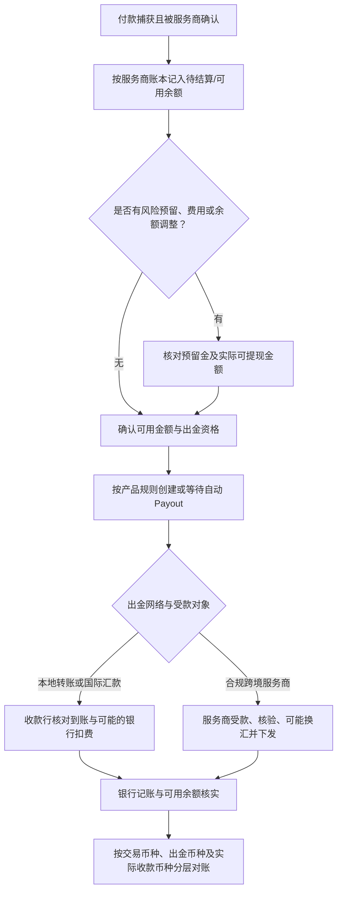
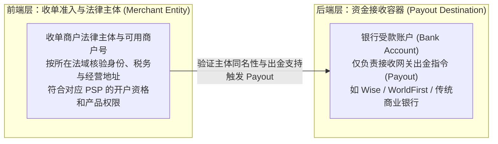
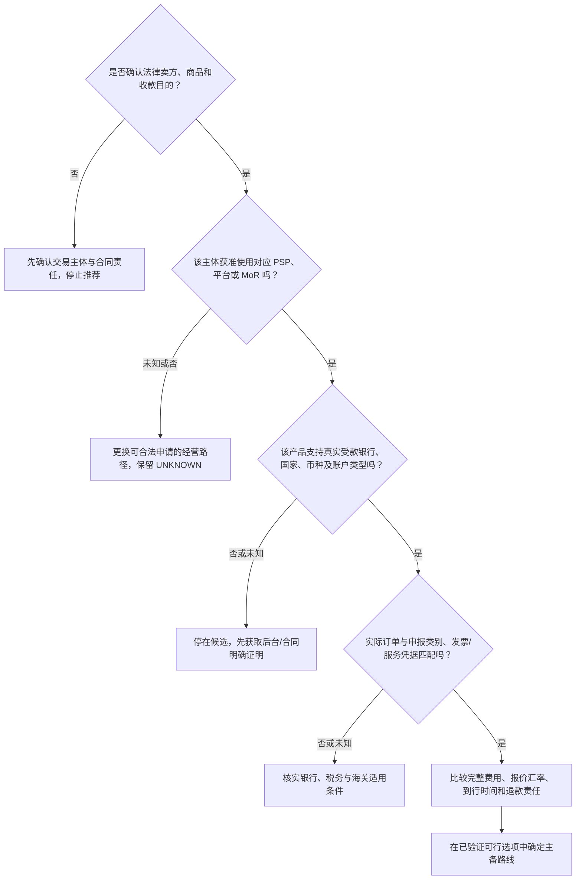
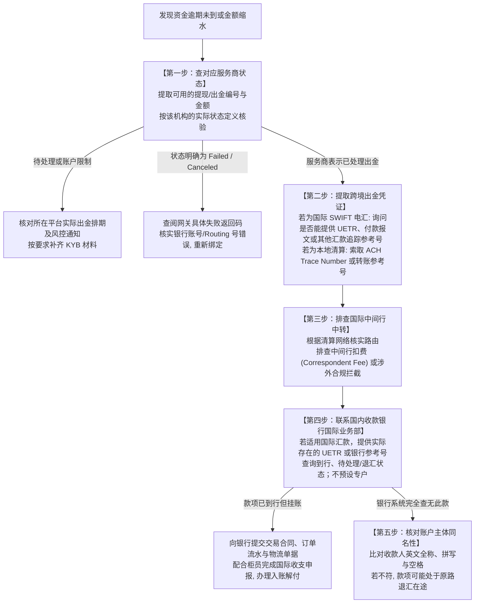

# 第五部分 资金结算与到账｜如何更快、更省、更安全地拿到钱？

## 引言：从“数字账面”到“银行真金白银”的跨国清算旅程

在前四部分中，我们系统解决了“选择收款方案、技术接入、优化结账体验、确保订单正确扣款”的全过程。在第四部分的终点，买家扣款成功，收单网关返回了 `succeeded`，商户系统生成了订单并下发了软件激活码或发出了实体商品包裹。

然而，在跨境商业实践中，交易成功并不等于资金入袋：
- 为什么收单网关后台明明显示“交易成功”，可用余额却依然是 0，甚至显示“资金处理中（Pending）”或被“风险冻结（Reserve）”？
- 为什么后台扣除了顾客 100 美元，经过层层中转、提现和汇兑，最终进入国内公司银行账户的资金会出现明显差额，中间究竟产生了哪些扣费与汇损？
- 为什么某些境外银行账户在绑定收单网关后会触发二次风控，甚至导致资金被限制提现？
- 面对中国大陆的外汇与跨境金融监管要求，海外收到的美元、欧元营业款，怎样才能依法合规地结算至可用银行账户，用于缴纳税款、采购物料和团队开支？

在支付金融底层，必须建立清晰的概念分水岭：**“收单网关扣款成功”不等于“资金已经安全进入银行账户”**。收单机构后台显示的可用数字，本质上是服务商对商户的一笔账面负债；只有当资金通过结算周期、风控评估、跨国出金清算、银行间外汇市场以及外汇合规审核，最终记入你的银行可用账单时，一笔商业交易才真正完成资金闭环。

为了让全部资金流转、费率测算与异常排查具备扎实的实战依托，本部分继续延用全书贯穿的**两个互为镜像的假设商业情境**（注：两主体的跨境收单与开户资格均标为 UNKNOWN 教学假设，不代表其已获批特定境外通道）：
- **情境 A（纯软件/SaaS 出海）**：**深圳灵动软件工作室**。持有中国大陆有限责任公司营业执照，销售单价 29 美元买断工具或 29 美元/月订阅制。商品依靠在线即时发码交付，无物理物流报关单，核心诉求是“小额高频资金低损耗归集、避免多道货币折算损耗、合规办理服务贸易结汇”。
- **情境 B（高客单实物 DTC 品牌出海）**：**东莞极光工坊**。持有大陆外贸制造企业执照，自主设计分体式人体工学机械键盘（客单价 120 美元）。商品从大湾区直邮全球个人买家，涉及跨国物理运输与售后退换，核心诉求是“评估可能的预留金对供应链现金流的影响，按实际出口监管方式、银行收汇与税务适用条件办理相关手续”；直邮个人买家不自动取得 9610 申报及退税资格。

无论你是使用平台卖货的电商卖家，还是自建独立站出海的开发者，本部分都将系统拆解资金到账的四大核心关卡：
1. **资金流向地图**：理清从交易捕获到银行可用资金的关键状态，认清四种出海模式的资金权责；
2. **到手金额拆解**：透视收单费、跨境费、提现费、中转行扣费、汇率利差与预留金六大损耗因子，掌握可复算的精算账本；
3. **结算路径决策**：厘清境内公户、持牌跨境平台、境外本土银行账户的准入资格与合规边界，破除“虚拟银行账户等同收单资格”的误区；
4. **异常排查手册**：建立面对提现延迟、扣费账差、资金挂账退汇的五步排查法则与对账工具箱。

---

## 1. 顾客付的钱，究竟怎么到我的银行账户？

### 1.1 为什么付款成功了，钱还在平台或支付账户里？

#### 跨国清算全链路：一笔资金流转的关键状态

当顾客在结账页刷卡成功后，资金并不是瞬间从买家的银行进入商家的银行。在国际金融体系中，资金需要经历跨机构、跨系统、跨法域的状态流转：


```

1. **状态一：网关待结算资金（Pending Balance）**：
   - **业务实质**：买家发卡行确认了交易并生成了扣款记录，收单机构（如 Stripe [S01] 或 PayPal）记账确认。但根据具体收单产品、地区与商户账户确定的清算排期（并无跨机构统一的 T+2 至 T+7 规则），该款项处于“待结算”状态，在此期间商户无法发起提现。
2. **状态二：网关可用余额（Available Balance）**：
   - **业务实质**：款项经历结算期后，收单机构正式将资金划入商户账本的 `Available` 字段 [S02]。此时若商户被收单风控系统设置了**风险预留金（Reserve）** [S03]，预留金部分将被剥离锁定，剩余净额才是商户可真正支配的提现额度。
3. **状态三：提现在途（Payout In-Transit）**：
   - **业务实质**：商户手动点击提现，或收单系统按既定周期（每日/每周/每月）自动发起付款（Payout）[S01]。收单机构在网关扣减可用余额，通过当地清算网络（如美国 ACH、欧洲 SEPA、英国 Faster Payments）或国际跨境电汇网络（SWIFT）向绑定的银行账户发出支付报文。
4. **状态四：收款银行入账与外汇处理分支**：
   - **分支 A（境内对公外汇账户原币留存）**：如果商户绑定的是境内银行对公外汇账户，外币资金入境后，企业可以选择保留 USD、EUR 原币现汇，用于支付境外采购或国际物流服务，并不强制立即结汇为人民币。
   - **分支 B（持牌跨境支付平台阳光结汇）**：如果商户、交易类型、支付平台受款来源和银行下发账户均满足对应产品条件，跨境服务商可按其流程提供收款、换汇及下发；是否涉及人民币结汇及由谁办理申报，应按服务商合同与合作银行的业务实际核对，不保证所有交易自动结汇。
   - **分支 C（银行外汇挂账待申报）**：银行依据交易性质、真实性审核和客户资料要求决定是否需要补充材料；资金可能待处理、暂记账或被退回，但“待核查专户”并非各银行、各笔入账必经的统一状态。应核对银行真实的业务通知、收款指引和可用余额 [S04]。
5. **状态五：银行最终可用资金（Bank Available Funds）**：
   - **业务实质**：完成银行或外汇申报审核后，资金正式记入商户银行账户可用余额，成为企业可自由支配的现金流。

#### 四大出海商业模式的资金链路与权责对比

不同商业模式决定了资金的法律归属、提现自主权、拒付承担者以及到账时效：

| 商业经营模式 | 法律卖方与资金路径 | 谁安排出金 | 退款、拒付与资金责任 | 账期判断方法 |
|:---|:---|:---|:---|:---|
| **Marketplace 平台卖家**（Amazon/Temu 等） | 法律卖方及平台收款角色依平台、站点与协议不同；资金先进入平台控制的结算体系 | 通常依平台卖家结算设置、保留金及扣费规则 | 平台可能代处理争议，也可能向卖家追偿；逐平台合同核对 | 看卖家后台可结算余额、保留金、出金计划与银行入账，不预设统一 14–30 天 |
| **自营独立站 PSP**（WooCommerce/Shopify 配合适格 PSP） | 由实际商户承担销售关系，支付服务商提供支付处理；资金记在商户余额账本 | PSP 仅向**已核准的绑定受款账户**按其地区和产品规则出金 | 商户通常承担与其交易有关的退款、争议及负余额；是否可开启相应渠道须先核验 | 结算期、首次出金、手动/自动排期各不相同；不可照搬美区 Stripe 排期 |
| **MoR 法定销售方**（Lemon Squeezy/Paddle） | MoR 在其覆盖交易中担任法律销售方，并向供应商按协议结算收益 | 平台定期结算，不能等同 PSP 直接提现 | 平台承担相应税务与争议处理职责；对供应商的费用扣回、追偿或限制须查该家合同 | **Lemon Squeezy**：1/15 日创建、14/28 日支付，13 天持有、最低 $50，银行另需 1–5 天 [S05]；**Paddle**：每月 1 日筛选达到设置门槛（最低 $100）的款项，通常 15 日前发送，实际到行另需处理时间 [S05] |
| **B2B 银行收款**（合同、商业发票） | 买方通过实际银行路由支付给合同收款主体 | 不使用 PSP 的 Payout，但可能经过多级代理行 | 无银行卡拒付并不等于无退汇、欺诈、付款争议或合规风险 | 按付款报文、银行处理通知及实际入账核对；跨境时效不保证统一 1–5 天 |

> **关键认知纠偏（MoR 模式的争议责任真相）**：
> MoR 在其合同覆盖的订单中通常作为对顾客的法律销售方，处理相应销售税与争议，但不等于商户完全没有履约、税务或损失责任。Lemon Squeezy 与 Paddle 各有自己的退款、拒付费用和供应商余额调整规则，可能扣回收入、收取合同约定费用，也可能由平台承担部分费用或提供申诉与调整；**不得假定所有拒付费用均为固定 15–20 美元且必然如数扣除**。商家应分别保留两家服务协议和实际账单，逐笔核对 [S05]。

---

## 2. 哪些因素影响到账时间和实际金额？

### 2.1 手续费、汇率、平台暂扣和结算时间，分别怎样影响到账？

#### 影响最终到账金额与时效的四大核心要素

在资金从海外到达国内银行的路径中，存在四大影响损耗与周转速度的客观要素：

```mermaid
flowchart LR
    A["买家支付标价金额 (Gross Sales)\n如 $29.00 / $120.00"] -->|扣除 1: 网关收单处理费 + 跨境卡附加费| B["网关入账净额 (Net Settled)\n经历 T+2~T+7 结算期"]
    B -->|扣除 2: 风险预留金 (Reserve)\n如 10% 冻结 90 天| C["网关当期实际可提现额 (Available)"]
    C -->|扣除 3: 提现转账费 + 国际中间行电汇扣费| D["跨境出金净额 (Payout Net)"]
    D -->|扣除 4: 货币转换利差 (FX Spread)\n银行结汇入账手续费| E["最终入账可用资金 (Bank Available)"]
```

##### 要素一：全链条层层剥离的手续费（Fees Breakdown）
1. **收单基础处理费（Payment Processing Fee）**：收单机构收取的卡网络清算服务费，通常为固定百分比加上单笔固定费用（例如美国本土卡标准为 `2.9% + $0.30`）[S06]；
2. **跨境交易附加费（Cross-Border Surcharge）**：当买家发卡行所在国家与商户收单账号注册地不同时，收单机构额外收取的通道成本（是否及收取多少均取决于商户账户地区、卡来源、收单产品与定价协议）[S06]；
3. **提现与出金手续费（Payout / Withdrawal Fee）**：收单机构将资金汇出至银行账户时收取的转账费。使用本地清算网络（如美国本土 ACH 提现至美国本土银行）通常为免费；若使用收单机构提供的国际电汇出金，费用依服务商定价而异（例如 PayPal 中国大陆商业账户电汇提现至中国大陆银行，官方定价为每笔 **$35 美元**，若退汇加收 $15 美元，最低提现额为 $150 美元 [S07]；注意：此费率属于 PayPal 中国账户定价，不能直接挪用为 Stripe 的收费标准）；
4. **国际中转行电汇扣费（Correspondent Bank Routing Fees）**：当款项通过国际 SWIFT 电汇网络跨国传输时，清算链路中的代理行（Intermediary / Correspondent Bank）通常会从本金中扣除服务费（金额受路由、费用承担方式（OUR/SHA/BEN）及相关银行收费约定影响，并不固定），导致银行最终收到金额少于网关汇出金额。

##### 要素二：汇率差价与货币转换成本（FX Markup）
- **基准汇率（Mid-Market Rate）**：国际外汇市场上银行间买卖的公允基准汇率；
- **服务商汇兑加价（FX Spread / Markup）**：商业收单机构（如 Stripe、PayPal）或商业银行在兑换外币时，会在基准汇率基础上加收价差作为汇兑收益（不同机构及币对差异显著，须使用当时的报价或正式价目表）[S06], [S07]；
- **多币种结算避坑**：商户若在具有多币种结算能力的银行开户，应尽量以交易原币（如 USD）入账，避免在网关侧被强制折算为非交易币种（如折算为港币再折算为人民币），产生双重汇兑损耗。

##### 要素三：平台暂扣与风险预留金机制（Reserves & Holds）
收单机构为了防范买家在交易后 180 天内发起信用卡拒付（Chargeback）而商户无力偿还，会对特定商户实施资金暂扣：
- **滚动保证金（Rolling Reserve）**：收单机构将商户每日销售额的固定比例（比例由商户协议和个别风控决定，本章案例假设 10%）扣押冻结，在固定的保留期（由对应协议、账期及风险条件决定，本章假设 90 天）之后逐日滚动释放 [S03]；
- **预留金的法律与财务属性**：
  1. 预留金通常区别于当期处理手续费，但相关权利、可抵扣范围与释放条件应依据支付服务商合同，不保证一定能全额收回；
  2. 但它会实质性冻结商户的短期现金支配权；
  3. **预留金并不保证在第 91 天全额原样退还**：如果商户在冻结期间遭遇买家拒付或退款，收单机构将直接从预留金池中抵扣赔付资金；
  4. **外汇波动风险**：以原币（USD）保留的预留金在 90 天后释放时，实际可结汇的人民币金额将随当时的汇率波动而增减。

##### 要素四：结算周期与到账时限（Payout Schedules）
- **常规滚动结算排期**：不同收单产品、结算国家、支付方式及商户风控可有不同的可用余额与出金排期，Stripe 美国资料中的 `T+2` 等不能套用到大陆主体 [S01]；
- **新商户首笔提现风险观察期（First Payout Delay）**：部分 Stripe 账户的首笔出金可能较常规排期延后（官方资料以 7–14 天为例），具体适用地区、账户和实际预计日期须在后台确认 [S01]，用于监测首批订单是否会引发快速欺诈投诉；
- **工作日与法定节假日**：银行清算系统（ACH / SEPA / SWIFT）可能受各自营业日、结算窗口、节假日及支付轨道规则限制，遇假期到账顺延。

---

#### 双商业情境端到端精算演示（教学模型与精确账本）

> **计算规则声明**：以下测算基于明确的**教学假设模型**，用于演示逐层扣费逻辑；费率与汇率均为示例参数，不代表任何机构对特定商户的实际签约报价。计算中**各分项费用按单笔四舍五入保留两位小数（Rounded per fee item to 2 decimal places）**。

**可执行性前置说明**：以下美区 Stripe 处理费和跨境平台费率只是便于演示的**跨地区拼接参数**，不是中国大陆公司已经获批的真实链路；任何“公司最终到账”均指模型计算结果而非真实交易证明。实际使用时应先核对该主体可开户的 PSP、绑定银行/出金币种、银行受款资格、汇兑和退款责任，再重新填写算例，不得依本例直接下单。

##### 算例 A：深圳灵动软件（单笔 29.00 美元数字工具，月度归集出金模式）
- **情境与费率假设**：
  - 销售标的：无形数字软件，买家使用国际卡支付 `$29.00 USD`；
  - 收单基础费：假设适用美区标准账户费率 `2.9% + $0.30`，跨境卡附加费 `+1.5%` [S06]；
  - 预留金：纯数字软件即时交付，假设收单风控未设置预留金（Reserve = 0%）；
  - 出金模式：灵动软件采取**月度批量归集模式**，单月累积 100 笔订单（总营业额 $2,900.00 USD）后合并出金；
  - 跨境出金与结汇：仅作教学算式，**假定存在已核准且与该收单账户兼容的跨境服务商**，并假设其按 `0.4%` 收费；真实存在与资格未被本章证明，结汇基准汇率为 `1 USD = 7.2000 CNY`。

**单笔交易逐层扣费拆解账本**：
1. **买家实付总额（Gross Sales）**：`$29.00 USD`
2. **收单基础处理费（2.9% + $0.30）**：
   $$\$29.00 \times 2.9\% + \$0.30 = \$0.841 + \$0.30 = \$1.141 \approx \mathbf{\$1.14 \text{ USD}}$$
3. **跨境卡附加费（1.5%）**：
   $$\$29.00 \times 1.5\% = \$0.435 \approx \mathbf{\$0.44 \text{ USD}}$$
4. **收单网关总扣费**：
   $$\$1.14 + \$0.44 = \mathbf{\$1.58 \text{ USD}}$$
5. **网关入账净额（Net Settled，进入可用余额）**：
   $$\$29.00 - \$1.58 = \mathbf{\$27.42 \text{ USD}}$$
6. **月度归集出金分摊结汇服务费（假设按 0.4% 计）**：
   $$\$27.42 \times 0.4\% = \$0.10968 \approx \mathbf{\$0.11 \text{ USD}}$$
7. **最终结汇净额（Net Converted USD）**：
   $$\$27.42 - \$0.11 = \mathbf{\$27.31 \text{ USD}}$$
8. **模型推算的人民币净额（非实际银行到账凭证）**：
   $$\$27.31 \times 7.2000 = \mathbf{196.63 \text{ CNY}}$$
9. **综合核心指标**：
   - 理论原值（以 $29.00 × 7.2000 计）：`208.80 CNY`；
   - 最终实际到手：`196.63 CNY`；
   - **单笔资金净留存率（Net Retention Rate）**：$196.63 \div 208.80 \approx \mathbf{94.17\%}$。

> **固定费用如何影响出金决策**：若某条**确实可用且实际按笔收取** $35 电汇费的路径处理本例 $27.42，费用就超过本金；但 $35 是特定 PayPal 中国提现价目表示例，**不能套用到上述美区 Stripe 假设**。应按实际可用路径的最低出金门槛、费用与现金需求决定是否批量归集。若 100 笔合为一笔并按批次收取 0.4%，批次费为 $10.97，和先逐笔四舍五入再求和的 $11.00 不同；批次银行实收应以实际批次对账为准。

---

##### 算例 B：东莞极光工坊（单笔 120.00 美元机械键盘实物 DTC，含 10% 滚动保证金）
- **情境与费率假设**：
  - 销售单价：`$120.00 USD`，国际信用卡付款；
  - 收单基础费：假设适用 `2.9% + $0.30`，跨境附加费 `+1.5%` [S06]；
  - **风控约束（实物新店高发）**：收单机构设置了 **10% 滚动保证金（Rolling Reserve），冻结期 90 天** [S03]；
  - 跨境出金与结汇：仅作教学，假定银行/服务商及出口监管方式均已核准、可以完成该笔零售直邮货款的合规出金，服务费假设为 `0.3%`；**直邮不自动证明适用 9610、出口退税或 PSP 与第三方账户可互相绑定**；
  - 汇率基准：假设交易日及 90 天后解冻日的基准汇率均为 `1 USD = 7.2000 CNY`（注：实际汇率存在波动风险）。

**逐层扣费与现金流两阶段账本**：
1. **买家实付总额（Gross Sales）**：`$120.00 USD`
2. **收单基础处理费（2.9% + $0.30）**：
   $$\$120.00 \times 2.9\% + \$0.30 = \$3.48 + \$0.30 = \mathbf{\$3.78 \text{ USD}}$$
3. **跨境卡附加费（1.5%）**：
   $$\$120.00 \times 1.5\% = \mathbf{\$1.80 \text{ USD}}$$
4. **收单网关总扣费**：
   $$\$3.78 + \$1.80 = \mathbf{\$5.58 \text{ USD}}$$
5. **网关扣费后净营业款（Net Settled）**：
   $$\$120.00 - \$5.58 = \mathbf{\$114.42 \text{ USD}}$$
6. **10% 滚动保证金扣押（冻结 90 天，计入 Reserve）**：
   $$\$120.00 \times 10\% = \mathbf{\$12.00 \text{ USD}}$$
7. **当期实际可提现金额（Current Available Payout）**：
   $$\$114.42 - \$12.00 = \mathbf{\$102.42 \text{ USD}}$$
8. **当期跨境结汇服务费（按 0.3% 计）**：
   $$\$102.42 \times 0.3\% = \$0.30726 \approx \mathbf{\$0.31 \text{ USD}}$$
9. **当期结汇净额**：
   $$\$102.42 - \$0.31 = \mathbf{\$102.11 \text{ USD}}$$
10. **当期模型换汇净额（到账日是假设，非真实银行流水）**：
    $$\$102.11 \times 7.2000 = \mathbf{735.19 \text{ CNY}}$$
11. **假定第 90 天预留金按协议全额释放并可再出金（未发生退款、争议、追偿、其他费用，且汇率仍为 7.2000）的第二阶段模型**：
    - 解冻本金：`$12.00 USD`；
    - 结汇服务费（0.3%）：$\$12.00 \times 0.3\% = \$0.036 \approx \mathbf{\$0.04 \text{ USD}}$；
    - 净结汇金额：$\$12.00 - \$0.04 = \mathbf{\$11.96 \text{ USD}}$；
    - 90 天后到账人民币：$\$11.96 \times 7.2000 = \mathbf{86.11 \text{ CNY}}$；
12. **该笔订单两阶段全部回款总值**：
    $$\text{Total Recovered} = 735.19 + 86.11 = \mathbf{821.30 \text{ CNY}}$$
    *(相比理论原值 $120.00 × 7.2000 = 864.00 CNY，总留存率为 95.06%)*

> **实物外贸现金流错配警示**：
> 极光工坊生产这把机械键盘的物料与人工硬性成本假设为 450 元人民币，国际物流直邮运费 150 元，总出库硬成本为 600 元。
> 假设本期款项已经银行核实可用，模型的当期回款为 **735.19 元**（扣除了 86.11 元的保证金价值）。如果该店单月热销 1,000 把键盘，被收单机构沉淀在预留金里的资金将达到 **12,000 美元（按示例汇率折合约 8.64 万元人民币）**；实际金额、冻结期及可释放金额均依协议，不是行业通行设定。实物出海企业必须在财务模型中预留充裕的流动资金，防止因账面盈利但资金滞后导致的供应链周转困难。

---

## 3. 钱该怎样结算、换汇，再提到银行？

### 3.1 哪些账户可以接收营业款，支持哪些币种和提现方式？

#### 跨境出海商户资金链路可执行性判定矩阵

商户在规划提现路径前，必须先进行严密的**法律主体与账户匹配核验**：

| 必查事实（未验证记 UNKNOWN） | 境内企业外汇公户 | 跨境服务商受款及换汇 | 合法境外公司的银行公户 | MoR 供应商分成 |
|:---|:---|:---|:---|:---|
| **谁是法律收款方？** | 合同写明的境内企业，银行开户名称匹配 | 交易来源与服务商商户登记主体均应一致或有合同依据 | 实际设立、纳税及经营的境外实体，不是仅持境外号码的境内公司 | MoR 销售方与供应商分成合同各自独立 |
| **谁允许出金？** | **特定 PSP/平台**确实支持向中国大陆公户该币种汇出或买方可直接电汇 | 上游 PSP/平台是否允许绑定该服务商提供的**具体账户号码和属地**；下游是否接受该类订单及汇出方式 | PSP 的账户注册地区、股权/税务/KYB、银行属地及币种必须全部获准 | MoR 是否接受主体、产品类型、受款国及受款方式，完成税务/KYC 审核 |
| **到款、费率、汇率** | 查银行收款币种、OUR/SHA/BEN、入账审核及实际中转费 | 查该产品支持的付款方、币种、换汇报价、受款路径和境内下发对象 | 查境外公司维护成本、银行费、汇兑及境外利润划转合规 | 看具体 MoR 的持有期、支付日、门槛、手续费及银行额外费用 |
| **争议/税务责任** | 按真实销售合同、PSP 协议和贸易类型落实 | 第三方代收/结汇不自动转移卖家退款、拒付或税务义务 | 境外公司额外承担所在地合规义务；不自动解决境内结汇 | 按 MoR 协议确认法定卖方、服务费用、退款争议和供应商报税义务 |
| **选择条件** | 取得 PSP 或付款行到该银行的路由支持和实际银行确认 | **先取得上游兼容与服务商书面/后台确认**，再与其他合规路径比较 | 先证实当地实体真实合规且可用，不得只靠一个海外账号 | 逐家核对供应商结算资格、门槛、价格及合同 |

**执行门槛**：对每一条候选路径建立记录：`产品/地区/法律主体 → Merchant ID 或平台卖家 ID → 可出金币种 → 受款银行名称、国别与账户类型 → 合同/官方后台可绑定证明 → 退款/争议责任 → 费率及 FX 报价 → 到行证明`。任何一个关键项为 `UNKNOWN`，只能标为**待核验候选**，不得称“可用/首选”。各表中的示例服务商不能推定适用于本文的大陆公司 [S04][S08][S09][S12]。

#### B2B 合同及发票银行收款：六步闭环示例

| 步骤 | 需要做什么 | 如何确认完成 |
|:---|:---|:---|
| 1. 账户及主体 | 核验卖方经营主体、银行或持牌服务商的开户资格、受款币种、付款方类型 | 主体身份、账户名称、收款能力与合同相匹配 |
| 2. 合同与账单 | 与买家确认真实贸易或服务合同、Invoice、金额币种、订单号与付款人名称 | 单据之间可相互对应，付款指令信息正确 |
| 3. 发起汇款 | 向买家提供经官方后台核准的受款账户资料，必要时提供账户证明信 | 保存付款凭证或银行流水参考号；**买家说已汇款不等于卖家已到账** |
| 4. 来款核验 | 识别银行或服务商显示的“待审核／待入账”，按要求关联贸易订单及补充合同、物流或服务证明 | 审核完成且余额实际可用，未通过或退汇应单独跟踪 |
| 5. 出金与结汇 | 核查收款人、资金来源、适用外汇管理与结汇订单要求，取得实际银行汇率和费用 | 提款或结汇回执与银行入账记录一致 |
| 6. 对账归档 | 以订单号、付款人、金额、币种、流水号连接订单、收款账户和最终银行账 | 对净额、汇差、手续费及未达账项逐一勾稽 |

**产品差异提醒**：上表是核对通用流程，**不是所有银行或跨境服务商的统一按钮步骤**。例如万里汇外贸 B2B 官方指引包含“创建订单—关联待入账款—提交证明—结汇订单”，但实际支持的主体、服务贸易结汇、币种、费用及所需材料应按具体产品与交易重新确认（[万里汇 B2B 快速指南](https://www.worldfirst.com.cn/content/articles/b2b_gbl/quick_guide)、[订单关联说明](https://www.worldfirst.com.cn/content/articles/b2b_gbl_portal/submit_trade_order)）。

---

#### 核心误区破除：虚拟银行账户与收单商户资格的本质鸿沟

在跨境独立站和出海开发者群体中，存在一个高发的认知误区：
> *“只要我申请了一个 Wise Business 账号或获得了美国本土银行的 Routing Number + Account Number，我就能直接开通海外 Stripe 或 Shopify Payments 进行全球收单了。”*

**这是对国际金融监管架构的严重误解！**
必须彻底厘清**受款账户（Payout Account）**与**收单商户实体（Merchant Legal Entity）**的本质鸿沟：



- **Wise、万里汇（WorldFirst）等工具的真实定位**：相关产品可提供收款、换汇或付款服务，可能由不同国家的不同受监管实体及合作银行提供；具体是否有本地账户详情、哪个国家和币种、能否用于某 PSP 出金均需核实 [S08], [S09]；
- **虚拟银行账户绝不能替代收单商户资格**：依据收单机构官方全球支持国家与市场准入清单 [S12]，收单机构仅对在官方支持国家或地区合法注册的经营实体开放（中国大陆暂不在 Stripe 直接支持地区之列）。如果大陆商户在开通境外收单账户时，使用虚构的海外地址或个人信息绕开限制，即便把虚拟银行账户绑成了提现账户，收单机构的大数据风控（通过 IP 追踪、法人护照穿透、税务申报表 TIN 校验）可能触发审查、限制付款或出金、拒绝开户、终止服务及合同约定的余额处置，具体时长和措施不能预设；
- **提现账户变更的风控保护机制**：修改受款账户可能触发安全校验、延迟或额外审核，但**不存在适用于所有 Stripe 账户的固定 1–3 个工作日锁定规则**。备用渠道切换前必须确认新账户已核准、真实测试过出金，并评估未结算余额与旧渠道交易的退款责任。

---

#### 外汇管理法规红线：个人年度便利化额度的正确认知

在涉及个人出海收款时，必须准确理解国家外汇管理局的法定红线：

1. **5 万美元是“便利化额度”而非“绝对结汇硬上限”**：
   - 根据国家外汇管理局规定 [S10]，中国境内个人每年拥有等值 **5 万美元的结汇年度便利化额度**。在此额度内，个人凭有效身份证件即可直接在银行办理结汇，无需提供逐笔资金交易证明材料；
   - **超出 5 万美元的合法结汇途径**：如果个人拥有真实、合法的经常项目外汇收入（如个人合法对外贸易、软件服务费、稿酬等），**只要向银行提供真实的交易凭证材料（如开发合同、对账单、纳税凭单等），经银行真实性审核后，可以依法办理不占用 5 万美元额度的经常项目结汇** [S10]。将 5 万美元说成“绝对结汇硬上限”在法规上是不准确的；
2. **严厉禁止的违规行为（“蚂蚁搬家”分拆结汇）**：
   - 某些个人卖家为了将大额商业经营款结汇回国，发动亲戚朋友的身份证借用其便利化额度进行分拆结汇。这种行为属于外汇局明确界定的**严重违规分拆结汇行为**，一经查实将被列入外汇监管“关注名单”，并面临巨额行政罚款与反洗钱调查；
3. **商业经营资金的阳光出金正道**：
   - 针对跨境电商与商业化独立站，应按自身法律主体、真实商品或服务贸易、所用银行与支付机构的具体许可和路径办理。境内企业外汇公户及具备适用业务资格的跨境服务商是待评估选项，并不对任意个人/公司、任意独立站订单自动开放 [S04], [S09]。真实跨境电商个人业务另有依交易电子信息办理结售汇的规定 [S10]。

---

### 3.2 如何综合比较不同路径的到账速度、到手金额与合规风险？

#### 跨境资金归国四大典型路径决策漏斗

出海商户在设计资金架构时，应根据业务品类、发货方式与合规条件进行决策：



**路径选择示例（非直接推荐）**：极光工坊面向个人直邮的小包裹**可能**涉及 9610，但须检查监管申报模式及企业适用资格；9710 适用于符合条件的跨境电商 B2B 直接出口，并非由“大额批发”自动决定。灵动软件应以真实软件许可/服务收入性质和银行受款许可评估服务贸易路径，不能凭软件著作权证就推定某平台支持直接收款。境外公司可保留当地资金，也可能产生汇兑、税收和合规成本，**并非无损留存** [S04][S12]。

```

#### 四类业务形态的银行外汇审核凭据清单

当资金到达银行或跨境平台时，商户可按业务类型整理以下**可能被银行、平台或税务机关要求**的材料；不同机构不一定要求全部项目，也不能承诺审核或结汇速度：

| 业务分类 | 典型商业场景 | 银行/外汇监管要求的核心审核凭据清单 [S04] | 核心注意事项 |
|:---|:---|:---|:---|
| **跨境电商零售 (9610 B2C)** | 极光工坊 120 美元键盘直邮全球个人买家 | 1. 跨境电商平台/独立站订单清单（含买家姓名、商品名称、实付金额）；<br>2. 国际快递运单物流追踪记录（如 DHL/FedEx/邮政小包单号及妥投轨迹）；<br>3. 实际适用监管方式下的申报记录（若合规采用 9610，则保存该方式相应记录）。 | 需保证资金入账金额、订单销售金额与物流发货数量逻辑对应。 |
| **数字内容与 SaaS 服务贸易** | 灵动软件 29 美元工具买断与订阅 | 1. 能证明软件销售/服务真实性的许可、合同或其他资料（如有著作权证书可补充）；<br>2. 线上用户服务协议（EULA / Terms of Service）；<br>3. 支付网关月度账单流水与用户下载/激活日志记录。 | 服务贸易无实物海关报关单，核心依赖线上服务协议与真实流水证明。 |
| **记录商家 (MoR) 分润结算** | 通过 Lemon Squeezy 或 Paddle 销售软件 | 1. 与 MoR 服务商签署的主服务协议（Master Services Agreement）；<br>2. MoR 后台官方导出的月度/双周结算收入账单（Payout Invoice）；<br>3. 国内企业向 MoR 开具的形式发票（Commercial Invoice）。 | 属于标准的技术服务出口，是否属于服务贸易、应采用何种税务处理与单据，由实际供应商—MoR 合同及主管税务机关确认；**不自动适用免税/零税率**。 |
| **外贸 B2B 批发出口 (9710/一般贸易)** | 极光工坊批量出口 500 把键盘至海外经销商 | 1. 双方签署的国际外贸销售合同（Sales Contract）；<br>2. 商业发票（Commercial Invoice）与装箱单（Packing List）；<br>3. 中华人民共和国海关出口货物报关单（海关监管方式 0110 或 9710）。 | 真实交易数据与收汇应能够合理对应；实际申报方式、单证要求和差异解释依银行、海关和税务规定。 |

---

## 4. 钱迟迟不到账，或到账金额不对，怎么办？

### 4.1 钱卡在哪一步、少了哪笔费用，应该找谁处理？

#### 五步系统化排查与故障定位法

当商户发现提现款逾期未到、或者到账金额与预期严重不符时，切忌盲目焦虑，应严格依照以下**五步标准诊断路径**逐级排查：



#### 四大典型到账卡点与标准纠正运行手册（Runbook）

在跨境日常资金处理中，绝大多数异常均归属于以下四种典型场景，商家应依照手册精准施策：

##### 场景一：交易已扣款，但网关资金持续处于 Pending 不转入 Available
- **故障现象**：顾客付款成功已过 5 天，网关后台总金额显示正常，但可用余额始终为 0，无法发起提现。
- **常见诱因**：
  1. **首笔提现风险观察期**：新账户第一笔提现被系统自动延迟 7–14 天 [S01]；
  2. **高风险交易审查**：近期交易中出现多笔大额订单，或多位买家来自欺诈高发地区，触发风控算法临时冻结；
  3. **高级认证（KYB）材料缺失**：收单机构要求补充大陆企业的最新营业执照公证、实际受益人（UBO）护照或官方地址证明。
- **标准化纠正措施**：
  1. 登录收单后台通知中心，核查是否有带有红色的“Action Required”警示；
  2. 若为首笔出金排期延长，核对实际预计日期；商品是否继续履约仍应根据第四部分已确认的支付终态和订单规则决定；
  3. 若被要求补充材料，由商户授权人员在服务商通知的实际期限内按安全渠道提交要求材料，严禁上传篡改伪造凭单；
  4. **操作红线**：在账户处于审查期间，**严禁人为导入大批外部交易测试流水**，这可能触发异常交易风控，也无助于解除原有审核；不得以虚构交易突破限制。

##### 场景二：网关显示“Payout Paid”，但国内银行多日查不到到账
- **故障现象**：收单后台提现状态显示为绿色 `Paid`（已支付完成），但过去 4 个工作日，国内公司银行账单依然空空如也。
- **常见诱因**：
  1. **状态术语误解**：**Stripe Payout 对象**的 `pending` 表示尚未提交银行，`in_transit` 表示已提交银行处理，`paid` 表示该次付款在 Stripe 记录中被认定成功；但有少数已显示 `paid` 的款项仍可能后续转为 `failed`。因此银行**实际入账且可用**仍须以银行流水为准；PayPal、MoR 的状态不能与 Stripe 机械等同 [S01]；
  2. **国内银行外汇挂账**：款项实际已到银行总行，但因缺乏申报材料，被支行暂扣在“待核查专户”；
  3. **银行信息拼写偏差**：大陆公司在填报收单机构英文户名时，由于中文字符转换（如有限公司拼写成了 `Co., Ltd` 而银行开户信息是 `Company Limited`），导致跨行路由核对失败。
- **标准化纠正措施**：
  1. 向收单机构客服或银行后台索取该笔转账的权威凭证：
     - 若实际采用 SWIFT 付款，可向付款服务商询问**有无** UETR（标准形式为 36 字符）及可提供的 MT103、ISO 20022 pacs.008 或银行出金回单；**不得把 MT103 当成所有路径的强制凭证** [S11]；
     - 若为本地清算（如 ACH），索取 ACH Trace Number；
  2. 致电开户行对公业务部或国际业务清算中心，提供实际可取得的 UETR 或其他汇款参考号，请银行按实际适用系统追踪；
  3. 若银行确认款项已到达但挂账，立即按实际贸易性质及银行通知提交合适的合同、交易清单或履约材料，办完手续后继续核实入账状态；不保证立即可用；
  4. **重大红线**：在查明此笔款项去向之前，**坚决不要在网关后台盲目发起第二笔大额提现**，防止两笔巨款同时卡在跨境网络中造成企业流动性休克！

##### 场景三：最终到手金额少了一大截（对账差额排查）
- **故障现象**：明明申请提现 1,000 美元，国内银行最终入账仅显示折合 950 美元，凭空消失了 50 美元。
- **常见诱因与费用核实**：
  1. **中转行扣费**：国际电汇经过两家跨国清算中转行，每家各自动扣除了 $15 至 $25 美元的手续费；
  2. **隐形汇率加价**：使用了不透明的汇率兑换，相比基准汇价被加收了 2% 的汇差；
  3. **历史负余额冲抵**：上一周期中发生过买家退款或拒付扣款，收单系统在本次提现前自动平账扣减了历史欠款。
- **标准化对账步骤**：
  1. 登录网关导出该时间段的 `Balance Transaction History`（余额变动明细表）[S02]；
  2. 检索表中每一行的 `type` 字段：核查是否有 `refund`（退款）、`dispute`（拒付扣费）或 `adjustment`（系统平账调账）；
  3. 查看收款银行入账结汇单据，确认扣除的中间行电汇费金额与实际执行的结售汇汇率，将各项差额精确登记到财务损益表中的“财务费用—手续费/汇兑损失”科目。

##### 场景四：提现被驳回并扣减退汇费（Payout Failed / Returned）
- **故障现象**：提现发起 3 天后，网关后台提示 `Failed` 或 `Returned`，资金退回可用余额，但总额少扣了 15 至 30 美元。
- **常见根因**：银行账号、Routing Number（美国汇款路径号）或 SWIFT 代码输入错误，收款银行拒绝接收并将款项原路退回，退回过程中产生了不可退还的跨国退汇电讯费。
- **标准化纠正步骤**：
  1. 立即停止使用该银行账户配置；
  2. 调出国内银行提供的正式《涉外收付款银行账户信息指引》（包含英文户名、开户行英文名称、SWIFT Code、对公账号）；
  3. 在收单后台按照服务商允许的账户修改流程核验，**先查询该次失败是否已完成退款/余额回补**；只在服务商、银行允许且用户明确授权的情况下做受控小额验证，避免自动重提或重复划款。

---

## 5. 资金结算与对账实操工具箱

### 工具一：商业支付全链路资金状态映射表（Payment-to-Bank State Mapping Table）

| 证据所在系统 | 参考状态（不可跨平台直接映射） | 应读取的证据 | 能否当作已入银行？ |
|:---|:---|:---|:---|
| 商户订单系统 | `PAID / PROCESSING / FULFILLED` 等商户自定义状态 | 订单号、对应支付对象和履约结果 | **不能**；只证明商户业务状态 |
| Stripe 交易/余额（仅适格账户示例） | 支付 `succeeded`；余额 `pending/available` | PaymentIntent/Charge、Balance Transaction、余额可用日、预留金与调整 | **不能**；余额可用不等于银行可用 |
| Stripe Payout（与其他平台有别） | `pending → in_transit → paid` 或 `failed/canceled`；少数 `paid` 后仍可能 `failed` [S01] | Payout ID、金额币种、目的账户、状态变化和出金账务 | **不能单凭 paid 认定**；用银行回单核对 |
| PayPal、Marketplace、MoR | 各平台自有结算/提现状态及支付排期 | 供应商后台的余额、对账单、出金凭据与扣费明细 | **不能套用 Stripe 状态名** |
| 银行与外汇服务商 | 已收到/待补材料/退回/已入账等实际状态 | 汇款参考号、银行到账通知、费用、结汇成交凭证和最终可用余额 | **银行记账并可实际使用后**才能确认为已到行；退汇需继续调整 |

---

### 工具二：跨系统多级勾稽结算对账单模型（Reconciliation Ledger Model）

在跨境财务对账中，必须按**交易原币、网关余额、提现批次、收款行与换汇**分层核对。货币不同的数字不能直接用等号连接：

- **网关账本（逐币种）**：`期初余额 + 本期交易净额 + 预留金释放 + 其他入账 - 本期退款/争议/调整支出 - 本期新增预留金 - 已扣的提现额 = 期末余额`。同一项目若已包含于“交易净额”或其他余额流水，不得重复扣减；以服务商实际 Balance Transaction 记账口径为准。预留金从可用余额移到受限余额时，应另列“受限余额”账本。
- **每个提现批次（出金币种）**：`批次付款本金 - 出金时单独扣取的费用 = 发往受款网络的金额`；若服务商直接从余额扣费，应在余额账本单列，不得再从批次本金扣一次。
- **银行与汇兑桥（按实际币种）**：`银行收到的外币 = 发往银行的外币 - 代理行/收款行在外币中扣取的费用 ± 退款/冲正（如有）`；`银行最终可用人民币 = 实际结汇外币 × 实际成交汇率 - 以人民币另扣的费用`。外币仍留在银行时，不应提前折算为已结汇人民币。

#### 1. 订单与网关余额流水层（教学虚构数据）

| 订单/流水 | 原币销售额 | 收单费 | 网关入账净额 | 余额流水归属 | 备注 |
|:---|---:|---:|---:|:---|:---|
| ORD-001 | USD 29.00 | USD 1.58 | USD 27.42 | txn-A（示意） | 已结算后可用 |
| ORD-002 | USD 29.00 | USD 1.58 | USD 27.42 | txn-B（示意） | 已结算后可用 |
| ORD-003 | USD 29.00 | USD 1.58 | USD 27.42 | txn-C（示意） | 已结算后可用 |
| 本期合计 | **USD 87.00** | **USD 4.74** | **USD 82.26** | — | 与出金前账本对齐 |

#### 2. 网关资金守恒层（同一 USD 币种；教学虚构批次）

| 项目 | USD | 说明 |
|:---|---:|:---|
| 期初可用余额 | 10.00 | 延续上期；不假定本期所有余额都出金 |
| 本期已结算交易净额 | +82.26 | 上表三单 |
| 本期新增预留金 | -5.00 | 转入单独的受限余额账本；非费用 |
| 本期释放预留金 | +2.00 | 来自历史批次 |
| 本期退款及其他调整（净） | -3.00 | 已依据实际流水去重 |
| 本期发起并扣记的 Payout | -80.00 | 示例出金 `po_example_901` |
| **期末可用余额** | **6.26** | 10+82.26-5+2-3-80=6.26 |
| 本期受限余额变化 | **+3.00** | 假设无其他变化：新增 5、释放 2；不能当成损失 |

#### 3. 出金、收款行及换汇层（教学虚构数据，三种货币金额不可直接相等）

| 环节 | 金额/凭证 | 解释 |
|:---|:---|:---|
| 网关已扣记 Payout | USD 80.00 | `po_example_901`；可用余额已减 80，不能再次扣 |
| 出金另收费用 | USD 1.00 | **假设**从批次金额扣取，并非 Stripe 标准费率 |
| 发往银行的美元 | USD 79.00 | 80-1；使用单独的出金费用流水核对 |
| 中间行/收款行扣费 | USD 2.00 | **假设**以外币扣收 |
| 银行实际收到美元 | **USD 77.00** | 79-2，核对银行美元入账通知 |
| 实际结汇成交价 | CNY 7.1800 / USD | **假设**银行成交价，不能视作统一市场价 |
| 结汇人民币毛额 | CNY 552.86 | 77 × 7.18 = 552.86 |
| 银行另扣人民币费用 | CNY 3.00 | **假设** |
| **人民币最终可用金额** | **CNY 549.86** | 552.86-3，与银行人民币流水核对 |

记录付款批次与交易流水的实际关联方式：如某平台按整体余额汇总扣费/退款，不能强行声称某个 `Payout ID` 一一对应仅三笔订单。对账时应按**服务商余额流水的时间与币种**、出金报告和账户期初/期末余额还原批次归属；示例 `po_example_901` 是虚构教学 ID，不是 Stripe 真实出票号。SWIFT UETR 如由银行提供，应以真实 36 字符编号记录；**不为示例编造可追踪编号**。

---

### 工具三：跨境电商现金流流动性压力测试与主备通道评估模型

在设计企业的跨境资金流水线时，财务团队应根据自身业务特性进行现金流压力测试，而非生搬硬套固定的比例教条：

```
【月度实际可用流动现金流入评估模型】
当月银行实际可用现金流入（按币种分账）= 本月银行实际收到并可用的各笔入款 - 银行已实际扣取的费用；外币与人民币分别列账，在实际结汇时按成交价换算。另设“网关应收/可用/预留/出金在途余额”台账，不得把当月销售直接当成当月现金到账。

【企业主备通道健康度自检建议（非强制法规要求，供内部风控参考）】
1. 集中度自检：评估单一收单服务商或收款渠道沉淀的未出金余额是否超过企业总流动资金的警戒线，防范单一通道审查带来的全线停摆风险；
2. 备用通道可用性演练：只在产品、银行及商户账户允许，且已获真实操作授权时考虑受控的小额出金核验；不能通过重复付款或重复提现证明可用；
3. 预留金台账跟踪：建立专门的 Reserve 到期排期表，按周更新到期释放金额，并纳入下周的供应商采购排款预算中。
```

---

## 结语与跨章衔接：从资金安全落袋到商业合规经营

至此，通过第五部分的系统梳理，我们完成了跨境交易中“从数字账面到真金白银”的清算跨越：
- 我们厘清了**从待结算、可用余额、预留金到银行入账的关键状态流转**，明晰了收单机构账面与银行可用资金的本质区别；
- 我们通过**深圳灵动软件（$29）与东莞极光工坊（$120 键盘含教学假设的 10% 预留金）的两组模型演算（并非真实报价或开户证明）**，把收单费、跨境费、汇率利差与预留金的每一处损耗摆在了台面上；
- 我们厘清了**受款账户与收单商户资格的不可替代性**，明确了中国外汇管理法规中 5 万美元便利化额度的法律边界；
- 我们建立了**五步排查法与四大卡点运行手册（Runbook）**，提供了多级勾稽对账模型与现金流压力测试方法。

然而，当资金已经安全进入银行账户时，跨境商业经营依然面临长期的售后与风控考验：
- 如果买家在收货后 60 天突然向发卡行发起恶意信用卡拒付（Chargeback），收单机构直接从可用余额中划走资金并收取高额争议罚金，商家该如何组织发货与签收证据链有效应诉？
- 如果遇到跨国黑卡盗刷、恶意欺诈攻击，甚至导致整个收单账户被列入卡组织监控名单，企业该如何搭建防欺诈防火墙？

全书将在**第六部分《售后与资金风险｜如何减少并妥善处理退款、拒付及资金风险？》**中，为你全景拆解跨境交易中的退款、拒付抗辩、防欺诈与资金安全策略。

---

## 附录：官方参考资料与适用边界清单

> **核验基准说明**：以下官方一手公开文档构成本部分技术事实与商业决策的权威核验入口。金融监管、接口规范与服务商资费处于动态演进中，商户应在实际展业时以最新官方协议为准：

- **[S01] Stripe 官方开发与商户文档：提现机制与结算排期（Payouts Overview and Schedules）**
  - **官方链接**：<https://docs.stripe.com/payouts>
  - **支持论断与适用边界**：Payout API 的 `pending/in_transit/paid/failed/canceled` 状态以单独的 <https://docs.stripe.com/api/payouts/object> 为准；`paid` 表示 Stripe 认定该次出金成功，少数之后仍可能 `failed`。结算与首笔出金时效取决于具体国家、支付产品和账户，不能普遍化。
- **[S02] Stripe 官方技术文档：账户余额对象与记账模型（Understand Stripe Balances）**
  - **官方链接**：<https://docs.stripe.com/payments/balances>
  - **支持论断与适用边界**：系统定义了网关账本中 `available`（可用余额）、`pending`（在途未结算余额）与 `connect_reserved`（预留金）的构成逻辑；界定了 Balance Transaction 流水对象的明细字段，构成了多级对账的底层依据。
- **[S03] Stripe 官方风控指南：风险预留金政策与管理（Dispute Prevention: Reserves）**
  - **官方链接**：<https://docs.stripe.com/disputes/prevention/reserves>
  - **支持论断与适用边界**：说明预留资金用于抵御交易风险；比例、扣押基数、期限、处置、是否释放和资金权利以适用账户合同/通知为准，不能从本文案例 10%/90 天推导为行业通用值。
- **[S04] 国家外汇管理局（SAFE）官方政策法规：支付机构外汇业务管理办法与货物贸易外汇指引**
  - **官方链接**：<https://www.safe.gov.cn/safe/2019/0429/13114.html>、<https://www.safe.gov.cn/safe/2019/0703/13568.html>、<https://www.safe.gov.cn/tianjin/2025/0303/2735.html>
  - **支持论断与适用边界**：汇发〔2019〕13 号支持银行/支付机构在真实交易电子信息审核框架下办理适用业务；具体 9610、9710 申报与退税需另核海关及税务文件，本链接**不单独证明**某笔独立站直邮属于 9610 或具备退税资格。
- **[S05] Lemon Squeezy / Paddle 官方商户文档：记录商家结算周期与代售服务条款（MoR Payouts & Terms）**
  - **官方链接**：<https://docs.lemonsqueezy.com/help/getting-started/getting-paid>、<https://docs.lemonsqueezy.com/help/getting-started/fees> 及 <https://www.paddle.com/help/manage/get-paid/when-and-how-do-i-get-paid>
  - **支持论断与适用边界**：Lemon Squeezy：每月 1/15 日创建、14/28 日付款、13 天销售款持有期、最低 $50、银行入账另需约 1–5 天；Paddle：按月处理符合门槛的出金，最低 $100，通常当月 15 日前发出，银行到行时间另计。收费、争议费用与余额调整均依据各自文档及合同，不统一认定谁最终承担固定罚金。另见 <https://www.paddle.com/help/manage/risk-prevention/understanding-chargebacks-with-paddle>。
- **[S06] Stripe 官方定价与费率规范（Stripe Pricing and Fees）**
  - **官方链接**：<https://stripe.com/pricing>
  - **支持论断与适用边界**：公布了美区标准卡交易基础处理费（2.9% + $0.30 USD）、国际卡跨境附加费（+1.5%）与货币转换费率；具体签约商户依开户注册法域协议为准。
- **[S07] PayPal 官方商户服务协议与提现费率清单（PayPal Merchant Fees and Withdrawal Policy）**
  - **官方链接**：<https://api-c.paypal.com/c2/business/paypal-business-fees?locale.x=en_C2> 及 <https://www.paypal.com/c2/cshelp/article/how-do-i-withdraw-funds-from-my-paypal-account-help394?locale.x=en_C2>
  - **支持论断与适用边界**：明确规定了中国大陆注册的 PayPal 商业账户通过电汇方式提现至国内银行账户的收费标准为每笔 $35 美元（退汇费为 $15 美元，最低提现额 $150 美元）；明确了货币兑换时收取的加价利差。
- **[S08] Wise 官方帮助中心：Wise Business 支持国家与多币种账户范围**
  - **官方链接**：<https://wise.com/help/articles/2932701/which-countries-can-i-use-wise-in> 及 <https://wise.com/help/articles/2932704/which-currencies-can-i-receive>
  - **支持论断与适用边界**：明确了 Wise Business 为企业签发本地虚拟收款账户（Routing/Account No、IBAN 等）的业务性质；证明了虚拟银行账号仅作为受款容器，不能替代收单商户牌照与主体经营准入资格。
- **[S09] 万里汇（WorldFirst）官方产品与合规服务指引：跨境电商与外贸 B2B 结算**
  - **官方链接**：<https://www.worldfirst.com/cn/events/online-sellers/>、<https://www.worldfirst.com/cn/b2b/mkt-sem/>
  - **支持论断与适用边界**：展示了万里汇跨境电商与 B2B 的不同服务产品和推广范围；**营销页不等于正式服务资格或服务费承诺**。具体法人主体、账户币种、来源平台及上游 PSP 可否绑定，须查官网具体产品条款、后台核验或取得服务商确认。
- **[S10] 国家外汇管理局官方政策释疑：个人结汇年度便利化额度管理规定**
  - **官方链接**：<https://www.safe.gov.cn/ningxia/2022/0929/1997.html> 及 <https://www.safe.gov.cn/>
  - **支持论断与适用边界**：权威澄清个人每年等值 5 万美元为“结汇年度便利化额度”而非绝对结汇硬上限；明确规定具有真实合法经常项目交易背景的个人外汇，可凭证明材料办理不占用便利化额度的结汇；明确严厉禁止通过借用他人额度分拆规避监管（“蚂蚁搬家”）。
- **[S11] 国际 SWIFT 组织：UETR 规范与 ISO 20022 支付标准指南**
  - **官方链接**：<https://www.swift.com/ru/node/310011> 及 <https://www.swift.com/standards/data-standards/mt103>
  - **支持论断与适用边界**：权威界定了跨国电汇唯一端到端交易跟踪号（UETR）为 36 字符规范 UUID 格式（包含连字符）；说明了在 2025 年 11 月完成向 ISO 20022 迁移的背景下，UETR 可用于跨行追踪客户汇款报文（MT103 或 pacs.008）。
- **[S12] Stripe 官方全球支持国家与市场准入清单及跨国开户要求**
  - **官方链接**：<https://stripe.com/global> 及 <https://support.stripe.com/questions/requirements-to-open-a-stripe-account-in-another-country?locale=zh-CN>
  - **支持论断与适用边界**：明确公布了 Stripe 官方直接支持开户的 40 余个国家与地区名单（明确中国大陆暂不处于直接支持之列）；说明开设其他国家/地区 Stripe 账户须满足该地区实际开户要求；具体条件应依所在地的最新官方准入页面与开户流程核验，不能用境外受款账户替代真实经营资格。