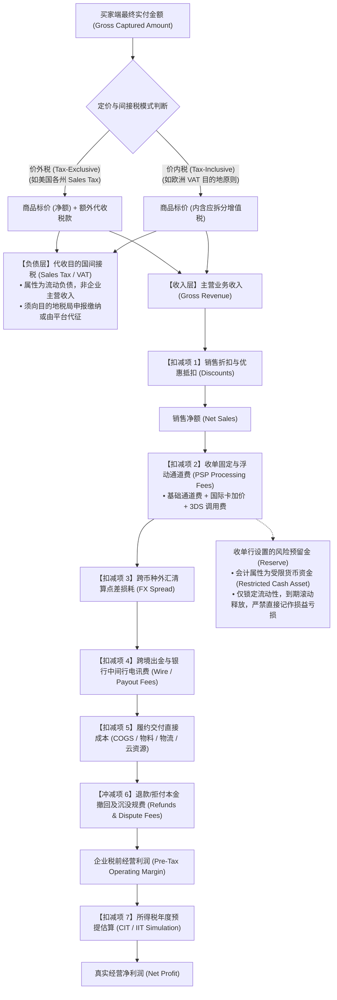
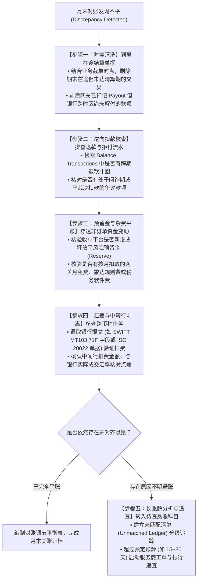
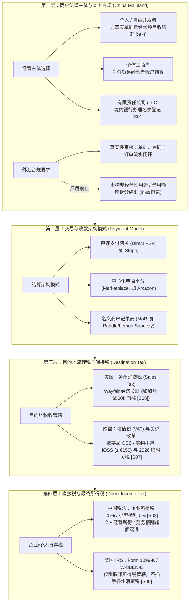
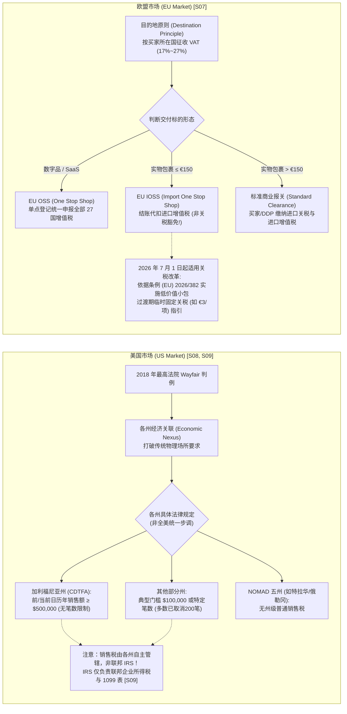
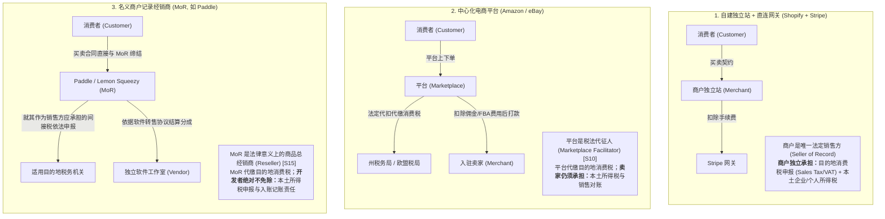
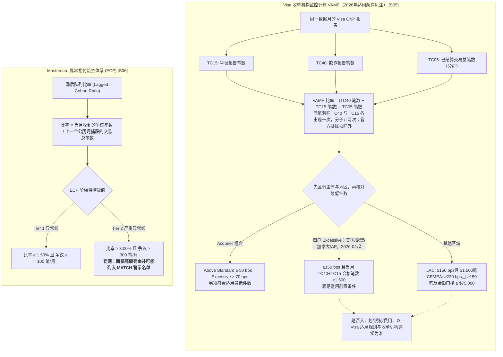
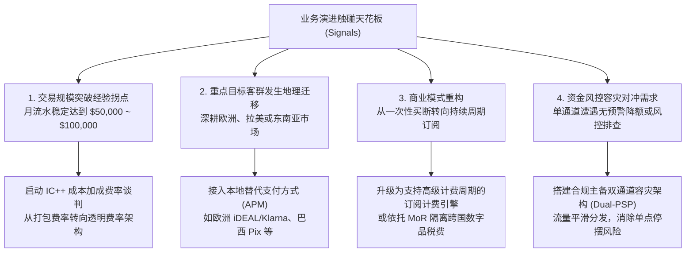
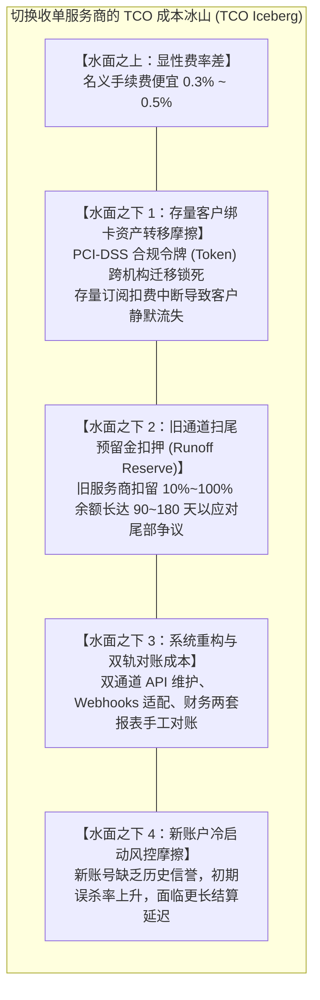
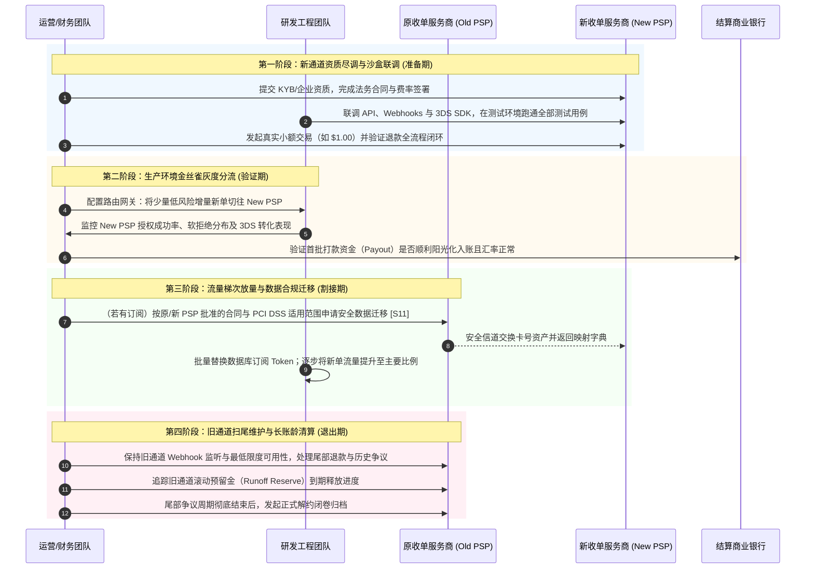

# 第七部分 财务与合规经营｜如何长期、低成本、合规地管理收款业务？

## 引言：从“野蛮生长”到“精细化合规”——跨境支付的终极护城河

在商业出海与数字化转型的浪潮中，许多初创团队和独立开发者往往将精力倾注于“如何获客、如何提升结账转化率、如何接入更多支付方式”上。然而，随着交易规模从几千美元向数十万、数百万美元攀升，大部分经营者最终遭遇的“生死劫”却并非来自前端流量，而是来自后端的**财务脱节与合规暴击**：

1. **“账面繁荣”下的隐形失血**：后台显示 GMV 突破 10 万美元，扣除标称费率后以为利润丰厚，但到了银行对公账户结汇时，才发现资金在跨境卡费率加点、3DS 校验费、货币转换点差、不可退手续费和在途挂账中被层层蚕食，真实到账利润远低于财务预算；
2. **退款、拒付与预留金引发的“资金链休克”**：没有分清会计利润与净现金流的区别，在遭遇发卡行突发批量争议或收单机构设置 10% 滚动预留金（Rolling Reserve）时，可用流动资金被瞬间锁死，导致上游货款或服务器费用无法支付；
3. **国际税务与外汇监管的“达摩克利斯之剑”**：误以为使用境外个人卡提现即可高枕无忧，结果因借用他人额度分拆结汇触发外汇反洗钱拦截；或者误以为挂靠名义商户（MoR）即可豁免本国所得税，最终面临巨额滞纳金与稽查罚单。

支付不仅是技术链路的调用，更是**商业契约、资金清算、税法管辖与外汇合规的综合交汇点**。对于中国大陆的个人开发者、独立站经营者以及小微跨境电商卖家而言，唯有建立起严密的财务核算模型、全链路对账机制、法域合规意识与通道治理能力，才能确保收款业务“收得进、算得清、走得通、留得下”。

---

### 本章核心认知框架与贯穿分析场景

为了让复杂的跨国财税逻辑清晰落地，本章将贯穿使用前序章节确立的**两个典型教学假设案例**（*注：两个案例均为教学模拟实体，其具体收单机构准入资质、所在法域税务核准状态与外汇合规路径须按最新监管规定核对，不代表任何已获批真实资质*）：

*   **案例 A：深圳灵动软件工作室（数字产品 / SaaS 订阅）**  
    *业务特征*：假设为中国大陆注册的小微软件技术企业，面向欧美市场销售 \$29.00 美元的单次买断制设计软件，或提供 \$29.00/月的持续订阅服务。交付形式为纯数字化无形交付（发放 License Key 或云端账号），依托 Stripe、Paddle 或 Lemon Squeezy 收款。
*   **案例 B：东莞极光工坊（跨境实体制造与硬件直邮）**  
    *业务特征*：假设为中国大陆制造业工坊，在独立站面向海外极客销售 \$120.00 美元的人体工学机械键盘。涉及硬件 BOM 采购制造、跨境小包裹直邮/海外仓备货、目的国进口清关、物流妥投、实物退货翻新与二次入库，资金周转与履约周期显著长于数字软件。

围绕这两类业务，本章将依次拆解四大核心命题：**真实利润核算、全链路资金对账、全球税务与外汇合规、通道性能监测与安全切换决策**，并在文末提供开箱即用的实操工具箱。

---

## 1. 如何核算真实收入、成本和利润？

对于刚刚开始商业化收款的创业者而言，最容易陷入的认知误区是：**将收单网关后台显示的“结算总金额（Gross Volume）”误当做企业的“营业收入”，甚至将其等同于“可支配净利润”**。

一笔看似简单的 \$29 软件订单或 \$120 机械键盘订单，在其生命周期内涉及多达十余个层级的资金流向变动。要核算真实利润，首先必须建立符合会计权责发生制（Accrual Basis）的核算要素图谱。

---

### 1.1 一笔订单扣掉商品成本、手续费、退款、汇兑和税费，还赚多少？



#### 1. 会计核算要素的标准归类与权责界限

在跨国交易的资金链路中，不同款项在资产负债表与利润表中的归属必须严格厘清：

1. **买家实付总额（Gross Captured Amount）**：买家在结账时信用卡或电子钱包实际被授权扣除的金额；
2. **代收待缴间接税（Collected Sales Tax / VAT）**：**会计属性为流动负债（Current Liability - 应付税费）**。在直营收单（Direct PSP）模式下，这是商户代目的国税局向消费者收取的税款。该款项虽由收单网关代收并入账，但在法律与财务上绝不属于企业的主营业务收入，最终必须全额向当地税局申报缴纳；若在 Marketplace 或 MoR 模式下，法律卖方或代征代缴主体为平台，该税款甚至不进入商户自身的资产负债表；
3. **主营业务收入（Gross Revenue）**：买家实付总额扣除代收间接税后的纯商品货款或服务对价；
4. **销售折扣与优惠（Discounts & Promotions）**：商户促销减免的金额，作为收入冲减项，反映真实的销售净额；
5. **收单通道处理手续费（Payment Processing Fees）**：记入“财务费用—手续费”。包含基础处理费（如标准 `2.9% + $0.30`）、跨境卡加价（通常 `+1.0% ~ 1.5%`）及 3DS 校验查询费；
6. **退款冲减与沉没手续费（Refunds & Sunk Processing Fees）**：发生退款时，全额冲减主营业务收入；同时依据主流收单机构公开规则（如 Stripe、PayPal 等，具体条款有差异），**原始交易的处理费是否退还及退还范围随具体收单地区、支付方式和定价合同变化** [S14]，该笔已扣除手续费转化为已沉没的财务费用；
7. **拒付争议规费（Dispute Fees & Fines）**：发卡行立案拒付时强制划扣本金全额冲减收入；收单机构收取的争议处理手续费（如 Stripe 标准 \$15.00 美元/笔 [S14]）记入“营业外支出—争议罚金”；
8. **多币种结算兑换利差（Realized FX Gains/Losses）**：交易币种转化为结算币种、或外币结算款提取结汇为人民币时，银行/支付机构实际执行汇率与市场基准中间价之间的点差，记入“财务费用—汇兑损益”；
9. **主营业务成本（Cost of Goods Sold, COGS）**：实物商品的工厂 BOM 制造采购成本、数字软件实际消耗的边际云端算力与第三方接口调用费，记入“主营业务成本”；
10. **履约与物流费用（Fulfillment & Shipping）**：头程国际干线运费、目的国末端派送费、包装辅料费、报关服务费，记入“销售费用—运输费”；
11. **风险预留金（Rolling Reserve）**：**会计属性为其他货币资金/受限资产（Restricted Cash Asset）**。收单机构依据风控规则暂时扣留的资金（如按流水 10% 锁定 180 天），其会计处理和对资金的可执行权益应按合同及适用会计准则判断，通常不得仅因受限就直接认作当期损失，在资产负债表中列为受限流动资产，**严禁将其直接作为费用损失从损益表中扣除**！

---

#### 2. 定价策略与税费归属模型：含税价（Tax-Inclusive）与价外税（Tax-Exclusive）

出海企业在独立站前端设定价格时，必须明确界定采用何种定价模式：

##### (1) 价外税模式（Tax-Exclusive Pricing - 常见于美国、加拿大市场）
*   **业务机制**：独立站货架展示的价格为纯商品净价（如键盘标价 \$120.00）。当买家进入结账页并输入其具体的居住邮政编码（ZIP Code）后，系统调用税务计算接口（如 Stripe Tax [S14]）根据当地具体的州、县、市综合税率（如某地 9%）**在标价之外额外追加税金**；
*   **资金流向**：买家实付金额为 $\$120.00 + \$10.80 = \$130.80$。商户将 \$10.80 计入“应付税费—代收销售税”，主营业务收入按 \$120.00 入账；
*   **商业利弊**：商户的毛利空间不会被不同法域的税率高低侵蚀，财务透明度高；但结账最终页价格上涨可能造成心理落差并导致部分买家流失。

##### (2) 价内税模式（Tax-Inclusive Pricing - 常见于欧洲、英国、澳洲市场）
*   **业务机制**：依据欧洲商业惯例与消费者权益法规，面向 B2C 买家展示的价格必须是最终实付总价（如软件标价 €29.00 含 VAT）。结账时系统不再向买家加价；
*   **财务穿透反算公式**：
    $$\text{主营业务收入 (Gross Revenue)} = \frac{\text{买家实付含税标价}}{1 + \text{当地增值税率 (VAT Rate)}}$$
    $$\text{代收待缴增值税 (Collected VAT)} = \text{买家实付含税标价} - \text{主营业务收入}$$
*   **毛利侵蚀陷阱**：若深圳灵动软件向德国用户销售 €29.00（德国标准 VAT 为 19%），实际主营业务收入仅为 $\frac{29.00}{1 + 0.19} = €24.37$，须向税局代缴 €4.63；若向匈牙利用户销售（VAT 为 27%），实际主营业务收入骤降至 $\frac{29.00}{1 + 0.27} = €22.83$。**在价内税模式下，不同目的国税率的差异直接侵蚀商户自身的净利润**。

---

#### 3. 贯穿案例全生命周期可复算数学模型

以下针对深圳灵动软件（\$29）与东莞极光工坊（\$120），在**正常销售、客户退款、发卡行争议拒付败诉**三种业务情境下展开逐笔资金与会计复算。

> [!NOTE]
> **所得税与费用测算边界说明（MODEL_ASSUMPTION）**  
> 1. 以下算例中涉及的企业所得税（CIT 5%），系假定商户在中国境内设立合规小型微利企业，其**全年度应纳税所得额 $\le 300$ 万元**，依法享受减按 25% 计入应纳税所得额按 20% 税率缴纳的税收优惠（实际有效税率约为 5%，依据财税〔2023〕12号 [S02]）。  
> 2. **法定企业所得税系按年度汇算清缴，绝非单笔订单孤立征收**。下表中的单笔所得税计提仅为“示范性单笔测算”（Illustrative Tax Provision Simulation），用于直观呈现单笔交易对企业终极净利润的边际贡献。  
> 3. 通道费率假设为 Stripe 国际卡跨境费率 `3.4% + $0.30`，叠加外币转换加价 1.0% 时综合为 `4.4% + $0.30`（四舍五入精确至美分）。

##### 案例 A：深圳灵动软件工作室（$29.00 软件买断 / 月付 SaaS 订阅）

| 核算财务项目 | 情境 1A：正常销售 (价外税模式)<br/>*(美区买家，假设 9% 州销售税)* | 情境 1B：正常销售 (价内税模式)<br/>*(欧区买家，假设 20% 法国 VAT)* | 情境 2：交易 15 天后客户申请全额退款<br/>*(价内税模式退单)* | 情境 3：交易 45 天后遭遇发卡行拒付败诉<br/>*(恶意欺诈或未授权扣款)* |
| :--- | :--- | :--- | :--- | :--- |
| **买家端实扣总额** | **\$31.61**（标价 \$29.00 + 税 \$2.61） | **\$29.00**（内含增值税 \$4.83） | 原始支付 \$29.00，全额原路退还买家 | 原始支付 \$29.00，发卡行强制划扣撤回 |
| **代收目的国间接税** | **-\$2.61**（流动负债，代收代缴） | **-\$4.83**（从总额剥离代缴税款） | **\$0.00**（退款后税款负债同步冲销） | **\$0.00**（税款负债冲销或免税） |
| **确认主营业务收入** | **\$29.00** | **\$24.17**（\$29.00 / 1.20） | 收入由 +\$24.17 冲销为 **\$0.00** | 收入由 +\$24.17 冲销为 **\$0.00** |
| **收单通道手续费** | **-\$1.69**（\$31.61 × 4.4% + \$0.30） | **-\$1.58**（\$29.00 × 4.4% + \$0.30） | **-\$1.58**（网关通道费不退，沉没损失） | **-\$1.58**（网关通道费不退，沉没损失） |
| **拒付争议罚款规费** | \$0.00 | \$0.00 | \$0.00 | **-\$15.00**（收单行扣收争议规费 [S14]） |
| **交付成本 (COGS)** | **-\$1.00**（云服务器算力/CDN带宽） | **-\$1.00**（云服务器算力/CDN带宽） | **-\$1.00**（已发生的 CDN/客服费用沉没） | **-\$1.00**（已发生的 CDN/客服费用沉没） |
| **抗辩与行政工时损耗** | \$0.00 | \$0.00 | \$0.00 | **-\$5.00**（调单抗辩、日志提取工时估算） |
| **税前经营毛利 (EBT)** | **+\$26.31** | **+\$21.59** | **-\$2.58** | **-\$22.58** |
| **所得税预提估算 (5%)** | **-\$1.32**（\$26.31 × 5%） | **-\$1.08**（\$21.59 × 5%） | \$0.00（亏损不产生所得税） | \$0.00（亏损不产生所得税） |
| **最终会计净利润** | **+\$24.99** | **+\$20.51** | **-\$2.58**（净亏损） | **-\$22.58**（净亏损） |
| **订单全生命周期净贡献（不等于退款当日现金流）** | **+\$27.31**（仅扣通道费及待缴税款；未扣云成本、所得税） | **+\$22.59**（同口径） | **-\$2.58**（从原销售至退款完结的沉没费及已消耗成本） | **-\$22.58**（从销售至拒付完结的处理费、争议费、云成本及工时合计） |

> [!IMPORTANT]
> **财务核算纠偏：分清“收入冲回”与“现金流出”，严禁重复扣除本金**  
> 在情境 2 和情境 3 中，许多初学者会将退还买家的 \$29.00 本金算作商户的“额外现金亏损”，得出“亏损 \$29 + \$2.58 = \$31.58”的荒谬结论。  
> 必须明确：**订单本金在原销售时收到、退款或拒付时又流出，应分别记录当期实际收支；从该订单完整生命周期汇总时，本金收回与退还净额为零，不能把已冲回的收入再作为第二次成本扣除。** 但这不意味着退款当日没有 \$29.00 现金流出。完整生命周期中的剩余经济损失还包括已发生而不可追回的处理费、争议费、CDN 成本及人工等；某些退款/争议费是否退还依签约地区、支付方法与事件结果判断。

---

##### 案例 B：东莞极光工坊（$120.00 人体工学机械键盘跨境实物销售）

*硬件制造与物流参数假设（MODEL_ASSUMPTION）*：
*   键盘工厂制造采购成本（BOM Cost）：\$45.00 美元；
*   中港拼箱国际直邮国际干线及末端运费：\$18.00 美元；
*   收单通道费率：`3.3% + $0.30`（综合通道费：`$120.00 × 3.3% + $0.30 = $4.26`）；
*   收单行基于实物长周期履约设置 5% 滚动预留金（Rolling Reserve）；
*   中国增值税出口退税政策：假设具备一般纳税人资质、取得进项发票并完成海关合规出口申报，享受出口退税收益约 +\$4.55 美元 [S12]。

| 核算财务项目 | 情境 1：正常外贸出口直邮顺利成交 | 情境 2：买家收到键盘后退货退款<br/>*(海外仓收回并成功验货二次入库)* | 情境 3：跨境包裹遭遇恶意拒付败诉<br/>*(买家谎称未收到货 INR，货物灭失)* |
| :--- | :--- | :--- | :--- |
| **买家实付总金额** | **\$120.00** | 原始支付 \$120.00，全额原路退还买家 | 原始支付 \$120.00，发卡行强制划扣撤回 |
| **主营业务收入确认** | **+\$120.00** | 收入冲减归零：**\$0.00** | 收入冲减归零：**\$0.00** |
| **收单通道手续费** | **-\$4.26**（实际扣除通道费） | **-\$4.26**（初始手续费不退，沉没损失） | **-\$4.26**（初始手续费不退，沉没损失） |
| **发卡行拒付罚金规费** | \$0.00 | \$0.00 | **-\$15.00**（收单行扣收争议规费 [S14]） |
| **硬件 BOM 采购成本** | **-\$45.00** | 原采购成本 -\$45.00，经残值回收对冲 | **-\$45.00**（键盘实物灭失，全额坏账损失） |
| **头程国际直邮运费** | **-\$18.00** | **-\$18.00**（正向干线运费已完全沉没） | **-\$18.00**（正向干线运费已完全沉没） |
| **逆向退货运费与仓储** | \$0.00 | **-\$10.00** (买家退回海外仓运费) - **\$5.00** (3PL检验上架费) | \$0.00（货物被买家扣留或遗失，无逆向费） |
| **库存资产残值回收** | 不适用（资产已转化为销售成本） | **+\$38.00**（键盘作为 B-stock 开箱良品重新入库评估残值） | **\$0.00**（货物无法追回，残值为零） |
| **出口退税收益预期** | **+\$4.55**（仅作“确已取得且可确认”教学假设；实际资格与到账 UNKNOWN） | **\$0.00**（货物退回注销出口退税申报） | **\$0.00**（无法完成正常核销） |
| **真实经营综合损益** | **+\$57.29**（毛利 \$52.74 + 退税 \$4.55） | **-\$44.26**（运费/杂费损耗 + 库存跌价） | **-\$82.26**（货值灭失 + 罚款 + 通道运费） |
| **滚动预留金影响** | **-\$6.00**（5% 流动性暂扣，列为受限资产） | 预留金随结算解除质押释放 | 预留金可能被收单行提高质押比例 |
| **支付服务商余额示例（非银行到账）** | **+\$109.74**（\$120 - \$4.26 通道费 - \$6 暂扣预留金；仅假设其余款项已成为 PSP 可用余额） | **-\$44.26**（全生命周期经济损益，并非本日 PSP 余额或银行付款） | **-\$82.26**（全生命周期经济损益；并非银行实际扣款）。**银行到账：均为 UNKNOWN，须依 Payout ID 与银行回单核实** |

*实物退货残值会计纠偏*：在实物跨境贸易中，**退货并不等于实物货值 100% 灭失**。情境 2 中，由于极光工坊在海外设有 3PL 合作仓，退回的机械键盘经外观检查与清洁后，作为“99 新开箱良品（Open-box / B-stock）”重新入库，保留了 \$38.00 美元的公允资产残值，使得最终经济损失控制在 -\$44.26 美元（主要为双向运费、检验工时与 \$7 的折价折损）。而在情境 3 的恶意欺诈拒付中，货物彻底失联，企业才不得不将 \$45.00 物料全额列入资产减值损失。

---

### 1.2 订单、支付和银行到账记录，怎样对账才知道有没有差错？

在真实的经营过程中，许多出海商户发现：**系统导出的订单流水总额、支付网关结算报告与银行对公电子回单上的金额，几乎从来没有一次能直接对齐**。

这种不对齐通常不是因为系统算错了钱，而是因为各系统处于不同的清算节点，并存在**时间戳错位（Timing Difference）、多币种汇兑摩擦（FX Conversion）以及手续费与中间行在途扣划**。

```mermaid
flowchart TD
    subgraph 层级一：商户业务系统 (Order Layer)
        O1["订单 ORD-101 ($29.00 USD)"]
        O2["订单 ORD-102 ($29.00 USD)"]
        O3["订单 ORD-103 ($120.00 USD)"]
        R1["历史订单退款 REF-088 (-$29.00 USD)"]
        D1["历史订单拒付 DIS-077 (-$29.00 USD 本金 + $15.00 规费)"]
    end

    subgraph 层级二：收单网关清算流水 (Balance Transactions Layer)
        T1["txn_101: Charge +$27.42 USD (净)"]
        T2["txn_102: Charge +$27.42 USD (净)"]
        T3["txn_103: Charge +$114.42 USD (净)"]
        T4["txn_104: Refund -$29.00 USD (本金)"]
        T5["txn_105: Dispute -$44.00 USD (本金+规费)"]
        T6["Reserve Hold -$10.00 USD (新增受限预留金)"]
        T7["Reserve Release +$5.00 USD (历史预留金释放)"]
    end

    subgraph 层级三：出金付款批次 (Payout Batch Layer)
        PO["付款批次 Payout po_example_20261017<br/>• 期初可用: $15.00 USD<br/>• 流水净增: +$96.26 USD<br/>• 预留金净变动: -$5.00 USD<br/>• 可供出金基数: $106.26 USD<br/>• 本期出金金额: $95.00 USD<br/>• 期末留存可用余额: $11.26 USD"]
    end

    subgraph 层级四：跨国银行入账与外汇 (Banking Layer)
        BK["银行外币账户收到现汇: $93.00 USD<br/>(扣减中转行电报费 $2.00 USD)"]
        CNY["结汇为人民币电子回单: ¥664.74 CNY<br/>(汇率 7.1800 折算 ¥667.74，扣国内银行费 ¥3.00)"]
    end

    O1 --> T1
    O2 --> T2
    O3 --> T3
    R1 --> T4
    D1 --> T5
    
    T1 & T2 & T3 & T4 & T5 & T6 & T7 --> PO
    PO --> BK --> CNY
```

#### 核心映射法则：
1. **多对一聚合（Many-to-One）**：收单机构不会为每笔订单单独发起一次跨境银行电汇。通常是按周期（日结、周结）或达到提现阈值后，将周期内所有订单的收费、退款冲抵、争议扣款、预留金增减合并为一个 `Payout ID` 批量打款 [S14]；
2. **一对多衍生（One-to-Many）**：一笔商户订单（`Order ID`）在支付网关中可能对应多条交易流水对象（`Balance Transaction`）。例如初始扣款为一条正向流水，后续部分退款产生一条负向退款流水，若再发生拒付又会追加一条争议扣款流水及争议罚费流水；
3. **断点映射（Orphan / In-Transit Records）**：在任何对账截止日，客观上必然存在“业务系统已下单但收单网关未清算”、“网关已扣记出金但银行跨时区在途尚未入账”的单据。必须在对账账本中单列“在途待结款项”科目，绝不可强行抹平。

---

#### 跨币种隔离对账法则：绝对禁止不同币种不经换算直接相加

在跨境财务核算中，严禁将不同货币单位的金额混在一起求和。支付链路存在四大独立的货币维度，对账时必须按币种建立四层独立核算台账：

1. **交易币种（Transaction Currency）**：买家在结账页面被扣款的币种（如 EUR、GBP、JPY），用于核对购物车应收金额；
2. **网关结算币种（Settlement / Balance Currency）**：收单机构记入商户后台余额账本的币种（如 USD）。若交易币种与结算币种不同，收单机构依据其清算汇率扣取货币转换点差（通常 1.0%~2.0%），对账时核验 `Balance Transaction` 中的原始金额、折算汇率与入账净额；
3. **出金提现币种（Payout Currency）**：收单机构通过本地清算网络或跨境汇款向银行电汇时的报文币种；
4. **银行最终入账可用币种（Bank Deposit Currency）**：商户境内对公外汇账户保留的现汇币种，或境内商业银行办理结汇后最终可用的人民币（CNY）。

*对账铁律*：**每一个币种层级的期初余额、当期发生额与期末余额，只能在该币种内部实现自平衡**。发生跨币种转换时，必须单独记录时间戳、成交汇率、汇兑点差及已实现汇兑损益。

---

#### 教学复算多订单批次对账推演模型 (Reconciliation Master Ledger)

以下提供一套包含多笔订单、退款、争议、预留金增减及银行手续费的教学复算总账模型，所有数据在数学上保持严格资金守恒与借贷平衡：

##### 1. 业务订单与网关清算流水层（Transaction Layer - 币种：USD）

| 流水编号 | 关联业务订单 | 交易业务性质 | 订单原始标价 | 收单手续费 [S14] | 争议规费扣收 | 网关入账净额 (Net) | 对账归属与核算说明 |
|:---|:---|:---|---:|---:|---:|---:|:---|
| `txn_101` | ORD-101 | 成功销售（灵动软件买断） | \$29.00 | -\$1.58 | \$0.00 | **+\$27.42** | 扣除 `4.4% + $0.30` 后入可用余额 |
| `txn_102` | ORD-102 | 成功销售（灵动软件买断） | \$29.00 | -\$1.58 | \$0.00 | **+\$27.42** | 扣除 `4.4% + $0.30` 后入可用余额 |
| `txn_103` | ORD-103 | 成功销售（极光机械键盘） | \$120.00 | -\$5.58 | \$0.00 | **+\$114.42** | 扣除 `4.4% + $0.30` 后入可用余额 |
| `txn_104` | ORD-088 (历史) | 历史订单全额退款冲减 | -\$29.00 | \$0.00 | \$0.00 | **-\$29.00** | 原始手续费前期已扣不退，本金冲减 |
| `txn_105` | ORD-077 (历史) | 历史订单发卡行拒付划扣 | -\$29.00 | \$0.00 | -\$15.00 | **-\$44.00** | 划回本金 \$29 且加扣 \$15 争议规费 |
| **本期发生合计** | — | **5 笔清算变动** | **+\$120.00** | **-\$8.74** | **-\$15.00** | **+\$96.26** | **网关清算流水净发生额** |

##### 2. 收单网关可用余额资金守恒层（Balance Sheet Layer - 币种：USD）

| 账本资金项目 | 美元金额 (USD) | 勾稽逻辑与算术验证 |
|:---|---:|:---|
| **期初可用余额（Beginning Available Balance）** | **\$15.00** | 承接上期未出金可用余额 |
| 加：本期新产生清算流水净额 | +\$96.26 | 对应上方流水层合计：`$27.42 + $27.42 + $114.42 - $29.00 - $44.00` |
| 减：本期新增风险预留金（转入受限资产） | -\$10.00 | 收单风控按流水暂扣，形成受限流动资产，非损益亏损 |
| 加：本期释放历史到期预留金（释放入可用） | +\$5.00 | 历史前期滚动的预留金到期解冻释放进入可用余额池 |
| **可供出金总净额（Net Amount Available for Payout）** | **\$106.26** | 算术验证：`$15.00 + $96.26 - $10.00 + $5.00 = $106.26` |
| 减：本期发起出金付款批次（Payout） | -\$95.00 | 触发银行出金指令批次：`po_example_20261017` |
| **期末可用余额（Ending Available Balance）** | **\$11.26** | 算术验证：`$106.26 - $95.00 = $11.26`（结转入下期账本） |
| **本期受限预留金资产净变动** | **+\$5.00** | 新增 \$10 - 释放 \$5 = 受限资产增加 \$5，在资产负债表单列 |

##### 3. 跨国银行出金、中转行扣费与结汇可用层（Banking & FX Layer - 货币跨越）

| 业务处理节点 | 凭单号与货币数额 | 业务实质与对账核验要领 |
|:---|:---|:---|
| **网关扣记出金批次** | Payout ID: `po_example_20261017`<br/>**金额：\$95.00 USD** | 网关可用余额扣减 \$95.00，资金指令通过银行清算网络发往收款银行 [S14] |
| 减：跨境中转中间行电报手续费 | **-\$2.00 USD** | 经由国际中间清算行在现汇中扣收电讯路由费（传统 SWIFT 报文代码 `71F`，或本地网络费）[S16] |
| **境内银行实际收汇金额** | 银行外币入账单（Credit Advice）<br/>**现汇金额：\$93.00 USD** | 算术验证：`$95.00 - $2.00 = $93.00 USD`。核对银行现汇入账底单 |
| 办理经常项目贸易结汇 | 申报为软件技术出海经常项目结汇 | 提交商业合同与交易订单清单凭证办理阳光结汇，不占用个人非经营性便利额度 [S04] |
| 银行实际成交外汇牌价 | 银行结汇买入价：**7.1800 CNY / USD** | 采用银行实际交割的外汇牌价，与央行中间价之差形成已实现汇兑损益 |
| 结汇后人民币毛额 | \$93.00 × 7.1800 = **¥667.74 CNY** | 人民币毛额入账 |
| 减：国内银行入账服务费 | -¥3.00 CNY | 商业银行扣收境内涉外资金入账服务费（以人民币单列扣除） |
| **最终银行对公可用人民币净额** | 银行人民币电子回单：**¥664.74 CNY** | 算术验证：`¥667.74 - ¥3.00 = ¥664.74 CNY`。与银行基本存款账户人民币流水勾稽 |

*资金守恒复算结论*：通过以上三层账本，企业财务能够精准还原：账面产生的销售流水中，有多少资金转化为了银行实际可支配的人民币（¥664.74），有多少留存在网关可用余额（\$11.26），有多少作为受限资产沉淀在预留金池（净增加 \$5.00），有多少在跨国中间行和手续费中被合理损耗（\$2.00 中间行费 + ¥3.00 银行费）。**全链路借贷平衡，不存在任何不可解释的悬挂差额**。

---

#### 挂账与对账差错排查 SOP：常见账差定位与长账龄处理机制

在月末关账时，若发现“订单系统理论销售额”、“网关清算报告”与“银行对账单”存在差额，财务团队应启动标准化**排查指引（Runbook）**：



##### 常见账差定位与处置准则：
1. **时区差错（Timezone Offset）**：独立站自建订单系统若按北京时间（UTC+8）截单，而海外收单网关（如 Stripe）默认采用协调世界时（UTC）生成日终清算报告。**必须将双方数据统一转换为 UTC 时间戳后再行比对**；
2. **退款跨期处置原则（Cross-Period Refund Accounting）**：历史月份订单在本月发生退款，收单网关在当期直接扣减余额。依据会计权责发生制与重要性原则，**通常在当月损益中冲减当期营业收入或计入当期销售退回，不应随意翻改历史月份已封板的报表**；若涉及跨年度重大退货，则按资产负债表日后事项准则调整；
3. **银行挂账与审核延迟（Bank Inward Compliance Review）**：若境外汇款到达境内银行但未入账，通常是由于银行触发涉外收付款反洗钱或外汇真实性审核。财务人员应在银行规定时限内（通常为 5~15 个工作日内，视具体银行风控要求而定）向银行柜台提交基础贸易单据、交易订单清单及商业合同办理核销，避免款项被强制原路退回产生高额双向电讯损失；
4. **多渠道报文差异（SWIFT MT103 vs ISO 20022）**：对于传统跨境电汇，中转行扣费在 MT103 报文中通常体现为 Field 71A（SHA/OUR/BEN）与 Field 71F（Sender's Charges）[S16]；而对于通过境内本地清算网络或 ISO 20022 现代报文标准（如 pacs.008、camt.053）结算的渠道，中转杂费通常已在发报前或结算批次内由结算清算机构抵扣，对账时须依据服务商提供的清算详情文件匹配。


---

## 2. 收款需要交哪些税、遵守哪些规定？

在出海与商业收款的运营中，许多团队往往将全部精力放在“流量投放、支付转化与拒付风控”上，直到银行对公账户突然收到外汇局或主管税局的核查通知，或者海外某州税务局发出补税罚款账单时，才意识到：**支付流程的终点不是结账完成，而是资金与税务的合法合规落地**。

跨境收款的税费与监管义务绝非单一维度，而是由**商户法定身份（个人/个体/公司）、商品形态（数字无形资产/实体硬件）、销售目的地法域（美国/欧盟/中国本土）以及收款合作架构（直接网关/平台/名义商户 MoR）**共同交织决定的复杂网络。



---

### 2.1 我是个人还是公司、卖什么、卖到哪里，会影响税务义务吗？

答案是：**不仅会影响，而且这三个维度直接决定了你的纳税税种、计税基数、合规凭证链条以及适用的外汇核销路径**。

#### 1. 经营主体维度：个人、个体工商户与有限责任公司的合规边界

在中国大陆法律与财税监管体系内，以不同主体形式开展跨境收款，适用的政策规则存在本质区别：

| 经营主体形态 | 适用税法与主要税种 | 纳税成本与核算特征 | 外汇合规与银行结算通道 [S01, S04] | 组织适用场景与风控提示 |
| :--- | :--- | :--- | :--- | :--- |
| **个人 / 独立开发者**<br/>*(以自然人身份开设店铺或开发应用)* | **个人所得税（IIT）**<br/>・综合所得：劳务报酬（适用 3%~45% 超额累进税率）<br/>・或按生产经营所得申报（5%~35%） | 个人无法自行开具增值税专用发票；无进项抵扣；若按劳务报酬综合申报且年度应税额较高时，边际税率相对较重。 | **合规通道**：根据《经常项目外汇业务指引（2020年版）》第 54–56 条，个人从事真实跨境电商/服务贸易，**可凭真实交易单据在银行办理经常项目收结汇**，或通过持牌跨境支付机构凭交易电子信息结汇 [S04]。<br/>**红线**：严禁利用个人 5 万美元便利额度虚构非经营性用途分拆结汇！ | **适合验证期与初期轻量尝试**。<br/>风险：个人银行卡若频繁接收境外资金且无法及时提供贸易单据，易触发反洗钱（AML）排查；自然人承担无限责任。 |
| **个体工商户**<br/>*(常见于跨境电商产业带商户)* | **个人经营所得税 + 增值税**<br/>・部分跨境集聚区在特定条件下享有核定征收或税收优惠政策 | 账目相对灵活；可凭真实外贸单据申领普通发票；可开立个体工商户对公外汇结算账户。 | 开立个体工商户经常项目外汇账户；凭电商平台订单流水在具备跨境资质的商业银行或支付机构办理收结汇。 | **适合月流水相对稳定、以个人为核心的跨境卖家**。<br/>风险：经营者对个体工商户债务承担**无限清偿责任**，侵权或法律争议直接波及个人资产。 |
| **有限责任公司（LLC）**<br/>*(中国境内标准企业法人)* | **企业所得税（CIT）+ 增值税**<br/>・法定基准税率：25%<br/>・小型微利企业优惠：年度应纳税所得额 $\le$ 300 万元部分实际税负约为 5% [S02] | 建立规范的会计双记账核算体系；可进行 BOM 采购成本、云服务器、人员工资等合规税前扣除与进项税抵扣；符合条件可享出口退免税政策。 | 在商业银行开立经常项目对公外汇账户；由开户银行依据外汇局汇发〔2024〕11号直接办理名录登记，凭海关报关单或技术服务合同阳光化结汇 [S01]。 | **团队化扩张、规模化出海的标配主体**。<br/>法人仅以认缴出资额为限承担**有限责任**，能够有效隔离跨境重大争议或国际追偿风险。 |

> [!CAUTION] 
> **外汇监管真实性红线：便利化额度与经营性收汇的法定界限 [S01, S04]**  
> 1. 根据国家外汇管理局《外汇管理条例》及《个人外汇管理办法》，境内个人每年每人等值 5 万美元的结汇额度，属于**无需提供交易单据即可凭身份证件直接办理的“便利化通道”**。  
> 2. **该额度在法理上针对个人经常项目下的“非经营性外汇收支”**（如直系亲属赡家款、旅游、留学生活费）。**严禁出海经营者以虚假申报非经营性用途、借用亲戚朋友身份证多账户分拆汇入（行业俗称“蚂蚁搬家”）的方式规避贸易外汇单据审核**！一经外汇监管系统反洗钱模型识别，涉案个人将被列入“关注名单”（取消两年内便利化额度），涉案主体还将面临外汇处罚甚至非法经营追责。  
> 3. **合规正道**：境内个人从事真实的跨境电商或软件出口，完全可以依法凭真实合同、线上订单流水向银行提交经营性收结汇申请，走经常项目正规通道，无需也不应采取违规分拆手段 [S04]。

---

#### 2. 标的形态维度：数字无形资产 vs 实物硬件

商品形态直接决定了货物流与资金流如何在海关与外汇监管体系中完成闭环验证：

*   **数字商品与无形资产（如深圳灵动软件 $29.00 软件/SaaS 订阅）**：
    *   **业务属性**：属于**服务贸易（Trade in Services）**中的软件技术出口或数字版权特许权使用费。
    *   **核验凭证链条**：无海关物理出口报关单。对公收汇时，向银行提供的凭证通常为：境外用户服务协议（EULA/Terms of Service）、软件著作权证书、独立站订单明细与电子交易流水、商业发票或形式发票（Commercial / Proforma Invoice）以及银行要求的经常项目收汇说明材料。
    *   **重要纠偏（避免付汇混同）**：国家税务总局与国家外汇管理局 2013 年第 40 号公告规定的《服务贸易等项目对外支付税务备案表》**仅适用于境内机构向境外支付等值 5 万美元以上款项的付汇环节**，收汇入账环节无需也不应要求该付汇备案表 [S13]！
    *   **增值税待遇**：根据国家税务总局公告 2016 年第 29 号，向境外单位有偿提供完全在境外消费的软件技术服务与信息技术研发服务，符合法定凭证要求的可依法享受**增值税免税或零税率政策** [S03]。
*   **跨境实物硬件（如东莞极光工坊 $120.00 机械键盘）**：
    *   **业务属性**：属于**货物贸易（Trade in Goods）**。
    *   **名录登记新规（汇发〔2024〕11号）**：自 2024 年 6 月 1 日起，开展货物贸易外汇收支的企业，**名录登记全面改由境内商业银行直接办理**，企业无需再前往外汇局分支局现场排队 [S01]；同时，对于年贸易外汇收支等值 20 万美元以下的小微跨境电商企业，若通过具备资质的第三方跨境支付机构或外贸综合服务平台凭电子信息办理结汇，**依法可免于办理名录登记**！
    *   **海关监管方式精准区分 [S12]**：
        *   `9610`（跨境贸易电子商务零售一般出口）：专用于独立站 B2C 直邮小包裹，采用“清单核放、汇总申报”，适合小批量、多批次的碎片化直邮订单；
        *   `9710`（跨境电商 B2B 直接出口）：境内企业通过跨境电商平台与境外企业达成交易，通过海关直接报关出口；
        *   `9810`（跨境电商出口海外仓）：境内企业将批量货物先运抵境外海外仓备货，待境外终端消费者下单后再从海外仓履约派送（B2B2C 模式）。
    *   **出口退税条件性（绝非无条件）**：企业凭增值税专用发票、海关报关单、收汇凭单申请出口退税（退还采购环节缴纳的增值税进项税，通常税率 13%）[S12]。**能否退免税及所需资格、申报凭证取决于实际出口模式、主体和适用政策**。一般纳税人凭合法进项凭证办理进项退税是常见场景之一，但不应推出所有出口业务统一适用相同材料；无票采购也不能直接推定自动适用免税政策。案例中 \$4.55 仅在真实资格、金额及确认条件均满足时计入收益，否则记为 UNKNOWN 或不计入利润。

---

#### 3. 销售目的地维度：美国消费税与欧盟增值税/关税新规

当商品通过网络销往境外终端消费者时，卖方必须面对目的地国家极其严苛的间接税（消费流转税）与关税管辖：



##### (1) 美国销售税（US Sales Tax）与各州经济关联实务规则
*   **管辖主体划清边界**：**美国没有全国统一的联邦增值税或联邦销售税！** 销售税完全由各州及地方县市独立立法并管理（如加利福尼亚州税费管理局 CDTFA、纽约州税务与财政局 NY DTF 等）。**美国国税局（IRS）只负责联邦企业所得税、个人所得税及 W-8/W-9/1099 系列表单核实，绝不插手各州消费税的征收 [S09]**。
*   **各州经济关联（Economic Nexus）门槛差异（绝非全美一刀切）[S08]**：
    *   自 2018 年美国最高法院对 *South Dakota v. Wayfair, Inc.* 案作出里程碑判决后，州税务局对州外及外国卖家的管辖权取决于在当地的销售体量。
    *   **各州门槛高度分化**：例如加利福尼亚州（CDTFA）规定，远程卖家在上一或当前日历年度向该州销售有形个人财产的总额**达到或超过 \$500,000 美元**，可能触发加州经济关联下的征税/登记义务；仍需查看商品应税性及其他关联规则，且加州**不适用 200 笔交易笔数门槛** [S08, O08]；纽约州需要结合当地年度/季度销售额、笔数和跨州销售规定核实是否负有登记义务；在缺少州税局对应深链接的情况下不以本表给出确定门槛；而其他州门槛和计算口径不同（如德克萨斯州、华盛顿州均须查看各自官方最新公告，具体金额在此列为 UNKNOWN）；阿拉斯加、特拉华、蒙大拿、新罕布什尔、俄勒冈五州（NOMAD）则不设立州级普通销售税。
*   **商品应税性（Taxability）差异**：实物商品在绝大多数州均属应税品；但数字软件（如深圳 \$29 软件买断或 SaaS 订阅），在加利福尼亚州等部分州通常不征收销售税，而在纽约州、得克萨斯州则属于应税数字服务。商户必须结合销售标的与目的地州税法具体判断。

##### (2) 欧盟增值税（EU VAT）、IOSS 与 2026 进口小包关税改革
*   **目的地征税与适用税率应分别判断**：对适用目的地征税规则的跨境 B2C 数字服务或商品，应核对**交易与纳税主体、商品或服务分类、成员国税率、进口环节及平台是否代征**；不能一律按当地**标准 VAT 税率**或推定所有税都由卖家直接申报。欧盟各国可能适用优惠、零税率或豁免。卢森堡 17%、德国 19%、法国 20%、匈牙利 27% 仅是相应**一般标准税率示例**，并非每种产品必用税率（[欧盟 VAT 税率指引](https://europa.eu/youreurope/business/finance-and-tax/vat/vat-rules-rates/indexamp_en.htm)、[OSS/IOSS 平台责任](https://vat-one-stop-shop.ec.europa.eu/one-stop-shop_en)）。
*   **适用的数字服务申报路径：EU OSS（One Stop Shop）**：如深圳灵动软件的 \$29 买断/SaaS 在具体交易中属于适用 Non-Union OSS 的 B2C 服务、且卖家自身为 VAT 申报责任方，则可评估在一个成员国注册该机制并按规定汇总申报相关销售；若由符合条件的平台代征，或交易类型不适用该机制，应采用对应的税务处理路径，不能将所有“数字产品”自动归入同一种 OSS。
*   **实物直邮小包裹：EU IOSS 机制与 2026 关税改革深水区 [S07]**：
    *   **IOSS 的核心本质**：专门适用于由非欧盟国家直接发货至欧盟消费者、**内件托运价值 $\le €150$（以商品净额为准，不含运费与独立列明的税费）**的实体商品。非欧盟卖家须通过指定的欧盟本土税务中介机构（IOSS Intermediary）注册并承担连带申报责任。
    *   **关键纠偏（IOSS 绝非免关税豁免券）**：
        1.  **IOSS 仅解决“进口增值税（Import VAT）”的前置代征与抵扣**，确保买家在结账时即完成 VAT 支付，在申报和税款校验一致的条件下减少进口 VAT 再次收取的风险；IOSS 本身不保证免除物流商或海关另行依法收取的服务费；
        2.  **2026 进口小包关税新政**：根据欧盟理事会条例 Regulation (EU) 2026/382 及其低价值进口指引 [O02, O03]，欧盟正全面推进海关同盟改革，逐步废除 €150 关税免征门槛。自 **2026 年 7 月 1 日起**，针对低价值远程销售进口包裹将引入过渡期**临时固定关税机制（如按税则类别适用 €3/项 等定额或简化关税费率）**，此关税豁免实际上已于 2026 年 7 月 1 日废除；临时定额关税机制暂适用至 2028 年 7 月 1 日，之后按适用常规关税机制处理；
        3.  因此，即便东莞极光工坊（\$120 机械键盘，折合约 €111 处于 €150 门槛内）使用了合法 IOSS 申报，也必须在独立站明确关税负担方（采用 DDP 完税交货条款由卖家消化，或由买家承担），且海关依然保留随机抽检与安全查验权，**绝不存在“绝对秒级放行、零关税、零检查成本”的绝对化承诺**。
    *   **超标处置**：若键盘加装配件使包裹内件价值**超过 €150**，**绝对禁止填报 IOSS 编号**！包裹必须走标准商业清关流程（Standard Customs Clearance），由进口商或物流清关代理缴纳进口关税与进口增值税。

---

### 2.2 通过平台或由第三方作为卖方收款，哪些税务责任仍要自己承担？

由于自行注册海外各州销售税许可和欧盟 IOSS 存在繁重的合规成本，大量卖家选择挂靠中心化平台（Marketplace）或名义商户记录商（MoR）。然而，市场上关于“**挂靠平台就不用管税**”或“**用 Paddle 就能免税**”的误解极其普遍。

要厘清责任边界，必须透视**四大主流收款经营模式**下的法律与税务责任切分：



#### 四大收款模式法定权利义务与税务责任穿透矩阵：

| 关键比对维度 | 模式一：自建独立站 + 直连网关<br/>*(Shopify + 自有 Stripe)* | 模式二：中心化电商平台<br/>*(Amazon / eBay)* | 模式三：名义商户记录经销商 (MoR)<br/>*(Paddle / Lemon Squeezy)* [S15] | 模式四：传统跨境 B2B 电汇 / 外贸收款<br/>*(商业银行 TT / 持牌结汇机构)* |
| :--- | :--- | :--- | :--- | :--- |
| **法定商户主体**<br/>*(Merchant of Record)* | **卖家自身** | **卖家自身**（平台为撮合与履约服务商） | **第三方 MoR 服务商**（MoR 向买家直接开具账单） | **卖家自身** |
| **账单交易抬头**<br/>*(Billing Descriptor)* | 卖家自主设置（如 `AURORA*KEYBOARD`） | 平台及卖家组合（如 `AMZ*SellerName`） | MoR 品牌及产品名（如 `PADDLE.NET*LINGDONG`） | 不适用（买家网银发起跨境 SWIFT 转账） |
| **目的地消费税/VAT**<br/>*(Sales Tax / VAT)* | **依实际销售身份与所在地税法承担适用义务**；Stripe Tax 是计算/服务功能，不能代替主体依法注册、申报的所有工作。 | **视州/国法律、平台和交易范围执行平台代征**；卖家其他申报、注册和留档义务不能一概免除 [S10]。 | **由合同确定其作为法律销售方承担的代征申报责任**；具体商品、法域和剩余卖家义务逐项核实。 | **依进口法域、法律进口商与合同贸易术语决定**；卖家或买方负担不能凭 B2B 或 FOB/CIF 标签一概推定。 |
| **拒付与欺诈经济风险** | **全由卖家承担**。<br/>每笔拒付扣罚 \$15~\$25 规费，直接计入商户卡组织监控比率。 | **平台主导风控**。<br/>高拒付风险直接导致平台封店或扣留全部资金。 | **MoR 分担与消化**。<br/>MoR 承担持卡人端拒付风险，费用通常内嵌在较高分成抽成中。 | **极低**。<br/>传统商业电汇入账不可逆向撤回，无卡组织单方面退单机制。 |
| **卖家本土所得税责任**<br/>*(Income Tax 申报)* | **必须如实申报缴纳**。<br/>网关结算流水扣除成本后计入应纳税所得额。 | **必须如实申报缴纳**。<br/>依合同和适用会计制度判断是总额法还是净额法，不能一律将平台净打款加回全部扣费认作销售收入。 | **必须如实申报缴纳**！<br/>**绝对不免除中国企业所得税或个人所得税**。 | **必须如实申报缴纳**。<br/>配合海关报关单与水单办理阳光收汇与退税。 |
| **综合资金扣点成本** | 标称约 **2.9%~3.4% + $0.30**<br/>*(外加潜在外汇点差与税务软件费)* | 平台佣金高达 **8%~15%**<br/>*(外加 FBA 仓储配送费与广告投放)* | 费用依具体 MoR 产品、币种、地区与合同；**5% + $0.50 仅作教学报价示意（MODEL_ASSUMPTION）** | 真实报价依银行、汇率、转账网络与合同（UNKNOWN）；不得把 **0.4%~1.0%** 当统一费用 |

---

#### 深度警示：MoR（名义商户）模式下必须澄清的本土税务真相

许多独立软件开发者与小微团队误以为：“我用了 Paddle，Paddle 既然处理了所有税，打到我银行卡里的钱就是纯利润，不用再向中国税局报任何税了。” **这种认识在税法上完全错误，且蕴藏着巨大的纳税合规风险！**

##### 1. 间接流转税 vs 直接所得税的根本界线
*   **MoR 代替你承担的，仅仅是销售目的地的“间接流转税”**（如美国各州销售税、法国 20% VAT、澳大利亚 10% GST）。因为在法律上，是 Paddle 作为 Reseller 将软件转售给了法国消费者，所以 Paddle 替法国税局缴纳了增值税；
*   **MoR 绝不可能、也无权代替你缴纳“商户所在地的直接税”（即企业所得税 CIT 或个人所得税 IIT）**；
*   当 Paddle 扣除其 5% 佣金和流转税后，将剩余资金（Payout）电汇至深圳灵动软件工作室的境内账户时，**该笔 Payout 是境外 MoR 按合同向工作室结算的资金，并不能仅凭净到账额判定收入科目或金额**；应先核对转售/许可/佣金等合同安排、应结算总额、平台扣费、退款、间接税和中国会计与税法适用口径，再确定主营收入、费用与应纳税所得额；
*   深圳灵动软件工作室必须依照《中华人民共和国企业所得税法》或《中华人民共和国个人所得税法》，将按合同及适用会计税法确认的收入、成本费用和相关跨境所得如实记录并依法申报；银行到账额不能直接替代应确认收入。符合小型微利企业优惠条件的，按规定享受优惠税率（应纳税所得额 $\le 300$ 万元部分实际税负约为 5% [S02]）。

##### 2. 跨国凭证归档与阳光化入账实操建议
由于境外 MoR 服务商位于英国或美国，其向国内商户付款时无法开具中国境内的“增值税普通发票”，仅能提供系统生成的英文版月度打款单（Payout Statement / Reverse Invoice）。

中小团队在阳光化入账时，应做好以下凭证链条归档备查：
1.  **服务合同支撑**：保存并归档与 MoR 服务商在线签署的服务转售协议（Terms of Service / Reseller Agreement），重点划定转售与分成条款；
2.  **结算闭环单据**：按月下载 MoR 系统导出的 Payout 报表、底层交易流水（脱敏后）、境外银行电汇水单（MT103 凭单）以及境内对公银行入账通知单，装订成册；
3.  **形式发票开具（Commercial / Proforma Invoice）**：依财务做账规范，以自身名义向境外 MoR 机构开具载明收款项目与合同号的形式发票，作为记账凭单附件；
4.  *(注：不同省市基层税务部门对跨境无形服务出口免税备案的具体单据执行要求存在个案差异，企业在流水放大至月均 \$10,000 美元以上时，建议主动向主管税局专管员沟通本地凭证口径，未证实地方差异标为 `UNKNOWN`)*。


---

## 3. 怎么判断现在的收款方式好不好用？

当商业收款系统上线运转后，许多商户管理者只关心一个最终数字——“今天又收到了多少美金”。然而，支付不仅是一根管道，更是一个由发卡行、收单机构、卡组织清算网络与风控引擎构成的动态博弈系统。

如果缺乏精准的数据指标监控，商户往往处于**“隐形失血”**状态：成百上千位意向顾客在结账最终步因为网关报错而流失；巨额手续费在层层货币转换中被悄然吞噬；甚至在毫无预警的情况下，突然收到卡组织高达数万美元的违规罚单并被强制关停账户。

要科学评估收款方式的优劣，经营者必须建立起包含**四维核心指标**的量化看板。

---

### 3.1 付款成功率、手续费、到账时间和拒付率，应该怎么看？

```mermaid
quadrantChart
    title 收款健康度四维监控矩阵 (示例基准)
    x-axis 低综合成本 (Low Fee) --> 高综合成本 (High Fee)
    y-axis 低转化/高风险 (Risk/Fail) --> 高成功率/低风险 (Healthy)
    quadrant-1 成本畸高型 (需压降费率或转直连谈判)
    quadrant-2 理想健康型 (核心主通道)
    quadrant-3 濒危劣质型 (必须立即下线排查)
    quadrant-4 虚假低价型 (名义通道便宜但暗扣/拒付高)
```

#### 指标一：付款成功率——严防“结账转化率”与“网关授权率”混淆

在支付数据分析中，最常见的低级错误是将“前端购物车下单转化率”与“底层支付通道本身的授权成功率”混为一谈：

$$\text{前端结账转化率 (Checkout Conversion Rate)} = \frac{\text{成功发起支付请求的订单数}}{\text{进入结算页面的独立访客数}} \quad \text{(受页面设计、运费展示、表单复杂度影响)}$$

$$\text{底层网关授权成功率 (Authorization Rate)} = \frac{\text{发卡行成功批准的支付请求次数 (Approved Authorized)}}{\text{前端发起的所有支付尝试总次数 (Total Auth Requests)}}$$

##### 授权失败原因分类与诊断对策（行业特征区间，MODEL_ASSUMPTION）：
1.  **硬拒绝（Hard Decline，经验占比约 15%~25%）**：
    *   *错误码特征*：`stolen_card`（被盗卡）、`lost_card`（挂失卡）、`invalid_account_number`（无效卡号）。
    *   *处置准则*：不可盲目自动重试，网关应立即终止流程并提示用户更换支付方式，防范被欺诈分子利用进行暴力撞库刷卡。
2.  **软拒绝（Soft Decline，经验占比约 60%~75%）**：
    *   *错误码特征*：`insufficient_funds`（余额不足）、`processing_error`（网络超时）、`card_velocity_exceeded`（超出发卡行单日限额）。
    *   *处置准则*：可配置智能路由重试或建议用户致电发卡行解冻；针对 SaaS 订阅续费类商户，配置智能账单催收重试引擎（Smart Retries）。
3.  **风控与 3DS 校验失败（SCA / 3DS Friction Decline，经验占比约 10%~15%）**：
    *   *错误码特征*：`3ds_failed`、`authentication_required`。
    *   *处置准则*：检查前端 3DS SDK 集成是否支持无缝原生内嵌；对于小额交易（如深圳 \$29.00 订阅），可向收单行申请交易风险分析免除（TRA Exemption），避免强跳 3DS 造成不必要的用户跳出。

#### 指标二：有效手续费率（Effective Fee Rate）——刺破“标称费率”伪装

支付服务商在官网上宣传的费率（如 `2.9% + $0.30`）往往只是理想条件下的“名义费率”。企业在月底算账时，必须计算**全口径有效费率**：

$$\text{有效手续费率 (Effective Fee Rate)} = \frac{\text{当期支付给收单机构的全部费用总和 (基础通道费 + 国际卡加价 + 3DS费 + 汇兑加点 + 提现费)}}{\text{当期成功结算的全部订单总金额 (Gross Volume)}} \times 100\%$$

*实务真相（MODEL_ASSUMPTION）*：对于面向欧美销售的中国商户，由于大量买家使用跨境卡、商业信用卡（Corporate Cards）或运通卡（Amex），加之跨境货币转换摩擦，实际综合有效费率往往会上升至 **3.8% ~ 5.2%** 甚至更高。若不加监控，仅这一项就会吞噬企业 1%~2% 的纯利润底线。

#### 指标三：到账时间与现金流动性（Payout Latency & Liquidity）

到账周期直接决定了商户的营运资本周转天数（Cash Conversion Cycle）：
*   **结算周期依账户、国家、币种和服务商计划确定**：T+2、T+7 只是说明不同商户可能存在不同出金排期的示例，不能视为所有 PSP 的标准承诺；应以服务商余额可用日期、Payout 对象与银行入账回单核实；
*   **滚动风险预留金（Rolling Reserve）的流动性影响**：若商户被认定为高风险品类、履约周期较长或争议率攀升，收单行通常会按流水暂扣 **一定比例作为滚动预留金，比例、起算点与释放时间必须按账户合同及风控通知核实（此处无统一百分比/天数）**。
    *   *案例量化（MODEL_ASSUMPTION）*：东莞极光工坊若月流水达到 \$100,000 美元，被扣押 10% 预留金意味着账面沉淀 \$10,000 ~ \$30,000 美元无法动用，对于需要向上游工厂垫付物料采购款的硬件卖家而言，必须提前做好流动性资金储备。

#### 指标四：卡组织核心合规监控标准——Visa VAMP 与 Mastercard ECP

商户合规运营中最具毁灭性的杀手，莫过于突破国际卡组织的**违规拒付与欺诈监控红线**。



##### 1. Visa 综合收单机构监控计划（Visa VAMP）核心规范 [S05]
Visa 从 2025 年起整合旧的欺诈及争议监控，采用 **VAMP 综合笔数比率**，但必须同时核对**被监控对象（收单机构组合还是单一商户）、地区、合格笔数门槛与排除项**。

$$\text{VAMP Ratio}=\frac{\text{Count(TC40)}+\text{Count(TC15)}}{\text{Count(TC05)}}\times100\%$$

* **同笔不去重**：同一笔交易既有 TC40 欺诈记录又有 TC15 争议记录时，在 VAMP 计数中分别计入，两项相加可算两次；Stripe 官方 FAQ 明确说明。并非所有争议均计入，争议前解决方案及符合 CE 3.0 的 TC40 等排除项受 Visa 规则、数据提取时点与服务商适用条件影响。
* **Visa 官方 Fact Sheet（截至 2026-10 核验）**：收单机构（Acquirer）组合 Above Standard 是 **≥50 bps**、Excessive 是 **≥70 bps**，且受相应最低笔数门槛约束；这是**组合监管**，不能写成单个商户的自动处罚线。
* **商户 Excessive 门槛**：在美国、加拿大、欧盟、亚太（AP）地区，**2026-04-01 起 ≥150 bps，且合格欺诈及争议笔数 ≥1,500**；拉丁美洲和加勒比（LAC）为 ≥150 bps、≥1,500 笔；中东欧/中东非洲（CEMEA）为 ≥220 bps、≥150 笔且金额 ≥75,000 美元。Visa Fact Sheet 对商户门槛还注明适用前提（例如收单机构未被上述组合级别识别）；其他特殊地区和发卡/收单路径按最新规则确认。
* **监控建议与官方处罚资格不同**：商户可以自设更低的内部预警比例，以防风险恶化；例如 60 bps 可以只是内部 MODEL_ASSUMPTION，**不能据此声称已进入 VAMP 官方违规/罚款程序**。DTR、欺诈金额率等内部分析指标也不能直接代替上述 VAMP 笔数比率。
* **来源核验**：[Visa 官方 VAMP Fact Sheet](https://corporate.visa.com/content/dam/VCOM/corporate/visa-perspectives/security-and-trust/documents/visa-acquirer-monitoring-program-fact-sheet-2025.pdf)；[Stripe VAMP 统计 FAQ（含同笔计两次）](https://support.stripe.com/questions/monitoring-program-faq?locale=zh-CN)。

##### 2. Mastercard 异常拒付监控计划（ECP）核心规范 [S06]
Mastercard 依然采用严格的**跨月度滞后队列比率（Lagged Cohort Ratio）**计算逻辑：
$$\text{Mastercard 拒付率} = \frac{\text{本公历月收到的 Mastercard 争议总笔数}}{\mathbf{上一个公历月}\text{成功捕获结算的 Mastercard 交易总笔数}} \times 100\%$$
*   *分母时滞陷阱*：如果东莞极光工坊 10 月处理了 1,000 笔 Mastercard 交易，11 月仅处理 100 笔；若 11 月收到 20 笔相关拒付，**11 月比率为 20 ÷ 1,000 = 2.0%**，因为分母仍取**10 月**交易笔数，而非 11 月的 100 笔。若 12 月再收到 5 笔拒付，才以**11 月的 100 笔**作分母，得到 5 ÷ 100 = 5.0%。**两组都仅为计算示例**：20 笔或 5 笔均未达到 ECP 当月最低争议件数，不能据此判断商户进入官方处罚程序；还须同时核实适用的监控门槛（[Mastercard ECP 说明](https://developer.paypal.com/braintree/articles/risk-and-security/card-brand-monitoring-programs/mastercard-programs/excessive-chargeback-program)）。
*   *分级门槛与罚则*：Tier 1 为比率 $\ge 1.50\%$ 且当月争议 $\ge 100$ 笔；Tier 2 为比率 $\ge 3.00\%$ 且争议 $\ge 300$ 笔。两项条件需同时满足，并按监控月份及适用规则认定；实际罚款及收单机构是否、如何向商家转收，以卡组织计划、收单合同和当期通知为准，不能假设所有费用自动全额转嫁。

---

#### 商户收款健康度四维监控评分卡（Payment Health Scorecard）

为了让经营者每月能够对照复盘通道表现，提供以下参考评估基准（*注：除卡组织法定红线外，其余指标为行业经验基准，商户须按自身客单价与品类校准，MODEL_ASSUMPTION*）：

| 评估维度与关键指标 | 绿色健康区间（Healthy）<br/>*可继续放心放量运营* | 黄色预警区间（Warning）<br/>*需排查漏斗并优化重试* | 红色濒危区间（Critical）<br/>*触发紧急预警，立即自查整改* |
| :--- | :--- | :--- | :--- |
| **底层网关授权成功率 (Auth Rate)** | **$\ge 88\%$**<br/>*(欧美成熟本地发卡行主流水平)* | **$80\% \sim 87\%$**<br/>*(存在较多软拒绝，建议配置智能重试)* | **$< 80\%$**<br/>*(通道水土不服严重或风控误杀过高)* |
| **全口径有效费率 (Effective Fee Rate)** | **$< 3.8\%$**<br/>*(直连优质通道组合水平)* | **$3.8\% \sim 4.8\%$**<br/>*(跨境卡加点与外汇点差损耗偏高)* | **$> 5.0\%$**<br/>*(中间损耗过大，需重新比选通道架构)* |
| **资金结算到账时效 (Payout Latency)** | **T+2 至 T+3 个工作日**<br/>*(且无额外大额预留金扣除)* | **T+5 至 T+7 个工作日**<br/>*(或被扣押 $\le 5\%$ 滚动预留金)* | **$>$ T+14 工作日**<br/>*(或被扣押 $\ge 10\%$ 预留金长达 180 天)* |
| **Visa VAMP 综合比率 [S05]**<br/>*(TC40 笔数 + TC15 笔数) / TC05，非去重* | **内部目标：< 0.60%**（MODEL_ASSUMPTION） | **内部复盘：0.60%–1.49%**（MODEL_ASSUMPTION；不同地区和规模另评估） | **官方资格需另外判断**：例如 2026-04 起美国/加拿大/欧盟/AP 的商户 Excessive 为 ≥1.50% **且 ≥1,500 合格笔数**，并受适用前提约束；不得仅凭比例断定被处罚 |
| **Mastercard ECP 争议率 [S06]**<br/>*(当月争议笔数 / 上月捕获笔数)* | **$< 1.00\%$** | **$1.00\% \sim 1.49\%$**<br/>*(逼近 1.50% 监控红线)* | **$\ge 1.50\%$ (且争议 $\ge 100$ 笔)<br/>正式触发 ECP 异常通报与违规罚金** |

---

## 4. 生意变化了，什么时候要调整收款方式？

在商业发展的早期，使用“单一收单机构”往往是最省心高效的策略；但当业务迈过探索期，跨入规模扩张期时，原本适用的收款方案可能会逐渐显现瓶颈，甚至演变为**经营中的单一故障点（Single Point of Failure）**。

然而，调整收款通道绝非后台换绑 API 密钥那么简单，它涉及到技术迁移成本、存量订阅资产留存、合规凭单转移以及卡组织反规避审查等多重挑战。

---

### 4.1 什么变化意味着应该调整或增加收款渠道？

当企业出现以下业务演进信号时，经营者应考虑启动收款渠道的重构或多通道扩展（*注：相关数值门槛为行业经验决策参考，MODEL_ASSUMPTION*）：



#### 信号一：交易规模跨越经验门槛，从“打包费率”转向“成本加成费率（IC++）”
*   **规模拐点（MODEL_ASSUMPTION）**：当商户单月处理的信用卡流水稳定超过 **\$50,000 至 \$100,000 美元**时，继续按统一打包费率（Blended Pricing，如 2.9% + \$0.30）结算往往承受着隐形溢价；
*   **机制转换**：主流收单机构（如 Stripe、Adyen、Checkout.com）针对达到一定规模的商户开放 **Interchange++（IC++）定价模型**：
    *   **Interchange（交换费）**：直接支付给发卡行的硬性网络成本（如美国本地借记卡交换费通常低至 0.05% + \$0.21，欧盟本土借记卡受封顶法规限制仅为 0.20%）；
    *   **Scheme Fee（卡组织费）**：直接付给 Visa/Mastercard 的清算网络费（通常约 0.10%~0.15%）；
    *   **Acquirer Markup（收单行加价）**：收单行收取的净利润（通常在 0.10%~0.30% 之间商务谈判确定，具体加价取决于商户资信，属于商业机密 `UNKNOWN`）；
*   *效益核算*：以欧洲市场为主的交易，若走 Blended 费率需支付 2.9%；若走 IC++，欧盟合规借记卡综合费率往往仅需 `0.20% + 0.15% + 0.25% = 0.60%`，能为大体量商户显著压缩通道摩擦成本。

#### 信号二：深耕海外非美市场，信用卡不再占据绝对统治地位
*   **本地替代支付方式（APM, Alternative Payment Methods）的重要性**：若独立站加大对欧洲、拉美或东南亚市场的投放，单纯依赖 Visa/Mastercard 国际信用卡容易导致买家弃购：
    *   **荷兰**：超过 70% 的电商在线交易通过本地网银直连系统 **iDEAL** 完成；
    *   **德国与北欧**：买家高度青睐先买后付（BNPL）巨头 **Klarna** 或 Sofort 网银转账，信用卡持有率与在线支付倾向相对较低；
    *   **巴西**：央行主导的即时支付系统 **Pix** 占据了在线交易近 40% 的份额，且具备天然无拒付属性。
*   **渠道调整动作**：商户此时须接入支持深度本地化路由的聚合支付网关，或开通本地收单账户以提升支付完成率。

#### 信号三：单通道遭遇风控警告，搭建“合规主备双通道”
*   **单点故障的商业风险**：若商户全部现金流依赖单一收单账户，一旦该账户遭遇突发风控限制或系统波动，独立站将陷入停摆；
*   **主备双通道建设原则**：
    *   **资质前置**：必须确保两家收单机构**均已独立完成 KYB 审核、签署正式商业合同，且均已通过小额真实交易验证**；
    *   **流量分流（MODEL_ASSUMPTION）**：建议在前端通过路由层实现平滑分流（例如 80% 走主通道，20% 走备用通道以维持通道交易活跃度并积累历史信誉）；
    *   **严正合规底线**：**备用通道仅用于商业容灾与负载均衡，绝对禁止用于逃避被调查主通道的风控监管或转移高拒付违规流量！**

---

### 4.2 换收款服务商真的更划算吗？切换时会遇到什么麻烦或风险？

许多经营者仅凭一张费率报价单（例如“新服务商手续费只要 2.4%，比现有的 2.9% 便宜了 0.5%”）就草率决定更换收单机构，结果却往往陷入**“切换成本远超所省费用、甚至导致老客户大批流失”**的惨痛陷阱。

切换收款服务商，必须穿透表面标称差价，全面穿透“**总拥有成本（TCO）冰山**”并遵循数据安全合规准则：



#### 麻烦一：存量订阅客户的支付授权迁移——按 PSP 支持与 PCI DSS 适用范围办理
对于 SaaS 或周期性订阅商户（如深圳灵动软件的月付用户），这是最容易引发业务断崖的技术合规关口：
*   **PAN 与 CVV 存储的法定安全界线（PCI-DSS v4.0.1）[S11, O09]**：
    *   **主账号（PAN, Primary Account Number）**：并非绝对禁止存储。根据 PCI DSS 要求 3 及官方指引（FAQ 1318），仅在具有合法保存需求且满足 PCI DSS 适用的存储保护、访问控制和密钥管理要求时，才可能保存必要的 PAN；不能把“加密 PAN”称为“明文卡号”，也不能以某一种加密算法代替完整合规义务；
    *   **敏感认证数据（SAD, Sensitive Authentication Data）**：**包含 CVV/CVC、全磁道数据（Full Track Data）、PIN 码等，在交易授权完成后绝对禁止存储，哪怕强加密也不得保留（FAQ 1086）**！
*   **跨服务商不可直接复用 Token**：为了避免自行存储 PAN 带来的极高合规审计成本，绝大多数中小商户选择由收单行代为托管卡号并生成令牌（Payment Method Token）。不同 PSP 的令牌通常不能作为通用凭据直接跨平台使用；若双方支持受控数据迁移，须通过官方授权流程获取新的标识和必要的客户同意；
*   **服务商间合规安全迁移流程（PSP-to-PSP Secure Transfer）**：
    1.  商户分别向原收单行与新收单行提交正式数据迁移申请；
    2.  分别确认原/新 PSP **是否提供持卡人数据导出与安全迁移服务**，按卡组织、收单行和各方 PCI DSS 角色确定适用验证方式（可能为 ROC、AoC 或 SAQ 等），**不一律要求双方为 Level 1**；
    3.  原收单行在底层保险库中调出持卡人卡号信息，使用新收单行提供的安全公钥进行加密，通过双方约定的安全信道进行点对点传输；
    4.  新收单行将数据导入其本地保险库，并为商户生成全新的 Token 映射字典文件；
    5.  商户研发团队根据映射字典在数据库中更新存量订阅扣费 ID。
    *   *业务兜底措施*：跨机构数据迁移受限于合同支持与系统适配，不可避免存在少量数据损耗。对于未能成功迁移的存量用户，系统应在下次扣款日前通过邮件或应用内弹窗，引导用户重新进行授权绑卡。

#### 麻烦二：旧服务商的“扫尾预留金扣押”（Runoff Tail Reserve）
当你停止向原收单服务商分配新交易并提出解约时，原服务商并不会立即将账户里的全部余额全额结算给你：
*   **尾部争议风险（Tail Disputes）**：由于国际卡组织允许持卡人在交易后一定窗口内（部分支付方式或争议类型的常见参考窗口可能为 120 天，但可能有更长/其他起算点；应依据合同、卡组织和争议理由逐项核验）发起退单，旧服务商为了防止商户停用通道后产生无主坏账，**通常会依据合同条款扣留商户全部或部分剩余可用资金作为清算保障金，可能根据合同保留尾部保障金一段时间；具体金额与释放日应从服务商合同、后台和结算通知核实（UNKNOWN）**；
*   商户在切换渠道前，必须提前做好流动性资金规划，避免在途资金被冻结导致营运资本链条紧绷。

#### 麻烦三：严禁利用“换通道”进行反规避（Anti-Circumvention Rule）
*   **合规高压红线**：若商户在 A 服务商处因为拒付率飙升、欺诈泛滥即将触碰 VAMP 监控线或被调查，试图通过“趁还没被正式封杀，赶紧注册换到 B 服务商继续跑”的手段进行风险转移，属于卡组织与收单机构联合严厉打击的**恶意反规避行为（Circumvention of Network Monitoring）**；
*   **黑名单联防惩戒机制 [S05, S06]**：一旦原收单机构提交通报，卡组织会将该商户的法人身份证件、公司税号、银行账户及关联独立站域名一并写入 **MATCH（Mastercard Member Alert to Control High-risk Merchants）或 VMAS（Visa Merchant Alert Service）警示名单**。一旦被列入 MATCH/VMAS 系统，全球正规收单机构在开户尽调（KYB）初筛中都将识别该风险记录并拒绝入网，商户在长达数年内将面临极其沉重的再准入壁垒！

---

#### 规范的通道平稳割接操作流程（Cutover SOP）

为确保业务平稳过渡并规避上述深水区风险，切换收单服务商必须遵循四阶段割接规程：




---

## 5. 财务与合规经营实操工具箱

为了将本章前述的核算原理、对账方法、合规要求与通道评估转化为中小团队可直接落地的日常工作制度，本节提炼了四套标准化的实操工具。

---

### 工具一：月度关账与真实利润核算清单（Monthly Closing Checklist）

企业财务与运营人员在每月初应按以下标准化时序完成上个公历月的财务关账（Financial Close）：

| 阶段步骤 | 执行时点建议 | 责任岗位 | 核心动作与核验要点 | 交付成果与单据归档 |
| :--- | :--- | :--- | :--- | :--- |
| **步骤 1：流水冻结与报表导出** | 每月 1~2 日 | 财务 / 出纳 | 1. 导出独立站业务系统订单报表（按 UTC 时间戳截断至上月末）；<br/>2. 导出所有收款网关（Stripe、PayPal、Paddle）的 `Balance Transactions` 与 `Payouts` 原始清算报表 [S14]；<br/>3. 调取所有对公银行结算账户月度对账单与电子回单。 | 原始数据完整归档至 `Finance/YYYYMM/Raw_Statements/`。 |
| **步骤 2：多层拓扑对账勾稽** | 每月 2~4 日 | 财务会计 | 1. 运行多层拓扑对账模型，比对 `Order ID` 与 `Balance Transaction ID`；<br/>2. 筛查跨期在途结算批次（In-Transit Payouts）；<br/>3. 核对银行实际到账金额与 Payout 扣费后净额，隔离中转行电报费与实际成交汇率点差。 | 编制《月度综合支付对账调节平衡表》，标记异常挂账号。 |
| **步骤 3：真实利润损益表编制** | 每月 4~5 日 | 主管会计 | 1. 确认当期主营业务收入（扣减代收待缴销售税/VAT 负债）；<br/>2. 归集并扣除当期商品直接 BOM 采购成本、头程运费或云资源消耗；<br/>3. 汇总全口径有效通道费、不可退沉没手续费与争议罚金；<br/>4. 将收单行滚动预留金（Reserve）计入“受限货币资金”资产科目，不计入当期损益。 | 输出《月度真实经营毛利与经营净利润核算表》。 |
| **步骤 4：税费计提与合规备查** | 每月 5~6 日 | 税务专员 / 外部会计 | 1. 统计各法域销售额：核验美国各州累计销售额是否逼近当地经济关联门槛（如加州 \$500k [S08]）；<br/>2. 汇总欧盟 OSS 季度待缴增值税，或核对 MoR 模式月度转售结算单（Payout Statement）[S15]；<br/>3. 按当期真实企业应纳税所得额预提企业所得税（小型微利企业优惠 5% [S02]）。 | 形成《月度税务合规备查与税费计提表》。 |
| **步骤 5：通道健康度复盘** | 每月 6~7 日 | 支付运营 / 负责人 | 1. 计算各通道当月网关授权成功率（Auth Rate）与有效手续费率（Effective Fee Rate）；<br/>2. 计算 Visa VAMP 综合比率（`Count(TC40+TC15)/TC05` [S05]）与 Mastercard ECP 比率；<br/>3. 若指标逼近预警线，召开风控例会优化反欺诈规则与售后退款机制。 | 输出《月度收款健康度与通道性能监控摘要》。 |

---

### 工具二：对账差错排查与长账龄处理矩阵（Reconciliation Discrepancy & Aging Matrix）

针对对账过程中发现的不平账项，对照本矩阵快速定位归因并启动处置闭环：

| 账差类型 | 典型排查特征与现象 | 产生机理与根因 | 标准会计纠错处置动作 | 账龄处理时效与升级机制 |
| :--- | :--- | :--- | :--- | :--- |
| **T01: 跨期在途结算批次** | 网关显示已于月末扣减 Payout，但银行在次月初才收到款项入账 | 银行周末、节假日或跨境清算跨时区在途时间差（通常 1~3 工作日） | 在月末作为“在途货币资金（Cash in Transit）”列报，次月初银行实际到账后自动核销。 | **常规周期**：$\le 5$ 个工作日自动对齐；<br/>**超期预警**：超过 7 个工作日未到账向收单行与银行索取报文追踪。 |
| **T02: 跨期退款逆向冲减** | 历史月份成交订单在当月中旬发生退款，网关可用余额被抵扣 | 买家售后周期跨越公历月度，收单行在退款当天冲减可用资金 | 遵循权责发生制与重要性原则，在当期营业收入中冲减对应金额，**严禁随意翻改历史月份已结账报表**。 | **当期核销**：以退款发生日的 Balance Transaction 时间戳为准归期。 |
| **T03: 风险预留金扣押** | 结算打款金额持续少于“订单净额 - 手续费”且无明确订单对应 | 账户触发收单行风控模型，收单行单方面设置了 Rolling Reserve | 审查网关后台 Reserve 账户余额，借记“其他货币资金-受限预留金”，贷记“应收账款-网关”。 | **长期跟踪**：建立预留金到期台账，到期日前 15 天提示客服向收单行跟进释放。 |
| **T04: 中转行电讯扣费** | 银行实际收到外币电汇现汇比网关批次出金少 \$15~\$30 美元 | 跨境 SWIFT 网络由中转清算行按 SHA 规则扣收路由电讯费（MT103 报文 71F 字段）[S16] | 借记“财务费用-金融机构手续费”，贷记“在途货币资金”，补齐银行入账现汇差额。 | **当周平账**：凭银行外币入账单明细与 MT103 报文完成凭证录入。 |
| **T05: 银行挂账待核验** | 银行通知有一笔境外资金到达，但处于“待审挂账”状态无法结汇 | 触发涉外收付款反洗钱或外汇真实性审核，缺少贸易背景证明材料 | 联合业务人员在银行规定时限内（通常 5~15 工作日）向银行提交合同、商业发票、订单清单与物流提单办理结汇。 | **限期核销**：超期未提供材料款项将被强制原路退回，产生高额双向电讯损失。 |

---

### 工具三：收款渠道 TCO 测算与切换评估模型（Channel TCO & Switching Evaluation Model）

在评估是否更换或新增收款服务商时，严禁仅凭单一的手续费名义差价做决策，必须代入 **全生命周期总拥有成本（TCO）模型**：

$$\Delta \text{TCO} = \sum (\text{显性通道费节省}) - \sum (\text{隐性外汇与跨境摩擦}) - \sum (\text{存量订阅资产迁移损耗}) - \sum (\text{研发重构与双轨维护成本})$$

#### 综合决策评估工作底稿（示例模型参数，MODEL_ASSUMPTION）：

```
【输入参数】
1. 企业月均银行卡流水总额 (GMV)：$____________________ 美元/月
2. 现有服务商 (PSP-A) 名义费率：_______% + $_______
3. 拟选服务商 (PSP-B) 名义费率：_______% + $_______
4. 拟选服务商外汇提现加点 (FX Spread)：_______%
5. 是否涉及存量订阅用户绑卡迁移？ [ 是 / 否 ]
   - 若是，存量月付订阅客户总数：________ 人；预估迁移中断脱落率：_____% (行业经验区间通常约 2%~8%)

【经济效益测算公式】
A. 月度显性交易手续费差额：
   = [PSP-A 交易笔数×单笔固定费 + PSP-A 各笔交易金额×适用百分比费率 + 其他通道费] - [PSP-B 按同一订单篮子重算的相应固定、浮动及附加费] 
   = $_______________ / 月

B. 月度隐性外汇与跨境加点损耗差额：
   = [PSP-A 按真实币种组合的 FX/出金总成本] - [PSP-B 同订单篮子下 FX/出金总成本]
   = $_______________ / 月

C. 一次性迁移软硬件成本 (One-off Migration Costs)：
   = 研发接口联调工时费 ($_______) + 合同批准的数据迁移与安全评估费（如适用） ($_______)
   = $_______________ (一次性支出)

D. 存量订阅流失经济价值损失：
   = 存量订阅人数 × 预估脱落率 × 客户终身价值 (LTV)
   = $_______________ (永久性资产损失)

【最终决策判决参考准则 (MODEL_ASSUMPTION)】
1. 若业务为【单笔买断型商品 (如东莞键盘)】：
   - 投资回收期 (Payback Period) = (一次性成本 C) / (月手续费净节省 A + 月 FX/出金净节省 B)（若分母 ≤0，不存在正向回收期）
   - 决策准则：若回收期 ≤ 3 个月，且 PSP-B 资质齐备、已签署正式合同，支持切换；若回收期 > 6 个月，维持现状或优先就地谈判。
2. 若业务为【持续周期性订阅 (如深圳 SaaS)】：
   - 必须满足：((月手续费净节省 A + 月 FX/出金净节省 B) × 12) > (一次性成本 C + 存量流失 D) 的 2 倍以上！
   - 否则坚决不建议对存量用户做全量数据库 Token 迁移，仅针对增量新用户做路由分流。
3. 严正红线：备用渠道仅用于商业容灾与降低成本，绝对禁止用于逃避被调查主通道的风控监管或转移高拒付违规流量！
```

---

### 工具四：跨境卖家财务合规十大高频陷阱与防范速查表

| 序号 | 常见高频认知陷阱 | 潜在后果与合规风险 | 科学规范的做法与防范举措 |
| :---: | :--- | :--- | :--- |
| **01** | **利用个人 5 万美元便利额度虚构用途分拆结汇** | 涉嫌违反《外汇管理条例》，被列入关注名单取消额度，银行冻结个人账户并移交反洗钱调查 [S01, S04]。 | 凭真实交易合同与订单明细走正规经常项目经营性收结汇通道，或通过持牌跨境支付机构阳光化结汇。 |
| **02** | **以为使用 MoR（如 Paddle）即可免除境内所得税** | 境外 MoR 仅代扣目的地消费税，境内企业到账资金属于未申报营业收入，面临税局追缴补税及滞纳金。 | 将 MoR 结算流水全额作为外贸技术服务营业收入入账，如实申报中国企业所得税或个人所得税 [S02, S15]。 |
| **03** | **把收单行预留金（Rolling Reserve）作为损益费用扣除** | 造成企业账面利润虚减，预留金到期解冻时财务混乱，无法清晰追溯资产真实归属。 | 在资产负债表中列入“其他货币资金-受限预留金”资产科目，建立到期台账专人跟踪，不计入当期损益。 |
| **04** | **退款或拒付时把订单本金当做双重现金亏损** | 错误放大损失数额，无法看清真实的营销 ROI 与渠道毛利底线。 | 明确：订单本金被撤回属于收入冲销（取消此前入账），真正的增量现金损失是不可退通道费、罚金与物流损耗。 |
| **05** | **把美国 IRS 当做各州销售税（Sales Tax）的管辖机构** | 误以为填了 W-8BEN 就无需理会美国消费税，导致在加州等触发经济关联后遭受州税局巨额追缴 [S08, S09]。 | 厘清 IRS 仅管辖联邦所得税；各州销售税由各州税局独立管辖，达到各州法定门槛时须单独申请销售税许可。 |
| **06** | **误将前端结账转化率与底层网关授权率混为一谈** | 误判通道性能，或者把页面表单交互不佳的问题盲目甩锅给支付收单行。 | 严格区分 Checkout Conversion Rate（受运费展示、交互影响）与 Authorization Rate（受发卡行与风控规则影响）。 |
| **07** | **只看官网宣传的标称费率，忽视货币转换加点** | 以为省了 0.5% 通道费，结果在提现时被收取高达 2.0% 的汇兑点差，综合有效成本不降反升。 | 必须以“全口径有效费率”进行核算，将跨境卡加价、3DS 费用与提现外汇损耗统一纳入评估模型。 |
| **08** | **试图通过换收单商户来逃避卡组织风控与拒付罚款** | 触发国际卡组织“反规避”审查，企业主体与法人被列入 MATCH / VMAS 警示名单，全网收单受阻 [S05, S06]。 | 严格合规降拒付，整顿售后履约与退款机制；严禁在遭遇风控处罚前夕突击转移高风险流量。 |
| **09** | **实物跨境直邮包裹超 €150 依然强走 IOSS** | 属于欧盟海关严重违规行为，面临全额补征关税、罚款并可能导致商户 IOSS 资质被全欧盟注销 [S07]。 | 单票包裹内件价值超过 €150 时，必须走标准商业清关流程，绝不得填报 IOSS 编号。 |
| **10** | **更换服务商时随意切断订阅，未做合规 Token 迁移** | 存量订阅用户因扣款凭据失效发生大面积静默脱落，企业月度经常性收入（MRR）遭受重创。 | 遵循 PCI-DSS 规范，由双方收单机构通过安全信道完成持卡人 Token 资产合规迁移 [S11]，并做好用户二次绑卡兜底。 |

---

## 结语：构筑长期、稳健、低成本的跨境财务与合规底盘

至此，我们完整走过了《现代商业支付系统》全书的七大部分：

*   在**第一部分《收款方案选择》**中，我们从最底层的**商业定位、买家心智、收单模式与合规准入**切入，拆解了自建独立站、中心化平台、名义商户（MoR）与 B2B 汇款的权责分工；
*   在**第二部分《收款开通与接入》**中，我们详细梳理了 **KYC/KYB 审核、支付链接、API/Webhook 与多层状态机**，打通了商业系统与金融网络的连接桥梁；
*   在**第三部分《顾客付款》**中，我们深入**全球买家支付习惯、本地支付方式（APM）、货币展示与 3DS/SCA 认证体验**，攻克了支付结账转化漏斗的关键节点；
*   在**第四部分《支付处理》**中，我们聚焦**系统工程实现、状态幂等性、掉单补偿与全生命周期开发**，确保了高并发高可用下的交易可靠性；
*   在**第五部分《资金结算与到账》**中，我们深入剖析了**网关账户余额体系、滚动出金（Payout）、多币种汇兑摩擦、结算周期与银行实际入账**，讲清了资金从数字记录到银行账户的流转机理；
*   在**第六部分《售后与资金风险》**中，我们系统建立了**退款、发卡行拒付抗辩、防欺诈风控与账户冻结申诉机制**，为企业筑牢了抵御恶意坏账与卡组织罚则的坚固盾牌；
*   而在**这第七部分《财务与合规经营》**中，我们跨越了技术与代码本身，回到了商业经营的终极根本——**真实利润核算、多层对账勾稽、全球税务管辖、外汇合规落地与通道治理**。

支付不仅仅是工程系统中的一行 API 代码，也不仅仅是结账页面上几个花哨的按钮，**它是企业连接全球用户、实现商业价值闭环的生命线**。

对于每一位在出海浪潮中拼搏的中国独立开发者、独立站品牌经营者与跨境电商团队而言，一个成熟的商业架构师与财务负责人，既能像精密工程师一样在毫厘之间抠出 1% 的授权成功率并压降 0.5% 的隐形汇差，又能像宏观战略家一样准确把握全球不同法域的税务边界与监管动向。

愿本书为你构建的知识体系与实操底盘，能陪伴你的商业航船在波谲云诡的全球商业浪潮中：**算得清利润、走得通合规、守得住现金、经得起风浪，行稳而致远！**

---

> **使用边界**：本章的两组模拟商户不代表真实开户、已获税务资格或实际交易；美元成本、汇率、银行费用及税负示例均须以真实合同、当期税法和后台对账单复核。尤其不得将订单全生命周期净损益、PSP 可用余额、Payout 执行金额和银行到账混作一个数字。动态政策核验时点为 2026-10-17，若服务商或法域规则变动，应以更新的官方文本为准。

## 附录：官方参考资料与适用边界清单

### 1. 官方规范与法规制度来源清单 [S01] ~ [S16]

本章所涉及的法律条款、卡组织规则、税务政策与技术标准，按截至 2026-10 可公开检索的官方资料核对如下；没有深链接支持的地区/合同/单笔收费仍需现场核验，不能把示例数字视为任何商户的报价：

*   **[S01] 国家外汇管理局《关于进一步优化贸易外汇业务管理的通知》（汇发〔2024〕11号）及《外汇管理条例》**
    *   *官方出处*：国家外汇管理局官方门户网站（`safe.gov.cn`）及中国政府网政策库：`https://app.www.gov.cn/govdata/gov/202404/08/513747/article.html`。
    *   *适用法域与时点*：中国大陆，自 2024 年 6 月 1 日起实施。
    *   *核心条款与正文支撑*：明确取消外汇局分支局办理“贸易外汇收支企业名录”登记，全面改由境内商业银行直接办理；规定年贸易外汇收支等值 20 万美元以下的小微跨境电商企业凭交易电子信息办理结汇的可免于办理名录登记；规范经常项目外汇真实性审核。
*   **[S02] 《中华人民共和国企业所得税法》 及 财政部、税务总局公告2023年第12号**
    *   *官方出处*：国家税务总局官方门户网站法规库：`https://fgk.chinatax.gov.cn/zcfgk/c102416/c5210453/content.html`。
    *   *适用法域与时点*：中国大陆，优惠政策执行至 2027 年 12 月 31 日。
    *   *核心条款与正文支撑*：居民企业取得来源于境内外的全部所得依法缴纳企业所得税（法定税率 25%）；对年应纳税所得额不超过 300 万元的小型微利企业，减按 25% 计入应纳税所得额，按 20% 的税率缴纳企业所得税（实际有效税率约为 5%）。正文明确该税负基于年度企业应纳税所得额综合申报，单笔测算仅为示范性计提。
*   **[S03] 国家税务总局关于发布《跨境应税行为适用增值税零税率和免税政策的规定》的公告（国家税务总局公告2016年第29号）**
    *   *官方出处*：国家税务总局官方门户网站（`chinatax.gov.cn`）。
    *   *适用法域与时点*：中国大陆，自 2016 年 5 月 1 日起施行。
    *   *核心条款与正文支撑*：向境外单位有偿提供完全在境外消费的软件技术研发、技术转让及信息技术服务，符合法定凭证要求的适用增值税免税或零税率政策；支撑深圳软件工作室服务贸易出口增值税免税待遇。
*   **[S04] 中国人民银行《个人外汇管理办法》（中国人民银行令〔2006〕第3号）及《经常项目外汇业务指引（2020年版）》**
    *   *官方出处*：国家外汇管理局官方门户网站及商务部法规库：`https://www.mofcom.gov.cn/zcfb/zgdwjjmywg/art/2020/art_0dd36157a03f494db7571002c7f785b8.html`。
    *   *适用法域与时点*：中国大陆，现行有效。
    *   *核心条款与正文支撑*：指引第 54–56 条明确境内个人从事跨境电子商务或对外贸易，可凭真实贸易合同、交易订单等单据在银行办理经常项目经营性收结汇；明确境内个人每年 5 万美元便利化额度用于非经营性收支，严禁通过虚假申报或多人分拆结汇（“蚂蚁搬家”）掩盖逃避贸易外汇单据核验。
*   **[S05] Visa Acquirer Monitoring Program (VAMP) Fact Sheet (2025/2026 Edition)**
    *   *官方出处*：Visa Corporate Perspectives Fact Sheet：`https://corporate.visa.com/content/dam/VCOM/corporate/visa-perspectives/security-and-trust/documents/visa-acquirer-monitoring-program-fact-sheet-2025.pdf`；Stripe 官方 VAMP 双重计数 FAQ：`https://support.stripe.com/questions/monitoring-program-faq?locale=zh-CN`。
    *   *适用法域与时点*：Visa 全球收单机构体系，2025 年基准，自 2026 年 4 月 1 日起实施部分区域门槛调整。
    *   *核心条款与正文支撑*：整合旧有 VDMP 与 VFMP，定义 `Count(TC40 欺诈) + Count(TC15 争议)` 对 `Count(TC05 已结算交易)` 的综合笔数比率；同一交易分别发生 TC40、TC15 时两种报告各计一次（不去重，参见 Stripe FAQ）；明确 Acquirer 组合级 Above Standard ≥50bps、Excessive ≥70bps；2026-04 起美国、欧盟、加拿大、AP 的商户 Excessive 为 ≥150bps 且月合格笔数 ≥1,500（其他地区另有门槛），并须符合 Visa 规定的适用前置条件和排除项。
*   **[S06] Mastercard Security and Risk Services / Chargeback Guide & Excessive Chargeback Program (ECP)**
    *   *官方出处*：Mastercard Global Rules & Chargeback Operations Manual。
    *   *适用法域与时点*：Mastercard 全球收单机构体系，现行有效。
    *   *核心条款与正文支撑*：确立基于跨月滞后队列（Lagged Cohort）的拒付率计算公式（当月争议笔数 / 上月捕获交易总笔数）；定义 Tier 1（1.50% 且 100 笔）与 Tier 2（3.00% 且 300 笔）惩处规则与 MATCH 警示名单通报机制。
*   **[S07] 欧盟理事会指令 (EU) 2017/2455 & 2019/1995 (VAT e-commerce package) 及理事会条例 Regulation (EU) 2026/382**
    *   *官方出处*：European Commission Taxation and Customs Union 及 EUR-Lex：`https://taxation-customs.ec.europa.eu/news/guidance-and-legal-text-temporary-flat-fee-low-value-imports-which-will-apply-until-1-july-2028-2026-06-08_en` 与 `https://eur-lex.europa.eu/eli/reg/2026/382/oj/eng`。
    *   *适用法域与时点*：欧盟 27 国，VAT 改革自 2021 年 7 月 1 日起实施，低价值进口商品临时固定关税指引自 2026 年 7 月 1 日起适用。
    *   *核心条款与正文支撑*：确立远程销售数字品 EU OSS 申报机制；确立实物直邮内件价值 $\le €150$ 的 EU IOSS 结账代代征增值税机制；明确条例 (EU) 2026/382 引入过渡期临时固定关税机制（如 €3/项 指引），证明 IOSS 仅解决进口 VAT，不等于永久绝对免除关税。
*   **[S08] 美国最高法院 *South Dakota v. Wayfair, Inc.*, 585 U.S. 843 (2018) 及加利福尼亚州税费管理局 (CDTFA)**
    *   *官方出处*：Supreme Court of the United States Slip Opinions 及加州税局官方指引：`https://www.cdtfa.ca.gov/industry/MPFAct.htm`。
    *   *适用法域与时点*：美国联邦最高法院裁决及各州销售税法案。
    *   *核心条款与正文支撑*：确立远程在线卖家州销售税经济关联（Economic Nexus）宪法合宪性；加州 CDTFA 规定销售额门槛为上一或当前日历年度 $\ge \$500,000$ 美元且不适用 200 笔交易限制，打破全美统一“\$100k 或 200 笔”的绝对化推断。
*   **[S09] 美国国税局 (IRS): Foreign Persons and Entities Tax Compliance / Form 1099-K & W-8BEN-E Guidelines**
    *   *官方出处*：IRS Official Website：`https://www.irs.gov/instructions/iw8bene`、`https://www.irs.gov/individuals/international-taxpayers/claiming-tax-treaty-benefits`。
    *   *适用法域与时点*：美国联邦税收管辖，现行有效。
    *   *核心条款与正文支撑*：明确 IRS 管辖范畴为联邦所得税，不管理各州消费税（Sales Tax）；W-8BEN-E 用于境外实体向适用付款方证明外国主体身份及在满足具体收入性质、美国来源判断、税收协定资格、条款和 TIN 等条件时主张适用预提税待遇；**提交表格本身绝不自动免除 30% 预提税**。
*   **[S10] 美国全国州议会会议 (NCSL) / 各州平台销售税法典 (Marketplace Facilitator Sales Tax Laws)**
    *   *官方出处*：NCSL 州电商税收立法跟踪库：`https://www.ncsl.org/`。
    *   *适用法域与时点*：美国绝大多数设立销售税的州，现行有效。
    *   *核心条款与正文支撑*：确立主流电商平台（如亚马逊、eBay）在州销售税法中作为“平台代征人（Marketplace Facilitator）”的法定代扣代缴代征义务，厘清自建独立站与第三方平台入驻卖家的税收申报分界。
*   **[S11] PCI Security Standards Council: Payment Card Industry Data Security Standard (PCI-DSS) v4.0.1 及官方 FAQ**
    *   *官方出处*：PCI SSC 官方门户网站：`https://www.pcisecuritystandards.org/faqs/1318/`、`https://www.pcisecuritystandards.org/faqs/1086/` 与 `https://www.pcisecuritystandards.org/faqs/1473/`。
    *   *适用法域与时点*：全球支付卡产业数据安全规范，v4.0.1 版本现行有效。
    *   *核心条款与正文支撑*：官方 FAQ 1318 明确主账号（PAN）在具备正当业务需求并实施强加密/密钥保护等 Requirement 3 控制下可合规存储；官方 FAQ 1086 明确敏感认证数据（SAD，包括 CVV/CVC）在授权完成后绝对禁止存储；PCI SSC FAQ 1473 说明 PCI DSS 验证与报告方式由支付品牌、收单机构等合规接受方确定；不是所有 PSP 令牌迁移都要求双方 Level 1。实际迁移还受各 PSP 的支持范围、合同、持卡人授权和安全传输要求限制。
*   **[S12] 中华人民共和国海关总署跨境电商海关监管代码规范及出口退税法规**
    *   *官方出处*：海关总署官方门户网站（`customs.gov.cn`）及财税出口退税政策。
    *   *适用法域与时点*：中国大陆，现行有效。
    *   *核心条款与正文支撑*：严格区分跨境电商监管方式代码：9610（零售一般出口直邮小包）、9710（B2B 直接出口）、9810（出口海外仓备货）；明确出口退税须以一般纳税人资质、合规进项增值税专票、海关报关单与收汇凭证为前提，非无条件直接享有。
*   **[S13] 国家税务总局 国家外汇管理局关于服务贸易等项目对外支付税务备案有关问题的公告（国家税务总局 国家外汇管理局公告2013年第40号）**
    *   *官方出处*：国家税务总局官方政策解读：`https://www.chinatax.gov.cn/chinatax/n810356/n3255681/c5220664/content.html`。
    *   *适用法域与时点*：中国大陆，现行有效。
    *   *核心条款与正文支撑*：明确《服务贸易等项目对外支付税务备案表》仅适用于境内机构向境外支付等值 5 万美元以上款项的付汇环节；正文据此纠偏，明确境外收汇入账环节无需也不应要求该付汇备案表。
*   **[S14] Stripe 官方文档：Balances, Payouts, Fees & Stripe Tax**
    *   *官方出处*：Stripe Documentation：`https://docs.stripe.com/` 及官方支持文章 `https://support.stripe.com/questions/find-what-transactions-were-included-in-or-impacted-a-payout-amount`。
    *   *适用法域与时点*：Stripe 商业收单服务，2025/2026 现行规范。
    *   *核心条款与正文支撑*：定义底层资金对象模型（Balance Transaction、Payout、Charge、Refund）；明确退款不退还固定收单手续费；明确争议费用须按账户地区、产品、事件处理状态和有效定价表确认；正文 \$15.00 美元仅作教学情景参数，不代表全球统一报价；支持 Payout 批次交易的溯源勾稽。
*   **[S15] Paddle 官方开发者与商户文档：Merchant of Record Model & Invoicing**
    *   *官方出处*：Paddle Developer Portal：`https://developer.paddle.com/`。
    *   *适用法域与时点*：Paddle Billing 商业服务，现行有效。
    *   *核心条款与正文支撑*：阐明名义商户（MoR）法律总经销商地位；证明 MoR 承担目的地间接流转税的代扣代缴；支持正文关于商户仍负有本地所得税申报及以 Payout Statement 归档入账的核心论断。
*   **[S16] SWIFT 国际电汇报文标准规范（MT103 Field Specifications）及 ISO 20022 标准**
    *   *官方出处*：SWIFT User Handbook 及 ISO 20022 官方金融库：`https://www.swift.com/`。
    *   *适用法域与时点*：全球银行间金融电讯清算网络，现行有效。
    *   *核心条款与正文支撑*：规范跨境单笔客户汇款报文结构，明确 Field 71A（Details of Charges: BEN, OUR, SHA）与 Field 71F（Sender's Charges）对跨国清算中转行扣费的对账凭据作用；对比 ISO 20022（pacs.008、camt.053）本地清算网络对账支持。

---

### 2. 未证实事项与示范假设披露表（UNKNOWN & MODEL_ASSUMPTION）

为保证学术严谨性与法律实务边界，避免对读者产生误导，本章对无法从公开普遍规则中推演出的变量、各平台动态谈判费率以及特定地方行政执法口径，进行了严格的独立标注：

| 变量/事项标识 | 属性分类 | 涉及章节与业务场景 | 具体内容与未证实/假设说明 | 对读者实操的边界建议 |
| :--- | :--- | :--- | :--- | :--- |
| **UA-01: 深圳工作室海外收单准入资格** | `MODEL_ASSUMPTION` | 第 1、2 章<br/>(案例 A：深圳灵动软件) | 假设深圳灵动软件工作室已通过正规渠道开通了合法合规的国际网关（如拥有已完成 KYB 的合规出海实体或跨境收单账户）。 | 中国大陆居民直接以个人身份证申请部分纯境外收单网关可能受限，读者必须按收单机构官方当前准入政策自主核实，不可直接套用。 |
| **UA-02: 地方税局对 MoR 形式发票认可口径** | `UNKNOWN` | 第 2.2 节<br/>(MoR 凭证入账) | 中国大陆各省市基层税务机关对于境外 MoR 服务商（Paddle）出具的电子打款结算单（Payout Statement）是否作为阳光化退税或免税唯一凭证存在个案裁量权。 | 企业在流水放量至月均 \$10,000 前，必须主动携带《转售协议》与水单走访主管税务所税收专管员，明确本地认可的做账与免税申报凭证。 |
| **UA-03: 中大卖家收单机构 IC++ 阶梯加价点数** | `UNKNOWN` | 第 4.1 节<br/>(费率重构谈判) | Stripe、Adyen 或 Checkout.com 针对月流水超过 \$100,000 的大客户给予的收单行加价（Acquirer Markup）具有高度商业机密性，按商户信用与品类一对一浮动。 | 表中所列加价（如 0.10%~0.30%）仅为行业经验区间，读者在业务规模达标后应组建法务财务团队直接向收单机构发起商务竞标谈判。 |
| **UA-04: 跨国银行中间行扣费确切金额** | `MODEL_ASSUMPTION` | 第 1.2 节<br/>(对账表单算例) | 在对账总表中假设中转行扣收了 \$2.00 费用（SWIFT SHA 模式）。实务中中间行扣收金额通常在 \$10 至 \$35 不等，完全取决于资金路由经过的清算行级数。 | 财务人员在勾稽 Payout 时，不可假设固定扣款，凭银行入账/出账明细及可取得的 SWIFT MT103、ISO 20022 pacs.008/camt 报文或其他费用追踪证明核对；不能假定每一笔都有 MT103 或 71F。 |
| **UA-05: 存量订阅用户换通道脱落率** | `MODEL_ASSUMPTION` | 第 4.2 节 & 工具三<br/>(Token 迁移评估) | 测算模型中假设跨收单机构数据迁移会造成 2%~8% 的存量订阅脱落率。实务中因发卡行对新收单行 Initial Transaction 严格程度不同存在波动。 | 读者应在正式全量切流前，选取少量非核心订阅队列进行金丝雀测试，实测出自己用户群体的真实脱落率后再代入模型。 |
| **UA-06: 欧盟各成员国针对小微企业的 VAT 免征门槛适用性** | `UNKNOWN` | 第 2.1 节<br/>(欧盟增值税合规) | 欧盟本土地方法人享有 €10,000 的跨国远程销售免税微额门槛，但对于非欧盟设立的离岸企业（如直接面向欧盟销售的中国大陆公司），通常自第一笔销售起即须纳税。 | 中国大陆直发卖家切勿套用欧盟本土小微企业的免税额度，建议一律按目的地原则足额代收代缴 VAT，或直接采用 MoR 模式规避。 |
| **UA-07: 单笔交易企业所得税 5% 计提口径** | `MODEL_ASSUMPTION` | 第 1.1 节<br/>(案例 A 利润算式) | 假定商户在中国境内设立合规小型微利企业，其全年度应纳税所得额 $\le 300$ 万元，依法享受减按 25% 计入应纳税所得额按 20% 税率缴纳的优惠（实际有效税率约为 5% [S02]）。 | 法定企业所得税按年度汇算清缴，绝非单笔订单孤立征收；算例中的单笔计提仅用于直观展示边际税负贡献。 |
| **UA-08: 键盘退货翻新评估残值 $38.00** | `MODEL_ASSUMPTION` | 第 1.1 节<br/>(案例 B 退货算例) | 假定东莞极光工坊退回海外仓的机械键盘经外观检查完好，作为 B-stock 开箱良品重新上架，公允残值估算为 \$38.00（制造 BOM 成本为 \$45.00）。 | 读者在评估退货损失时，须根据自身产品品类、质检合格率与二次折价销售能力测算实际库存残值，不可一概假定货值全损。 |
