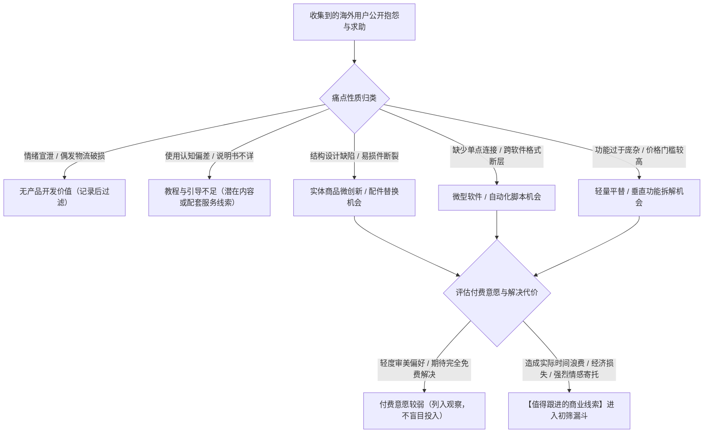
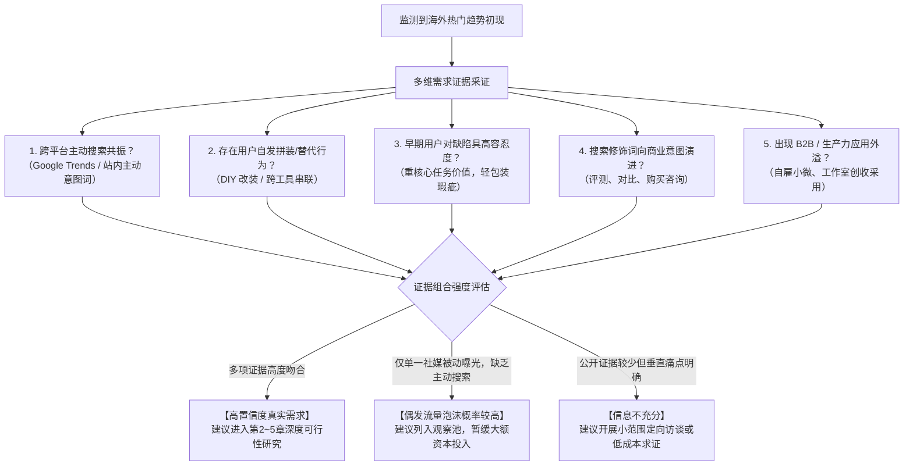
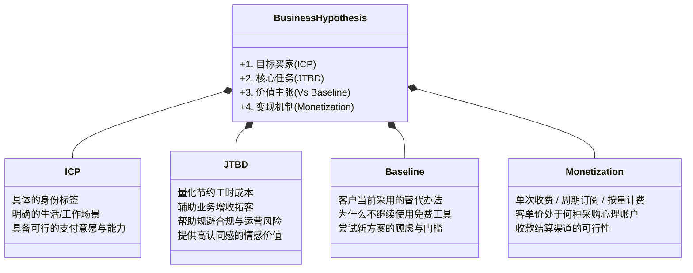

# 1. 我该从哪里找到值得做的生意？

> **正式封板说明（2026-10-18）**：本章沿用独立Writer R2完整稿，经Owner特别授权对事实、假设及法规适用范围作定向修订。文内`MODEL_ASSUMPTION`均是教学假设，非真实市场调研、可保证收益或个人化法律/投资建议。政策与产品条款以对应来源、地点及日期为准。

> **【本章导读与定位说明】**
>
> 很多中国大陆的出海创业者、个人开发者和中小跨境商家，在迈向全球市场时往往容易受制于两种思维误区：
> - **“自嗨式造车”**：根据个人的主观喜好或单纯的技术执念闭门研发数月，产品推向海外后才发现用户痛点并不迫切，甚至市场上早已有体验更好且免费的替代方案；
> - **“盲目追逐爆款”**：在社交媒体上看到某个产品播放量暴涨，或者在第三方选品软件上看到某组关键词热度飙升，便急于投入资金备货或开发同类产品，结果遭遇知识产权封锁、平台规则限制或流量骤降，造成沉没损失。
>
> **本章的核心任务，是帮助读者建立一套理性、客观且可操作的“跨境商业机会发现与初筛方法论”。**
>
> 值得投入研究的商业机会，往往源自海外客户对现有方案的真实困扰、国际供应链与平台底层规则的结构性重组，以及中国制造业与数字化实践向海外转移的场景落差。本章将指导读者在公开生态中系统捕捉这些早期商业线索，并在投入实质性资源之前，运用理性的初筛工具排除不适合自身资源禀赋的高风险方向。
>
> **【知识边界与章节分工声明】**
> 本书第一部分《机会挖掘与市场判断》共设八章，构成循序渐进的研究与决策链条。本章明确专注于**“商业机会线索捕获与可行性初筛（Opportunity Discovery & Initial Triage）”**阶段：
> - 目标买家的精准画像、生活与工作场景深剖及付费驱动力分析，由 第2章《谁会买我的东西，为什么愿意花钱？》 展开；
> - 现有竞品的替代方案、差评深度挖掘与客户迁移成本评估，由 第3章《别人已经在卖了，我还有机会吗？》 展开；
> - 市场大盘容量的量化测算、长期趋势持续性与国别优先级排序，由 第4章《这个市场有多大，还能做多久？》 展开；
> - 定价策略、毛利模型、全链路成本精算与现金流回款节奏，由 第5章《这门生意到底能赚多少钱？》 展开；
> - 知识产权深度检索、各国强制合规认证与平台禁限售规则审查，由 第6章《这门生意有哪些不能忽视的门槛？》 展开；
> - 真实场景下的最小可行性付费测试与订单真伪鉴别，由 第7章《怎么用最少的钱，验证客户真的会买？》 展开；
> - 多项目横向加权评估、资源取舍决策与止损退出机制，由 第8章《好几个方向都不错，我究竟该做哪个？》 展开。
>
> 此外，涉及网络环境配置（第二板块）、海外主体设立与支付税务处理（第三板块）、产品系统搭建（第四板块）以及海外全渠道获客运营（第五板块）等专业工程，均在后续对应板块中提供专门指引。本章聚焦于“线索发现、真实需求辨识、商业价值初验与业态禀赋匹配”，不越界展开后续章节的深度测算与实操。


## 1.1 有哪些渠道能帮我发现新的生意机会？

在全球化商业语境中，商业机会从来不是凭空产生的。所谓生意机会，本质上是**市场上尚未被充分满足的客户需求与现有产品供给之间存在的结构性差距**。

对于资源有限的中国大陆独立开发者、独立站经营者与中小跨境商家而言，我们既没有海量资本去凭空创造全新的消费习惯，也难以在线下铺开大规模的跨国实地调研。最为务实且低成本的起步策略，是在公开网络生态中做一个敏锐的商业线索捕获者。

具体而言，高置信度的生意线索主要源自三大维度：
1. **需求端的负向反馈**：客户在公开场景中自发表达的困扰、缺陷抱怨、求助与寻找替代方案（1.1.1）；
2. **供给端的动态位移**：供应链采购流向、国际贸易动向与平台底层技术规范的调整（1.1.2）；
3. **跨地域的势能落差**：中国成熟的细分制造业供应链、数字化工作流与新技术应用，在海外特定场景下的新用途开发（1.1.3）。

---

### 1.1.1 海外客户在哪些地方反复抱怨、求助或寻找替代品？

满意的人往往保持沉默，而不满的人总在寻找倾诉渠道。**海外客户在公开网络上的反复抱怨、公开求助以及主动寻找替代品（Alternative）的行为，是市场现有方案存在未解痛点的直接体现。**

然而，很多出海初学者容易在泛娱乐的社交媒体推荐流中耗费大量时间，收集到的往往是情绪化的碎片言论。真正具备高商业信息密度的阵地主要分布在以下四类公开生态中：

#### 1. 高信息密度的需求挖掘阵地

##### ① 垂直讨论社区与论坛（Reddit、垂直兴趣社群、技术交流版块）
Reddit 是全球英文互联网重要的用户讨论社区之一，用户基于共同的职业、爱好或生活方式组建了成千上万个 Subreddit（子版块）。与受公关机制控制的商业页面相比，Reddit 上的讨论往往更加直接，细节也更为丰富。
- **代表性 Subreddit 示例**：
  - 硬件耐用性与产品缺陷讨论：`r/BuyItForLife`（讨论哪些产品经久耐用、哪些传统品牌因设计退化或材料缩水引发不满）；
  - 软件与数字工具痛点讨论：`r/software`、`r/SaaS`、`r/SideProject`、`r/selfhosted`；
  - 垂直小众生产力圈子：`r/3Dprinting`、`r/HomeNetworking`、`r/productivity`、`r/smallbusiness`。
- **垂直论坛与问答平台**：Quora（特别是带有“What is the best alternative to...”标签的高关注度问题）、垂直手艺或生活方式论坛（如木工论坛 LumberJocks、房车露营论坛 iRV2 等）。

##### ② 电商平台评价区（重点关注 2~3 星中评区）
在亚马逊或各类品牌独立站上，很多卖家习惯只看平均评分或只看 1 星差评。但在产品研究中：
- **1 星差评**往往包含较多非产品本身的偶然事故，例如物流暴力运输造成的包装破损、配送延误或客服沟通摩擦，这些属于履约端问题，对产品本体的改良启发相对有限；
- **2 星与 3 星中评**往往是产品微创新的关键线索库。给出中评的买家通常实际且深度地使用了产品，认可其基础功能，但对某个具体的设计缺陷或缺失细节感到失望。他们往往会在长篇评价中指出具体问题（例如：“这款便携吸尘器的吸力符合预期，但集尘盒的卡扣塑料材质较脆，多次拆卸清理后容易断裂，且官方并未提供单独的可替换配件”——这就提示了一个具体的结构改进或配套配件供给机会）。
- **第三方信誉点评平台**：Trustpilot（`trustpilot.com`）、Sitejabber 等。在这些平台上检索海外知名品牌，用户针对“功能捆绑强迫升级”、“取消订阅困难”或“基础配置过于繁琐”的抱怨，能够暴露出老牌玩家在服务或产品层面的薄弱环节。

##### ③ 软件与数字化生态专业评测阵地
对于独立开发者与数字资产创作者而言，专业软件评测网站是发现微型工具（Micro-SaaS）与替代产品的有效源泉：
- **B2B 软件评测网**：G2（`g2.com`）、Capterra（`capterra.com`）。查看中小企业对成熟管理软件（如大型 CRM、项目协作软件、财务系统）的负面反馈，常见抱怨往往集中在：“系统过于庞大，中小团队常用的仅有两三个功能，却必须支付全套昂贵版本”、“操作逻辑复杂，需要专门配置管理员”。这提示了**“反向拆解（Unbundling）巨头，聚焦单一核心任务”**的轻量化工具机会；
- **平台专属应用市场**：Shopify App Store、WordPress Plugin Directory、Chrome Web Store。查看热门插件最新几个月的评论，凡是出现“更新后出现兼容故障”、“原作者停止维护”、“基础版突然改版为高门槛收费”的条目，都意味着市场上出现了一批面临工具迁移需求的用户。

##### ④ 开发者与创客社区的开放讨论
- GitHub Issues 与 Discussions：很多用户在开源项目下方提出“希望支持特定文件格式转换”或“缺乏某种数据库连接器”；
- Product Hunt、Indie Hackers：新产品发布后的交流区中，经常有早期专业用户留言指出“产品理念不错，但如果能针对某一细分行业解决具体导出问题，才更愿意长期付费”。

---

#### 2. 结构化检索布尔语法与实操记录指南

在搜索引擎中挖掘需求线索时，可以通过布尔搜索语法（Boolean Search Operators）过滤无关干扰。需要说明的是，**不同搜索引擎、目标平台算法更新及用户地域偏好可能会影响最终的检索结果收录**，建议读者将其作为结构化的检索思路，并建立自己的调研记录表。

```text
# 语法 1：定向挖掘某款已知工具的替代品讨论（适用通用行业）
site:reddit.com "[目标品牌或产品名称]" ("alternative" OR "replacement" OR "switch from" OR "tired of")

# 语法 2：挖掘用户的工具求助与未满足诉求（适用软件与数字工具）
site:reddit.com ("I wish there was a tool" OR "is there a plugin that" OR "frustrated with" OR "why is it so hard to") "[特定应用场景]"

# 语法 3：挖掘平台插件生态中的功能缺失与定价抱怨（以 Shopify 为例）
site:apps.shopify.com "[竞争插件名称]" ("too expensive" OR "missing feature" OR "doesn't support")

# 语法 4：挖掘独立品牌在第三方评价中的高频痛点（适用实体商品与服务）
site:trustpilot.com/review/[目标品牌域名] ("broken" OR "poor quality" OR "disappointed" OR "design flaw")
```

**【实操建议：建立线索观察记录清单】**  
检索时建议使用表格记录以下关键字段，避免沉溺于零散的信息流中：
1. **线索来源与链接**（如 Reddit 具体帖子链接、评测页面）；
2. **用户原发痛点描述**（用户究竟在什么具体场景下遇到了什么困难）；
3. **涉及的代价类型**（是消耗了额外工时、造成了业务损失、还是属于外观偏好）；
4. **现有替代方案情况**（用户目前是如何勉强解决的，是否有成熟免费工具）；
5. **初步归类与备注意见**。

---

#### 3. 评价情感挖掘方法论：从抱怨中识别真实商业价值

在收集到用户的负面反馈后，关键在于建立**“痛点价值评估过滤器”**，理性区分情绪宣泄与具备商业潜力的刚需：



**核心判别逻辑：区分“口头抱怨”与“实际付费动力”**
- **低付费动力的抱怨**：用户对某款免费工具界面配色表示不满，或者希望某款日用品增加小众颜色。这类诉求多属于个人的审美偏好或对免费产品的无尽期望，一旦要求其付费，转化往往面临较大阻力；
- **高付费动力的痛点**：通常体现为两类：
  1. **理性经济价值**：用户在反馈中明确提到了**可衡量的代价**，例如“每周需要花费数小时手动搬运数据，且容易出现账目错误”、“由于缺少合适的转接配件，昂贵的整套设备无法正常运转”。凡是涉及**时间节约、经济减损、安全合规保障**的问题，用户更具动力采购成熟解决方案；
  2. **高强度情感与个性化价值**：涉及宠物关怀、纪念性礼品、小众文化认同等场景，虽然缺乏量化的工作效率产出，但其提供的情感抚慰与归属感同样能够支撑较高的商业溢价。

---

#### 4. 四类业态的实操映射教学示意

> **【教学示意说明（`MODEL_ASSUMPTION`）】**  
> 以下四类场景中的用户反馈表述为教学演示用的综合归纳模型，用于展示如何从公开信息中提取产品微创新思路，并非真实的特定商业机构实测记录。

| 业态类型 | 用户抱怨与求助场景（教学示意：`MODEL_ASSUMPTION`） | 提炼出的微创新切入方向 |
| :--- | :--- | :--- |
| **实体商品** | 户外与桌面工具爱好者在论坛反馈：“多款热销便携雕刻机原装线缆与滑轨缺乏稳固卡扣，移动时容易刮碰，且市面缺乏标准适配配件。” | 针对特定主流型号开发耐磨卡扣与线缆导向配件包，以轻量配件为切入点。 |
| **数字产品** | 远程自由职业者社群反复讨论：“市面现成财务模板多基于单一法币设计，跨国承接多币种订单时汇率核算与提现手续费记录繁琐。” | 制作面向跨国自由职业者的“多币种智能换算与结算对账数字化表格模板包”。 |
| **软件/工具** | 小型外贸工作团队在 B2B 评测网反馈：“主流企业级客户邮件追踪系统费用过高，且强制捆绑全套营销自动化套件，小团队只需轻量追踪。” | 打造单功能浏览器扩展：仅专注于单个用户的出海邮件阅读状态追踪与快捷模版插入。 |
| **跨境服务** | 小型电商站长在讨论区求助：“希望接入拉美或东南亚本土小众本地支付方式，但缺乏懂技术对接的人员，海外大型外包公司起步报价过高。” | 提供“固定服务范围、明确交付周期”的标准化支付接口联调与基础环境排错服务。 |

---

### 1.1.2 现有商品的销售、采购和供应变化，能透露什么生意机会？

如果说用户的抱怨体现了下游终端的需求波动，那么**国际贸易流向、供应链采购及平台基础设施的变化，往往在更早的阶段传递出供需格局的调整信号**。

对于中国大陆的创业者而言，身处全球品类齐全、响应敏捷的制造与工程交付网络中，理解供应端的信息变化，有助于在市场格局成熟之前捕捉到早期的切入机会。

#### 1. 国际海运舱单与贸易数据的观察价值与使用边界

在跨境大宗货运中，货物的装船出运通常先于海外零售终端的集中爆发。然而，很多初学者对海关提单数据的获取权限和应用边界存在误解，在此需明确区分：

##### ① 明确数据来源与获取机制
- **美国海关与边境保护局（U.S. CBP）Automated Commercial Environment (ACE)**：  
  ACE 是美国海关官方用于处理进出口货物申报、税费清算与边境执法的专业电子系统。根据 CBP 官方规范（参考 `https://www.cbp.gov/trade/automated/how-to-use-ace`），**ACE 是为获得授权的进出口商、报关行及承运人提供的法定申报处理平台，并非对公众开放任意查询每家企业商业机密的公开搜索引擎**；
- **法定海运舱单公开信息与保密规则**：  
  依据美国联邦法规（19 C.F.R. § 103.31）与 19 U.S.C. § 1431，入境海运船舶的提单舱单（Vessel Manifest）属于法定可向公众或商业机构披露的数据范围，但**进出口企业有权依法向海关提交保密申请（Confidentiality Request）**，隐藏其发货人与收货人名称（参考 `https://www.cbp.gov/trade/automated/electronic-vessel-manifest-confidentiality`）；
- **商业数据聚合工具（如 ImportYeti、Panjiva、Datamyne）**：  
  市场上常见的提单查询工具，是通过合法渠道购买并清洗海关公开披露的海运舱单数据。使用这些商业工具时，应理性认识其客观局限：通常仅覆盖海运货柜（空运与跨境小包专线多未纳入）、存在数据更新时滞、且申请了保密的企业信息会被脱敏。

##### ② 如何正确使用贸易物流线索
- **观察供应链采购与出货频次**：若通过公开提单数据观察到海外某个新兴细分品牌在近几个季度保持稳定的海运采购批次，可作为其业务处于扩张阶段的一项参考线索；
- **边界提示：发货量不等于实际终端利润**：海运集装箱的到港量仅代表**海外企业的上游备货动作**，并不能直接推断出其零售终端的实际动销速度、真实退货率或扣税后的净利润。企业也可能因误判市场而造成集装箱货物积压在海外仓。因此，物流数据只能作为**“先行供需线索”**，绝不能作为拍板投资的唯一依据。

#### 2. 源头供应链采办市场的信号捕捉

国内成熟的 B2B 平台（如 1688 跨境专区、阿里国际站商机市场）是全球小微贸易的重要信息汇集地：
- **热搜品类与采购趋势异动**：关注“跨境热搜词”中搜索量环比攀升、但现有稳定供货商家相对有限的细分产品；
- **采购需求（RFQ）中的参数变化**：观察海外买家在定制询盘中反复提出的特殊参数（例如对无塑包装、特定生物基环保材质、特定电压插头规格的要求）。这往往反映了海外特定国家在市场准入或环保偏好上的最新转向。

#### 3. 零售平台的变动榜单与“互补品（卖水人）策略”

电商零售平台公开的销量与趋势榜单，能够直观反映近期的产品热度：
- **Amazon Movers & Shakers（飙升榜）**：  
  根据亚马逊官方卖家指导页面（参考 `https://sell.amazon.com/blog/product-ideas`），Movers & Shakers 榜单展示的是过去 24 小时内销售排名（Best Sellers Rank）提升最快的商品，定时更新。研究该榜单有助于快速感知突发需求（如季节转换、特定社会活动带来的用品需求）；
- **“互补品（卖水人）策略”**：  
  对于缺乏海量资金打消耗战的中小商家而言，当市场上某款主设备（如新型智能手机、微型无人机、专业游戏手柄）热销时，直接跟风生产主设备往往面临专利封锁与重资产压力。更为稳妥的切入方式是**寻找主设备的互补衍生品**——例如专用保护套、收纳底座、线缆转接器、防尘盖或入门级教学指南。互补品通常开模成本更轻、试错成本较低，能够依托主设备的市场基数实现伴随式销售。

#### 4. 平台底层基础设施与技术规范的调整

在软件、浏览器扩展及电商应用生态中，底层技术平台的规则迭代往往会催生结构性的替代需求：

##### ① 浏览器扩展底层规范的迁移
- **客观事实依据**：Google Chrome 推进从 Manifest V2 向 Manifest V3 架构的过渡（参考 Chrome 开发者官方时间表 `https://developer.chrome.com/docs/extensions/develop/migrate/mv2-deprecation-timeline`），对后台服务工作进程（Service Workers）和网络请求拦截机制（Declarative Net Request API）提出了全新技术要求；
- **商业机会初筛启示**：对于仍依赖 Manifest V2 且希望在新版 Chrome 持续运行的扩展，开发者通常需要评估并迁移相关实现；具体修改范围取决于既有功能和所用 API。市场上部分长年缺乏维护的老牌扩展因未能及时适配新架构而面临停更或功能受限。对于技术敏捷的个人全栈开发者而言，关注那些用户基数较大但因架构调整出现使用障碍的工具类目，针对新规范开发轻量、高效的替代工具，是一个具有技术切入点的方向。但必须注意，**实际的用户迁移依然高度依赖产品品质、隐私合规与持续的运营分发**，技术升级本身并不自动带来保证的下载量。

##### ② 电商平台系统接口的演进
- **客观事实依据**：根据 Shopify 开发者平台官方文档（参考 `https://shopify.dev/docs/api/admin-rest`），Shopify 将 REST Admin API 标记为 Legacy（遗留状态），并要求自 2025 年 4 月 1 日起提交至 Shopify App Store 的新公共应用必须采用 GraphQL API；
- **商业机会初筛启示**：底层 API 的架构升级促使整个应用生态进行重构。对于新入场的开发者，直接基于现代化的 GraphQL 规范开发符合平台最新架构规范的轻量小插件，有助于在应用性能和未来接口兼容性上保持规范性。

#### 5. 跨国法规与环保政策变动带来的供需调整

政策法规的演变是重塑全球供应链的重要外部力量：
- **欧盟包装与包装废弃物法规（PPWR / EPR 机制）**：  
  根据欧盟委员会环境总署关于包装废弃物的现行与发展政策（参考 `https://environment.ec.europa.eu/topics/waste-and-recycling/packaging-waste_en`），欧盟持续推行生产者责任延伸制度（EPR），各成员国（如德国包装法 VerpackG、法国包装合规系统）对投放市场的包装材料回收、可回收设计及注册追溯提出了严格要求；
- **理性看待市场影响**：  
  欧盟《包装与包装废弃物法规》（Regulation (EU) 2025/40）于2025年2月11日生效、2026年8月12日起适用；部分具体要求另有分阶段实施安排。它可能改变产品包装设计、材料选择、生产者责任及市场准入成本，从而形成对可回收设计、包装材料和合规支持的潜在需求线索，但**不能仅凭法规出台就断言某种包材销量必然增长或某类咨询服务一定盈利**。商家是否需要登记、申报、支付生产者责任费用或承担其他义务，要按其实际身份（例如生产者、进口商、分销商、跨境远程销售者）、投放成员国、包装类型和各条款实施时点判断；不应把每个向欧盟销售商品的商家都视为承担完全相同义务，更不能把欧盟规则当作美国统一要求。具体资格与申报操作详见第6章。参考欧盟委员会：https://environment.ec.europa.eu/topics/waste-and-recycling/packaging-waste_en 。

---

### 1.1.3 国内已有的产品、做法或新技术，哪些可能在海外有新用途？

很多出海初学者对“时光机理论”的理解较为单一，简单将其等同于“将国内低价小商品直接搬到海外平台”。在当下的跨境商业环境中，更有价值的视角是**“不对称能力转移”**：**将中国成熟的细分制造业供应链反应速度、高度内卷打磨出的数字化工作流工具，与海外特定生活环境、高昂人工成本以及不同的消费习惯进行对接。**

#### 1. 实体制造细分与海外生活场景的跨文化融合

中国制造业具备极强的微创新与快速迭代能力。很多在国内属于普通工业配套或极度内卷的微型硬件，在融入欧美的居住环境与生活方式后，可能展现出不同的应用价值：

##### ① 桌面级小型加工设备：从“工业辅助”到“车库手工创收”
- **场景差异解析**：在国内，小型桌面激光雕刻机、小型 CNC 雕铣机主要用于小型五金车间打样或创客实验室；  
  而在欧美国家，普遍存在深厚的**车库文化（Garage Culture）与自雇手工艺传统**。大量个人手工艺人、社区礼品定制者利用业余时间制作个性化木质招牌、皮革钱包或定制杯具。对于这些小微经营者而言，操作直观、体积轻巧的桌面级加工设备是一台**“能够辅助个人创收的轻量生产力工具”**。只要为其配套完善的英文操作教程、标准化雕刻参数库以及稳健的固件，产品就能建立起区别于廉价消费电子的专业工具定位。

##### ② 居住与出行环境差异促生的场景化需求
- **独栋庭院与维护习惯**：国内主流城市居民多居住于高层公寓，对落叶清理、排水槽疏通、积雪清扫缺乏日常接触；而在欧美郊区独栋住宅环境中，庭院维护是高频家务。国内针对特定作业研发的轻便低压手持吹吸风机，搭配适宜的庭院落叶收集接口，即可适配当地的日常清理场景；
- **户外房车（RV）与移动旅居场景**：国内面向紧凑型公寓设计的免打孔折叠挂架、阻尼防震收纳箱，由于具备抗震、轻量化与空间复用特性，在海外房车改装（Vanlife）与露营车后备箱收纳场景中，形成了新的使用场景。

#### 2. 成熟数字化工作流与内容生产工具的场景化赋能

中国电商生态在详情页视觉处理、3D 渲染与轻量营销内容制作方面沉淀了大量成熟工作流：
- **电商 3D 渲染与场景素材资产**：海外许多中小独立站站长或独立手艺人缺乏专职美工团队，如果聘请当地商业摄影团队，单次实景拍摄与布光成本相对较高。利用国内成熟的 3D 虚拟渲染技术，将特定产品类目（如餐具、小家具、饰品）的场景模版制作成易于套用的免抠素材包或设计样机（Mockups），能够为海外中小电商店主提供低成本的视觉解决方案；
- **结构化内容生成与分发辅助**：国内电商积累的短视频开头脚本框架、高点击率主图版式规范，可抽象为标准化的设计模版或排版指南，帮助海外中小创作者提高日常运营效率。

#### 3. 垂直业务流程中的技术敏捷封装

海外许多传统中小企业（如地方独立会计师、中介代理、小微报关行）面临着本地定制软件开发费用高昂的现实约束：
- **实用型垂直工具的封装**：针对特定的跨系统数据搬运、文档信息结构化提取（例如从非标准化 PDF 货运单中提取特定报关字段），利用成熟开源框架或商业大模型 API 进行定制化封装，能够帮助小企业主节约重复性的人工录入时间。中小企业愿意为此类能切实节省人力的专用工具支付合理的软件订阅费。

---

#### 4. 警惕“水土不服”：跨国场景移植的排雷自检清单

在考虑将国内现有的产品或商业做法移植到海外时，必须客观评估以下四个维度的现实差异：

```text
【跨国场景移植四维排雷自检表】

□ 1. 物理环境与安全标准核查：
   - 房屋结构差异：欧美木质结构住宅比例较高，对电气温升、阻燃等级（UL/ETL 认证要求）审核严格；
   - 基础参数差异：各国家与地区的公用电网电压与频率不同（如北美 120V/60Hz，欧洲 230V/50Hz）；
   - 尺寸习惯差异：国内偏好极简紧凑，欧美独栋住宅更看重结构坚固耐用与大容量。

□ 2. 人工成本与自助安装核查：
   - 国内用户习惯“包送包安装”，而欧美等地区因上门工时费昂贵，高度依赖自主安装（DIY）；
   - 产品若需复杂布线或专业管道改造，容易因高额安装费用抑制购买欲望；
   - 产品设计应尽量支持模块化替换，并附带清晰易懂的图文或视频装配说明。

□ 3. 隐私保护与数据合规核查：
   - 涉及智能硬件麦克风、摄像头常开、位置追踪等功能，必须严格遵守欧盟 GDPR、美国加州 CCPA 等隐私法律规范；
   - 严禁未经用户明确授权擅自收集或回传非必要个人数据。

□ 4. 支付与交易交互习惯核查：
   - 适应海外以独立域名官方网站、电子邮箱通知、主流信用卡自动扣费及国际第三方支付为主的结算体系；
   - 明确建立清晰透明的退换货政策与用户服务条款。
```

---


#### 机会线索的原始证据卡（立项前最低要求）

每条线索记录：**原始网址、实际发布时间与采集日、目标国家与人群、原话/原始数值、证据类别（观察/自述/实际交易）、是否同源转载、可能反证、复核日期**。同一新闻被五个平台转发只是一组来源，不能算五条独立需求证据；公开抱怨不能替代付款证据。遇到未知标 `UNKNOWN`，并注意目标站点访问条款及个人隐私；早期人工记录少量可追溯来源即可，不以建设爬虫为前提。

## 1.2 看到一个热门产品或新趋势，怎么判断值不值得研究？

在算法推荐与病毒式内容分发极其发达的今天，跨境从业者每天都会接收到大量“热门风口”的信息轰炸：
- 某款减压小玩具在社交媒体上获得了千万级播放，看似引发了广泛讨论；
- 某款基于大模型的微型工具在海外开发者社区热度高涨，引来大量同行围观；
- 亚马逊特定类目新品榜上某款商品排名短期内迅速跃升。

面对这些瞬息万变的网络热点，创业者容易产生“错失恐惧（FOMO - Fear of Missing Out）”，担心稍慢一步便被市场淘汰。然而，客观的商业实践表明，许多短期爆火的现象只是偶发的流量热潮——若在未经初筛的情况下贸然投入资金开模、批量备货或开发软件，往往容易在热度消退后陷入沉没成本难以收回的困境。

**商业机会初筛的第一道基本功，不是盲目追赶每一个热点，而是建立理性的甄别与排雷标准。**

本节旨在建立一套适合个人与中小团队的初筛分析方法：先通过多维证据识别爆红背后是否存在相对稳固的底层需求（1.2.1），再结合自身的资源与合规承受力，理性排查那些存在重大进入障碍的高风险方向（1.2.2）。

---

### 1.2.1 爆红之后，有什么迹象说明背后可能是真实需求？

要判断一个热门趋势是否值得立项展开可行性研究，核心在于**穿透算法推荐池带来的偶发流量表象，观察其背后是否具有长期的真实需求支撑**。

社媒上的高点赞或高播放量，很多时候仅反映了受众的猎奇心或消遣心理；而一个能够支撑稳健商业运作的方向，必须在用户的实际生活使用或商业工作流中形成解决问题的闭环。

以下五个维度的观察指征，构成了评估热点背后需求扎实程度的**“多维证据组合库”**。在实际调研中，不同类别的产品所表现出的信号形态各有侧重，创业者应结合证据强度进行综合评估，而非将其作为僵化的绝对门槛：



#### 1. 跨平台意图共振（Cross-Platform Intent Resonance）
- **现象特征**：真实的需求通常不会长期仅局限在单一封闭的短视频信息流中；
- **验证逻辑**：如果某个产品在社交媒体被动推荐流中播放量极高，但用户在离开该平台后没有任何主动探索，这多属于被动娱乐流量；  
  相反，如果该现象在社交媒体曝光后，**在需要用户主动键入关键词的高意图平台上同步出现明显波动**：
  - Google 搜索趋势（Google Trends）中相关问题或用途词呈现持续的爬升态势；
  - 亚马逊、Etsy 等电商平台的站内搜索框（Search Suggestion）自动联想出相关型号与配件词汇；
  - 垂直论坛、社区中开始出现大量寻求购买渠道或真实体验的讨论帖。
- **研判参考**：从“算法被动喂养”走向“全网主动检索”，是用户形成真实购买意图的重要参考指征。

#### 2. 自发性“拼装与妥协”行为（Spontaneous Workarounds）
- **现象特征**：在市场上缺乏现成、完善的成熟商品之前，部分刚需用户已经开始用手头现有的简陋工具进行手工拼装或组合替代；
- **实战观察案例（教学示意：`MODEL_ASSUMPTION`）**：
  - **硬件领域**：在某类新型露营灯具普及专用磁吸支架前，部分资深露营爱好者在论坛分享如何用工业胶带与五金强磁环手工自制底座；
  - **软件领域**：在主流跨境财务软件支持某项小众税表导出前，部分小商家自发使用自动化连接工具串联电子表格并手工编写脚本，即使经常出错也坚持使用。
- **研判参考**：当用户愿意付出额外的时间与动手成本去拼凑替代方案时，往往说明该场景下的痛点具有实质性。此时若能提供一个开箱即用的标准化产品，更容易被这些承受高摩擦成本的存量用户所接受。

#### 3. 用户对早期产品缺陷与摩擦的相对高容忍度（Tolerance for Friction）
- **现象特征**：早期试水某种新形态产品的买家，其评价呈现出“宽容非核心瑕疵、高度认可核心用途”的特征；
- **评价观察要点**：
  - 观察第一批进入该领域的先行产品评价，若发现不少买家反馈：“虽然包装较为简陋、配送等待时间偏长，但它确实解决了长期困扰我的特定清理难题，值得肯定。”
- **研判参考**：这种反馈表明产品所提供的**核心任务价值（Core Job Value）**显著覆盖了其交付过程中的琐碎摩擦。后来者只要在供应链品控、包装体验或配送时效上做出针对性改善，便具备了良好的优化空间。

#### 4. 搜索修饰词向商业意图演进（Search Intent Evolution）
关注用户在搜索引擎中使用的关键词修饰语是如何从泛好奇向交易决策迁移的。搜索词的语义结构直观反映了受众的决策深度：

| 认知演进阶段 | 用户搜索词典型形态（教学示意） | 市场状态与初筛研判 |
| :--- | :--- | :--- |
| **阶段一：泛好奇期** | `"what is [名词]"`、`"funny [名词] video"`、`"[名词] trend"` | 偏向社媒话题与娱乐围观，直接商业价值不确定，不宜盲目备货。 |
| **阶段二：方案探索期** | `"best [名词] for [具体场景]"`、`"[名词] review"`、`"[名词] vs [竞品]"` | 用户开始主动评估解决路径并比对优劣，商业需求逐步显现。 |
| **阶段三：交易决策期** | `"where to buy [名词]"`、`"[名词] price in [国家]"`、`"[名词] in stock"` | 用户已产生明确购买意图并比价，商业变现土壤相对成熟。 |
| **阶段四：专业外溢期** | `"[名词] for commercial use"`、`"[名词] for small business"` | 从普通个人消费向生产力工具延伸，往往具有更高的客单价支撑力。 |

#### 5. 商业化与专业应用外溢（Prosumer & B2B Spillover）
- **概念解析**：所谓 Prosumer（专业级消费者 / 产消合一者），是指将消费级产品用于个人创收或专业创作的用户群体；
- **现象特征**：某个原本面向大众消费者的趣味性产品，开始被自由职业者、小型工作室或自雇人士引入日常营利性工作流中；
- **研判参考**：一旦消费级热点出现生产力外溢，客户的购买逻辑将从“可有可无的情感开销”升级为“能够帮助业务节省工时或创造收入的投资性支出”。这类需求通常具备更强的抗周期能力与更健康的预算空间。

---

### 1.2.2 哪类明显障碍，足以让我先放下这个热门方向？

在商业初筛中，**“识别自身资源与能力的边界”**与“寻找好点子”同等重要。

对于资金储备有限的个人开发者、或者初创期的小微跨境团队而言，并非所有具备真实需求的热门赛道都适合进入。某些方向虽然大盘规模可观，但在资本门槛、平台依赖度、法律合规责任以及获客经济学上存在客观壁垒。如果在初筛阶段未做排查，创业者可能会在后续推进中面临现金流断裂或法律纠纷。

在开展深入的竞品拆解（第3章）或资金投入之前，建议对照以下四个维度的**“前置风险与资源门槛评估”**进行系统自检：

#### 1. 资金周转与重资产壁垒评估
- **前期研发与开模成本占比过高**：某些实体硬件涉及复杂的多色注塑模具、精密金属压铸或高精度光学构件，前期工程打样与开模费用高昂，如果这笔支出一旦失败就会侵占必要的生活费、运营周转金或下一轮修模的现金缓冲，团队就可能没有足够资金改进首版设计；
- **供应链起订量（MOQ）与现金周转周期失衡**：工厂端要求单批次起订数千件，不仅占用大量流动资金，且叠加“生产周期 + 国际干线物流 + 平台海外仓上架 + 平台回款账期”，全链路资金周转若超过数月，对于缺乏持续外部融资的小微企业而言，现金流极易发生断裂；
- **初筛建议**：对于初期资金有限的团队，宜优先选择公模微改、模块化配件组装、按需打印（POD）或轻小件产品，控制单次试错的资金风险。

#### 2. 平台依附脆弱性与“原生功能内置（Sherlocking）”风险
- **利用平台灰色机制与非官方接口**：某些软件或工具产品依赖于抓取第三方平台未公开的内部接口，甚至绕过官方访问控制机制。这类业务模式在法律上存在合规隐患，且平台只需在常规安全更新中调整接口协议或验证机制，外部工具便会面临不可用风险；
- **被平台原生功能吸收内置的风险（所谓“Sherlock 效应”）**：
  > **【概念背景说明】**  
  > “Sherlock 效应”源自早期 macOS 生态中，苹果系统更新推出了原生搜索工具 Sherlock 3，其功能直接覆盖了第三方知名软件 Watson 的核心功能。这一现象在当代操作系统、大模型基座及大型电商平台生态中依然普遍存在。
- **初筛建议**：如果一个产品仅仅是在巨头产品界面上增加一个悬浮按钮，或者仅是对大模型官方功能进行极其浅层的界面封装，且该功能属于平台官方后续版本演进的必经之路，那么缺乏独立业务壁垒的工具极易在平台版本升级后失去价值。

#### 3. 监管合规责任、强制认证与专利壁垒排查
- **高合规责任消费品类目**：
  - **儿童与婴幼儿用品**：美国 CPSC 对**主要为12岁及以下儿童设计或预定使用、且受其执行的儿童产品安全规则约束**的商品，要求相关责任制造商或进口商依据适用要求签发儿童产品证书（CPC）。证书一般以 CPSC 接受的第三方实验室测试结果为基础，但具体规则存在豁免、例外、组件测试及部分小批量生产商的特殊规定；**免做某项测试不必然等于免于签发 CPC**。对于输美进口产品，适用时还需核查2026年7月8日起的证书电子申报要求。应先核定商品年龄定位、具体适用规则、责任角色与可能的检测豁免，再估算成本，不能推断“所有儿童用品必须做全部第三方检测”或“任何卖家都必须独立签证”。参考 `https://www.cpsc.gov/Business--Manufacturing/Testing-Certification/Childrens-Product-Certificate`；
  - **食品接触、人体摄入与局部涂抹类**：受各国食品药品监管机构（如美国 FDA、欧盟 EFSA 及相关化妆品法规）严格监管，违规经营面临严厉的下架处罚与法律连带责任；
  - **带电产品与大容量电池**：可能涉及运输试验、危险品运输规则和目的国产品安全要求；例如锂电池常需要按适用规则核查 UN38.3 测试摘要等文件。CE是特定欧盟协调法规下的符合性标志，UL不是所有美国电气产品的普遍强制认证；应按产品分类与销售地逐项核定。
- **专利壁垒与侵权风险**：某些类目虽然销售火爆，但早期入局的大品牌或专业专利运营机构可能已针对核心外观结构或工作原理建立了密集的专利布局。中小团队在立项初筛时，应通过专业专利检索工具（如 Google Patents）初步排查是否存在高度相似的有效外观专利，避免产品到港后遭遇侵权诉讼（详细检索指引见第6章）。

#### 4. 获客经济学与商业模式独立性评估
- **纯通用关键词投放的死循环**：产品形态极度简单且高度同质化，完全依赖在主流广告平台购买通用大词竞价流量。如果该行业平均单次点击成本（CPC）较高，而产品本身客单价微薄且缺乏用户复购，单笔交易毛利在数学上可能无法覆盖获客支出（具体测算见 1.3.2 节）；
- **初筛建议**：缺乏自然流量入口、没有私域裂变机制且客单价极低的产品，不宜盲目采用大规模付费买量作为核心商业假设。

---

#### 【实操工具：热门方向资源匹配与风险分级排查表】

在看到具有吸引力的趋势时，建议使用下表对项目进行前置自检，评估该方向与自身当前阶段的匹配程度：

```text
【热门方向资源匹配与风险分级排查表】

方向名称：____________________      评估日期：________

一、需求线索多元度自检（用于评估需求扎实程度）
[ ] 1. 跨平台主动搜索：Google 趋势或主流平台站内意图搜索词呈现同步波动。
[ ] 2. 用户自发替代行为：在论坛或社群发现用户自行动手组合替代方案的真实讨论。
[ ] 3. 早期用户高容忍度：先行产品买家对核心功能高度认可，对非核心瑕疵表现宽容。
[ ] 4. 商业关键词深化：用户搜索词逐步向型号对比、购买渠道及场景化求助演进。
[ ] 5. 专业生产力外溢：该产品开始被小微经营者或自雇人士用于创收或辅助工作。
结果解读：若多项符合，需求相对扎实；若仅社媒被动曝光且缺乏主动搜索，建议保持观望。

二、进入门槛与风险分级排查（用于评估自身能否承受）
[ ] 风险点 1【资金沉淀】：前期模具与起订量支付后，是否还留有足够的生活费、运营现金和失败重试的缓冲？
[ ] 风险点 2【依附风险】：核心功能是否纯粹依赖第三方平台漏洞，或极易被平台下一版本直接内置？
[ ] 风险点 3【合规资质】：是否涉及高危儿童认证、人体接触摄入审查，或存在明显的有效专利封锁？
[ ] 风险点 4【获客模型】：单笔毛利是否过于微薄，且缺乏任何自然流量、私域或复购支持？
结果解读：
- 任意一项需要重点关注：并不证明该行业不合法，也不必然意味着团队不能进入；应结合风险严重性、能够减轻风险的措施与当前资源重新判断；
- 建议优先选择风险可控、试错成本在自身可承受范围内的细分方向切入。
```

---


## 1.3 有了一个点子，怎么判断它有没有商业价值？

在跨境出海的探索初期，创业者最常遇到的心理陷阱莫过于对初生点子的过度盲信。

很多人在日常浏览网页、使用软件或与朋友交谈时灵光一现，便迫不及待地开始注册公司域名、寻找工厂打样或通宵编写代码。然而，商业世界的实践经验表明：**未经结构化梳理与常识检验的“原始点子”，往往包含大量未经验证的主观假设，盲目投入可能造成不必要的资源浪费。**

一个初步的想法若想升级为值得展开深度调研（第2~5章）的商业课题，必须经历从“模糊设想”向“结构化商业假设”的演进。

本节旨在提供两套低成本、高效率的初筛梳理工具：
- 首先，借助“商业假设四要素画布”，清晰界定买家角色、核心任务、基准对照与收费机制（1.3.1）；
- 其次，运用四项商业常识性排雷测试，在草稿纸上检验商业模式的初步可行性（1.3.2）。

---

### 1.3.1 能否说清谁会买、为了解决什么，以及打算怎么收费？

检验一个商业点子是否具备起步价值，首要标准是：**创业者能否用简洁、务实的语言，清晰完整地说明该业务的核心闭环。**

如果面对“谁会买”、“为了解决什么问题”、“凭什么选择你”、“打算如何收取费用”这些基础追问时，只能给出诸如“所有经常网购的海外用户”、“这是一个革命性的多功能平台”等泛化表述，说明该方向尚处于构想萌芽期，还未形成清晰的商业轮廓。

#### 1. 商业假设四要素画布（The Business Hypothesis Canvas）

建议创业者在立项之初，将自己的构想填入以下四个核心要素组成的结构化画布中：



##### 要素一：目标买家究竟是谁？（理想客户画像 - Ideal Customer Profile / ICP）
- **常见误区**：“所有人都能用”、“海外养宠人群”、“亚马逊电商卖家”；
- **清晰定义**：买家画像必须具备**清晰的身份属性、特定的触发场景、以及现实的决策与支付能力**。
  - 示例对比：不要泛称“养宠人群”，而是聚焦于“居住在北美郊区独栋住宅、家中饲养大型长毛犬、日常需自行清理庭院毛发的中产家庭”；
  - 不要泛称“跨境电商卖家”，而是细化为“在 Shopify 上经营年营业额 5 万至 20 万美元、SKU 数量在 100 个以上、缺乏专职前端开发人员的小型独立站经营者”。

##### 要素二：为了解决什么核心任务？（用户任务理论 - Job-to-be-Done / JTBD）
- **核心逻辑**：管理学家克莱顿·克里斯坦森（Clayton Christensen）提出的“用户任务理论”指出，用户购买一件产品，本质上是为了“雇用（Hire）”它来完成生活或工作中的某项具体任务；
- **价值维度的量化评估**：
  1. **协助增效节时**：例如“将过去需要手动耗费 2 小时的表格整理与多平台格式对齐工作压缩至 10 分钟”；
  2. **辅助增收拓客**：例如“通过页面多语言呈现与本地度量衡适配，改善目标国客户的到店浏览体验”；
  3. **降低合规与经营风险**：例如“在货物出厂发货前，自动核验外箱标签尺寸与条码规范是否满足目标海外仓标准”；
  4. **高认同感的情感价值**：例如“为特定小众手工艺爱好者提供兼具审美质感与收藏属性的定制工具手柄”。

##### 要素三：相比现有基准方案，核心优势何在？（基准对比 - Value vs. Baseline）
- 在任何新产品问世之前，潜在客户都已经习惯了某种现存的处理方式——包括使用成熟竞品、凑合使用免费开源工具、完全依赖手工劳动，或者干脆选择搁置。
- 创业者必须思考：**客户为什么要克服尝试新事物的心理惰性与试错成本，转向你的方案？** 你的产品是在操作流程上更加简明、在总拥有成本上更为划算，还是填补了主流软件不愿兼顾的边缘生态缺口？（深入的竞品与替代方案剖析见第3章）。

##### 要素四：打算怎么收费？（变现机制与商业模式 - Monetization）
- 不同的产品形态对应着不同的变现结构（一次性买断、按月或按年订阅制、按实际调用量计费、或是预收服务费）；
- 设定的价格处于买家的哪类采购预算账户中？是属于冲动消费的小额日常支出、属于中小微商家的日常运营工具预算，还是需要跨部门审批的重大资本采购？（详细的定价与毛利模型测算见第5章）。

---

#### 2. 四类业态商业假设推演教学模型（`MODEL_ASSUMPTION`）

> **【教学演示说明】**  
> 以下四个案例均为用于展示分析框架与推演过程的教学模型（标注为 `MODEL_ASSUMPTION`）。其中涉及的人群设定、价格区间与技术路径均为方法演示，不代表特定企业经过审计的实际经营财务数据。

##### ① 实体商品类商业假设模型（`MODEL_ASSUMPTION`）
- **项目方向**：面向海外木工与创客爱好者的“集尘软管快速磁吸转接模块套件”
- **1. 目标买家 (ICP)**：欧美拥有独立车库工坊、业余从事木艺制作、同时拥有不同品牌台锯与吸尘设备的 DIY 手工爱好者。
- **2. 解决什么 (JTBD)**：解决不同品牌吸尘管与电动工具接口口径不一导致粉尘飞溅、频繁插拔费力的痛点，实现 5 秒内单手磁吸快拆换接，保持工坊清洁。
- **3. 相比基准方案 (vs Baseline)**：官方原厂配件适配范围窄且价格偏高；传统通用胶带缠绕拆卸繁琐。本项目采用高韧性注塑件结合强磁定位环，兼容主流口径。
- **4. 怎么收费 (Monetization)**：套件零售定价 \$29.99 美元一次性销售；主要依托垂直手工社群、木工内容分享与搜索引擎自然流量进行精准触达。

##### ② 数字产品类商业假设模型（`MODEL_ASSUMPTION`）
- **项目方向**：针对 2D 独立游戏开发者的“复古像素风 UI 与音效合规即用素材包”
- **1. 目标买家 (ICP)**：使用 Unity 或 Godot 引擎、独立开发商业化像素游戏、团队规模在 1~3 人且缺乏全职美术音效人员的独立游戏创作者。
- **2. 解决什么 (JTBD)**：省去从零绘制像素控件与调制 8-bit 音效的大量工时，协助项目在早期快速搭建具有良好视觉一致性的可交互原型，并附带明确的免版税全球商用许可。
- **3. 相比基准方案 (vs Baseline)**：相比在自由职业者平台定制外包的高额成本，该素材包定价亲民；相比网上零散免费资源，本套件在色调统一性、网格规范和文件命名上具备开箱即用的工业化标准。
- **4. 怎么收费 (Monetization)**：在 Itch.io、Unity Asset Store 或独立页面以 \$39.00 美元一次性授权销售；平台扣除常规通道与平台佣金后直接回款。

##### ③ 软件/工具类商业假设模型（`MODEL_ASSUMPTION`）
- **项目方向**：面向中小跨境独立站卖家的“公开运费规则与包邮门槛结构化分析工具”
- **1. 目标买家 (ICP)**：主营欧美独立站（Shopify/WooCommerce）、客单价在 \$30~\$100 之间、需要定期调研同行公开运费策略与包邮活动门槛的运营人员。
- **2. 解决什么 (JTBD)**：很多中小卖家不清楚竞争对手公开设置的运费梯级（如满 \$50 包邮与特定地区运费加价），人工手动浏览记录较为耗时。该工具拟在符合目标网站条款、访问控制、内容许可及适用数据保护规则的前提下，整理网站公开发布的 Shipping Policy（运费政策）页面与 FAQ 文本，提取关键梯级并生成结构化对比表格。
- **3. 相比基准方案 (vs Baseline)**：纯手工整理 20 家店铺通常需要数小时；该工具应在目标站点明确允许的访问条件下整理公开信息，不模拟结账、不绕过登录或访问限制。Robots.txt是爬虫访问指导，**并不等于版权、合同或个人数据处理授权**；“秒级处理”仅为待验证的产品目标，非已测表现。
- **4. 怎么收费 (Monetization)**：轻量 SaaS 模式，个人版 \$19.00/月 订阅制；支持主流国际信用卡自动续费。

##### ④ 跨境服务类商业假设模型（`MODEL_ASSUMPTION`）
- **项目方向**：面向欧洲独立站的“小语种语言本土化排版与常见电商体验优化支持”
- **1. 目标买家 (ICP)**：以英语为母语（美/英/澳）的小型独立站卖家，计划向德语、法语国家拓展业务，但缺乏小语种沟通与当地电商习惯理解能力。
- **2. 解决什么 (JTBD)**：解决机器自动翻译带来的语病、专业术语失真、度量衡符号混乱等问题，协助排查常见的基础视觉排版缺陷，改善欧洲本地买家的浏览舒适度。
- **3. 相比基准方案 (vs Baseline)**：传统大型跨国翻译事务所起步门槛较高且流程复杂；该服务提供固定服务范围的标准套餐（如基础站点 \$299.00/次），3 个工作日内交付修改建议清单。
- **4. 业务边界声明**：该服务严格界定为**“语言润色与基础电商用户体验优化”**，明确不承担专业法律合规顾问职责；涉及德国 Impressum 等法定条款时，指导商家采用官方标准模板或委托当地持牌合规机构审核。

---

### 1.3.2 在详细调研前，怎样初步排除没有商业空间的想法？

在完成商业假设的初步梳理后，切忌盲目开启漫长的技术开发或实物备货。在开展深入的买家调研（第2章）之前，建议在草稿纸上使用以下四项**“商业常识试金石”**，对点子的经济合理性进行初步排查：

#### 1. 试金石一：免费公地陷阱排查
- **现象特征**：该需求确实普遍存在，但用户在长期使用习惯中已经形成了**“此功能天然应当完全免费”**的心理认知；
- **典型表现**：例如基础桌面时钟挂件、通用单位换算器、日常简易待办清单或公开新闻简报。主流操作系统（Windows/macOS/iOS/Android）、浏览器及各大基础平台早已将这些基础功能作为免费基础设施内置。如果尝试向普通个人消费者就此类通用功能收费，获客与说服成本将极其高昂；
- **初筛思考**：如果某项功能在市面上已经有大量成熟、无广告且体验优秀的完全免费开源方案，若想实现商业化，必须深入思考：你的方案是否针对极度专业的垂直商业场景提供了能够切实降低合规成本或整合工作流的独特价值？如果缺乏差异化，建议尽早调整方向。

#### 2. 试金石二：初筛型获客经济学常识测试（CAC vs. Unit Economics）

很多初创者在规划业务时，容易陷入“只要产品好就一定能卖出去”的乐观情绪中，忽视了现代数字商业中获客成本与单笔毛利之间的数学制约关系。

以下建立一个**获客经济学草稿纸测算模型（`MODEL_ASSUMPTION`）**，用于在立项前排查单笔经济学逻辑是否自洽：

##### ① 测算公式与参数定义
- **单笔贡献毛利（Pre-Ad Contribution Margin）**：
  $$\text{Gross\_Margin} = P - C - F$$
  - 其中：$P$ 为零售标价（Retail Price）；$C$ 为商品出厂硬件采购、基础包装及头程干线物流成本；$F$ 为支付处理与网关手续费（**本教学模型人为假设**为交易额的 3% 加 \$0.30；并非所有平台、地区或支付方式的通用费率）。
- **单个客户获客成本（Customer Acquisition Cost / CAC）**：
  若拟采用通用付费关键词搜索广告进行冷启动获客，在假定每笔成交对应独立付费获客的简化模型下：
  $$\text{CAC} = \frac{\text{CPC}}{\text{CR}}$$
  - 其中：$\text{CPC}$（Cost Per Click）为单次有效点击成本；$\text{CR}$（Conversion Rate）为落地页购买转化率。
- **广告投流后单笔首单贡献利润（First-Order Contribution）**：
  $$\text{Unit Contribution} = \text{Gross\_Margin} - \text{CAC}$$

##### ② 基准教学场景测算与敏感性对比（`MODEL_ASSUMPTION`）

```text
【基准教学场景：Scenario A —— 假设的低客单价独立站实物商品】
- 设定零售标价 P = $25.00
- 综合生产采购、包装与干线运费 C = $10.00
- 支付通道与网关费估算 F = $25.00 * 3% + $0.30 = $1.05
- 投流前单笔毛利 Gross_Margin = $25.00 - $10.00 - $1.05 = $13.95
- 付费广告冷启动参数假设（教学基准设定）：
  - 设定平均单次点击成本 CPC = $1.50
  - 设定落地页转化率 CR = 2.0%（即每 100 次点击产生 2 个成交订单）
- 获客成本计算：
  CAC = CPC / CR = $1.50 / 0.02 = $75.00
- 单笔首单贡献利润：
  Unit Contribution = Gross_Margin - CAC = $13.95 - $75.00 = -$61.05
  【结论】：在此模型设定下，每通过付费广告卖出一单，首单贡献为负 $61.05（不等于企业最终净利润）。

【敏感性对比场景：Scenario B —— 更低客单价轻量数字商品/微型配件】
- 设定零售标价 P = $15.00，综合履约与网关成本 C + F = $7.00 -> Gross_Margin = $8.00
- 保持相同付费获客参数（CPC = $1.50, CR = 2.0% -> CAC = $75.00）
- 单笔首单贡献利润：
  Unit Contribution = $8.00 - $75.00 = -$67.00
  【结论】：客单价越低，单笔毛利对获客成本的承压能力越弱，首单亏损进一步扩大至 -$67.00。
```

##### ③ 教学意义与初筛启示
> **【重要逻辑说明】**  
> 上述模型中的转化率（2.0%）与点击成本（\$1.50）均为用于说明经济学机制的教学假设，实际市场中不同国家、不同类目的广告竞价与落地页转化率存在较大差异。  
> **这一测试的核心启发在于**：对于**上述假设参数组合下**的低客单价、低单笔贡献且缺乏复购的商品，如果计划完全依赖付费搜索广告买量，首单贡献可能显著为负；**\$30不是适用于所有产品的亏损分界线**，实际应以真实成交成本、广告转化率、退款损耗和客户后续价值重新核算。在初筛阶段，创业者必须明确：该项目是否能够通过垂直社群互动、长尾内容 SEO、自发口碑推荐或老客户复购来摊薄获客支出？若完全缺乏低成本获客路径，该方向应慎重推进。

#### 3. 试金石三：利基规模与触达可行性排查
- **现象特征**：痛点确实真实存在，且潜在买家也有支付能力，但目标受众规模极其微小，且在公网环境中处于高度分散状态，缺乏集中的沟通渠道；
- **初筛思考**：冷启动阶段的微型团队，抗风险能力依赖于**“能否在明确的阵地快速接触到第一批目标受众”**。如果一个方向让你无法回答“明天去哪几个具体的论坛、社群或平台可以直接与这批人产生连接”，那么该方向的初期教育与搜寻成本可能会超出小团队的承受范围。

#### 4. 试金石四：履约复杂度与工时机会成本排查
- **现象特征**：客单价看似具有吸引力，但每次交付都伴随着高度个性化沟通、频繁的需求调整、复杂的售后支持或高昂的退换货沟通；
- **初筛思考**：小团队与个人创业者最核心的资产是有限的个人工时与专注力。如果一门生意在单笔利润有限的情况下，需要耗费大量人工处理定制沟通与售后争议，随着订单量增加，团队可能会陷入工时严重透支而边际利润并未改善的被动局面。

---

#### 【实操工具：草稿纸 15 分钟商业空间初筛自检卡】

在动手投入开发或生产之前，建议在草稿纸上回答以下四个问题：

```text
【草稿纸 15 分钟商业空间初筛自检卡】

1.【目标买家触达路径】
   我能否具体列出 1~2 个目标受众活跃的公开社群、论坛或专业平台？
   [ ] 能明确列出具体阵地（具备初步触达可行性）
   [ ] 无法明确，受众全网极度分散（触达难度较高，需审慎评估）

2.【核心价值量化感知】
   买家在深度使用后，能否在短时间内明确感知到以下至少一项？
   [ ] 辅助节约具体工作时间
   [ ] 辅助增加实际业务收益
   [ ] 帮助规避运营或合规风险
   [ ] 提供明确的情感认同与审美满足

3.【单笔单位经济学可行性初步推演】（结合实际设定估算）
   预估零售价：$________    预估单笔直接履约/采购/网关成本：$________
   预估投流前单笔毛利：$________
   主要获客依托方式：
   [ ] 垂直内容、自然搜索与社群口碑（需具备持续内容生产或社区互动能力）
   [ ] 付费买量广告（单笔毛利必须能够支撑真实的点击与转化成本，防范负贡献风险）

4.【交付标准化程度自检】
   单笔订单从成交到完成交付，主要依赖于：
   [ ] 系统自动发货 / 标准化仓储代发 / 软件自助运行（标准化程度高）
   [ ] 半标准化服务交付，单客沟通时间相对可控（可接受）
   [ ] 重度非标准人工定制，沟通需求繁复（单客收费必须足以覆盖高额工时机会成本）
```

---


## 1.4 实体商品、数字产品、软件和服务，哪种更适合我？

在跨境出海的探索中，新手容易产生一种认知倾向：**试图简单复制他人的成功形态，而忽视了自身所具备的实际资源条件与能力结构。**

- 看到有人从事传统跨境电商实现规模化销售，一个流动资金极为有限的在校学生可能也尝试借款备货，但在遭遇长周期物流积压或包装破损退换时，容易面临资金链紧张；
- 看到有人通过海外微型 SaaS 获得持续的订阅收入，一个缺乏编程背景的传统外贸业务员尝试自学代码，却在基础环境配置和日常接口维护上耗费了大量业务开发时间；
- 看到海外咨询与专业服务能够带来高时薪，一个性格相对内向、不适应跨时区高频英语商务谈判的开发者尝试承接非标外包，容易在需求沟通与反复修改中耗尽精力。

**在商业世界的起步阶段，没有抽象意义上“最好”的业态，只有“与你当前的风险资金储备、核心专业技能、地缘禀赋及可用时间预算最匹配”的经营形态。**

跨境出海的商业载体通常涵盖四大典型形态：**实体商品（Physical Goods）**、**数字产品（Digital Products）**、**软件与工具（Software & Tools）**以及**跨境专业服务（Cross-Border Services）**。

本节旨在系统梳理这四类业态在投入、交付、复购与风险上的底层机制差异（1.4.1），并提供一套个人资源禀赋的自查诊断工具，帮助读者理清适合自身的起步方向（1.4.2）。

---

### 1.4.1 四类生意在投入、交付、复购与风险上究竟差在哪里？

这四类商业形态不仅是“最终交付给客户的形式不同”，更在**初始资本要求、全链路履约周期、边际扩张成本、客户留存逻辑以及核心经营风险**上遵循着不同的运转规律。

#### 1. 实体商品（Physical Goods / 电商与硬件出海）
- **核心逻辑**：以物理实体为载体，依托中国制造业完善的产业集群、成熟工艺与快速打样能力，通过跨国供应链运营实现商品出海。
- **初始投入特征**：通常具有较高的资金沉淀要求。自主备货模式需要承担前置样品打样费、首批生产采购款、跨国海运或空运干线物流费、海外仓储与贴标费；启动资金随品类、制造方式、采购数量与账期显著变化，不能用统一的美元档位推定；按需生产、代发与平台托管等路径可能减少备货资金占用，但对应承担其他成本和服务风险。按需生产（Print-on-Demand / POD）或一件代发（Dropshipping）等轻资产模式资金门槛相对较低，但在供应链自主掌控力和客单毛利上有所折损。
- **履约交付链路**：涉及物理世界中漫长而复杂的长链条协作，涵盖“国内源头采购 ➔ 出口报关 ➔ 跨国海空干线运送 ➔ 目的港清关 ➔ 海外本地仓储分拣 ➔ 末端快递派送 ➔ 逆向退换货处理”。任何环节（如口岸查验延误、极端天气导致港口拥堵、易碎品破损）都会影响最终的交付体验。
- **复购与生命周期**：取决于商品属性。工具、小家电、家具等耐用硬件的复购周期极长（通常以年为单位）；快消品、日常耗材与高频服饰存在周期性复购潜力，但高度依赖店铺的品牌心智与后续邮件营销触达。
- **资金周转与回款周期**：资金周转周期相对较长。从向工厂支付订金排单生产，到货物入库海外仓并最终在平台销售回款，实际资金占用时间取决于预付款、生产与物流、库存销售速度以及平台结算安排，可能很短，也可能明显超过数月；初筛时应逐环节估算，不能把30至90天当作通用行业均值。
- **核心风险点**：
  - **库存积压与贬值风险**：若选品预测失误造成滞销，商品在海外仓将面临持续累积的仓储费用，严重时需支付清理销毁费；
  - **平台规则风控与账户审核**：第三方零售平台（如亚马逊等）对店铺合规、知识产权投诉及绩效指标有严格考核，若发生账号限制或冻结，店铺资金与在途库存可能面临周转障碍。

#### 2. 数字产品（Digital Products / 模板、数字设计资产、音画素材包、专业数据指南）
- **核心逻辑**：将个人在特定领域的专业技能、设计审美或实操工作流，沉淀并封装为可供即时下载的数字化文件（如 Notion/Excel 效率模版、3D 渲染工程文件、Figma/Canva 排版资产、行业研究报告）。
- **初始投入特征**：资金门槛极低，前期主要投入为创作者个人的专业工时与基础电脑软件工具订阅费。启动阶段通常不需要垫付实物生产与仓储资金。
- **履约交付链路**：高度自动化。客户在独立站或第三方平台（如 Gumroad、Itch.io、Shopify）完成在线支付后，系统可在数秒内自动将数字文件的下载链接、授权码或网盘权限发送至买家邮箱，不存在物理运输、海关申报或运输破损。
- **复购与生命周期**：单个数字产品的直接复购率通常较低（买家极少重复购买同一份文件模版）；业务的长期增长通常依赖于创作者持续推出互补的新资产包、高阶会员专属社群，或通过组合包（Bundle）形式提升客单价。
- **结算与资金回款机制**：
  > **【概念解析：名义商户记录（Merchant of Record / MoR）】**  
  > 很多从事数字产品出海的独立创作者常借助 Lemon Squeezy、Paddle 等所谓的 MoR（Merchant of Record）平台进行结算。MoR 平台在法律上作为商品的“再销售方（Reseller）”，在支持的地区自动代扣代缴数字增值税（VAT / Sales Tax），从而降低了创作者在海外繁复注册税号的合规复杂度。  
  > **理性认识回款周期**：支付网关在用户付款时虽然能够实现实时扣款授权，但**商户实际从平台提现至本地银行账户通常存在清算周期**（例如按周或按月结算，并可能涉及待结算期、周期性出款、最低提现金额，以及个别账户依风险或合同设置的预留金（并非全部账户自动扣留相同百分比））。创作者应了解支付处理与最终银行到账的时间差。
- **核心风险点**：
  - **数字资产盗版与无授权传播**：数字化文件易被翻录并上传至公共网盘或社群免费共享，需要依赖明确的版权许可协议与社区认同；
  - **同质化竞争与 AI 替代**：较为简单、通用的素材文件极易被生成式 AI 工具平民化，创作者必须向深度融合垂直行业专业工作流的高门槛资产深耕。

#### 3. 软件与工具（Software & Micro-SaaS / 独立微型工具、浏览器扩展、轻量 Web 应用程序）
- **核心逻辑**：通过工程化代码与自动化系统架构，为特定行业或岗位人群提供可长期、高可用运行的生产力软件或 API 工具。
- **初始投入特征**：纯硬件资金支出处于中低水平（主要为基础云服务器、域名、基础数据库及必要的第三方商业大模型 API 费用）；但**对全栈开发工程能力、产品架构设计与技术自主排错有极高要求**。
- **履约交付链路**：依托云端自动化运行。用户通过浏览器、客户端或移动终端自助注册使用。核心履约工作在于保障系统高可用性（Uptime）、接口响应速度与底层数据传输的安全性。
- **复购与生命周期**：具备形成周期性持续复购的良好机制。一旦软件切实嵌入了企业或个人的高频日常业务流，用户通常愿意维持按月或按年订阅。然而，**订阅制绝不意味着天然的零流失**——若后续缺乏有价值的持续功能迭代或技术支持，微型 SaaS 也可能出现客户流失（Churn）；流失率必须区分客户流失和收入流失、月度和年度口径，具体水平与客群、定价及留存机制有关，不能用未经界定样本的固定百分比代替。
- **边际成本结构**：虽然没有实体制造的直接原材料成本，但随着用户规模扩大，云服务器算力开销、第三方商业 API 调用用量以及客户技术支持工时构成了软件的直接销货成本（COGS）。
- **核心风险点**：
  - **隐性维护成本与技术债务**：操作系统底层更新、浏览器扩展安全协议演进或依赖的第三方 API 弃用，均要求开发者持续投入精力和工时进行代码维护与兼容性修复；
  - **底层安全与滥用防范**：若系统鉴权或用量防护存在漏洞，可能遭遇恶意高频请求刷量，产生意外的云资源或 API 账单。

#### 4. 跨境专业服务（Cross-Border Services / 产品化服务、专项咨询、定制外包）
- **核心逻辑**：以个人的专业知识技能、深度行业经验与时间精力为杠杆，跨越语言与时区为海外企业或个人客户提供定向解决方案。
- **初始投入特征**：近乎零固定资产门槛。启动所需的核心资源是个人专业能力、熟练的外语商务沟通技巧与基础生产力设备。
- **履约交付链路**：高度依赖人工沟通与阶段性交付。交付过程需要与海外客户进行跨时区对齐、需求拆解、分步提交中间成果（如代码原型、设计效果图、分析报告），并根据客户意见进行调整修改。
- **复购与生命周期**：在商业外包领域，寻找一个沟通顺畅、交付守时且品控稳定的专业服务商成本较高。一旦与海外小企业主建立起深厚互信，单次外包任务往往有机会转化为长期稳定的按月固定顾问合作（Monthly Retainer）。
- **资金回款特征**：可按合同约定采用阶段性预付款、里程碑验收后收款、按月支付或完成后账期付款；是否能够预付及资金何时真正到账取决于客户议价能力、合同、结算方式和争议情况，不能将某个定金比例视为行业惯例。
- **核心风险点**：
  - **个人工时产能天花板**：交付能力直接受限于个人的可用精力与工时，较难单纯依靠增加订单量实现非线性的规模化爆发；
  - **需求蔓延与验收争议（Scope Creep）**：若前期在服务合同中未严格界定修改轮次与交付边界，容易陷入无休止的细微调整沟通，甚至在结算期面临客户的争议或拒付风险。

---

#### 【四类跨境商业形态核心维度对比矩阵】

> **【对比说明】**  
> 下表各项指标反映的是各类业态在常规运营场景下的主要特征对比，实际运营中因品类客单价、供应链模式及经营策略的不同而存在波动空间，非僵化的唯一标准：

| 比较维度 | 实体商品 (Physical) | 数字产品 (Digital) | 软件与工具 (Software) | 跨境专业服务 (Services) |
| :--- | :--- | :--- | :--- | :--- |
| **初始资金投入门槛** | 相对较高（需覆盖备货/物流/打样，轻资产模式除外） | 极低（主要为个人工时与基础软件开销） | 中低资金（主要为云资源/API，但开发技能门槛极高） | 极低（主要为个人时间与专业技能投入） |
| **核心能力侧重** | 供应链组织、品控、国际物流、库存管理 | 垂直专业知识、视觉审美、数字内容排版 | 全栈软件开发、系统架构、自动化运维 | 专业手艺、跨文化商务沟通、项目交付管理 |
| **履约交付链路** | 物理链路漫长（涉及报关/海空运/海外仓/派送） | 极度简捷（系统全自动发送下载权限） | 自动化云端运行（依赖系统与接口稳定性） | 人工深度参与（涉及跨时区沟通与阶段性交付） |
| **边际成本特征** | 随销量呈线性增加（每件均需耗费实物与运费） | 边际交付成本趋近于零（无额外物理成本） | 边际成本较低（需承担额外服务器与API用量费）| 边际交付成本极高（每增加一单需投入额外工时）|
| **客户复购机制** | 耐用品复购周期长，快消耗材视品牌粘性而定 | 单品复购率低，主要依靠产品矩阵与Bundle扩展 | 具备订阅复购潜力，但需持续控制流失率 (Churn) | 建立信任后容易形成按月包月顾问制 (Retainer) |
| **资金周转周期** | 取决于备货、生产、运输、售出及结算；可能较长，按需生产和代发另评估 | 依赖平台出款、可用余额和账户规则；个别情况下才有风险预留金 | 受订阅收费周期、服务商结算及退款争议影响；不等于自动实时到账 | 视客户合同而定；可以预收也可能在验收后账期付款 |
| **项目沉没风险** | 相对较高（滞销存货变现难，需承担海外仓租） | 无实体存货，但前期制作工时、授权风险和营销费用可能成为沉没成本 | 开发工时、服务承诺、技术债与第三方成本均可能形成较高沉没成本| 固定资产可能较少，但前期获客工时、合同责任与项目终止成本仍需承担 |
| **核心管理挑战** | 供应链履约断链、海运波动、库存积压与破损 | 数字版权防翻录、防同质化 AI 生成冲击 | 长期技术债务维护、第三方接口变动防范 | 个人工时产能受限、客户需求蔓延与时差耗竭 |

---

### 1.4.2 现有资金、技能、供应资源与时间，更适合我先做哪一种？

在决定进入哪类商业形态时，切忌凭“感觉”行事。最理性的做法是给自己的现实条件做一次客观的**“个人资源禀赋审计（Resource Audit）”**。

#### 1. 四维个人资源禀赋自查模型

建议创业者对照以下四个维度，评估自身的实际条件处于何种区间：

```text
【个人资源禀赋四维自查量表】

维度一：可用闲置风险流动资金（指即便完全损失也不影响家庭基本生计的纯闲钱）
[ ] 无法承担任何试错损失：先以公开资料与合规访谈研究，暂缓资金投入。
[ ] 有明确可承担损失的试验预算：可按真实报价做小样、样品或服务试点。
[ ] 有额外营运缓冲：除试验预算外，仍有生活费、固定支出和必要履约准备金。
[ ] 具备可扩大投入的现金与能力：仍需单独核验需求、交付、法规和资金周转。

注：以上为**自我判断维度**，不是行业资本等级或经营资质门槛。不同国家/渠道的开户、许可与真实预算须另查。

维度二：核心技能优势结构（最容易形成差异化交付的王牌技能）
[ ] 选项 A【研发工程型】：具备全栈开发能力，能够独立完成产品架构、前后端与接口部署。
[ ] 选项 B【设计与审美型】：擅长 3D 渲染建模、UI/UX 设计、排版构图与视觉包装。
[ ] 选项 C【供应链与品控型】：熟悉工厂生产工艺流程，具备打样改款沟通与质量检验能力。
[ ] 选项 D【商务沟通与咨询型】：目标外语流利，善于跨文化人际沟通、需求洞察与方案汇报。

维度三：物理地缘与供应链距离
[ ] 地缘便利：身处珠三角、长三角等核心产业带周边，能够便利前往源头工厂车间实地勘验。
[ ] 远程状态：身处内陆非制造业核心区，或属于纯线上办公的数字游民，主要依托网络开展业务。

维度四：可用时间预算与现金流耐受期
[ ] 模式 1【副业兼职】：当前有其他主要责任，只能投入有限且不连续的时间，应按实际可支配时段填写。
[ ] 模式 2【全职启动·紧迫现金流】：全职投入，当前现金储备偏紧，需先测算生活及经营支出，避免做回款不确定的重投入。
[ ] 模式 3【全职启动·耐受培育期】：全职投入，有相对充足的生活和经营资金缓冲，能承担计划内的一段试验周期。
```

---

#### 2. 典型创业者画像与起步路径参考

结合上述四个维度的自查结果，以下针对中国大陆出海者最常见的四类典型画像，提供相匹配的起步路径分析：

##### 画像 A：个人全栈工程师（资金储备有限，具备自主编程开发能力）
- **客观短板**：通常缺乏实物供应链管理经验与海外大宗货运知识，若贸然涉足重资产压货电商，容易在备货物流端面临高摩擦成本；同时在兼职状态下难以应对高强度的全天候人工外包沟通；
- **适合起步方向**：**轻量微型工具（Micro-SaaS）或浏览器单功能扩展**。
  - 聚焦海外主流软件生态中老牌工具用户反馈强烈的单点痛点；
  - 开发功能克制、轻便易用的单点工具；
  - 采用低单价订阅制，借助 Stripe 或 Lemon Squeezy 等合规支付网关自动化收费；
  - **优势体现**：发挥代码的低边际交付成本优势，即使已有少量付费客户，也仍需验证续费、流失率、服务成本和实际可用的收款渠道，才能判断月度经常性收入（MRR）是否稳定。

##### 画像 B：视觉设计师 / 内容创作者（资金储备有限，审美设计能力突出）
- **客观短板**：缺乏底层软件架构开发能力，外包软件开发又容易产生沟通失真与额外成本；
- **适合起步方向**：**垂直行业的高单价数字化资产包（Digital Product Bundles）**。
  - 针对海外特定职业人群（如房产经纪人营销模版、游戏开发者特定风格资产包、电商 3D 样机渲染场景）；
  - 借助 Gumroad、Etsy 或自建独立页面进行挂载销售；
  - **优势体现**：零物理库存、无跨境物流损耗，制作一次即可长期销售，依靠设计水准在细分利基市场建立口碑。

##### 画像 C：沿海工贸从业者 / 传统外贸转型商家（资金储备适中，毗邻核心产业带）
- **客观短板**：对纯虚拟软件的代码架构缺乏理解，不宜盲目跟风投资软件开发；同时在缺乏品牌心智的红海大宗消费品领域，单纯拼价格容易压缩毛利；
- **适合起步方向**：**细分生活场景下的轻资产实体微创新**。
  - 充分利用靠近产业集群的便利，针对海外特殊居住或休闲场景，在现有公模基础上进行材质、结构或收纳改良；
  - 初期控制首单采购规模（如以小批量多频次试单），配合跨境小包专线或海外小微第三方仓进行测款；
  - 详尽的采购定价与现金流精算留至第5章深度评估。

##### 画像 D：外语流利的垂直行业专业人士（资金门槛低，跨文化商务沟通能力极佳）
- **客观短板**：在未深入了解海外客户真实业务流程前，闭门开发标准化软件或产品往往容易偏离实际需求；
- **适合起步方向**：**高客单价产品化服务（Productized Service）**。
  - 将自身的专业知识包装为标准化的交付包（如特定小语种本土化排版优化、海外众筹页面视觉架构梳理等）；
  - 坚持“规范预付款制度后再开工交付”的原则；
  - **优势体现**：前期基本不占用固定资金，在有客户签约且按约支付、交付成本可控时，才可能较快形成正向现金流；不承诺当月盈利。更重要的是，在与海外客户一对一的深度沟通中，能够以近乎零成本的方式直接获取海外一线最真实的痛点信息。

---

#### 3. 稳健出海者的“阶梯式演进参考路径”（The Ladder Strategy）

对于许多从零起步的微型团队而言，除了选择单一形态深耕之外，在商业实践中还存在一种**“由轻到重、由服务到资产”的阶梯式演进参考路径**。这一路径旨在通过逐步积累行业洞察与现金流，平滑创业早期的风险：

```text
【阶梯式演进参考路径：三阶段递进模型】

第一阶段：以【专业服务 (Services)】切入 ──> 积累初期现金流，在一线接触真实痛点
  - 创作者以专业顾问、外包协助或技术支持切入海外市场；
  - 核心价值：不仅在于获取初期的服务报酬以维持团队运营，更关键在于以减少前置存货资金风险（仍有时间、获客与合同风险）的方式，
    深入海外客户的实际业务流，识别他们反复遭遇的操作痛点与现有软件缺陷。

第二阶段：将共性经验沉淀为【数字产品 (Digital Products)】 ──> 摆脱纯工时买卖，沉淀被动资产
  - 将第一阶段为不同客户反复手工制作的标准流程（SOP）、排版模版、测算表格，
    抽象提炼为标准化的数字化资产包或实操指南；
  - 在公网实现全自动化分发销售，逐步构建不完全依赖个人工时的被动收入来源。

第三阶段：将成熟逻辑代码化为【软件 (Software)】或推出【定制实体工具 (Physical Hardware)】
  - 当数字资产积累了明确的客户群体与信任背书后，将验证有效的成熟逻辑固化为
    自动化 SaaS 软件，或联合源头工厂定制高匹配度的实体配件；
  - 核心价值：此时新产品的开发已经有了经过验证的实际需求与存量意向群体作为基础，
    显著降低了闭门造车的试错风险。
```

> **【路径建议的适用边界】**  
> 上述“阶梯演进”是一种可能有助于分阶段积累经验、但尚未得到本章证据证明其普遍成功率的**可选参考思路**，但绝非适用于所有创业者的唯一标准法则。  
> 具备深厚研发功底的工程师完全可以直接从微型工具（Micro-SaaS）起步；深耕制造业多年的工贸卖家也完全可以直接从实体微创新切入。核心原则始终在于：**以自身最扎实的技能为支点，以自身最输得起的资金为边界，理性迈出跨境出海的第一步。**

---

> **【向下一章过渡与逻辑承接】**
>
> 通过本章的系统初筛，我们掌握了从海外公开讨论、供应链流动与场景落差中捕捉早期商业线索的方法，并在四类典型商业业态与自身资源禀赋之间找到了相契合的起步切入点。
>
> 然而，无论选定的商业形态听起来多么自洽，在真实的全球商业世界中，决定产品生死的第一道根本门槛永远是：**到底是谁在买？他们在什么具体情境下才会产生迫切的付费冲动？** 如果买单者的痛点不够具体、付费动机不够刚性，再好的供应链与开发技能也只是空中楼阁。
>
> 这将引领我们进入下一章的核心探索——《第2章：谁会买我的东西，为什么愿意花钱？》，深入海外买家的具体工作与生活场景，彻底穿透用户画像、触发契机与底层付费逻辑。

