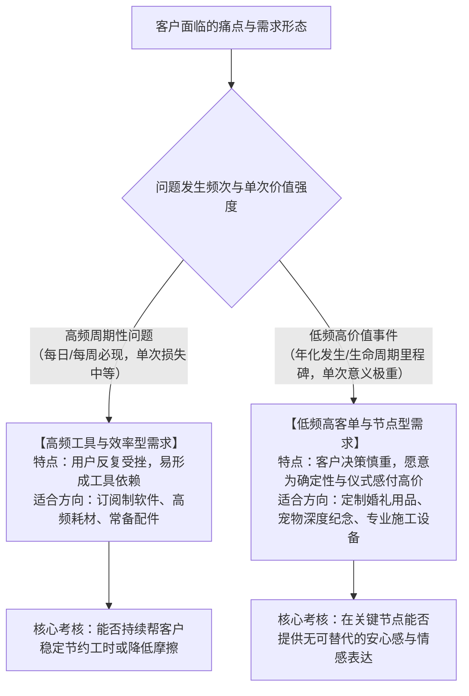
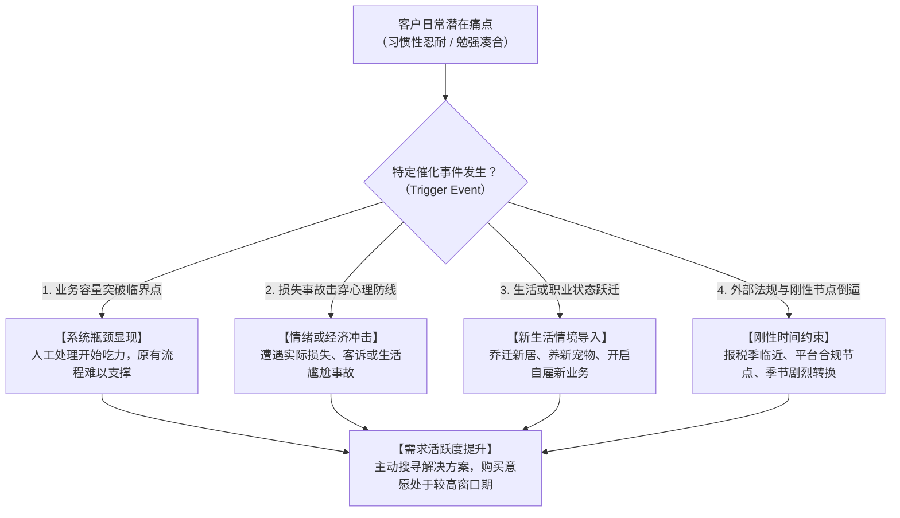
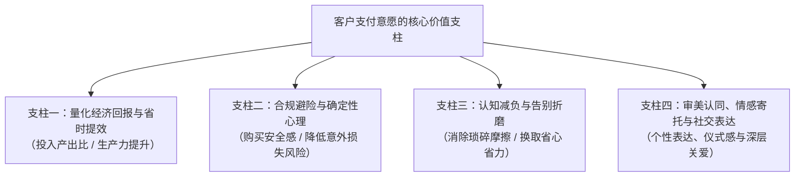
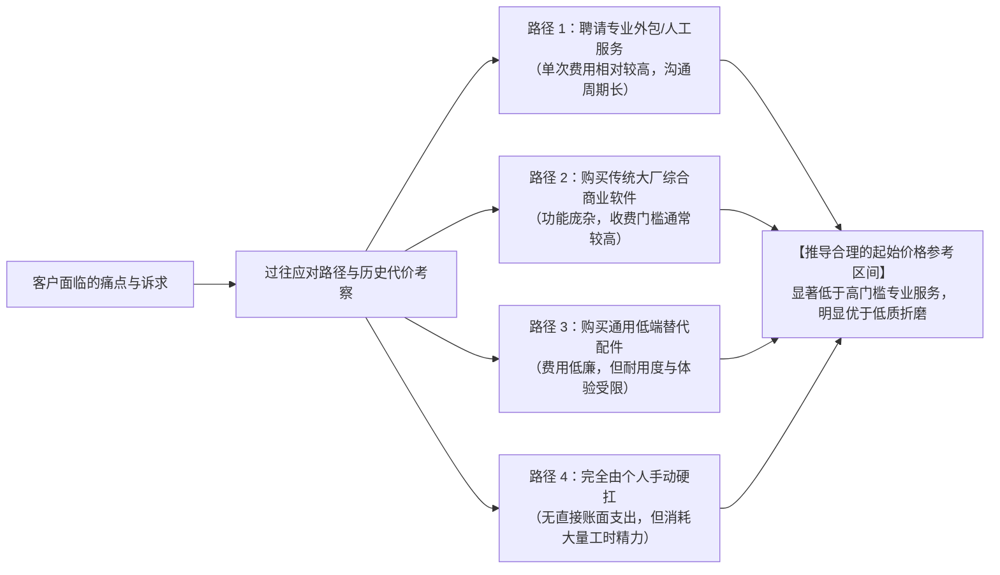
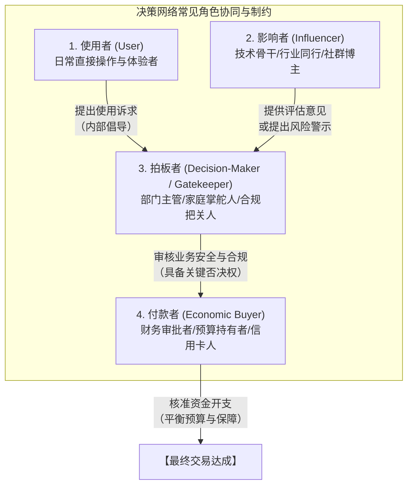

# 2. 谁会买我的东西，为什么愿意花钱？

> **正式封板说明（2026-10-18）**：本章基于独立Writer R2完整稿，经Owner特别授权由Reviewer修正少量事实、教学模型与来源适用边界，并在复核后正式封板。文中`MODEL_ASSUMPTION`为教学假设，不能代替真实访谈、市场数据、法律核查或收入保证。

> **【本章导读与定位说明】**
>
> 在第1章《我该从哪里找到值得做的生意？》中，我们系统梳理了如何从公开生态的用户抱怨、国际贸易供应链位移与跨国场景落差中捕捉商业线索，并通过初筛排雷建立起初步的商业假设。
>
> 然而，商业假设无法自动产生收入。任何一个点子在纸面上逻辑自洽，并不意味着海外客户就会自发掏出信用卡付款。商业世界的客观规律表明：**产品从来不会被卖给抽象的“宏观市场”，而只能被卖给身处具体生活或工作情境中、面临实际阻力或情感诉求、并且掌握真实支付预算的具体决策者。**
>
> 许多中国大陆的出海创业者、个人开发者和中小跨境商家，在进入海外市场时往往容易受制于以下三种思维误区：
> - **“静态人口统计学标签假象”**：试图用宽泛的宏观标签（如“25~45岁的北美白领”、“欧美中小企业主”）来定义自己的目标客户，忽略了实际促成购买的是具体情境中的摩擦力，而非户籍普查式的年龄与收入统计；
> - **“功能自嗨与付费动机错位”**：耗费大量精力打磨自认为精巧的功能，却忽视了客户付费购买的从来不是“功能本身”，而是“完成某项具体任务后的解脱、收益、安心感或情绪认同”；
> - **“使用者与买单者角色混淆”**：只关注终端使用者的操作体验，但在企业采购、家庭日常消费或礼品赠送等复杂决策链条中，忽略了握有否决权的管理者、家庭财务主导者或安全合规把关人的现实顾虑，导致销售转化在临门一脚时受阻。
>
> **本章的核心任务，是帮助读者建立一套理性、务实且可落地的“客户画像定位与付费意愿研判方法论”。**
>
> 本章将系统阐述：如何在具体生活与工作场景中识别反复遇到问题的人群，并收敛至务实的早期切入小群（2.1）；客户在何种外部转折事件与阻力阶段会产生迫切需求，以及当地物理与文化环境如何改变使用情境（2.2）；客户究竟为什么样的价值维度付费，如何结合历史支出基准与预算优先级推导合理的起步价格区间（2.3）；以及当使用者、影响者、拍板者与付款者分离时，如何识别并化解关键角色的决策顾虑（2.4）。
>
> **【知识边界与章节分工声明】**
> 本书第一部分《机会挖掘与市场判断》共设八章，环环相扣。本章明确专注于**“买家深度画像、使用情境与触发动因、付费价值根源及采购决策角色（Customer & Value Analysis）”**：
> - 商业线索的来源捕获与初筛排雷，已在 第1章《我该从哪里找到值得做的生意？》 完成；
> - 现有竞品的深度拆解、替代方案缺陷与客户迁移阻力分析，由 第3章《别人已经在卖了，我还有机会吗？》 展开；
> - 市场大盘规模量化测算（TAM/SAM/SOM）、国别横向筛选与生命周期预测，由 第4章《这个市场有多大，还能做多久？》 展开；
> - 阶梯定价策略、全链路成本精算、损益测算与现金流账期回款，由 第5章《这门生意到底能赚多少钱？》 展开；
> - 知识产权深度检索、跨国法律法规与平台强制准入资质审查，由 第6章《这门生意有哪些不能忽视的门槛？》 展开；
> - 真实场景下的低成本购买意愿测试、冒烟测试与意向验证，由 第7章《怎么用最少的钱，验证客户真的会买？》 展开；
> - 多项目横向加权权衡、资源边界与止损退出决策，由 第8章《好几个方向都不错，我究竟该做哪个？》 展开。
>
> 此外，第二板块（网络基础设施）、第三板块（海外主体与支付税务）、第四板块（研发与物理履约）及第五板块（全渠道获客与增长）分别承担各自的工程与运营职责。本章严格立足于客户画像与付费逻辑的深度拆解，不越界展开后续章节的专业测算与实操。

## 2.1 我的目标客户究竟是谁？

很多跨境创业者在被问到“你的目标客户是谁”时，给出的答案往往较为宽泛：
- 做实物产品的卖家会说：“我的产品面向全欧美 18~45 岁、追求生活品质的现代女性”；
- 做独立软件的开发者会说：“任何需要提高工作效率的办公人员都是我的潜在用户”；
- 做数字模板或设计素材的创作者会说：“全球数以千万计的自媒体博主都可以购买我的模板”。

**在资源有限的起步阶段，这种基于宏观统计数据或主观设想的“泛化定义”，往往难以指导具体的营销与产品决策。**

商业实践表明：一个试图面向“所有人”的产品，最终往往谁也不会为其买单。本节将指导读者摆脱静态标签的束缚，学会从具体的生活与业务情境中界定真正存在需求痛点的目标客户（2.1.1），并在看似庞大的潜在受众中，通过多维评估锁定务实的早期切入小群（2.1.2）。

---

### 2.1.1 哪些人会在特定场景下反复遇到这个问题？

为什么在现代跨境商业中，单纯依靠“年龄、性别、地域、收入”等静态人口统计学标签（Demographics）做客户画像容易出现偏差？

因为**决定一个人是否掏出信用卡购买产品的，往往不是他在人口普查表上的客观静态属性，而是他在具体生活或工作流程中所身处的特定情境与面临的实际阻力。**

#### 1. 静态标签 vs. 情境化定义的现实对比

以一个直观的对比为例（教学对比模型：`MODEL_ASSUMPTION`）：
- 假定在北美西海岸生活着两位同样是 35 岁、年收入均处于当地中高水平的男性居民：
  - **用户 A**：独身居住在市中心的高层紧凑型公寓内，不养宠物，日常完全依赖公共交通通勤，工作是跨国企业的远程销售顾问；
  - **用户 B**：在郊区拥有一栋带前后院的木质独栋住宅，养有两只大型长毛犬，业余时间热爱木工与车库机械改装。
- 如果某位跨境卖家仅凭“35岁、高收入、男性、西海岸”这一套静态标签去研发一款“高压便携冲洗水枪”或“车库防尘收纳件”，并向他们统一投放广告，用户 A 很可能将其视为无关信息；而用户 B 却可能因为契合其日常庭院清洁痛点而产生浓厚兴趣。

**【情境化目标客户界定模型（Contextual Customer Definition）】**  
一个具备实操指导意义的目标客户定义，建议结合以下三个结构性要素进行综合界定：
$$\text{目标客户} = \text{特定专业角色/生活身份} + \text{具体的约束情境} + \text{面临的核心摩擦障碍}$$

```text
【情境化客户定义应用示例】

× 泛化定义：“使用独立站的跨境电商卖家”
√ 情境化定义（教学设定：MODEL_ASSUMPTION）：“年销售额在 10 万至 50 万美元之间、SKU 数量较多、同时在 Shopify 与第三方平台多渠道销售、且缺乏专职技术人员维护日常库存对齐的中小独立站站长。”

× 泛化定义：“喜欢户外徒步的欧美年轻人”
√ 情境化定义（教学设定：MODEL_ASSUMPTION）：“在多雨湿润地区、习惯在秋冬季节携带大型犬进行周末户外越野、且需要解决犬只爪部泥浆弄脏汽车座舱问题的爱狗车主。”
```

---

#### 2. 理性看待问题频次与商业价值的关联

在评估潜在需求时，初学者容易走入两个极端：要么以为只有“高频”需求才值得做，要么忽视了频次对用户习惯培育的深远影响。

实际上，**一门生意的商业价值并不单由“频次”单一维度决定，而是由多维因素共同构成的综合判断体系：**
**【教学启发式，非数学计量公式】**：比较不同机会时，可同时观察问题发生频次、单次价值强度、买家支付意愿与能力，以及可触达性。这几项的单位不同、证据质量不一，**不能直接相乘推导真实市场价值、收入、利润或投资回报**；具体测算属于第4、5章。



##### ① 高频周期性需求（High-Frequency Recurring Friction）
- **特征**：问题每隔几天、甚至每次开启某个工作流都会必然出现（例如自由职业者每周多平台账目核对、烘焙爱好者每次脱模的粘连清理）；
- **商业价值**：高频发生的摩擦会在用户心智中持续累积挫败感。用户为了彻底摆脱这种周期性的精力消耗，通常更愿意花时间学习新工具，并对具有持续价值的订阅制（SaaS）或消耗品复购抱有相对开放的态度。

##### ② 低频高价值/节点型需求（Low-Frequency, High-Impact Events）
- **特征**：问题发生频率极低（例如一生仅有数次的婚礼筹备、几年一次的跨国长途搬迁、或伴侣宠物的终极纪念）；
- **商业价值**：尽管使用频次极低，但单次事件对客户的心理意义或经济影响极高。部分客户可能因事件重要而降低对价格的敏感度，但仍需实际比较材质、交付可靠性、情感价值、替代选择和预算，不能承诺必然获得溢价。因此，**不能因为某种需求属于低频场景就武断判定其不具备商业潜力**，关键在于单客价值能否覆盖获客支出。

---

#### 3. 四类业态的“情境化客户”实操映射

为了展示如何在不同商业形态中提取具体的情境化客户，以下提供四组教学推演示例（`MODEL_ASSUMPTION`）：

| 业态类型 | 泛化的抽象定义 | 具象化的情境客户（教学模型：`MODEL_ASSUMPTION`） | 具体的日常应用情境与摩擦点 |
| :--- | :--- | :--- | :--- |
| **实体商品** | 咖啡爱好者 | 在欧美居家办公、使用无底手柄意式半自动咖啡机、注重萃取稳定度的小众发烧玩家。 | 研磨不同烘焙度咖啡豆时容易产生粉层结块与通道效应，需要精细化布粉配件以减少喷溅与台面打理负担。 |
| **数字产品** | 独立咨询顾问 | 面向海外初创团队提供跨国雇佣与薪酬合规辅导、按月承接多客户的自由职业顾问。 | 每次为新客户建立协作面板时，缺乏标准化的时差考勤追踪与跨币种账单对齐格式，每月结算期需手动核对跨表格数据。 |
| **软件/工具** | 短视频自媒体作者 | 每天在 TikTok、YouTube Shorts 与 Reels 上同步分发教程切片、追求高产出节奏的个人创作者。 | 剪辑完成后，需要为不同平台的视频封面调整安全区排版，避免标题核心文字被各平台底部的交互图标遮挡。 |
| **跨境服务** | 开源软件团队 | 核心开发团队非英语母语、主要面向欧美企业开发者销售技术支持与商业授权的开源软件项目主理人。 | 周期性发布新版本时，需要为企业客户提供严谨、无歧义且符合当地技术表达习惯的 Release Notes 与接口变更说明。 |

---

### 2.1.2 可能买的人很多，应该先研究哪一小群？

在明确了情境化客户的雏形后，初创团队往往会面临新的选择难题：“如果我发现很多不同背景的人都可能需要这个产品，我该首先把精力投入到哪一小群人身上？”

**新手常见的误区是试图在一开始“讨好所有人”**——既希望吸引预算紧张的入门爱好者，又希望兼顾流程复杂的大企业，还试图满足中等规模团队的个性化诉求。这种缺乏重心的策略往往会导致早期有限的研发与运营资源被过度分散，营销信息变得模糊平庸。

商业战略经典著作《跨越鸿沟》（Crossing the Chasm）的重要启示在于：**面对全新的商业设想，小微企业应优先聚焦于一个边界清晰、痛点明确的细分群体，集中力量在该小群中建立口碑（即抢滩市场 - Beachhead Market），再以此为基础向更广阔的客群稳步延伸。**

#### 1. 早期核心切入小群优选评估模型

在比对多个潜在细分客户群时，建议对照以下四个维度进行综合权衡：

```text
【早期切入核心小群四维评估框架】

维度一：痛点迫切度与主动探索意愿（Pain Urgency）
- 这一小群人是否正在承受明确的时间、金钱或心理压力？
- 他们是否已经自发在论坛、社群中主动发帖求助，并尝试过各种临时替代方案？
- 评估导向：优先选择那些“痛点感知深、主动寻求改变意愿强烈”的群体。

维度二：预算决策链路与付款敏捷度（Decision Autonomy）
- 采购决策是否能够由单人独立闭环（例如单人即可决定刷信用卡支付小额费用）？
- 是否需要经过繁琐的多层级跨部门安全合规审批或漫长的采购招投标账期？
- 评估导向：初创阶段优先选择决策链条短、能快速验证反馈的轻量决策主体。

维度三：阵地聚集度与低成本触达性（Channel Accessibility）
- 这一小群人在互联网上是否有高度聚合的交流场所（如专有 Subreddit、行业 Discord 频道、垂直社区）？
- 创业者能否以较低的营销成本直接进入该场景并展开有效沟通？
- 评估导向：优先选择“聚集阵地清晰、便于针对性触达”的人群。

维度四：圈层互动氛围与自发传播意愿（Advocacy Potential）
- 该群体内部是否有分享工具心得、评测新产品的文化习惯？
- 当一款产品切实解决其痛点时，他们是否愿意向同行推荐或在公开社区撰写客观反馈？
- 评估导向：优先选择具备良好口碑自传播潜力的圈层。
```

---

#### 2. 从泛人群筛选“早期切入小群”的实战取舍推演（`MODEL_ASSUMPTION`）

以下提供三个不同商业形态的推演案例，展示如何从庞大的潜在群体中收敛出适合起步的早期小群（`MODEL_ASSUMPTION`）：

##### 案例一：软件与开发工具赛道——从“全网程序员”向“垂直外包开发者”的收敛
- **原始泛化想法**：“我开发了一款能够自动捕获前端页面异常并生成复现录屏的监控工具，所有 Web 开发人员都可以使用。”
- **备选细分群体权衡**：
  - *群体 1（大中型科技企业的前端团队）*：人数多、预算充足。**现实阻力**：采购需通过法务、信息安全合规审查（如 SOC 2 认证）及统一对公账期，初创小团队前期较难满足其准入壁垒；
  - *群体 2（编程初学者与在校学生）*：活跃度高、对新工具好奇。**现实阻力**：对价格极其敏感，习惯完全使用免费开源方案，缺乏稳定的商业付费预算；
  - *群体 3（承接海外中小企业官网定制的独立全栈外包开发者 / 小型数字工作室）*：**【适合作为首选切入小群】**  
    - **痛点明确**：外包交付后常遭遇客户反馈“某页面无法正常显示”，但由于非技术客户表述不清，导致来回邮件扯皮数日，甚至影响尾款结算；
    - **决策敏捷**：项目主理人单人即可自主决策购买轻量订阅工具，只要能减少几轮客诉纠纷，便能直接节约自身的交付工时；
    - **触达便利**：高频聚集在独立开发者社区、远程工作论坛与垂直自由职业者板块中。

##### 案例二：实体硬件与消费品赛道——从“所有 3D 打印用户”向“工程塑料进阶创客”的收敛
- **原始泛化想法**：“工厂研发了一种新型耐磨高分子涂层成型板，适合各种 3D 打印机，所有打印玩家都可以买。”
- **备选细分群体权衡**：
  - *群体 1（普通入门创客与简易玩具打印用户）*：通常仅打印基础低温材料（如 PLA），原厂附带的简易打印板已能满足基本需求，更换意愿较弱；
  - *群体 2（大型代工打印农场主）*：采购量大。**现实阻力**：对配件单价压制极低，倾向于大批量直采无涂层工业板，对表面工艺微创新的溢价接受度有限；
  - *群体 3（使用 ABS、碳纤维尼龙等高收缩率工程塑料的进阶机械发烧友）*：**【适合作为首选切入小群】**  
    - **痛点强烈**：工程塑料在打印过程中极易因温差翘曲脱盘，导致耗费数十小时打印的大型功能件报废，单次材料与时间损耗明显；
    - **付费意向扎实**：该群体对设备精度与成型可靠性要求极高，乐于为能够显著降低翘曲概率的优质构件支付合理溢价；
    - **圈层反馈积极**：在垂直开源硬件论坛与社群中活跃度高，评测反馈详实，易于形成技术向的内容沉淀。

##### 案例三：数字产品与模板赛道——从“所有办公人员”向“独立商业顾问”的收敛
- **原始泛化想法**：“我制作了一套基于多维表格的通用项目管理看板，任何需要协同工作的人都可以下载。”
- **备选细分群体权衡**：
  - *群体 1（企业内部普通白领）*：多由公司统一采购标准化办公协同软件，个人极少自费购买第三方模板；
  - *群体 2（日常生活打卡爱好者）*：偏好小清新、泛娱乐化的手账记录，对严肃的数据对齐与交付流程无实际诉求，市面免费替代品极为丰富；
  - *群体 3（按交付里程碑结算的独立战略与人力顾问）*：**【适合作为首选切入小群】**  
    - **痛点明确**：需要向付费企业客户展示专业、清晰且带有交付阶段确认的透明进度看板，避免因口头汇报造成双方对项目进度的理解脱节；
    - **商业价值直观**：整洁规范的客户交付看板能够直接彰显其咨询服务的专业度，属于能够辅助其树立职业形象的生产力资产。

---

## 2.2 客户在什么情况下需要这个东西？

即使创业者已经精准地描摹出目标客户的身份标签，客户也绝不会在一天 24 小时内随时处于积极的购买状态中。

一个普遍存在的认知误区是把“客户存在潜在痛点”直接等同于“客户正在主动寻找购买方案”。在现实商业环境中，大多数潜在买家在日常生活中习惯于对微小的摩擦保持忍耐，直到**某个特定的转折事件（Trigger Event）**打破了原有的平衡，将其推入迫切寻找解决方案的行动通道。

同时，从客户感知到问题，到最终完成解决，中间包含着一段复杂的体验旅程；在这段旅程中，不同国家和地区的物理居住环境、人工服务成本与当地生活习惯，往往会深刻重塑产品的实际使用情境。

本节将系统拆解激发购买行为的关键触发事件（2.2.1）、精准定位客户全流程中最费劲的“最大阻力环节”（2.2.2），并深入剖析海外本地化生活与物理环境如何改变产品的具体使用情境（2.2.3）。

---

### 2.2.1 什么事件会让客户突然开始寻找解决办法？

在消费者行为学与企业采购研究中，**许多购买需求并不是均匀分布的日常恒量，而是由“转变时刻（Transition Moments）”催化的显性增量。**

在触发事件发生前，客户对于现有痛点的态度往往是“虽然有点麻烦，但还能凑合过”；而当特定的催化事件发生时，问题的严重性或紧迫性跨过了心理忍耐阈值，客户才会真正开始主动检索信息、在社群中求助或考虑实质性采购。

#### 1. 四类常见催化事件与触发机制



##### ① 业务容量突破临界点（Operational Capacity Thresholds）
- **触发机制**：原有的简易手工办法或免费工具，在业务量较小时勉强够用，但当业务规模跨越某个临界点时，操作摩擦力明显放大，迫使经营者寻求工具化替代。
- **典型表现（教学示意：`MODEL_ASSUMPTION`）**：
  - 一个独立站卖家每天只有几笔订单时，使用普通电子表格手工整理订单信息完全应付得来；但当月度促销导致日订单量增长到数十笔时，手工处理开始容易出现遗漏或单号填写失误——**“订单量迈上新台阶”往往成为促使其寻找多渠道订单管理工具的催化契机**；
  - 一位独立设计师过去使用单块外置硬盘备份工程文件，直到系统弹出存储空间严重不足的警报，且影响了当晚重要工程文件的导出——**“容量告急事件”促使其开始认真评估云端归档方案**。

##### ② 损失事故与忍耐极限事件（Incident Shocks）
- **触发机制**：客户长期习惯性忍耐某个小问题，直到经历了一次令人懊恼的实际损失或重大尴尬，促使其下定决心寻求改变。
- **典型表现（教学示意：`MODEL_ASSUMPTION`）**：
  - 车主日常习惯将宠物犬直接放在汽车后座，偶尔有些浮毛用简易滚刷清理。直到某个雨后户外出行，玩了一身泥浆的爱犬将车座内饰严重弄脏，清洗耗费了大量精力与洗车支出——**这一具体的尴尬与损失事件，促使其当晚便开始寻找高防护性的专用车用防水垫**；
  - 某个小型开发团队因未留意第三方依赖的开源授权要求，遭遇了合规质疑与下架风险警告——**这次偶发风险事件，促使其将软件依赖合规检测工具提上日程**。

##### ③ 个人生活与职业状态跃迁（Life Stage & Environmental Shifts）
- **触发机制**：客户的居住环境、家庭成员结构或职业角色发生了物理性或社会性的重大迁移，从而被置入全新的日常需求情境中。
- **典型表现（教学示意：`MODEL_ASSUMPTION`）**：
  - 用户从城市公寓搬迁至拥有前后院的郊区独栋住宅，原本不需要考虑的草坪清理、落叶打扫或管道防冻问题，在乔迁后的几周内迅速转化为具体的采购清单；
  - 一名普通在职白领决定转型为全职远程自由职业者，在首次面临跨国多币种结算与复杂的自雇开票流程时，相关数字化财务工具的需求便应运而生。

##### ④ 外部强制节点与自然周期（External Deadlines & Seasonal Shifts）
- **触发机制**：需求由外部明确的截止日期（Hard Deadlines）或大自然的季节转换强力推动。
- **典型表现**：
  - 目标国家每年的年度个人与小微企业所得税申报季（如美国 3~4 月的申报周期），大量自雇人士在截止日前夕集中面临票据与账目整理压力，带动了轻量记账工具与模板的季节性关注；
  - 北方寒冷地区每年秋冬首场霜冻预警发布前后，房车用户与农场主必须在管路受冻前完成排水与防冻保护，促成了管路保温配件的集中采购。

---

#### 2. 捕捉触发事件对出海商家的实战价值

理解触发事件，有助于跨境商家优化营销沟通效率：
1. **文案表达更具情境共鸣**：相比于抽象宣传“功能强大的管理工具”，直接结合触发情境（如“当你的店铺订单开始快速增长，手工核对单号频繁出错时……”）更容易引起处于该阶段用户的深层共鸣；
2. **长尾关键词更贴近意图**：搜索宽泛产品词的用户可能仅在做初期了解，而搜索带有具体情境的词汇（如“独立站日单增长后如何自动化发货”、“雨天带狗自驾如何保护后排车座”）的用户，通常处于需求更为迫切的窗口期；
3. **结合周期性规律安排运营节奏**：将产品推广与目标市场的返校季、搬迁季、报税季或季节转换等客观周期对齐，在需求自然释放的阶段进行重点布局。

---

### 2.2.2 从发现问题到解决问题，客户最费劲的是哪一步？

很多产品在功能设计上投入巨大，但在推向市场后买家转化却不理想。深入剖析后往往会发现：**商家把精力全部放在了解决主要问题上，却忽视了客户在整个购买、配置或使用的链条中，遭遇了另一个意料之外的高摩擦环节，导致其在最后关头放弃。**

这一制约用户完成闭环的关键环节，被称为**“客户旅程中的最大阻力点（The Choke Point）”**。

#### 1. 客户解决问题的五个体验阶段

客户从最初意识到麻烦，到彻底享受到产品价值，通常需要穿越五个连续的体验阶段：


在这五个阶段中，阻力分布往往并不均衡。创业者必须识别出到底哪一步是阻碍客户决策的“最费劲环节”：

##### ① 阶段 3（选型与适配核验）的典型阻力：“极度担忧买错规格”
- **实战情境（实体配件赛道：`MODEL_ASSUMPTION`）**：某款庭院割草机需要更换割草刀片。客户感知到问题并搜索到了多种副厂刀片，但到了选型阶段却产生巨大犹豫：不同年份出厂的机器接口轴径存在细微公差，商品页面描述含糊，买家极度担心买错后不仅无法使用，还要承担跨国退换货的麻烦；
- **微创新启发**：如果商家在详情页提供清晰直观的“图解尺码测量指南”或交互式型号比对工具，甚至在包装内提供适配多种主流轴径的转接衬套，便能显著减轻买家的选型顾虑，提升初始进店转化信心（具体转化率表现须在实际投放中实测验证）。

##### ② 阶段 4（配置与上手）的典型阻力：“技术门槛过高或配置繁复”
- **实战情境（软件与微型 SaaS 赛道：`MODEL_ASSUMPTION`）**：一款面向小型电商商家的辅助插件，核心功能实用，但初次配置需要用户手动申请第三方平台 API 密钥、配置复杂的 Webhook 并自行修改域名解析。对于缺乏技术背景的小微商家而言，这一步的认知负荷往往导致其在试用初期便搁置放弃；
- **微创新启发**：提供“免代码一键授权集成”或清晰的步骤引导浮窗，将繁琐的配置流程降至最低，往往能成为相比功能更全但配置复杂的传统竞品的关键差异化优势。

##### ③ 阶段 5（日常打理与维护）的典型阻力：“后期清理极其繁琐”
- **实战情境（生活家居实体赛道：`MODEL_ASSUMPTION`）**：某些智能宠物喂水器或自动化家居用品，日常运转良好，但长期使用后，内部管路死角清理极其繁琐，需要拆卸多颗螺丝，积攒的水垢极难刷洗，导致部分买家在经历几次清洗后选择闲置；
- **微创新启发**：结构上主打“无死角快拆、部件全可水洗、磁吸式装配”，针对后期维护阻力进行专门改良，能够切实击中存量用户的长期痛点。

---

### 2.2.3 哪些当地习惯、语言或生活环境会改变这个使用场景？

出海商业容易遇到的隐形暗礁，在于**中国大陆创业者潜意识中的“环境默认设定”与海外目标市场的“具体生活环境”之间存在的客观落差**。

国内习以为常的生活常识，跨越国境后可能因地理、建筑或制度差异而发生改变；而海外当地的基础规范，若未曾深入调查，则容易在产品设计上留下隐患。

以下从物理建筑空间、社会服务成本与制度文化习惯三个维度，梳理需要针对性核实的本地化变量：

#### 1. 物理建筑形态与基础设施维度的核查要点

```text
【目标市场居住与设施条件核查清单（研究方法，非地区统计结论）】

核查维度       应拿到的真实证据                    可能遇到的差异（MODEL_ASSUMPTION，仅作提问示例）
────────────────────────────────────────────────────────────────────────────────────────────────────
墙体与安装面   目标城市具体建筑及楼龄、物业规则、    某住户可能是石膏板轻质隔墙，另一住户可能是
               施工手册、现场照片/用户反馈        砖石或混凝土；不同基材需要不同固定件与负载校核。
空间与动线     指定客户群样本的居住面积、楼梯、    有的住户有车库和庭院，有的住户只有窄楼梯或
               门洞、存储空间、实际测量数据        公寓阳台；不能凭“欧美”标签假定空间尺寸。
管路/接头      目标国家与具体产品的现行接口规范、  某产品可能接触NPT或BSP系列，也可能采用当地
               接头实测尺寸与兼容清单             花园软管专用螺纹；须逐型号实测，不凭洲别猜测。
电气与安全     目标国家/地区的额定电压、频率、     不同地区可能采用120V/60Hz或230V/50Hz等配置，
               插头/接地及适用产品标准             还需逐设备核对额定铭牌、插座和安全认证条件。
────────────────────────────────────────────────────────────────────────────────────────────────────

英格兰与威尔士2021年普查确实显示半独立、独立和公寓等多种住宅形态并存，**但住宅形态比例不能推出当地墙体材质、院子面积、地下室配备率或消费者偏好**。美国Census HVS也仅提供住房空置与自有率等统计，不支持把北美郊区视为统一结构。上述差异示例是供Seller建立核查问题的教学设定，未经具体市场样本验证时均为`UNKNOWN`。
```

> **【案例教学警示（`MODEL_ASSUMPTION`）】**  
> 假设某团队的免打孔浴室置物架在其试验瓷砖面上表现良好；如果目标客户将其安装在不适配的涂漆轻质墙面上，可能发生粘接失败或表面损伤（`MODEL_ASSUMPTION`，并非真实已发生投诉案例）。这一假设提示：**必须客观核实目标市场不同住宅形态的真实安装表面与物理约束，不能将单一地区的建筑习惯套用到所有海外用户身上。**

#### 2. 人工服务成本背景下的“DIY（自行动手）倾向”

在不少发达经济体，由于专业技工（如水暖工、电工）的人工上门费用与时薪相对较高（具体收费随城市、工种及紧急程度波动显著），普通家庭在面对非重大故障时，具有较强的**自主组装、简易维修与日常打理倾向（DIY 文化）**。

- **对产品设计与交付的客观要求**：
  1. **安装流程力求简便**：尽量减少对昂贵特种专业工具的依赖，必要的小型扳手或紧固件宜随包装配齐；
  2. **说明文档重视图解化**：使用步骤分解图、关键部位放大图以及无语言障碍的视频演示，降低跨语言理解难度；
  3. **防呆与容错考量**：在接口设计上尽量引入不对称防反插结构，降低用户因误装造成设备损坏的概率。

#### 3. 语言规范、法定计量与当地生活习惯

- **度量衡系统的使用偏好**：美国市场在日常生活中依然深度依赖英制单位（Inches, Feet, Pounds, Gallons, 华氏度 °F）。如果软件界面、详情页参数或实体刻度仅标注公制单位，往往会增加当地消费者的理解成本；而在欧洲大陆及大多数英联邦国家，公制单位则是标准规范。产品应根据目标国提供适宜的单位支持；
- **社区宁静与噪音控制法规（以德国 Ruhezeit 为例）**：  
  德国联邦环境署就32. BImSchV说明：在住宅等噪声敏感区域，**受该法规涵盖的某些室外园艺机器和设备**，原则上在周日、法定节假日以及20:00至次日7:00等时间受使用限制；吹叶机等特定设备可能还有更严格时段，市镇规则也可能进一步限制。该规则**不是所有室内电钻或所有动力工具一律禁售/禁用的结论**；具体要按设备类别、使用地及现行地方规定核验，不能据此臆断产品必有销售溢价。官方参考：https://www.umweltbundesamt.de/themen/laerm/nachbarschaftslaerm-laerm-von-anlagen/gartengeraete ；
- **商业语言习惯的适切性**：避免简单的字面直译。例如在北美电商语境中，承诺无忧退货通常使用 `Hassle-Free Returns` 等习惯表达，生硬直译的表达容易让买家产生对品牌专业度的疑虑。

---

## 2.3 这个问题对客户有多重要，值得花多少钱解决？

很多出海卖家在产品构思阶段，容易陷入一种纯功能性的思维定式：“只要产品做得足够扎实，客户自然愿意为它支付高价。”

然而，在真实的市场交易中，**“产品客观上有用”与“客户主观上愿意出多少钱”之间，并不存在简单的线性等号。**

有的产品研发耗时数月，功能完备，但客户在对比现有方案后只愿支付极低费用；而有的产品结构并不复杂，或是一份精心编排的垂直行业数字模板包，客户却愿意爽快地支付几十美元甚至更高。

要理解这种价值感知差异，需要从商业心理学的视角进行拆解：
- 首先，解构客户究竟愿意为了何种维度的价值支付溢价——是可量化的经济与时间回报、确定性的合规避险，还是主观层面的认知减负与情绪认同（2.3.1）；
- 其次，学会通过客户在类似问题上的历史支出基准与“心理账户”优先级，推导出具备常识依据的起始价格探索区间（2.3.2）。

---

### 2.3.1 客户愿意为什么样的省事、省钱、安心或情绪体验付费？

在跨境出海中，对“刚需”的理解不应局限于狭隘的工具论，误以为只有帮助企业“直接省钱”的产品才具有商业价值，而将审美、仪式感与情感类消费视为轻浮的次要需求。

**商业实践表明，客户的付费驱动力是由理性计算与情感共鸣共同构成的多元网络。** 无论是追求投资回报率（ROI）的企业采购，还是追求生活品质与情感满足的个人消费，客户愿意掏出真金白银的核心动因通常涵盖以下四大价值支柱：



#### 1. 四大付费价值支柱深度拆解

##### 支柱一：量化经济回报与省时提效（Economic ROI & Time Arbitrage）
- **底层逻辑**：客户在心智中进行理性的投入产出对比——**“为这个解决方案付出的费用，应显著低于它预期能帮我节省的直接资金支出或机会工时成本。”**
- **典型表现形态**：
  - **节约实际雇工时间**：在欧美主要市场，专业技术人员或常规雇工的时薪较为可观。如果一款轻量自动化工具每月收费 \$20 左右，但每周能帮助小微团队节省数小时重复性的跨表格整理时间，其在经营者心目中就具备清晰的效率代偿价值；
  - **降低实体材料报废**：某款针对 3D 打印爱好者的耗材干燥收纳盒（售价约数十美元），能够有效减少工程长丝受潮导致的打印中途拉丝报废，保护高价值耗材，客户计算的是材料损耗的挽回价值。

##### 支柱二：合规避险与确定性心理（Risk Mitigation & Peace of Mind）
- **底层逻辑**：客户购买的不仅是功能，更是一份**“降低未来不确定性与潜在处罚风险的心理确定感”**。
- **典型表现形态**：
  - **降低法律与平台规则风险**：例如独立站隐私政策生成与授权弹窗工具，客户购买的核心动力是获得清晰的合规文本框架与配置支持，以降低因无意违规招致监管处罚的隐忧（但需要说明的是，工具本身无法替代专业律师出具的法律意见，亦不能提供绝对免责保证，具体合规机制见第6章）；
  - **人身与财产安全保障**：家用一氧化碳监测报警器、便携式水管防冻保护套。这类产品平时处于静默状态，但用户愿意为此付费，因为其防范的是一旦发生便代价沉重的意外损失。

##### 支柱三：认知减负与告别折磨（Cognitive Offloading & Hassle Elimination）
- **底层逻辑**：客户的日常精力与专注力是宝贵的有限资源。许多买家愿意付费，是为了**“不再为某项琐事反复纠结，换取流程上的省心与轻松”**。
- **典型表现形态**：
  - 许多独立站站长即便掌握基础技术，也更倾向于每月支付小额订阅费使用全托管应用，而非自行在服务器上手动维护开源脚本，因为前者将版本兼容、异常重启等繁琐事务托管了出去，避免了突发故障打断核心业务精力。

##### 支柱四：审美认同、情感寄托与社交表达（Aesthetic, Identity & Affection）
- **底层逻辑**：超越纯粹功利计算的精神与情感满足。**在消费品与定制数字化领域，情感与审美的价值往往能够支撑起良好的毛利空间。**
- **典型表现形态**：
  - **发烧友圈层与个性化表达**：客制化机械键盘的个性化树脂键帽、带有复古工业风格的手工皮套。买家购买的核心动力在于独特的视觉美感、材质触感与在同行圈层中的身份认同；
  - **深层情感联结与纪念礼遇**：为伴侣宠物定制的手工肖像挂件、结婚周年纪念刻字相框。这类消费往往承载着客户的深情表达，买家更在乎细节是否精致体面，而非单纯计较其实用功能。

---

#### 2. 四类商业形态的价值感知对照（教学模型：`MODEL_ASSUMPTION`）

| 业态类型 | 案例情境（教学模型：`MODEL_ASSUMPTION`） | 主导付费价值支柱 | 客户主要感知到的核心价值 |
| :--- | :--- | :--- | :--- |
| **实体商品** | 适用于寒冷地区独栋住宅的“车库快速防冻保温水龙头保护套” | **合规避险 + 认知减负**（安心与省心） | 客户并非为了提高日常用水效率，而是为了防范冬季室外管道冻裂导致墙内渗水与高额修缮账单的风险，花小钱换取安心。 |
| **数字产品** | 面向独立播客主播的“商务赞助对接与排期管理协议模板包” | **量化经济 + 认知减负**（省时与专业） | 相比单独找法务人员撰写高额合同，标准化模板提供了清晰的权益划分框架，既节约了初期咨询开销，又避免了口头约定的潜在扯皮。 |
| **软件/工具** | 面向跨境卖家的“多语言详情页违规敏感词实时检测浏览器扩展” | **合规避险 + 提高效率**（避险与增效） | 在商品上架前快速自查可能触发第三方电商平台规则审核的敏感词汇，协助运营人员降低因词汇疏漏导致 Listing 受限的概率（非绝对免责保证）。 |
| **跨境服务** | 面向海外中小品牌的“独立站首页节日送礼场景 3D 视觉排版支持” | **审美认同 + 辅助增收**（质感与转化） | 将普通商品图置于具有节日礼遇质感的场景中，提升目标市场买家进店后的视觉信赖度，辅助改善大促期间的浏览转化表现。 |

---

### 2.3.2 他们过去为类似问题花过什么钱，预算和优先级如何？

很多出海创业者在思考产品定价时，容易陷入主观臆断：“市面上没有一模一样的竞品，我该定多少钱合适？”

**商业实践中，客户心智中往往存在着“历史支出锚点（Historical Spending Proxy）”与“心理账户（Mental Accounting）”。** 面对一个新事物，客户很少孤立地评估一个数字，而是会不自觉地拿它与过往解决类似问题的替代花费进行比对。

#### 1. 寻找客户心智中的“历史替代参照物”

在推测客户的可接受价格带之前，应首先考察：**在你的方案出现之前，客户正在通过何种方式应对该问题？他们为此付出了怎样的显性或隐性代价？**



##### 价格参照效应的推演参考
- **主系统采购体量对配件价格容忍度的影响**：  
  如果你的产品是一款高精度金属布粉器配件，面对拥有一台价值一两千美元高档意式咖啡机的深度发烧友，一个做工考究、售价几十美元的配件通常会被视为合理的装备升级；但如果面对的是使用几十美元基础咖啡机的大众用户，同样的配件价格便会显得偏高。**主设备或主业务流的历史采购体量，往往直接影响客户对配套衍生品的心理价格承受力。**
- **以专业人工替代作为参照的数字化工具**：  
  一款面向中小卖家的轻量排错软件，如果直接与免费教程比对，买家可能对付费较为犹豫；但如果其对比参照物是聘请专业技术人员按工时计费排查，软件相对亲民的月度订阅费在客户心智中便容易被感知为高性价比的替代选项。

---

#### 2. 客户心理账户预算优先级的客观差异

在不同的经济环境与经营压力下，客户对不同类型的支出展现出不同的敏感度与抗波动韧性：

```text
【客户心理账户预算优先级参考矩阵】

优先级等级        预算性质归属                常见商品与服务方向                市场波动下的支出韧性
────────────────────────────────────────────────────────────────────────────────────────────────────────
P0（业务生命线） 核心业务连续性 / 法定合规要求 / 基础会计记账、核心支付收款、基础  经济波动期通常受到坚决保护；
                  刚性居住取暖防冻安全       管路防冻、关键生产依赖的核心工具   即使削减其他预算，此类支出通常不轻易停摆。
────────────────────────────────────────────────────────────────────────────────────────────────────────
P1（生产力增效）  量化降本增效 / 直接辅助拓客 /  能够清晰验证投入产出比的生产力工   整体保持良好生命力；
                  有助于改善转化率的工具     具、能够显著提升产出效率的构件     客户倾向于将其作为优化整体成本结构的杠杆。
────────────────────────────────────────────────────────────────────────────────────────────────────────
P2（改善型便利）  微小的日常打理便利 / 非紧急的  界面稍微美化的小插件、可有可无的   在预算收紧时较为脆弱；
                  边缘体验升级配件           通用整理配件                      客户容易选择推迟采购或寻找临时替代办法。
────────────────────────────────────────────────────────────────────────────────────────────────────────
P3（深层爱好认同） 小众深度发烧友爱好 / 伴侣及宠 深度极客硬件改装、个性化纪念定制、 呈现出相对独立的韧性；
                  物深情表达 / 仪式感馈赠    特定节庆核心送礼物品              热衷特定爱好的群体往往愿意保持这部分开销。
```

---

#### 3. 价格带的常识性三角测算思考框架（教学推演模型：`MODEL_ASSUMPTION`）

在未展开第5章详细的企业财务损益与现金流精算之前，创业者在初筛阶段可以通过**“常识性三角测算框架”**，推导出一个符合商业逻辑的起步试销价格区间：

##### ① 测算思考的三个输入支点（`MODEL_ASSUMPTION`）
- **支点 A（低端替代方案底线价 $P_{\text{low}}$）**：市场上基础替代品或简易竞品的定价基准（设为统一月度单位或单件基准）；
- **支点 B（高阶专业方案参考价 $P_{\text{high}}$）**：若采用成熟企业级系统或聘请外部人工服务解决该问题的月度或单次折算成本；
- **支点 C（免审批轻量决策心理阈值 $T_{\text{frictionless}}$）**：目标客户无需复杂审批即可独立决策的小额支出心理舒适区间（教学设定：个人消费者通常在数十美元以内，小微企业主单月软件开销通常在百元以内）；
- **基础成本下限约束 $C_{\text{floor}}$**：产品单笔履约直接成本或单用户月度云基础设施与必要 API 开销的预估下限（若成本下限暂未完全核清，标记为 `UNKNOWN`，需预留安全空间）。

##### ② 启发式测算公式与教学推演（`MODEL_ASSUMPTION`）
$$\text{价格探索可行区间} \in \left[ \max(P_{\text{low}} \times 1.5, \, \text{自行设定的教学探索报价下限}), \; \min(P_{\text{high}} \times 0.20, \, T_{\text{frictionless}}) \right]$$

- **案例推演过程说明（独立开发者轻量密钥检测插件：`MODEL_ASSUMPTION`）**：
  - *统一测算单位*：按单月订阅费用对比；
  - *输入参数设定*：
    - 市面开源基础脚本免费（但缺乏自动化告警），低端简易插件定价 $P_{\text{low}} = \$5.00/\text{月}$；
    - 成熟企业级综合安全审计系统起步月费 $P_{\text{high}} = \$150.00/\text{月}$；
    - 个人开发者使用自身信用卡独立决策的免纠结月度订阅心理阈值设定为 $T_{\text{frictionless}} = \$30.00/\text{月}$；
    - 假定预估的单用户云端运行与通知基础设施成本下限 $C_{\text{floor}} \approx \$3.00/\text{月}$（创业者另行**自行设定探索报价下限为 \$10.00/月**，并非由 \$3.00 的直接成本已计算出的保本价）；
  - *区间推导结果*：
    - 价格下界 = $\max(\$5.00 \times 1.5, \, \$10.00) = \max(\$7.50, \, \$10.00) = \$10.00/\text{月}$；
    - 价格上界 = $\min(\$150.00 \times 0.20, \, \$30.00) = \min(\$30.00, \, \$30.00) = \$30.00/\text{月}$；
    - 推导出的常识性可行探索区间为 **\$10.00 ~ \$30.00/月**。
- **从探索区间到首发测试价的主动决策**：
  - 在 **[\$10, \$30]** 这一仅按以上任意教学权重、可比价和主观报价下限得到的*探索区间*内，创业者如果人为选定 **\$15.00 ~ \$19.00/月** 作为首发测试报价，是基于“略高于低端基础版、明显低于心理痛感线、有利于早期降低试用门槛获取种子反馈”的**主动商业策略考量**，而**并非数学公式自动得出的唯一确定结论**；
  - **特别提醒**：\$3/月只是假设的直接运行成本，未包含获客、结算费用、开发维护、人力、退款与固定支出；\$10/月不是经过损益计算的“最低保本线”。使用这些启发式比例筛选报价，**不能证明任何售价可盈利或买家愿意购买**。真实成本与长期可持续定价由第5章精算，付费意愿由第7章验证。

---

## 2.4 使用产品的人和真正付钱的人有什么区别？

在跨境出海的实战中，初创团队容易遇到这样一种令人困惑的现象：
- “我们在社交媒体上获得了不少试用者的积极反馈，很多操作者在社群中表示体验顺畅，但最终转化为付费购买的比例却不高”；
- “某款针对学龄儿童设计的益智硬件在展示中孩子们非常喜欢，但在购买页面家长却犹豫再三没有下单”；
- “某款面向企业开发者的效率工具，基层工程师认为极大提升了体验，但在向团队申请采购报销时却未能获得主管的批准”。

**产生这种现象的核心原因之一，在于团队默认了一个潜在假设：“使用产品的人，就是最终决定并付款的人。”**

在现代商业形态中——无论是企业级软件与专业外包服务（B2B）、节假日亲友送礼场景，还是以家庭为单位的日常大件消费（B2C）——**购买决策往往不是由单个个体独立闭环的，而是由一个由多个不同角色组成的“决策网络（Buying Center）”共同作用的结果。**

本节将系统拆解使用者、影响者、拍板者与付款者之间的角色诉求差异（2.4.1），并指导读者：在多角色分离的决策场景中，如何理性识别谁的顾虑构成关键阻断，进而针对核心关切设计合理的信任支撑。

---

### 2.4.1 使用者、影响者、拍板者和付款者不是同一人时，谁的顾虑必须先解决？

要看清复杂交易背后的动力机制，必须将抽象的“客户”拆解为决策网络中的四大典型角色：



#### 1. 决策网络中四大角色的诉求与核心顾虑

| 角色身份 | 核心诉求与驱动力 | 主要顾虑与关注重点 | 在交易中的典型角色定位 |
| :--- | :--- | :--- | :--- |
| **使用者 (The User)**<br>*日常直接操作者* | 界面是否直观、操作是否省力、能否帮自己更顺畅地完成日常差事。 | 学习新工具的门槛是否过高；使用后若出现故障会不会增加自己的额外排错负担。 | **诉求发起者与倡导者（Champion）**：能够推动试用，但在多角色场景下通常不直接决定预算。 |
| **影响者 (The Influencer)**<br>*专业评估与建议者* | 方案是否符合行业通用规范、底层架构是否合理、同行口碑如何。 | 推荐不成熟的方案会不会损害自身的专业声誉或圈层信誉。 | **评估与建议权**：其专业意见能够显著影响拍板者的信任倾向。 |
| **拍板者 (The Decision-Maker / Gatekeeper)**<br>*管理与合规把关人* | 团队整体产出能否提升、方案是否符合合规与安全标准、会不会给业务或家庭带来潜在麻烦。 | **安全隐私漏洞、产品责任纠纷、合规被罚风险、被上级或家人质疑决策失误**。 | **【把关权与否决权（Gatekeeper Veto）】**：若核心顾虑未解除，交易往往难以推进。 |
| **付款者 (The Economic Buyer)**<br>*预算持有与支付者* | 总投入成本是否合理、预期价值是否清晰、支付结算与票据流程是否规范、退换是否有基本兜底。 | 付款后服务无法履约；缺乏合规收据无法入账；遇到质量问题缺乏清晰的售后退换保障。 | **资金核准权（Budget Approval）**：在合规与需求认可的前提下最终划拨资金。 |

---

#### 2. 谁的顾虑必须先解决？——基于具体情境的动态阻力分析

在多角色决策的场景中，**并不存在放之四海而皆准的绝对说服次序**。四个角色有时由同一人兼任（如个人自费购买日常工具），有时高度分离（如企业采购或亲友送礼）。

究竟谁的顾虑构成第一阻力，需要结合**具体的交易情境、组织权限和潜在的风险属性**判断：

##### 情境 A：强合规与安全敏感型场景（如企业级 B2B 软件或儿童硬件）
- **核心阻力点**：在涉及数据资产安全或儿童人身健康的领域，**拍板把关人（Gatekeeper）拥有绝对的“一票否决权”**；
- **决策博弈逻辑（教学模型：`MODEL_ASSUMPTION`）**：
  - 基层工程师或客服人员可能非常喜欢某款效率工具，但如果公司的 IT 安全主管或法务把关人在官网上找不到关于“数据传输是否加密”、“是否会擅自抓取非公开客户隐私”的明确声明，出于合规风控本能，主管会直接终止采购审批；
  - **应对重点**：优先在产品页面中清晰呈现相关的安全合规架构说明、明确的权限申请边界与必要的数据处理声明（如对儿童玩具，需准备符合法规的测试支持与制造商/进口商合规证书准备，详见第6章）。

##### 情境 B：送礼与强社交属性场景（如结婚礼品、节庆个性化定制）
- **核心阻力点**：礼品的最终**使用者（新婚夫妇、受礼亲友）**在购买前往往不参与挑选，**付款购买者（送礼人）的核心焦虑在于“送礼过程中的社交体面与时效确定性”**；
- **决策博弈逻辑（教学模型：`MODEL_ASSUMPTION`）**：
  - 送礼人最担心的不是产品具体的操作细节，而是“周六的婚礼，周五包裹能不能准时送到？如果晚了我就要在现场空手失礼”；以及“包裹拆开时包装是否得体？箱内是否会夹带写有出厂批发价的廉价清单？”；
  - **应对重点**：营销信息应重点向付款人展示**“可靠透明的物流在途跟踪（Tracking Number）、明确的预计送达时间范围（Estimated Delivery Windows）、体面的礼品盒包装以及默认不随箱夹带价格凭证的贴心承诺”**。

##### 情境 C：个人效率与创作者自费场景（使用者即付款者）
- **核心阻力点**：角色合一，不存在复杂的组织博弈，**终端使用者的实际价值感知、预算及试用体验可能成为重要驱动力**；
- **决策博弈逻辑**：买家重点权衡自身工时投入与小额试错成本，此时直观易懂的上手体验、友好的免费体验期或无摩擦的按月取消选项，是推动下单的最关键因素。

---

#### 3. 四大跨业态多角色实战推演（`MODEL_ASSUMPTION`）

为了帮助读者在不同业务中落地多角色分析，以下提供涵盖四种商业形态的实战推演模型（`MODEL_ASSUMPTION`）：

##### 案例一：B2B 软件工具——面向跨境独立站开发者的代码报错监控插件
- **使用者 (User)**：初级前端开发人员。诉求：报错提示直观、能快速定位错误文件行号；
- **拍板者 (Decision-Maker)**：技术主管（CTO）或安全把关人。**核心关切**：该扩展是否会过度申请代码仓库的全局写入权限？敏感客户信息在传输时是否经过端到端加密？
- **付款者 (Economic Buyer)**：电商店主。**核心关切**：按月支付费用是否合理？能否提供规范的商业发票以便企业入账？
- **沟通突破策略**：在产品页面清晰设立 **“Security & Permissions（安全与权限说明）”** 专栏，明确承诺仅申请必要只读权限、说明数据传输加密机制，直接消除技术主管的安全疑虑；同时在结账环节支持规范的企业商业发票开具，打消店主的报销入账顾虑。

##### 案例二：实体礼品消费品——面向海外婚礼场景的个性化木质定制相册
- **使用者 (User)**：新郎与新娘（礼品接收方）。诉求：木材纹理自然、相纸装订牢固、外观雅致；
- **决策与付款者 (Payer & Decision-Maker)**：受邀参加婚礼的伴娘或挚友。
  - **核心关切**：在跨国或异地配送时，能否提供可靠的物流轨迹追踪，避免错过特定婚礼日期；包装是否具备礼品仪式感；
- **沟通突破策略**：详情页明确提供**“基于真实承运商时效的预计到达时间段估算”**、提供可全程在线查询的挂号物流单号，并明确注明**“专享礼盒包装封箱，随箱仅附带祝福卡片，绝无任何价格发票清单泄露”**，击中送礼人的社交体面需求。

##### 案例三：家庭与儿童用品——针对学龄前儿童的实木益智积木套件
- **使用者 (User)**：学龄前幼儿。诉求：颜色明亮、易于抓握堆叠、趣味性强；
- **决策与付款者 (Parents / Grandparents)**：年轻父母或长辈。
  - **核心关切**：积木倒角打磨是否光滑圆润？表面涂料是否符合无毒环保安全标准？小零件尺寸是否符合防吞咽窒息规定（如美国 CPSC 关于小零件的相关法规要求）；
- **沟通突破策略**：
  > **【法规表述规范提示】**  
  > 依据美国 CPSC 官方CPC FAQ（https://www.cpsc.gov/FAQ/CPC），对**受适用儿童产品安全规则约束**的产品，美国境内制造的由负有责任的国内制造商签发CPC，境外制造的由负有责任的进口商签发；**进口商不必实际位于美国境内，也无需仅因签发CPC而填写美国地址**。CPSC认可的检测实验室提供适用规则所需的测试结果，**并不负责签发CPC**；是否需要具体第三方测试、测试范围或可以适用例外/零部件测试，应按产品和现行法规逐项核定。  
  在详情页中，**只有确实完成本产品实际适用的检测、认证并留有有效证据**时，才可以针对已完成的项目如实披露检测结论、责任主体依法签发的CPC以及产品安全设计；不得因为某个积木教学案例就预先声称全部产品通过“重金属与物理机械安全”检测。可以使用真实的边角和尺寸照片回应家长顾虑；**本例是`MODEL_ASSUMPTION`，并未开展实际检测或取得CPC**。

##### 案例四：跨境专业服务——面向海外新兴品牌的产品化 3D 渲染服务
- **使用者 (User)**：品牌方的日常美工或社媒运营专员。诉求：三维模型切图角度丰富、图层拆分清晰、便于套入日常海报；
- **决策与付款者 (Decision-Maker & Payer)**：品牌创始人或市场营销负责人。
  - **核心关切**：跨时区沟通是否顺畅？服务交付周期是否明确？如果初稿风格与欧美本地审美存在偏差，修改机制如何规定？
- **沟通突破策略**：服务方案明确提供**“标准化服务说明书”**：界定清晰的交付时间节点（如明确的阶段初稿提交时限）、提供欧美同类真实商业案例作品集参考、约定合理的修改轮次边界（如包含基于初版方向的 2 轮针对性精修），并提供清晰规范的阶段性服务协议文本，消除客户对非标外包扯皮的防范心理。

---

#### 【实操工具：多角色决策网络对齐自检表】

在确定任何产品形态或对外方案前，建议对照下表，检查方案是否兼顾了决策链条中的关键角色关切：

```text
【多角色决策网络对齐自检表】

目标项目方向：____________________      自检日期：________

1.【使用者体验链 (User)】
   - 目标操作者在初次上手时，能否在较短时间内独立感知到核心便利，是否需要繁重的额外培训？
   - 该方案是否会给使用者的现有日常工作流程带来意外的额外负担？

2.【把关者合规与安全链 (Gatekeeper / Decision-Maker)】（情境否决权）
   - 该方案是否涉及任何可能令管理者或把关人产生担忧的数据安全、合规责任或声誉风险？
   - 我们是否在介绍中提供了合理的客观凭据（如透明的权限声明、合规检测合格记录、材质安全说明）
     来提前化解把关人的顾虑？

3.【付款者财务与保障链 (Economic Buyer)】（资金审批权）
   - 定价是否具备相对合理的参照依据（节约的工时或防范的损失）？
   - 是否提供了符合行业惯例的支付渠道、清晰的凭证支持与符合实际履约能力的售后保障政策？

4.【送礼与家庭代购特殊情境核查】（若适用）
   - 购买者送出礼物时，包装是否具备足够的体面感与仪式感？是否能确保不泄露实际采购价格？
   - 物流履约是否具备透明可靠的在途追踪信息，能够合理支持特定节庆或纪念日的时间安排？
```

---