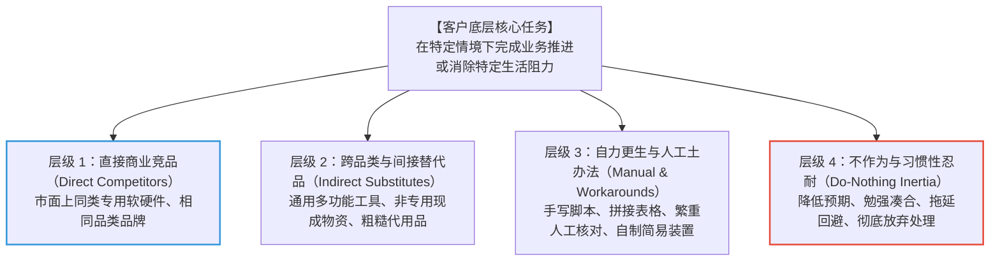
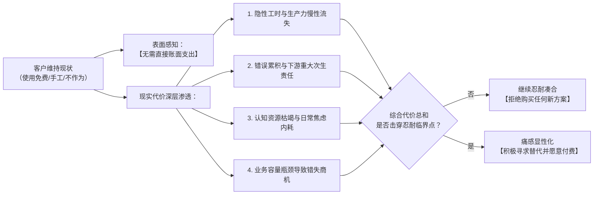
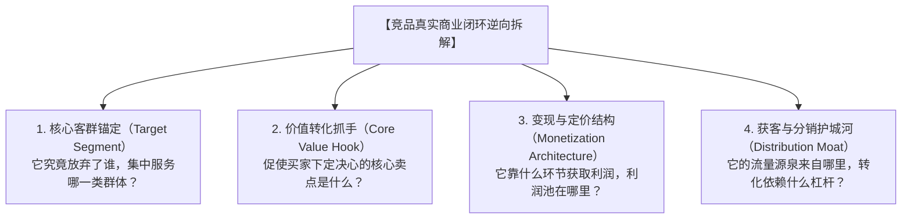
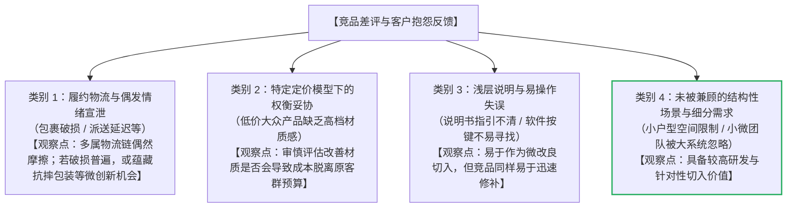
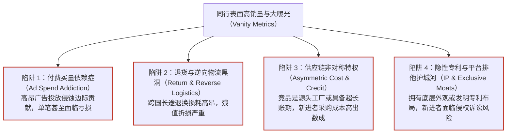
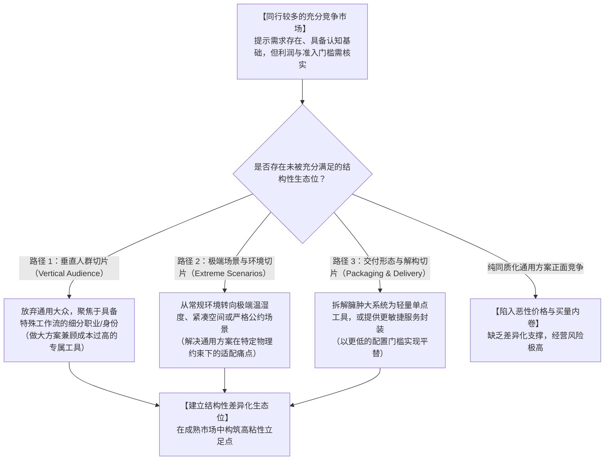
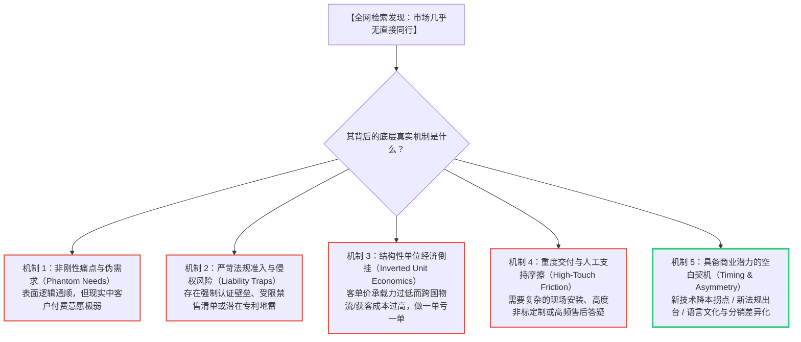
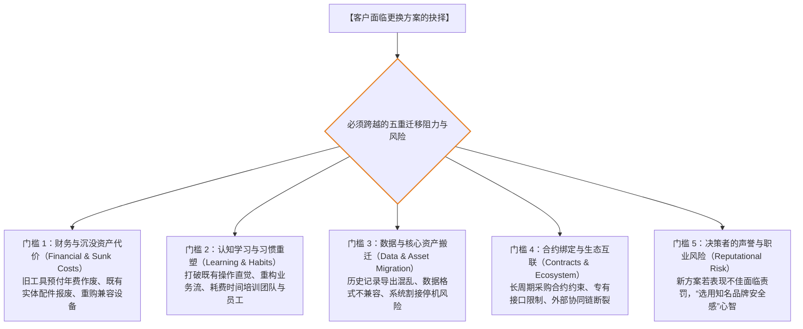

# 3. 别人已经在卖了，我还有机会吗？

> **正式封板说明（2026-10-18）**：本章以独立Writer R2完整稿为基线，经独立Reviewer审核判为`PASS_CANDIDATE_OWNER_REVIEW`，依据Owner明确授权，仅对5类非阻断问题及相关绝对化措辞进行小范围更正后正式封板。全部商业案例、财务算式及模型设定中的`MODEL_ASSUMPTION`均为教学推演，不能作为真实市场调查、实际销售结果或合法合规证明。具体平台政策、法规与证据须按目标国家、产品及核验日期重新确认。

> **【本章导读与定位说明】**
>
> 在第1章《我该从哪里找到值得做的生意？》中，我们系统学习了如何从生态抱怨、贸易位移与跨国落差中捕获商业机会并初筛排雷；在第2章《谁会买我的东西，为什么愿意花钱？》中，我们深入剖析了目标客户的情境化画像、购买触发事件、付费价值支柱与决策多角色博弈。
>
> 当初创团队锁定了一个看似有潜力的客户痛点并构思出解决方案时，在商业实践中往往会立即撞上两堵截然相反、却同样令人焦虑的心理高墙：
> - **第一堵墙（红海焦虑）**：“我在亚马逊、Shopify、Google、各大应用商店或社交媒体上一搜，发现已经有十几家甚至几十家同行在卖类似的产品或服务了，大牌林立、销量惊人。市场上既然已经有了这么多成熟产品，我一个资源有限的后来者，凭什么还能插得进去手？这扇门是不是已经关上了？”
> - **第二堵墙（蓝海迷茫）**：“我在市场上搜寻了很久，惊讶地发现几乎没有人在提供完全一样的方案。这究竟是我独具慧眼发现了一片无人涉足的黄金蓝海，还是前面已经有无数先烈踩坑倒下、甚至根本就是一块无人愿意付费的商业荒漠？”
>
> 商业世界的客观现实表明：**市场从来不会因为“已经有人在卖”就绝对失去后来者的生存空间，但也绝不会因为“暂时无人销售”就天然保证新产品的商业成功。**
>
> 许多中国大陆的个人开发者、独立站经营者和中小跨境卖家，在评估竞争格局时容易陷入以下四个典型的思维陷阱：
> - **“同质竞品狭隘定义”**：误以为竞争对手仅仅指代“在同一个类目下销售同款商品的商家”，完全忽略了客户目前使用的免费工具、临时组合的手工土办法、跨品类的间接替代品，乃至最具杀伤力的隐形阻力——“客户的习惯性忍耐与什么都不做”；
> - **“差评盲目当作缺口”**：在第三方平台上抓取了几条竞品的 1 星或 2 星差评，便轻率地判定为“巨大的市场蓝海”，却未曾辨别这些差评究竟是不可抗力的偶发宣泄、特定定价策略下的必然权衡妥协，还是真正具备支付意愿支撑的结构性痛点；
> - **“爆款虚假繁荣误判”**：将竞品在前台展示的销量排名、高频曝光或热烈点赞直接等同于“丰厚利润与易于复制”，忽略了其背后高昂的买量补贴、隐秘的高退货率、深厚的供应链账期特权或隐性专利护城河；
> - **“参数微优自嗨假设”**：误以为只要自己的产品在某项功能上“多加一个参数”或在价格上“便宜 10%”，客户就会自发抛弃现用方案转投怀抱，完全低估了客户在迁移过程中面临的习惯重塑成本、数据资产搬迁代价与承担决策失误的真实风险。
>
> **本章的核心任务，是帮助读者建立一套客观、清醒且具备高度可操作性的“竞争格局解构与迁移优势验证方法论”。**
>
> 本章将系统阐述：如何跳出狭隘的同类商品视角，全景式摸清客户现有的真实替代路径与维持现状的隐形成本（3.1）；如何穿透同行的表面繁荣，逆向解构其核心客群与变现模型，从真实抱怨中识别真正的市场缺口并排查虚假繁荣陷阱（3.2）；如何科学解读“竞争拥挤”与“市场空白”背后的底层机制与反证逻辑（3.3）；以及全面拆解客户转换方案所面临的五重迁移阻力，建立基于客观证据的竞争优势自检体系（3.4）。
>
> **【知识边界与章节分工声明】**
> 本书第一部分《机会挖掘与市场判断》由八个递进章节构成。本章明确专注于**“现有替代路径摸底、竞品商业解构与缺陷识别、市场拥挤度与空白机制研判、以及客户迁移成本与可验证优势分析（Competition & Switching Analysis）”**：
> - 目标客群的具体生活工作情境与心理账户优先级，已在《第2章：谁会买我的东西，为什么愿意花钱？》完成界定，本章直接将其作为调研对象，不再重述画像建立方法；
> - 目标市场的宏观容量量化测算（TAM/SAM/SOM）、国别横向大盘对比与行业生命周期预测，由《第4章：这个市场有多大，还能做多久？》专门负责；
> - 详细的企业财务成本精算、阶梯定价模型、头程尾程物流运费拆解与现金流回款账期，由《第5章：这门生意到底能赚多少钱？》展开；
> - 知识产权深度检索、跨国合规准入与专利侵权法律避险，由《第6章：这门生意有哪些不能忽视的门槛？》展开；
> - 真实场景下低成本测试订单、冒烟广告投放与预售意向测试，由《第7章：怎么用最少的钱，验证客户真的会买？》展开；
> - 多项目横向加权打分与退出决策，由《第8章：好几个方向都不错，我究竟该做哪个？》展开。
>
> 此外，第二板块（网络基础设施）、第三板块（海外主体与合规财税）、第四板块（研发工程与物理履约）及第五板块（全渠道获客与增长运营）分别承担各自的工程与运营职责。本章严格立足于竞争格局与替代方案的理性研判，不越界代写后续章节的专业核算与实操。

## 3.1 客户现在是怎么解决这个问题的？

在商业竞争分析中，初涉出海的创业者最容易犯的一个战略直觉错误，是**将“竞争对手”等同于“和自己卖同样产品的直接同行”**：
- 打算研发一款独立站多渠道库存同步插件的开发者，把全部注意力放在市面上另外三款同类 SaaS 上；
- 打算销售一款高精度模型喷涂防渗遮蔽胶带的实体卖家，只在亚马逊上紧盯排名前三的同款品牌胶带；
- 打算制作一套跨境自雇人士报税核算模板的创作者，只去 Etsy 和 Gumroad 上搜索同类型的报税表格。

**这种狭隘的同质竞品视角，往往会让创业者产生一种危险的错觉：以为只要战胜了那几家同行，客户就会自然倒向自己。**

然而，消费者行为学与商业战略经典理论（如克莱顿·克里斯坦森的“用户任务理论”，Jobs-to-be-Done）揭示了一个深刻的规律：**客户购买一件产品，本质上不是为了拥有该产品本身，而是为了在特定的生活或工作情境中“雇用（Hire）”某种方案，来协助自己消除阻力、完成某项具体进展（Progress）。**

在你的产品推向市场之前，世界并没有处于停滞状态。目标客户在过去漫长的时间里，早已摸索出了一套应对该问题的现有办法。**客户当前正在使用的所有替代路径——包括通用的通用软件、自制的人工土办法，乃至什么都不做的习惯性忍耐——统统是你在真实商业世界中必须直面的强劲竞争对手。**

---

### 3.1.1 除了同类产品，客户还用哪些免费、人工或其他办法解决？

如果我们将“客户解决问题的手段”置于更广阔的商业光谱中审视，可以清晰地识别出四大层级的现有替代方案：



#### 1. 四大层级替代路径的商业本质

##### ① 层级 1：直接商业竞品（Direct Competitors）
- **形态特征**：与你的方案属于同品类、形态相似、专门针对同一场景设计的成熟商品或服务；
- **客户选择理由**：功能指向明确、开箱即用、市场认知相对成熟；
- **局限与常见痛点**：通常价格较高、可能包含大量冗余功能（臃肿化）、针对普适大众设计从而无法兼顾垂直细分群体的特殊限制。

##### ② 层级 2：跨品类与间接替代品（Indirect Substitutes）
- **形态特征**：并非为了该特定场景而生，但客户通过“变通使用”能够部分满足需求的通用工具；
- **典型表现（教学推演：`MODEL_ASSUMPTION`）**：
  - 用户不购买专用的项目进度追踪 SaaS，而是直接在免费的通用电子表格（如 Google Sheets）或通用笔记软件（如 Notion）中搭建一套简易排期表；
  - 电子发烧友在焊接精细电路板时，不购买专业的贴片定位夹具，而是随手使用文具燕尾夹或重物压住板材边缘；
  - 独立站卖家不购买专门的包装封箱护角，而是将废弃瓦楞纸折叠多层作为临时填充；
- **客户选择理由**：边际成本极低（甚至完全零增量成本）、无需引入新的软件账户或陌生实体物资、掌握门槛极低。

##### ③ 层级 3：自力更生与人工土办法（Manual & Workarounds）
- **形态特征**：客户完全依赖个人或团队内部的密集体力与时间投入，以纯手工、多步骤流转的“土办法”硬性闭环流程；
- **典型表现（教学推演：`MODEL_ASSUMPTION`）**：
  - 跨境电商卖家每天清晨由专人手工从 Shopify 后台导出订单 CSV，再手动复制粘贴至 ERP 或运费计算表，人工对比库存数字；
  - 3D 打印用户为了防止尼龙耗材受潮，每次打印前将其放入自制加热除湿箱或烘干设备中处理，并手动监控温度（注：部分创客在社区分享使用家用食品烘干器具进行临时除湿，但需注意家用食品设备可能存在温控精度不足导致材料熔融变形、或高温释放挥发物污染器具的安全隐患，不构成操作推荐，实际应遵循耗材厂商官方烘干规范）；
  - 独立自由职业者每月手动制作 PDF 格式的账单，并通过个人邮箱逐封发送给海外客户，再手动在纸质笔记本上记录收款到账状态；
- **客户选择理由**：对现状具有完全掌控感、无需对外支付任何显性采购预算、流程极度灵活可随意调整。

##### ④ 层级 4：不作为与习惯性忍耐（Do-Nothing Inertia）
- **形态特征**：**维持现状是初创企业容易忽视的重要替代选择。** 客户充分意识到了问题的存在，日常也经常抱怨，但由于改变现状需要付出认知精力、决策精力和行动成本，客户最终选择“降低心理预期，凑合过下去”；
- **客户选择理由**：心理阻力最小，沉溺于舒适区，认为“虽然麻烦，但还没致命到非解决不可的地步”。

---

#### 2. 四类商业形态的“替代路径全景对照”（教学模型：`MODEL_ASSUMPTION`）

为了帮助读者理解不同业态下客户如何运用替代手段，下表展示了涵盖四类典型商业形态的实操映射（教学设定：`MODEL_ASSUMPTION`）：

| 商业形态 | 待解决的核心任务 | 直接商业竞品（层级 1） | 跨品类与间接替代品（层级 2） | 自力更生与人工土办法（层级 3） | 不作为与习惯性忍耐（层级 4） |
| :--- | :--- | :--- | :--- | :--- | :--- |
| **实物商品** | 3D 打印工程耗材防潮干燥与即抽即打 | 市场上成型的专业双盘加热恒温干燥盒（售价约 \$60~\$120） | 密封储物整理箱 + 投入大量散装变色硅胶干燥剂包 | 使用简易除湿盒改装穿孔引出，手工监控温湿度（非标准操作需注意温控与材料安全） | 耗材直接裸露在空气中，打印出现轻微拉丝就用美工刀手工刮除，严重报废就自认倒霉 |
| **数字产品** | 跨境自由职业者多币种与税务合规记账 | 订阅制商业小微财务记账软件（每月约 \$15~\$30） | 通用免费在线电子表格模版（Google Sheets / Excel 基础函数） | 手写纸质账本，每笔交易保留纸质打印收据，月底用计算器人工汇总核算 | 平时不记账，银行账户混用，直到报税季来临前夕才陷入恐慌突击凭记忆翻查账目 |
| **软件/工具** | 独立站多店铺库存防超卖实时对齐 | 传统企业级多渠道 ERP 系统（月费通常在百元以上，多要求按年结算） | 依赖第三方物流仓（3PL）后台简易的每日库存定时导出邮件 | 运营人员每天定点导出店铺表格，肉眼比对差额并在各店铺后台手动修改库存可售量 | 默认留足虚高安全库存，若偶尔出现超卖就向买家致歉、私下补偿优惠券或取消订单 |
| **跨境服务** | 海外新兴电商品牌独立站产品 3D 渲染图 | 欧美本地商业 3D 渲染与视觉设计工作室（单图收费通常可达数百美元） | 使用普通智能手机在自然光下拍摄实物，再用简易在线工具一键抠图去底 | 运营人员自学开源 3D 软件进行基础建模贴图，反复摸索灯光排版，耗费数日工时 | 直接使用制造工厂提供的通用白底棚拍图或粗糙渲染图，即便视觉风格与海外审美脱节也凑合使用 |

---

#### 3. 挖掘客户真实替代路径的实操调研方法

如何穿透表象，发现目标客户在日常生活中真正使用的“土办法”与“间接替代品”？跨境创业者可以运用以下三种低成本的公共侦察技术：

##### ① 检索式行为考古：挖掘“非商业长尾词”
- 试图寻找直接商业方案的用户，通常会搜索产品品类词（如 `best 3d printer filament dry box`）；
- 而深陷替代方案中的用户，往往会搜索**痛点与土办法操作词**。例如在 Google、YouTube 或 Reddit 上检索：
  - `"how to [解决痛点] without [竞品名字]"`（例如 `"how to dry nylon filament without dry box"`）；
  - `"[痛点] DIY workaround"`；
  - `"[痛点] excel template free"`；
  - `"[通用工具] vs [专用工具] for [特定任务]"`（例如 `"notion vs dedicated crm for solopreneur"`）。
- **分析重点**：观察搜索结果中讨论度与关注度较高的民间方案。如果大量用户在讨论如何自制低成本干燥箱，这表明该需求具备高度真实性，且现有成熟商业方案尚未完美覆盖该细分群体的预算或便利性期待。

##### ② 垂直社群沉浸观察：追踪“民间拼装帖”与“发帖求助”
- 在目标受众聚集的垂直社区（如 Reddit 细分子版块、行业 Discord、专用技术论坛），检索关键词 `workaround`、`hack`、`temporary fix`、`struggling with`；
- 重点记录：用户为了绕过现存工具的缺陷，自发编写了哪些开源小脚本？拼装了哪些物理五金件？这些“拼装方案”通常是极佳的产品微创新灵感来源。

##### ③ 逆向竞品反思：同行被替换的蛛丝马迹
- 在竞品官网的社区论坛、产品更新日志（Changelog）底下的评论区或产品评测视频下方，寻找用户的弃用留言：
  - “我们取消了订阅，因为我们发现用两张 Google Sheet 表格就能搞定我们 90% 的需求”；
  - “太贵了，我们最终雇佣了一名兼职实习生手动处理，成本反而更划算”。
- 这类真实反馈直接揭示了商业方案在面对“间接替代”时的脆弱节点。

---

### 3.1.2 沿用原办法甚至什么都不做，客户实际要付出什么代价？

既然客户现有的替代方案（免费工具、手工流程、习惯忍耐）往往“不花钱”或“开销极低”，为什么他们最终还会考虑换用新的商业化产品？

许多创业者在推广产品时，竭尽全力向客户罗列新方案的先进功能，却发现客户反应冷淡。其根本原因在于：**创业者未能向客户算清“现状维持代价（The Cost of Status Quo）”。**

在商业心理学中，客户在面对新事物时天然具有强烈的**现状偏差（Status Quo Bias）**与**损失厌恶（Loss Aversion）**倾向。客户为新产品支付真金白银是即时可见的“显性支出”，而现有办法的弊端往往是慢性累积的“隐性损耗”。

当客户能够理解维持现状的代价，并认为新方案的预期价值值得抵偿付款、学习和迁移风险时，购买才更有可能发生。即便如此，是否购买仍取决于预算、信任、时机和个人偏好，而不是单一成本对比。



#### 1. 现状维持代价的四大解构维度

##### ① 维度一：隐性工时与生产力的慢性流失（The Invisible Labor Bleed）
- **机制原理**：免费工具看似零门槛，但需要消耗用户持续的显性工时进行数据搬运、格式清洗或设备值守。在欧美等劳动力成本较高的市场中，时间本身即是极其昂贵的生产要素；
- **实操测算推演（教学示意：`MODEL_ASSUMPTION`）**：
  - 假定一位欧美独立咨询顾问或小型跨境电商卖家，其有效商业时薪预估约为 \$30~\$50；
  - 如果他为了省下每月 \$20 的自动化工具订阅费，每天必须花费 30 分钟进行跨平台订单的手动复制核对；
  - **维持现状的等效时间机会成本估算**：每月消耗工时约 10~15 小时，按假定时薪折算等效时间成本约为 **\$300 ~ \$750/月**（相当于其节省软件费用的 **15 到 37.5 倍**；需注意此数值为特定时薪假设下的理论机会成本推导，实际取决于该自雇者能否将省下的工时切实转化为增量商业收入，不能等同于已发生的账面现金亏损）；
  - 当创业者在销售主张中把这笔时间账清晰呈现给客户时，“免费土办法”在经济学上的吸引力便会大打折扣。

##### ② 维度二：错误累积与下游重大次生责任（Downstream Compounding Liabilities）
- **机制原理**：人工处理与拼凑方案必然伴随着不可避免的疲劳失误率。随着业务量增长，微小的单点疏漏会在下游链路引发放大数倍的经济损失、客诉罚单乃至品牌声誉受损；
- **典型情境（教学示意：`MODEL_ASSUMPTION`）**：
  - 独立站卖家使用人工肉眼更新库存。在平时偶发失误可能只需向个别买家道歉；但在“黑色星期五”大促期间，由于手工对账延迟导致某爆款商品超卖 50 件，最终导致大量买家向支付机构发起拒付投诉（Chargeback）、店铺支付网关被风控冻结储备金，甚至导致核心广告账号因履约受限而被暂停；
  - **维持现状的代价**：不再是几十分钟的人工劳动，而是数千美元的直接利润损失与商业信誉受挫。

##### ③ 维度三：认知资源枯竭与日常焦虑内耗（Cognitive Load & Mental Exhaustion）
- **机制原理**：非自动化的土办法需要用户在心智中时刻保持警惕，占据宝贵的大脑工作记忆，造成持续性的心理压力与情绪内耗；
- **典型情境**：
  - 自由职业者使用零散的备忘录记录客户交付与收款节点，每天早晨醒来必须在脑中反复盘算“今天有没有哪位客户的账单到期该催了？上周的代码修改意见是否全部回复了？”；
  - 这种担心遗漏关键事项的焦虑感，严重消耗其从事创造性核心工作的精力。许多用户愿意花钱，仅仅是为了**“换取流程上的省心与安心，降低日常心理负荷”**。

##### ④ 维度四：业务容量瓶颈导致错失商机（Capacity Ceilings & Opportunity Cost）
- **机制原理**：依赖手工作业的流程存在物理通量上限。当外部商机涌现时，经营者由于被锁死在低价值的琐事泥潭中，无法承接更多业务，导致商业规模增长停滞；
- **典型情境**：
  - 一个高质量的独立外包开发者，由于每个项目都需要耗费整整两天手动部署服务器环境与编写接口文档，导致其每个月最多只能承接 2 个客户项目；
  - 缺乏标准化的敏捷工具，使其产能天花板被硬性锁定，无法将月收入从几千美元突破至更高水平。

---

#### 2. “现状代价”调研自检框架

出海创业者在评估目标客户对现有办法的依赖程度时，建议对照以下评估框架进行实操摸底：

```text
【现状维持代价评估框架（Cost of Status Quo Audit）】

调研项目方向：____________________      评估日期：________

1.【显性工时损耗测算】
   - 目标客户每次执行该替代方案，平均耗费多长时间？每周/每月累计重复几次？
   - 按照目标市场该岗位的平均时薪折算，客户每月在“土办法”上投入的等效工时估值是多少？

2.【潜在失误损失预估】
   - 人工作业或简陋代用品的平均失误率大致处于什么区间？
   - 一旦发生单次严重失误，客户面临的较坏后果是什么（退款、罚金、材料报废、封号）？
   - 这种极端后果在一年内发生的潜在概率与损失规模如何？

3.【心理阻力与爆发临界点】
   - 客户在各大论坛和社群中，对现有替代方案的抱怨主要集中在哪个具体动作上？
   - 是否存在某个明显的业务拐点（如订单量显著跃升、团队新员工加入、节庆大促节点），
     使得原本勉强容忍的代价瞬间变得不可承受？
```

## 3.2 同行靠什么赚钱，客户又有哪些不满意的地方？

当跨境卖家发现市场上已经有同行在销售类似方案时，往往容易产生两种截然相反的非理性反应：
- **第一种是非理性的自卑**：“同行已经积累了数千条好评，资金雄厚，功能强大，我根本没有胜算”；
- **第二种是盲目的轻敌**：“我在同行的商品评论区里看到好多差评，大家都说它不好用，我只要做一个没有这些缺点的产品，客户就会立刻抛弃它来买我的”。

**这两种反应都脱离了商业逻辑的实质。**

商业竞争从来不是静态的功能比拼，而是整体商业闭环的博弈。一个表面上功能粗糙的产品，背后可能拥有极其强悍的供应链成本优势或分销渠道；而一个被买家口诛笔伐的差评点，很可能是同行为了维持特定商业模型所主动做出的**战略权衡**。

本节将指导读者建立一套客观理性的竞品拆解方法：逆向还原同行的核心客群与盈利支柱（3.2.1），从海量的客户抱怨中过滤噪音并精准筛选出真正的结构性市场缺口（3.2.2），并刺破表面的销量泡沫，理性评估同行模式的真实盈利性与可复制性（3.2.3）。

---

### 3.2.1 同行主要卖给谁，靠什么让客户愿意向他们买？

要真正读懂一个竞争对手，绝不能仅凭其官网首页的宣传标语（Slogan）或亚马逊页面的商品标题。宣传标语通常是为了讨好最广泛的受众而撰写的营销语言，往往掩盖了其最真实的商业定位。

**创业者必须穿透表象，对竞品的四个底层商业支柱进行逆向拆解：**



#### 1. 竞品解构的四大核心支柱

##### ① 支柱一：核心客群锚定（Who They Actually Serve）
- **分析重点**：竞品的产品形态、定价与客服策略，决定了它不可能同时满足所有人。观察它在功能设计上向谁倾斜，又在哪些群体的使用体验上做了减法？
- **典型分化**：
  - 有的竞品定位于**“预算充足的企业级深度用户”**：界面复杂、配置繁琐、权限体系完善、支持多角色协作，但对于个人开发者而言显得极其臃肿且价格高昂；
  - 有的竞品定位于**“大众入门级尝鲜人群”**：价格极度低廉、操作极度傻瓜化，但缺乏进阶自定义参数，无法满足深度发烧友的精细化需求。

##### ② 支柱二：价值转化抓手（Why Customers Actually Buy）
- **分析重点**：客户掏出真金白银的那一瞬间，究竟是被哪一个具体要素所打动？
- **常见的真实抓手**：
  - **极致的履约时效与退换确定性**（例如第三方电商平台上标有平台配送标签的成熟卖家，买家并不一定认为其品质最好，但为了“到货时效相对明确且退换有保障”而买单）；
  - **深厚的品牌声誉与信任背书**（在企业采购中，决策者往往倾向于选择历史悠久的大厂，以降低个人在组织内部的推介责任风险）；
  - **极具竞争力的价格穿透力**（依赖庞大生产规模与供应链整合压出的低单价）；
  - **极简的单点极致体验**（虽然功能并不繁复，但能在极短时间内顺畅完成某项高频操作）。

##### ③ 支柱三：变现与定价结构（How They Make Money）
- **分析重点**：竞品的真正利润来源是哪一部分？它是否采用了交叉补贴策略？
- **典型变现架构**：
  - **“剃须刀与刀片”模式（Razor-and-Blades）**：主机设备或基础硬件以较低毛利甚至微利销售，真正依靠后续高频复购的专用耗材或配件赚取持续收益；
  - **“免费增值”模式（Freemium）**：免费版提供满足基础需求的功能以形成漏斗规模，仅对高级 API 权限、团队协同或白标功能收取增值订阅费；
  - **一次性买断 vs. 订阅制（Perpetual vs. Subscription）**：观察竞品是否因强推高价订阅而引发部分中小存量用户的流失与不满。

##### ④ 支柱四：获客与分销护城河（How They Acquire Traffic）
- **分析重点**：竞品的新用户是从哪里来的？这一获客通道是否容易被后来者打破？
- **流量来源解构**：
  - 依赖累积数年的自然搜索权重（SEO）与海量技术文档沉淀；
  - 依赖高昂的付费买量预算（PPC 广告），占据核心关键词顶部；
  - 依赖与上下游平台的官方深度绑定或分销联盟分成（Affiliate Marketing）。

---

#### 2. 四类商业形态的竞品商业模式拆解示范（教学推演：`MODEL_ASSUMPTION`）

以下提供四组针对不同商业形态的竞品解构推演案例（教学模型设定：`MODEL_ASSUMPTION`，表中数据与品牌仅作为教学情境示范，不代表具体真实商业主体的财务实测数据）：

| 业态类型 | 典型竞品形态设定（教学模型） | 核心客群定位 | 核心转化抓手 | 盈利模式结构 | 获客与渠道特征 |
| :--- | :--- | :--- | :--- | :--- | :--- |
| **实物商品** | 电商热销的通用型“多功能厨房压蒜绞肉机” | 追求基础做饭便利、对价格较为敏感的普通大众家庭。 | 物流时效确定、累积评价基数大、价格亲民。 | 走量薄利模式，单件边际贡献有限，依赖规模摊薄模具成本。 | 依赖平台搜索广告抢占大词前列，依靠长期累积的评论权重抵御新进卖家。 |
| **数字产品** | 协同软件生态中热销的“全能创业公司管理模板包” | 刚刚起步、缺乏管理流程规划经验的初创小团队负责人。 | 视觉排版规整、涵盖日常运营图表范例。 | 一次性买断模式，后续通过高级定制咨询提供增值转化入口。 | 依靠效率类自媒体测评、社媒推文演示与分销联盟推广。 |
| **软件/工具** | 老牌企业级“跨平台电商多仓库数据同步中台” | 订单量庞大、拥有多个海外本土物理仓库的中大型跨境电商品牌。 | 功能覆盖全面、支持多家物流仓对接、提供专属客户支持。 | 基础月费门槛较高 + 按处理订单量阶梯计费（Usage-based）。 | 依靠行业展会赞助、大客户销售团队（BD）跟进与生态伙伴认证推荐。 |
| **跨境服务** | 欧美本地的“跨境品牌海外红人营销全案代理机构” | 营销预算充裕、追求品牌曝光声量与本地化形象的新消费品牌。 | 本地母语团队沟通、签约垂类红人资源、提供全案策划与排期支持。 | 基础服务费（Retainer）+ 实际营销预算佣金分成。 | 依靠行业口碑推介、职场社交平台定向外联与行业研讨会背书。 |

---

#### 3. 合法合规的情报调研边界与检索技巧

在调研竞争对手时，必须严格遵守跨国商业伦理、网站服务条款与反不正当竞争法规：
- **【坚决禁止的违法违规行为】**：严禁伪造企业身份套取竞品商业机密；严禁使用黑客手段攻破竞品系统；严禁恶意刷低竞品评价；严禁未经授权滥抓涉及个人隐私的用户数据。
- **【推荐采用的公开情报采集法（OSINT for Business）】**：
  1. **公开广告资料库检索**：利用 Meta Ad Library（Facebook 广告档案库）与 Google Ads Transparency Center，合规检索竞品正在展示的部分广告素材创意、文案切入点与对应着陆页（注：广告透明度工具主要展示活跃素材形式与投放法域，不能直接体现竞品的完整财务收支、真实转化率或整体广告预算支出规模）；
  2. **产品更新日志（Changelog）考古**：翻阅竞品公开的更新说明，观察其产品迭代重心从何处转移到何处，往往能直接看出其在哪些功能上遭遇了瓶颈，又在哪些方向上追加了资源；
  3. **帮助中心与文档库深度研读**：竞品的官方帮助中心（Help Center/FAQ）是了解其实际能力的窗口。重点阅读其“不支持的功能与边界（Limitations）”、“退款政策细则（Refund Terms）”与“常见报错排错指南”，这些内容直接反映了其系统的适用边界。

---

### 3.2.2 差评、退货和抱怨里，哪些问题值得当作真正的市场缺口？

在跨国电商与独立软件的公开评价区（如 Amazon Reviews、Trustpilot、G2、Shopify App Store、垂直讨论社区）中，包含着大量来自真实用户的反馈。

许多创业者在初筛阶段，看到竞品有较多低星差评，便容易产生乐观判断，误以为只要开发一个“没有这些缺点的产品”，就能轻松切入市场。

**然而，在商业实践中，大量的客户差评并不能直接等同于可成立的商业机会，盲目依据表面负评立项容易造成资源错配。**

建议建立系统化的辨识框架，将用户差评与抱怨划分为四个不同维度的类别，以便更审慎地识别潜在的市场缺口：



#### 1. 深入剖析四类差评的本质与决策含义

##### ① 类别 1：履约物流与偶发情绪宣泄（Emotional Venting & Delivery Issues）
- **典型特征**：“包裹在恶劣天气下延迟送达”、“外包装纸箱在搬运中有挤压变形”、“买家未仔细阅读规格说明而产生的预期落差”。
- **商业分析**：此类反馈多属于跨国运输链路中的随机扰动，通常不能直接推导为产品本身的功能缺陷。然而，如果特定品类在不同卖家的评价中均高度集中反映“商品内部核心卡扣在运输中极易震断”，这反而可能揭示出行业通用的结构加固或防震包装改良机会。

##### ② 类别 2：特定定价模型下的权衡妥协（Structural Trade-offs）
- **典型特征**：“这款十几美元的便携塑料收纳架承重有限，质感比不上专业实木柜”。
- **商业分析**：竞品之所以能占据大众主流市场，往往正是依托于平价材料与轻量化开模。如果创业者仅凭此类差评便冒然采用昂贵铝合金或实木重构，产品成本与售价将大幅上升，脱离了原有的走量客群。**在商业分析中，必须评估某种不满意是否属于商业模式成立所必需的代价，切勿盲目以高成本方案去强攻低客单市场。**

##### ③ 类别 3：浅层说明与易操作失误（Operational Glitches）
- **典型特征**：“说明书里的多语言翻译晦涩难懂”、“包装内未附带常见规格转接件”、“软件初次进入缺乏步骤指引”。
- **商业分析**：这类问题确实造成了用户体验阻碍，也可以作为后来者优化体验的切入点。但在竞争壁垒上，其**防御周期相对有限**。一旦新卖家以此为主要卖点，竞品在后续版本迭代或包装印刷升级中同样能够以较低成本做出跟进修正。

##### ④ 类别 4：未被兼顾的结构性场景与细分需求（Structural Unmet Needs）
- **典型特征**：
  - “我们是 2~3 人的独立工作室，该大型系统要求按部门级年费结算且配置复杂，缺乏敏捷轻量支持”；
  - “该款宠物喂食器容量充足，但整体进深尺寸对于欧洲紧凑型公寓厨房过于庞大，无法顺畅置入橱柜缝隙”。
- **商业分析**：**这类结构性差异可能是值得进一步验证的细分机会。** 仍应核查目标买家的规模、支付意愿、可交付性与竞争者跟进成本。 为什么成熟同行往往不优先解决这类问题？克莱顿·克里斯坦森在《创新者的窘境》中提供了解释视角：成熟企业受到既有组织架构、财务模型及主力高客单客户的资源牵引，往往难以迅速调配核心精力去开发利润较薄、体量较小的小众细分方案。成熟企业的战略重心取舍，为敏捷小团队留出了宝贵的生存生态位（需注意该理论为竞争观察框架，不等于任何巨头都会绝对放弃特定细分客群）。

---

#### 2. 筛选真正市场缺口的四步过滤框架

在分析同行差评时，建议通过以下四个维度进行综合比对：

```text
【高价值市场缺口四步过滤框架】

维度一：跨主流竞品复现性检验（Cross-Competitor Consistency）
- 观察这一抱怨是个别店铺的偶发品控事故，还是普遍存在于同品类多个主流方案中的共性摩擦？
- 导向：在同品类方案中高频复现的共性不足，更具备行业系统性缺口的特征。

维度二：付费解脱意愿检验（Willingness-to-Pay Test）
- 买家抱怨的问题，到底是一个“即使不改也能凑合使用”的轻度瑕疵，还是一个严重影响日常使用的核心阻碍？
- 导向：客户是否表现出愿意为了彻底消除该阻碍而接受合理的独立报价或增量成本。

维度三：小微团队工程与资源可行性检验（Feasibility for Small Teams）
- 解决该痛点，是否需要超出自身承受范围的底层材料基础研发、重型模具投资或重度本地团队维护？
- 导向：优先选择能依托现有产业带工艺改进、软件轻量解构或精细化适配来解决的痛点。

维度四：巨头防御意愿与响应周期评估（Defender's Response Barrier）
- 当我们推出针对该痛点的方案后，市场头部竞品跟进修改的商业动力如何？
- 导向：评估该细分需求是否属于对大厂而言市场空间有限、或者与其主营高毛利产品线存在定位冲突的安全生态位。
```

---

### 3.2.3 看起来卖得好，怎么判断它是否真的可盈利、可复制？

在跨境出海圈子里，充斥着各种“爆款神话”与“销售额排行榜”。新手极易被同行前台亮眼的数据所迷惑：
- “某款商品在电商平台同类目中长期位居前列，月发货量数千件”；
- “某款独立工具在社交媒体上获得了大量互动，海外测评视频流传广泛”；
- “某家独立站月度访客数据可观，预估总流水庞大”。

**然而，在商业实践中，“销量大”并不等同于“能赚钱”，“同行卖得好”也绝不意味着“新进者能轻松复制”。**

在缺乏对企业完整财务损益与后端资产的穿透了解之前，盲目跟风所谓的“畅销爆款”，往往是小微出海商家陷入资金困境的常见诱因。

#### 1. 隐藏在高销量背后的四大“利润黑洞与壁垒陷阱”



##### 陷阱 1：付费买量依赖症（Ad Spend Addiction）
- **现象本质**：前台看到的亮眼出单，部分是由极其激进的站内付费搜索广告（PPC）或社媒投放强力拉动的。在激烈竞价下，单客获客成本（CAC）可能大幅压缩产品毛利空间；
- **推演警示（教学设定：`MODEL_ASSUMPTION`）**：
  - 设定某款售价 \$29.99 的家居商品，其裸货出厂成本 \$8.00，头程海运与平台综合履约基础费用 \$10.00；
  - 若同行为了维持类目头部曝光，每获取一笔订单需消耗 \$12.00 的广告竞价支出；
  - **简化单笔边际贡献估算**：$$\text{简化单笔贡献} = \$29.99 - \$8.00 - \$10.00 - \$12.00 = -\$0.01$$
  - **重要说明**：此处的 $-\$0.01$ 仅为未扣除支付渠道手续费、退款退货损失、平台佣金比例与企业固定经营开销的**极简教学单笔贡献示范**；若广告竞价成本超过 \$12.00 或纳入上述各项税费，实际单笔边际贡献将进一步低于该数值。同行可能依靠其他利润产品线交叉补贴、或资本支持进行战略性卡位；若小微卖家在缺乏测算的前提下盲目跟进，将面临现金流严峻承压；
- **信息未知边界（`UNKNOWN`）**：由于未上市中小出海商家或海外竞品的财务损益表、真实单客获客成本（CAC）与广告投产比（ROAS）属于非公开商业信息，在此类目宏观初筛阶段无法获得全行业统一确定常数，标记为 `UNKNOWN`，创业者需在第5章财务精算与第7章小额试销中通过自有实测构建敏感性区间。

##### 陷阱 2：退货与逆向物流黑洞（The Return Rate Bleed）
- **现象本质**：前台展现的销量只计算了初始发货订单，却往往掩盖了后端的实际退货率（Refund Rate）。特别是在涉及人体尺寸测量、复杂电子软硬件兼容或特定审美偏好的品类中，跨国电商的综合退换损耗往往明显高于本土零售；
- **商业后果**：在跨国长途履约中，由于退货往返运费高昂、商品二次上架需高额检测打包装箱费，部分退货最终只能在海外仓直接折价销毁。高退货率往往会显著侵蚀原本看似可行的利润空间；
- **信息未知边界（`UNKNOWN`）**：特定细分品类在海外市场的真实退货率与二次上架残值受季节波动、目标国消费习惯及平台退货政策多重影响，初筛期无法武断设定固定标准，标记为 `UNKNOWN`，需在第5章结合海外仓服务商的实测数据进行压力测试。

##### 陷阱 3：供应链非对称特权（Asymmetric Supplier Power）
- **现象本质**：排名前列的同行，其真实身份往往是深耕该产业带数十年的源头工厂本身，或者是与工厂深度绑定的资本大户；
- **不对称优势**：龙头卖家能拿到远低于公开市场的原材料直采底价，拥有数万件规模的开模成本摊薄效应，并享有供应商在具体合作条件下争取到不同程度的供应商付款账期（是否提供、期限多长，应以供应商报价和实际合同为准）。小微卖家如果去公开批发市场拿货，小批量拿货单价可能比同行的综合出厂成本高出明显比例，在纯价格竞争上处于天然劣势。

##### 陷阱 4：隐性专利与法律排他壁垒（IP Minefields）
- **现象本质**：某些商品形态看似简单，但同行可能早已在目标国家布局了严密的外观设计（Design Patent）或技术发明专利。只要新进入的小卖家销量微小，大卖家往往隐忍不发；一旦新卖家的产品起量或开始大批量备货，大卖家便可能通过平台维权机制或海外法院申请临时禁令（TRO），封锁新卖家的店铺资金并下架库存；
- **信息未知边界与法律适用提示（`UNKNOWN`）**：
  - 依据《专利合作条约》（PCT）第 21 条等国际惯例，发明专利申请自**优先权日**起通常有 18 个月的未公开期（申请人亦可申请提前公开，并存在撤回等特定例外）；在此期间公开检索数据库无法彻底排除潜在未决专利，该风险标记为 `UNKNOWN`，需在第6章结合专业涉外知识产权代理机构进行穿透排查。

---

#### 2. 同行可盈利性与可复制性自检清单

在决定是否跟随某个热销方向之前，建议对照以下维度进行审慎自检：

```text
【同行真实盈利性与可复制性审慎核验清单】

评估候选品类/方案：____________________      核验日期：________

1.【毛利空间与买量耐受度初验】
   - 评估毛利率能否在覆盖该品类特有的头程海空运、关税、平台佣金与预估获客成本后，
     留出基本的经营安全垫（不同业态与周转速度要求差异显著，高周转实体与纯数字产品
     不可一刀切套用固定比例）。
   - 结合自身行业预估的转化率水平，测算获客成本（CAC）是否会快速侵蚀单件边际贡献。

2.【逆向售后与损耗风险排查】
   - 该商品是否涉及复杂的安装配置、精密易碎部件或严格的尺寸兼容？
   - 评估竞品差评中与尺寸不合、到货破损、操作不会用相关的负评频次，
     分析该品类是否存在结构性的售后高损耗风险。
   - 如果发生跨国退货，退回的货件是否有经济可行的本地二次翻新或再销售路径？

3.【自身供应链与履约能力对齐】
   - 我们能否找到不弱于竞品的品质供货源？起订量（MOQ）资金门槛是否在自身承受范围内？
   - 同行是否具备不可替代的本地现货仓储壁垒或独家代理特权？

4.【知识产权与专利初步扫描】
   - 在美国专利商标局（USPTO）、欧洲知识产权局（EUIPO，针对外观设计与商标）或
     欧洲专利局（EPO，针对技术发明）等公开检索数据库中，对该商品的核心外观、独特结构
     或商标进行初步排查（注：公开检索无法完全排除处于未公开期的在审申请，完整 FTO 
     自由实施分析须在第6章由专业涉外律所展开）。
```

## 3.3 竞争激烈或没有竞争，分别意味着什么？

在面对目标市场的竞争状态时，许多初涉跨境出海的创业者往往会陷入非黑即白的简单二元论：
- 看到同行林立，就哀叹“红海一片、市场早已饱和，后来者绝无机会”；
- 看到空无一人，就狂喜“天降蓝海、我发现了无人涉足的黄金赛道”。

**这两种基于直觉的判断，在真实的商业推演中往往背离实际。**

商业竞争环境是一个动态演化的生态系统。一个拥挤的市场，往往意味着相对集中的市场关注与既有需求基础；而一个看似空白的市场，背后可能隐藏着未被察觉的结构性阻碍，甚至可能是一片由严苛法规或经济模型倒挂所导致的商业荒漠。

本节将指导读者建立辩证的“竞争生态研判逻辑”：学会从竞争充分的拥挤市场中，通过“三重切割法”识别仍未被充分满足的结构性生态位（3.3.1）；并学会通过“四步排除检验法”，理性穿透市场空白背后的成因，排除伪需求与潜在陷阱（3.3.2）。

---

### 3.3.1 同行很多时，怎么判断需求已被满足还是仍有机会？

当你在亚马逊、Google、各类应用商店或专业行业社群中检索时，发现已经有较多成熟同行在售卖相关产品，首先可以做出的**一个客观研判是**：
- **同行很多，通常表明该场景下存在相对集中的市场关注与既有需求基础，客户对解决该问题已有一定的认知前提，市场大盘不需要后来者从零开始进行漫长而昂贵的通识教育。**
- **但需要清醒认识到的是**：平台上的可见卖家并不直接等于其全部实现了健康稳定的净利润，也不代表上下游供应链对新进小卖家天然无门槛开放，后来者必须进一步核实供需两端的真实留存、获客成本与进入壁垒。

在成熟对手盘根错节的市场中，小微新进者绝不能采取“正面硬碰硬”的同质化打法。大厂拥有更充沛的资本、规模化的采购议价权和更高的平台权重累积，任何试图在大众主流赛道上“以同等形态打价格战”的后来者，都会迅速陷入毛利归零的困境。

**关键在于判断：现有的海量同行，是否已经将所有细分人群、极端使用场景与交付形态彻底满足？**



#### 1. 破局红海的“三重切割法”（The Three Cleavages）

##### ① 切割维度一：垂直人群切片（Vertical Audience Cleavage）
- **底层逻辑**：成熟竞品为了支撑其庞大的组织规模，必须追求最大公约数的大众市场，其产品功能往往设计得较为宽泛、折中；
- **小团队机会**：放弃普适大众，**挑选一个具备特殊工作流或严苛审美要求的垂直小群，为其量身打造针对性方案**；
- **推演案例（教学模型：`MODEL_ASSUMPTION`）**：
  - 市面上通用项目管理与看板工具（如 Trello、Asana）数量众多，竞争充分；
  - 某独立开发者并不试图做另一款通用看板，而是专门面向**“欧美独立室内设计师”**开发轻量管理插件：整合家具物料清单（FF&E）、自动抓取色号规格、支持一键生成客户报价单。对于室内设计师而言，通用看板需要繁琐的手动配置且缺乏行业专用字段，而这款垂直工具切中了其日常专业痛点，从而顺利避开了与通用巨头的正面对抗。

##### ② 切割维度二：场景与极端约束切片（Extreme Constraint Cleavage）
- **底层逻辑**：通用产品在标准室内或常规办公生活环境下表现良好，但在特定的物理空间、恶劣气候或特殊公约约束下，往往暴露出适配不足；
- **小团队机会**：**紧扣极端环境约束，对产品的物理形态或架构进行针对性重塑**；
- **推演案例（教学模型：`MODEL_ASSUMPTION`）**：
  - 市面上通用户外露营折叠桌椅品牌众多，价格竞争较为激烈；
  - 某出海硬件卖家专门针对**“小型紧凑型两厢车及复古摩托车自驾露营爱好者”**，研发了一款收纳后长度控制在 35 厘米以内、可直接塞入摩托车侧箱的高刚性超紧凑模块桌。虽然放弃了普通家庭自驾大车市场，但在摩托机车露营这一细分圈层中建立了针对性的口碑，避开了平价折叠桌的通用同质竞争。

##### ③ 切割维度三：交付形态与解构切片（Unbundling & Packaging Cleavage）
- **底层逻辑**：许多老牌行业软件或服务经过多年迭代，功能日渐复杂，学习门槛相对较高，部分用户为了使用其中一两项高频核心功能，不得不为整套系统支付较高的整体订阅费用并承担繁重的配置负荷；
- **小团队机会**：**“解构大方案（Unbundle the Monolith）”**——将成熟系统中最具针对性的单点功能独立出来，做成开箱即用、界面极简、免繁复学习的微型工具或轻量模板；
- **推演案例（教学模型：`MODEL_ASSUMPTION`）**：
  - 大型企业级合规管理软件包含庞大的审计流，对小微团队而言门槛偏高；
  - 某跨境开发者仅将其中的“开源代码第三方依赖许可证违规风险扫描”这一单点功能提取出来，做成一款单月收费 \$19 的轻量代码仓库检测插件，面向中小独立团队，获得了出色的立足空间。

---

#### 2. 充分竞争市场中的“高风险死胡同”警示

并非所有竞争激烈的市场都存在切入空间。当一个赛道呈现以下三种特征时，小微后来者应保持高度警惕，切勿抱有侥幸心理：
1. **强网络效应与双边生态锁定（Winner-Takes-All Network Effects）**：产品的核心价值高度依赖于双边用户规模（如大型综合交易平台、主流即时通讯网络）。新方案即便单点体验更好，也难以逾越客户必须在平台上与他人协同的网络壁垒；
2. **纯成本压制的极致标品（Pure Commoditized Cost-Down）**：产品几乎没有结构改良或品牌溢价空间，行业竞争退化为极其微小的制造成本内卷，且已被产业带源头重资产企业深度主导；
3. **关键平台早期评价黑盒锁定**：类目核心流量被少数几家老牌店铺通过长期积累的海量评价权重高度集中占据，新产品在缺乏巨额推广预算的前提下，在公域搜索结果中难以获得有效曝光。

---

### 3.3.2 几乎没有同行时，怎么排除根本没人愿意买的可能？

商业实践中，最令初创团队兴奋、却又伴随高风险的诱惑，莫过于**“在公开渠道搜索后发现几乎没有人在做完全一样的产品”**。

新手的典型心理是：“全世界这么大，居然没有人想到这一点，这绝对是一个巨大的蓝海！只要我做出来，我就能占领市场！”

**但在现代高度透明与竞争充分的跨国商业环境中，许多看似崭新的“市场空白”，背后往往隐藏着未被察觉的结构性阻碍，新进者不能轻率地将其直接等同于无竞争红利。**

#### 1. 导致“市场空白”的五大底层机制



##### 机制 1：非刚性痛点与伪需求（Phantom Needs）
- **表现**：某个点子在闭门讨论中显得极为合理，逻辑能够自洽。然而在买家的实际生活或工作中，这仅仅是一个“微不足道的偶发小瑕疵”，买家习惯性顺手忍耐或通过现有简易手段应付，根本不存在专门为其掏出信用卡采购的付费冲动。市场上缺乏竞品，核心原因在于**缺乏支撑商业闭环的真实付费基础**。

##### 机制 2：严苛法规准入与侵权风险（Regulatory & Liability Traps）
- **表现**：该品类在目标国家受到极其严苛的法定强制准入管制（例如涉及人体直接接触的特定医疗健康认证、严苛的儿童化学阻燃安全限制、大容量锂电池航空海运危包规定），或者该领域早已存在密集的专利保护网络。市场上缺乏小卖家涉足，是因为**合规准入门槛资金要求较高，或者稍有不慎便会面临下架清盘的法律风险**。

##### 机制 3：结构性单位经济倒挂（Inverted Unit Economics）
- **表现**：痛点确实存在，买家也表示感兴趣，但买家心智中的心理价格上限偏低，而该物品体积庞大或重量较重，跨国干线运输与海外仓一件代发的基础费用显著偏高。**在扣除物流与基础履约后，单笔边际贡献为负**。同行可能在前期测算阶段就发现这门生意在单位经济上难以跑通，因而未选择量产；
- **信息未知边界（`UNKNOWN`）**：跨国干线海空运费率、燃油附加费及特定海外仓的入库上架杂费受国际宏观运力市场影响频繁波动，在未锁定具体货代合作协议与实物打包尺寸前，单件综合履约成本下限属于动态变量，标记为 `UNKNOWN`，需在第5章核对最新报价单。

##### 机制 4：重度交付与人工支持摩擦（High-Touch Servicing Friction）
- **表现**：产品使用需要根据每位海外客户的复杂实际环境进行高度非标的定制、繁杂的线下安装配合，或需要全天候跨时区的高频人工答疑。对于缺乏海外本地服务团队的小微跨境商家而言，**过高的客户支持负担容易拖垮团队日常运营**。

##### 机制 5：具备商业潜力的空白契机（Timing & Asymmetry）
- **具备健康商业潜力的空白契机**：该空白若要成立，通常需要特定外部催化变量或结构性不对称优势的支持：
  - **技术降本拐点**：某项原本昂贵的工业级技术（如高精度光学传感器、轻量开源模型框架、特定复合材料）近期实现了成本下降，使得面向大众消费级或轻量工具化的方案成为可能；
  - **制度与法规刚性洗牌**：目标国家或主流平台近期出台了新的强制性合规指引（如欧盟新环保包装规范、特定平台数据接口合规节点），存量老旧工具面临调整，而新型合规替代方案尚未充分普及；
  - **语言文化与本地化分销差异**：某些在特定语言区域成熟的方案，由于缺乏多语言本地化支持或未能覆盖特定新兴渠道，给具备本地化适配能力的团队留出了时间窗口。

---

#### 2. 市场空白“四步排除检验法”

在认定自己发现了“无人涉足的极佳机会”之前，创业者建议对照以下四步开展排查：

```text
【市场空白“四步排除检验法”】

第一步：商业先烈考古检验（Graveyard Archaeology）
- 检索 KickStarter、Indiegogo、Product Hunt、GitHub 开源仓库历史与各大投融资数据库：
  在过去数年内，是否曾有团队尝试过同类商业方向？
- 如果发现曾有多款众筹产品募资或有团队上线类似产品，但如今官方已停止运营——
  他们究竟是因为供应链断裂，还是因为客户真实复购、使用留存或单位经济未能跑通？

第二步：非商业“替代方案”存量检验（Grassroots Workaround Audit）
- 如果市场上确实没有成熟商业方案，那么在各大垂直论坛中，是否有用户正在自发分享
  针对该问题的民间简易应对教程、自制脚本或操作心得？
- 关键反证逻辑：如果连在公开社群中求助、分享替代方案的痕迹都极其罕见，
  需高度警惕这是否属于伪需求；同时也需审慎排查是否受限于搜索关键词偏差、
  行业交流圈层高度私密或主要依托线下传统渠道的可能。

第三步：法规准入与物流经济性硬约束筛查（Feasibility Audit）
- 该方案是否触碰任何目标市场的强制认证红线（如美国 FDA、EPA、FCC、CPSC 特别管控，欧盟 CE/RoHS/WEEE 复杂申报）？
- 评估单件物理尺寸与毛重在跨国履约模型下，运费与海外仓操作费是否会严重压缩毛利空间，
  导致单位经济模型难以支撑？

第四步：低成本真实意向探针准备（Smoke Test Readiness）
- 若顺利通过前三步排查，且确定存在明确的新变量支撑，方可将该方向作为具备探索价值的假说，
  准备推进至后续章节进行小额真实付费意向测试（详见第 7 章）。
```

## 3.4 客户为什么要放弃原来的选择，转而购买我的产品？

很多跨境创业者在完成了产品研发或选品打样后，常常对自己的方案充满信心：
- “我的软件界面比同行美观现代，功能还多了两个”；
- “我的实体配件用料更扎实，做工更精细”；
- “我的价格比行业龙头便宜了整整 15%”。

然而，当产品正式上线推广时，现实往往给团队浇上一盆冷水：**部分潜在客户仍可能沿用原有方案，即使新产品开放了免费试用也未必愿意尝试。**

创业者往往困惑不解：“明明我的产品比现有的方案更好、更便宜，客户为什么就是不愿意换？”

**一个重要原因可能是创业者低估了客户在“转换（Switching）”时承担的现实阻力。**

消费者或企业是否转向新方案，需要结合改进幅度、现有习惯、合同或数据迁移成本与信任进行判断。**有些低成本替换可以很快发生；涉及长期合同、数据和团队流程的迁移则可能需要更充分的证据。**

本节将系统拆解客户在离开旧选择时必须跨越的“五重迁移成本与风险”（3.4.1），并指导创业者如何建立基于客观证据的竞争优势体系，以足够坚实的价值杠杆撬动客户的现状惯性（3.4.2）。

---

### 3.4.1 客户要换掉原来的办法，必须承担哪些麻烦和风险？

行为经济学经典理论（如理查德·塞勒、丹尼尔·卡尼曼等人对“禀赋效应”与“现状偏差”的研究）指出：**人类在心理评估中天然存在损失厌恶倾向，往往对放弃既有成果或改变熟悉现状所承受的潜在损失更为敏感。**

在客户心智中，现有的方案（无论是正在付费的竞品、摸索顺手的免费表格、还是习惯的土办法）是已经确定的存量事实；而你的新产品，无论宣传多么诱人，在未经验证前都属于充满不确定性的“外部假设”。

**要促成客户换用新方案，客户感知到的净增收益，必须显著超过其承担的“综合迁移代价”：**

$$\text{客户净迁移动力} = (\text{新方案感知预期价值} - \text{原方案保留价值}) - \sum \text{综合迁移成本与风险}$$

如果净增价值（$\Delta \text{Value}$）仅仅是微弱的 10% 或 20%，那么它在扣除综合迁移阻力后，净迁移动力往往直接沦为**负数**。



#### 1. 阻碍客户迁移的“五重门”深度拆解

##### ① 门槛一：财务与沉没资本代价（Financial & Sunk Costs）
- **阻力表现**：
  - 在软件与数字服务领域，客户可能已经在现有竞品上预付了整年订阅费用，中途退订通常无法获得退款；
  - 在实体硬件领域，客户现存的机加工台、打印机或生产设备，已经配备了专门的夹具、接口连接线或配套耗材。更换你的新主机，意味着现存的部分周边配件可能贬值或无法复用；
- **客户内心算盘**：“虽然你的新机器稍微好一点，但我刚花数百美元买的旧机器和配套模具才用了半年，现在换掉等于白白浪费既有投资。”

##### ② 门槛二：认知学习曲线与习惯重塑（Learning Curve & Habit Reconfiguration）
- **阻力表现**：人类对已经建立的操作直觉具有较强的依赖性。现有流程哪怕效率一般，但操作者已经高度熟悉；
- **阻力现实**：引入新方案意味着必须重新阅读说明书、观看教程视频、经历初期的生疏与误操作，甚至导致短期内的业务交付速度出现波动。对于忙碌的专业人士而言，**“抽出半天时间重新适应一个新工具”本身就是一项不可忽视的时间投入**。

##### ③ 门槛三：数据与核心资产搬迁风险（Data & Asset Migration Risks）
- **阻力表现**：这是数字化产品与工作流工具中最令客户担忧的障碍之一；
- **典型顾虑**：客户在旧系统里积累了长期的客户资料、历史订单、财务报表或代码资产。如果换用你的新系统，历史数据能否完整无损地平替导过来？会不会出现字符乱码、字段丢失？在系统切换的过渡期，现有业务会不会发生数小时的中断或漏单？这种对“搬家风险”的顾虑，往往会将不少原本有意尝试的客户劝退。

##### ④ 门槛四：合约绑定与生态互联壁垒（Contractual & Ecosystem Lock-in）
- **阻力表现**：成熟竞品往往通过长周期商业合同、专有物理卡扣接口、或专属 API 生态将用户紧密融入其体系内部；
- **现实约束**：客户的工作流上下游协作者全部都在使用现有主流方案格式。如果单方面换用你的独立新格式，将导致其无法与合作伙伴顺畅对齐文件，产生协作壁垒。

##### ⑤ 门槛五：决策者的声誉与职业信任风险（Reputational & Career Risk）
- **阻力表现**：**在企业采购与高价值消费中，这是隐秘却极具分量的心理防御机制。**
- **商业经验启示**：“企业界有一句流传甚广的格言——*没有人会因为选用了知名大厂（如 IBM、微软等）的方案而遭到公司解雇*（Nobody gets fired for buying IBM）”；
- **博弈心理**：如果团队主管推介采购了行业龙头方案，即便后续出现小问题，也会被视为普遍的技术故障；但如果他力排众议引荐了一家名不见经传的全新出海小团队方案，一旦新系统在交付的关键节点出现延误或异常，该主管在公司内部将承担显著的推介信任压力。**为了避免个人承担不确定的推介风险，企业把关者往往对新进品牌抱有更审慎的防范心理。**

---

### 3.4.2 我能拿出什么有证据的优势，值得客户承担这些成本？

既然客户跨越迁移门槛需要承担综合代价，那么创业者如何才能打破现状的锁链？

著名创业投资人彼得·蒂尔在《从0到1》中曾提出一个广为人知的战略启发式视角：**新方案若想打破存量垄断，通常需要在某个关键维度上提供远超现有方案的断崖式体验跃迁（如“十倍好”原则），以足够显著的感知差异击穿客户的转换阻力；而在实际商业中，这种差异化既可以源自功能性能的飞跃，也可以来自更透明的信任保障、更敏捷的本地履约或更具针对性的垂直定制。**

更重要的是，这种优势绝不能停留在空洞的自吹自擂，而必须转化为**“具备客观凭证的硬核事实（Verifiable Evidence）”**：

```text
【假设性营销凭证规范示例（教学模型：MODEL_ASSUMPTION）】
（注：以下表述仅用于示范具备可核验属性的凭证表达结构；在实际商业经营中，所有检测数据、
对比视频与履约承诺必须基于真实取得的第三方检验报告或系统实测日志，未取得法定依据前切勿虚构报告声称）

× 苍白空洞的口号宣称             √ 具备可验证属性的凭证表达结构示例
────────────────────────────────────────────────────────────────────────────────────────────
“我们的品质比行业竞品更好”        →  “若经具备资质的独立实验室依据规范测试标准完成拉力测试，
                                      实测拉力指标达到指定数值，并提供无剪辑对比工况实录支撑。”

“我们的软件界面比大厂更易用”      →  “从注册到完成核心业务首单对齐，全程无需复杂代码配置，
                                      经实测平均上手时长显著缩短，并提供清晰的分步实操指引。”

“我们的价格比大厂更实惠”          →  “无隐藏席位费用，按年折算能切实帮小微团队优化软件开销，
                                      并在条款中提供符合商业规范的试用体验与退款保障机制。”

“我们的数据迁移完全平顺”          →  “提供原生格式导入转换指引，支持针对主流竞品备份格式的
                                      字段映射工具，并提供清晰的导入异常排错文档支持。”
```

#### 1. 构筑可验证迁移优势的四大实战支点

##### ① 支点一：即时可感知的效率显著跃迁（Instant Quantifiable Leap）
- **核心逻辑**：不让客户等待数周才能体会好处，尽量在初次使用的较短时间内，让其亲身感知到操作效率的改善；
- **落地示例**：原本需要客户在 Excel 中手工核对 2 个小时的跨平台账目，导入新工具后点击一次，较短时间内自动高亮标出全部不匹配单号并生成调整建议。这种直观的工时释放，有助于降低客户对学习新软件的心理抗拒。

##### ② 支点二：物理结构与功能缺陷的“针对性消除”（Defect Elimination Proof）
- **核心逻辑**：针对竞品在特定使用场景下被普遍反映的硬伤，给出直接消除该硬伤的结构证据；
- **落地示例（实体硬件：`MODEL_ASSUMPTION`）**：针对市面现有部分 3D 打印喷嘴在高温下容易积碳堵料的行业痛点，研发团队采用双金属喉管与内壁抛光工艺，直接展示显微镜下的内壁光洁度对比切片，并提供持续无故障工况的实测验证日志（注：相关性能必须经严格工况实测，不可做未经测试的虚假宣传）。

##### ③ 支点三：低摩擦平替与无损迁移桥梁（Low-Friction Migration Bridges）
- **核心逻辑**：**主动替客户分担迁移过程中的繁琐事务**，将切换摩擦降至最低；
- **落地策略**：
  - 在软件与数字模板中，提供专门针对主流竞品的“一键导入转换指引”或数据兼容映射表；
  - 在实体五金配件中，包装内考虑附带多种规格的通用转接配件或适配垫圈，确保新配件能够较好适配客户现存的既有设备，降低客户周边资产的沉没风险。

##### ④ 支点四：合规透明的风险兜底与履约保障（Risk Reversal Commitments）
- **核心逻辑**：缓解决策者因担忧“决策失误担责”而产生的防御心理；
- **落地策略**：
  - 依据相关商业诚实准则与监管规则（例如美国联邦贸易委员会关于远程订单发货时限的合理依据规定，FTC 16 CFR Part 435），向买家提供真实有据的预计发货与物流履约时效区间（而非未经核实的虚假必达承诺），提供透明的挂号追踪运单与合规退换货渠道支持；
  - 针对企业级客户，提供详尽合规的数据安全架构说明、标准商业发票（Invoice）支持、以及明确的服务可用性承诺（SLA），让组织内部的推介者能够体面、合规地向管理层汇报。

---

#### 2. 【实操工具：客户迁移可行性自检矩阵】

在投入实质性资源打样或写代码之前，建议对照下表，客观评估你的方案是否具备足够撬动客户现状的综合迁移拉力：

```text
【客户迁移可行性综合评估矩阵（Switching Feasibility Audit）】

评估拟定项目：____________________      自检日期：________

1.【客户现状惯性评估】
   - 目标客户目前最常用的替代方式是什么（竞品、免费工具、人工、不作为）？
   - 客户在现有方式上已沉淀了多少资金、时间、数据资产与使用习惯？

2.【五重迁移阻力自测】
   - [ ] 财务沉没门槛：更换新方案是否会导致客户原有的硬件、耗材或预付订阅产生较大损耗？
   - [ ] 认知学习门槛：客户能否在较短时间内独立掌握核心操作，是否需要重度培训？
   - [ ] 数据搬迁门槛：我们是否为客户提供了相对平顺、低风险的历史数据平替桥梁？
   - [ ] 生态契合门槛：新方案是否较好兼容客户上下游的通用文件格式与物理接口？
   - [ ] 个人担责门槛：我们是否提供了足够的合规声明、测试报告或保障条款，
                          让推介者无需为决策失误承担过高的个人信誉风险？

3.【单点优势的证据硬度核验】
   - 我们宣传的“核心优势”，是否能用直观数据、实测视频或经得起检验的凭据直接支撑？
   - 这一优势是竞品短时间内就能轻松跟进的表面改动，还是具备一定结构防御性的扎实差异？

4.【综合判定结论】
   - 新方案带来的感知预期收益，是否明显超过了客户需要承担的全部迁移阻力与成本？
   - [ ] 是，具备清晰的迁移驱动力，可以推进后续规模测算与商业验证。
   - [ ] 否，客户更大概率会选择留在现状中，必须重新寻找更尖锐的单点切入突破口。
```

---

> **【向下一章过渡与逻辑承接】**
>
> 通过本章的系统梳理，我们解构了目标客户的现有替代全景与现状维持代价（3.1），洞察了同行的盈利支柱并学会从客户抱怨中筛选真正的结构性缺口（3.2），理清了市场拥挤与空白背后的生态机制（3.3），并确立了撬动客户跨越五重迁移门槛的可验证证据体系（3.4）。
>
> 当我们确认在现有竞争格局中确实存在一个具备扎实迁移拉力的结构性立足点后，下一个接踵而至的战略追问便是：
> **“这个被我们切开的细分生态位，究竟能容纳多大的生意体量？它是只能养活一两个人的微小死水滩，还是一个正处于爆发前夜、值得全力以赴的长青大盘？”**
>
> 这将引领我们进入下一章的核心探索——《第4章：这个市场有多大，还能做多久？》，系统展开针对目标市场宏观容量、增长趋势与生命周期的科学量化测算。
