# 4. 这个市场有多大，还能做多久？

> **正式封板说明（2026-10-18）**：本章以独立Writer R2完整稿为基线，经Owner明确授权，由Reviewer针对事实、教学数据口径和来源支持范围定向修订。文中的 `MODEL_ASSUMPTION` 均为教学假设；所引法规与平台规则按文中核验时点及适用主体、产品核查，真实商业收益与竞争数据仍须独立验证。

在跨境生意的探索历程中，许多初涉海外市场的个人开发者与中小商家，往往在完成前期的痛点捕捉（《第1章：我该从哪里找到值得做的生意？》）、用户画像勾勒（《第2章：谁会买我的东西，为什么愿意花钱？》）以及竞品优缺点拆解（《第3章：别人已经在卖了，我还有机会吗？》）之后，会不可避免地陷入一种极其危险的“认知膨胀期”：

“全球有几十亿网民，哪怕只有 0.01% 的人买我的软件，我也能财富自由！”
“亚马逊上这个品类的关键词月搜索量有 50 万次，说明这是个巨大且嗷嗷待哺的蓝海市场！”
“第三方行业咨询报告说这个赛道年复合增长率（CAGR）高达 35%，未来五年规模突破千亿美元，现在入场闭着眼睛都能赚钱！”

这种脱离现实约束的宏观数字幻觉，是导致跨境新入局者遭受严重亏损的最常见诱因之一。在商业现实中，宏观统计报告中的千亿级市场规模，并不等于你能实际触达并促成交易的真实容量；Google 或电商平台上的百万级搜索量，并不等于具有真实付费意愿的确定性订单；而社交媒体上铺天盖地的爆款视频与暴涨曲线，更可能只是一场寿命仅有三至五个月的短暂算法风口或情绪狂欢。

如果你盲目依据粗糙的宏观外推数据启动备货、采购模具、租赁海外仓，或者组建技术团队进行耗时数月的深度研发，你很可能会在产品上线的第一天就迎头撞上一堵冰冷的墙壁——**市场规模远比想象中狭窄，而仅有的那点需求也早已在产品漫长的研发与海运周期中被迅速消耗殆尽**。

本章的核心教学目标，正是为中国大陆出海的独立开发者、独立站经营者、中小跨境电商卖家以及出海专业服务商，建立一套**严谨、克制且高度贴合实操的微观市场容量测算与生命周期评估方法论**。我们不再依赖虚妄的宏观宏愿，而是教你像一位严谨的审计师与侦探一样，学会自下而上地限定市场边界、多维交叉辨析数据真伪、精准研判需求演进规律、科学比选目标国别切入点，并在正式投入重金之前，彻底摸清目标客群的真实可触达性与经济合理性。

在正式展开具体工具与测算模型之前，我们必须首先在思维层面彻底破除跨境出海领域最顽固的四大“市场认知陷阱”：

#### 认知陷阱一：宏观外推与“1%幻觉”（Top-Down Fallacy）
“只要拿下全球市场的 1% 就足够了”是商业计划书中最经典的逻辑谬误。对于资源极其有限的个体创业者和中小团队而言，巨头林立的百亿宏观大盘从来不是你的游乐场。宏观市场（TAM）包含着大量你根本无法服务的非目标客户、无法履约的偏远地域、无法满足的极端性能需求以及牢不可破的头部品牌垄断护城河。中小商家的生存之道，永远在于能否在一个清晰限定的微观细分利基（SAM）中，切下属于自己的可获取市场份额（SOM）。一个年需求 50 万美元且你能占据 20% 份额的细分市场，其商业真实度与生存概率，千百倍于一个声称千亿美元却连一个精准客户都抓不到的宏观赛道。

#### 认知陷阱二：虚荣指标与“搜索量即销量”幻觉（Vanity Metric Trap）
看到第三方 SEO 工具或选品软件上跳动着几十万月搜索量，许多新卖家便按部就班地乘以转化率推算利润。然而，搜索行为背后的意图高度分化——绝大多数通用搜索仅仅代表获取资讯、寻找免费教程、吃瓜围观或遭遇故障时的求助（Informational Intent），并不代表掏出信用卡购买产品的商业交易意图（Transactional Intent）。把搜索热度直接等同于销量，就像把走过商店橱窗并多看了一眼的路人数量，直接算作当天的收银机流水。

#### 认知陷阱三：静态切片与“趋势永续”盲区（Trend Blindness）
任何爆款、品类和商业模式都深植于特定的生命周期曲线之中。新卖家最容易在某个品类或技术热点处于“大众狂欢顶峰”时被吸引入场，误将短期的事件性炒作（Fad）或季节性脉冲，当成不可逆转的长期结构性趋势（Structural Shift）。结果往往是：当你耗尽心力完成供应链开模、合规认证或软件工程开发并运抵目的港时，原本火爆的市场需求已经彻底退潮，只留下一堆无法变现的冗余库存和沉没服务器成本。

#### 认知陷阱四：纸面受众与“触达不可行”黑洞（Accessibility Delusion）
“全世界有上千万中小企业需要我的服务”，但问题在于：**你究竟能不能在合规、合法且经济可行的前提下，敲开这些企业决策者的门？** 市场需求的存在是一回事，个体经营者能否以合理的单位获客成本（CAC）触达他们则是完全不同的另一回事。如果目标客户深藏在高度封闭的线下熟人网络中，或者获客渠道已被巨头通过极高的广告竞价完全封锁，那么纸面上的需求再庞大，对你而言依然是一片无法变现的死海。

---

> **本章与后续章节的严格边界声明：**
> - **本章职责所在**：聚焦于**市场容量边界界定（4.1）**、**公开数据与研究报告去伪存真（4.2）**、**需求生命周期与衰变风险评估（4.3）**、**多目标国家/地区的现实摩擦与首站决策（4.4）**，以及**目标客群的渠道分布与接触经济性初筛（4.5）**。
> - **严守后续章节边界**：
>   - 本章不提前展开单笔贡献边际、精细化定价策略、P&L 损益平衡测算与现金流回正周期（这些核心财务与单位经济学模型将在《第5章：这门生意到底能赚多少钱？》中系统展开）。
>   - 本章不展开具体的知识产权侵权排查规程、特定产品法规准入认证（如 FDA、CE、FCC 等实验室申请流程）的细节落地（这些合规防火墙建设属于《第6章：这门生意有哪些不能忽视的门槛？》的专业职责）。
>   - 本章不提供具体的烟雾测试（Smoke Testing）、虚构预售页面搭建或广告买量实验实操（最小化实证验证方法将留待《第7章：怎么用最少的钱，验证客户真的会买？》进行实战教学）。
>   - 本章不设定跨项目的综合加权决策矩阵与最终入场/放弃抉择（全盘商业机会的比选与投资优先级评估将在《第8章：好几个方向都不错，我究竟该做哪个？》完成收官）。

理解了上述定位与边界，接下来我们将深入微观市场测算的第一线，从最基础、也最致命的问题开始：**如何科学估算出真正可能购买你产品的客户规模？**

## 4.1 怎么估算真正可能购买的客户有多少？

在开启任何商业计划、采购生产物料或编写第一行代码之前，跨境创业者面临的第一个根本性拷问是：**在这个世界上，究竟有多少人真正可能为这个方案买单？**

很多新手在回答这个问题时，习惯于随手在网络上搜索宏观行业研报，引用动辄“全球千亿美元规模”的宏大数字。然而，宏观总额对于具体的微观经营没有任何直接指导意义。一个真实的跨境生意从来不是服务“全世界所有人”，而是从一个极度精准的切口切入，解决特定人群在特定约束下的特定问题。

要测算出真正可靠的市场容量，必须经历三个递进的严密步骤：首先，用四维约束框定明确的“市场边界盒”；其次，运用自下而上的“微观三要素公式”，测算市场需求的理论上下限；最后，严谨剖析总需求与自身交付能力之间的落差，彻底剔除虚妄的份额幻想。

---

### 4.1.1 计算市场之前，应该先限定哪些客户、地区和购买用途？

商业测算中最容易犯的常见错误，就是进行“无边界测算”。如果你声称自己的产品是“面向全球 3D 打印爱好者的工具”或“面向所有跨境独立站卖家的效率插件”，测算结果往往会因缺乏约束条件而与真实业务严重脱节。

一个可用于实际经营决策的有效市场空间，必须通过以下四个核心维度进行严格的物理与逻辑边界收窄，构建起清晰的**“市场边界盒（Market Boundary Box）”**：

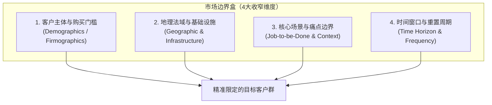

#### 维度一：客户主体资格与购买门槛（Demographics / Firmographics）
你必须明确界定目标客户的支付能力、技能水平与组织形态。
- **个人消费（B2C）**：不能只看总人口，必须限定年龄层、可支配收入中位数、居住形态（如独栋房屋与公寓的区别、有无独立工作室或车库）以及必备前置技能（如是否掌握基础 3D 建模切片软件、是否有动手改装习惯）。
- **企业与商业组织（B2B）**：必须限定企业规模（雇员人数、年营收区间）、组织类型（自由职业者、小型精品工作室、中型代理商还是大型企业）以及技术栈兼容性（如正在使用哪款独立站系统、特定建站工具或特定的设计渲染软件）。

#### 维度二：地理范围与法域基础设施（Geographic & Regulatory Infrastructure）
不同国家和地区绝非铁板一块，地理边界直接影响商业可行性：
- **物理交付基础设施**：海外目标国家是否存在成熟可靠的最后一公里物流网络？（例如，高单价大件商品在美国本土有成熟的陆运与商业快递网络，但在部分新兴市场可能面临较高的丢包与破损风险）。
- **金融与扣款习惯**：当地消费者是否普遍持有支持跨境扣款的国际信用卡（如 Visa/Mastercard），还是高度依赖本地专有支付网关（如荷兰 iDEAL、巴西 Pix）或需要特殊履约安排的货到付款（COD）？
- **合规与法域准入底线**：目标地区是否存在强制性的环保准入（如德国包装法 VerpackG、电气电子法 WEEE）、电子产品认证（CE、FCC、RoHS）或严苛的数据保护法案（如欧盟 GDPR、美国加州 CCPA）？不符合当地法定准入门槛的区域，必须在一开始就从市场计算中直接剔除。

#### 维度三：特定使用场景与痛点边界（Job-to-be-Done & Usage Context）
客户只有在特定场景被触发时才会产生付费欲望（正如《第2章：谁会买我的东西，为什么愿意花钱？》所系统论证）。你的产品绝不可能适配所有的使用工况。
- 必须明确界定客户是在“家庭日常使用”、“移动户外旅途”、“高强度商用办公”还是“工业级严苛生产”环境下作业。
- 必须界定客户购买是为了“解决急性停机损失（防灾/救火）”、“降低日常工时成本（提效）”，还是仅仅为了“满足社交炫耀与娱乐消遣”。不同用途对应的预算优先级与支付阻力天差地别。

#### 维度四：时间窗口与重置消耗周期（Time Horizon & Replenishment Cycle）
市场容量是一个具有“时间流速”的动态指标，而不是一个静态数字。
- 必须界定测算的时间跨度（通常以 1 个自然年为标准测算周期）。
- 明确产品属于“耐用硬件资产（单次购买，平均使用寿命 2~3 年）”、“高频周期消耗品（每 1~3 个月需定期更换配件/耗材）”，还是“持续按期计费服务（按月/按年自动扣费订阅）”。

---

#### 四种出海商业业态的“市场边界盒”限定对照

为了帮助不同背景的跨境出海者建立直观认知，下表展示了四种典型出海业态在计算市场前必须完成的边界收窄示范：

| 维度 | 实物商品：桌面光固化 3D 打印空气净化器 | 数字产品：本地广告视频商用动效模板包 | 软件/SaaS：Shopify 欧洲合规发票与包装申报插件 | 跨境服务：北美定制住宅 3D 建筑效果图外包渲染 |
| :--- | :--- | :--- | :--- | :--- |
| **客户主体门槛** | 拥有桌面 LCD/SLA 光固化 3D 打印机的个人极客与模型制作者；**排除**工业级打印工厂与纯 FDM 塑料丝打印用户 | 1~5 人的小型影视工作室、自由职业商业剪辑师；**排除**个人自媒体短视频爱好者与好莱坞级高端后期特效公司 | 年 GMV 在 \$3 万至 \$100 万美元的独立站出海卖家；**排除**自身拥有自研 ERP 的头部大卖家与月销低于 3 单的休眠店铺 | 雇员规模在 1~15 人的美国/加拿大定制单户住宅建造商与小型建筑设计师；**排除**大型商业地产综合体开发商 |
| **地理与法域范围** | **美国本土与西欧**（独栋住房带独立房间、或公寓内紧凑工作台，且冬季长需关闭门窗通风受限的地区） | **英语主流市场**（美、英、加、澳），以英文商业广告制作体系为标准法域 | **非欧盟注册但向德国/奥地利跨境直邮**实物包裹的 Shopify 独立站卖家 | **美国与加拿大二三线城市**为主的定制住宅建造商（当地人力设计成本高昂但建房需求旺盛） |
| **使用场景痛点** | 打印机在室内封闭环境工作 4~10 小时期间，散发的刺激性 VOC 光敏树脂气味引发家庭成员或合租室友抱怨，需主动低噪吸附 | 客户临时加急下发本地商户促销视频需求，交付周期仅剩 24~48 小时，无法从零搭建 3D 粒子和排版特效 | 欧盟新规要求跨境销售开具符合当地税号的发票并向德国主管机构申报包装材质重量，人工计算耗时且存在下架罚单风险 | 承包商需向私人业主展示定制别墅预售方案并获取首期工程款，本地渲染师单张报价 \$800~\$1500 且排期长达两周 |
| **周期与消耗形态** | 硬件机体为耐用品（3 年生命周期）；活性炭/复合滤芯为定期消耗品（每 2~3 个月需更换一次） | 季度或年度购买扩展包（或单次买断商业授权），平均每年采购 1~2 套核心细分主题素材 | 按月自动续费订阅（SaaS 模式），在店铺存续且持续向欧洲发货期间常年订阅 | 按建筑工程项目制交付，每个中小型承包商年均承揽 2~5 个定制住宅设计建造项目 |

> **边界校验警示（Boundary Tripwire）**：
> 如果你在限定边界时发现自己写下的客户定义依然是“所有想赚钱的人”、“所有亚马逊买家”或“所有需要渲染图的公司”，请立刻停下计算。**缺乏边界约束的市场测算，本质上是用模糊的宏大叙事掩盖对真实客户画像的不理解**。

---

### 4.1.2 怎么用客户数量、购买频率和价格估算市场上下限？

当“市场边界盒”清晰建立后，我们就可以运用经过严密界定的**微观三要素公式**来估算该细分利基的年度可成交市场总额：

$$\text{Annual Market Size (USD)} = N \times F \times P$$

#### 核心指标口径明确界定：终端交易规模 vs 卖家可得收入
在应用该公式前，必须严格区分两个不同的财务量纲：
1. **细分市场年度终端交易额（Gross Buyer Spend / GMV）**：这是宏观与微观市场规模评估（TAM/SAM）的标准通用口径。公式中的 $P$ 采用**目标终端买家实际支付的含运费/税前结算单价（Gross Realized Price）**，反映该细分需求在特定年度内撬动的终端资金池总额；
2. **本人项目的收入、贡献与实际到账现金**：本章估算的是给定市场的终端交易规模，**它不等于创业者自己的收入、利润或银行卡到账金额**。进入第5章要按实际合同和会计口径区分“净销售额（先按折扣、退款、代收税等确定）→扣成本后的单位贡献→扣固定开销后的利润→按结算周期可用的现金”。平台佣金、支付手续费和获客费用在相应成本环节扣除，**不得在所谓Net Realized Revenue中先扣一次、第5章再扣一次**。例如仅作教学假设的一笔无税、无折扣与退款、售价29美元的软件月费订单：本章终端交易额29美元，若该笔确属卖家本人销售，第5章净销售额亦先按29美元起算，再扣变动费用，实际入账时间另行核验。运费、税金和平台主责/代理列报必须按实际经营条件判断。

各参数定义如下：
- $N$（Qualified Target Customers）：限定边界盒内，处于活跃状态且具备真实付费能力的合格客户总数；
- $F$（Annual Purchasing Frequency）：每个活跃客户在 1 个自然年内的平均购买频次（对于硬件耐用品，采用稳态年化出货/重置置换比率；对于软件，为年度有效订阅期折算；对于服务，为年均发包项目数）；
- $P$（Gross Average Transaction Price）：终端客户单次购买实际支付的平均交易客单价。

#### 为什么必须采用“自下而上微观代理变量法（Bottom-Up Triangulation）”？
绝大多数失败的测算都源于“自上而下宏观漏斗法”——例如：“全球宠物市场规模 2000 亿美元，我们切入智能猫砂盆，假设占 1% 就是 20 亿美元”。这种假设完全脱离了真实的消费决策路径。

严谨的独立开发者与中小商家必须采用**自下而上的微观代理变量法**：通过寻找具有物理依据的**“生态基石装机量（Host Installed Base）”**、**“细分行业官方统计登记企业数”**、**“核心零部件海关报关出货量”**或**“高门槛专业社区活跃会员数”**作为底层锚点，逐层进行真实转化漏斗过滤。

为了防范单一数字的过度自信偏差，我们必须为便于检验不确定性，本章使用**三档假设情景模型**：
1. **保守下限（Conservative Scenario）**：采用严格的转化过滤条件、较低购买频次与折扣价格底线；
2. **基准中性（Baseline Scenario）**：采用作者**自设的一组居中教学假设**作为比较锚点；未经实际市场抽样，不能称为行业统计中位数；
3. **乐观上限（Optimistic Scenario）**：假设特定利基生态保持良性自然扩散、周边耗材与高阶增值包渗透率达到良好水平。

---

#### 四大出海商业业态微观测算全景演示（含三档情景与算术复核）

以下四个案例严格基于微观三要素公式展开。案例中的基础客群底池与转化比例，均属于为教学示范而设定的**结构性假设模型（`[MODEL_ASSUMPTION]`）**，借鉴了官方普查（如美国人口普查局 NAICS 512110 / NAICS 236115）与行业平台的分类逻辑，但不代表政府官方直接发布的统计定论。在实际经营中，读者应代入自己真实调研取得的各变量证据。

---

#### 案例一（实物商品）：桌面光固化 3D 打印空气净化器

- **底层参考基数（`[MODEL_ASSUMPTION]`）**：欧美主流消费级光固化（LCD/SLA）3D 打印机活跃保有量，基于行业出货量推算的教学底池约 600,000 台（保守 450,000 台，乐观 800,000 台）。
- **边界设定**：美、英、德、法四国，居于独立房间且无专业外排通风管道的活跃玩家家庭。
- **稳态出货与消耗模型（`[MODEL_ASSUMPTION]`）**：
  - 室内无独立车库/专业排风、且高度关注树脂气味与毒性安全的用户占比：中性取 $35\%$（保守取 $25\%$，乐观取 $45\%$）；
  - 单用户年均综合支出 $P$：硬件零售价 \$60（寿命 3 年，年化折算 $\$20.00/\text{年}$），替换活性炭滤芯组零售价 \$12/套。保守情景年消耗 2 套（折后均价 \$10/套，合计 \$40.00/年）；基准情景年消耗 3 套（\$56.00/年）；乐观情景年消耗 4 套（\$68.00/年）。

**三档市场规模估算结果（$\text{Market Size} = N \times P$）**：
- **保守下限**：$N_{\text{low}} (450,000 \times 25\% = 112,500 \text{ 户}) \times \$40.00 = \mathbf{\$4,500,000}$（约 450 万美元/年）；
- **基准中性**：$N_{\text{mid}} (600,000 \times 35\% = 210,000 \text{ 户}) \times \$56.00 = \mathbf{\$11,760,000}$（约 1,176 万美元/年）；
- **乐观上限**：$N_{\text{high}} (800,000 \times 45\% = 360,000 \text{ 户}) \times \$68.00 = \mathbf{\$24,480,000}$（约 2,448 万美元/年）。

> **实物测算实操启示**：
> **仅在上述教学参数成立时**，本例三档假设的年度终端交易额分别为 **450 万、1,176 万、2,448 万美元**，整个敏感性范围为**450 万至 2,448 万美元/年**（若只比较基准—乐观两档，则为 1,176 万至 2,448 万）。这**不能证实**真实市场容量、可取得份额、巨头会否进入或小卖家能够盈利；这些都需要真实装机量、实际购买频次、竞品交易和供给侧证据验证。将全球宏观盘直接套用为个人可服务市场同样会误导备货决策。

---

#### 案例二（数字产品）：本地广告视频商用动效模板包（After Effects / Premiere Pro）

- **底层参考基数（`[MODEL_ASSUMPTION]`）**：参考美国劳工统计局（BLS）与英国国家统计局（ONS）行业分类下的小微影视制作实体及活跃独立商业剪辑师，设定美英澳教学底池约 75,000 户（保守 55,000 户，乐观 105,000 户）。
- **边界设定**：美、英、澳三国内，为本地中小商户制作短视频广告、受工期限制需采购商业动效模板的 1~5 人微型工作室与独立剪辑师。
- **各参数假设与推导逻辑（`[MODEL_ASSUMPTION]`）**：
  - 具备真实商业模板采购习惯的机构比例：中性取 $40\%$（保守取 $30\%$，乐观取 $50\%$）；
  - 年采购频次 $F$ 与单笔交易客单价 $P$：保守情景 $F=1.0$ 次、单次 \$59.00（年单客 \$59.00）；基准情景 $F=1.5$ 次、单次 \$89.00（年单客 $1.5 \times \$89 = \$133.50$）；乐观情景 $F=1.5$ 次、单次 \$109.00（年单客 $1.5 \times \$109 = \$163.50$）。

**三档市场规模估算结果（$\text{Market Size} = N \times F \times P$）**：
- **保守下限**：$N_{\text{low}} (55,000 \times 30\% = 16,500 \text{ 户}) \times 1.0 \times \$59.00 = \mathbf{\$973,500}$（约 97.4 万美元/年）；
- **基准中性**：$N_{\text{mid}} (75,000 \times 40\% = 30,000 \text{ 户}) \times 1.5 \times \$89.00 = \mathbf{\$4,005,000}$（约 400.5 万美元/年）；
- **乐观上限**：$N_{\text{high}} (105,000 \times 50\% = 52,500 \text{ 户}) \times 1.5 \times \$109.00 = \mathbf{\$8,583,750}$（约 858.4 万美元/年）。

> **数字产品实操启示**：
> 数字资产边际复制成本极低，但市场容量受限于目标小微工作室的绝对基数。在基准年交易额约 400 万美元的利基中，单打独斗的开发者应聚焦极度精准的垂直行业资产（如专攻齿科、律所、健身房本地推广模板），而非铺摊子做泛化素材。

---

#### 案例三（软件/SaaS）：Shopify 欧洲包装法与跨境增值税自动合规发票插件

- **声明（`[MODEL_ASSUMPTION]`）**：本案例为**概念性虚拟组合产品示例**，旨在拆解微型合规 SaaS 的测算逻辑；现实中德国 VerpackG 包装申报与 VAT 发票开具在监管主体、法律责任与第三方授权机制上彼此独立，任何软件功能的集成均需遵循平台与官方审核要求。
- **底层参考基数（`[MODEL_ASSUMPTION]`）**：参考 Shopify 官方公开披露的全球活跃商户大盘及第三方建站监测工具，设定非欧盟向德奥直邮实物且有一定流水（年销 > \$30,000）的 Shopify 活跃店铺教学底池约 45,000 家（保守 30,000 家，乐观 65,000 家）。
- **边界设定**：非欧盟注册主体、独立站直邮德国与奥地利消费者的实物电商独立站。
- **各参数假设与推导逻辑（`[MODEL_ASSUMPTION]`）**：
  - 急需自动化轻量软件解决申报报表与发票的店铺比例：中性取 $35\%$（保守取 $25\%$，乐观取 $45\%$）；
  - 终端商家支付的年度订阅费 $P$（年化折算）：保守情景按年付优惠/流失折算 $P_{\text{low}} = \$120.00/\text{年}$；基准情景标准套餐 $P_{\text{mid}} = \$190.00/\text{年}$；乐观情景多站点合规包 $P_{\text{high}} = \$240.00/\text{年}$。

**三档市场规模估算结果（$\text{Market Size} = N \times P$）**：
- **保守下限**：$N_{\text{low}} (30,000 \times 25\% = 7,500 \text{ 家}) \times \$120.00 = \mathbf{\$900,000}$（约 90 万美元/年）；
- **基准中性**：$N_{\text{mid}} (45,000 \times 35\% = 15,750 \text{ 家}) \times \$190.00 = \mathbf{\$2,992,500}$（约 299.3 万美元/年）；
- **乐观上限**：$N_{\text{high}} (65,000 \times 45\% = 29,250 \text{ 家}) \times \$240.00 = \mathbf{\$7,020,000}$（约 702 万美元/年）。

> **开发者收益分配与平台政策说明（重要核验事实）**：
> 依据 Shopify 开发者现行分成政策（[Shopify App Store Revenue Share Policy](https://shopify.dev/docs/apps/launch/distribution/revenue-share)），对于符合 Shopify **标准分成资格**的开发者，**自 2025 年 1 月 1 日起计入的终身累计应用总收入（lifetime gross app revenue）前 \$1,000,000 美元适用 0% 平台收入分成，门槛不会每年重置**，超过部分适用 15% 平台分成。跨应用与关联开发者账号须合并计入，达到大型开发者条件的账号不适用这项 0% 优惠；另有 2.9% 处理费及适用税费、地区性费用。应按平台当前合同与资格核实。
> **仅在教学假设下**：若该开发者仍符合 0% 平台分成资格、关联应用终身累计总收入尚未触及门槛，且有 500 家付费店铺、每家年支付 \$190，则终端实付金额为 $500 \times \$190 = \$95,000$；**仅扣假设的 2.9% 处理费**（约 \$2,755）后余约 \$92,245。此数不是实际到账净额、利润或健康现金流的证据；退款、税费、云资源、人工、营销、合规成本、结算时点均尚未计算，真正盈利能力为 `UNKNOWN`。

---

#### 案例四（跨境服务）：北美定制独栋住宅 3D 建筑设计渲染与动画外包

- **底层参考基数（`[MODEL_ASSUMPTION]`）**：参考美国人口普查局经济普查（NAICS 236115 单户住宅建造商），设定美加中小型定制住宅承包商与独立事务所教学底池约 35,000 家（保守 25,000 家，乐观 48,000 家）。
- **边界设定**：雇员在 1~15 人的北美中小型定制住宅承包商，年开工建造 2~10 套定制独栋，且未雇佣全职专职渲染团队。
- **各参数假设与推导逻辑（`[MODEL_ASSUMPTION]`）**：
  - 存在向海外或第三方团队外包 3D 效果图诉求以降低本地成本的机构占比：中性取 $30\%$（保守取 $20\%$，乐观取 $40\%$）；
  - 年外包频次 $F$ 与单套外包价 $P$：保守情景 $F=2$ 次、单套 \$700（年单客 \$1,400）；基准情景 $F=3$ 次、单套 \$850（年单客 \$2,550）；乐观情景 $F=4.5$ 次、单套 \$1,050（含漫游短动画，年单客 \$4,725）。

**三档市场规模估算结果（$\text{Market Size} = N \times F \times P$）**：
- **保守下限**：$N_{\text{low}} (25,000 \times 20\% = 5,000 \text{ 家}) \times 2 \times \$700 = \mathbf{\$7,000,000}$（约 700 万美元/年）；
- **基准中性**：$N_{\text{mid}} (35,000 \times 30\% = 10,500 \text{ 家}) \times 3 \times \$850 = \mathbf{\$26,775,000}$（约 2,678 万美元/年）；
- **乐观上限**：$N_{\text{high}} (48,000 \times 40\% = 19,200 \text{ 家}) \times 4.5 \times \$1,050 = \mathbf{\$90,720,000}$（约 9,072 万美元/年）。

> **跨境服务实操启示**：
> 服务交易总值较高，但高度依赖人工工时交付。2678 万美元的基准年总需求，支撑的是高度分散的工作室生态。服务类商家的核心约束通常不是外部市场容量不足，而是自身团队的交付带宽与质量稳定性。

---

### 4.1.3 市场总需求和新商家实际可能服务的规模，有什么区别？

在完成微观测算后，初入局者往往会产生第二种典型幻觉：“既然基准市场有数百万甚至上千万美元，我只要拿到极小一点份额，就足够维持运转了！”

这种思维方式忽略了商业运营中最残酷的一层过滤：**市场总需求（Demand-Side Pool）与单个新进入者的供给侧真实承载力（Supply-Side Capacity）之间的天壤之别**。

为了理清这一落差，我们必须借用成熟的微观商业分层模型——**TAM / SAM / SOM 漏斗**，并结合中小商家的真实能力进行重新审视：

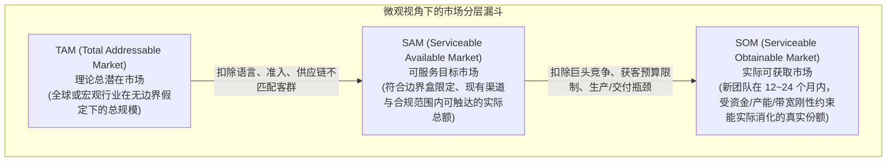

#### 概念厘清：中小团队的现实定义
1. **TAM（Total Addressable Market，潜在市场总额）**：在假定全球没有竞争对手、没有任何关税壁垒、全人类同一种语言且供给无限的极端理想状态下，某种产品形态的理论消费极限。在中小商家的实际经营决策中，**TAM 仅具有宏观背景参考价值，绝不能作为立项出资的直接依据**。
2. **SAM（Serviceable Available Market，可服务市场）**：在你在 4.1.1 节构建的“市场边界盒”内（限定了具体国别、语言、客户资格与使用场景），现有行业中所有同行共同瓜分的**真实年度总需求大盘**。我们在 4.1.2 节测算出的“基准中性规模”，本质上正是该细分利基的 SAM。
3. **SOM（Serviceable Obtainable Market，实际可获取市场）**：在未来 12 至 24 个月内，一个**新入场的微型团队或个人经营者，在受到自身起步资金、库存周期、客服工时及营销买量预算的现实约束下，真正能够切下来并完成履约的实际销售额**。

#### 为什么脱离实际能力谈“市场份额”是危险的？
很多商业企划书习惯随意假设“我们第一年拿下市场份额的 1%”。**商业现实表明，份额是产品力与渠道执行沉淀的结果，而非预设的起点**。
在一个规模百亿美元的成熟通用大市场（如基础手机壳、泛用办公软件）中，行业头部品牌通常凭借规模采购成本、线下渠道分销、海量评价积累及高额广告投放构筑了极深的防御壁垒。一个新团队如果盲目扎入此类红海赛道，可能在耗尽前期获客预算后依然无法建立稳定的盈利模型。

相反，在一个 SAM 为数百万美元规模的垂直细分利基中，**可能**存在大企业不优先覆盖的细分场景，但也可能因规模小、履约成本高或合规困难而无法盈利；是否有竞争者服务不足应通过实际客户评价、交付和替代方案核验。此时，新团队若能集中资源解决特定场景下的刚性问题（如极端环境下的气味吸附、特定法域的合规报送），**更有机会在可控的投入下跑通局部正向循环，建立稳固的生存阵地**。

---

#### 决定新商家 SOM 上限的四大供给侧现实瓶颈（Supply-Side Bottlenecks）

决定你第一阶段到底能完成多少销售额的，往往不是外部需求池有多大，而是你的**供给侧在什么地方会率先达到承载上限**：

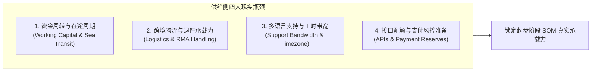

1. **资金占用与供应链周转周期（针对实物商品）**：
   - 生产一件硬件需要垫付采购成本，海运到海外仓需要一定航程周期（美西通常需 18~25 天，美东或欧洲通常需 30~45 天），上架销售后还要面临平台结算账期。
   - 如果初创团队的自有流动资金有限，首批备货量就会受到严格限制。哪怕全美每年有数十万台的市场需求，你第一年的实际出货能力上限也会被资金周转速度直接锁定。超出资金承受能力的盲目扩充，极易导致现金流断裂。
2. **多语言交付与时差服务带宽（针对跨境服务与高客单软件）**：
   - 熟练的 3D 建筑设计效果图渲染师，在确保图纸准确性与材质光影的前提下，单人每月高质量交付的项目套数存在物理上限。
   - 哪怕目标市场每年有数万套的外包总需求，在未建立流水线分工团队之前，由少数几名设计师组成的工作室，其初期的年度交付上限就被团队总工时硬性锁定。
3. **平台规则、支付风控与算力限额（针对微型 SaaS 与独立站）**：
   - 新注册的跨境支付网关或收款账户，在遭遇突发交易量激增或买家争议时，可能面临支付渠道基于风险评估设立的流动质押（Rolling Reserve），部分资金可能被临时延期结算；
   - 依托大语言模型或云渲染底层接口开发的软件，新开发者账户受到请求并发数（RPM）和每日额度的限制；如果未提前规划接口配额，瞬间涌入的用户会导致服务响应变慢或请求失败，反向引发退款投诉。
4. **逆向物流与售后沉没损耗（针对跨国实物销售）**：
   - 跨境销售不仅要核算正向物流成本，更要评估退换货（RMA）带来的潜在损耗。如果特定产品因说明书不够详细或操作门槛高导致退货率上升，海外本地检测、重新贴标入库或就地报废的处理成本，会快速侵蚀原本的利润空间。这要求新卖家在起步期必须小批量精细验证，而非盲目铺货。

> **本节小结与承上启下**：
> 估算市场从来不是在纸面上画一个巨大的饼来麻醉自己。严谨的分析，懂得用**“市场边界盒”排除非目标客群**，懂得用**“微观三要素公式”推导合理的基准 SAM 范围**，更懂得用**“自身的资金与交付工时上限”清醒锚定起步阶段的 SOM**。
> 然而，在实际进行这套推导时，我们赖以作为输入参数的各类网上传播的销量榜、关键词热度以及行业研报，究竟有多少水分？下一节，我们将深入拆解网络商业数据的可信度真相与辨析方法。

#### 用真实官方入口复现一个市场参数

以“向美国餐饮门店销售软件”为例，查美国 Census Bureau 2023 County Business Patterns（<https://www.census.gov/data/datasets/2023/econ/cbp/2023-cbp.html>），按官方 API 说明筛选州、NAICS2017=722511 和 ESTAB，保留查询 URL、原始响应、数据年份与字段定义。这个 ESTAB 是**有雇员营业场所数**，不是买家或付费客户数。以其作为可观察母体 N0，扣除不适用门店的证据化比例范围；真实年度购买频率 F 和价格 P 还须访谈与报价核验，才能估算 N×F×P。若尚未执行 API，N/F/P 均标 UNKNOWN。**本轮仅给出可复现方法，未实际下载和计算数据**，不得伪装真实市场容量。

## 4.2 网上那些销量、搜索量和市场报告靠谱吗？

在互联网时代，做跨境市场调研似乎变得前所未有的容易：只要在浏览器里敲入几个关键词，各种选品软件的“月销估算”、SEO 工具的“关键词热度大盘”，以及商业咨询机构的“全球市场分析摘要”，就会铺天盖地涌现在屏幕前。

然而，**海量的数据并不等同于客观的事实**。商业分析领域有一句经典格言：“Garbage In, Garbage Out（输入垃圾，产出的必然也是垃圾）”。如果创业者把缺乏实证基础的估算算法当成真实成交，把泛资讯搜索当成刷卡购买，或者把由宏观公关诉求驱动的研报当成微观真理，那么你的商业测算在第一步就会出现系统性偏差。

本节将逐一解构销量榜单、搜索流量和第三方研究报告的底层运作机制，揭示它们**“能证明什么”与“不能证明什么”**；并为你提供一套严谨的三角交叉核实框架，教你在面对互相矛盾的数据源时，如何客观辨析真实商业线索并规范说明假设敏感性区间。

---

### 4.2.1 销量榜、搜索量和第三方市场报告，各自能证明什么？

要正确使用网络数据，首先必须对常见的几大公开数据源建立清晰的批判性认知。没有任何一种单一数据源能够呈现完整的市场全貌，每一种工具都有其特定的观测视角与盲区。

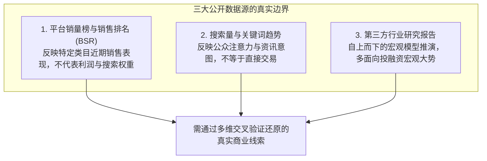

---

#### 1. 平台销量榜与热卖排名（如 Amazon BSR、TikTok 热榜、Etsy Best Sellers、Chrome 应用商店推荐）

在主流电商与数字应用生态中，销售排名机制（如亚马逊的 Best Sellers Rank，即 BSR）是卖家使用最频繁的参考指标。各类第三方选品工具正是通过监测 BSR 的变动历史，结合其自研算法模型来推算该商品的“预估出单流速”。

- **它能证明什么**：
  1. **同细分类目下的相对销售流速（Relative Sales Velocity）**：依据亚马逊官方说明（[Amazon Best Sellers Rank Guide](https://sell.amazon.com/blog/amazon-best-sellers-rank)），BSR 是基于商品在该特定类目下的**近期销售表现结合历史销售累积加权计算**得出的相对位次。在同一类目子节点下，BSR 靠前的商品近期出单流速通常高于排名靠后的商品；
  2. **品类的即时热度波动**：如果某类商品的排名在短期内集中上升，通常反映了当季或近期该品类受到更多消费者的集中采购。
- **它不能证明什么**：
  1. **搜索排名与系统推荐曝光**：**BSR 绝不等同于搜索排名（Search Rank）**。搜索排名由搜索算法（如亚马逊 A9/Rufus）依据关键词匹配度、转化率和买家满意度等多维算法独立判定；高 BSR 往往是出单较多的“结果”，而不能作为该商品获得了系统额外推荐曝光的“因果证明”；
  2. **跨类目的绝对销售数量**：不同类目的 BSR 绝对出单量不可直接横向类比。在大类目中，排名 100 位的商品日均出单可能数百件；而在极窄的工业配件类目中，排名第 1 位的商品每天可能仅出单数件；
  3. **盈利能力与真实沉淀收益**：**销量榜单只记录订单流速，完全不体现财务账目**。部分商品可能通过大额优惠券促销（Coupon）、赔本清库存或高竞价站外广告推升销量，表面流速高并不代表其经营具有正向利润；
  4. **退货率与售后损耗**：退货并不实时抵消既往的销售积分。对于退货率较高的大件或精密产品，高昂的退件运费与再处理成本可能早已吞噬掉账面利润。

---

#### 2. 搜索量与关键词趋势（如 Google Keyword Planner、Ahrefs、SEMrush、Helium 10、Google Trends）

搜索数据常被创业者视为验证市场需求的“第一道风向标”。然而，将搜索量直接折算为销售订单的做法，极易造成严重的商业误判。

##### 区分绝对指数与相对指数：Google Trends 的认知机制
依据谷歌官方文档（[Google Trends Help](https://support.google.com/trends/answer/4365533?hl=en)），**Google Trends 所展示的数值（0~100）是一个归一化的相对搜索热度指数，绝非绝对搜索人次！**
- 某一关键词的趋势指数达到 100，仅代表该词在其**自身选定的查询时间范围和地理区域内，相对于总搜索量达到了最高峰值**；
- 在人口较少的国家，指数为 100 对应的月度绝对搜索次数可能仅有数百次；而在人口庞大的国家，即便指数只有 30，对应的月度绝对搜索量也可能有数十万次。未经过绝对基数校准的跨国或跨类目对比，不具备可比性。

##### Google Trends最短操作与结果记录卡

访问 [Google Trends Explore](https://trends.google.com/trends/explore)；把**地区、时间范围、搜索词或主题、搜索类别、网页/购物/YouTube等属性**记录下来。需要比较两个词时放在**同一查询和同一组条件**里；例如以“restaurant waitlist”和目标市场常用同义词练习，但本教材**没有实际获取该词的搜索数据**。复制查询链接、截图或导出CSV，标记查询日期、低量词0值和可能的随机波动；**指数100不等于100次搜索，指数0不证明完全无人搜索**。

最终只写“趋势变动方向和不确定性”，再用独立来源核对真实客户问题、交易或采购行为；搜索趋势并不等于愿意付钱。[Google Trends官方数据FAQ](https://support.google.com/trends/answer/4365533?hl=en)。

##### 搜索意图四分法：理解不同搜索词背后的转化差异
即便获取了第三方 SEO 工具测算出的月度绝对搜索量，也必须对其背后的**搜索意图（Search Intent）**进行分类辨析：

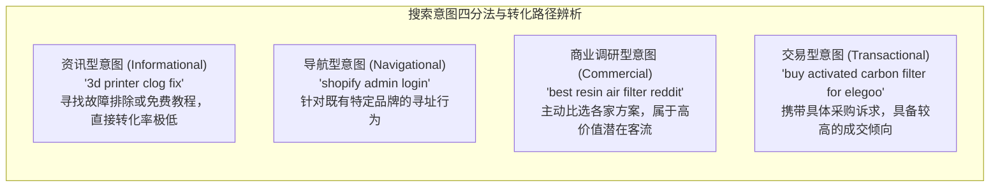

1. **资讯型意图（Informational Intent）**：例如搜索“how to fix 3d printer resin smell（如何解决树脂异味）”。用户多为遭遇突发问题时寻找免费教程或日常了解。此类通用长尾词虽然搜索量庞大，但用户此时并没有立刻采购新硬件的心智准备，直接购买转化率通常极低；
2. **导航型意图（Navigational Intent）**：例如搜索“Shopify login”、“Bambu Lab forum”，用户仅是将搜索引擎作为寻址入口，不具备开放的商业采购意向；
3. **商业调研型意图（Commercial Investigation）**：例如搜索“best air purifier for resin 3d printer”或“Shopify invoice app reviews”。用户已经确认了痛点，正在主动比选各家方案的优劣，属于极具转化潜力的高价值流量；
4. **交易型意图（Transactional Intent）**：例如搜索“buy activated carbon filter replacement”、“Shopify verpackg app pricing”。用户带有明确的购买或订阅意图，具备相对集中的交易倾向，但最终是否付款仍取决于你的定价、信任背书与交付时效。

---

#### 3. 第三方行业研究报告（如 Grand View Research、Statista、Allied Market Research、Mordor Intelligence）

在网络检索某个细分品类时，经常会看到商业研究咨询机构发布的“全球市场分析报告”摘要通稿（例如“2026 年全球 3D 打印配件市场将达到 XX 亿美元，CAGR 为 20%”）。

- **它能证明什么**：
  1. **资本与大型机构的宏观关注度**：有咨询机构持续发布报告，说明该大行业在投融资、上市公司或宏观产业政策中有一定的讨论热度；
  2. **宏观产业链与上下游分类梳理**：报告通常会对大产业的技术流派、原材料供应、主流下游应用场景提供相对规范的结构性梳理。
- **它不能证明什么**：
  1. **小微利基的真实可为空间**：宏观报告的统计口径通常极其宽泛。例如一份“全球空气净化设备研报”，其千亿级大盘里可能 $90\%$ 以上是由工业级厂房通风、大型商场暖通和医疗负压系统构成的，留给消费级桌面 3D 打印空气净化配件的微观份额可能极其微小。将工业级大盘的增长率机械套用到消费级小利基上，属于统计口径的错位；
  2. **微观抽样的精确性**：部分第三方商业研报的摘要多基于宏观公开二手资料与模型外推，其背后的具体一手调研样本量、问卷回收率与统计误差范围通常未在摘要中公开披露（`[UNKNOWN]`），不能直接等同于严密的微观市场核验数据。

---

#### 三大公开数据源与官方审计统计的对比判别矩阵

| 数据源类型 | 典型代表工具 | 底层数据生成逻辑 | 核心优势与参考价值 | 关键盲区与使用限制 | 推荐用法与置信度评级 |
| :--- | :--- | :--- | :--- | :--- | :--- |
| **平台销售流速榜** | 亚马逊 BSR、Etsy Best Seller、TikTok 趋势榜 | 平台系统内部基于近期出单流速与历史表现滚动加权 | 捕捉当前细分类目内的相对畅销趋势，判断即时出单表现 | **不体现利润与退货率**；绝对销量跨类目不可比；不代表搜索权重与官方推荐曝光 | 用于横向比对竞品近期相对走势，置信度：**中** |
| **搜索热度工具** | Google Keyword Planner、Ahrefs、Helium 10、Google Trends | 搜索引擎公开接口、历史查询日志聚合与点击流拟合模型 | 反映全球用户主动探寻的痛点方向，捕捉长尾交易意图 | **搜索热度不等于购买成交**；Trends 为 0~100 相对指数；泛资讯词转化意愿极弱 | 重点筛选商业调研与交易型长尾词，置信度：**中高** |
| **第三方商业研报** | Grand View Research、Statista、Allied Market Research | 宏观二手资料聚合、自上而下复合增长率（CAGR）数学外推 | 宏观产业链结构梳理，了解行业大势与投融资热点 | **口径过于宽泛（混淆工业与消费级）**；微观样本细节多不公开，预测多为数学外推 | 仅用于阅读产业链上下游定性分类，不可作为出资依据，置信度：**低** |
| **官方普查与审计财报** | 美国人口普查局（US Census Bureau）、欧盟统计局（Eurostat）、上市公司 10-K 年报 | 政府法定抽样普查、经审计的上市公司法定财务申报 | **法理口径清晰，样本机制完备**；底层法定义务与责任明确 | 数据更新通常滞后 6~18 个月；颗粒度较粗，难以直接对应特定超窄新利基 | 作为微观自下而上推导的**宏观底池参考**，置信度：**最高（Tier 1）** |

---

### 4.2.2 来源互相矛盾时，怎样交叉核实并说明不确定性？

在实际调研过程中，创业者经常会遇到数据“打架”的困惑：
- 选品工具 A 显示某款产品的预估月销量是 1,500 件，而选品工具 B 测算只有 300 件；
- 关键词工具显示某词月搜索量高达 50,000 次，但同行独立站的预估月访问量却非常有限；
- 宏观研报声称该赛道正在高速增长，但在垂直卖家社群中却经常能看到经营困难的讨论。

当数据来源互相矛盾、难以辨析时，必须启用**“三角交叉核实法则（Triangulation Framework）”**，从供给侧物理痕迹、社群原生讨论以及生态基石装机量三个维度寻找佐证，并客观说明数据局限性。

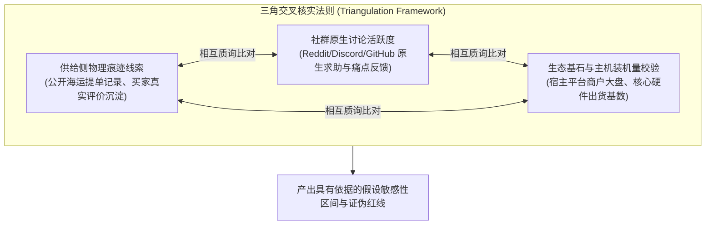

---

#### 交叉核实路径一：供给侧物理痕迹线索（公开海运提单与真实评价沉淀）

网络上的点击和浏览易受短期活动影响，但跨国远洋物流与买家真实评价能够提供宝贵的物理参考线索：

1. **公开海运提单线索检索（Bill of Lading Analysis）**：
   - 依托美国海关与边境保护局（CBP）公开海运提单数据（可通过 ImportYeti、Panjiva 等第三方平台合规检索），查询核心竞品申报主体的远洋报关记录；
   - **核查参考点**：在过去 6 至 12 个月内，该品牌是否有相对规律的集装箱货柜靠港？真实的货重（Weight）与报关频次如何？
   - **已知局限与核验边界（重要核查事实）**：
     - 依据美国联邦法规 19 CFR 103.31 及 CBP 官方指南（[CBP Manifest Confidentiality](https://www.help.cbp.gov/s/article/Article-1108?language=en_US)），进口商与收货人有权依法向海关申请**提单商业信息保密（Manifest Confidentiality）**，保密后第三方工具将无法抓取其公开数据；
     - 此外，海运提单**无法反映空运专线、国际小包邮政、海外本地供应链采购或通过大型综合分销商代理进口的货物**。因此，提单记录应作为验证“其是否存在稳定海运大货补货”的辅助线索，**不可简单以“未搜到公开提单”直接得出“对方完全没有真实销量”的绝对断言**。
2. **买家真实评价留存流速观察（Review Velocity Method）**：
   - **经验参考逻辑**：在电商平台及独立站运营中，消费类商品的非邀约自然留评率受售后跟进与品类特质影响较大，实操中多作为粗略的经验参考区间（`[UNKNOWN]`）；
   - **反推核查方式**：追踪竞品近 6 个月内“带有真实购买认证（Verified Purchase）”且包含具体使用痛点反馈的月均新增评价。如果新增评价长期平稳增长且包含真实图文细节，可作为其产品正在持续销售的侧面参考；若 Listing 评价在短时间内批量涌入大量千篇一律的模板化好评，则可能存在营销干预，需审慎评估其自然销量。

---

#### 交叉核实路径二：社群原生求助频率与讨论深度

如果一个痛点在真实世界中广泛存在，客户通常会在垂直社区、专业论坛或问答板块中留下有机的讨论足迹。

- **调研阵地**：深潜进入 Reddit（如 r/resinprinting、r/shopify、r/architecture）、专有 Discord 服务器、行业问答论坛与 GitHub Issues 讨论区；
- **核验关注点**：
  1. **主动求助 vs 单向推销**：区分是普通用户在主动发帖求助（例如询问低噪音排气方案），还是营销号在单向发布推广软文；
  2. **讨论的时效性与密度**：类似问题在近几个月内是被持续提及，还是仅在几年前特定节点集中讨论过之后归于死寂；
  3. **现有解法的妥协程度**：社群用户在分享现有替代方案时，是否普遍反映存在操作繁琐、噪音大或成本高的痛点，这构成了验证付费意愿的重要定性依据。

---

#### 交叉核实路径三：生态基石与主机装机量校验（Ecosystem Anchor）

任何配件、插件或外包服务，都依托于某个更底层的宿主系统或硬件生态。**外围配件与增值服务的总盘，必然受制于底层宿主生态的装机规模**。

- **软件/SaaS 校验示例**：如果你开发的是面向 Shopify 卖家的包装法插件，在评估潜在空间时，必须以向目标法域发货的活跃店铺总盘作为物理边界；若某一市场推算出来的插件潜在客户数超过了宿主平台该区域活跃商户的总和，该推算显然不符合客观规律；
- **实物配件校验示例**：如果你开发的是光固化打印机净化配件，全球主流厂商的整机出货量与保有量是决定其需求总盘的物理上限。若配件推算需求远超整机供应链的产能水平，则必须下调测算预期。

---

#### 规范说明不确定性：建立假设敏感性区间与证伪红线

在完成交叉比对后，严谨的商业决策报告**不应当提供一个武断的“唯一真理数字”**，而应坦率说明数据局限，并规范使用以下分析工具：

##### 1. 采用“假设敏感性区间（Sensitivity Range）”与风险条件附注
用情景与敏感性区间替代单一数字点估计。例如在可行性评估中应当这样规范陈述：
> “结合公开海运提单抽样、主要竞品真实评价流速及垂直社区讨论热度综合评估：
> 该细分产品在美欧核心市场的基准年度有效需求估计在 **18 万件至 30 万件区间**（基准中性参考值：22 万件）。
> - **主要不确定性因素**：主流整机厂商未来是否会在新款机型中直接内置一体化排风净化结构（`[UNKNOWN]`）；
> - **数据局限性说明**：提单数据受部分进口商海运保密申请及空运渠道不可见性限制，评价留存率存在品类波动，本区间仅作为教学假设情景推演，不作为确定性投资担保。”

##### 2. 预设“调研证伪红线（Go / No-Go Research Tripwires）”
在进入模具开模或全职研发前，为自己设定明确的叫停红线。一旦在深入调研中触发以下条件，应暂停投入并重新评估：
- **红线一（需求端缺乏真实反馈）**：在目标垂直社区（如 Reddit 目标版块）发起关于该痛点的深度探讨与调研，未能引发目标受众的真实痛点共鸣与讨论，痛点可能仅局限于个别极端个案；
- **红线二（宿主平台生态重构）**：底层宿主平台官方发布了重大底层系统升级声明（例如平台直接原生推出了免费的合规报表生成模块），导致该第三方软件立项的前提假设在物理上失效；
- **红线三（头部供给持续陷入价格战）**：连续跟踪多个标杆竞品，发现其长期依靠大幅降价或高额补贴维持出单流速，单笔毛利空间已被极度压缩，新进入者缺乏健康的起步空间。

> **本节小结与承上启下**：
> 数据的价值不在于图表多么精致，而在于其底层是否有扎实的物理证据与多维交叉印证。学会破除虚荣指标，是跨境从业者走向理性决策的关键一步。
> 然而，即便我们证实了当前市场存在真实的需求，还有一个关键维度需要审视：**当下的需求能够持续多久？** 它是否会在短时间内迅速退潮？下一节，我们将深入探讨需求的生命周期演进规律与防衰退法则。

## 4.3 现在很火的产品，会不会过几个月就没人买了？

对于出海中小商家和独立开发者而言，极其严峻的经营挑战之一在于：**产品研发或备货刚完成，原本火爆的市场需求却已迅速退潮**。

跨境业务涉及漫长的跨国价值链条：实物出海通常需要经历开模打样、批量排产、国际远洋海运（美西通常需 18~25 天，美东或欧洲通常需 30~45 天）、清关报关以及入库上架，整个周转链路往往长达数周至数月；即使是软件开发或数字资产制作，从原型验证、支付配置到多语言本地化打磨，也需要持续的精力投入。

如果在你启动项目的那一刻，市场上观测到的“爆火”仅仅是一场持续周期很短的**短期炒作热潮（Fad）**，或者是一年一度的**季节性脉冲（Seasonal Spike）**，那么当货物运抵海外仓或软件正式部署上线时，最初的热潮可能早已平息。随之而来的，是买量成本上升、出单流速减缓，以及持续产生的海外仓储与维护开支。

因此，在评估市场体量之后，你必须具备动态的时间视角：**深度研判需求的生命周期本质，准确识别出那些可能导致需求提前出现结构性衰退的技术、平台与政策突变**。

---

### 4.3.1 如何区分稳定需求、季节性波动与短期炒作？

在市场需求的时间轴上，绝大多数商业现象可以归入三种不同的生命周期原型。不同原型对应的经营节奏、资金分配与风险控制逻辑截然不同：

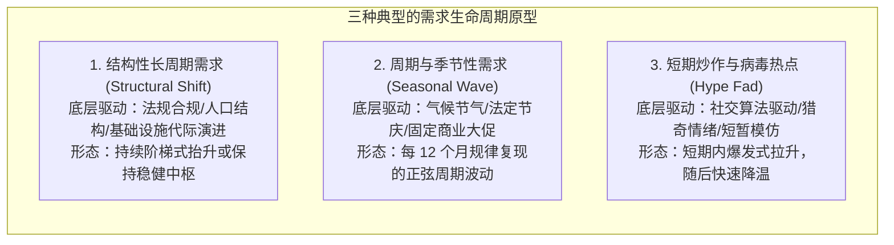

---

#### 1. 结构性长周期需求（Structural Shifts / Evergreen Demand）
- **底层驱动源**：深植于社会人口结构变迁、全球强制性合规法律颁布、生产生活基础设施升级，或技术底层的不可逆代际演进。
- **典型特征**：需求一旦产生便具备持续性与相对稳定性。即使宏观经济出现周期波动，客户为了维持生产生活基本运转或满足合规底线，依然需要定期采购或置换。
- **典型案例对照**：
  - **实物领域**：欧洲议会与理事会正式通过的通用充电接口指令（[Directive (EU) 2022/2380](https://eur-lex.europa.eu/eli/dir/2022/2380/oj)，强制要求便携电子设备统一采用 USB Type-C 接口），由此带来的各类适配线缆、转换插头与扩展坞置换需求，属于由强制法规锁定的结构性长周期需求；
  - **软件领域**：德国正式施行的《包装法》（[VerpackG / Verpackungsgesetz](https://www.verpackungsregister.org/en/)）要求向当地终端销售实物商品的跨境电商申报包装材质与重量，这是由强制性法律监管锁定的确定性企业合规报表需求；
  - **服务领域**：欧美成熟市场本地高昂的劳动力与设计工时成本，驱动中小型住宅建造商常态化寻求离岸 3D 效果图外包，以控制企业固定开支。

---

#### 2. 周期与季节性需求（Cyclical & Seasonal Fluctuations）
- **底层驱动源**：自然气候冷暖交替、西方既定的节庆日历（如复活节、万圣节、感恩节、圣诞节）、学校开学季（Back to School），或平台固化的促销活动（如亚马逊 Prime Day、黑五网一 Cyber Monday）。
- **典型特征**：在 1 个自然年内，需求在特定月份迎来规律性爆发，贡献全年的核心流水；而在其余淡季月份，出单流速回落至基准低位。
- **经营风险提示**：
  - 新入场者如果在第四季度（Q4）旺季入场调研，看到滑雪装备或节日装饰灯每天出单旺盛，容易误以为“全年都能维持此等流速”；
  - 如果在 1 月中旬大举向工厂追单备货，当海运货物在春季到港时，需求往往已进入漫长的淡季周期，可能产生长期的仓储积压。
- **应对逻辑**：经营季节性品类必须建立严密的**“倒排供应链日历”**——提前数月完成选品与排产，确保货物在旺季来临前入库，并在旺季结束前合理控制库存周转，避免将大宗库存滞留在海外仓。

---

#### 3. 短期炒作与病毒性热点（Short-term Fads & Viral Memes）
- **底层驱动源**：社交媒体算法推荐推送的趣味短视频、突发影视剧文化符号、短期的猎奇模仿、或缺乏深层实用价值的解压小玩具（如曾经流行的指尖陀螺等）。
- **典型特征**：需求在数周内呈现爆发式增长，搜索量迅速拉升；但由于缺乏持续的实用价值或使用黏性，随着社交注意力转移，**热度可能在数周至数月内大幅降温**。
- **跨境时差风险**：
  - 本地拥有现货的卖家或快速反应的空运代发模式或许能捕捉前期的脉冲红利；
  - 但对于依赖远洋海运备货的中小跨境商家，由于存在较长的跨国物流在途时间，当批量采购的货柜运抵目的港时，当地市场可能已被早期供给充分消化，甚至面临低价清仓的竞争压力。

---

#### 需求耐久性五维诊断法（The 5-Dimension Durability Framework）

为了在正式立项前更清晰地审视“短期热度”与“长效需求”，创业者可参考以下五维雷达诊断表进行定性排查：

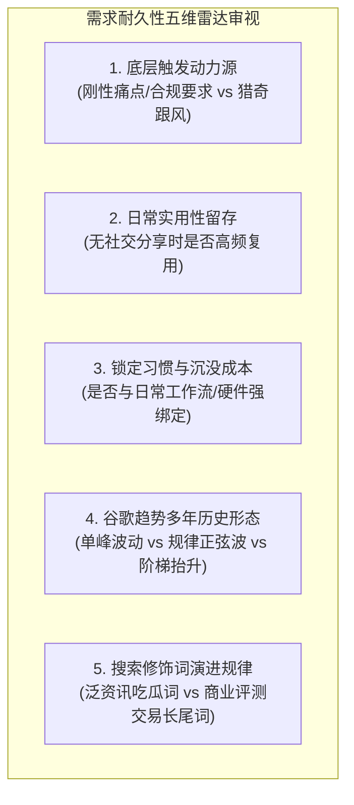

| 诊断维度 | 警惕信号：短期炒作（Fad） | 关注信号：季节性波动（Seasonal） | 优良信号：长效稳定需求（Evergreen） |
| :--- | :--- | :--- | :--- |
| **1. 动力驱动源** | 纯粹社交跟风、影视剧短期周边、猎奇搞笑 | 气候周期（防冻/防暑）、传统节庆（圣诞）、法定日程（报税季） | 强制法律合规、刚性工时节约、安全防护、日常生产耗材补充 |
| **2. 日常实用性** | 满足短暂新鲜感后，长期闲置率较高 | 在特定月份或特定气候环境下具有明确的使用功能 | 哪怕没有社交展示场景，用户在日常工作中依然必须定期开启使用 |
| **3. 习惯与沉没** | 即买即抛，无任何使用数据沉淀或软硬件生态依赖 | 具有周期性使用习惯，每年在固定月份取出使用 | 深度嵌入工作流；更换新方案需要承担数据迁移、接口重配或培训成本 |
| **4. 趋势曲线形态** | **单峰快速回落型**：历史上无基准，短期内指数级暴涨，随后持续走低 | **规律正弦波型**：过去几年在 Google Trends 上呈现规律的 12 个月周期起伏 | **阶梯抬升/稳态型**：历经多年检验，底部搜索中枢平稳或呈现阶梯式增长 |
| **5. 关键词修饰词** | 充斥“what is...”、“...meme”、“...tiktok trend”，商业词极少 | 季节来临前集中涌现“best... for summer”、“black friday deals” | 持续出现“...replacement parts”、“...commercial license”、“...specifications” |

---

### 4.3.2 哪些技术、平台或消费变化会让需求提前衰退？

即便某类需求在过去几年一直属于健康的稳定市场，外部商业环境的突发变迁也可能在毫无预警的情况下，对业务造成重大冲击，导致需求空间被大幅压缩。

出海创业者必须保持敏锐的风险意识，密切跟踪以下四大“潜在衰退触发器”：

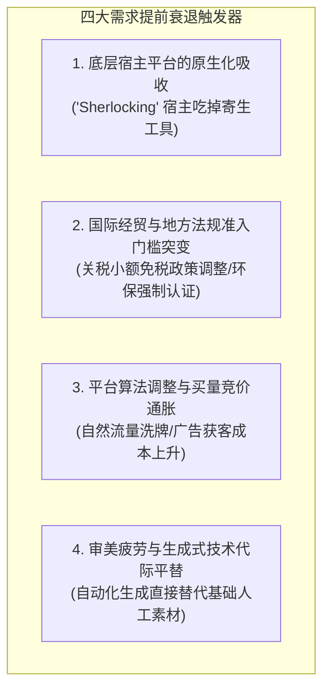

---

#### 1. 底层宿主平台的“原生化吸收”（The "Sherlocking" Effect）
- **现象本质**：在科技历史上，著名的“Sherlock 事件”是指苹果公司在 macOS 升级中，直接将第三方著名搜索工具 Watson 的核心功能做成了系统内置的原生功能，导致该软件公司瞬间失去独立商业空间。
- **寄生生态的客观风险**：依托于大型宿主生态（如 Shopify 插件、Chrome 扩展程序、电商平台卖家工具、大模型套壳应用）的微型软件，其生命周期易受到宿主平台产品演进的影响。
  - **软件示例**：许多独立开发者曾开发基于基础 API 的“文档智能问答摘要工具”；然而，随着基础模型官方在其客户端直接原生集成了多模态文件上传、解析与画板功能，大量功能单一的第三方轻量工具面临严峻的客户流失压力；
  - **电商插件示例**：如果插件仅仅实现简单的“货币转换展示”或“通用结账提示”，一旦平台官方将此类能力收拢为原生主题的免费标配，第三方独立插件的生存空间就会被大幅压缩。
- **应对逻辑**：产品应尽量深入到宿主平台不便标准化处理的**深水区复杂本地业务流**中（例如：涉及不同法域特定财税规则、离线申报接口对接等重度业务）。

---

#### 2. 国际经贸与地方法规准入门槛突变（Regulatory Shocks）
跨境贸易深植于跨国法域监管之中，目标国的政策调整会直接改变商业模型的底层可行性。

##### 真实政策突变案例：美国 800 美元小额免税（Section 321）政策的调整
- **政策现实背景（权威一手事实）**：以往中国向美国直邮的小型包裹，广泛利用了美国《关税法》第 321 条（19 U.S.C. 1321）所赋予的 800 美元以下个人进口包裹小额免税清关待遇（De Minimis Exception）；
- **已实施的监管调整**：依据美国海关与边境保护局（CBP）于 2025 年 8 月 28 日发布的官方指导公告（[CBP Guidance Bulletin 3f01456](https://content.govdelivery.com/accounts/USDHSCBP/bulletins/3f01456)），依据相关行政与立法授权，**自 2025 年 8 月 29 日起，正式暂停了符合范围的特定商业货物的 800 美元低价值小额免税清关待遇**；CBP 官方问答（[Article-1919](https://www.help.cbp.gov/s/article/Article-1919?language=en_US)）可用于进一步确认现行解释；但 [2026 年 10 月 8 日《联邦公报》Low-Value Shipments](https://www.govinfo.gov/content/pkg/FR-2026-10-08/html/2026-20650.htm) 明确标为 **Proposed Rule／拟议规则**（拟议新增申报类别及程序要求，意见期截至 2026 年 12 月 7 日），**并非已生效最终细则**，不得拿拟议内容当作当前正式义务；
- **微观商业冲击**：这一现实政策落地后，依靠免税小包直邮、追求极致低价的跨境电商模式受到直接冲击，单票包裹不仅面临关税核定，还需承担报关代理费用与清关查验时延，原本微薄的毛利空间被大幅压缩。**这一案例直观证明：任何过度寄生于特定税收制度优惠的商业模式，均面临政策落地时的重构风险**。

##### 欧洲环保与产品安全法规的高压执行
- 对**适用 GPSR 的产品**，投放欧盟市场时原则上须有设在欧盟境内、承担相应任务的负责经济运营者；其可依实际供应链与法规条件为制造商、进口商、授权代表或符合条件的履约服务提供者，不等于每家跨境商家都必须另外购买“欧代服务”。相关识别、联系方式及标签/在线展示要求须按产品和适用规则核实，亦应排查优先适用的专项产品法规（[GPSR 正文](https://eur-lex.europa.eu/eli/reg/2023/988/oj)）；
- 德国包装法（VerpackG）要求电商平台对未合规登记的企业承担连带合规责任，缺乏合规资质的商品会面临系统自动下架。中小卖家必须将合规成本纳入前置考量。

---

#### 3. 平台规则迭代与流量成本上升（Algorithm & Channel Dynamics）
- **自然流量机制的变动**：很多早期依赖特定技巧（如程序化批量抓取生成低质页面、社群无节制推销）获取流量的团队，极易受到搜索引擎或社交平台算法更新的冲击。例如谷歌定期的“有用内容更新（Helpful Content Updates）”会针对缺乏原创体验的聚合页面进行降权；
- **付费买量竞价上升**：随着成熟品牌持续加大数字营销投入，Meta、Google 等公域广告竞价中枢呈现上升态势。如果你的产品复购率较低且无法维持合理的毛利空间，单纯依靠付费买量获客将面临严峻的边际收益递减。

---

#### 4. 消费审美疲劳与生成式技术的代际平替（Tech & Cultural Shifts）
- **数字资产的价值重塑**：在平面设计模板与通用数字素材领域，AI 生图与视频生成工具的快速迭代，正在大幅降低初级创意素材的生产门槛。原本需要耗费工时制作的基础背景或简易动效，逐渐可以被更低成本的自动化工具替代；
- **专业服务的交付升级**：对于提供 3D 建筑设计效果图等外包服务的团队而言，如果仅停留在基础建模阶段，将面临效率工具普及带来的价格竞争压力；唯有向深化设计节点、专业施工协同及高阶定制沟通延伸，方能构筑长效壁垒。

---

#### 业务脆弱性与生命周期预警核验清单（Vulnerability Checklist）

在正式投入资金前，请结合以下四项条件进行理性自检：

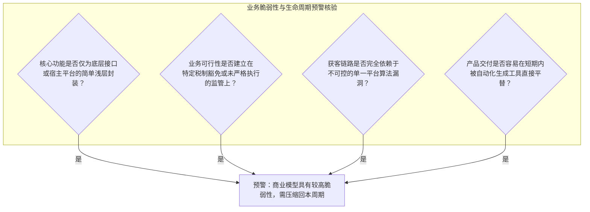

> **生命周期评估原则**：
> 凡是符合上述预警特征的商业构想，在编制财务预期时，应**更加审慎地设定预期有效回本周期**，避免在需要长期大额资金沉淀的项目上盲目投入；如果在保守测算下项目需要极长周期方能打平成本，则应在立项阶段重新审视其抗风险能力。

## 4.4 同样的生意，哪个国家或地区更值得做？

在明确了市场容量和生命周期之后，创业者面临的最具战略分水岭的抉择是：**在这个地球上，我的第一站应该选在哪个具体的国家或地区？**

很多新手在做国别选择时，往往容易陷入简化的“宏观唯 GDP 论”：打开全球经济体名录，看到美国排第一、德国排前列、日本规模大，便不假思索地认为“去这些大市场卖一定最容易赚钱”。或者反过来，听信了某些新兴市场“人口红利巨大、遍地黄金”的笼统说法，在未评估履约基础设施的情况下贸然入场。

在跨国商业实战中，**宏观市场的“大”，并不直接等于具体生意的“好做”**。不同国家和地区在实际商业运转中，存在着由法律监管、金融基础设施、文化语境、物流履约以及买量成本交织构成的**“现实摩擦力（Real-World Frictions）”**。

如果你选择了一个看似庞大、但现实摩擦力远超自身团队当前承载能力的国家作为首发站，哪怕产品本身具有竞争力，也可能在早期因合规门槛、支付拒付或繁琐的跨语种沟通而承受巨大的运营压力。

---

### 4.4.1 比较国家时，除了市场大小还要看哪些现实差异？

评估一个国家是否适合作为你的目标市场，必须跳出单一的人口和 GDP 视角，建立涵盖六大物理维度的**“跨国现实摩擦力评估模型”**：

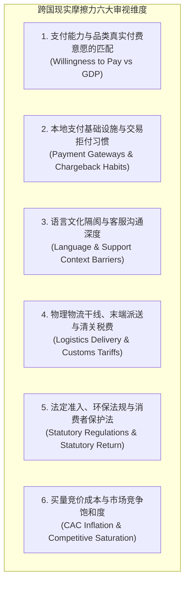

---

#### 1. 支付能力与特定品类真实付费意愿的匹配（Willingness to Pay vs. Ability to Pay）
人均 GDP 高，并不意味着消费者在所有品类上都具有相同的付费习惯。
- **消费习惯与信任门槛的差异（待验证假设）**：研究日本某一具体品类时，应核实目标客群是否更信任当地渠道、是否需要母语客服、具体服务响应要求以及已有竞品报价；不能凭国籍推断所有日本客户必然排斥境外品牌。
- **效率价值与实际付费意愿（待验证假设）**：研究美国某一小型企业软件场景时，应向同类买家核对节省工时、预算审批、历史支出、续订和拒付数据；不能仅因产品“提高效率”就断言美国客户会尝试或持续订阅。
- **核心逻辑**：**宏观购买力是潜在约束，不是个体客户付费意愿的证明**。按“同一产品×同一买家角色×同一价格/渠道”比较国家，分别记录官方规则、实际替代价格、经核验的交易证据及`UNKNOWN`。

---

#### 2. 本地支付基础设施与交易风险（Payment Infrastructure & Financial Risk）
如果客户无法顺畅付款，或者支付渠道存在较高的拒付纠纷成本，交易闭环就会受到影响。
- **成熟英语市场的信用卡机制与争议处理**：
  - 在美、加、英、澳，国际银行卡是常见的线上付款方案，但具体客群是否倾向银行卡、数字钱包或其他方式，及结账转化表现，须按品类、商户配置与当地资料核实；
  - 但需关注发卡行的拒付保护机制（Chargeback），部分买家在产生售后纠纷时可能通过银行直接发起争议，商家需保留完备的物流妥投凭据与客户沟通日志，以应对潜在的拒付纠纷与通道处理费用；
- **欧洲大陆本地专有支付方式的分化**：
  - 在荷兰，[iDEAL](https://www.ideal.nl/) 可作为核验本地在线银行付款习惯的起点，实际支持和用户采用率须按2026年具体服务商与产品类型查验；在德国，需根据**零售或企业采购、服务商支持及交易场景**分别验证银行卡、钱包、PayPal、Klarna（含其适用的即时付款选项）、SEPA 银行转账或 SEPA 直接借记等方式。**Giropay 已于 2024 年停止收款，独立 Sofort 于 2025 年 3 月 31 日起不再作为独立方式受理**，不可作为 2026 年新接入方案（[Giropay 停用](https://support.stripe.com/questions/availability-of-giropay-june-2024-update?locale=en-GB)、[Sofort 停用](https://support.stripe.com/questions/sofort-is-being-deprecated-as-a-standalone-payment-method)）；
  - 如果出海独立站仅提供单一国际信用卡接口，在部分欧洲国家可能会面临较高的结账流失；
- **新兴市场的货到付款（COD）与履约风险**：
  - 在东南亚、拉美的**部分国家和具体电商品类**，货到付款（Cash on Delivery）可能仍是重要支付选项；是否适用须核对当地服务商支持、真实订单结构和目标买家偏好，不能以区域名称推断统一比例；
  - COD 模式面临拒签退回（Return to Origin, RTO）的履约风险，往返国际干线运费及货损可能对薄利小件商品造成严重侵蚀。

---

#### 3. 语言壁垒、时区与客服交互深度（Language & Support Context Barriers）
- **通用英语市场（US, UK, CA, AU）**：
  - 语言门槛相对较为通用，全英文的产品界面、帮助文档与售后邮件能够覆盖主要受众；
  - 目标客户是否接受异步工单（Ticket）或帮助中心自助查询，应以所售产品、客户支持协议与真实投诉反馈验证；
- **非英语成熟市场（以德、日、法为代表）**：
  - **语言精准度要求高**：在日本或德国市场，如果产品详情页或使用手册充斥生硬的机器翻译错误，会显著降低消费者的信任感；
  - **法定公示要求（以德国 Impressum 为例）**：德国《数字服务法》[DDG § 5](https://www.gesetze-im-internet.de/ddg/__5.html)要求**受其适用范围约束、以商业方式且通常有偿提供数字服务的服务提供者**持续公开相应经营主体及联系方式等信息。面向德国市场的商业网站应结合服务形式、经营主体、所在地和跨境适用规则核查Impressum义务；**不能仅因网站出现德国访客或使用德语就断言所有网站均负相同义务**。若适用，应按法条列示具体信息并保持可访问；情况不明标`UNKNOWN`，必要时请当地专业人士核验。

---

#### 4. 物理物流干线、末端派送与清关税费（Logistics Delivery & Customs Tariffs）
- **跨区域统一大市场的物流网络（美国）**：美国拥有高度成熟的全国干线运输、商业快递（UPS/FedEx）与邮政（USPS）系统，货物进入主要海外仓后，可实现相对标准化的本土派送时效；
- **地理碎裂型岛屿市场的物流复杂性**：在岛屿众多的国家，跨岛配送涉及多程转运，不仅派送时效波动较大，偏远区域附加费也较高；
- **欧洲跨境增值税机制与 IOSS 的适用条件（重要核实事实）**：
  - 依据欧盟官方税收政策（[EU VAT One-Stop Shop](https://vat-one-stop-shop.ec.europa.eu/)），**进口一站式服务（IOSS）是一项针对货值不超过 €150 欧元的非消费税货物的可选性增值税简化征管制度（Optional Simplification Scheme）**，旨在允许商家在结账时直接代收代缴增值税，使包裹在海关享受快速清关；
  - 必须澄清：**向欧盟销售实物并非必须强制注册 IOSS**。未接入 IOSS 的包裹，可通过特殊申报安排（Special Arrangements，由当地邮政或报关承运人向收件人代收增值税并收取清关手续费）或标准进口报关完成履约，但可能会因买家被额外收取手续费而降低购物体验。

  - **2026年低值进口关税更新**：IOSS 是 VAT 简化安排，不代表免关税。欧盟 Regulation (EU) 2026/382 自2026-07-01起取消原€150关税免征安排；符合第二条条件、总内在货值不超过€150的货件，过渡期按**每个不同税则类项€3**核算，不是简单按包裹或每物理件收€3；还须核查具体分类、税务申报路径、责任主体及独立的VAT和清关服务费。来源：<https://eur-lex.europa.eu/legal-content/EN/TXT/?uri=CELEX:32026R0382>（2026-10-19复核）。

---

#### 5. 法定准入、环保法规与消费者保护法（Statutory Regulations & Consumer Rights）
- **欧盟消费者 14 天撤回权及法定例外（重要核实事实）**：
  - 依据欧盟《消费者权益指令》（[Directive 2011/83/EU](https://eur-lex.europa.eu/eli/dir/2011/83/oj) 及 [EU Consumer Rights](https://europa.eu/youreurope/citizens/consumers/shopping/shopping-consumer-rights/index_en.htm)），欧盟消费者在网购实物商品时，通常享有自签收之日起 **14 天内无理由解除合同并申请退货的法定撤回权（Right of Withdrawal）**；
  - **明确法定例外及条件**：该权利不是所有交易都无条件适用，例如按客户规格制作或明显个性化的商品、符合卫生例外的已拆封密封商品、易腐商品等。**有实体载体的密封音视频/电脑软件拆封**，与**无实体载体的数字内容下载/播放**不能混为一谈：后者若要在付费情形适用撤回权例外，通常需消费者事前明确同意于撤回期内开始履行、确认知悉将失去撤回权，并由商家按规定作合同确认（[指令第16条](https://eur-lex.europa.eu/legal-content/EN/TXT/?uri=CELEX:02011L0083-20260927)）。退回成本由谁负担也须按事前告知和具体例外核实；
- **德国与法国环保包装法责任**：
  - 德国包装义务取决于经营者在供应链中的“生产者/首次投放者”身份及**包装是否须参与回收系统**。符合注册责任者须在 [LUCID](https://www.verpackungsregister.org/en/registration/find-out-about-registrations) 注册，**注册和向 LUCID 报送免费**；对须参与系统的包装，需要另与回收系统运营商签合同并支付按材质、数量等决定的参与费（[ZSVR 官方说明](https://www.verpackungsregister.org/en/help/system-participation-catalogue)），不应把注册本身写成收费项目；
  - 法国环保法规要求对特定品类包装标注 Triman 分类回收标识，电商平台对入驻商家承担连带审核责任。

---

#### 6. 买量竞价成本与市场竞争饱和度（CAC Inflation & Competitive Saturation）
- **成熟主干市场的竞价水平**：美国作为全球电商与 SaaS 的重点竞争阵地，Meta 与 Google 的广告竞价长期处于较高区间。如果产品单笔毛利较为微薄且缺乏复购，单纯依靠付费买量获客将面临较大的财务压力；
- **次级成熟市场的差异化空间**：加拿大、澳大利亚、英国等成熟英语市场，消费习惯与支付体系与美国高度同质，而在部分细分领域的数字广告竞价热度相对平缓，对部分起步预算有限的微型团队而言，可以作为更具弹性的首发缓冲区。

---

#### 全球核心出海目标法域现实摩擦力横向对比参考表

| 考察维度 | 美国（US） | 德国（DE）/ 欧盟核心区 | 日本（JP） | 东南亚代表（ID/PH等） | 巴西（BR）/ 拉美 |
| :--- | :--- | :--- | :--- | :--- | :--- |
| **市场宏观容量** | **大**（全球核心消费力与软件采购市场之一） | **大且稳定**（欧洲重要经济体，B2B工具需求旺盛） | **大**（高密度成熟消费市场，客单表现较好） | **快速增长**（人口结构年轻，电商渗透率上升） | **中等**（社交活跃度高，消费品需求广泛） |
| **付费意愿特征** | 实用效率导向，对软件订阅与硬件创新接受度较好 | 注重质量耐用度与合规隐私，决策相对审慎 | 信任壁垒较高，对品牌背书与服务细节要求严格 | 价格敏感度较高，对促销与性价比关注度高 | 价格较敏感，广泛习惯免息分期付款 |
| **支付与金融环境** | **信用卡主流**，Apple Pay / PayPal；需防范争议处理纠纷 | **本地银行转账（iDEAL/SEPA）与 Klarna** 占比较高 | **信用卡与便利店支付**（Konbini）；支付违约率较低 | **货到付款（COD）**与本地电子钱包仍占相当比例 | **本地 Pix 支付** 与本地信用卡分期占统治地位 |
| **语言与合规成本** | 商业英语通用，需满足 FTC 与地方法规标准 | 地道德语支持，强制要求 Impressum 与包装回收申报 | 需评估日语支持、目标客群的沟通及售后习惯，不能将全部消费者视为同一偏好 | 按目标国家分别核验语言、支付和客服要求 | 需地道巴西葡萄牙语，英语覆盖率有限 |
| **物流与关税机制** | 物流基础设施完善；注意 2025/2026 小额免税调整 | 具备 IOSS 简化通道（可选）；注意 14 天撤回权规则 | 进口查验严密，物流时效稳定 | 岛屿跨区配送时效长，COD 拒签存在逆向损耗 | 进口关税与州税结构复杂，海关清关时效较慢 |
| **数字买量竞价** | 核心品类竞价处于全球高位梯队，获客成本高 | 隐私追踪受限，数字广告定向成本相对较高 | 社交与搜索竞价中等偏高，转化链条相对较长 | 流量单价相对低廉，但客单与转化率相对较薄 | 买量成本适中，但受汇率波动折算影响明显 |

---

### 4.4.2 两个国家都能做，怎样选资源更匹配的第一站？

在明确了各国的现实摩擦力之后，面对两个看似都具备潜力的目标国家，中小创业者最应避免的策略就是**“未经测试便全线出击”**：
- 如果团队仅有 2~3 人，过早同时向多个法域铺货，不仅会将有限的资金分散在不同的海外仓储点，还要同时应对不同的清关税收、多语种客户沟通与合规申报，容易导致运营资源被快速稀释。

你必须为自己的生意确立明确的**“首发滩头阵地（Beachhead Market）”**——**将主要精力与资本倾注在单一点位上打穿闭环，跑通业务模型并积累初始用户，再稳步向次级市场拓展**。

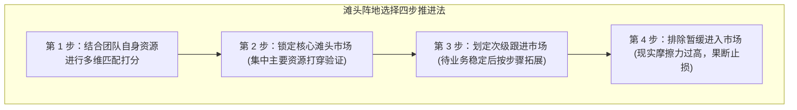

---

#### 首发站资源匹配的四大检视维度（The 4-Match Lenses）

在两个国家之间权衡首选站时，决策权应当交还给**团队自身的现实资源约束**：

##### 维度一：团队自身语言与文化认知舒适区（Team Competency & Context Fluency）
- 你的核心团队是否能够顺畅使用当地语言理解行业讨论、编写准确的产品说明，并在客户咨询时提供符合当地习惯的专业回复？
- **原则**：如果团队完全缺乏某国语言基础，在起步阶段强行将其设为第一站，会面临较高的外包沟通成本与误解风险。

##### 维度二：物理交付容错率与退货承受度（Fulfillment Resilience & Margin Buffer）
- 你的产品毛利空间能否覆盖当地法定的售后退换成本？
- 欧洲消费者享有法定的撤回权，如果你销售的是单价较低但体积较大的实物商品，且未在当地建立低成本的逆向退件检测与再包装渠道，逆向运费与货损可能直接吞噬掉正常订单的利润。

##### 维度三：前期法定合规与资质认证的固定资金门槛（Upfront Compliance Fixed Cost）
- 在完成第一笔销售之前，你需要为进入该市场支付多少不可退还的硬性准入成本？
- 进入德国等市场，应先按产品与经营角色**逐项辨认**包装生产者义务、WEEE 是否适用，以及 GPSR/产品专项法规要求的欧盟负责经济运营者。**LUCID 注册与向 LUCID 报送免费**，但需系统参与的包装可能产生回收合同费用；WEEE、服务商、检验和运营费用另按真实情形报价，不能一律算作强制“欧代注册费”或统一固定成本。现金缓冲有限者应比较具体报价与履约能力。

##### 维度四：真实客户反馈的闭环反馈流速（Customer Feedback Velocity）
- 在项目起步阶段，最宝贵的资产是**高质量、具备建设性的早期用户反馈**。
- 哪个市场的种子用户更活跃、更愿意在社群中直接与开发者或卖家探讨改进建议？这直接决定了产品迭代的敏捷度。

---

#### 跨国出海首发滩头阵地决策打分模型（Beachhead Selection Scorecard）

为了让国别选择中**团队自己设定的偏好与约束可见**，创业者可采用以下加权评分表对候选国家进行横向对质（**统一采用 10 分制，满分 10.0 分**）：

$$\text{Total Score} = \sum (\text{Weight}_i \times \text{Score}_i)$$

| 评估维度 | 权重占比 | 评分参考标准（1~10 分，分数越高越优） | 教学案例候选国 A：美国（US）打分 | 教学案例候选国 B：德国（DE）打分 |
| :--- | :---: | :--- | :---: | :---: |
| **1. 团队认知与语言适配** | **25%** | 团队具备熟练工作语言（8~10分）；完全依赖机器翻译（1~4分） | **9.0 分**（熟练商务英语，沟通阻力小） | **4.0 分**（团队无德语能力，依赖翻译外包） |
| **2. 前期固定合规资金门槛** | **25%** | 起步前置固定开销小（8~10分）；需强制固定牌照与欧代（1~4分）| **8.0 分**（前期无强制大额牌照固定支出） | **3.0 分**（纯属该团队的教学评分：假设包装回收系统费用及其他适用合规服务占用有限预算；LUCID 注册本身免费，须依实际角色和产品重新评估） |
| **3. 基础设施与支付顺畅度** | **20%** | 通用信用卡结算顺畅（8~10分）；本地专有网关分化严重（1~4分）| **9.0 分**（主流支付网关覆盖度高，跨州直达） | **7.0 分**（需额外集成 iDEAL/SEPA/Klarna）|
| **4. 种子用户共创与反馈流速** | **15%** | 社区活跃、用户交流意愿强（8~10分）；沟通保守封闭（1~4分）| **9.0 分**（Reddit/Discord 目标圈层互动直接）| **6.0 分**（反馈严谨，但早期破冰周期稍长） |
| **5. 广告买量与竞争性价比** | **15%** | 竞价处于洼地（8~10分）；巨头林立、竞价极度内卷（1~4分） | **5.0 分**（公域买量竞价处于较高位） | **6.0 分**（竞价略低于美国，但受定向限制） |
| **综合加权得分** | **100%** | **加权总分计算结果（满分 10.0 分）** | **$\mathbf{8.15}$ 分（首选滩头阵地）** | **$\mathbf{4.95}$ 分（次级跟进市场）** |

> **打分模型与场景敏感性声明（`[MODEL_ASSUMPTION]`）**：
> 上述打分表仅代表**一个特定团队画像（中国大陆英语流利全栈团队、启动资金有限、主营 3D 打印消费类硬件配件）**在面临美德两选时的教学演算情境：
> - 美国得分：$0.25 \times 9.0 + 0.25 \times 8.0 + 0.20 \times 9.0 + 0.15 \times 9.0 + 0.15 \times 5.0 = 2.25 + 2.00 + 1.80 + 1.35 + 0.75 = \mathbf{8.15}$ 分
> - 德国得分：$0.25 \times 4.0 + 0.25 \times 3.0 + 0.20 \times 7.0 + 0.15 \times 6.0 + 0.15 \times 6.0 = 1.00 + 0.75 + 1.40 + 0.90 + 0.90 = \mathbf{4.95}$ 分
> 
> **重要业务敏感性反转提示**：
> **该打分结论绝非适用于所有出海业务的“通用国别优劣定论”**。若将业务方向替换为我们在 4.1.2 节讨论的“Shopify 德国包装法合规申报插件”，德国的包装相关法规可能提升该场景的需求关联度，因此该团队可以**优先研究德国**；但插件真实购买意愿、平台应用资格、法定报送接口、竞品与语言支持仍未知。若重新设置维度及权重，评分**可能**逆转，不能宣称德国必为“无可争议首发阵地”。**国别决策永远是“业务属性、目标人群与团队能力”三者交织的结果**。

---

#### 四类出海业态首站选择决策范式参考

1. **实物商品类出海（以桌面 3D 打印配件为例）**：
   - **首选考量**：若团队具备成熟英语沟通能力且希望依托成熟海外仓快速周转，美国本土通常是较具规模效应的验证点；
   - **注意事项**：应集中资源打通单个法域，避免在起步阶段将有限资金拆分到多个非英语国家。
2. **数字产品类出海（以广告视频动效资产包为例）**：
   - **首选考量**：首选**美、英、加、澳四大主流成熟英语市场合集**。数字资产交付边际成本几乎为零，通用英语能够同时辐射跨国创作者，依托单一英文站即可展开运营；
   - **注意事项**：在未取得母语支持前，无需过早投入工时制作小语种版本。
3. **软件/SaaS 工具出海（以欧洲合规申报插件为例）**：
   - **首选考量**：若业务功能解决的是特定法域的合规痛点，**物理目标市场天然锁定在该受监管法域**；但在冷启动客群招募上，可优先切入同样面临该合规风险的跨境出海卖家，痛点往往更为急性；
   - **注意事项**：避免盲目跨法域拓展与核心功能不相关的市场。
4. **跨境专业服务出海（以定制住宅 3D 建筑设计渲染为例）**：
   - **首选考量**：可重点关注美加英语区中小型定制住宅建造商，利用时差与相对人力成本优势承接项目制设计外包；
   - **注意事项**：初期应聚焦单一标准制式（如美标英制单位），避免跨越度过大的建筑制图规范切换。

> **本节小结与承上启下**：
> 选定目标国家不是去选纸面上宏观最庞大的经济体，而是去寻找与你当前团队能力、产品属性摩擦力最小的**“最优着陆场”**。
> 然而，即便我们圈定了一个容量健康、生命周期稳定且资源匹配的滩头国家，最现实的一个执行拷问随之而来：**在茫茫人海中，你究竟能不能在物理和经济上，真正接触到这些客户？** 下一节，我们将深入触达可行性的最后防线。

#### 两国同一产品可比较表

固定**具体SKU/服务、细分买家、定价与货币换算口径**，对两个候选国分别填写：可核查潜在买家数、真实触达渠道与测试成本、当地适配、交付和退货成本、税费与准入障碍、证据强度及最大未知项。没有真实数据时结论应是“下一步在哪国用最小预算验证”，不能凭国别刻板印象给出精确排名。

## 4.5 有市场需求，就代表我能接触到这些客户吗？

在完成市场规模的算术推导、排除数据虚火、确认趋势耐久性并圈定目标国别之后，绝大多数创业者会认为自己的可行性调研已经大功告成，可以放手大干一场。

然而，商业世界中最残酷的一道“生死过滤器”往往潜伏在最后一步：**“市场里确实有大量客户存在需求”，绝对不等于“你能以合法、有效且经济划算的方式，真正接触到他们”**。

这就是所谓的**“可触达性鸿沟（The Accessibility Gap）”**。在物理世界与互联网信息洪流中，目标客户并不会整齐划一地排队等待你的推销。他们可能深藏在防范垃圾通讯的企业防火墙之后；他们可能活跃在极度排斥商业推销的专业极客圈层内部；他们的注意力可能已被行业成熟品牌通过高额竞价所占据；甚至，在缺乏合规意识的情况下贸然进行商业外联，还可能触犯当地的反商业骚扰法案。

如果在立项之初没有摸清触达链路的真实物理路径与经济底线，你很可能会陷入“产品具备可用性，但在茫茫互联网上找不到有效获客入口”的被动局面。

---

### 4.5.1 目标客户通常在哪里寻找解决方案，我能接触到他们吗？

要跨越可触达性鸿沟，首先必须完成**“客户注意力阵地映射（Channel Mapping）”**。客户在产生需求时，究竟会通过哪些具体物理或数字化路径寻找解法？不同路径对新入局者的进入门槛和反作弊壁垒完全不同：

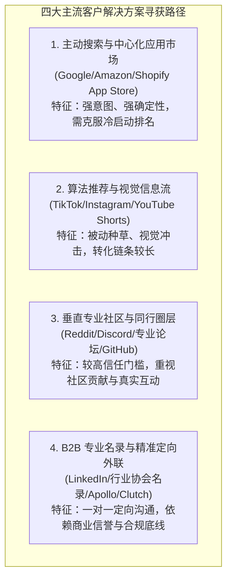

---

#### 1. 主动搜索与中心化应用生态（Search-Driven & App Store Ecosystems）
- **适用业态**：具有明确功能定义的实物商品、强痛点解决型微型 SaaS、具备标准化输入输出的数字资产包。
- **客户行为特征**：客户在遭遇具体问题时，主动打开搜索引擎（Google）、电商平台搜索框（Amazon）或专业宿主应用市场（Shopify App Store、Chrome Web Store、WordPress Plugin Directory），敲入特定长尾痛点词。
- **新商家的触达真实门槛**：
  - **平台冷启动的权重积累**：应用市场或电商平台的搜索排序，通常综合考量商品的近期出单流速、买家真实评价与星级、转化率等多维数据。一个没有任何历史积累的新入场者，其产品在自然排序中往往处于较为靠后的位置；
  - **曝光成本与早期积累**：新产品通常需要承担前期的广告竞价测试（如 Amazon Sponsored Products、Shopify App Store Search Ads），或者通过外部精准种子用户导入初始真实订单与评价，方能逐步建立在站内的自然可见度。

---

#### 2. 算法推荐与视觉信息流（Algorithmic Feed & Social Discovery）
- **适用业态**：外观极具视觉张力的创意实物硬件、效果立竿见影的 3D 渲染与动效模板、面向 C 端或自由职业者的生产力工具。
- **客户行为特征**：客户在浏览短视频或社交图文（TikTok、Instagram Reels、YouTube Shorts、Pinterest）时，处于泛娱乐状态；通过视频中抓人眼球的“视觉痛点对比”或“奇妙效果展示”，突然被激发潜在欲望（被动种草）。
- **新商家的触达真实门槛**：
  - **内容创作的持续淘汰率**：算法推荐具有较强的审美疲劳周期。如果团队自身不具备持续制作高质量原生短视频的素材制作能力，仅仅依靠简单剪辑，账号往往难以获得持续的算法推荐；
  - **购买冲动的易变性**：信息流刺激带来的消费冲动，在脱离特定情境后可能面临较高的弃单或退货倾向，需配合完善的售前沟通与履约确认。

---

#### 3. 垂直专业社区与同行圈层（Niche Communities & Deep Circles）
- **适用业态**：极客类硬件改装配件（如光固化打印机净化器）、开发者底层效率库、小众专业设计师模板。
- **客户行为特征**：专业用户与重度极客通常对粗暴的硬广推销保持警惕，他们更常聚集在垂直的 Reddit Subreddit、专有 Discord 服务器、小众开源论坛或技术社群中，通过同行案例分享与技术探讨寻找最适宜的解法。
- **新商家的触达真实门槛**：
  - **社区反营销与互动准则**：许多优质技术版块均制定了严格的版规，反对无节制的商业自推；部分社区鼓励发帖者先以真实同行身份提供实质性的技术探讨或经验分享，避免单纯发布广告外链；
  - **切入路径**：要有效触达此类群体，创始人或核心成员需深入理解社区文化，以同行技术探讨、提供开源辅助工具或征集共创反馈等方式逐步建立信任。

---

#### 4. B2B 专业名录与精准定向外联（B2B Directories & Cold Outreach）
- **适用业态**：高客单跨境离岸外包服务（如定制住宅 3D 建筑效果图外包）、企业级垂直软件或咨询服务。
- **客户行为特征**：目标企业决策者或承包商寻找供应商时，常借助同行引荐、行业协会官方名录（如全美住宅建筑商协会 NAHB 名录）或专业商业平台（如 LinkedIn、Clutch）。
- **新商家的触达真实门槛**：
  - **决策链条穿透成本**：从公开名录中获取通用前台邮箱往往难以触达具有签字采购权的核心决策人；利用专业数据库工具（如 Apollo.io、ZoomInfo）进行信息检索与清洗需要一定的前期投入；
  - **商业信誉与案例背书**：在缺乏当地标杆合作案例的前提下，纯陌生的开发信外联通常面临较低的正向反馈率，需通过极具针对性的定制化样品与专业沟通建立信任。

---

#### 四类出海业态客户寻获路径与进入阻力对比参考表

| 商业业态 | 标杆业务示例 | 客户核心寻获路径 | 渠道准入门槛与关键考量因素 | 触达认知误区提示 |
| :--- | :--- | :--- | :--- | :--- |
| **实物商品** | 桌面光固化打印机空气净化器 | 亚马逊/Google 主动搜索；垂直社群真实测评；YouTube 行业博主评测 | 平台算法对新 Listing 的信任考察；头部测评博主的样品对接周期 | 以为仅靠社交平台宽泛兴趣定向即可低成本起量，忽略了客单价对广告竞价的支撑上限 |
| **数字产品** | 本地广告动效视频模板包 | 搜索引擎长尾词；YouTube 剪辑实操教学下方推荐；专业设计资产分销站 | 垂直素材分销平台的审核上架门槛；长尾搜索排名的建立周期 | 以为单靠静态效果图即可吸引转化，忽略了专业制作人对工程源文件层级结构的考量 |
| **软件/SaaS** | Shopify 欧洲包装法合规发票插件 | Shopify App Store 站内搜索（“VerpackG” / “German Invoice”）；卖家行业社群口碑推荐 | 官方应用商店的代码安全与用户体验审核；初期用户真实口碑积累 | 以为通过盲目批量发信即可获客，忽略了商家对涉及核心财务与店铺数据权限软件的安全顾虑 |
| **跨境服务** | 北美定制住宅 3D 建筑设计渲染外包 | LinkedIn 商业定向检索；专业建筑商协会名录定向沟通；自由职业平台信用沉淀 | 客户对试制样品（Test Render）的严格考察；跨时区沟通的敏捷度 | 以为批量抓取企业邮箱即可成单，缺乏深度个性化案例容易被归入垃圾邮件过滤 |

---

### 4.5.2 即使能找到人，初步接触成本和限制是否让这门生意不划算？

在确认了客户的聚集阵地之后，商业可行性的最后一道物理防线在于**“接触的经济性核算与法定合规边界”**：
- 如果你必须为每一次有效的客户沟通支付高昂的渠道成本，或者面临极长的决策沟通周期，导致客户获取成本（CAC）超出产品所能带来的现金回报，那么这门生意在商业逻辑上就会出现严重倒挂。

> **边界隔离指引**：
> 本节仅聚焦于**在立项前对“接触成本与客户结构进行初步可行性筛选”**，重点识别是否存在明显的“获客成本与客单价倒挂”风险；
> 关于企业全生命周期精细化的单位贡献边际（Unit Economics）、多层级定价策略（Pricing Strategy）、客户终身价值（LTV）与获客成本（CAC）的严密比值建模、以及动态收支平衡点计算，**将在下一章《第5章：这门生意到底能赚多少钱？》中展开全方位的财务推演**。

---

#### 1. 警惕“低客单价叠加高触达成本”的商业倒挂风险

在商业模式设计中，微型团队最容易陷入的困局之一是：**产品客单总额较低，但触达客户的渠道摩擦却相对高昂**。

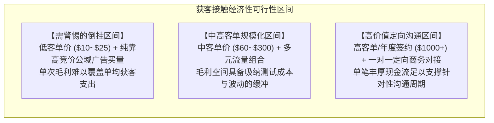

- **推演情景示范（`[MODEL_ASSUMPTION]`）**：
  - 假定你开发了一款极为小巧的 3D 打印树脂清理刮刀，售价 \$15 美元，单件毛利润为 \$6 美元；
  - 若在通用公域广告平台投放搜索广告，假定平均单次点击成本（CPC）为 \$1.8 美元；
  - 假定独立站转化率达到 $3\%$（等效于平均约 33.3 次点击产生 1 笔真实订单）；
  - **每笔订单的广告成本（Order CPA）**：$\text{CPA}_{\text{order}} = (1 \div 0.03) \times \$1.80 = 33.33 \times \$1.80 = \mathbf{\$60.00}$ 美元。**只有在每笔订单都由不同的首次付费新客完成且获客费用口径一致时**，该数才同时近似等于新客CAC；复购订单不能被计作新增客户。参见第5.3.2与7.4.2节；
  - **分析结论**：为了获取 \$6 美元的毛利，若需付出 \$60 美元的单笔获客投入，单笔直接处于深度亏损状态。除非产品存在经验证的后续贡献、复购或更低的实际获客成本，否则单一低客单实物纯靠高竞价公域买量难以维持健康运转。
- **健康商业模型的筛选考量**：
  - 要么产品客单价具备合理的毛利空间以吸纳获客成本；
  - 要么获客渠道能够依托自然搜索流、垂直社区口碑或自建内容长尾分发；
  - 要么产品具备持续续费的高黏性订阅属性（SaaS），用长周期的累积生命周期价值（LTV）覆盖初期的获客投入。

---

#### 2. 客户集中度与离散度考量：大 B 端决策链 vs 超长尾个人群体

客户在物理世界中的分布形态，直接决定了新商家接触他们时的沟通成本与组织适配度：

##### 决策链复杂的超大型企业客群（Enterprise / Whale Clients）
- **特征**：单笔采购体量可能高达数十万甚至上百万美元；
- **潜在门槛**：大型企业通常具备严密的合规审计、技术评审与采购审批委员会流程，整体销售周期可能长达数月乃至一年以上；
- **小微团队适配性**：在尚未取得稳定现金流之前，初创微型团队若将全部希望寄托在少数大客户身上，一旦遇到对方人事变动或预算收紧，可能面临严重的流动性危机。

##### 极度离散的个人长尾群体（Hyper-Fragmented B2C）
- **特征**：客户分布广泛且高度分散；
- **潜在门槛**：难以通过单一的垂直名录实现精准直联，往往需要通过公域平台的大范围算法分发建立认知，容易受到广告竞价波动的直接影响。

##### 适合中小跨境商家的垂直专业自雇者与小微商业体（Prosumers & Micro-SMBs）
- **特征**：例如小型影视工作室、独立住宅承包商、特定垂直独立站卖家；
- **适配优势**：他们既具备为提升效率或满足合规要求支付数百美元的明确商业预算；同时其决策链路相对扁平（通常由负责人或核心业务人员直接决策）；并且他们往往高度聚集在特定的垂直应用商店、行业名录或专业论坛中，便于小团队以合理的精力和预算完成精准触达。

---

#### 3. 法定通讯监管与反商业骚扰合规底线（Regulatory Anti-Spam Boundaries）

如果你计划采用主动外联（Cold Outreach）的方式敲开潜在海外客户的大门，必须清醒地认识到：**海外主要法域对商业外联通讯拥有明确的法定规范与严格的罚则体系**。

在开展任何邮件或商务直联前，必须严格筑牢以下合规底线：

1. **美国反垃圾邮件法（CAN-SPAM Act）与电话消费者保护法（TCPA）**：
   - **核心法定规范**：依据美国联邦贸易委员会指南（[FTC CAN-SPAM Act Guide](https://www.ftc.gov/business-guidance/resources/can-spam-act-compliance-guide-business)），向美国商业实体或个人发送商业电子邮件时，邮件头部必须清晰反映真实的发件人身份；**正文必须包含发件人真实有效的物理邮寄地址（Physical Postal Address）**；
   - **退订要求**：必须在邮件内提供清晰明显的退订机制（Unsubscribe），并依法在收到退订请求后的 10 个工作日内停止发送营销邮件；
   - **自动化呼叫与短信限制**：依据美国联邦通信委员会规定（[FCC TCPA Regulations](https://www.fcc.gov/general/telemarketing-and-robocalls)），未经用户明确的事先书面同意，严禁利用自动化系统向手机号码发送商业促销短信或拨打电话，违规将面临高额的法定赔偿风险；
2. **欧洲数据保护与反不正当竞争规范（GDPR 与德国 UWG § 7）**：
   - **欧洲外联规范**：在欧盟（特别是德国），依据德国《反不正当竞争法》（[Gesetz gegen den unlauteren Wettbewerb, UWG § 7](https://www.gesetze-im-internet.de/uwg_2004/__7.html)），未经收件人**明确的事先明示同意（Prior Explicit Consent）**，原则上禁止通过电子邮件等电子通讯方式直接向商业主体发送未经请求的推销内容（Cold B2B Email）；
   - **违规风险**：当地行业协会或竞争对手有权通过律师送达带有惩罚性赔偿条款的合规警告信（Abmahnung），要求签署不再违约保证书并承担律师费用。因此，面向欧洲市场开展客户接触，应以内容驱动（Inbound）、合规展示与公开阵地为主；
3. **电商平台站内信通讯隔离原则**：
   - 依据亚马逊官方买家沟通与评价政策（[Amazon Customer Review Guidelines](https://sellercentral.amazon.com/help/hub/reference/G201972140)），平台严密禁止卖家通过站内信系统（Buyer-Seller Messaging）向买家索要私人联系方式或引导至站外独立站；
   - 在包裹中放置带有“好评返现或礼品卡（Incentivized Reviews）”的实体小卡片，更是被平台反操纵系统列为严重违规行为，可能直接导致店铺权限受限与资金冻结。

---

#### 本章全篇知识体系收官复盘

#### 共用案例的第四张证据卡（MODEL_ASSUMPTION）

把市场限定为美国某州、符合特定店型与预约场景的餐厅。Census营业场所数只是潜在基数，不是付费买家数。合格客户N、年购买频次F、实际单价P仍为UNKNOWN时，不能以Google Trends指数替代这些变量，也不能宣称已有市场规模结论。

至此，我们已经完成了针对一门跨境生意在“市场维度”上的系统性审视：

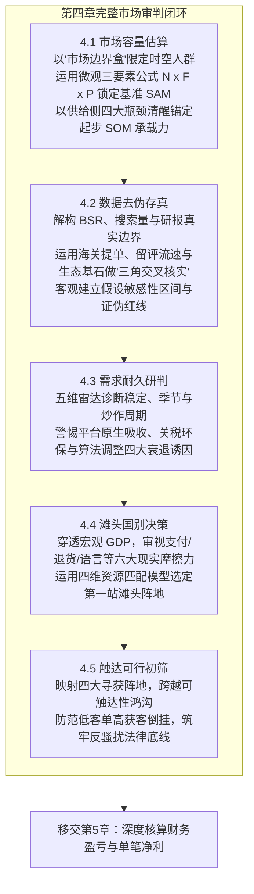

当你能够客观、严密地在纸面上给出以上五个维度的扎实推导与客观证据记录时，你可以充满底气地确认：**在这个世界上，确实存在着一个真实、健康、具备合理存续期且你能真正接触到的目标市场**。

然而，在这个市场里把产品卖出去、把服务交付出去，**你到底能不能赚到属于自己的真金白银？** 
- 每卖出一单，扣除采购生产、国际物流、目的港税费、平台手续费、广告营销以及潜在的退货损耗之后，你手里究竟还能剩下多少边际贡献？
- 你的产品究竟该卖 \$19 还是 \$79，才能既让海外客户觉得物有所值，又确保自己不至于亏本？
- 你准备的启动资金，究竟能够在跨国物流周转与平台结算账期中支撑多久？何时才能迎来现金流彻底回正的平衡点？

这些决定企业生死存亡的底层微观财务拷问，我们将正式移交并在接下来的《第5章：这门生意到底能赚多少钱？》中，为你展开最严密、最硬核的单位经济学（Unit Economics）与财务测算拆解。
