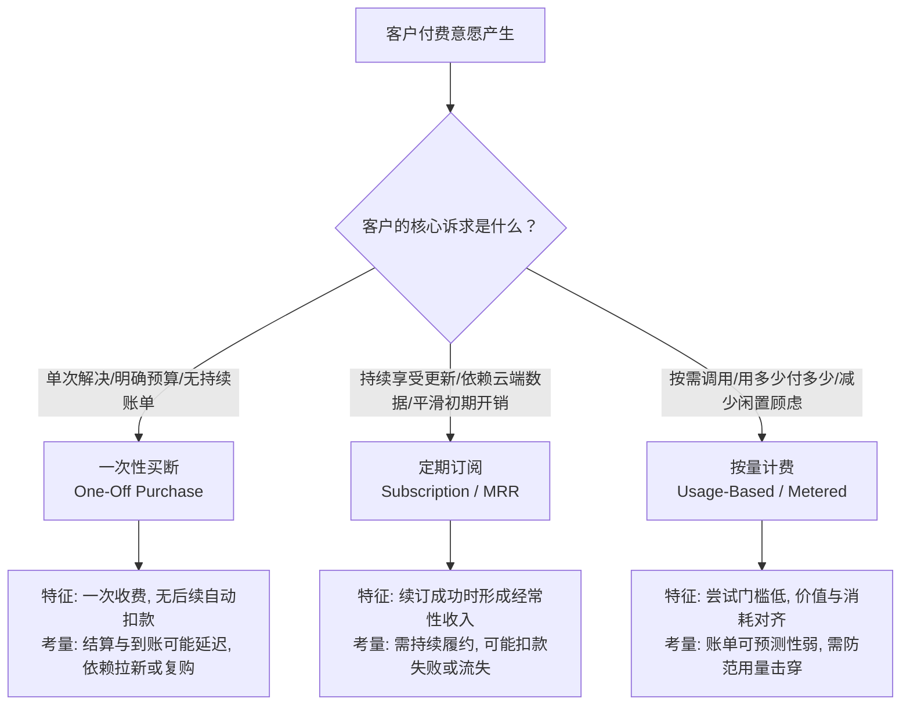
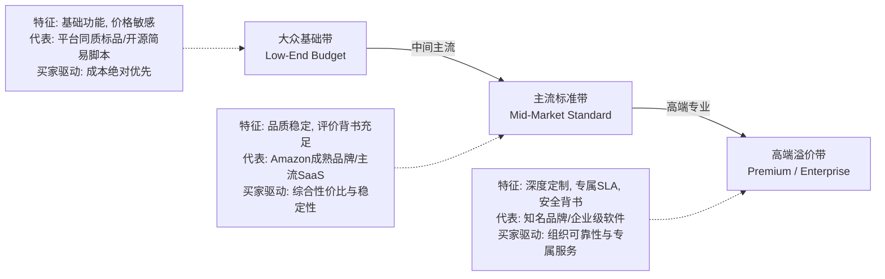
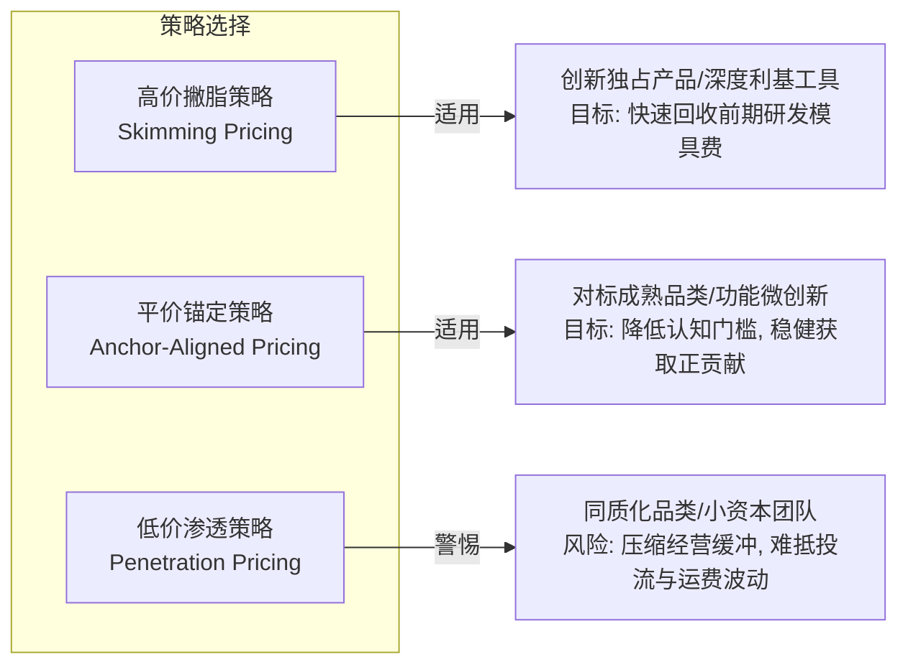
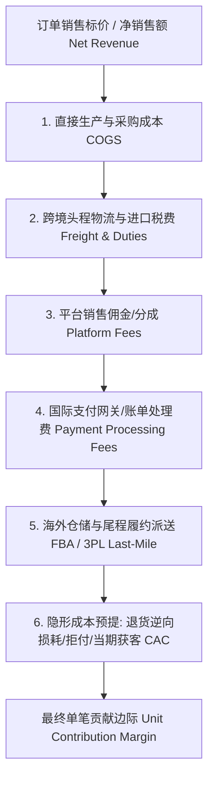
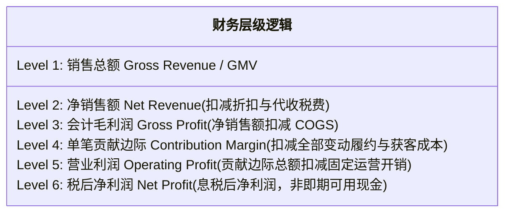
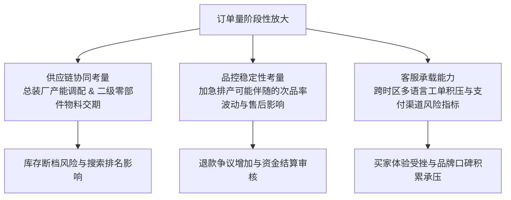
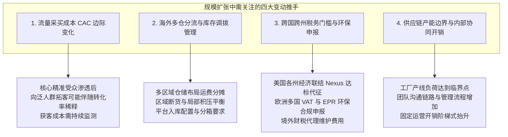

# 5. 这门生意到底能赚多少钱？

在前四章的系统探索中，我们已经逐步完成了痛点挖掘（《第1章：我该从哪里找到值得做的生意？》）、客户画像与支付意愿锚定（《第2章：谁会买我的东西，为什么愿意花钱？》）、竞品替代方案排查（《第3章：别人已经在卖了，我还有机会吗？》）以及微观市场容量与触达可行性初筛（《第4章：这个市场有多大，还能做多久？》）。

然而，当许多初涉出海领域的个人开发者、独立站经营者和中小跨境卖家走完前四步时，极易陷入一种更为致命的“财务盲目乐观”：

“前四章证明了这个细分市场每年有数百万美元的真实需求，而且我们能接触到客户，这门生意肯定发财了！”
“国内出厂采购价只要 30 元人民币，海外亚马逊能卖 35 美元，中间存在将近 8 倍的暴利空间，闭着眼睛都能赚钱！”
“软件和数字资产制作完成后，多卖一份边际成本几乎为零，只要有人订阅，剩下的全是纯利润！”

在残酷的商业现实中，**“有市场需求、且能把东西卖出去”，与“企业最终能沉淀下真金白银的净现金流”，是完全脱节的两码事**。大量出海创业者并不是死在没有客户、也没有死在没有订单，而是死在**“订单越多、亏损越大”**的财务黑洞中，或者死在**“账面看似盈利、但账户现金流彻底断裂”**的资金周转深渊里。

本章的核心教学目标，是为中国大陆出海的个人创业者与中小团队，建立一套**严谨、穿透且能够精确指导经营决策的单位经济学（Unit Economics）与微观现金流核算体系**。我们不再停留在粗糙的“售价减采购价”小学生算术层面，而是教你像一位严苛的首席财务官（CFO）一样，逐层剖析不同收费模式背后的交付隐形负债、拆解支撑定价的价值天花板、穿透从订单毛利到单笔贡献边际的每一道隐性费用漏斗、精准测算库存与结算账期锁死的现金周转周期，并在业务规模化扩张之前，提前看清那些可能让企业在订单暴增中猝死的规模不经济陷阱。

在正式推导具体的财务公式与模型之前，我们必须首先在思维层面彻底粉碎跨境出海领域最顽固的四大“财务认知陷阱”：

#### 认知陷阱一：毛利错觉与“出厂售价暴利”幻觉（The Gross Margin Illusion）
“30 元出厂、卖 35 美元，毛利高达 85%”是跨境电商领域最常见的虚假神话。这种算法仅仅扣除了最基础的工厂物理采购成本（COGS），却完全无视了跨国商业中极其厚重的中间流通摩擦：从国际远洋头程物流、目的港清关税费、海外仓一件代发处理费、电商平台高昂的销售佣金、不可避免的支付通道手续费，到动辄侵蚀 5%~15% 货值的退换货损耗与恶意拒付。当把所有变量费用扣除后，原本看似高达 80% 的毛利，往往会迅速收缩为只有 5% 甚至负数的单笔贡献边际。脱离完整履约链条谈毛利，无异于商业自杀。

#### 认知陷阱二：订阅神话与“被动收入复利”幻觉（The Subscription Magic Fantasy）
随着 SaaS 模式的普及，许多独立开发者误以为只要把产品包装成“每月 19 美元自动续费”，就能一劳永逸地躺赚复合现金流。然而，订阅模式是一把锋利的双刃剑：客户按月付费的心理前提，是你必须提供持续的系统维护、安全更新、合规跟进与客服响应。一旦产品的核心功能缺乏持续复用黏性，或者用户仅在特定场景下短期使用，月度客户流失率（Monthly Churn Rate）若达到 10%，意味着你的存量客户池在一年内将流失近 70%。你为了维持订阅大盘所持续支付的获客成本与服务器工时，会迅速将原本美好的“被动收入”变成拖垮团队的“持续交付负债”。

#### 认知陷阱三：零边际成本陷阱与“规模暴利”幻觉（The Zero Marginal Cost Trap）
数字产品和软件工具确实具有“物理复制边际成本几乎为零”的天然优势，但这绝不等于其“综合交付边际成本为零”。在真实的数字出海中，伴随着用户规模的扩大，第三方向量数据库与大模型 API 调用配额费用会呈现线性甚至超线性暴涨；多语言工单与技术答疑的人工客服成本会迅速击穿开发者的工时天花板；更致命的是，公域流量竞价的边际获客成本（CAC）会随着核心受众的饱和而急剧通胀。如果只看到软件复制的廉价，而忽视了伴随规模扩张而来的隐性支撑成本，数字产品同样会在订单暴增中深陷亏损。

#### 认知陷阱四：账面盈利与“现金断流猝死”盲区（Paper Profit vs. Cash Starvation）
很多中小企业主在年末拿到财务报表时，发现损益表（P&L）上清晰地写着“全年净利润 10 万美元”，但公司银行账户上却连下个月支付工厂尾款的现金都拿不出来。这是因为权责发生制下的“账面利润”根本不等于实打实的“银行账户可用现金”。从你提前数月向工厂垫付 30% 定金、海运在途漂泊 35 天、海外仓备货等待销售 45 天，到平台扣除 14 天滚动质押（Rolling Reserve）最终放款，实物出海的现金周转周期（CCC）往往长达 90 至 150 天。在漫长的时间差内，哪怕账面订单不断增长，只要一次大规模补货断档或遭遇退款潮，企业就会在账面盈利的假象中因现金流断裂而瞬间破产。

---

> **本章与后续章节的严格边界声明：**
> - **本章职责所在**：聚焦于**收费模式匹配与风险（5.1）**、**价格带判定与起始报价（5.2）**、**每单直接/履约/交易成本与贡献边际（5.3）**、**前期启动资本与现金周转周期测算（5.4）**，以及**规模化增长后的盈利与交付可持续性（5.5）**。
> - **严守后续章节边界**：
>   - 本章不展开具体的知识产权侵权排查规程、特定产品法规准入认证（如 FDA、CE、FCC 等实验室申请流程）的细节落地（这些合规防火墙建设属于《第6章：这门生意有哪些不能忽视的门槛？》的专业职责）。
>   - 本章不提供具体的烟雾测试（Smoke Testing）、虚构预售页面搭建或广告买量实验实操（最小化实证验证方法将留待《第7章：怎么用最少的钱，验证客户真的会买？》进行实战教学）。
>   - 本章不设定跨项目的综合加权决策矩阵与最终入场/放弃抉择（全盘商业机会的比选与投资优先级评估将在《第8章：好几个方向都不错，我究竟该做哪个？》完成收官）。
>   - 本章不代写跨境网络环境部署（第二板块）、海外公司注册与银行开户税务实操（第三板块）、代码架构实现（第四板块）、长期广告买量运营（第五板块）。

理解了上述定位与边界，接下来我们将深入微观商业算术的核心深水区，从最顶层的商业契约开始：**一次性收费、持续订阅、按量计费，你的业务到底应该怎么选？**


## 5.1 一次性收费、订阅、按量收费，应该怎么选？

很多跨境创业者在设计产品之初，往往把收费模式仅仅看作一个“支付界面怎么做”的结算技术问题。但在真实的商业世界中，**收费模式在本质上是买卖双方在风险、所有权与履约责任之间达成的一场契约分配**。

你选择了一次性买断，意味着你把产品未来的闲置风险转移给了客户（实物转移物权所有权，数字软件转移使用许可），但同时也意味着你的收入流将难以沉淀经常性收入，高度依赖持续拉新；你选择了按月或按年订阅，看似获得了可预测的经常性收入（Recurring Revenue），但同时也背负了持续交付与维护义务，若交付体验下滑或价值供给脱节，流失率（Churn Rate）会在数月内侵蚀前期获客投入；你选择了按量计费，看似将初次尝试门槛降到了最低，但若没有合理的计量防御与用量封顶机制，突发的重度使用可能对服务器与上游调用成本造成意料之外的压力。

本节将系统拆解客户在不同收费模式下的决策心理机制，并从经营者视角透视每种模式背后隐藏的续费摩擦、交付履约与现金流特征。

### 5.1.1 客户为什么买一次、反复续费或按使用量付钱？

客户在掏出信用卡的那一瞬间，大脑中进行的并不是单纯的算术加减，而是在评估三件事：**使用确定感、闲置浪费顾虑，以及持续履约带来的信任感**。

针对中国跨境出海的四种典型业态（实体商品、数字资产、软件工具、专业服务），客户对一次性收费、定期订阅与按量计费的接受度存在着截然不同的心理逻辑。

#### 1. 一次性收费（One-Off / Perpetual Purchase）：预算封顶与确定性心理

一次性收费是最符合直觉的商业交换形式：客户支付确定金额，即刻完成交付与结算。客户偏好一次性买断的核心心理动因包括：

- **预算确定性与审批阻力最小化**：无论在海外 B2B 企业采购还是 C 端家庭消费中，单次支出只需走一次审批流或单次决策。企业部门在每年 Q4 消耗剩余资本预算（CapEx）时，往往更倾向于一次性买断特定资产或设备；
- **免除“持续负债感”与订阅疲劳（Subscription Fatigue）**：随着全球各类软件与消费应用全面转向订阅制，海外消费者的“订阅疲劳”愈发显著。客户容易对“低频使用却每月自动扣款”产生抵触心理，买断制或单次付费能够提供明确的心理封顶；
- **适用场景与权属特征**：
  - **实体商品**：人体工学椅、户外露营装备、定制五金工具等耐用消费品，天然适用单次购买并完成物权转移；
  - **数字产品**：平面设计矢量图标库、3D 打印模型切片、商用字体授权、电子书与体系化录播课程。需要注意：**数字产品的一次性收费通常赋予客户的是永久或特定范围的“使用许可（License）”，而非转让底层知识产权著作权**；
  - **专业服务**：单次合规验厂咨询、品牌 VI 视觉全案设计、海外公司设立代办等以交付明确成果为终点的专项委托。

#### 2. 定期订阅（Subscription / Recurring Billing）：平滑门槛与持续价值流依赖

订阅制的底层逻辑并非单纯的“商品分期付款”，而是**客户付费购买的是一项“持续演进的动态服务与数据保障”**。

客户愿意每月或每年持续续订，通常需要满足以下业务前提：

1. **持续价值更新而非静态交付**：客户付费的实质是享有团队的“持续维护与升级权益”。如果软件长期不修 Bug、不适配新系统，或者内容库长期停更，客户流失风险将急剧上升；
2. **高频使用场景与不可中断的数据资产沉淀**：例如 Shopify 店铺运营工具，商家每天都需要查看库存同步、订单流转；一旦停止使用，现有业务流程便会中断。数据沉淀（Data Lock-in）和工作流嵌入是维持高留存的核心基础；
3. **大幅降低初次尝试门槛（Lower Upfront Friction）**：一款专业级跨境数据分析系统如果直接开价 \$3,000 买断，独立小卖家往往无力承担；但如果定为 \$49/月，卖家只需付出较低的初始尝试成本就能展开业务验证。



#### 3. 按使用量付费（Usage-Based / Metered Pricing）：消耗对齐与弹性计费

按量付费（如按 API 调用次数、按处理视频分钟数、按翻译字数、按成交订单抽点）在近年来随着云计算基础设施与 AI 调用的普及而日益主流。客户选择按量付费的底层心理在于：

- **“按实际消耗买单”的风险对齐**：初创团队或小体量用户最担心业务淡季时仍需承担高昂的固定闲置费用。按量付费在心理上减少了“买而不用（Shelfware）”的浪费顾虑；
- **与业务体量同频伸缩**：业务体量大时支付更多费用，业务处于探索或淡季时支出自动收缩，兼具弹性与合理性。

#### 4. 混合收费模式（Hybrid Models）：主流的商业融合

在实际商业运作中，单一模式往往难以兼顾不同体量的客户需求，现代软件与服务常采用混合方案：

- **基础订阅 + 超额按量计费（Base Subscription + Overage）**：例如基础版每月收取 \$29，包含 10,000 次操作配额；超出后每 1,000 次加收 \$1.50。这种模式既锁定了商家的保底经常性现金流，又捕获了大用量客户的增量价值；
- **买断授权 + 可选维保支持（Perpetual License + Optional Maintenance）**：客户一次性购买当前版本的使用许可，次年起可自主选择是否按年支付技术支持与跨版本升级年费。

---

### 5.1.2 不同收费方式会给我带来哪些续费、交付和收入风险？

商业模式的另一面是经营风险。不同收费方式对团队的现金流形态、客户支持压力以及法律合规边界提出了截然不同的要求。

下表系统对比了一次性收费、定期订阅与按量计费在实操中的核心特征：

| 评估维度 | 一次性收费 (One-Off) | 定期订阅 (Subscription) | 按量计费 (Usage-Based) |
| :--- | :--- | :--- | :--- |
| **收入确定性与波动** | **月度波动明显**：没有经常性收入沉淀，收入高度取决于当月的市场营销与渠道拉新效果 | **相对可预测**：拥有月经常性收入（MRR）基底，便于规划阶段性预算与资源投入 | **受用量周期影响**：受客户自身业务季节性波动作息影响明显，淡旺季收入存在落差 |
| **交付法定义务与生命周期** | **交付后主要为质保支持**：实物妥投或软件激活授权后即完成主要履约（依合同及法规履行售后） | **持续服务责任**：在持续计费周期内，需维持产品可用性、服务器运行与技术答疑 | **动态弹性交付**：需维持高可用弹性架构，保障峰值用量下的吞吐稳定与接口响应 |
| **续费与流失机制** | **无自动续费机制**：依赖复购周期与老客再营销，客户单次生命周期价值（LTV）需合理界定 | **双重流失压力**：既面临客户主动退订，又面临因信用卡过期或支付风控引起的被动扣款失败 | **用量休眠风险**：客户可能不主动销户，但调用量归零变为低价值或零收入账户 |
| **国际支付与合规关注** | **争议窗口期相对明确**：主要受限于银行卡常规调单申诉窗口，相对容易追踪 | **监管要求严谨**：需遵循各司法管辖区关于自动续订披露、明示同意与便捷退订的要求 | **计量对账争议**：用量统计口径不透明易引发客户质疑，需提供清晰的用量看板 |
| **成本击穿风险** | **极低**：单次交付成本通常在出货或授权发放时即已锁定 | **极端用量风险**：若订阅套餐提供无限制资源，需防范极端脚本滥用对服务器与API造成冲击 | **上游倒挂风险**：若上游服务商采购成本发生波动而终端定价未及时调整，可能压缩利润 |
| **冷启动转化阻力** | **中/高**：单次决策金额相对较高，需要更强的品牌背书、评测与品质承诺 | **较低**：单次尝试成本低，便于通过试用期（Trial）或首月优惠降低转化门槛 | **低**：按需起步，提供初始免费额度或低门槛充值即可引导实际体验 |

#### 1. 订阅制的复利与流失考量：流失率与履约责任

在订阅制模式下，经营者不仅要关注新增订阅，更要关注复合流失对长期的侵蚀效应。

流失通常包含两类：
- **主动流失（Voluntary Churn）**：客户认为产品价值不足、业务关停或转向替代方案而主动取消；
- **被动流失（Involuntary / Delinquent Churn）**：客户并无退订意图，但由于信用卡挂失、到期换卡、发卡行跨境风控拦截或账户透支导致扣款失败。在跨国在线支付中，被动流失往往占据一定比例。

若某款产品的月综合流失率（Monthly Churn Rate）达到 **8%**，经过 12 个月的复合计算：

$$\text{Annual Retention Rate} = (1 - 0.08)^{12} \approx 36.77\%$$

这意味着年初的 1,000 名订阅客户，在不增加任何新客的极端假设下，到年末大约仅保留 368 人。经营者必须保持持续拉新或提升留存水平，才能维系大盘规模。

此外，向海外客户预收的年度订阅费（Annual Plan），在权责发生制会计准则下属于**递延收入（Deferred Revenue）**，并非即期确认的全部利润。经营者需按月逐步确认为营业收入，并在此期间维持服务履行能力，防范由于重大业务停滞引发的争议纠纷。

#### 2. 跨国自动续费合规：加州 ARL 法案与暗黑模式防范

在订阅业务出海实操中，不同司法管辖区对消费者权益保护制定了严格规则：

- **美国联邦监管背景与司法动态**：2024 年 10 月，美国联邦贸易委员会（FTC）曾公布针对《负面选项规则》（Negative Option Rule）的修订版（俗称“一键取消 / Click-to-Cancel 最终规则”）。然而，**美国第八巡回上诉法院于 2025 年 7 月 8 日作出判决，依法撤销了该项 2024 年最终规则**。因此，截至 2026 年，该具体最终规则并未作为普遍适用的联邦生效法规执行。但需要特别强调的是：**这绝不意味着跨境商家可以随意设置取消障碍！** FTC 依然依据《联邦贸易委员会法》第 5 条（禁止不公平或欺骗性商业行为）以及《恢复在线购物者信心法案》（ROSCA），对隐蔽自动续费、虚假宣传和阻碍取消等欺骗性暗黑设计（Dark Patterns）保持严厉的执法诉讼；
- **加州自动续订法（California Automatic Renewal Law - ARL）**：加州于 2025 年 7 月 1 日起进一步强化了其自动续订监管要求。法律明确要求商家在续费扣款前向消费者提供醒目通知（具体要求因免费试用、月度或年度方案的期限而异），并强制要求为在线签约的消费者提供简便、直接且无需复杂客服工单的在线自助取消途径；
- **国际支付通道风控与监测机制**：Visa 现行的 **Visa 收单机构监控计划（Visa Acquirer Monitoring Program - VAMP）** 将欺诈与争议事件进行综合考量，结合交易总量和发生比率进行多级监控（例如适用区域的过量门槛已根据Visa时间表于2026年4月调整至150个基点/1.5%（仍需核对最新地区、笔数、比率定义） 并设有笔数底线）。如果商户在 Stripe、PayPal 等渠道上的争议与拒付频次过高，支付服务商可能根据商户风险评级采取增加人工审核、调整结算周期或设置个性化滚动预留金（Rolling Reserve）等风控措施，因此合规透明的取消政策是维护支付通道健康的基础。

#### 3. 按量计费的双刃剑：“账单恐慌”与重度使用防御

按量计费虽能紧贴实际消耗，但在实操中需要建立两道防御机制：

1. **客户端的“账单恐慌”（Bill Shock）防御**：企业与开发者最担忧超出预期的突发扣费。如果因客户自身脚本失误导致用量暴涨，未经预警的大额扣款极易引发支付争议。因此，**成熟的按量计费产品通常提供“消费预算软硬上限（Spending Caps）”与“梯度用量邮件预警”**，赋予客户自主风控权；
2. **经营端的成本倒挂防范**：出海软件若重度依赖第三方商业云 API（如按 Token 计费的基础模型），必须在计费方案中预留合理的安全边际，并对异常高频调用配置基础的速率限制（Rate Limiting），防止少数极端用量行为对整体系统资源造成不成比例的消耗。

---


#### 订阅客户的有限期贡献与CAC

新客有限期预期贡献可用 `LTV_CM(T)=Σ[第t期持续付费概率×(实收收入−当期增量履约/客服成本−预期退款)]`，再比较同口径新客CAC。例 `[MODEL_ASSUMPTION]`：每付费期净贡献$10，前三期留存概率100%/80%/60%，三期预期贡献$24；若新客CAC=$18，差额仅$6，尚不含固定开支、现金时间差和更长期不确定性。没有真实客户队列时须明确标假设；取得数据后按获客批次和付费行为分 cohort 复算，不以“订阅价×月份”保证LTV。

## 5.2 产品应该卖多少钱，客户才愿意买？

产品定价绝不是简单的“成本加成 30%”，也不是在竞品价格旁边随意打个九折。在跨境出海领域，**价格是产品向目标受众传递价值与定位的第一信号**。定得过低，不仅会压缩后续投流、客服与质保的必要安全边际，还可能让海外主流买家对产品的品质稳定性、合规性或售后支持产生疑虑；定得过高，超出目标客群的支付意愿与替代品锚点，转化漏斗会在结账环节出现断崖式下跌。

定价的核心本质，是在客户**“获得的增量经济价值”**与**“付出的货币及心理成本”**之间寻找一个双方均认可的利益平衡带。本节将从经济价值估算模型、起始报价确定策略，以及跨国购买力区分与防套利合规三个维度，提供一套可落地的实操定价框架。

### 5.2.1 怎么参考客户获得的价值和已有替代品，判断可接受的价格带？

客户在评估一个陌生跨境产品或工具时，通常不会孤立地看待价格数字。他们的大脑中会自动调出已有的**次优替代方案（Next Best Alternative, NBA）**，以此作为价格基准线。

#### 1. 经济价值估算模型（Economic Value Estimation, EVE）

经典的 EVE 定价模型（由托马斯·纳格等学者奠定，并在现代 B2B 与专业级消费品中广泛应用）指出：客户能够接受的理论最高价格，取决于**参考价值（Reference Value）与差异化价值（Differentiation Value）的总和**：

$$\text{Total Economic Value (TEV)} = \text{Reference Value (次优替代品价格)} + \text{Positive Differentiation Value} - \text{Negative Differentiation Value}$$

- **参考价值（Reference Value）**：如果客户不买你的产品，他们目前花多少钱来解决同样的问题？这包括购买竞品、雇佣兼职人员外包，或者客户团队自行耗费工时解决；
- **正向差异化价值（Positive Differentiation Value）**：你的产品相比替代方案，具体为客户多创造了哪些价值？通常可分为三类：
  1. **直接成本节约**：节省了多少工时、材料耗损或外包外协费用；
  2. **收入提升与效率放大**：帮助客户多获得了多少精准销售线索、提升了多少店铺结账转化率；
  3. **风险降低与确定性保障**：减少了多少海外合规罚款、退款纠纷或数据泄露的概率；
- **负向差异化价值（Negative Differentiation Value）**：客户使用你的新产品时，需要额外承担的初次学习成本、系统迁移成本或功能缺失缺陷。

> **教学模型测算 [MODEL_ASSUMPTION]**：
> 假设你开发了一款针对欧美 Shopify 服装独立站卖家的“多国尺码对照与本地化尺寸智能推荐插件”：
> - **次优替代方案（NBA）**：卖家在 Upwork 上雇佣兼职制图助理，每周手动排版制作各国的尺码对照图表。每月支出约为：8 个工作小时 $\times$ \$15/小时 = **\$120/月**；
> - **正向差异化价值**：
>   - 插件通过读取访客 IP 自动匹配欧美/英制/公制尺寸，减少尺码咨询工作量，据模型估算每月可为卖家节省约 3 小时客服人工时间（折合 \$45/月）；
>   - 提升结账体验并微幅降低退货概率（属于增量心理价值）；
> - **负向差异化价值（时间周期与摊销考量）**：
>   - 插件需要卖家在**首月首次投入约 1 小时**配置商品分类与初始数据（折合客户单次认知与时间摩擦成本约 -\$15）；
>   - **首月净经济价值上限**：
>     $$\text{TEV}_{\text{首月}} = \$120 + \$45 - \$15 = \mathbf{\$150/\text{月}}$$
>   - **次月及后续稳态月份**：
>     一旦初始配置完成，该单次学习摩擦不再发生，插件每月为客户带来的稳态经济价值上限为：
>     $$\text{TEV}_{\text{稳态}} = \$120 + \$45 = \mathbf{\$165/\text{月}}$$
>     *(若将首月 \$15 的单次学习成本按年度 12 个月平摊，每月的平均摩擦仅为 \$1.25/月，年化月均经济价值约为 \$163.75/月)*。
> 
> 在这个模型中，**\$150–\$165/月**构成了该插件在 B2B 客户心中的“价值天花板”。如果你开价超过这个区间，理性卖家会倾向于继续在 Upwork 雇佣兼职；但如果你开价在 **\$29 至 \$49/月**之间，卖家就会感知到显著的“净价值盈余（Value Surplus）”（每月花 \$39 能解决原本花 \$120 还不省心的痛点），转化阻力便会明显下降。

#### 2. 替代品价格带谱系映射（Competitive Price Corridor）

在进入目标市场前，必须对市场上现存的全部替代方案进行全景分层，通常可划分为三个典型价格带：



- **大众基础带（Low-End Commodity）**：同质化竞争较为普遍的供应层级（如跨境平台白牌铺货商品，或简易开源脚本）。此区间的客户对价格极其敏感，转换成本较低；
- **主流标准带（Mid-Market Benchmark）**：成熟品牌商家或主流 SaaS 工具所在的价格带。拥有完善的客户评价背书、标准化的售后支持与稳定的品质；
- **高端专业带（High-End / Enterprise）**：提供高级功能（如企业团队权限协同、专属客户成功经理、定制化 API 集成、严苛的企业安全合规审计），享有较高溢价。

#### 3. 范西斯滕多普价格敏感度测试法（Van Westendorp PSM）

当你要向海外受众推出一款没有直接同款产品的创新性产品或小众软件时，可以通过冷启动问卷（在海外垂直社群、Reddit、Discord 或早期候补名单用户中展开）进行范西斯滕多普（PSM）调研。

问卷包含四个核心问题：
1. **太便宜了（Too Cheap）**：在什么价格下，您会觉得该产品便宜到让人怀疑其质量或安全性，从而不敢购买？
2. **划算超值（Cheap / Bargain）**：在什么价格下，您会觉得该产品非常划算，物超所值，会毫不犹豫地付款？
3. **有点昂贵（Expensive）**：在什么价格下，您会觉得价格开始有点贵了，但依然会认真考虑购买？
4. **太昂贵了（Too Expensive）**：在什么价格下，您会觉得价格高到完全不可接受，无论如何都不会购买？

将各价格梯度的回答比例绘制成累计百分比曲线，四条曲线的交点可勾勒出四个心理参考阈值：
- **边际廉价点（Point of Marginal Cheapness, PMC）**：“太便宜”与“有点贵”曲线交点，低于此价格会导致部分买家因质量顾虑而放弃下单；
- **边际昂贵点（Point of Marginal Expensiveness, PME）**：“太贵”与“划算超值”曲线交点，高于此价格会导致买家因预算超标而快速流失；
- **最优价格点（Optimal Price Point, OPP）**：“太便宜”与“太贵”曲线交点，受访者对价格的心理抗拒处于相对较低点；
- **无差异价格点（Indifference Price Point, IPP）**：“划算超值”与“有点贵”曲线交点，代表受访者心智中的公允中位基准价。

> **方法论边界提示**：
> 范西斯滕多普（PSM）是一种基于**主观问卷调查**的心理偏好测试工具，能够为初次定价提供宝贵的区间参考线索，但它**不等于真实的购买承诺**。客户在不掏钱的问卷中表达的意向往往存在认知偏差，真实的成交转化率仍必须通过后续章节的定量市场测试（如《第7章》的烟雾测试与实际投放）进行实证核验。

---

### 5.2.2 价格低到不亏、高到难卖之间，应如何确定一个起始报价？

确定起始报价是跨境新项目面临的关键博弈。价格空间实际上被限制在两个刚性边界之内：

- **刚性成本底线（Cost Floor, $P_{\text{floor}}$）**：单笔订单的全部变动成本总和（包含采购制造、跨境干线、尾程派送、平台抽佣、支付通道费与退款退货损失拨备）。任何低于该底线的价格都意味着单笔交易直接产生现金失血；
- **感知价值天花板（Value Ceiling, $P_{\text{ceiling}}$）**：由 EVE 模型推导出的客户最大增量经济价值认知。任何高于该天花板的价格都难以促成理性买家的有效转化；
- **有效定价走廊（Pricing Corridor）**：介于两者之间的区间，即 $[P_{\text{floor}}, P_{\text{ceiling}}]$。

#### 1. 三种经典起始报价策略的实操权衡



1. **高价撇脂策略（Price Skimming）**：
   - **适用条件**：产品拥有显著的技术区隔、独特的外观专利，或者在垂直小众圈层内建立了极强的调性（如特定发烧级音频配件、独家算法的设计插件）；
   - **操作逻辑**：在产品冷启动初期定位于价值走廊的高位区间（接近 $P_{\text{ceiling}}$），优先吸引对价格相对不敏感、追求尝鲜的种子客户，以此加速回收前期的开模与开发成本；随着市场成熟与竞品出现，再逐步推出标准版或优化方案下沉；
   - **潜在考量**：过高的毛利空间容易吸引同行跟进开发类似功能。
2. **平价锚定策略（Anchor-Aligned / Neutral Pricing）—— 中小团队推荐方案**：
   - **操作逻辑**：直接将正价设定在主流市场标杆竞品的价格带区间（或略低 10%–15%），但通过提供**“更优的配置、更友好的退款保障、更及时的多语言在线技术支持”**形成差异化价值；
   - **优势**：客户不需要重新建立对价格数字的认知心理，比较成本极低；同时为团队保留了健康的边际贡献空间，足以覆盖投流与客服开销。
3. **低价渗透策略（Penetration Pricing）—— 需高度警惕的风险区**：
   - **常见误区**：部分初涉出海的卖家习惯“先亏损低价冲量，等积累好评后再慢慢涨价”。
   - **出海残酷实情**：海外成熟平台（如 Amazon、Shopify 独立站或 App Store）的客户认知具有一定黏性。一旦在客户心中形成了廉价低质的品牌标签，后续大幅提价极易造成转化率受挫；更严峻的是，跨境营销的获客成本（CAC）受平台竞价影响较大，超低定价一旦遭遇海运费上涨或广告 CPC 波动，企业容易陷入流动资金枯竭。

#### 2. 合规初始定价与真实阶梯上市策略

在向海外市场推介新产品时，定价展示必须严格遵循海外消费者保护与价格真实性法规：

> **重要法规合规警示：防范虚假参考价（Phantom Pricing）**
> - **欧盟《价格指示指令》（Price Indication Directive 98/6/EC）及综合指令（Omnibus Directive）**：明确规定商家在公布任何降价或打折促销时，**必须显著标示该商品在此前至少 30 天内适用的最低历史价格**。如果该产品此前从未以 \$49 真实成交过，商家直接在页面上虚构“原价 \$49、现早鸟特价 \$29”，在欧盟市场属于典型的虚假促销违法行为；
> - **美国联邦贸易委员会《防欺诈定价指南》（FTC Guides Against Deceptive Pricing, 16 CFR Part 233）**：同样明确禁止以虚构的、未曾在合理期限内真实诚意销售过的“参考原价”误导消费者。

因此，出海团队应当采用合规透明的阶梯上市策略：

- **方案 A：真实早鸟上市价（Genuine Early-Adopter Pricing）**：
  明确告知用户当前为产品 Beta 测试期或首批 100 名创始支持者阶段，正式公开上市后的基准价将定为 \$49，目前为早期客户提供真实的 \$29 优惠体验价。在产品功能逐步完备并转入正式运营后，真正将价格调整至 \$49；
- **方案 B：真实功能版本阶梯（Good-Better-Best Tiering）**：
  通过真实的功能配额差异构建梯级价格，避免虚假打折：
  - **基础入门版（Good - \$29）**：提供核心基础功能，适合小体量卖家或个人尝鲜；
  - **专业旗舰版（Better - \$49）**：包含完整高级功能与更充足的使用配额，作为主推主力套餐；
  - **团队尊享版（Best - \$99+）**：提供多人协作、高阶审计与专属响应支持，作为高阶参考锚点。

---

### 5.2.3 不同国家或客户可能接受不同价格，怎样决定是否区分报价？

在跨境出海中，面对全球不同国家和地区的潜在买家，究竟是采用“全球统一基准报价”，还是针对不同国家实行“区域购买力差异化定价（Purchasing Power Parity, PPP Pricing）”？这是一个兼具商业利益与合规法律风险的双重决策。

#### 1. 区域购买力平价（PPP）的现实需求与心理阈值

各国平均收入、消费价格和支付渠道可能不同，但**不能依国籍或宏观收入档位直接推断某一类消费者的购买意愿**。研究具体产品的区域价格，应按“同一商品/服务 × 同一客户角色 × 同一购买场景”分别记录：

- **当地支付能力的约束**：公开收入与价格水平只能作为背景，不能据此认定高收入国家的所有客户可接受\$29–\$99，或新兴市场的专业客户必然付不起\$49。
- **可验证的替代报价与购买行为**：记录竞品当期真实报价、实际采购支出和客户访谈，区分个人消费者与企业付费者，未知项标`UNKNOWN`。
- **是否值得分区定价**：如果目标群体付费证据、税费与支持成本差异足以弥补实施复杂度，再小范围试验区分报价；否则统一起步价也可作为低复杂度方案。上述判断是工作流程而非各国心理排行榜。

#### 2. 跨区套利（Arbitrage）的技术对抗与漏洞防范

如果你对同一款数字产品或 SaaS 服务实施了区域定价（例如：美国区售价 \$49/月，特定发展中国家售价折合 \$12/月），你将立刻面临跨区套利的风险：

- **VPN 虚拟定位滥用**：部分高购买力地区的用户通过挂载低价区节点，伪装成当地买家下单；
- **二级市场激活码倒卖**：一次性发放的软件授权 License 易被倒买倒卖，在低价区批量采购并在二级平台转售给高价区用户。

**技术防御与风控三道防线**：
1. **支付卡发卡行国家比对（BIN Check）**：Stripe 等成熟支付通道能够校验信用卡前 6-8 位的发卡银行国家代码（Issuer Country）。即使客户通过 VPN 伪装成低价区 IP，只要其使用的是欧美本土发行的信用卡，系统可强制按其发卡行所在地区的价格结算；
2. **本地化支付方式绑定**：在特定低价区，主要开放必须具备当地身份验证的本地支付通道（如巴西 Pix、荷兰 iDEAL 等），切断国际通用信用卡跨区享受低价的路径；
3. **账户绑定与活跃地验证**：对于高价值数字软件，要求用户绑定本地手机号或在检测到异地频繁登录时触发验证。

#### 3. 法律合规红线：欧盟反地理阻断法规（EU Geo-blocking Regulation）

若你的跨境业务涉及欧盟 27 个成员国，必须严格遵守**《反地理阻断法规》（Regulation (EU) 2018/302）**：

> **重要法规合规约束**：
> 欧盟法律严厉禁止在没有客观正当理由的前提下，因消费者的国籍、居住地或商业设立地而在欧盟单一市场内部设置人为的在线访问壁垒或歧视性待遇。
> - **合规红线**：禁止在没有客观合理理由的情况下，强制将某成员国消费者重定向到其他国别页面，或者由于客户持有其他欧盟国家的信用卡而拒绝交易；
> - **合法运作空间**：
>   - 商家**依然被允许设立针对不同国家市场的特定站点**（如德国站与法国站），并在不同站点提供不同标价，前提是必须允许其他欧盟国家的消费者自由访问这些站点并按该站点的条款购买（例如法国消费者有权在德国站按德国价格下单，但商家无需承担超出其既定配送范围之外的跨国运费）；
>   - 商家基于客观存在的跨境运费差异、各国法定增值税率差异（如德国增值税 19%，匈牙利增值税 27%）展示不同的含税总额，完全符合法律规定；
>   - 需要注意：涉及受版权保护的特定视听与数字流媒体服务，在该法规下享有特定的法律适用例外。

#### 4. 区分报价与否的决策参考

| 业务形态与特征 | 建议策略 | 核心落地考量 |
| :--- | :--- | :--- |
| **实物跨境电商（独立站/平台）** | **统一基准底价 + 本地币种结算 + 真实差异化运费** | 物理商品的跨境物流与清关成本天然构成了地域套利屏障；重点在于接入多币种结算以降低换汇顾虑 |
| **通用型小工具与数字素材库** | **全球统一美元/欧元基准定价（Global Tier）** | 初创期团队若缺乏复杂风控精力，差异化定价所得的边际收入可能不足以弥补主市场被套利的潜在损失 |
| **高价值 B2B SaaS 与 API 服务** | **按客户组织规模分级，而非粗放按国别分级** | 避免粗放的国别降价，转而通过“功能阶梯（Feature Gating）”与“配额限制”实现自然分流，让个人与微型团队使用轻量套餐，企业级客户使用专业套餐 |

---


## 5.3 每卖出一单，扣完各种成本还能剩多少钱？

在跨境出海的财务实践中，不少初涉出海的企业面临的挑战并不是“产品卖不出去”，而是**“以为自己每单都在赚钱，实则卖得越多现金失血越严重”**。

这背后最常见的诱因，在于经营者习惯用传统的粗放记账方式来看待跨国长链条交易。在一件出厂价 20 元的商品卖 100 元的直觉想象中，经营者往往认为存在 80 元毛利；但在跨境商业中，从海外消费者刷卡支付到资金最终完成结汇，中间跨越了平台佣金、支付通道手续费、跨境干线海空运费、进口关税、海外仓储拣配理货、尾程快递、不可退还的支付手续费、逆向退换货损耗以及持续竞争的数字广告获客成本。

扣除层层必要支出后，原本看似可观的“纸面毛利”，往往只剩下微薄的单位贡献边际，若遭遇运费或获客成本波动，极易侵蚀利润底线。本节将建立单笔订单全成本瀑布流模型，理顺各项财务会计口径，并提供动态敏感性压力测试方法。

### 5.3.1 每单有哪些直接、履约和交易费用必须扣除？

要算清每一单真正沉淀下来的边际贡献，必须对单笔订单发生的**直接变动成本（Variable Costs）**进行逐项梳理。

#### 1. 单笔订单全成本瀑布流（The Unit Cost Waterfall）

一笔跨境订单从成交到履约完毕，通常包含以下六大成本板块：



1. **直接生产与采购制造费用（Cost of Goods Sold, COGS）**：
   - 实物产品：工厂采购出厂单价（BOM 成本）、内外包装礼盒、说明书印制、防摔辅料与工厂端质检抽检费；
   - 数字与软件产品：单次交付所产生的云端底层计算开销（AWS/GCP/Cloudflare 边缘算力）、商业 API Token 调用费、跨国 CDN 下载出口流量费。
2. **跨境头程干线与进口关税（First-Leg Shipping & Customs Duties）**：
   - 国际干线运费：从国内工厂到海外仓的空运、海运拼箱（LCL）或整柜（FCL）按单分摊运费；
   - 港口附加费：海运提单费、码头操作费（THC）、滞港排队费；
   - 进口清关与关税：目的地国海关收取的进口关税（Tariffs）与报关行清关代理费。
  - **欧盟低值进口新费用**：2026-07-01起符合 Council Regulation (EU) 2026/382 第二条条件、内在总货值不超过€150的进口货件，应独立核对每个税则类项€3的过渡期关税，并与进口VAT、IOSS简化申报、清关服务费及实际责任人区分。下文原教学算例未按具体欧盟SKU重新代入该成本；实际经营必须按目的国及申报路径复算。官方：<https://eur-lex.europa.eu/legal-content/EN/TXT/?uri=CELEX:32026R0382>。

3. **平台销售佣金与分账规则（Marketplace & Platform Commissions）**：
   - **Amazon 平台**：美国站销售佣金按**实际收费类目**查询：`Consumer Electronics` 为 **8%**；`Electronics Accessories` 为**前$100部分15%、超过$100部分8%**。家居厨具为15%，其他类目也可能高于15%，并须核对每件最低佣金；前台展示类目不等于收费类目，其他国家站点不得直接套用。来源：<https://sell.amazon.com/pricing>（2026-10-19复核）；
   - **Shopify App Store 开发者平台规则**：据[Shopify官方收益分成说明](https://shopify.dev/docs/apps/launch/distribution/revenue-share)（2026-10-20核验），**符合标准资格**的开发者及关联账户，自2025年1月1日起产生的应用毛收入累计首100万美元适用0%分成，超额部分15%，账单处理费通常另计2.9%及适用税费；**上年度App Store收入达到2000万美元，或企业总收入达到1亿美元的大型开发者**不适用此首100万美元0%优惠。门槛依应用毛收入而非净利润；旧的每年重置规则已取消；
   - **独立站（DTC）SaaS 平台费**：若使用 Shopify 独立站，根据套餐不同需承担 0.5%–2.0% 的第三方交易手续费（若未启用 Shopify Payments）。
4. **国际支付网关与账单处理费（Payment Processing & Billing Fees）**：
   - **Stripe**：官方标准费率为美国境内银行卡 **2.9% + \$0.30**。若涉及国际发卡行，加收 **1.5% 跨境交易费**；若涉及不同货币结算，加收 **1.0% 货币转换费**（依据 Stripe 官方费率表）；
   - **Shopify App Store 官方账单**：上架 Shopify 应用商店的公共应用必须接入 Shopify 官方 Billing API，Shopify 官方收取 **2.9% 的支付处理费（Payment Processing Fee）**；
   - **Gumroad 创作者平台**：依据 Gumroad 官方费率，创作者在个人主页/直链销售的基础费率为 **10% + \$0.50/笔**；若买家通过 Gumroad Discover 推荐生态成交，平台费率为 30%（若属于早期已绑定独立 Stripe 的特定存量账户，底层通道可能另行结算）。
5. **海外仓配与尾程派送费（Fulfillment & Last-Mile Delivery）**：
   - **亚马逊 FBA 订单处理费**：按商品尺寸分级与发货重量计费。一件标准大件（1–2 磅）的单件拣配包装与派送费通常在 **\$4.00 至 \$5.50** 之间；
   - **第三方海外仓（3PL）**：出库订单操作费（Order Pick & Pack Fee，通常 \$2.00–\$3.50/单）+ 本地快递运单费（USPS Ground Advantage / UPS Ground / FedEx Home Delivery，通常 \$4.50–\$9.00/单）。
6. **隐性损失拨备与获客投入（Returns, Chargebacks & Direct CAC）**：
   - 包含客户退换货的不可回收逆向物流损耗、争议调单手续费以及为了促成该订单直接消耗的广告投放支出（详见 5.3.2 节）。

#### 2. 四大跨境业务形态单笔订单成本构成对比表

> **教学模型基准测算 [MODEL_ASSUMPTION]**：
> 下表设定四种典型出海业务在特定销售价格下的成本瀑布流对照（单位：美元 USD）。**简化前提：每笔均为不同新客的首单，表内按单分摊的获客支出才暂可同时视为该新客CAC；出现复购时须拆开两种分母。**另假定标价尚未冲回退款，表内退款/损耗拨备为一次性的预计收入冲回和新增损耗合计；若起点改为已扣退款的净销售额，不得再按全额重复扣退款货款。

| 成本组成板块 | ① 实物跨境电商 (DTC家居) | ② 数字内容资产 (设计模板) | ③ 订阅制软件 (Shopify插件) | ④ 跨境专业服务 (合规代办) |
| :--- | :--- | :--- | :--- | :--- |
| **单笔标称售价 (Gross Price)** | **\$60.00** | **\$49.00** | **\$39.00/月** | **\$350.00** |
| 1. 直接生产/采购成本 (COGS) | \$12.00 (工厂出厂价+包装) | \$0.00 (无实体采购物料) | \$2.50 (云服务器+数据库) | \$40.00 (兼职律师初审成本) |
| 2. 国际干线与进口关税 | \$3.50 (海运分摊+关税) | \$0.00 (无实体物流) | \$0.00 (无实体物流) | \$0.00 (无实体物流) |
| 3. 平台销售佣金/分成 | \$0.00 (独立站无平台抽成) | \$5.40 (Gumroad直链10%+\$0.50) | \$0.00 (首100万终身免佣期) | \$0.00 (官网直营销售) |
| 4. 国际支付处理/账单通道费 | \$2.04 (Stripe 2.9%+\$0.30) | \$1.72 (假设存量Stripe 2.9%+\$0.30) | \$1.13 (Shopify官方账单2.9%) | \$10.45 (Stripe 2.9%+\$0.30) |
| 5. 海外仓储与尾程派送 | \$7.50 (3PL操作+USPS派送) | \$0.10 (CDN全球下载带宽) | \$0.00 (云端运行无派送) | \$0.00 (邮件电子交付) |
| 6. 退款/拒付/损耗拨备 | \$3.20 (预估5%退货逆向损耗) | \$2.45 (预估5%退款损失拨备) | \$1.95 (预估5%退款率拨备) | \$10.00 (返工与补件拨备) |
| 7. 直接单客获客成本 (CAC) | \$20.00 (Meta广告转化成本) | \$15.00 (Google关键词投流) | \$16.00 (初次拉新获客CAC) | \$110.00 (海外B2B精准线索) |
| **单笔总变动成本 (Total Variable)** | **\$48.24** | **\$24.67** | **\$21.58 (首月)** | **\$170.45** |
| **单笔贡献边际 (Contribution Margin)** | **\$11.76** | **\$24.33** | **\$17.42 (首月)** | **\$179.55** |
| **单笔贡献边际率 (CM Ratio)** | **19.60%** | **49.65%** | **44.67% (首月)** | **51.30%** |

> **关于订阅制 SaaS 获客成本（CAC）与时间周期的重要说明 [MODEL_ASSUMPTION]**：
> - 上表针对 ③ 订阅制软件测算的 **\$17.42 贡献边际（44.67%）属于“首月单客指标”**，因为 **\$16.00 的拉新获客成本仅在首月发生一次**；
> - 在**次月及后续留存月份（Months 2+）**，假设客户持续续费，经营者无需再次支付拉新 CAC，月度变动成本仅包括服务器（\$2.50）、Shopify 账单费（\$1.13）与退款拨备（\$1.95），合计仅为 **\$5.58/月**；
> - 此时，存量客户的**月度稳态贡献边际将跃升至 \$39.00 - \$5.58 = \$33.42/月（边际贡献率达 85.69%）**；
> - 这同时推导出了该 SaaS 客户的**获客成本回收期（CAC Payback Period）**：
 >   $$\text{CAC Contribution-Equivalent Payback} = \frac{\$16.00}{\$33.42/\text{月}} \approx \mathbf{0.48 \text{ 个月（静态贡献等值）}}$$
>   **注意：0.48 个月不是“第15天银行卡现金到账”的事实。** 该计算只是在客户后续持续付费、月贡献稳定且忽略账单时点时，将一次性 CAC 换算为月度贡献的等值回收期。即使首期订阅的账面贡献已经超过获客支出，实际现金能否回到银行账户仍取决于商家付款、平台记账、提现与结算时间。Shopify 官方说明，周期性应用费用从商家同意计费到显示为开发者收益，可能长达37天，且显示为收益不等于当日到账。来源：https://shopify.dev/docs/apps/launch/distribution/track-app-usage 。

---

### 5.3.2 退货、损耗、退款和获客费用不确定时怎么估？

在跨国复杂环境中，**不确定性本身就是一项不可忽视的隐形经营成本**。

#### 1. 退货与损耗的财务构成（Physical Returns）

实物出海中，退货绝不仅仅是货款原路退回，经营者通常承担以下几项实质性支出：

$\text{相对未退货基准的总影响} = \text{尚未计入净销售额的收入冲回} + \text{尚未列支的增量逆向运营与手续费净损失}$

**两种互斥的核算入口（MODEL_ASSUMPTION）**：仍以本节\$60单价和8%预计退款率为例，\$4.80是每初始订单的预计退款收入冲回；本节计算的增量逆向操作费为\$0.736。

- **方法甲（从未扣退款的\$60标价起算）**：\$60－\$4.80－\$0.736＝**\$54.464**，然后再扣其他尚未计入的共同履约成本。
- **方法乙（从已冲回退款的净销售额起算）**：净销售额先记\$60－\$4.80＝**\$55.20**，**只再扣\$0.736**，也得到**\$54.464**；绝不在净销售额已扣退款后又把\$4.80计入“退款损失拨备”。

以上是**以初始订单为单位的简化贡献计算**，不是完整会计损益或现金流；原始采购成本、去程运费与支付费若已在基准表中扣过就不再重复。真实商品退回可能产生退款负债、收回商品权利资产和后续存货调整，依适用会计准则处理。可参考公开可读的[IFRS for SMEs会计准则教学模块23A.24–23A.26](https://www.ifrs.org/content/dam/ifrs/supporting-implementation/smes/2025-modules/module-23.pdf)所示退货收入、退款负债和收回商品资产的分列原则；该材料并不自动意味着经营者适用IFRS for SMEs。

1. **不可退还的支付处理费**：Stripe、PayPal 等主流国际支付网关在商户向买家全额退款时，**原始交易已经支付的手续费是否退回取决于支付渠道、地区和合同**，这构成商户的净手续费损失；
2. **逆向物流运费（Reverse Freight）**：在欧美，逆向退货运费通常由商家提供的退货标签买单，寄回海外仓的运费往往需 \$6–\$10；
3. **退货质检与重新贴标费**：海外仓工人拆箱检查破损、重新贴标入库，单件操作费通常需 \$2.50–\$4.00；
4. **商品残值损失与重复扣除警示**：对于服装穿戴或个人护理用品，部分退回商品因包装破损或使用痕迹无法再次销售，需就地销毁（支付 \$0.50–\$1.00 销毁费）。**需要注意会计口径：由于商品采购成本（COGS）已在出货时全额结转，报废商品仅损失其预期残值并发生销毁费，不应在模型中重复扣减两次采购成本**。

> **退货拨备估算模型示例 [MODEL_ASSUMPTION]**：
> 假设某零售价 \$60 的实物商品，预估综合退货率为 $r = 8\%$：
> - **销售收入冲回（Revenue Reversal）**：每初始成交 100 单中将有 8 单退款，预期每单冲回收入：$8\% \times \$60 = \mathbf{\$4.80}$；
> - **逆向运营附加现金损失**：
>   假设退回商品中 60% 可翻新二次销售（重新上架费 \$3），40% 报废（支付销毁费 \$1），平均逆向运费 \$7。**基准订单成本表已按全部初始成交单计入支付手续费，因此本次只计算“相对于基准新增”的退货影响，不再二次扣除 \$2.04 的原始手续费**；可再销售商品的库存回补与不可销售商品残值，须在真实账册中另按实际状况核对：
>   $$\text{每初始单新增逆向操作现金成本} = 0.08 \times (\$7 + 0.6 \times \$3 + 0.4 \times \$1) = 0.08 \times \$9.20 = \mathbf{\$0.736 \approx \$0.74}$$
>   *(注：报废商品的 COGS \$12 已在初始出厂成本中计列，此处不重复双计)*；
> - 因此，8% 退货率相对于**已列扣原始手续费和初始商品成本的基准单**，产生**预期收入冲回 \$4.80 + 新增逆向现金费用 \$0.736 = \$5.536，约 \$5.54/初始单**。这是一个明确简化的教学口径，不自动等于完整会计损益或真实现金净额；不能再和基准表的另一组5%退货拨备 \$3.20 重叠相加。若恢复可售库存/分支残值，应同步调整销货成本与资产账面价值，不能重复扣减原始采购成本。
> *(而在 5.3.1 节四业态对比表中，退款/损耗拨备 \$3.20 是基于 5% 综合退换货损耗率设定的独立教学基准，读者在实操中需依据自身品类的实际退货水平单独测算)*。

#### 2. 调单拒付风险与风控应对（Chargebacks & Dispute Fees）

海外买家若遭遇物流严重延迟或怀疑信用卡被盗刷，可能直接致电发卡银行发起调单拒付（Chargeback）。

- **争议处理费规则**：以 Stripe 美国公开标准价格为例，**收到争议（Dispute received）费可能为 \$15/笔；若提交人工证据反驳（Dispute countered），另可能产生 \$15/笔的抗辩费**。官方解释：胜诉后可退回的是符合条件的**抗辩费**，不能据此认为收到争议费也一律退回；墨西哥、日本等地区存在抗辩费例外，具体以注册地区、合同和当期账单为准（https://stripe.com/pricing ，https://support.stripe.com/questions/dispute-fees-faq）。其他支付渠道不能套用本例；
- **拒付拨备估算**：若业务月均拒付率为 0.5%（即每 200 单出现 1 单拒付），在“全部争议均损失货款、仅有收到争议费、不进行人工抗辩、且其他费用另算”的窄口径下，单笔初始订单的增量风险准备金为 $0.005 \times (\$60 \text{ 争议货款} + \$15 \text{ received fee}) = \mathbf{\$0.375}$。若进行抗辩，还应结合胜诉概率、可返还的抗辩费、争议时现金冻结和已列扣的退款拨备，避免双算。

#### 3. 动态获客成本（CAC）的波动与估算

获客成本（CAC）受多种市场变量动态影响：

- **季节性竞价波动**：每年 Q4（黑五网一、圣诞季），全网广告竞价激烈，千次展示费用（CPM）普遍上涨，使得单客获取成本阶段性抬升；
- **受众饱和效应**：当投放预算从初期精准人群扩展至广泛受众时，点击率（CTR）与转化率（CVR）通常会出现一定稀释，推高边际 CAC；
- **CAC须以新增付费客户为分母**：`广告费/有效订单数`是每订单广告开销，不等于CAC；`广告获客支出/归因期内新增付费客户数`是该渠道新客CAC；`Blended CAC=全渠道可归因获客支出（广告、代理、寄样、人工获客工时等）/同期新增付费客户人数`。人工成本无法可靠归因时说明排除项及上下限。
  - **反例 [MODEL_ASSUMPTION]**：100单中40单来自老客、60位为新客，获客支出$600，则每单广告开销$6、每新客CAC$10；复购订单不能自动计成新客。若将观测CAC乘1.2—1.4用于压力测试，只是自设情景而非公认行业基准。

---

### 5.3.3 营业收入、毛利、单笔贡献和最终净利润到底哪里不同？

许多出海经营者容易将“销售总额”、“毛利”、“贡献边际”与“净利润”混同，甚至误把第三方支付提现金额当成企业纯利润。必须从现代管理会计角度，对各财务层级建立明确边界：



#### 1. 概念内涵与数学定义

1. **销售总额 / 营业毛收入（Gross Revenue / GMV）**：
   - 客户在结账页面实际支付的总金额。在电商中常被称为商品交易总额（GMV）。需要注意：GMV 中若包含代收的目的地消费税或运费，所有权并不完全属于商家；
2. **净销售额（Net Revenue）**：
   - 在同一收入口径下考虑折扣、预计或实际退货退款造成的**收入冲回**，以及商家依法代收而不属于其收入的消费税（Sales Tax / VAT）。**若结账实付价已扣折扣，不可再扣一次**；退货的退款负债、库存回收价值和逆向费用应分账处理。净销售额不等于银行卡到账现金或扣完佣金后的利润；主要责任人/代理人的总额与净额列报，应依合同和适用会计准则判断；
3. **会计毛利润（Gross Profit）与毛利率（Gross Margin）**：
   - 遵循标准财务会计口径，从净销售额中扣除**商品直接采购制造与生产开发成本（COGS）**：
     $$\text{Gross Profit} = R_{\text{net}} - \text{COGS}$$
     $$\text{Gross Margin (\%)} = \frac{\text{Gross Profit}}{R_{\text{net}}} \times 100\%$$
   - **重要理解**：在管理会计简化模型中，毛利润主要反映制造或采购加价空间。它**尚未扣除**跨国干线、海外仓配、广告投放与平台抽成。单看高毛利率并不等同于生意一定赚钱；
  - **报表毛利与管理决策瀑布图不应混用**：本章按厂价、头程、税费、尾程、获客逐层扣减，是便于经营决策的**管理展示顺序**，不是所有主体通用的正式财务报表毛利。IAS 2指出符合条件的不可收回进口税、运输及直接归属存货取得的支出构成存货成本；广告及出库配送不因此自动入存货。例 `[MODEL_ASSUMPTION]`：净销$100，厂价$20，合规归集的头程与进口税$8，其他变动成本$12。管理表按$100−$20−$8−$12=$60；财务存货口径先得毛利$100−($20+$8)=$72，再扣$12，贡献仍$60。**分类改变毛利层级，不改变总贡献**。实际采用会计准则由主体核实。<https://www.ifrs.org/issued-standards/list-of-standards/ias-2-inventories/>

4. **单笔贡献边际（Unit Contribution Margin, CM）与边际贡献率（CMR）**：
   - 从单件**同口径净售价**中扣除与其对应的**直接变动成本（Variable Costs, $V$）**，包括 COGS、物流税费、平台和支付费、**未包含在净收入冲回中的额外逆向损耗**及可归属的订单获客开销；如将一位新客的CAC分摊给订单，必须说明该客户的订单数、归因期间，不能给复购单再次机械扣完整新客CAC：
     $$\text{Unit CM} = P_{\text{net}} - V_{\text{unit}}$$
     $$\text{CMR (\%)} = \frac{\text{Unit CM}}{P_{\text{net}}} \times 100\%$$
   - **核心价值**：单笔贡献边际衡量的是“每卖一件商品，能为公司沉淀多少真金白银去分摊人员工资、系统年费与办公支出等固定开销”。如果 $\text{Unit CM} \le 0$，增加销量反而会放大亏损；
5. **营业利润（Operating Profit / EBIT）与税后净利润（Net Profit）**：
   - 贡献边际总额扣除**固定运营开销（Fixed OPEX）**后为息税前营业利润；再扣除利息支出、汇兑损益及企业所得税后，得到税后净利润：
     $$\text{Operating Profit} = (\text{Unit CM} \times Q) - \text{Fixed Overhead (固定运营费用)}$$
     $$\text{Net Profit} = \text{Operating Profit} - \text{利息及汇兑损益} - \text{企业所得税}$$
   - **关键区别：净利润不等于可用银行现金！** 净利润是基于权责发生制计算的会计结果，而企业实际可支配的银行流动资金受库存采购垫款、应收账款结算时滞、资本性开支以及预留金冻结等现金流周转变量的深刻影响。

#### 2. 全链路财务穿透演练案例

> **全景核算演练模型 [MODEL_ASSUMPTION]**：
> 假设某独立站跨境卖家销售一款实物商品，标价为 **\$100.00**，月销量为 **600 件**。每月固定办公及系统支出（固定运营费用 $F$）为 **\$8,000.00**。

| 会计层级与费用项目 | 单件金额 (USD) | 占标价比例 | 月度总计 (600件) | 说明与定性 |
| :--- | :--- | :--- | :--- | :--- |
| **消费者结账实付标价 (Gross Price)** | **\$100.00** | 100.00% | \$60,000.00 | 包含商品售价（假定包邮策略） |
| 减：商品生产采购成本 (COGS) | -\$22.00 | -22.00% | -\$13,200.00 | 工厂批量采购成本与定制彩盒包装 |
| **= 会计毛利润 (Gross Profit)** | **\$78.00** | **78.00%** | **\$46,800.00** | **账面毛利率为 78.0%** |
| 减：跨境海运干线分摊与进口关税 | -\$4.50 | -4.50% | -\$2,700.00 | 拼箱海运到海外仓及清关关税 |
| 减：平台佣金及应用服务扣费 | -\$3.00 | -3.00% | -\$1,800.00 | 独立站交易费及工具插件分摊 |
| 减：国际信用卡支付手续费 | -\$3.20 | -3.20% | -\$1,920.00 | Stripe 2.9% + \$0.30 交易处理费 |
| 减：海外仓出库贴标与尾程快递 | -\$9.50 | -9.50% | -\$5,700.00 | 3PL 订单拣配包装及本地快递派送 |
| 减：退货损耗与争议处理拨备 | -\$3.80 | -3.80% | -\$2,280.00 | 综合退换货损耗与逆向处理预提 |
| 减：直接广告投放获客成本 (CAC) | -\$37.00 | -37.00% | -\$22,200.00 | Meta 广告投流单次成交转化成本 |
| **= 单笔贡献边际 (Unit CM)** | **\$17.00** | **17.00%** | **\$10,200.00** | **单笔边际贡献为 17.0%** |
| 减：固定运营费用分摊 (Fixed OPEX) | -\$13.33 | -13.33% | -\$8,000.00 | 核心团队薪酬、SaaS工具年费等 |
| **= 营业利润 (Operating EBIT)** | **\$3.67** | **3.67%** | **\$2,200.00** | 息税前经营利润 |
| 减：企业所得税拨备 (按假设20%测算) | -\$0.73 | -0.73% | -\$440.00 | 假定税负预提 |
| **= 会计净利润 (Net Profit)** | **\$2.93** | **2.93%** | **\$1,760.00** | **会计净利润率约为 2.93%** |

从 **78.0% 的会计毛利率** 到 **2.93% 的会计净利润率**，这一测算直观展现了跨境出海长链条的费用沉淀特征。如果忽视获客成本与履约费用的消耗，仅仅依据 78% 的毛利盲目放大支出，一旦遭遇旺季广告成本上涨或退货率波动，贡献边际便会受到明显挤压。

---

### 5.3.4 销量、客单价或单位成本变化时，利润会怎样变？

企业的经营利润受多种市场因素联动影响。理解**经营杠杆（Operating Leverage）**与各财务参数之间的敏感性，是制定经营预案的核心基础。

#### 1. 利润敏感性微分关系（Sensitivity Relationships）

企业营业利润的基础方程为：

$$\Pi = Q \times (P - V) - F = Q \times \text{CM} - F$$

其中：$Q$ 为销量，$P$ 为客单价，$V$ 为单位变动成本，$F$ 为固定开销。在其他条件保持不变（*Ceteris Paribus*）的假设下，各项变动对利润的影响呈现不同弹性：

- **客单价敏感性（Price Sensitivity）**：
  $$\frac{\partial \Pi}{\partial P} = Q$$
  在销量与渠道费率不随提价发生联动的简化假设下，价格提升的部分将全部转化为边际贡献。在上文案例中（$Q = 600$ 件），若将售价从 \$100 微调至 **\$105**（上涨 5%），在销量保持稳定、变动成本仍为 \$83 的教学情景下，单笔 CM 将上升至 \$22（增幅 29.4%），月度营业利润将计算为：
  $$600 \times \$22 - \$8,000 = \$5,200 \quad (\text{计算增幅 } +136.4\%)$$
  *(实操提示：现实中价格上涨可能伴随需求弹性变化导致销量波动，或引起按百分比收取的支付手续费微幅增加，此处仅作单变量敏感性教学演算)*；
- **变动成本敏感性（Variable Cost Sensitivity）**：
  $$\frac{\partial \Pi}{\partial V} = - Q$$
  单位变动成本每优化 \$1（例如通过集装箱海运节省物流费），在 600 件销量下直接贡献 \$600 的经营利润；
- **销量敏感性（Volume Sensitivity）**：
  $$\frac{\partial \Pi}{\partial Q} = P - V = \text{CM}$$
  销量对利润的拉动直接取决于单笔贡献边际的大小。若单笔 CM 极薄，单纯铺货冲量带来的利润总额增量有限，却可能放大资金占用与供应链周转压力。

#### 2. 三维情景压力测试矩阵（Scenario Stress Testing）

跨境经营需要对潜在风险保持底线预判：

> **敏感性压力测试推演 [MODEL_ASSUMPTION]**：
> 沿用 5.3.3 节的 \$100 实物商品模型（基准基线：$Q=600$ 件，$P=\$100$，$V=\$83$，$F=\$8,000$，基准营业利润 $\Pi = \$2,200$）：

| 经营情景假定 | 参数异动假设 | 单位变动成本 $V$ | 单笔 CM | 月度总 CM | 固定费用 $F$ | 月度营业利润 $\Pi$ | 利润变动幅度 |
| :--- | :--- | :--- | :--- | :--- | :--- | :--- | :--- |
| **乐观情景 (Optimistic)** | 口碑自传播使综合 CAC 降至 \$28；运费微降 \$0.50 | \$73.50 | **\$26.50** | \$15,900 | \$8,000 | **+\$7,900** | **+259.1%** |
| **基准中性 (Base Case)** | 各项参数均保持基准设定状态 | \$83.00 | **\$17.00** | \$10,200 | \$8,000 | **+\$2,200** | **基准基线** |
| **轻度受压 (Mild Stress)** | 旺季广告竞争激烈导致 CAC 涨至 \$45；销量微增至 650 | \$91.00 | **\$9.00** | \$5,850 | \$8,000 | **-\$2,150** | **由盈转亏** |
| **极度受压 (Severe Stress)** | 广告 CAC 飙升至 \$50；退货损耗拨备升至 \$7.60；运费涨价 \$1.00；销量因断货跌至 450 | \$100.80 | **-\$0.80** | -\$360 | \$8,000 | **-\$8,360** | **经营受挫** |

> **关键推演结论**：
> 在极度受压情景下，单位变动成本（\$100.80）已超出商品售价（\$100.00），单笔贡献边际变为 **-\$0.80**。这意味着每发出一单交易都在产生微额现金失血，加上 \$8,000 的固定运营费用，单月经营亏损达 \$8,360。
> 在面对此类市场变化时，合理的经营应对通常是**及时审视广告投放的边际产出，优化采购与物流履约链路，避免在负贡献状态下盲目增加预算**。

---


## 5.4 开始需要准备多少钱，多久才能回本？

在创业早期，最容易对出海项目造成实质威胁的往往不是“缺乏长期前景”，而是**“在实现自我造血之前遭遇现金断流”**。

不少出海团队在规划预算时，看到单笔订单存在利润空间，便推断投入微额资金即可持续运转。然而，当项目进入实操阶段，开支时序往往会显现其刚性：商品尚未量产，打样开模、品牌视觉与合规申请已产生初始开销；第一批商品下线，工厂通常要求结算余款；跨境海运与到港清关需要跨越数周周期；商品入库上架开始投放后，海外支付通道与平台的结算周期又将部分回款资金暂时留在流转途中。

**利润是损益表上的会计核算，而现金流是维持企业日常运营的直接血液。** 如果无法预估从首期采购支出到销售款项实际回流的资金占用时间（现金转换周期），企业容易在业务扩张过程中因流动资金承压而陷入被动。本节将系统拆解前期启动刚性开销、资金周转占用时间模型，以及保本销量与现金跑道的动态估算方法。

### 5.4.1 正式开始之前，哪些钱必须先付出去？

在第一笔订单正式成交之前，创业者通常需要预先支付一系列**前期投入（Pre-Operating Outlays）**与**初始资本开支（Initial CapEx）**。

#### 1. 前期刚性启动资金的四大组成板块

```mermaid
flowchart TD
    A[启动前现金支出 Pre-Operating Capital] --> B[1. 产品研发打样与模具费用 R&D / Tooling]
    A --> C[2. 知识产权与主体合规 (按需配置) Legal & IP]
    A --> D[3. 首批供应链起订量货款 Initial Inventory MOQ]
    A --> E[4. 基础设施与冷启动素材 Infrastructure & Assets]

    B --> B1[工业设计/3D建模/样品验证/注塑模具/代码开发]
    C --> C1[USPTO商标基本费$350+律师费/海外主体设立(按需)]
    D --> D1[工厂30%生产定金+70%尾款+首期国际物流清关]
    E --> E1[网店平台月费/云端部署/专业视觉渲染/红人样品]
```

1. **产品研发、打样与工模具费用（R&D, Prototyping & Tooling）**：
   - **实物硬件**：从手板 3D 打印验证，到开具专属注塑模具（Tooling / Mold）。一套精度优良的中型模具费用因结构与钢材而异，通常在 **\$2,000 至 \$15,000+** 之间；
   - **软件与数字工具**：前端商业 UI 组件库授权、商业 API 开发者测试套餐、顶级域名采购等；
   - **专业服务**：标准作业程序（SOP）梳理、专业服务合同模板合规起草。
2. **知识产权保护与主体合规（按需配置）**：
   - **美国专利商标局（USPTO）商标申请**：防范海外职业跟卖与侵权抢注的重要工具。依据 USPTO 自 **2025 年 1 月 18 日** 起执行的现行最新官费标准，Section 1/44 商标基本申请费已统一调整为 **\$350/类**（此前的 \$250 TEAS Plus 档位已被取代）。由于美国法律要求外国籍申请人必须通过具备美国执业资质的律师递交，加上律师服务费后，单一类别的合规申请开销通常在 **\$650 至 \$1,050** 之间；
   - **海外主体与联邦税号（EIN）的适用性说明**：许多初创者误以为出海“必须首先在海外设立 LLC 公司”，实际上这并非普遍适用的硬性前置门槛。目前主流电商平台（如亚马逊全球开店）与开发者生态均支持以中国大陆或香港企业身份直接入驻；对于独立开发者，亦可借助 Merchant of Record（MoR）模式（如 Paddle、FastSpring、Lemon Squeezy 等）直接合规出海，无需立即支付境外公司年审维护成本。若因特定海外银行结算需求确需设立美国 LLC（如怀俄明州或特拉华州），官方注册费与代办通常需 **\$300 至 \$800**，而 **美国国税局（IRS）核发雇主识别号（EIN）本身是官方免费的（\$0 官费）**；
3. **首批供应链货款与最小起订量占用（Initial Inventory Commitment - MOQ）**：
   - 工厂对于定制包装或专属配色的私模商品，通常设有 **500 件至 2,000 件** 的最小起订量（MOQ）；
   - **常规结算时点**：国内供应链对新出海商家通常采取 **“30% 生产定金 + 70% 尾款见提单出运”** 的结算方式。在货物离港前，首批采购货款需全额付清；
4. **数字基建与冷启动视觉营销素材（Infrastructure & Assets）**：
   - 独立站建站与云服务基础开销（Shopify 月费及必要插件、云服务器预付费）；
   - 针对目标受众的生活方式场景实拍（Lifestyle Photography）、3D 渲染图，以及向海外垂直红人寄送的体验样品与国际物流费。

#### 2. 四大业务形态前期启动资金需求对比

> **教学基准预算估算 [MODEL_ASSUMPTION]**：
> 下表量化对比四种出海形态在极简冷启动规模下的前期现金支出门槛（单位：美元 USD）：

| 支出细分科目 | ① 实物自主品牌 (私模家居) | ② 数字内容模板 (独立资产包) | ③ 独立开发者 SaaS (微型插件) | ④ 垂直跨境咨询 (出海财税服务) |
| :--- | :--- | :--- | :--- | :--- |
| **产品打样/开模/初始开发** | \$3,500 (定制开模与打样验证) | \$200 (设计素材与商用字体授权) | \$600 (测试API额度+前端组件) | \$300 (法律服务协议合规起草) |
| **主体架构与EIN申请 (条件性)** | \$500 (美国怀俄明州LLC可选) | \$0 (个人/国内主体跨境收款起步) | \$500 (海外LLC主体按需设立) | \$800 (新加坡或香港主体设立) |
| **商标与合规官费 (USPTO等)** | \$850 (USPTO $350官费+律师代理) | \$0 (早期阶段暂缓申请) | \$850 (核心品牌名海外商标) | \$0 (以个人专业背书为主) |
| **首批备货款 (含定金尾款)** | \$6,000 (首批500件 $\times$ \$12) | \$0 (数字资产无实物存货) | \$0 (云端按月订阅无实体备货) | \$0 (专业人工交付无备货) |
| **首批跨境海运头程与清关** | \$1,750 (海运拼箱+进口关税) | \$0 (无跨境实体物流) | \$0 (无跨境实体物流) | \$0 (无跨境实体物流) |
| **网店基建与营销视觉资产** | \$1,200 (Shopify+摄影渲染) | \$300 (Gumroad搭建与Demo主图) | \$400 (官网搭建+Demo制作) | \$500 (专业机构官网与案例页) |
| **红人寄样与冷启动推广备用** | \$1,500 (样品国际快递+初期投流) | \$500 (垂直社群推广与冷启动试错) | \$800 (Product Hunt与早期试错) | \$600 (专业社群商业线索拓展) |
| **合计起跑线现金门槛** | **\$15,300** | **\$1,000** | **\$3,150** | **\$2,200** |

*注：上述各项数值均为标准化教学估算假设 `[MODEL_ASSUMPTION]`。它展现了实物出海由于物理制造与跨境海运的客观要求，初始资金门槛高于纯数字业务；而海外主体设立属于特定商业路径下的可选配置，并非全行业强制前置条件。*

---

### 5.4.2 从付钱生产或开发到真正回款，要占用多久资金？

评估营运资金占用强度的重要指标，是管理会计中的**现金转换周期（Cash Conversion Cycle, CCC）**。

#### 1. 经典现金转换周期（CCC）理论模型

现金转换周期的标准计算公式为：

$$\text{CCC} = \text{DIO (存货周转天数)} + \text{DSO (应收账款周转天数)} - \text{DPO (应付账款延期天数)}$$

```mermaid
gantt
    title 跨境实物出海示例：从首次付款到现金回流127个自然日（非报表CCC）
    dateFormat  X
    axisFormat %d天

    section 现金流出时点
    支付工厂30%定金 (Day 0)        :milestone, m1, 0, 0d
    支付工厂70%尾款 (Day 35)       :milestone, m2, 35, 0d
    支付海运运费与关税 (Day 65)     :milestone, m3, 65, 0d

    section 供应链流转周期
    工厂排产与生产制造 (35天)      :active, a1, 0, 35
    出口报关装船 (7天)             :a2, 35, 42
    跨太平洋海运干线 (25天)        :a3, 42, 67
    港口清关与海外仓转运 (8天)     :a4, 67, 75
    海外仓理货与入库上架 (5天)      :a5, 75, 80
    货架等待销售与周转期 (40天)    :a6, 80, 120

    section 销售回款周期
    订单成交妥投                  :milestone, m4, 120, 0d
    结算划拨至可用账户 (7天)       :crit, a7, 120, 127
    资金实际可用回流 (Day 127)     :milestone, m5, 127, 0d
```



- **DIO（Days Inventory Outstanding, 存货周转天数）**：
  商品以原材料、在途物流、在仓货架形式存在的综合周转天数。在实物出海实操中，DIO 通常包含工厂生产（约 30–45 天）、国内集港装船（约 5–7 天）、海运干线（美西约 14–18 天，美东或欧洲约 25–35 天）、清关理货入库（约 5–10 天）以及上架后的货架销售周期（约 30–60 天）。在本章假设的特定生产与运输情境中，从预付货款到销售回款可能历时数月；不能将90–130天定为全部实物出海业务的常见标准；
- **DSO（Days Sales Outstanding, 应收账款回收天数）**：
  从买家完成支付，到资金真正结算划拨至商家可用银行账户的周期：
  - **独立站网关（Stripe / Shopify Payments）**：新账户通常受风控审查限制，平稳运行后通常为滚动 **T+2 至 T+5 个工作日**；
  - **平台型电商（Amazon 等）**：通常实行 **14 天结算周期**，且根据妥投政策（Delivery Date Based Reserve）可能在订单妥投后再预留约 7 天售后缓冲；
- **DPO（Days Payables Outstanding, 应付账款延期天数）**：
  商家拖延支付上游供应商货款的天数。对于具备大额采购规模的成熟企业，通常能获得 30 至 60 天账期（DPO 为正值）；但对于新建立合作的中小跨境团队，供应商通常要求生产前支付 30% 定金、离港前结清 70% 尾款。

> **方法论适用性提示**：
> 经典的 CCC 公式是基于财务报表周转率的宏观管理会计工具。在微观日常运营中，**分期预付的现金流出（如 Day 0 的定金与 Day 35 的尾款）不能简单等同于单一时点**。因此，经营者应当结合具体的**现金收支日历表**，逐周排查资金缺口。
> - **实物出海情景 [MODEL_ASSUMPTION]**：
>   $$\text{本案例首次付款至可用回款跨度} = \text{Day 127} - \text{Day 0} = \mathbf{127\text{ 个自然日}}$$
>   **这不是依据财报平均存货、应收与应付余额计算出来的标准 CCC 值。** 前120天由模型的生产、运输、库存及货架等待阶段构成，最后7天是假设的款项结算等待；现金分期支付还发生在 Day0、35、65。没有同期间真实平均余额及销货成本，就不能反推 DIO=120、DSO=7、DPO=0 的财务比率。该示例仅表明本次教学采购回款日历的资金收支可能跨越数月；
> - **数字产品与软件出海情景**：
>   数字业务通常没有实物商品存货，**不代表整个经营主体的 DIO 必然严格等于0**。云服务付款周期按实际合同计：某些合同可能有月末出账或30天应付期，但**不能仅凭“月末出账”推断 DPO=30天**。但需要注意：**不能断言所有软件出海都天然具备负现金周期**。依据 Shopify 官方应用商店结算规则（App Developer Earnings Timing），某些订阅制应用的收入从买家扣费到正式计入开发者可提现账户可能存在结算审核窗口，实际回款周期因平台政策而异。

#### 2. 增长中的资金占用现象（The Capital Squeeze of Growth）

长周期的存货周转，容易在业务快速爬坡时对营运资金造成压力：

假设某跨境独立站每单具备健康利润，但随着海外社交媒体带来订单增长，月销量从 500 件攀升至 1,500 件甚至 3,000 件。由于第一批商品的销售回款仍在结算与在途周期中，经营者为了保障未来数月的交付不出现断货，必须提前向工厂追加大额备货定金并锁定干线仓位。如果团队自身的流动资金储备不足或授信渠道受限，便可能面临营运资金周转趋紧的挑战。

---

### 5.4.3 怎么分别估算达到盈利需要多少销量，以及现金能撑多久？

在项目起步前，经营者通常需要测算两个关键经营底线：
1. **每月至少需要达成多少销量，单月经营才不至于亏损？（保本盈亏平衡销量 $Q_{\text{BEP}}$）**
2. **在业务实现稳定正向现金流之前，现有储备资金能够支撑多久？（现金跑道 Cash Runway）**

#### 1. 保本盈亏平衡销量与销售额估算

盈亏平衡点（Break-Even Point, BEP）是指企业的总贡献边际恰好覆盖当期固定运营费用的状态（此时营业利润 $\Pi = 0$）：

$$Q_{\text{BEP}} = \frac{\text{每月固定运营开销 (Fixed Overhead, } F)}{\text{单笔贡献边际 (Unit Contribution Margin, } \text{CM})} = \frac{F}{P_{\text{net}} - V_{\text{unit}}}$$

保本销售额（Break-Even Revenue, $R_{\text{BEP}}$）为：

$$R_{\text{BEP}} = \frac{F}{\text{贡献边际率 (CMR)}} = Q_{\text{BEP}} \times P_{\text{net}}$$

> **实操测算推导 [MODEL_ASSUMPTION]**：
> 沿用 5.3 节的实物出海案例：单件售价 $P_{\text{net}} = \$100.00$，单位变动成本 $V = \$83.00$，单笔贡献边际 $\text{CM} = \$17.00$（贡献边际率 $\text{CMR} = 17.0\%$）。
> 假设团队每月的固定开支（核心人员薪酬、独立站及管理工具年费摊提、基础办公支出）为 $F = \mathbf{\$8,000.00}$。
> 
> - **每月保本最低销量**：
>   $$Q_{\text{BEP}} = \frac{\$8,000}{\$17.00} \approx 470.59 \rightarrow \mathbf{471 \text{ 件}}$$
>   *(当销量达到 471 件时，单月总贡献边际为 $471 \times \$17 = \$8,007$，超出固定费用 \$7，单月经营即越过盈亏平衡点)*；
> - **理论连续销售额阈值（未取整）**：
>   $$R_{\text{BEP,theoretical}} = \frac{\$8,000}{0.17} \approx \mathbf{\$47,058.82}$$
>   对于只能按整件售卖且每件标价 \$100 的商品，**可执行的最低保本销售额为471件 × \$100 = \$47,100**。两者不能混称为整件交易时的同一个最低销售额。

#### 2. 净烧钱率与现金跑道动态测算

现金跑道（Cash Runway）衡量在现有收支节奏下，公司流动储备资金所能支撑的存续周期：

- **月度总支出（Gross Burn Rate）**：当月银行账户流出的全部现金支出总额；
- **月度净烧钱率（Net Burn Rate）**：当月现金流出减去实际回流入账的现金流入：
  $$\text{Net Burn Rate} = \text{Monthly Cash Outflows} - \text{Monthly Cash Inflows}$$
- **可用现金跑道月数（Runway Months）**：
  $$\text{Cash Runway (月)} = \frac{\text{当前账户可用非受限流动资金 (Total Liquid Cash)}}{\text{月度净烧钱率 (Net Burn Rate)}}$$

#### 3. 跨境出海 6 个月动态现金流推演示例表

> **动态现金流推演模型 [MODEL_ASSUMPTION]，与5.3.3利润表共用同一种每件售价与售后费用口径，但采购单价、运营规模和初始现金为独立教学设定**：
>
> 团队起始可用现金 **\$30,000**；筹备第0月支付打样与合规费共 \$5,500；第1月订首批500件，每件采购成本 \$12（30%定金 \$1,800）；第2月付70%尾款 \$4,200、头程运输与相关费用合计 \$1,750，**假设第3月首批500件全部入库可售**。第4月下第二批500件并付 \$1,800 定金，第5月付尾款及运费 \$5,950，**按和首批相近的排产/运输周期，第二批直到第6月才可售，不能算在第5月库存内**。
>
> 每个100美元订单，按5.3.3教学口径扣除支付手续费 \$3.20、海外仓尾程 \$9.50、平台/插件费用 \$3.00，以及当月预估实际退货损耗和争议现金支出 \$3.80，**每件可计入模型可用现金的净贡献（尚未扣本表单列广告、库存采购和固定费用）为 \$80.50**。为便于展示，假设订单款项、上述相关支付和退款在当月完成，且无额外银行冻结余额、税收支付、账期跨月差额与未列费用；这是**预留相关费用后的现金预算数**，并非某支付机构真实单笔银行卡入账净额。采购500件批次的 \$12/件采购费已在第1、2月现金支出中单列，不在销售月重复扣除。该简化模型不能替代经营者逐周现金流水台账。
>
> 广告 CAC 独立按每件 \$37 当月现金支付；第1月至第5月固定开销 \$4,000/月；销售假设第3月100件、第4月250件、第5月最多150件（首批售罄），**第5月不能在第二批未入库前出售额外200件**。

| 经营推进月份 | 当月可售与售出数量 | 已扣除支付/平台/尾程/退货费用的销售净可用现金流入 | 采购及运输现金支出 | 广告投流现金支出 | 固定开销现金支出 | 当月净现金变化 | 月末可用现金余额 | 期末可售库存与说明 |
| :--- | ---: | ---: | ---: | ---: | ---: | ---: | ---: | :--- |
| **第0月（筹备）** | 0 | \$0.00 | -\$3,500.00（打样） | \$0.00 | -\$2,000.00（主体/合规） | **-\$5,500.00** | **\$24,500.00** | 未订货 |
| **第1月（首批排产）** | 0 | \$0.00 | -\$1,800.00（首批30%定金） | \$0.00 | -\$4,000.00 | **-\$5,800.00** | **\$18,700.00** | 首批500件尚在产 |
| **第2月（首批运输）** | 0 | \$0.00 | -\$5,950.00（首批尾款、运输） | \$0.00 | -\$4,000.00 | **-\$9,950.00** | **\$8,750.00** | 500件尚在途 |
| **第3月（首批开售）** | 100 | \$8,050.00 | \$0.00 | -\$3,700.00 | -\$4,000.00 | **+\$350.00** | **\$9,100.00** | 首批剩400件 |
| **第4月（补货下单）** | 250 | \$20,125.00 | -\$1,800.00（第二批30%定金） | -\$9,250.00 | -\$4,000.00 | **+\$5,075.00** | **\$14,175.00** | 首批剩150件；次批在产 |
| **第5月（缺货边界）** | 150 | \$12,075.00 | -\$5,950.00（第二批尾款、运输） | -\$5,550.00 | -\$4,000.00 | **-\$3,425.00** | **\$10,750.00** | 首批售罄；次批在途、第6月才可售 |

> **现金预算自检与适用边界**：
> 1. **存货不超卖**：首批500件－100－250－150＝**0件**；第二批500件于第6月才入库，前六个时间点均未将在途库存误当现货。
> 2. **每单口径一致**：\$100－\$3.20（支付）－\$9.50（派送）－\$3.00（平台/插件）－\$3.80（退货及争议）＝**\$80.50**。销售月的广告支出在现金表单列，不在这 \$80.50 内重复扣；生产 \$12/件已通过上游批次采购现金支付，不在售出月份再从银行卡余额减一次。第5月150件销售按净可用现金 \$12,075 计，不承诺任何真实服务商会实时结算。
> 3. **最低现金点**：第2月末为 **\$8,750**；第5月末为 **\$10,750**，与原稿 \$26,100 期末余额不同；第二批货仍在途且首批售罄，不能把这笔期末现金理解为可持续利润。
> 4. **纯算术 ≠ 真实现金流**：本例假设每月成交、费用、售后损失与可用回款在同月发生；实际还有退款跨月、仓租、保险、VAT/州税、汇损、质押等未知现金流，必须按项目实情补表，且不能把预计退货拨备视作已确实发生的真实支付。真实经营应把“已到账、在途待付、受限预留金、已授权但未捕获”的现金状态分开。
---


> **现金跑道适用条件**：`可用现金÷持续为正的月净烧钱率`仅是资金消耗相对平稳时的近似。净烧钱率≤0或存在季节性补货/退款/缴税时不应输出负跑道或“无限安全”，应逐月或按关键周找**最低现金点**。

## 5.5 如果订单越来越多，我还能稳定赚钱和交付吗？

很多跨境初学者在规划业务时，容易设想一条简单的线性增长路径：单月卖 100 件时若能获得相应利润，便推断扩大至 1,000 件或 10,000 件时利润也将等比例放大。

**在现实商业运营中，规模扩张并非简单的线性复刻，而是对交付体系与成本结构的综合考验。** 当业务规模跨越新的数量级时，原本运转顺畅的各个环节可能相继面临挑战：供应链排产可能受到上游零部件周期制约、赶工压力容易引起次品率波动、海外多语言咨询与售后响应可能出现负荷积压、云端架构在高并发访问下需进行改造优化、广告竞价成本在受众泛化时可能出现边际递增，而海外各州与各国的税务与环保合规门槛也会随着销售体量跨越起征点。

这种“销量提升过程中，交付难度加大、平均成本反而可能抬升”的现象，在经济学上被称为**规模不经济（Diseconomies of Scale）**。一门具备长期经营韧性的跨境生意，不仅要在小体量时算得清账，更要在订单增长时维持稳定的交付质量与合理的边际收益。本节将深入剖析订单规模扩张过程中的供应链瓶颈、数字化复制成本特征与非线性成本演变规律，并完成向后续合规准入章节的承接过渡。

### 5.5.1 订单增加后，货源、质量和服务能力能不能跟上？

当月订单量从数百件快速爬升至数千件时，实物出海商家通常需要直面交付链条的三重考验。



#### 1. 总装厂产能与二级零部件供应链的协同周期

许多初创者认为只要与合作的整机总装厂达成一致，产能便可即时提升。然而，制造业供应链具有深度的**多级分工特征**：

- **二级/三级零部件长周期制约**：总装厂组装一件商品可能只需数十分钟，但其中定制的高规格外壳需要模具排产，特定的电源控制芯片或传感器可能需要提前数周向上游分销商订货，专属定制彩盒在印刷厂也存在起印批量与排单时序；
- **旺季产能排产挤兑**：在每年第三季度末至第四季度的海外年终旺季前夕，制造大厂产线通常较为饱和。面对突发追加的大批量订单，若中小商家的采购体量有限，工厂可能会优先保障长期核心客户的排期，导致中小商家的实际交期较平时有所延长，增加旺季断货的风险。

#### 2. 生产节奏加快对品控稳定性的考验（Defect Escalation）

在小批量生产阶段（如月产数百件），工厂通常由熟练工人在常规主线上装配，质检人员具备充裕的时间进行逐件复核。

但当订单量短时间内激增时：
- 工厂可能需要调配新产线或组织加班赶工；
- 模具在连续冲压磨损后若未及时校准，微小的公差偏差可能影响装配精度；
- **不良率（Defect Rate）可能出现波动**。在小基数下，极低的不良率产生的问题件数通常有限，商家可通过快速补发或退款妥善化解；但在数千件基数下，若不良率发生微幅抬升，流向海外买家的问题商品绝对数量将显著增加，容易在短时间内引发负面评价与退换货潮，对店铺信誉与搜索权重造成不利影响。

#### 3. 客服响应承载力与跨国语言壁垒

订单量增加带来的客户服务需求通常呈现复合态势：

- **售后咨询范围扩大**：涵盖物流在途轨迹追踪（WISMO - "Where Is My Order?"）、尺寸与规格适配咨询、破损补发、发票开具以及退换货流程引导；
- **人员响应瓶颈**：在项目早期，创始人利用业余时间兼顾客服尚能维持响应时效；当日常邮件与工单达到数十封乃至上百封时，若未配置专业的工单系统与多语言协作机制，容易出现回复延迟；
- **多语言沟通与支付争议控制**：面对非英语母语国家（如德、法、意、日）的买家，单纯依赖粗糙的机器翻译容易产生沟通误解。若客户诉求未能得到及时解决，部分买家可能选择向发卡行发起拒付争议（Chargeback）。依据 Visa VAMP 监控框架及主流支付机构风控标准，若争议与欺诈事件比率持续偏高，可能导致支付服务商采取延长结算审查、调增滚动预留金（Rolling Reserve）等风控举措，对团队的资金回流造成阶段性制约。

---

### 5.5.2 软件或数字产品复制成本低，为什么规模大了也可能亏钱？

在数字商业中，常常存在一种关于软件产品**“零边际成本（Zero Marginal Cost）”**的直觉理解，即认为“代码开发完成后，多交付一份软件的边际成本趋近于零，因此规模越大净利润率越高”。

这一规律在纯本地运行的离线单机工具中基本成立，但在**依托现代云原生架构、API 接口调用与实时数据同步的 SaaS 及在线数字工具中，必须考虑伴随规模扩张而来的动态成本**。

#### 1. 云端计算、流量带宽与第三方 API 商业调用成本

当代出海微型 SaaS（尤其是利用 AI 能力进行图像生成、文案撰写或视频处理的应用）在底层通常按调用量向云基础设施付费：

- **第三方 API Token 计费与商业模式对齐**：若开发了一款按月收取 \$29 固定订阅费的工具，初期普通用户轻度使用时，单客月均消耗的基础模型 API 成本可能仅为数美元，毛利空间相对健康；
- **重度使用与自动化调用的成本压力**：随着用户体量扩大，若产品中存在通过脚本进行高频批量处理的重度用户，且套餐未设置合理的**速率限制（Rate Limiting）**或**用量配额熔断**，该类用户单月产生的底层调用与算力账单可能超出其支付的固定订阅费，导致局部交易出现倒挂。

#### 2. 初始轻量架构在高并发下的重构支出

在产品验证初期（MVP），开发者通常采用极简架构部署在基础云主机上，以最低成本快速测试市场。

当活跃用户规模快速增长时：
- 数据库并发读写可能出现锁死与超时；
- 跨国网络出口带宽容易出现瓶颈，导致部分地区用户访问延迟显著拉长；
- 异步队列发生拥堵，数据同步与导出任务出现积压。
为了维持服务可用性，团队需要适时投入精力对底层进行容器化改造、读写分离集群搭建与全球 CDN 边缘节点部署，这一过程伴随着云资源固定月费与运维技术开销的相应增加。

#### 3. 客户群体拓展带来的长尾技术答疑成本

在产品冷启动阶段，早期用户多为熟悉数字工具的极客群体，能够自行排查基础网络与浏览器兼容问题。

当产品拓展至更广泛的主流客群时：
- 咨询问题逐渐延伸至本地网络受限、浏览器插件拦截、跨设备同步及操作系统权限等长尾环境问题；
- 对于客单价较低的轻量软件，若处理单次技术支持耗费大量人工排查时间，客户支持成本将对单笔利润形成显著消耗。

#### 4. 平台生态阶梯抽佣规则的临界点

出海开发者还需注意各大应用生态的阶梯收费政策：
- **Shopify App Store 收益分成规则**：自 2025 年 6 月 16 日起执行的最新政策明确规定：符合资格的开发者按 Partner 及关联账户汇总计算，**自 2025 年 1 月 1 日起的终身累计首 100 万美元应用毛收入享受 0% 平台抽成，超出 100 万美元终身累计额度后收取 15% 佣金**（外加 2.9% 支付处理费）。此前每年重置 100 万美元免抽成额度的旧制已不再适用，开发者在跨越百万美元累计流水后需将 15% 的增量抽成纳入财务测算；
- **Apple App Store（应按地区、交易类型及账户资格区分）**：符合条件的 [App Store Small Business Program](https://developer.apple.com/app-store/small-business-program/) 开发者可获15%优惠，资格按开发者与关联账户的合格收益（proceeds）核查；超过门槛后标准费率适用于**后续销售**，而非本年度此前交易统一追溯改为30%。[自动续订订阅](https://developer.apple.com/app-store/subscriptions/)另按累计付费时长、开发者优惠资格区分。Apple在2026年对欧盟的App Store内购、替代支付、外部链接公布地区性新条款，不能将某一市场标准费率套用全球，实际须查生效时间、所选协议和交易方式（[Apple欧盟官方公告](https://www.apple.com/newsroom/2026/08/apple-announces-changes-for-apps-in-the-european-union/)）。
- **Google Play（并非超百万美元便全量统一30%）**：其2026年新表自6月30日起适用于美国、EEA、英国，自9月30日起适用于澳大利亚、日本。须依**客户所在地区、新安装/既有安装、订阅/一次性购买、年度首100万美元及超额部分、特定计划资格、Google内购或替代支付**分别计算，使用Google账单时还可能另有结算费；其他尚未切换地区，符合15%层级的年度收入通常是**首100万美元部分15%，超过部分30%**，自动续订订阅另有15%规则。参见[Google Play官方服务费表](https://support.google.com/googleplay/android-developer/answer/112622?hl=en)（核验于2026-10-20）。
- **选型和复验**：先判断付费客户地区、商品与交易类型，再核查主体资格/附属账户、规则实施日期、协议与计费途径，最后分开记账**平台服务费**与**支付处理费**；不重复扣除。以上是带条件的规则示范，不代表任何账号已实际获准使用。

---

#### 供应、平台和物流集中风险

在放大销量前，记录唯一供应商依赖、MOQ、生产与补货提前期、替代供应商是否经过质检、单一账号/流量平台或物流服务受限后的切换成本。将“供货延期、渠道中断、汇率波动”作为现有利润/现金压力测试的额外变量；这只是立项前可行性筛查，具体供应链管理归第四部分。

### 5.5.3 销量越高，哪些成本反而可能增加或变得更不稳定？

在微观经济学中，**规模经济（Economies of Scale）**指的是随着产量的增加，固定成本得到有效摊薄；但若跨越特定经营边界，部分成本科目的非线性膨胀可能引发**规模不经济（Diseconomies of Scale）**。

在跨境出海实操中，有四大核心成本要素在规模扩张过程中需引起经营者的高度重视。



#### 1. 流量池拓展与边际获客成本（CAC）的变化

依赖付费数字广告（Meta、Google、TikTok）的出海项目通常会经历流量边际产出的演变：

- **从核心精准人群向外围人群拓展**：在小预算阶段，广告系统优先匹配高意向核心人群，投资回报率（ROAS）通常相对理想；
- **受众泛化带来的转化率稀释**：当月度广告预算成倍扩大时，系统必须将素材触达意向度更为宽泛的客群，点击率（CTR）与转化率（CVR）可能面临阶段性稀释，导致单次获客成本（CAC）出现抬升倾向，经营者需动态评估投流的边际利润贡献。

#### 2. 海外多仓分流、库存调拨与配置附加费

在初期销售阶段，商家通常采用单一海外仓集中发货，流程相对简练。

当销量扩大后，为了保障跨国买家的妥投时效：
- **海外多仓布局与调拨考量**：商家可能需要将货物分派至不同区域的仓库（如美西仓与美东仓）。这增加了库存预测的复杂度，需协调区域之间的供需平衡，防范一侧仓库断货而另一侧在库积压的矛盾；
- **亚马逊入库配置服务费（FBA Inbound Placement Service Fee）**：自 2024 年 3 月起，亚马逊针对选择将库存集中单点入仓的卖家加收每件入库配置服务费；若希望规避该项费用，卖家需自行承担将货物拆分发往多个指定仓库的干线物流与分箱申报成本。

#### 3. 跨州跨国税务门槛与境外合规成本

不能以销售规模小为由推断无税务登记义务；仓储、存货等实物联结可能先于经济销售额门槛触发相关义务。随着业务规模扩大，合规申报成为法定必修课：

- **美国各州经济联结（Economic Nexus）法规的触发**：
  依据2018年美国最高法院Wayfair判例及随后各州规则，跨州远程销售可能触发经济联结，但**不能把“10万美元或200笔”当成多数州现行统一门槛**，一些州已取消200笔门槛。以加州为例，对有关实物商品，前一或当前日历年向加州交付的相关销售额超过**50万美元**可触发经济联结；若在州内持有存货、仓储或其他实体存在，还可能不待经济门槛即触发实物联结。通过合规平台代征与自营站直销的商家责任亦可能不同；应按所在州、关联销售、商品、销售方式和实际经营身份逐一核查，不能估计一笔统一法定“多州维护费”。官方：https://www.cdtfa.ca.gov/industry/MPFAct.htm ；https://www.cdtfa.ca.gov/industry/local-and-district-retailer-taxes/online-retailers-registration-and-local-tax.htm 。
- **欧洲增值税（VAT）与生产者责任延伸（EPR）合规**：
  在欧洲（德、法、意、西等），若在当地海外仓备货销售，通常需要注册当地独立 VAT 税号并履行周期性申报义务；同时，德国包装法（VerpackG）、电气设备法（ElektroG）及法国 AGEC 法规等 EPR 环保回收认证亦需按期缴纳规费并委托当地授权代理人进行申报。

#### 4. 供应链产能边界与组织协同摩擦

初创团队容易预期采购量增加后工厂必然会持续大幅降价，但在实际博弈中需考虑其客观约束：
- **边际成本优化空间存在物理极限**：原材料大宗商品价格与组装人工成本存在底线，当规模红利释放完毕后，工厂降价空间逐步收窄；
- **产线满载后的议价考量**：当工厂现有产能负荷接近上限时，承接超额急单可能需要工厂组织工人调班，边际生产成本反而微升，供应商可能对付款账期提出更严格的要求；
- **组织管理协同成本抬升**：团队规模从两三个人发展至多部门协同阶段，内部沟通工具、项目管理协同以及流程审批将带来**固定运营费用（Fixed Overhead）**的阶梯式上涨，需要注重人均产出效能的维持。

---

#### 本章总结与承接下一章思考

#### 共用案例的第五张证据卡（MODEL_ASSUMPTION）

沿用“美国某州小餐厅预约工具”。假设月费29美元，单客每月云资源4美元、人工支持3美元、支付手续费2美元，则**获客前贡献＝29－4－3－2＝20美元/月**；再假设新客获取成本12美元，则首月扣获客贡献8美元。仍未考虑固定开发支出、税、退款、续订及资金结算时间；不是实际盈利证明，下一步要将真实账单和用户数据带入模型。

通过本章五个小节的系统推演，我们为跨境出海生意梳理了一套严谨审慎的**单位经济学与微观财务检视体系**：

1. **收费模式的选择**，核心在于客户购买心理、交付责任与现金流形态之间的权衡，需综合评估续订留存与结算规则；
2. **定价的合理区间**，依托客户在替代方案之外获得的增量经济价值（EVE），筑牢单位变动成本底线，并在公开标价中遵循海外价格真实性法规；
3. **单笔订单的真实回报**，必须通过全成本瀑布流逐层扣减 COGS、物流、关税、平台佣金、支付手续费、逆向退换损耗与动态 CAC，以**单笔贡献边际（Unit Contribution Margin）**作为业务存续的核心衡量准绳；
4. **资金周转的安全性**，取决于存货、账期与现金转换周期（CCC）的客观时滞，需防范扩张过快带来的营运资金周转压力，保持稳健的现金跑道储备；
5. **规模扩张的可持续性**，在于前瞻性排查供应链协同瓶颈、软件底层架构负债、流量池边际产出变化以及海外跨区域税务合规门槛所带来的**规模不经济**考量。

**然而，商业世界的一条重要规则在于：即使你在微观财务模型上把毛利、单笔贡献与资金周转推导得十分顺畅，如果产品在知识产权保护、质量认证或海外市场准入门槛上踩中合规红线，整门生意的经营基础便可能在短时间内遭遇重大动摇。**

- 产品的结构或外观是否涉及海外竞品的外观设计专利（Design Patent）或发明专利？
- 品牌商标在目标市场是否已建立防御性注册，能否抵御恶意跟卖与临时禁令（TRO）纠纷？
- 电子电气类商品是否具备目标市场强制要求的安全与电磁兼容认证（如美国 FCC、欧盟 CE / RoHS）？
- 儿童用品与玩具是否符合美国 CPSC/CPSIA 严苛的物理与化学检测标准？
- 软件工具与在线数据服务是否切实遵循了欧盟 GDPR、加州 CCPA 等跨国数据隐私合规准则？

如果缺少对法律法规与准入门槛的系统敬畏，纸面上规划的预期利润就可能在海关查验、平台合规下架或司法诉讼面前面临不确定性。

这就是我们在下一章必须直面的核心命题：**《第6章：这门生意有哪些不能忽视的门槛？》**。

---
