# 6. 这门生意有哪些不能忽视的门槛？

在《第5章：这门生意到底能赚多少钱？》中，我们系统拆解了跨境生意的单位经济模型、现金转换周期与回本曲线。你可能已经通过精细的财务测算，筛选出了毛利率可观、理论回本期适中的商业方向。

然而，在真实商业世界中，决定一门跨境生意能否持续经营的，除了表格里的利润率，还有那些隐藏在海关口岸、地方法规、知识产权公报与平台服务协议中的**硬性准入门槛**。

与普通的市场竞争或获客成本波动不同，准入风险具有极强的不对称影响：它不仅会侵蚀预期利润，更可能直接导致海外结算资金受限、货物在口岸滞留扣押、核心域名与应用被下架，甚至面临异地民事诉讼判赔风险。

很多中国大陆的个人开发者、独立站初创卖家和跨境小团队，在起步阶段容易陷入四种常见的“合规认知偏差”：

1. **“工厂有证”误区**：误以为上游供应商发来的一张带有“CE”或“FDA”字样的第三方检测报告，就能完全免除自己在目标市场的合规义务。在欧美产品安全法系下，将货物投放市场的跨境卖家（或进口商）通常直接承担法定的产品符合性与追溯责任。
2. **“别人在卖”误区**：误以为只要在亚马逊、Temu、Shopify或应用商店里能搜到同行在售，该产品就必定合规。跨境电商中存在客观的“监管执法周期”与“信息时滞”，同行当前在售并不代表已排除知识产权或行政抽检风险。
3. **“管辖不及”误区**：误以为身在中国大陆、不设立境外实体，海外司法管辖便无法触及。事实上，以美国联邦民事诉讼中的临时限制令（TRO）为代表的维权程序，能够通过跨境电商平台与主流支付清算通道直接对涉案账户实施限制与保全。
4. **“无形产品无监管”误区**：误以为纯代码、数字下载、SaaS工具或远程咨询不经过物理海关，就没有任何监管门槛。实际上，欧盟通用数据保护条例（GDPR）的长臂管辖原则、未成年人在线隐私法（COPPA）、美国出口管制条例（EAR）中的商业加密规则，以及欧洲无障碍法案（EAA），对无形数字产品与在线服务均设有明确的适用条件。

本章的核心任务，是帮助跨境创业者在**投入批量采购资金、启动重度开发代码、签署长期场地协议之前**，建立一套理性、可复核、低成本的**商业准入前置筛查体系**。我们将从知识产权穿透排查、国别法定标准与环保责任、数字产品数据规则，推进到平台特定政策、行业从业资质与跨境交付瓶颈，系统辨析“哪些属于实质性阻断点”、“哪些属于有条件的合规成本”、“何时必须寻求持牌专业人士的协助”。

> **本章边界与定位声明**：  
> 本章立足于商业立项初期的合规与可行性排查，旨在帮助创业者识别重大风险节点、掌握权威检索路径并做出理性的“进/退/改”商业决策。本章内容不构成任何特定国家或地区的法律、税务、认证或投资建议。在涉及高风险高责任品类时，读者必须结合目标法域专业持牌律师（Attorney at Law）或合规顾问的专项意见开展经营。海外公司注册、跨境税务申报与银行开户实务将在本书第三板块详述；境外服务器与网络环境搭建详见第二板块；而当产品通过合规门槛后，如何用最低成本验证客户真实购买意愿，将在接下来的《第7章：怎么用最少的钱，验证客户真的会买？》中深入探讨。

## 6.1 怎么知道自己的产品有没有侵权风险？

对于任何从事跨国经营的企业或个人而言，知识产权（Intellectual Property, IP）侵权指控是商业生命周期中极具破坏力的合规风险。

在传统内贸经营中，部分中小商家习惯了“先上架测试、遭遇投诉再下架”的被动试错逻辑。但在跨境出海场景下，这种侥幸心理往往会带来严重后果：海外知识产权保护体系不仅具备惩罚性赔偿与司法禁令机制，更与海关执法、电商平台风控和跨国资金清算网络深度挂钩。一旦涉嫌侵权，商家所面对的绝非一张简单的警告函，而是资金账户受限、店铺关停、货物在口岸被暂扣，乃至异地法庭的索赔诉讼。

要构建有效的知识产权防御屏障，首先必须从源头拆解权利类型，明确查验维度与授权边界。

---

### 6.1.1 名称、品牌、外观和技术方案，哪些权利需要提前查？

很多跨境创业者常常把“侵权”笼统地当成单一概念，在自查时无从下手。在现代知识产权法系中，商业成果受四种相互独立、保护客体各异的权利体系保护。你必须针对每一类权利实施专门的前置排查。

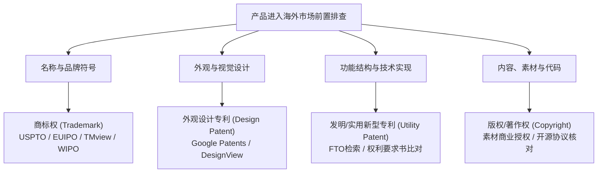

#### 1. 商标权（Trademark）：排查名称、词组、Logo与包装装潢

商标用于区分商品或服务的商业来源。跨境商家最常犯的错误，是误以为“只要在中国注册了商标，就能在全球通用”。

* **地域性原则（Territoriality Principle）**：商标权仅在核准注册的特定国家或地区受法律保护。中国国家知识产权局（CNIPA）核发的商标注册证，在美欧日等境外市场不具备自动排他效力。
* **先申请 vs 先使用原则**：
  * **先申请制（First-to-File）**：欧盟、中国、日本等绝大多数大陆法系法域采用该原则。通常谁先递交申请并获得注册，谁就享有法定独占权。
  * **先使用制（First-to-Use）**：美国等普通法系国家秉持使用原则。即使未在官方注册，在先在商业中实际真实使用该商标的企业，仍享有该地理区域内的普通法商标权（Common Law Trademark Rights，以《兰哈姆法》第43条(a)款，15 U.S.C. § 1125(a) 为核心救济依据）。
* **保护类别与尼斯分类（Nice Classification）**：
  * 全球通用《商标注册用商品和服务国际分类》（尼斯协定），共分45个大类（第1~34类为商品，第35~45类为服务）。
  * 检索时不仅要查核心类别（如智能硬件查第9类、软件SaaS查第42类、独立站在线零售服务查第35类），还必须覆盖高度关联的跨类别商品或服务防御圈。
* **官方检索渠道与技巧**：
  * **美国专利商标局（USPTO）**：通过官方商标检索系统（Trademark Search System，地址：`https://www.uspto.gov/trademarks/search`）查询。自2025年1月18日起，USPTO正式施行新版规费结构，停用原TEAS Plus体系，基础电子申请费调整为每类350美元。
  * **欧盟知识产权局（EUIPO）与成员国商标检索**：EUIPO 的 eSearch Plus 系统（地址：`https://euipo.europa.eu/eSearch/`）用于检索在欧盟全境生效的欧盟商标（EUTM）；而若要检索欧盟27个成员国各自独立的国家级商标数据库，通常推荐使用覆盖多国局方的综合检索平台 **TMview**（地址：`https://www.tmdn.org/tmview/`）。
  * **世界知识产权组织（WIPO）**：通过全球品牌数据库（Global Brand Database，地址：`https://www.wipo.int/reference/en/branddb/`）检索马德里国际注册商标及部分参与同步的国家局数据（需注意各成员局数据更新存在客观时滞）。
* **四维近似比对法则**：
  * 检索不能仅做“100%文字完全匹配”。海外审查员与法官判定侵权的核心标准是“是否存在引起消费者混淆的可能性（Likelihood of Confusion）”。
  * 必须同时检验：**字形近似（Visual）**、**读音近似（Phonetic）**、**含义近似（Conceptual）**，以及**商品/服务关联度（Commercial Relationship）**。
  * 举例说明 `[MODEL_ASSUMPTION]`：假设某企业将一款蓝牙耳机命名为“Aypod”，虽然与某知名耳机的拼写不同，但由于读音高度近似且同属个人音频设备赛道，可能引发混淆风险，是否侵权仍须依目标地区适用标准、真实消费者证据和法院对相关因素的评估判断。

#### 2. 外观设计专利（Design Patent / Registered Design）：排查产品形态与装饰性特征

如果你销售的是实体商品，外观侵权是仅次于商标侵权的高发领域。外观设计专利保护的是产品的**非纯功能性、具有装饰性的外在视觉形态、轮廓、线条与立体造型**。

* **保护期限与地域**：
  * **美国外观设计专利（Design Patent，专利号以D开头）**：自授权之日起保护15年（依据35 U.S.C. § 173）。
  * **欧盟注册共同体外观设计（RCD / EU Design）**：自申请日起最长保护25年（每5年需按规定办理续展）。
* **判定标准：普通观察者测试（Ordinary Observer Test）**：
  * 依据美国联邦巡回上诉法院在 *Egyptian Goddess, Inc. v. Swisa, Inc.* 案确立的先例，外观侵权的判定基准站在“普通消费者（Ordinary Observer）”的视角：如果两件产品在通常注意力下给消费者的整体视觉印象实质相同（Substantially Similar），导致消费者误认误购，即可能构成侵权。
  * 单纯修改螺丝孔位、微调边角圆弧半径或更换表面涂装，通常难以直接免除整体视觉印象近似的侵权认定。
* **检索渠道**：
  * **Google Patents**（`https://patents.google.com/`）：支持以图搜图、关键词与分类号（Locarno Classification 洛迦诺分类）多维过滤。
  * **USPTO Patent Public Search**（`https://ppubs.uspto.gov/`）：美国专利官方全文检索库。
  * **EUIPO DesignView**（`https://www.tmdn.org/tmdsview-web/welcome`）：全球跨国外观设计多局联合检索门户。

#### 3. 发明与实用新型专利（Utility Patent）：排查机械结构、电路与算法方案

发明专利保护的是具备新颖性、创造性和实用性的**技术方案**，涵盖物理结构、机械联动、电子电路、生产工艺及软件算法工作流。

* **权利要求书（Claims）是核心界限**：
  * 判断技术方案是否侵权，关键依据不是专利说明书里的背景介绍或附图，而是最后附带的**独立权利要求（Independent Claims）**。
  * **全面覆盖原则（All-Elements Rule）**：只有当你销售的产品或技术方案，完全落入了涉案专利某一项独立权利要求所记载的**全部技术特征**，才构成直接的字面文义侵权（Literal Infringement）。如果你的产品缺少了该权利要求中的某一个必要技术特征，通常不构成文义侵权。
  * **等同原则（Doctrine of Equivalents）**：即使缺少某一非实质性特征，但如果采用了本领域普通技术人员无需创造性劳动即可联想到的替代手段，且实现了基本相同的功能、产生基本相同的效果（Function-Way-Result Test），在司法审判中仍可能被认定构成等同侵权。
* **自由实施检索（Freedom to Operate, FTO）**：
  * 针对具有复杂技术特征的硬件商品或核心SaaS软件架构，企业在量产或商业上线前应组织专业FTO检索，排查目标销售国是否存在未失效的阻碍性在先专利。
* **软件与算法出海专利门槛**：
  * 在美国，软件算法受35 U.S.C. § 101与最高法院 *Alice Corp. v. CLS Bank* 案确立的“两步法”审查：纯数学算法或抽象商业逻辑属于不可专利客体，但如果结合了特定的系统架构并对计算机运行效率产生了技术性改进，则可受到实用发明专利保护。
  * 在欧洲，《欧洲专利公约》（EPC）第52条将“作为计算机程序本身的纯软件”排除在专利保护之外，仅当软件方案产生超越硬件交互常规物理效应的“进一步技术效果（Further Technical Effect）”时方可受到专利保护。

#### 4. 版权/著作权（Copyright）：排查说明书、包装画稿、渲染图与UI图形

版权保护文学、艺术和科学领域内具有独创性并能以一定形式表现的智力成果。

* **自动产生与伯尔尼公约（Berne Convention）**：
  * 依据《伯尔尼保护文学和艺术作品公约》，作品自创作完成之日起自动产生著作权，无需以官方登记为享有权利的前提条件。
* **美国版权登记的程序意义与法定赔偿条件**：
  * 依据美国法典（17 U.S.C. § 411(a)及最高法院 *Fourth Estate* 判例），针对美国作品（United States work）向联邦法院提起版权侵权诉讼前，通常必须完成美国版权局的正式登记（或版权局作出拒绝登记的最终决定）。
  * 依据17 U.S.C. § 504(c)，法定赔偿金（Statutory Damages）的标准区间为**每件作品750美元至30,000美元**，由法官根据案件具体情况自由裁量；**仅当原告能够举证证明侵权行为属于“故意（Willfully）”，法庭方可在自由裁量权范围内将法定赔偿金上限提高至每件作品最高150,000美元**；反之，若被告证明其属不知情的善意侵权，法官可将金额调低至200美元。
  * 此外，主张法定赔偿金和律师费（17 U.S.C. § 505）受到严格的时限前置条件约束（17 U.S.C. § 412）：原告必须在侵权行为发生前完成版权登记，或者在作品首次公开发表后的3个月宽限期内完成登记。如果是在侵权发生之后才补办登记，原告通常只能主张实际经济损失（Actual Damages）及侵权利润，而无法直接要求法定最高赔偿。

| 权利类别 | 保护核心客体 | 审查与授权机构 | 常见侵权表现形式 | 前置排查重点工具 |
| :--- | :--- | :--- | :--- | :--- |
| **商标权** | 品牌名、图标、口号、商品装潢 | USPTO / EUIPO / 各国商标局 | 标题关键词蹭知名品牌、使用高仿Logo | USPTO Trademark Search, TMview, WIPO BrandDB |
| **外观设计** | 产品外部形状、线条、图案与装饰 | USPTO (Design) / EUIPO (RCD) | 仿制热销款轮廓、局部微调公模造型 | Google Patents, DesignView |
| **实用专利** | 机械结构、电路系统、生产工艺、软件方法 | USPTO / EPO / 各国专利局 | 复制竞品核心卡扣结构、特定联动机构 | Patents Google, USPTO PPUBS, 专业FTO报告 |
| **著作权** | 文案、产品渲染图、包装手绘、UI代码 | 各国版权局（创作成形即受保护） | 盗用同行Listing主图、复制说明书画稿 | Google Lens以图搜图, Copyscape, GitHub |

---

### 6.1.2 使用图片、字体、音乐或开源代码时，授权范围怎么核对？

在轻资产出海或软件/内容出海业务中，创业者极少从零手绘所有插画、设计原创字体或编写底层编译内核。整合公开素材与开源组件是提高交付速度的标准做法，但其中暗藏着授权维度的法律边界。

#### 1. 商用字体（Commercial Fonts）：桌面端、网页端与应用内嵌的权限鸿沟

字体软件（Font Software）在美欧日主流法域均受计算机软件著作权或设计法保护。字体侵权往往源于对“授权场景”的误判。

* **授权维度的四重分层**：
  1. **桌面授权（Desktop License）**：允许在单台或限定数量的电脑上安装，用于制作静止印刷品、包装箱矢量稿或宣传展板。
  2. **网页字体授权（Webfont License）**：允许通过 `@font-face` 嵌入独立站网站代码中动态呈现。此项授权通常与独立站的**每月页面浏览量（Pageviews / month）**阶梯挂钩。一旦网站爆发流量，超出原授权区间，需按协议补充升级授权。
  3. **应用内嵌授权（Mobile App / Software Embedding License）**：允许将 `.ttf` 或 `.woff` 字体文件作为资源文件打包进iOS/Android应用或SaaS客户端安装包。该授权通常有独立的计费方案，不可直接用桌面版授权混淆替代。
  4. **商业商品销售授权（Electronic Commercial Products License）**：将字体作为核心卖点直接制作商品（如提供个性化印制服务的定制工具、提供字体排版功能的在线设计SaaS）。
* **“免费”字体的隐性陷阱**：
  * 网络上标记为“Free Font”的资源，大量在微小角落写着“Free for Personal Use Only（仅限个人非商用）”。一旦用于商业独立站或电商主图，极易面临权利人追踪取证。
  * 即便采用 Google Fonts 等开源字体库中的开放字体（遵循 SIL Open Font License, OFL 或 Apache 2.0 协议），虽然允许免费商用与内嵌，但协议通常明确要求：**不得单独售卖字体文件本身**，且在分发派生软件时必须**保留原作者的版权声明与协议文本**。

#### 2. 图片、矢量插画与3D渲染素材：免版税不等于免费

许多跨境卖家在设计产品包装、制作独立站广告图时，频繁使用各类图库素材。

* **Royalty-Free（RF，免版税）的真正含义**：
  * “Royalty-Free”不等于“免费（Free of Charge）”。它的法学含义是：被许可人只需支付一次性许可费用，后续在约定的授权范围内使用该素材时，无需按照每次展示、印刷或销售流水持续支付分成版税。
* **标准许可 vs 扩展许可（Standard vs. Extended / Enhanced License）**：
  * 主流图库（如 Shutterstock, Getty Images, Adobe Stock）的标准许可协议（Standard License）普遍包含明确的使用限制：
    1. **印量上限（Print Run Limit）**：许多标准许可通常约定在实体包装、画册或宣传单上的印刷副本上限（如不超过500,000份）。
    2. **商品转售限制（Items for Resale）**：通常禁止将素材直接印刷在以视觉为核心卖点的转售商品上（如将图库插画直接印在T恤、手机壳、明信片或马克杯上作为主要商品价值售卖）。此类场景通常必须采购扩展许可（Extended License）。
    3. **商标禁入**：严禁将任何公开图库素材直接作为企业独占商标（Logo）的核心组成部分进行注册。
* **AI生成图像的版权争议与合规边界**：
  * 依据美国版权局（USCO）发布的版权登记实践指引，纯粹由AI算法根据文本提示词生成的图像，因缺乏“人类智力创造（Human Authorship）”，目前在美法系下无法单独享有版权保护。
  * 商业使用 Midjourney、Stable Diffusion 生成的图稿，必须仔细核对相应服务商的商用服务条款（通常需具备付费订阅资格），同时应避免在提示词中直接模仿特定在世艺术家的专属独创特征以规避潜在侵权争议。

#### 3. 音乐与音效（Music & Audio）：双重权利与社媒商业音乐库

如果你制作短视频在 TikTok、Instagram Reels、YouTube Shorts 上推广跨境产品，音乐是极高频的踩坑点。

* **双重权利分割**：音乐作品包含**词曲著作权（Musical Work / Composition）**与**录音制作者权（Sound Recording / Master）**。合法用于商业宣传通常需要取得“同步权（Sync License）”。
* **个人账户与企业商业账户的权限隔离**：
  * TikTok与Meta平台为普通个人创作者提供了庞大的流行音乐库，但这些音乐与唱片公司签署的授权协议通常限定于“个人非商业娱乐”。
  * 跨境企业如果使用注册为商业账号（Business Account）的主体发布带货视频，系统会自动过滤大部分流行音乐，只能使用“商业音乐库（Commercial Music Library, CML）”中取得免版税商用许可的BGM。若试图绕过限制盗用流行流行歌曲配乐，可能面临音频被静音、视频下架乃至社媒主账号风控处罚。

#### 4. 开源软件（Open Source Software, OSS）：许可证边界与架构隔离

在软件、插件及独立站开发中，现代研发高度依赖开源生态。开源绝非公有领域（Public Domain），每一个开源项目都受制于特定的法律许可证（License）条款。

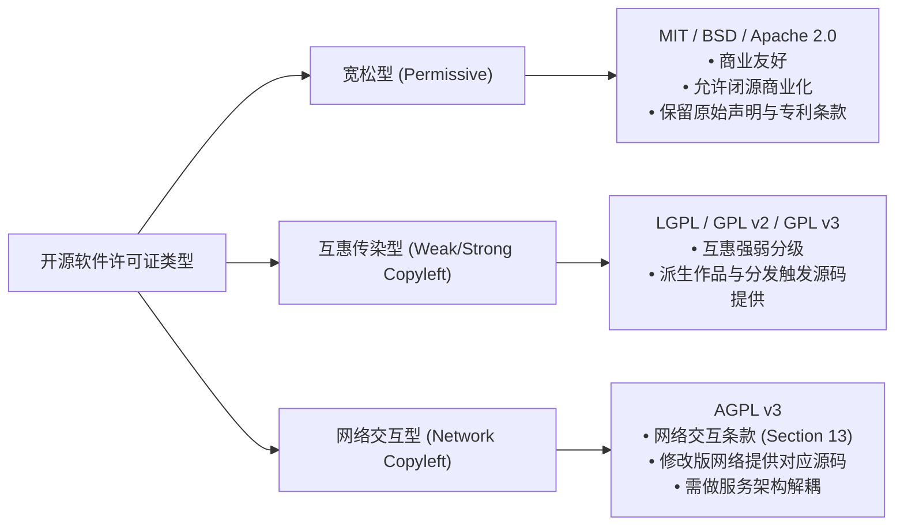

* **宽松型许可证（Permissive Licenses）**：
  * **MIT / BSD 2-Clause / BSD 3-Clause**：对商业极其友好，允许修改、闭源打包和商业转售，主要刚性要求是在源代码及产品分发包中保留原作者的版权声明和免责声明。
  * **Apache 2.0**：除保留版权声明外，包含了**显式专利授权（Patent Grant）**与**专利反制条款（Patent Retaliation Clause）**：如果使用者针对原项目的贡献者提起专利侵权诉讼，使用者获得的专利许可将依条款终止。
* **强互惠型许可证（Copyleft Licenses - GPL系列）**：
  * **GPL v2 / GPL v3**：确立了互惠原则。如果专有商业软件修改了GPL代码、与其紧密静态链接形成派生作品（Derivative Work），并向用户“分发（Convey/Distribute）”了二进制可执行文件，根据条款，接收者有权要求获得该作品的完整对应源码（Corresponding Source）。
  * **边界划分**：如果专有软件与GPL程序仅通过标准的进程间通信（IPC）、网络套接字（Sockets）或独立的命令行调用交互，且保持数据结构和模块的实质独立性，在GNU官方FAQ及行业通行实践中通常被视为独立的独立程序，不会必然导致专有商业代码被迫开源。
* **网络交互型许可证（Network Copyleft - AGPL v3）**：
  * **GNU AGPL v3（Affero GPL）第13条**：专为解决云服务（SaaS）不进行传统二进制物理分发的场景设计。
  * **触发条件与适用范围**：依据官方第13条条款，**如果你对 AGPL 覆盖的程序进行了“修改（Modified version）”**，并且通过计算机网络为远程用户提供交互式操作，你必须向所有通过网络与之交互的用户，提供获得该修改版本及其对应源码（Corresponding Source）的机会。
  * **合规边界辨析**：如果你的SaaS系统仅是在后台调用了**未经修改的原版 AGPL 数据库或工具**，并通过标准网络协议与之通信，或者你的专有业务系统是独立编写的微服务，AGPL 不会自动穿透网络边界将你全部独立的后端专有逻辑无条件强制开源。但若你的团队直接在 AGPL 代码基础上进行二次开发修改，并将该模块作为网络服务核心，则必须做好该模块源码公开的法律与架构准备。
* **商业源码许可证演进（SSPL / BSL）**：
  * 近年来，部分开源项目（如 MongoDB 采用 SSPL、Redis 采用双重商业协议）转向商业源码许可证（Business Source License, BSL），主要限制第三方在未经商业授权的情况下直接将代码封装为与原厂竞争的托管云服务。
* **软件物料清单（SBOM）与自动化扫描**：
  * 建议软件团队在CI/CD流水线中配置自动化合规扫描工具（如 Syft, FOSSA, LicenseChecker），自动解析三方依赖树，建立SBOM清单，针对强Copyleft及网络交互型许可证实施架构层面的物理隔离与法务评估。

---

### 6.1.3 自己查不到侵权记录，就能放心卖了吗？

许多跨境卖家花费了数天时间，在USPTO和Google Patents中输入关键词，没有发现完全一致的记录，便以为已排除全部风险。

然而在跨境商业实务中，由于专利审查机制、法律适用规则及跨境诉讼制度的特殊性，存在四种自主检索难以穿透的“制度性与操作性盲区”。

#### 1. 专利18个月公布盲区（The 18-Month Publication Window）

这是由国际专利申请公开制度决定的客观事实，也是硬件产品创新者必须理解的时间差风险。

* **法条依据与常规规则**：依据美国专利法（35 U.S.C. § 122(b)(1)）以及《专利合作条约》（PCT）第21条的规定，发明专利申请自其**最早优先权日（Earliest Priority Date）起算，通常在满18个月后方由专利局对外公开或刊登公报**。
* **法定例外与特殊情形**：
  * 依据35 U.S.C. § 122(b)(1)，申请人可依法主动请求**提前公开（Early Publication）**；
  * 依据35 U.S.C. § 122(b)(2)(B)(i)，如果申请人在递交申请时明确声明该发明并未且将不会在外国递交申请，可以提交**不公开请求（Nonpublication Request）**，在此情况下该申请在正式核准授权前将持续处于非公开状态。
* **商业影响**：
  * 举例说明 `[MODEL_ASSUMPTION]`：某海外同行在12个月前递交了一项关于折叠支架铰链结构的实用发明专利申请，在常规18个月期满公开之前，任何第三方在公开检索数据库中均无法查见该专利申请文件。即使你属于独立研发、并无抄袭意图，一旦该专利后续获得授权，其排他权效力仍可能对同类在售技术方案构成权利障碍。

#### 2. 美国普通法未注册在先使用权（Common Law Trademark Rights）

在USPTO商标检索系统中未查到注册记录，并不代表该名称在全美完全处于公有领域。

* **在先商业使用原则**：
  * 依据美国《兰哈姆法》第43条(a)款（15 U.S.C. § 1125(a)），商标权的取得基于在商业活动中的真实合法使用，联邦注册并非享有商标排他权利的唯一前提。
  * 如果美国本土某家企业虽然未向USPTO申请联邦注册，但已在特定州或区域市场中将某标识持续用于同类商品的销售与推广，该企业在其实际商业辐射区域内仍享有受普通法保护的在先商标权益。
  * 当跨境电商面向全美消费者提供直邮或仓储配送时，若产品名称与该区域性在先使用标识构成混淆近似，依然存在被主张普通法侵权或不正当竞争的法律风险。

#### 3. 供应链上游的“公模与私模”不确定性

跨境电商卖家常依托产业带选品，工厂业务员可能声称某款产品是其自主开发的“独家私模”。

* **供应链知识产权的实质风险**：
  * 在代工产业中，部分模具可能来源于海外客户过往委托研发的废弃案，或经由逆向工程测绘而成。
  * 在未获取上游完整工程图纸并由专业机构完成目标国独立外观与发明FTO检索之前，所谓“工厂私模必定不侵权”的客观真实性在法律上属于未经验证的未知事项 `[UNKNOWN]`。
  * 工厂作为供货方，其口头承诺并不能阻断海外进口商与零售商在目的国所承担的严格产品责任。若买卖合同中未设定严密的知识产权担保与追偿机制，一旦发生海外侵权索赔，跨境卖家往往直接承担民事赔偿与下架损失。

#### 4. 美国联邦法院TRO诉讼程序与应对路径

在跨境电商领域，涉及知识产权维权的**临时限制令（Temporary Restraining Order, TRO）**与 Schedule A 诉讼常给卖家带来严峻的资金与运营挑战。

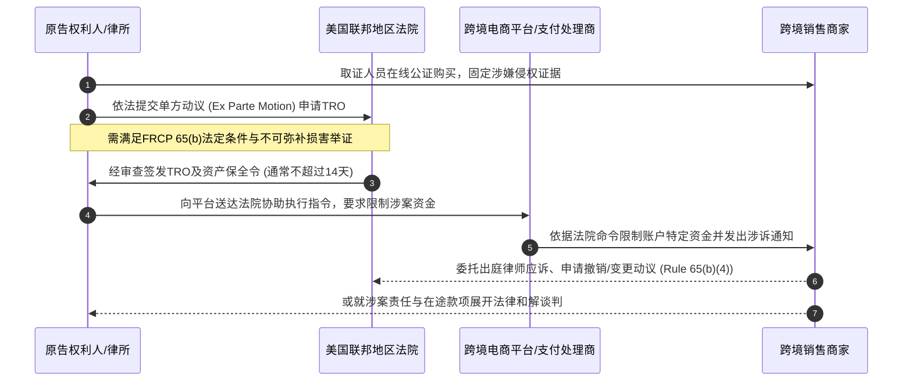

* **TRO的法定程序条件与期限约束（FRCP Rule 65）**：
  * **单方无通知签发的严格法定条件**：依据美国《联邦民事诉讼规则》（FRCP）第65条(b)款，法庭仅在满足严格法定要件时方可单方（Ex Parte）签发无提前通知的TRO：原告必须通过宣誓书或经核实的诉状，明确举证若非立即发布禁令，将在被申请人获得听证机会前造成**即时的、不可弥补的重大损害（Immediate and Irreparable Injury）**，且原告律师必须书面说明为何不应要求提前通知对方。
  * **法定期限**：依据 FRCP 65(b)(2)，单方TRO的有效期限**最长不得超过14天**，仅能在有正当理由经法庭裁定或经相对方同意时方可延长一次相同期限；若要继续维持禁令，原告必须申请初步禁令（Preliminary Injunction），而初步禁令必须在向被告送达通知并给予抗辩机会后方可裁决（FRCP 65(a)）。
  * **缺席认定的两步走程序（FRCP Rule 55）**：原告并不能在期满后直接自动取得资产划扣。依据联邦民事诉讼规则，缺席判决分为两步：第一步是由法庭书记官作出“缺席记录（Entry of Default, Rule 55(a)）”，第二步是原告向法庭申请“缺席判决（Default Judgment, Rule 55(b)）”，法庭仍需对管辖权、权利凭证及损害赔偿范围进行司法审查。法定惩罚性赔偿额（如商标假冒最高可达2,000,000美元，15 U.S.C. § 1117(c)）属于法官依据主观恶意程度自由裁量的上限，而非固定判决金额。
* **商家的合规应对与理性处置**：
  * **及时调取案卷与文书**：收到平台限制通知后，切忌慌乱私下进行无证据沟通。应第一时间通过平台通知中的案号（Case Number），在 PACER 联邦法院公共电子记录系统中调取诉状、TRO裁定书及涉案权利登记凭证（商标或版权号），确认涉诉主体与涉案商品范围。
  * **评估应诉与和解成本**：
    * 案例假设 `[MODEL_ASSUMPTION]`：在跨境实践中，若涉案受限资金较小，单独聘请具有当地联邦出庭资质的美国律师进行全面诉讼抗辩的费用可能显著高于预期损失；部分卖家会选择联合同案被告共同委托律师，或在专业律师协助下与原告展开和解谈判，和解金额通常由双方基于涉案侵权商品的历史销售流水、利润及冻结资金规模协商确定（教学场景常模拟为涉案受限款项的一定比例区间，如30%~70%不等，但该比例高度取决于具体个案案情与原告主张，不存在法定固定比率）。
    * 若受限金额巨大，或原告存在明显滥用诉权、涉案产品并不落入权利保护范围的情况，商家应积极委托律师依据 FRCP 65(b)(4) 提起撤销或变更禁令的动议（Motion to Dissolve or Modify the TRO），依法维护自身正当商业权益。
  * **健全企业风险隔离机制**：在企业运营层面，合理规划不同业务线与品牌主体的架构关系，建立规范的进货凭证与授权审计链条，避免因单一SKU的不确定性波及全局业务。

## 6.2 想卖到某个国家，需要符合哪些规定？

在完成知识产权风险排查后，许多创业者面临的第二个重大门槛，是目标销售国家和地区的**法定准入监管制度**。

不同于知识产权民事诉讼中“不告不理”的私权救济特征，产品安全、环境责任与数据隐私属于具有强制约束力的**公法监管体系**。一旦触犯，执法主体直接是目的地海关、消费者保护机构、通信委员会或环保监管部门。执法手段包括口岸暂扣退运、责令召回、行政罚款，以及对电商平台处以连带合规审查要求，从而导致平台限制或关停违规商家的在售Listing。

本节将系统梳理实体商品、环保回收与数字服务的监管图谱，并为跨境团队提供一套可复核的现行法条追踪方法论。

---

### 6.2.1 实体商品进入目标国家前，哪些安全、标识和进口规则可能适用？

实体商品的跨境出海，必须面对“安全测试认证”、“合规标识标示”与“进口报关清关”三重法定考量。

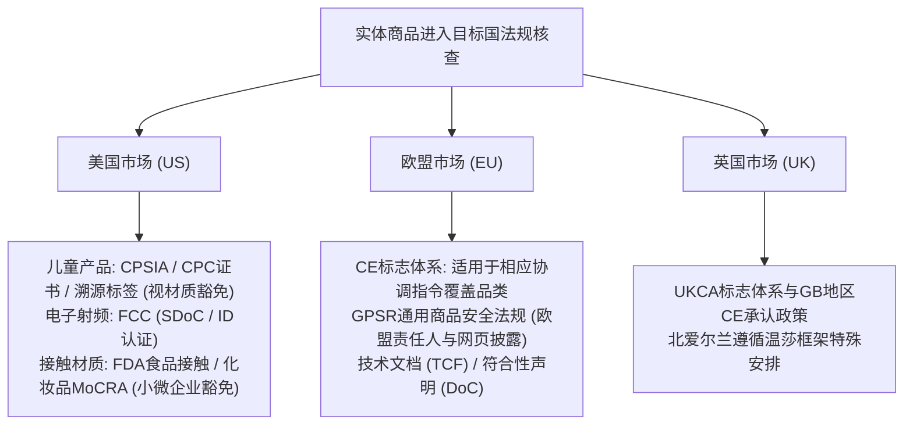

#### 1. 美国市场核心法规：CPSC、FCC与FDA

在美国联邦监管体系下，不同品类的实体商品由不同的专业联邦独立机构依据联邦法规全书（Code of Federal Regulations, CFR）管辖。

* **CPSC 与 CPSIA：儿童产品监管与测试规则**
  * **管辖机构与适用客体**：由美国消费品安全委员会（CPSC，官方门户：`https://www.cpsc.gov/`，儿童产品合规指引：`https://www.cpsc.gov/Business--Manufacturing/Business-Education/childrens-products`）依据《消费品安全改进法案》（CPSIA, 15 U.S.C. § 2051等）管辖，适用于主要为12岁及以下儿童设计的任何玩具、童装、婴儿用品及儿童家具。
  * **儿童产品证书（Children's Product Certificate, CPC）的签发主体与检测要求**：
    * 依据 CPSC 官方指引，CPC 必须由**负责的进口商或国内制造商**自行起草并签署签发（若产品在境外制造，依法应由负责的进口商签发；进口商不必实际位于美国境内。境外制造商的测试报告在符合法定条件时可供进口商合理依赖，但不能直接用境外制造商签署的证书替代进口商签发的 CPC），而非由检测实验室直接代签证书。对适用且无合法检测例外的儿童产品，签发 CPC 通常须依据 CPSC 接受的第三方实验室出具的合格检测结果；特定小批量制造商、部件测试等存在法规允许的替代或减免路径，列明适用的每一项联邦法规条款（如 16 CFR 1500, 16 CFR 1501 针对小零件窒息危险测试）。
    * **测试豁免与特定材质判定（Material Determinations）**：并非所有儿童产品都需要对全部化学指标做破坏性化验。例如，依据 16 CFR Part 1500.91 的规定，部分未经处理的天然木材、纯棉织物、特定纸张和部分未添加表面涂层的贵金属合金，被 CPSC 认定不含超出法定限量的铅，依法免于进行总铅测试；同时，邻苯二甲酸酯测试要求（16 CFR Part 1307）主要严格限定于儿童玩具及儿童护理用品的**可塑化塑料部件**（Plasticized components），而非所有儿童产品的无差别普适测试。
    * **有害物质法定限量**：油漆与表面涂层总铅含量不得超过90 ppm；所有可触及基材的总铅含量不得超过100 ppm；受控邻苯二甲酸酯单项含量不得超过1,000 ppm (0.1%)。
  * **法定强制溯源标签（Tracking Labels）**：依据15 U.S.C. § 2063(a)(5)，儿童产品及其包装上在可行范围内必须附带永久性醒目标签，注明制造商名称、生产地点、生产批次或批号、生产日期及便于追溯的详细信息。
* **FCC 认证：无线与电子电气产品的射频安全**
  * 由美国联邦通信委员会（FCC，官方门户：`https://www.fcc.gov/engineering-technology/laboratory-division/general/equipment-authorization`）依据 47 CFR Part 15 等法规监管。
  * **无意发射体（Unintentional Radiators）**：如纯有线电源适配器、普通数码时钟、显示器等。适用**供应商符合性声明（SDoC）**流程，由责任方自行完成测试并妥善保留测试报告备查，无需向FCC官方数据库上传全套卷宗。
  * **有意发射体（Intentional Radiators）**：包含 Wi-Fi、蓝牙、Zigbee、4G/5G 等无线射频发射功能的硬件设备。必须通过由FCC认可的电信认证机构（TCB）完成全套测试，向FCC官方数据库提交申请分配唯一的 **FCC ID**，并将该ID合规印制在产品铭牌或符合要求的电子标签上。
* **FDA 监管：食品接触材料与化妆品现代化法案（MoCRA）**
  * **食品接触材料（Food Contact Substances, FCS）**：咖啡杯、餐具、榨汁机刀头等凡与食品接触的材料，必须符合 21 CFR 170~199 标准，确保化学成分迁移量在安全阈值以内，符合 GRAS（公认安全）物质规范。
  * **化妆品MoCRA法案（Modernization of Cosmetics Regulation Act of 2022）与小微企业豁免**：
    * 依据 MoCRA 法案（FD&C Act 第 VI 章第 607 条），输美化妆品生产和加工设施必须完成企业设施登记（Facility Registration），责任人需提交产品成分清单（Cosmetic Product Listing），并建立不良事件（Adverse Event）记录机制。
    * **法定豁免（Small Business Exemption）**：依据 FD&C Act 第 612 条，过去3年在美国的年均总销售额低于1,000,000美元（经通胀调整）的微型企业，免于执行设施登记和产品列名要求。但此项豁免**不适用于高风险特定产品**（如经常与眼睛黏膜接触的化妆品、注射类产品、内服产品，或改变外观持续超过24小时且常规消费者不会自行清除的产品）。

#### 2. 欧盟市场核心法规：CE 标志体系与 GPSR 规范

欧盟将成员国的商品安全要求统一在“新立法框架（New Legislative Framework, NLF）”之下。

* **CE 标志（Conformité Européenne）体系的适用边界**：
  * CE标志是商品进入欧洲经济区（EEA）的法定符合性标志，但**仅适用于受特定欧盟协调指令或法规管辖的产品类别**（约25项指令，涵盖玩具、电子电气、机械、个人防护装备PPE、医疗器械等）。对于不受任何CE指令管辖的商品（如普通木质家具、普通纺织成衣、纸质图书），**严禁擅自张贴CE标志**。
  * 常见适用指令：
    * **低电压指令（LVD, 2014/35/EU）**：适用于输入或输出工作电压在交流50~1000V、直流75~1500V之间的特定电气设备。
    * **电磁兼容指令（EMC, 2014/30/EU）**：规范设备的电磁发射水平与抗扰度。
    * **无线电设备指令（RED, 2014/53/EU）**：规范所有包含无线射频通信或无线电测定功能的电子产品。
    * **RoHS指令（2011/65/EU 及其修订指令 (EU) 2015/863）**：强制限制在受控电子电气设备中使用铅、汞、镉、六价铬、PBB、PBDE及4项邻苯二甲酸酯（DEHP, BBP, DBP, DIBP）等10类受限物质。
  * **合规文档要求**：适用产品投放市场前，制造商必须起草**技术文档（Technical Documentation / TCF）**并妥善保存至少10年，同时由制造商签署正式的**欧盟符合性声明（EU Declaration of Conformity, DoC）**。
* **欧盟通用产品安全法规（GPSR, Regulation (EU) 2023/988，官方条文：`https://eur-lex.europa.eu/eli/reg/2023/988/oj`）**：
  * **生效与执行时点**：该法规于2024年12月13日正式强制执行，全面替代原 2001/95/EC 号通用产品安全指令。
  * **法律定位与风险兜底**：GPSR 适用于投放或提供于欧盟市场的所有非食品消费品。当特定商品已有更为具体的欧盟专门协调法规（如玩具指令、无线电指令）时，专门法规优先适用（Lex specialis 原则）；GPSR 则在专门法未覆盖的安全维度、在线电商销售信息披露与召回机制上发挥通用补充作用。
  * **欧盟责任人（EU Economic Operator）的法定角色**：
    * 依据 GPSR 第 16 条及欧盟市场监管法规 (EU) 2019/1020 第 4 条，非欧盟本土制造的商品向欧盟消费者销售时，必须存在一个位于欧盟境内的经济运营者作为法定联系方。
    * 该责任人可以是：(a) 欧盟境内的制造商；(b) **欧盟境内的进口商**（若商品通过欧盟本土进口商清关引入，该进口商依法即为法定责任人，无需额外再聘外部代表）；(c) 获得制造商书面授权的欧盟境内授权代表（Authorized Representative）；或 (d) 在无上述主体时，负责处理商品的欧盟境内履约服务提供商（Fulfillment Service Provider）。
  * **实物与页面双重信息披露**：
    1. 商品本身、包装或随附文件中，必须清晰标注**制造商**的名称、注册商号/商标及邮政/电子联络地址。
    2. 必须同时清晰标注位于欧盟境内的**经济运营者（欧代/进口商）**的名称及邮政与电子联络方式（电子邮箱或网址）。
    3. 在电商平台或独立站的在线销售展示页面上，必须展示能够识别该产品的信息、所有安全警告信息，以及制造商和欧盟境内经济运营者的名称与联系方式。平台依规对未披露上述法定信息的在售商品实施合规下架处理。

#### 3. 英国市场 UKCA 演进与北爱尔兰安排

自英国脱欧后，英国推出英国合格评定标志（UKCA）。

* **大不列颠（GB）地区的 CE 标志承认政策**：
  * 为减轻企业负担，英国商业和贸易部（DBT，官方指引：`https://www.gov.uk/guidance/using-the-ukca-marking`）已明确在绝大多数工业品与消费品领域（涵盖 DBT 管辖的 18 项法规，如电磁兼容、低压电气、玩具等），**无限期延长对符合欧盟CE标志要求的产品的认可**。这意味着出口大不列颠市场（英格兰、苏格兰、威尔士）的企业，持有合法的CE测试与DoC文件，可继续合法销售。
* **北爱尔兰（Northern Ireland）的特殊地位**：
  * 根据《温莎框架》（Windsor Framework），北爱尔兰市场继续遵循欧盟单一市场商品规则。销往北爱尔兰的商品需符合欧盟法规要求（使用CE标志，若使用英国认证机构则随附 UKNI 标志），企业需注意大不列颠与北爱尔兰在分销规则上的细微差异。

#### 4. 原产国标识与多语种本地化要求

在实体商品出口中，标签规范是关乎口岸查验放行的基础要素：

* **原产国标签（Country of Origin）**：
  * 依据美国关税法（19 U.S.C. § 1304）及美国海关法规（19 CFR Part 134），除非属于法定豁免清单（如 19 CFR § 134.32 规定的 J-List 无法直接标记物品、初级农产品或深加工原材料），所有进口美国的外国商品及其最小销售包装上，必须以醒目、清晰、耐久的英文标明原产国（如 `Made in China`）。
* **消费者语言强制要求**：
  * 欧盟各成员国均有保护消费者知情权的官方语言法律（如法国《杜邦法》Loi Toubon 强制要求法文安全说明与标签；德国产品安全法强制要求德文安全指导）。仅提供纯中文或纯英文标签，在抽检中可能被判定存在信息缺陷并责令整改。
* **纺织品与鞋服标签**：
  * 美国联邦贸易委员会（FTC）要求成衣标明准确的纤维成分通用名称及百分比（如 `100% Cotton`）、注册识别码（RN号或企业合法商业名称）及标准洗涤养护符号（Care Labeling Rule）。

---

#### 商品进入目标国的四步税费责任初筛

确定**具体SKU、材质、用途、目标国家**后：①查该国官方HS/HTS税则，分类不明查海关裁定；②依法判定**原产国**，不把发货地或贴标地当成原产地；③分别查一般税率、附加税、贸易救济、临时政策与进口VAT；④确认进口申报人、税运承担者及DDP/DAP等合同责任安排，并将税费、到岸物流和未知事项带回第5章。美国可参考 <https://rulings.cbp.gov/home>；分类、税费和合同都需按实际情况查证；具体申报、退税和实体办理属于第三部分。

### 6.2.2 包装、电池、电子产品等还可能承担哪些环保回收义务？

在绿色转型与循环经济政策推动下，欧美主流市场推行**生产者责任延伸制度（Extended Producer Responsibility, EPR）**。

EPR的核心法理是“谁污染、谁付费”，要求将包装物、废弃电子设备及电池投放市场的责任主体，承担废弃物后端的收集与无害化处置成本。

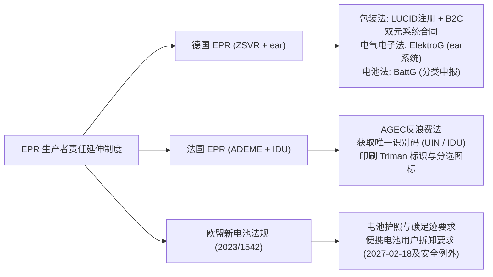

#### 1. 德国市场三大 EPR 支柱

德国在环保立法上执行严密，电商平台对德国站点的EPR合规采取自动化系统核验。

* **包装法（VerpackG）**：
  * **管辖机构**：中央包装登记处（ZSVR，官方入口：`https://www.verpackungsregister.org/en/`）。
  * **生产者（Hersteller）定义与分流**：德国包装法将首次在商业基础上将装有商品的包装（包括销售包装、二次包装及运输包装）投放德国市场的经营者定义为“生产者”。跨境电商以小包直邮或自建仓储向德国终端消费者直接发货时，属于典型的责任生产者。
  * **合规要求**：
    1. 必须在官方 LUCID 系统免费注册并取得 LUCID 注册编号；
    2. 对于最终在私人终端消费者处产生废弃物的“销售包装（B2C Packaging）”，必须与持牌的双元制回收系统服务商（Duales System，如 Der Grüne Punkt, Interseroh 等）签订系统参与合同（Systembeteiligungsvertrag），根据预估的纸板、塑料等材质重量缴纳回收处理费；
    3. 定期完成年度用量的数据双向申报（向 LUCID 平台和双元制系统两端如实填报）。
* **电气与电子设备法（ElektroG / WEEE）**：
  * 由废旧电气电子基金会（stiftung ear，`https://www.stiftung-ear.de/`）监管，销售受控电子电气产品需完成 WEEE 注册、提供担保并履行定期回收申报。
* **电池法（BattG）**：
  * 销售内置电池或随附电池的商品，需在 ear 系统完成电池责任人登记并履行回收义务。

#### 2. 法国市场 AGEC 法案与 Triman 标识

法国依据《循环经济与反浪费法》（AGEC 法案）构建了广泛的EPR监控网络。

* **法国生态转型局（ADEME）与唯一识别码（UIN / IDU）**：
  * 涵盖包装、电子电气、电池、纺织服装、家具、玩具等十余个细分品类。
  * 卖家加入对应品类的官方认可环保组织（Eco-Organismes）后，从 ADEME 的 SYDEREP 数据库取得格式为 `FRxxxxxx_xxxxxx` 的**唯一识别码（Identifiant Unique, IDU）**。
* **Triman 标识与分选指引（Info-tri）规范**：
  * 销往法国的可回收消费品及其包装上，必须按照官方技术规范印制 **Triman 标识**及对应的 **Info-tri 分选指引图标**（指导消费者按材质分类投放）。
  * 依据法国《环境法典》第 L. 541-9-4 条，违反消费者分选标识规定，主管机关可对责任主体处以行政罚款（自然人最高3,000欧元，法人最高15,000欧元）。

#### 3. 欧盟《新电池法规》（Regulation (EU) 2023/1542）的梯次要求与例外

欧盟新电池法规彻底取代了原2006/66/EC指令，对电池全生命周期设定了更高标准的环保与安全约束。

* **便携式电池用户可拆卸更换要求（Article 11）与法定例外**：
  * **实施时间节点**：该条款**自2027年2月18日起正式适用**（法规生效后42个月）。届时投放市场的包含便携式电池的消费电子产品，其内置电池应设计为可由终端用户在产品生命周期内随时安全、轻松地拆卸和更换。
  * **法定安全与专业例外（Article 11(2)-(3)）**：法规明确规定了特定豁免场景：
    1. 专为在经常受到飞溅水、水流或水下浸泡的环境中操作而设计的设备（如防水智能手表、特定潜水设备、电动牙刷等），若为确保用户安全与防水密封性所必需，免于终端用户自行拆卸，但应设计为可由**独立专业人员（Independent Professionals）**进行安全更换；
    2. 专业医疗成像及体外诊断器械；
    3. 为保障数据完整性或人身安全而需要持续供电的特定专业设备。
* **碳足迹与电池护照（Battery Passport）**：
  * 针对工业电池、动力电池及特定轻型交通工具（LMT）电池，法规按时间表逐步推行碳足迹声明、再生原材料最低比例及基于二维码的数字化电池护照制度。

---

### 6.2.3 软件、数字产品和在线服务需要留意哪些用户与数据规则？

数字资产与在线服务虽然无需通关查验，但在个人信息保护、特定算法治理及数字无障碍标准方面置身于明确的合规要求之中。

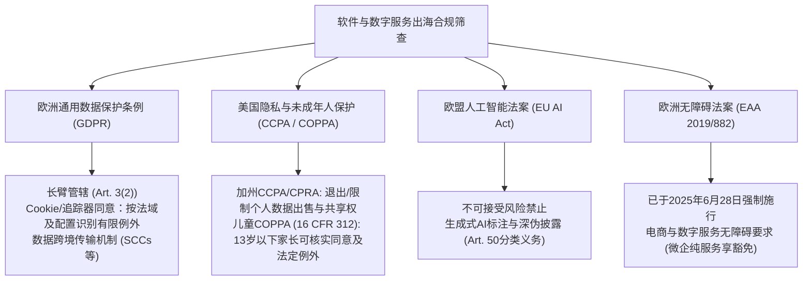

#### 1. 欧盟 GDPR：长臂管辖与个人数据治理

欧盟《通用数据保护条例》（GDPR, Regulation (EU) 2016/679，官方条文：`https://eur-lex.europa.eu/eli/reg/2016/679/oj`）对跨境数字业务产生直接约束。

* **长臂管辖效力（Article 3(2)）**：
  * 无论服务团队设立何处，只要其在线服务**向欧盟境内的个人提供商品或服务（无论是否收费），或者监控其在欧盟境内的网络行为**，GDPR 即具备管辖效力。
* **合法处理个人数据的六大法律基础（Article 6）**：
  * 处理个人数据必须具备合法基础（如“履行合同所必需”、“用户明确同意”、“履行法定义务”或“合法利益”）。
* **Cookie 与追踪器的“事前明示同意（Prior Opt-In）”**：
  * 依据GDPR与欧盟《电子隐私指令》（ePrivacy Directive），广告/跨站追踪一般须核实适用法域要求的事前有效同意；但**部分只在本站用于生成匿名受众统计、不得跨站追踪或混合使用数据的测量追踪器**，可能符合法国CNIL规定的严格豁免条件。是否适用取决于实际工具配置及国家规则，**Google Analytics、广告Pixel不因此默认免同意，也不能将法国例外一概外推全欧盟**。官方：<https://cnil.fr/fr/cookies-solutions-pour-les-outils-de-mesure-daudience>（2025-07-04；2026-10-19复核）。
  * 默认勾选、隐蔽继续浏览即代表同意等暗黑模式（Dark Patterns）属违规行为；且法律要求“拒绝全部”按钮的点击操作应与“接受全部”具备同等便捷度。
* **数据跨境流动机制（Chapter V）**：
  * 将欧盟个人数据传输至未获得欧盟“充分性认定（Adequacy Decision）”的第三国，需采用法定跨境机制，例如**欧盟标准合同条款（Standard Contractual Clauses, SCCs）**、具有约束力的公司规则（BCR）或满足 Article 49 的特定豁免情形。

#### 2. 美国隐私与儿童保护：CCPA/CPRA 与 COPPA

* **加州消费者隐私法（CCPA / CPRA）的适用门槛与权利**：
  * **法定适用范围**：加州隐私法针对在加州开展业务的营利性实体，且必须满足以下门槛之一（Cal. Civ. Code § 1798.140(d)）：(1) 上一年度总营收超过2,500万美元；(2) 每年购买、出售或共享至少100,000名加州消费者或家庭的个人信息；或 (3) 50%以上的年营收来自于出售或共享消费者的个人信息。
  * **退出与限制权利**：对于受管辖的企业，法律赋予消费者选择退出（Opt-Out）其个人信息被“出售”或“跨上下文行为广告共享”的权利；网站需提供清晰的 **“Do Not Sell or Share My Personal Information”** 通道。
* **儿童在线隐私保护法（COPPA, 16 CFR Part 312）与法定例外**：
  * **管辖范围**：适用于任何商业网站或在线服务，若其受众定位为13岁以下儿童，或其实际知晓（Actual Knowledge）正在收集13岁以下儿童的个人信息。
  * **可核实的家长同意（Verifiable Parental Consent, VPC）**：在收集、使用或披露儿童个人信息前，原则上必须获得可核实的监护人同意。
  * **法定例外情形（16 CFR § 312.5(c)）**：法规同时明确了特定豁免场景，例如：仅为了直接通知监护人并请求其同意而收集监护人或儿童的在线联系方式；仅为了单次响应儿童的特定请求且随后立即删除联系信息；为保障网站运行安全、完整性或防范欺诈所必需等情形，不要求在接触前预先完成繁重的全流程家长验证。

#### 3. 欧盟《人工智能法案》（EU AI Act, Regulation (EU) 2024/1689）

欧盟AI法案建立了基于风险的分层监管架构，对AI工具开发者设有针对性的透明度要求：

* **生成式AI与内容标注透明度（Article 50）**：
  * **提供者（Providers）的标注义务（Article 50(2)）**：开发并向市场提供生成音频、图像、视频或文本的人工智能系统提供者，应确保该系统的输出内容以机器可读格式进行标记，并能被技术检测为人工智能生成或操纵的内容（如数字水印或元数据标识），但在法律授权使用，或AI仅作为辅助常规文本编辑、未实质改变输入结构的情形下存在特定技术例外。
  * **部署者（Deployers）的深伪披露义务（Article 50(4)）**：利用AI生成或篡改具有高度逼真度的图像、音频或视频（即“深度伪造 Deepfake”）的部署运营方，必须以清晰易见的方式向公众披露该内容已被人工篡改。在属于艺术、讽刺、虚构创作等场景中，可在采取适当披露机制的前提下实施合理表达。

#### 4. 《欧洲无障碍法案》（European Accessibility Act - EAA, Directive (EU) 2019/882，官方条文：`https://eur-lex.europa.eu/eli/dir/2019/882/oj`）

* **实施时点**：该指令**已于2025年6月28日正式在欧盟各成员国强制施行**。
* **管辖产品与服务范围**：涵盖向欧盟消费者提供的电子商务网站与移动应用、电子书阅读软件、特定自助服务终端及消费类计算硬件。
* **技术基准（EN 301 549 / WCAG 2.1 AA级）**：
  * 受控的电商网站与在线服务需提供良好的无障碍支持，包括非文本内容替代说明（`alt` 标签）、屏幕阅读器良好解析、键盘逻辑导航支持及合规色彩对比度。
* **微型企业纯服务豁免（Microenterprise Exemption）**：
  * EAA 针对提供**服务**的“微型企业（Microenterprises）”（定义为员工人数少于10人且年营业额或资产负债表总额不超过200万欧元的实体）设立了服务合规豁免。
  * **适用边界**：该豁免主要免除小微服务商自身线上服务系统的无障碍改造行政要求；但若企业涉及销售特定受控的实体硬件产品，产品本身的无障碍设计标准仍受相应产品制造与进口法规约束。

---

#### 中国大陆出口端及数字业务适用范围检查

目标国家允许进口，并不自动表示中国出口端也允许无条件出口。对特定货物、技术、服务及相关数据，应检查出口管制清单、最终用户/用途、许可与技术来源；国务院令第792号《中华人民共和国两用物项出口管制条例》明确覆盖受控货物、技术和服务（<https://exportcontrol.mofcom.gov.cn/article/zcfg/gnzcfg/gzjgfxwj/202410/1057.html>），是否适用须按具体产品和最新清单查证。某些来源于第三国的技术/软件再出口可能另受其管制，不与中国制度相混。SaaS、数字内容及跨境专业服务还需按目标国家、行业与个人数据类型初筛当地代表/服务资格/数据本地化等条件，不推导出所有数字服务都必须境外设公司或本地存储。存疑时标`UNKNOWN`并寻求专业核查。

### 6.2.4 规定因国家和时间不同而变化，我该怎样找到可靠的现行依据？

国际法规处于动态演化之中。跨境初创团队既无必要为前期轻量验证常年聘请昂贵的跨国大所，又不能轻信网络二手转述。你必须建立一套严密的**四层法规检索金字塔**。

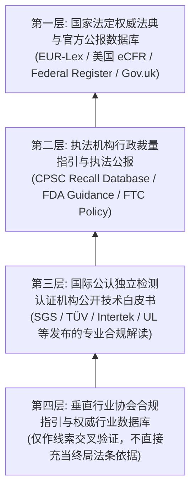

#### 1. 法规检索金字塔的四级信息源

* **第一级：法定法典与官方公报数据库——权威终局基准**
  * **欧盟**：`EUR-Lex`（`https://eur-lex.europa.eu/`）。通过检索具体指令号与法规号，查看“合并有效版本（Consolidated Version）”，辨析条款现行生效状态。
  * **美国**：联邦公报（Federal Register，`https://www.federalregister.gov/`）与联邦电子法规全书（eCFR，`https://www.ecfr.gov/`），实时追踪 Title 16（消费品）、Title 21（食品与化妆品）、Title 47（通信）的现行条款。
  * **英国**：官方立法网（`https://www.legislation.gov.uk/`），查阅脱欧后保留国内法及修改批注。
* **第二级：行政执法机关落地指引与公报**
  * 查阅 CPSC 官方召回公告库（CPSC Recall Database）、FDA 产业指南（Guidance for Industry）及 FTC 针对数字广告与隐私保护的政策指引。
* **第三级：国际公认认证机构的专业技术解读**
  * SGS、TÜV莱茵、天祥（Intertek）、UL Solutions 等头部机构发布的合规技术白皮书，直接对接标准更新细节，具备高工程实操价值。
* **第四层：行业合规追踪网络与专业工具**
  * 用于前期商业动态发现与线索发掘，但终局判断必须溯源至第一级官方条文。

#### 2. “四步穿透查验法”与动态审计台账

面对任何一项合规要求，跨境负责人应在内部分析表上严格穿透填写以下四项法定要素：

1. **精确适用客体与界限（Scope & Applicability）**：该法案管辖的是全品类，还是特定受控目录？是否存在微型企业、小批量或特定材质的法定豁免？
2. **法定责任主体定位（Role of Economic Operator）**：法规中承担首要责任的是境外制造商（Manufacturer）、当地进口商（Importer）、授权代表（Authorized Representative）还是履约服务商？
3. **时效状态鉴别（Temporal Status）**：
   * 议会起草拟议草案（Proposal） → 尚未生效，可作长期战略储备，无需当下重金技改；
   * 正式通过颁布（Adopted） → 法律已锁定，进入法定过渡期（Transitional Period）；
   * 强制施行日（Entry into Application） → 执法机关正式开闸执法，进口口岸必须符合；
   * 宽限期终结（End of Grace Period） → 渠道旧库存亦不得销售，强行上架即面临下架扣押。
4. **技术证据链闭环（Documentation Trail）**：法条要求的不仅是产品合格，更是**证明合格的文件闭环**。是否有受认可实验室出具的测试报告？是否有法定责任人签署的DoC/CPC声明？铭牌与溯源信息是否完备？

建立季度“法规动态追踪台账（Regulatory Drift Register）”，把合规工作融入常规业务运营。

#### 机会阶段的一页准入索引（不等于合法上市证明）

优先固定**产品/服务类型、销售国家、真实使用目的、法定责任主体**，把已找到的要求分为“有依据的不适用”“待核查/需报价”“已有官方依据的明确阻断”“UNKNOWN待专业核验”。注明法规链接、核验日期、生效/过渡期及责任方。绿色或“不适用”只是限定条件下的初筛结果，**绝不能称为监管机关许可**；也不要求纯软件开发者逐一满足所有儿童玩具、危险品规定。

## 6.3 哪些产品不能卖，哪些需要特殊资质？

通过了知识产权排查，也了解了目标国的法律法规，初创跨境团队仍需注意两道更为隐蔽的商业壁垒：**商业平台的私权准入规则**，以及**跨国物理交付的物流运输条件**。

法律不禁止的事，商业平台可能以用户安全、生态保护或金融风控为由制定更为严格的限制；而即使平台和法律都允许销售，如果商品属于民航危险品禁运范畴或无法通过目的国检疫，整门生意的履约链路依然无法闭环。

---

### 6.3.1 法律允许卖的东西，平台或应用商店也一定允许上架吗？

在现代跨境商业生态中，亚马逊、Shopify、Stripe、苹果 App Store、谷歌 Google Play 等超级平台，构成了事实上的商业服务基础设施。

在法律层面上，这些私营平台依据**合同自由原则（Freedom of Contract）**和平台用户协议（Terms of Service, ToS），享有对生态内交易行为的自主管理与准入裁量权。**“国家法律允许”，代表该交易在司法上不构成违法；但“平台允许上架”，才决定了你是否能够借助主流商业渠道跑通流转。**

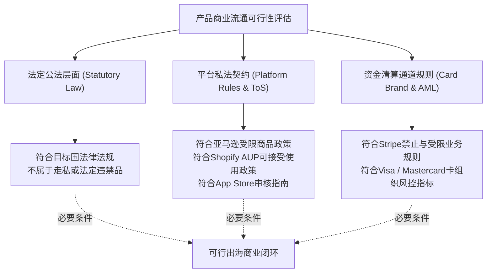

#### 1. 跨境电商平台受限商品：以亚马逊为例

亚马逊的《受限商品政策（Restricted Products Policy）》（参考：`https://sellercentral.amazon.com/help/hub/reference/external/200164330`）体现了商业平台基于自身风控考量设立的严格准入标准。

部分在目标国线下市场合法销售的商品，在主流跨境电商平台上往往被列入禁售清单或需要特定的特许类目审核（Gating）：

* **农药与杀菌设备（Pesticides & Pesticide Devices）**：在美国，部分紫外线杀菌灯、超声波驱虫设备在线下五金渠道可正常流通。但依据美国联邦杀虫剂、杀菌剂和杀鼠剂法（FIFRA），亚马逊要求此类商品必须具备EPA（环境保护署）登记号或EPA生产商机构编码（EPA Est. No.），且亚马逊对非美国本土公司注册的卖家账号设定了严格的类目准入限制。
* **特定工具与安防器材**：开锁工具套装（Lock-picking Sets）、功率超过5毫瓦的强光激光笔等，尽管在美多数州法律并未全面禁售，但平台出于安全与公共责任风险考量，明确禁止在普通零售类目销售。
* **伪装与隐藏式监控器材（Surveillance Equipment）**：伪装成日用品（如插座、笔、烟雾感应器）的针孔摄像器材，由于涉及侵犯他人隐私风险，主流电商平台普遍配置自动化算法进行审查，违规 Listing 会被直接移除。

#### 2. 独立站与SaaS的收单风控：Stripe 与卡组织规则

在自建独立站（如基于 Shopify 或 WooCommerce）场景下，商家不受单一电商中心化平台的货架限制，但核心受制于**支付处理商（Payment Processor）**与**银行卡组织（Card Brands）**的合规网络。

以全球主流支付网关 Stripe 为例，其《受限与禁止业务清单（Restricted & Prohibited Businesses）》（参考：`https://stripe.com/legal/restricted-businesses`）对业务类型进行了分级管理：

* **严厉禁止业务（Prohibited Businesses）**：
  * **非法或高风险金融服务**：包括未受牌照监管的二元期权、差价合约（CFD）、发薪日贷款、信用修复服务等。
  * **成人内容与服务**：成人影视、色情在线直播及伴游服务等。
  * **侵权协助工具**：专门用于绕过版权保护的解密设备、盗版 IPTV 机顶盒及订阅源，以及**以协助规避版权或从事非法访问为核心宣传卖点的虚拟私有网络（VPN）服务**（注：正规网络安全与远程办公类 VPN 工具不在此列，但需接受合规审查）。
  * **虚假与未经证实的健康宣称（Pseudo-pharmaceuticals）**：声称能够“治愈绝症”、“逆转衰老”且缺乏经批准临床依据的保健胶囊或器械。
* **受限与需特批业务（Restricted Businesses）**：
  * 大麻二酚（CBD）衍生品、特定远程医疗咨询、机票酒旅转售等。此类业务并非绝对禁止，但需向收单机构提交资质申请并接受额外的风控审查。
* **银行卡组织监控计划与商户风控**：
  * Visa 与 Mastercard 均设有争议及欺诈风险管理机制，但计划和地区指标并不相同。Visa 自 **2025年**起启用整合原有多项计划的 **Visa Acquirer Monitoring Program（VAMP）**；旧 VDMP 是历史计划，不应被当作2026年通用标准。
  * **现行监控与收单风险**：应查阅 Visa VAMP 最新地区指标定义、监测窗口、收单机构告警与实际商户合同；不同卡组织/收单行可能有不同门槛和处理程序。达到监控条件也**不代表自动或立即罚款、保证金或停止收单**；是否整改、调整结算、设立风险预留金或终止服务须结合实际规则和合同判断。官方参考：[Visa VAMP](https://corporate.visa.com/en/sites/visa-perspectives/security-trust/introducing-visa-acquirer-monitoring-program.html)。
  * **MATCH 系统（Member Alert to Control High-Risk Merchants）的性质**：MATCH 系统（原由万事达卡建立的受限商户警示库）主要用于收单机构在因欺诈、洗钱、严重合规违法或产生不可收回的巨额恶意拒付等法定事由与商户终止协议时进行的同业风控风险提示，并非任何商家只要单月拒付率略微波动就会被瞬间自动列入全球永久黑名单。

#### 3. 移动应用生态的准入规则：App Store 与 Google Play

对于软件与移动工具开发者，苹果 App Store 的《应用审核指南（App Store Review Guidelines）》（参考：`https://developer.apple.com/app-store/review/guidelines/`）构成了数字生态的核心规则：

* **应用内购买（IAP）与外链规则的演进（Guideline 3.1.1）**：
  * 在全球绝大多数地区的 App Store 商店中，向用户提供在 iOS 应用内消费的数字内容、软件功能、订阅与虚拟道具，原则上仍需接入苹果官方的 In-App Purchase（IAP）体系，苹果按既定规则收取 15%~30% 的交易抽成。
  * **特定法域的外链政策演化**：
    * **美国商店（US Storefront）**：按 Apple 截至 **2026-10-16** 更新的 App Review Guidelines §3.1.1(a)，美国区应用显示指向外部购买方式的按钮、链接或行动提示，**不需要 StoreKit External Purchase Link Entitlement**；历史的外链 12%/27% 佣金方案不得直接写成2026年美国区统一收费。应用内购买（IAP）、苹果开发者协议、其他地区外链授权及适用商业条款仍须分别核查；允许提供外链**不意味着**所有外部交易无需支付渠道费用或免除任何产品/隐私义务。参见 [Apple Review Guidelines §3.1.1(a)](https://developer.apple.com/app-store/review/guidelines/)。
    * **欧盟商店（EU Storefront）**：依据欧盟《数字市场法案》（DMA），在欧盟分发应用的开发者可选择使用替代应用市场或外部支付服务商，遵循专门的商业条款（包含核心技术费等结构）。
* **性能与功能规范（Guideline 2.4 / 2.5）**：
  * 禁止在设备端使用计算资源进行加密货币挖矿。
  * 严禁未经授权从外部服务器动态下载并执行具有独立功能的外部可执行代码，防止绕过苹果的代码安全审查。

---

### 6.3.2 哪些商品或服务在经营前必须取得资格或特殊批准？

在国际贸易中，某些商品由于直接关乎人身生命健康、公共安全或受限技术主权，在进入市场前必须取得**目的国法定行政许可、资质备案或出口管制授权**。

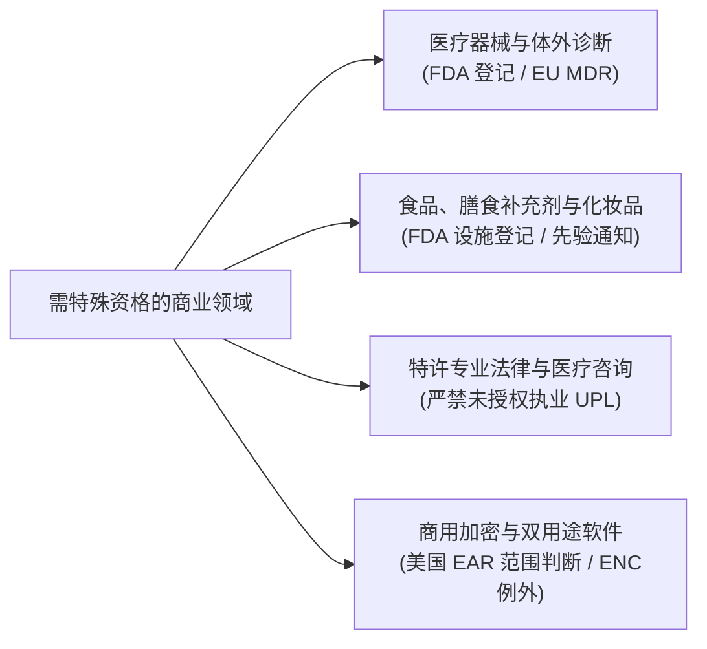

#### 1. 医疗器械（Medical Devices）：预期用途与监管分级

很多跨境卖家认为自己销售的只是日用消费品，却因文案宣称落入医疗器械监管范畴。

* **医疗器械的“预期用途（Intended Use）”认定规则**：
  * 依据美国联邦法规（21 CFR § 801.4），FDA 评估产品是否属于医疗器械，核心依据是客观体现的“预期用途”，即通过产品标签、包装说明、广告宣传及商业声明所展示的功能。
  * 若普通消费品在营销宣传中主张具有诊断、治疗、缓解疾病或直接影响人体生理结构的功能（例如将普通矫形坐垫宣传为“治疗腰椎间盘突出”，将普通防蓝光眼镜宣称“预防白内障与黄斑病变”），在监管审查中极易被归类为医疗器械监管对象。
* **美国 FDA 医疗器械监管体系（21 CFR Part 807）**：
  * **分类分级**：I类（低风险，多数免于510(k)上市前通告）、II类（中风险，多数需提交510(k)实质等同申请并获FDA许可）、III类（高风险，需开展上市前批准PMA）。
  * **年度设施登记规费**：依据《医疗器械使用者收费修正案》（MDUFA），FDA 每年更新并在《联邦公报》发布各财年（FY）的法定规费。**应先识别是否属于 FDA 要求注册和列名的医疗器械设施**，而非所有普通卖家一律缴费。对于适用设施，FY2027（2026-10-01—2027-09-30）的年度设施注册费为 **13,785 美元**；历史FY2026标准为 **11,423 美元**，不可混用财年。符合 FDA Small Business Determination 和财务困难等条件的某些小企业，可能申请**非首次注册**年度费豁免；首次注册不属于该豁免。需境外设施指定美国代理人的情况亦应按对应FDA要求核定。详情见 FDA [MDUFA Fees](https://www.fda.gov/industry/fda-user-fee-programs/medical-device-user-fee-amendments-mdufa-fees) 及 [Small Business Determination](https://www.fda.gov/medical-devices/premarket-submissions-selecting-and-preparing-correct-submission/reduced-or-waived-medical-device-user-fees-small-business-determination-sbd-program)。
* **欧盟 MDR 法规（Regulation (EU) 2017/745）**：
  * 涵盖医疗器械与部分无预期医疗目的但具有类似人体干预特征的设备（附件XVI产品）。中高风险产品需经欧盟公告机构（Notified Body）现场审核，并在 EUDAMED 数据库完成注册。

#### 2. 食品、膳食补充剂与健康产品

* **美国 FDA 食品设施登记与进口先验通知（Prior Notice）**：
  * 依据《食品安全现代化法案》（FSMA），向美国制造、加工、包装或储存供人类或动物食用食品的境外设施，必须向 FDA 完成食品设施登记（FFR），每偶数年更新一次。
  * 每批食品在抵港前，必须依法向 FDA 提交**进口食品先验通知（Prior Notice of Imported Food, 21 CFR Part 1 Subpart I）**，凭取得的有效确认单号办理海关清关手续。
* **膳食补充剂（Dietary Supplements）结构/功能宣称边界**：
  * 依据美国《膳食补充剂健康与教育法》（DSHEA, 21 U.S.C. § 343(r)(6)），膳食补充剂**严禁宣称能诊断、治疗、治愈或预防任何疾病（Disease Claims）**。
  * 仅允许就影响人体正常机能开展“结构/功能宣称（Structure/Function Claims）”，且必须在产品首次上市后30天内向 FDA 正式递交宣称通告，并在标签上醒目标注法定免责声明（“These statements have not been evaluated by the FDA...”）。
* **欧盟新食品法（Novel Food Regulation (EU) 2015/2283）**：
  * 凡在1997年5月15日之前未在欧盟境内有实质食用历史的创新食品原料，必须经欧洲食品安全局（EFSA）进行安全风险评估并取得欧盟委员会正式授权批准，方可合法加入食品中流通。

#### 3. 特许专业服务与无资质执业限制

对于从事出海法律咨询、医疗建议、财税代理等专业服务的团队：

* **未获执业许可（Unauthorized Practice of Law / Medicine）**：
  * 在美欧等主要法域，提供具有法律约束力的定制化合同审查、法庭抗辩指引或出具正式法律意见，属于持牌律师专属执业范围。未经许可在目标法域向公众提供法律服务，属于非法执业（UPL）。
  * 远程提供医学诊断与处方建议须评估目标法域的执照和执业范围。美国**有偿编制联邦报税表**的人员通常须持有效 **PTIN**，但并非一律必须是 CPA 或 EA；CPA、EA、律师等在 IRS 面前有更广泛代理权，只有 PTIN、无专业资质者的代理权可能有限或没有代理权。电子申报、具体州级资格和业务形态还需另外核实，不能把报税表编制与税务争议代理混为一谈。参考 [IRS 资质与代理权限](https://www.irs.gov/tax-professionals/understanding-tax-return-preparer-credentials-and-qualifications)。
* **合规边界声明**：境外提供专业赋能工具的技术团队，应在用户协议与网站显著位置明确限定服务范围，标明服务属于“纯客观信息整理、模板工具或教育性参考，不构成法定专业咨询意见”。

#### 4. 商业加密软件与美国出口管制（EAR）

在软件与移动应用出海过程中，部分开发者对美国出口管制条例的管辖边界存在认识不足。

* **美国出口管制条例（Export Administration Regulations, EAR, 15 CFR Parts 730~774）的管辖连接点**：
  * 由美国商务部工业与安全局（BIS）执行。依据 15 CFR § 734.3，受 EAR 管辖的物项包括：所有位于美国的物项、所有原产于美国的物项、包含超过特定微量（De Minimis，对受控品通常为25%）受控美国原产成分的外国制造产品，以及特定基于美国受控技术直接生产的产品。
  * **公开软件的原则例外**：依据 15 CFR § 734.7，公开发布、无获取限制的开源软件通常不受 EAR 管辖（但涉及特定受控加密源代码时需遵循 15 CFR § 742.15(b) 的通知要求）。纯粹在境外自主研发、未包含受控美国原产成分且不由美国境内实体出口的软件，不自动属于受 EAR 管辖物项。
* **商业大众市场加密软件与许可例外 ENC（15 CFR § 740.17）**：
  * 依据商业管制清单（CCL），具备标准数据保护加密功能的通用商业大众市场软件通常归入第5类第2部分（ECCN 5D002 或 5D992）。
  * 依据 15 CFR § 740.17(b)(1)，符合大众市场定义的通用加密软件，通常可依据许可例外 ENC 免许可证出口与再出口。
  * **年度自分类报告的适用条件（15 CFR § 740.17(e)(3)）**：如果企业属于根据 15 CFR § 740.17(b)(1) 进行大众市场加密物项出口/再出口且**未向 BIS 申请正式商品分类（CCATS）**的实体，法规要求在次年2月1日前向 BIS 和 ENC 协调员提交上一年度的年度加密自我分类报告（Annual Self-Classification Report）。但若产品已取得 BIS 正式分类核准，或该应用仅在本地设备使用标准操作系统加密（如 HTTPS/TLS）且在应用商店审核问卷中属于免除项，则无需重复提报此类年度报告。

---

### 6.3.3 产品合法，却没有可行的运输或交付方式怎么办？

在跨境选品评估中，部分产品虽然商业可行且取得合规认证，但在物理运输干线上却因国际危险品运输公约、海关特定检疫或跨国制裁限制而面临交付阻断。

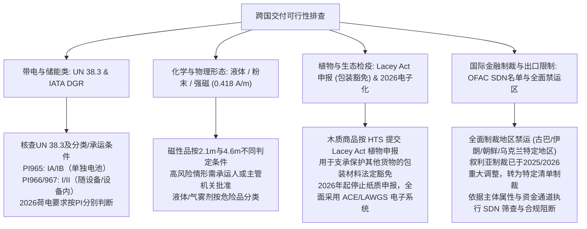

#### 1. 锂电池航空运输规范：UN 38.3 与 IATA 危险品规则（DGR）

锂电池属于高能量密度产品，在国际民航组织（ICAO）与国际航空运输协会（IATA）《危险品规则》（IATA DGR 第67版，官方专区：`https://www.iata.org/en/programs/cargo/dgr/lithium-batteries/`）中统一归入**第9类杂项危险品（Class 9 Dangerous Goods, UN 3480 / UN 3481）**。

* **基础前提：UN 38.3 测试概要（Test Summary）**：
  * 所有锂电芯及电池组在空运前，必须通过联合国《试验和标准手册》第38.3节规定的8项安全测试（涵盖高空模拟、温度冲击、振动、短路等），承运人收运时需核查盖章的 UN 38.3 报告及空运运输条件鉴定书。
* **包装说明（Packing Instructions, PI）与运输类别划分**：
  * **PI 965（单独运输的锂离子电池，如移动电源）**：
    * **严格禁止使用客机运输**，仅限全货机（Cargo Aircraft Only, CAO）；
    * 出厂荷电状态（State of Charge, SoC）交付空运时**不得超过其额定容量的30%**；
    * 国际邮政联盟（UPU）规则下，纯锂电池普遍属于万国邮联国际邮件禁止交寄物品。
  * **PI 966（与设备包装在一起的锂电池）与 PI 967（安装在设备内部的锂电池，如手机、手环）**：属于跨境消费电子最常见的出运形态。
* **额定能量（Watt-hour, Wh）的包装分级界限**：
  * 额定能量计算方式：
    $$\text{额定能量 } (\text{Wh}) = \text{额定电压 } (\text{V}) \times \frac{\text{毫安时 } (\text{mAh})}{1000}$$
  * **包装分级须首先看与设备的包装关系及单电芯/电池组的能量，而非单凭100Wh统一判作Section IA**（以下为 IATA 2026分类指引的简化介绍，实际托运仍须按当期DGR全套条件）：
  * **PI 965：单独运输锂离子电芯/电池组（UN 3480）**。电芯≤20Wh、整组≤100Wh，通常对应 **Section IB**；超过对应阈值则为 **Section IA**。两者属于针对单独电池的货机运输安排；一般荷电状态不高于30%，例外须按批准条件办理。
  * **PI 966：与设备包装在一起（UN 3481）**。电芯≤20Wh、整组≤100Wh，在满足其他条件时为 **Section II**；超过阈值为 **Section I**，不是 IA。自 **2026-01-01** 起，**Section I** 所涉锂离子电芯/电池组原则上须≤30% SoC；**Section II** 中大于 **2.7Wh** 的电芯/电池组原则上也须≤30% SoC；高于30%的合法运输须依适用批准路径办理。
  * **PI 967：装在设备内部（UN 3481）**。同样按阈值与其他条件分为 **Section I / Section II**；2026年IATA对这类设备电池降低荷电状态一般为**安全建议**（如≤30% SoC），不应写成PI966一样的普遍强制义务。
  * 以上仅供识别风险与询问承运人的初筛。不同情形的包装、标记、单件数量、文件和客机/货机许可不同，应由合格危险品专业人员依据**当期IATA DGR和航司要求**确认，不得把简化示意当正式托运许可。官方：[IATA 2026 Battery Guidance](https://www.iata.org/en/programs/cargo/dangerous-goods/lithium-batteries/)（2026年PDF第10、14页）。

#### 2. 液体、粉末与强磁物品的航空限制

* **磁性物品航空安全限制（Packing Instruction 953）**：
  * 包含磁芯或强力磁铁的商品（如扬声器、磁吸支架、直流无刷电机）。
  * **不能把4.6米的阈值套到2.1米**。ICAO/IATA的磁性物品分类，需区分**2.1米处是否造成罗盘偏转达到2度**，以及**4.6米处是否超过相当于2度偏转的0.418 A/m（约0.00525高斯）**。达到2.1米处条件但不超过4.6米处条件的包件，可能需要按磁化物品要求标记、安排承运人；超过4.6米处限值的运输需确认是否可依始发国及承运国主管机关批准的路径办理，并非“2.1米超过0.00525高斯便一律禁止空运”。此外，美国49 CFR §173.21(d)有独立的约**4.5米/15英尺**限制，应以实际适用规则和承运人的危险品专家核查。来源：[PHMSA官方解释09-0084](https://www.phmsa.dot.gov/regulations/title49/interp/09-0084)。物理换算 **0.00525G≈0.525μT≈0.418A/m** 只是同一场强单位换算，不能代替按正确距离实测。
* **易燃液体与挥发性物品**：
  * 含有酒精的消毒液、指甲油、香水等低闪点液体属于第3类易燃液体；气雾剂罐属于第2类危险品。常规跨境航空小包专线通常不予收寄，跨境批量运输需通过专业危险品资质渠道或合规海运危险品集装箱出运。

#### 3. 目的国植物检疫与雷西法案（Lacey Act）

* **美国《雷西法案》（Lacey Act, 16 U.S.C. §§ 3371~3378）与申报范围**：
  * 旨在打击非法木材采伐与野生动植物走私。涵盖特定协调关税税则（HTS）编码下的进口木制品（如实木家具、乐器、特定木雕工艺品）。进口商需申报植物学名（属名和种名）、采伐国家及数量。
  * **包装材料的法定豁免（16 U.S.C. § 3372(f)(3)）**：法规明确规定，**专用于支承、保护或盛放其他非植物货物的包装材料（Packaging Material，如普通瓦楞纸箱、木质托盘、包装衬垫等）依法免于提交雷西法案植物申报**。
  * **2026年全面推行电子申报系统**：依据美国农业部动植物卫生检验局（USDA APHIS）公告，**自2026年1月1日起，官方全面停止接收纸质 PPQ 505 / 505B 申报表格**。所有受控进口商品的植物申报，必须通过美国海关与边境保护局（CBP）的自动化商业环境（ACE）电子申报系统，或通过 APHIS 官方的雷西法案网络治理系统（LAWGS）进行全程数字化提交。

#### 4. 国际金融制裁、出口管制与合规筛查（OFAC Compliance）

即使经营纯数字化产品或跨境在线服务，交付与资金结算网络同样受到国际制裁规则的约束。

* **美国财政部外国资产控制办公室（OFAC）监管机制与2026年最新动态**：
  * OFAC 维护针对特定受制裁个人与实体的“特别指定国民清单”（SDN List）。
  * **全面领土制裁（Comprehensive Sanctions Jurisdictions）的当前适用范围**：截至2026年，美国维持全面领土禁运管辖的地区主要包括：**古巴、伊朗、朝鲜，以及乌克兰特定受冲突影响地区（克里米亚、顿涅茨克和卢甘斯克地区）**。
  * **叙利亚制裁政策的重大调整**：值得特别注意的是，**OFAC 已于2025年7月1日正式终止了针对叙利亚的全面国家制裁法规（Syrian Sanctions Regulations, 31 CFR Part 542），并于2026年8月进一步调整了相关特定限制**（官方问答与指引详见：`https://ofac.treasury.gov/faqs/1220`）。当前针对叙利亚主要执行针对特定被指认主体的名单制裁（SDN 个人与实体）以及针对特定两用物项的出口管制，不再属于一律无差别全面禁运状态。
* **数字产品出海的合规风控实务**：
  * 在涉及美金结算、使用位于美国的云基础设施或接受受美国法管辖的支付通道（如 PayPal, Stripe）时，企业需建立反洗钱与制裁合规机制。
  * 针对全面受制裁国家和地区，部署合理的 IP 地理阻断（Geo-blocking）与黑名单筛查机制，防范因向受制裁主体提供技术或处理款项而导致境外资金结算受限。

---

#### 5. 准入前置综合决策矩阵与全章行止准则

商业立项的理性法则是：**先识别并排除实质性法律与履约阻断点，再测算商业利润与扩张路径。**

在《第5章：这门生意到底能赚多少钱？》的商业盈利测算之后，本章建立的准入前置筛查体系，应当像一道坚密的过滤器，将商业构想在投入重金之前层层过滤：

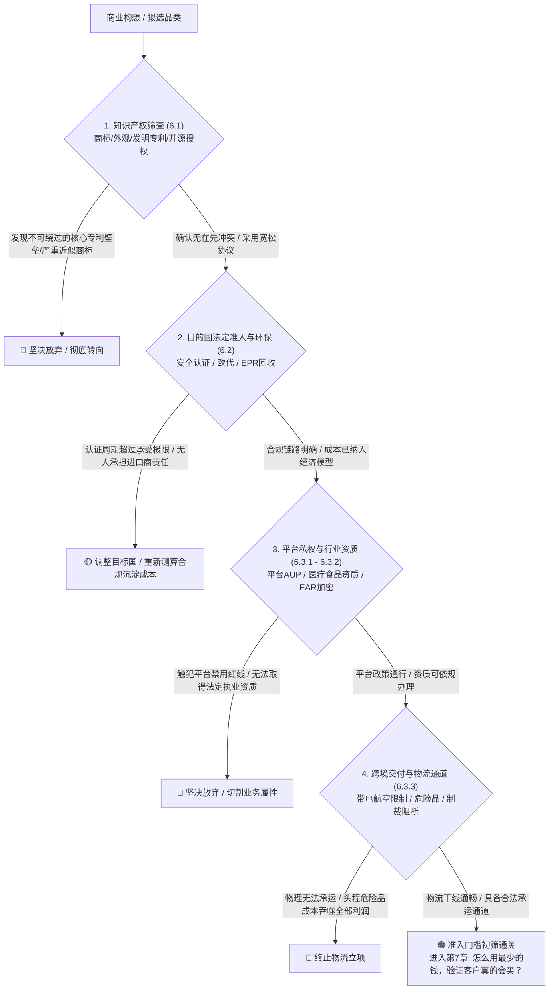

| 门槛层级 | 核心核查清单 | 实质性阻断红线（叫停或转向） | 具备进入条件的标志 |
| :--- | :--- | :--- | :--- |
| **知识产权 (6.1)** | 商标字形/音义检索、外观设计专利近似度、发明权利要求书比对、开源许可证合规与 SBOM 依赖扫描 | 涉嫌侵犯知名在先商标、产品外观落入他人未失效外观设计、修改并深度嵌入 AGPL 组件且无法开源专有代码 | 商标完成核心类别查验且无明显在先冲突、外观具备显著差异性、采用 MIT/Apache 2.0 宽松协议且保留声明 |
| **国别规制 (6.2)** | CPSC/CPC（注意材质豁免）、CE体系指令、GPSR欧代备案与双重披露、德国LUCID/法国IDU、GDPR/COPPA数据合规 | 无法落实欧盟法定责任人（GPSR）、儿童产品不具备合规检测报告、向未成年人收集数据未获有效监护人同意 | 具备合规的 DoC 或 CPC 卷宗备查、欧盟责任人与 EPR 编号完成备案并在包装展示、独立站配置合规 Cookie 授权弹窗 |
| **平台资质 (6.3.1-2)** | 亚马逊受限品类清单、Stripe 禁止与受限业务目录、FDA 医疗/食品登记、EAR 加密出口分类与申报例外判断 | 属于 Stripe 绝对禁止的高风险欺诈/非法业务、普通日用消费品进行虚假医疗疗效宣称、违反专业未授权执业禁令 | 取得目标电商平台受限类目销售许可、规范产品功能性描述、确认符合商业加密免除或完成年度自分类 |
| **物流交付 (6.3.3)** | 锂电池 UN 38.3 报告、IATA 危险品包装分级（100Wh分水岭）、雷西法案植物电子申报、OFAC 制裁名单与禁运区过滤 | 锂电池无法提供 UN 38.3 测试概要、带电或磁性货物超出民航承运规范且无危险品渠道承接、拟向受全面制裁地区交付 | 取得完备空运条件鉴定书、木质成分具备精准学名并采用电子申报、出海服务配置制裁名单筛查与风险防控机制 |

#### 握手交接：《第7章：怎么用最少的钱，验证客户真的会买？》验证什么？

当你的商业项目逐一穿越了知识产权、法定认证、平台规则与物流交付这四大门槛，并将其合规改造成本完整折算进了《第5章：这门生意到底能赚多少钱？》的单位经济模型之中，这仅仅意味着：**通向海外市场的大门在法律与物理意义上没有对你锁死**。

但“允许卖”并不等于“有人买”。  
没有任何一条法律会保证合规的产品必定具备商业吸引力；也没有任何一个海关公章能替你换来消费者的银行卡密码。

在投入重金开模量产、包租海外仓储或进行重度软件重构之前，你该如何用最少的人力、最小的资金，去测试那些素未谋面的海外真实客户是否真的愿意为你掏出真金白银？

请翻开下一章——《第7章：怎么用最少的钱，验证客户真的会买？》。
