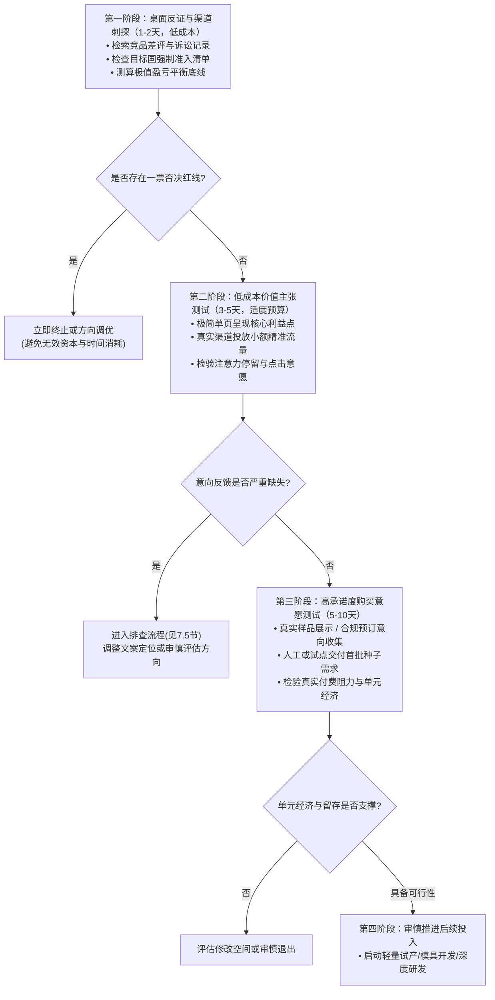
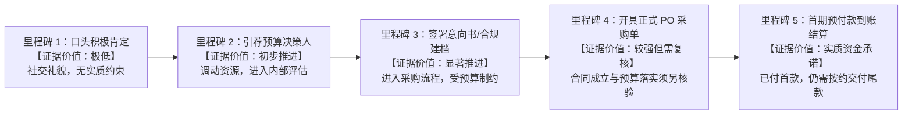
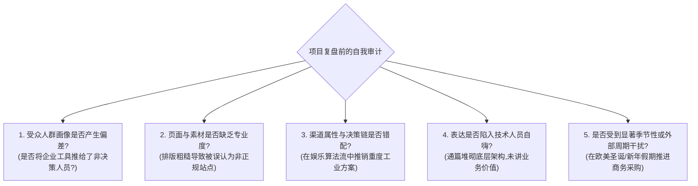

# 7. 怎么用最少的钱，验证客户真的会买？

在前六章中，我们依次完成了从机会线索扫描、目标客户痛点剖析、竞争格局与替代方案评估，到市场规模与生命周期测算、单笔盈利与现金流推演，再到知识产权与目标国监管准入门槛审查的完整分析闭环。通过前六章的层层过滤，一件事情已经变得非常清楚：**你的产品在纸面逻辑上是否讲得通、法律上是否被允许销售、财务模型上是否有理论盈利空间**。

然而，跨境出海商业中极易发生且成本高昂的误区，就是把“商业计划书逻辑闭环”等同于“真实客户愿意掏钱”。

许多出海创业者、独立开发者和跨境中小卖家，在完成了严谨的市场调研和竞品分析之后，往往直接迈入重资产的执行环节：投入数万元开模打样、一次性采购大批量库存发往海外仓、花费数月闭门编写数万行代码开发完整软件系统，或者组建一套复杂的海外服务运营团队。而当产品真正上线、挂上支付链接的那一刻，迎来的往往是长达数周的冷场——不仅没有预想中的订单，甚至可能连一个真实的付款转化都没有。

这时创始人常常陷入迷茫：**明明竞品卖得不错，明明问卷里潜在买家都说“这个功能很有用”，明明计算器里的测算毛利很可观，为什么真正上线后没人买单？**

答案非常现实：**在金钱真正离开客户银行账户之前，绝大多数市场调研、竞品对比、亲友赞美与问卷反馈，都只是未经实证的商业推想**。

商业交易存在一条客观规律：**表达赞美往往不需要付出实质成本，点赞也是轻量的情感表达，但从口袋里掏出信用卡输入支付信息并承担资金离开账户的风险，具有显著的心理与经济摩擦阻力**。如果必须在耗尽初始预算、背负滞销库存之后才能知道“市场究竟要不要这个东西”，这种经营模式在财务与时间维度上都承受着极高的下行风险。

本章的核心目标，是帮助跨境出海团队建立一套**“在规模化投入真金白银之前，以可承受的时间与现金预算，获取高质量购买意向证据”**的实操方法论：
1. **识别致命假设**：在行动前精准拆解哪些猜测一旦落空会直接导致生意无法运转，并按风险-成本权重安排科学的测试序列（第 7.1 节）；
2. **无成品意愿测试**：在工厂尚未量产、代码尚未全部写完的情况下，如何利用真实样品、报价单、小批量试卖、礼宾型（Concierge）与透明合规的人工试点，在尊重法规与用户隐私的前提下测试真实购买意向（第 7.2 节）；
3. **辨析有效购买信号**：建立从曝光、浏览、留资、询盘到有效订金、全额付款的“证据天梯”，看穿伪阳性虚假繁荣，理清企业 B2B 复杂采购的真实承诺节点与合同效力（第 7.3 节）；
4. **小样本决策与退出**：在样本量有限的情况下，如何结合分母法则、获客成本（CAC）与单均毛利，正确理解频率学派置信区间，理性选择扩大测试、单变量复测或果断止损关停（第 7.4 节）；
5. **零成交复盘排查**：当测试遭遇冷场时，如何系统排查获客触达、价值呈现、信任背书、跨境支付障碍与测试方法本身的偏差，避免误杀具备潜力的真实机会（第 7.5 节）。

本章内容兼顾**跨境实物消费品（DTC/小微品牌）**、**数字产品（资源包/模型/模板）**、**独立开发者软件/SaaS（插件/微工具）**、**跨境专业服务（代运营/咨询/方案）**以及**海外 B2B 企业采购与工业定制**五大商业业态。我们将严格遵循商业伦理与跨国法律规范，拒绝欺骗性的恶意测试，确保每一次验证都在合规、透明、可履约的前提下展开。

## 7.1 开始投入之前，最应该先验证什么？

在商业实践中，许多初创项目的受挫，并非因为团队不够努力、技术不够先进或设计不够美观，而是因为团队在一个**尚未被事实证实的假设**上，过早地投入了大量的金钱与精力。

跨境出海创业天然面临着地理距离遥远、文化语境差异、法律合规复杂以及跨国资金流转成本高的多重挑战。任何一个未经实证的主观推想，都可能在数千公里之外的市场端遭遇严峻考验。因此，在动用大额生产资金、批量采购备货或启动长期研发之前，首要任务不是编制一份厚达几十页的商业企划案，而是客观拆解商业模式背后的各类假设，识别出其中的“致命死穴”，并安排合理的测试序列。

### 7.1.1 哪些未经证实的猜测，一旦错了就可能让生意做不下去？

所谓**致命假设（Fatal Assumption）**，是指这样一类底层前提：**一旦这个猜测在现实中被证实是错误的，整个项目的商业闭环将立即受阻，且很难仅通过局部的微调、降价或文案优化来扭转局面**。

与致命假设相对的是**渐进假设（Optimization Assumption）**。例如，“包装盒是采用磨砂黑还是牛皮纸原色更受买家欢迎”、“主图的点击率是否可以通过更换模特产生小幅提升”、“产品的辅助功能是否需要支持深色模式”。这些问题虽然关乎转化效率，但即便推断不准，也不至于直接导致商业闭环瓦解。

许多初次出海的团队容易过度聚焦于打磨次要的渐进假设，却忽视了关乎业务能否存续的致命假设。在跨境业务体系中，致命假设主要集中在以下四大维度：

```
                    ┌─────────────────────────┐
                    │   商业模式的四大致命假设   │
                    └────────────┬────────────┘
                                 │
     ┌───────────────────────────┼───────────────────────────┐
     │                           │                           │
┌────┴────────────────┐ ┌────────┴───────────────┐ ┌─────────┴───────────────┐ ┌─────────────────────────┐
│   1. 核心价值假设    │ │   2. 付费与单客经济   │ │   3. 获客与分发通道   │ │    4. 履约与合规交付    │
│  (Value Hypothesis) │ │  (Unit Economics)     │ │   (Acquisition Channel) │ │  (Fulfillment/Compliance)│
│                     │ │                       │ │                         │ │                         │
│ • 痛点是否真实且剧烈? │ │ • 客户是否愿意出真金? │ │ • 能否以可承受成本触达? │ │ • 能否按时合规送达?     │
│ • 还是纯粹的不痛不痒? │ │ • 贡献能否覆盖获客成本?│ │ • 获客通道是否真实通畅? │ │ • 退货/争议率是否在容限?│
└─────────────────────┘ └───────────────────────┘ └─────────────────────────┘ └─────────────────────────┘
```

#### 1. 核心价值假设（Value Hypothesis）：问题是否足够痛？
- **猜测表征**：“海外家庭在给宠物梳毛时，毛发到处乱飞非常痛苦，只要我们做一款集成了静电吸附的梳子，他们一定会抢着买。”
- **致命漏洞**：目标客户是否真的认为这是一个“必须立刻花钱解决的剧痛问题（Must-have）”，还是仅仅觉得“有点烦，但拿吸尘器顺手吸一下也能凑合（Nice-to-have）”？
- **一旦猜错的后果**：如果痛点属于弱需求，潜在客户在浏览广告或落地页时可能觉得“挺有创意”，但在付款界面往往会理性放弃。无论后续投入多少营销预算，转化率都会卡在极低水平，最终导致产品严重滞销。

#### 2. 付费意愿与单客经济假设（Willingness-to-Pay & Unit Economics Hypothesis）：客户出价能否覆盖成本？
- **猜测表征**：“这个工具能帮跨境电商卖家节省每天 1 小时的对账时间，大家肯定愿意每个月支付 49 美元订阅费。”
- **致命漏洞**：正如《第5章：这门生意到底能赚多少钱？》中所测算的，商业成立的前提是单客贡献价值必须系统性大于单客获客成本（CAC）与交付履约费用。如果客户认可价值，但只愿意支付 9 美元，或者只愿意一次性买断而不接受经常性订阅，而该细分领域的海外搜索点击成本（CPC）居高不下，则单均经济学完全无法支撑。
- **一旦猜错的后果**：订单越多，现金失血越严重。每一笔交易都在消耗初始现金储备，陷入“不投广告没有单，投了广告亏损扩大”的被动局面。

#### 3. 获客与分发通道假设（Acquisition & Distribution Channel Hypothesis）：能否低成本找到这群人？
- **猜测表征**：“在德国有众多小微机械加工厂需要定制特种刀具，只要建好英文独立站，就能通过 Google 搜索源源不断接到工业询盘。”
- **致命漏洞**：这类工业买家是否真的在公开搜索引擎上寻找新供应商？他们的采购决策路径是否高度依赖本地现货分销商或长期合作网络？海外冷启动的获客渠道是否存在未预料到的商务信任壁垒？
- **一旦猜错的后果**：具备生产能力却找不到精准买家池。网站上线后日均访客寥寥无几，被迫转入极高成本的线下展会或中介拜访，小微团队的现金流承受巨大压力。

#### 4. 履约与合规交付假设（Fulfillment & Regulatory Feasibility Hypothesis）：能否安全合法交货？
- **猜测表征**：“国内生产的带磁性儿童拼装积木成本很低，贴上自行打印的说明标签就可以直接发小包到美国测试销售。”
- **致命漏洞**：正如《第6章：这门生意有哪些不能忽视的门槛？》中明确指出的，儿童玩具进入美国市场必须符合美国消费品安全委员会（CPSC）强制标准（如 ASTM F963 及强磁性部件吞咽安全限制），且**必须由 CPSC 认可的第三方独立实验室出具合格检测报告，并由美国境内制造商或适格进口商签发《儿童产品证书》（Children's Product Certificate, CPC）**。第三方实验室负责检测并出具报告，但并不直接签发证书；若进口商未依法取得检测支撑并合规签署 CPC，跨境小包在进入美国海关时面临扣押审查甚至退运处罚。
- **一旦猜错的后果**：测试订单尚未完全妥投，就可能遭遇海关查扣或支付渠道资金风控审查，造成财货两失。

#### 五大出海业态的致命假设对照清单

为了帮助不同业务类型的读者在立项前快速对号入座，下表归纳了五大典型业态中常见的致命假设及其潜在后果：

| 商业业态类型 | 典型出海项目示例 | 常见的致命底层假设（一旦猜错影响重大） | 潜在的严重后果 |
| :--- | :--- | :--- | :--- |
| **实物消费品（DTC/小微卖家）** | 定制人机工学机械键盘托 | 买家愿意为优质实木材质支付 $45 以上溢价，且跨国运费与包装破损率处于预期低位 | 真实成交价只能定在 $20 才有微弱意向，国际空运运费与破损补发吞噬全部毛利，单笔贡献转负 |
| **数字产品（模板/资产包）** | 专业建筑施工 Blender 3D 模型资产包 | 欧美独立建筑设计师会为高精度模型单次支付 $69，而不是直接寻找免费开源模型替代 | 访客大量浏览但极少付费；少数购买者下载后在社区二次传播，获客成本显著高于单笔净收入 |
| **软件与 SaaS（插件/微工具）** | Shopify 自动化多渠道库存防超卖同步插件 | 中小独立站卖家愿意承受每月 $29 的经常性订阅，且底层 API 频率与稳定性能够支撑实时对账 | 卖家仅接受免费版或要求一次性买断；遇到大促流量峰值系统同步延迟引发超卖争议，遭遇退款要求 |
| **跨境专业服务（代运营/咨询）** | 面向欧美卖家的中国工厂验厂与品控监理服务 | 海外小品牌主信任位于远东的独立咨询团队，愿意支付预付咨询费（Retainer）开展业务 | 缺乏本地商业信用沉淀；客户要求“验完货合格后再结算”，服务现金垫付周期拉长导致流动性紧张 |
| **B2B 企业采购与工业定制** | 工业级无人机定制高强度 CNC 铝合金结构件 | 海外初级联络工程师拥有直接下达试样采购的预算权，且国内机床加工公差一次即可满足海外工程标准 | 内部工程师仅有兴趣收集样品图纸，实际采购需经法务与供应商委员会漫长审批，小团队沟通成本过高 |

---

### 7.1.2 怎么按失败影响、验证成本和已有证据安排测试顺序？

识别出潜在假设之后，不宜盲目地将所有假设平摊在资源池里同时展开验证。初创团队的现金储备和时间窗口极其宝贵，**验证的有效性很大程度上取决于资源投入的优先级排序**。

测试顺序安排应当遵循一个基本逻辑：**以可承受的时间与金钱预算，最优先检验那些“一旦不成立就会对整个项目产生颠覆性冲击”的致命假设**。

#### 三维启发式优先级评估模型（模型假设）

我们可以通过三个核心维度，对梳理出的每一个商业假设进行量化启发式评分 `[MODEL_ASSUMPTION]`：

1. **失败影响度（Impact of Failure, 评分 1～5 分）**：
   - 5 分（致命级）：若假设不成立，商业模型无法运转，必须终止或根本重构项目（例如：目标客户根本不存在付费意愿）。
   - 3 分（重大级）：若假设不成立，需要大幅重构产品定位、价格或渠道（例如：主流获客渠道 CPC 偏高，必须调整获客路径）。
   - 1 分（轻微级）：若假设不成立，仅需进行局部微调或文案优化（例如：结账页面按钮颜色微调）。

2. **验证成本与周期（Validation Cost & Latency, 评分 1～5 分）**：
   - 1 分（极低成本）：花费不超过 $50 美元，耗时 1～3 天即可获得初步信号（例如：投放极窄意向广告测试点击与停留）。
   - 3 分（中等成本）：花费 $200～$500 美元，耗时 1～2 周（例如：搭建轻量落地页收集预购意向或手工交付首单服务）。
   - 5 分（极高成本）：花费 $3,000 美元以上，耗时 1～3 个月（例如：支付模具费用、开模量产、申请目标国官方认证）。

3. **已有证据强度（Strength of Existing Evidence, 评分 1～5 分）**：
   - 1 分（毫无证据）：纯属创始团队的主观猜想，没有任何外部客观数据支撑。
   - 3 分（间接证据）：有公开二手市场研报、竞品店铺销售数据或第三方论坛讨论，但非本店实测。
   - 5 分（直接铁证）：已有真实目标买家向我方账户汇入有效资金或签署具有法律约束力的采购协议。

#### 启发式验证优先指数（VPS）

结合上述三项指标，我们可以构建一个用于团队内部排期的**启发式验证优先指数（Validation Priority Score, VPS）** `[MODEL_ASSUMPTION]`：
$$\text{VPS} = \frac{\text{失败影响度 (1-5)} \times (6 - \text{已有证据强度 (1-5)})}{\text{验证成本与周期 (1-5)}}$$

需要特别说明的是：**该公式属于团队内部管理中用于权衡相对重要性的启发式辅助工具，并非外部统计学或金融学公认的客观真理**。它的价值在于以直观的算式提醒团队：**失败影响越大、当前越缺乏扎实证据、且验证所需花费与时间越低的事项，排期越应靠前**。

我们可以将所有假设映射到如下的“风险-成本决策四象限”中：

```
       高 ▲
          │  【象限 I：优先检验区 (Kill-or-Go)】     │  【象限 II：拆解降维区 (Deconstruct)】
          │  • 特征：重大假设 + 低成本/短周期         │  • 特征：重大假设 + 高成本/长周期
   失     │  • 动作：优先启动！用轻量原型快速检验    │  • 动作：禁止直接大额投入！拆解为低成本代理指标
   败     │  • 示例：广告意向测试 / 预售意向排摸      │  • 示例：开模量产前先做 3D 打印功能样件试用
   影     │                                         │
   响     ├─────────────────────────────────────────┼─────────────────────────────────────────
   度     │  【象限 IV：暂缓搁置区 (Ignore/Later)】   │  【象限 III：高危消耗区 (Money Sink Trap)】
          │  • 特征：次要假设 + 低成本               │  • 特征：次要假设 + 高成本
          │  • 动作：前期不必过度耗费精力           │  • 动作：坚决避免！典型的次要细节过度投入
   低     │  • 示例：提前优化结账页面动画细节       │  • 示例：未验证需求前就耗费重金定制全套 VI 包装
          ▼
          └─────────────────────────────────────────┴─────────────────────────────────────────►
            低 (1-2分)                                高 (4-5分)
                                 验 证 成 本 与 周 期
```

#### 标准测试实施路线图：四步阶梯法

为了避免出海团队陷入“要么只停留在纸上空想，要么一上来就大笔烧钱”的两极分化，建议按以下四个阶段由浅入深地推进测试：



1. **第一阶段：桌面反证与渠道刺探（耗时约 1～2 天）**：
   - 充分利用第 2 章至第 6 章的分析成果，重点寻找反证：在公开评价平台、专业论坛中检索竞品最受诟病的技术或服务缺陷；排查目标国监管机构是否对该品类有明确的技术认证与准入门槛。
   - 如果发现该类目在法律上存在无法合规绕开的红线，或者竞品正处于核心专利排他诉讼期，则在立项初期即可做出调整，节省后续大量试错资金。

2. **第二阶段：低成本价值主张测试（耗时约 3～5 天）**：
   - 不开发完整成品，通过清晰的原型图、核心功能演示图或痛点解决文案搭建一个简洁的展示页面（Landing Page）。
   - 在目标受众活跃的垂直渠道投放小额测试预算，观察真实目标人群对核心价值主张的反应，检查点击意愿与页面互动情况。

3. **第三阶段：高承诺度购买意愿测试（耗时约 5～10 天）**：
   - 面对高意向人群，引入需要付出一定实际成本的交互机制：例如填写详尽的公司采购参数需求单、申请参与有门槛的封闭测试，或者由团队直接通过人工服务交付最小闭环（Concierge MVP）。
   - 重点验证：当需要付出实质时间或进入商务沟通阶段时，客户的需求是否依然真实明确。

4. **第四阶段：审慎推进后续投入**：
   - 只有当前期测试获得的单位经济测算与客户真实反馈能够支持商业成立时，才考虑进入下一阶段的开模打样、小批量试产或全职产研投入。

#### 实验前登记卡与实验后结果卡

**实验卡（开始前填写）**：致命假设与其他解释、真实目标买家及国家、招募渠道与样本偏差、最小可观察行为、分母与归因窗口、预算/可承受损失和观察时限、事先规定的**继续/复测/停止/无结论**标准、退款/履约/测试页面披露义务。**结果卡（结束后填写）**：原始合格触达数、有效询盘、真实订单及退款、单位成本、失败/异常样本、与原假设相反的事实、按事先标准选择下一步。保留脱敏原始证据，不允许事后为了得到PASS篡改门槛；不能用假购物按钮隐瞒产品并不存在。

**业务类型不同，不用同一倒计时判死刑**：即买型实物更关注有效订单/退货，低价SaaS还要看真实付费及有意义使用，高价B2B/专业服务可能依次出现合格采购对话、预算/技术审批、试样合同、首付款。原文各种“3—5天、5—10天”只能用于**教学测试计划举例**，不是跨业态统一的需求证明时限；销售周期未结束而无订单时应允许`INCONCLUSIVE`并决定是否延长或换测试渠道。

## 7.2 产品还没做出来，怎么低成本测试购买意愿？

在传统工业制造与软件开发思维中，“先把产品做出来，再去市场上推销”被视为常规路径。然而在跨境出海语境下，这种重资产先行的做法往往蕴含着巨大的试错成本。从模具开发、打样试产、包装印刷、跨国干线运输到清关入仓，实物商品的初始启动资金与备料周期具有相当的沉没性；软件开发同样需要经历功能定义、UI 设计、架构搭建与联调测试，消耗大量的专业工时。

**现代精益验证的核心逻辑，是打破“先全面生产、后被动销售”的时序锁死，将其优化为“先验证真实付费意愿与核心阻力，再按需组织轻量履约”**。本节将详细拆解如何在尚未开展规模化量产的前提下，利用真实原型、合规预售、小批量试卖以及人工试点，以可控的财务风险测试海外买家的真实意向。

---

### 7.2.1 没有成品时，可以用哪些真实的样品或报价展示价值？

所谓“没有成品”，并不等同于虚构事实或向客户提供虚假承诺。商业合作的基础是诚实与信誉。在尚未实现规模化量产的情况下，出海团队依然可以通过制作**高保真、可感知的原型实物与方案说明（Artifacts）**，向海外客户客观呈现产品的核心价值与解决方案。

不同商业业态适用的真实样品与价值展示形态如下：

#### 1. 实物消费品：功能手板、改装样机与规范规格书
- **工业级 3D 打印功能手板（SLA/SLS 工业级打样）**：
  - 适用场景：塑料外壳、人机工学支架、穿戴配件、结构连接件等。
  - 成本与实操：国内工业级 3D 打印服务相对成熟，单个手板打印与表面喷油打磨费用通常在百元级人民币区间，周期一般为数个工作日。打样手板不仅具备真实的几何尺寸、重量感和握持体验，还可用于拍摄专业级产品功能演示短视频或场景图。
- **成熟部件改造样机（改装组装样件）**：
  - 适用场景：带有电子电路、马达或精密传动的复合型产品。
  - 成本与实操：在公开供应链市场采购基础公模样机，仅针对团队创新的核心模块（如专用刀头、自研夹具、定制导热结构）进行独立 3D 打印或小批量 CNC 试制，通过拼接组装形成一台真正能运转的功能样机。客户在视频演示中能直观看到痛点被解决的操作流程。
- **照片级 3D 渲染图与结构分解图（CAD Renderings）**：
  - 适用场景：尚未开模的复杂外观结构件或多色系产品线。
  - 规范声明要求：使用渲染软件制作高精度效果图时，**必须在页面醒目位置用英文做出明确的概念展示声明**（例如：*“Product design shown is a 3D rendered concept for illustration purposes; final production details may slightly vary.”*），切忌误导买家认为已有大量现货在海外仓即时待发。
- **详尽工程规格书与材质说明（Technical Specification Sheet）**：
  - 适用场景：专业户外装备、极客硬件、精密五金配件。
  - 呈现要点：海外专业玩家与行业买家极其关注物理工程参数（如铝合金牌号、公差精度、防水防尘等级、承重克数）。一份严谨规范的 PDF 规格书，其建立的专业信任度往往不亚于视觉营销素材。

#### 2. 数字产品：部分章节与真实工作流演示
- **核心章节试读或局部模板体验（Freemium Preview）**：
  - 适用场景：行业研报、设计资产、Notion 生产力模版、数据分析工作流。
  - 呈现要点：将数字资产中最核心、最具代表性的局部制作成可交互的免费试用样本，其余模块作为完整版展示目录大纲。客户直接操作样本即可直观感受内容深度与工程规范。
- **真实工作流实操录屏（Workflow Walkthrough）**：
  - 录制一段无废话的实操录屏，真实展示该模版或资源如何帮助用户简化复杂流程，直观体现其效率价值。

#### 3. 软件与 SaaS：可交互原型与痛点对比录屏
- **高保真可交互原型（Interactive Prototype）**：
  - 适用场景：独立开发者工具、浏览器扩展插件、垂直微 SaaS。
  - 呈现要点：在未编写全部后端复杂业务逻辑前，在原型工具（如 Figma）中制作具有逼真点击反馈、页面跳转和数据录入效果的高保真界面，嵌入网页供目标用户体验操作逻辑。
- **核心功能前后对比演示**：
  - 直观对比传统手工操作的繁琐步骤与使用该工具后的简化流程，并在下方提供清晰的定价梯队与意向沟通入口。

#### 4. 跨境专业服务与 B2B 工业采购：规范报价单与脱敏诊断报告
- **脱敏公开发布的“标杆诊断报告”（Sample Audit Report）**：
  - 适用场景：跨境店铺运营体检、海外知识产权检索分析、技术合规审计服务。
  - 呈现要点：选取公开的典型案例作为分析样本，制作一份格式严谨、见解深入的示范体检报告，并附上详细的工作说明书（SOW）。客户看到样本即可清晰了解交付标准。
- **透明的阶梯报价单与形式发票（Formal Quotation / Proforma Invoice）**：
  - 适用场景：海外 B2B 定制加工、五金冲压件、工业原材料出口。
  - 呈现要点：提供明确的单件打样费、批量梯度单价（MOQ 梯度）、材质执行标准、预计生产交期与海关编码（HS Code）。一份严谨规范的报价单本身就是展示商业履约成熟度的重要凭证。

---

### 7.2.2 哪些情况下适合预订、订金或小批量试卖？

当原型或样品准备就绪后，下一步是评估客户是否愿意在货物完全量产前支付款项或订金。预订（Pre-order）、订金（Deposit）以及小批量试卖是常见的意向检验方式，但它们有其特定的适用边界，必须严格审视业务特性并遵循跨国监管要求。

#### 1. 适用与不适用场景的客观界限

```
┌───────────────────────────────────────────────┐
│              预订与小批量测试适用性决策       │
└───────────────────────┬───────────────────────┘
                        │
            【产品性质是急需还是深度计划?】
           ┌────────────┴────────────┐
           ▼                         ▼
      [冲动/应急/时效消费]       [深度计划/极客爱好/高定制]
 (如紧急维修配件/特定节庆用品)   (如定制硬件/专业摄影架/小众外设)
           │                         │
           ▼                         ▼
   【不适合采用长周期预订】     【适宜考虑小批量预订或定金】
 客户对时效极敏感，等待易滋生纠纷  客户重视稀缺性与独特性，具备心理预期
 现货替代品多，履约延迟易致退订    具有圈层共识，愿为特定设计等待
```

- **适宜考虑小批量预订或订金测试的场景**：
  1. **单件开模或备料沉没成本较高的高客单定制产品**：例如售价较高的小众发烧友外设、专业摄影附件，小批量预订有助于提前锁定生产计划并排摸规格偏好。
  2. **具有明确生产排期与可靠供应链保障的项目**：工程样件已完成基础功能验证，工厂已给出明确的物料采购周期与交期承诺。
  3. **社群黏性高、极客属性强的小众市场**：目标买家对“团购（Group Buy）”或众筹文化相对熟悉，更看重产品的独特功能与定制属性，对合理的制作与运输周期具备心理预期。
- **不适合采用长周期预订测试的场景**：
  1. **即时应急型或强时效性商品**：例如水管维修配件、特定节庆装扮。客户购买的核心动机在于“即刻可用”，长达数周的生产与海运周期极易引发客户焦虑、取消订单或支付争议。
  2. **市场上已有充足成熟现货的同质化产品**：主流电商平台上已有大量支持次日达的替代品时，要求独立站买家等待漫长交期不符合大众消费习惯。
  3. **供应链交付周期完全未知、工艺稳定性尚未验证的技术方向**：在尚未确认能否稳定交付合格品的前提下，盲目预收定金可能演变为严重的合同履约风险。
  4. **受目标国强制准入或许可限制的特殊品类**：
     - **美国消费品安全（CPSC）**：涉及儿童产品时，必须依法由美国制造商或合格进口商基于 CPSC 认可实验室的合格测试报告签发 CPC 证书，禁止将不符合适用安全标准的儿童用品引入商业流通；2026 年起还应核查 CPSC 证书数据 eFiling 是否适用于具体进口与生效时间；
     - **美国联邦通信委员会（FCC）**：射频设备根据 47 CFR § 2.803 规定，在获得相应设备授权（Certification / SDoC）之前，其商业销售与交付受到严格限制（除符合特定条件的行业展会展示或满足严格披露条款的附条件预定外，不得向终端消费者现货销售或发货）；
     - **美国食品药品监督管理局（FDA）**：属于二类医疗器械管理的产品，在未经 510(k) 许可或豁免确认前，不得在目标市场开展实质性商业分销宣传。

#### 2. 国际法规与支付渠道的风控规范

开展跨境预售与订金测试，必须深入理解目标国消费者权益保护法与卡组织的支付风控标准：

##### (1) 美国联邦贸易委员会（FTC）《邮件、网络或电话订购商品规则》（16 CFR Part 435）
根据 FTC 官方法规与商业指南（[FTC 16 CFR Part 435: Mail, Internet, or Telephone Order Merchandise Rule](https://www.ftc.gov/legal-library/browse/rules/mail-internet-or-telephone-order-merchandise-rule)，核验于 2026 年 10 月）：
- **发货时效依据**：商家在招揽买家下单并收取款项时，必须对发货时限拥有“合理的商业依据（Reasonable Basis）”。如果未明确约定发货时间，通常须在收到完整订单后 **30 天内发货**；但买家在下单时向卖家申请由卖家提供的信用额度、且未另行承诺发货日期等符合规则条件的情形，可适用 **50 天**而非30天的默认期限。该规则针对其定义范围内的远程订购**货物**，并非直接统辖所有软件订阅、纯在线服务或全球所有预售。
- **延期通知与撤回权**：一旦预料到无法在承诺时间（或 30 天内）将货物发出，商家必须在原定发货截止日前主动通过邮件等方式通知买家，明确告知修正后的预计发货日期，并**主动向买家提供选择同意延期或无条件取消订单并获得全额退款的权利**。
- **退款时限的法定区分（依支付方式不同）**：
  - **第三方信用卡/借记卡、现金、支票或汇票支付**：对于消费者使用第三方发卡行信用卡、银行借记卡或现金支票完成的支付，在订单依法取消、买家依规则获得退款权之日起，通常须在 **7 个工作日内** 完成规定的退款动作或向第三方支付方发出退款指令（现金/支票等按规定退回）；**不以买家主动提出取消为唯一触发条件**：例如延迟发货后按规则必须自动取消，商家亦须主动处理退款；
  - **商家自营信用账户赊销（First-Party Credit）**：仅在商家本身作为债权人向买家提供赊销信用账户的情况下，应在订单依法取消、退款权产生后的 **1 个账单周期（One Billing Cycle）** 内完成规则规定的账户贷记或通知，而不是以买家主动请求作为唯一开始时点；
  - **注意区分指令发出与持卡人到账**：商家在 7 个工作日内向支付渠道发起退款后，资金实际显示在持卡人账单上还取决于跨国银行清算周期，但商家的法定责任是准时发起退款。同时需注意，该规则核心规范的是**发货期限、延期通知、取消处理与退款时限**，并不等同于跨国干线运输实际送达时效的保险。

##### (2) 国际卡组织监控标准（Visa VAMP）与支付服务商内部风控
- **Visa 风险监控指标演进（VAMP 2026 规则）**：
  - 根据 Visa 官方发布的技术说明（Visa Acquirer Monitoring Program - VAMP，核验于 2026 年 10 月），自 **2026 年 4 月 1 日** 起，针对美国、加拿大、欧洲及亚太等地区的商户，Excessive VAMP ratio 监控阈值调整为 **$\ge 1.50\%$（即 150 个基点）**。
  - **重要指标口径**：VAMP 监测比率并非单纯的拒付争议率，而是将 **欺诈报告量（TC40）与争议请求量（Disputes）综合计算后除以已结算 CNP 交易总量**；同时该指标受不同层级、地区及最低事件数条件约束；例如 Adyen 公布的 2026 相关商户 Excessive 门槛包括每月不少于 **1,500 笔争议**的条件及卡不在场交易口径，其他层级和地区应核查对应规则，不可把这一条件只归于收单机构。
  - **支付服务商与卡组织规则的层级区别**：初创团队需明确，Visa VAMP **同时评估收单机构（Acquirer）和单个商户（Merchant）**，不同层级的监控比例、事件数、地域和补救措施并不完全相同；此外，各收单机构、支付服务商（例如 Stripe、Shopify Payments、PayPal）还可能依其商户协议独立进行更早或更严格的合同风控。**争议费不是全球统一的 $15～$20/单**，必须查看具体服务商、账户地区、日期及是否发生提交抗辩等收费事项。当未发货争议增多或无法证明履约时，相关服务商可能依据适用条款设置储备、暂停提现或终止服务，不能将此理解为 Visa 自动统一处罚。出海团队切不可因自身体量未达卡组织宏观监控门槛，就忽视支付网关合同中的日常履约合规审查。

##### (3) 合规预订操作建议守则
1. **结账入口明确标示预售属性**：将结账按钮文案由常规的“*Buy Now*（立即购买）”替换为“*Pre-Order Now*（立即预订）”或“*Reserve Now*（即刻预约）”。
2. **预计发货周期醒目提示**：在商品标题、加购按钮附近以及订单确认邮件第一行，明确注明预计发货月份或时间段（例如：*Estimated Shipping: November 2026*）。
3. **审慎自愿退款承诺**：如果商业模式允许，可自愿向客户提供“发货前支持随时申请取消与全额退款”的自律承诺，这有助于降低海外买家面对新兴小微品牌的决策阻力，但团队必须确保账面现金具备实际履约退款能力。
4. **资金审慎管理与流动性隔离**：建议将收到的预购资金留存于独立账户中，作为专项交付与潜在退款备付金，**避免在货物尚未发出前将预收款全部挪作公司无关联的日常开销**，以防在遭遇供应链延迟或退款申请时引发流动性挤兑。

---

### 7.2.3 做软件或服务时，能否先用人工或付费试点验证？

对于独立开发者、软件工程师或数字化服务团队而言，往往存在一种思维惯性：耗费数月时间将多租户架构、自动化脚本、后台看板和算法逻辑全部编写完毕后，才挂出购买链接。

在精益验证方法中，软件与数字化服务同样可以通过**透明合规的人工交付与小范围试点**，在开发完整自动化后台前验证商业价值闭环。

#### 1. 礼宾型 MVP（Concierge MVP）与透明化的绿野仙踪测试

```
                    ┌─────────────────────────┐
                    │  数字化服务敏捷人工验证  │
                    └────────────┬────────────┘
                                 │
           ┌─────────────────────┴─────────────────────┐
           ▼                                           ▼
┌───────────────────────────┐               ┌───────────────────────────┐
│     礼宾型 MVP (Concierge) │               │   绿幕型试点 (Wizard of Oz)│
│   【完全透明的高端人工交付】 │               │   【前台交互，后台人工处理】 │
│                           │               │                           │
│ • 客户知晓由专业顾问亲自服务 │               │ • 前台提供标准化表单或入口 │
│ • 重点：深入摸清流程与痛点 │               │ • 后台人工或半自动化交付   │
│ • 示例：人工出具多渠道数据 │               │ • 必须严格合规：隐私政策中 │
│   分析报表，验证付费意愿  │               │   披露人工处理与第三方工具 │
└───────────────────────────┘               └───────────────────────────┘
```

##### (1) 礼宾型 MVP（Concierge MVP）：完全透明的专家人工交付
- **定义与机制**：以完全公开透明的方式告知客户：“我们目前采用专家一对一咨询与手工定制交付模式，为你提供深度的诊断与方案，以确保服务质量契合实际业务场景。”
- **典型案例（跨境选品与竞品数据分析服务）**：
  - 传统做法：先耗时数月爬取多平台数据，搭建复杂的数据可视化看板与 SaaS 订阅后台，定价 $49/月。
  - 礼宾做法：团队上线一个简洁单页，提供“跨境类目竞争格局与关键词漏斗专家深度审计”，单次收取服务费。收到客户需求后，创始人亲自结合 Keepa 等专业工具与分析模型，手工整理结构化数据并撰写包含改进建议的 PDF 报告，在约定时间内交付。
  - 验证价值：创始人能通过人工交付过程直接与客户沟通，深入观察客户真正看重报告中的哪些具体指标、追问哪些细节，哪些图表客户根本不看。这为后续是否需要自动化、自动化哪些功能提供了极具针对性的需求依据。

##### (2) 绿幕型/绿野仙踪测试（Wizard of Oz）：前台标准化交互，后台人工履约
- **定义与机制**：前台为用户呈现一个标准化表单或交互界面，但在后台核心自动化逻辑尚未完全就绪前，业务履约由人工或半自动化脚本辅助完成。
- **合规、伦理与个人数据隐私披露要求**：
  - **禁止虚假欺诈宣传**：不得虚构不存在的资质或承诺无法兑现的即时交付时效。
  - **个人数据与第三方处理披露义务**：在涉及简历修改、合同文本排查或涉及个人可识别信息（PII）的业务场景中，**必须在隐私政策和服务条款中清晰、透明地向用户说明数据处理流程**。若后台涉及人工审核或调用第三方大语言模型/云端 API 分析个人数据，应事先确认数据处理目的、适用的**合法处理依据**（GDPR 可能涉及合同履行、合法利益、有效同意等，不是一律需要“明示同意”），就处理流程及第三方接收对象履行适用的透明告知与合同义务；**在法律实际要求同意或明确同意时**取得符合条件的同意，并评估敏感数据、跨境传输、最小化、留存期限和安全措施。不能仅靠隐私政策披露替代合法处理依据。
  - **交付时效合理承诺**：页面应承诺一个现实可行的交付时间窗（例如：*“Deliver within 24 hours”*），避免因人工处理延迟造成用户预期落差与退款纠纷。

#### 2. B2B 与服务业态的“付费试点（Paid Pilot）”设计

在面向海外企业客户（B2B）或提供高客单价跨境专业服务时，**无边界的“完全免费试用（Free Trial）”往往难以检验真实的商业意向**。

若企业客户无需承担任何成本，往往不会安排专人深度参与测试，也不愿开放真实的业务环境，最终导致试点无疾而终。

一个规范、具有实际检验价值的 **付费试点协议（Paid Pilot Agreement）** 建议包含以下四项结构设计：

```
                    ┌─────────────────────────┐
                    │  B2B 付费试点协议四要素  │
                    └────────────┬────────────┘
                                 │
     ┌───────────────────────────┼───────────────────────────┐
     │                           │                           │
┌────┴────────────────┐ ┌────────┴───────────────┐ ┌─────────┴───────────────┐ ┌─────────────────────────┐
│   1. 明确时间周期    │ │   2. 适度资金门槛     │ │   3. 量化成功验收标准   │ │   4. 试点费抵扣机制     │
│   (Fixed Duration)  │ │   (Financial Skin)    │ │   (Measurable KPIs)     │ │   (Fee Rollover Clause) │
│                     │ │                       │ │                         │ │                         │
│ • 约定 30 或 60 天   │ │ • 收取适度试点费用    │ │ • 约定可客观度量的指标  │ │ • 若达标签署正式合同    │
│ • 促使双方聚焦推进   │ │ • 促使客户走通审批流程│ │ • 如数据对账误差率控制  │ │ • 试点费按约定抵扣首年款│
└─────────────────────┘ └───────────────────────┘ └─────────────────────────┘ └─────────────────────────┘
```

1. **明确约定的时间周期（Fixed Duration）**：建议试点周期设定为 **30 天或 60 天**，既为业务磨合留出必要窗口，也避免无限期拖延。
2. **适度的资金承诺门槛（Financial Skin in the Game）**：根据客单价收取合理且有一定约束力的试点费用。这一门槛有助于促使对接人主动向内部主管报备并走通基础支付审批，从而筛选出具有真实采购倾向的严肃客户。
3. **双方明确认同的验收标准（Measurable Success Criteria）**：在试点协议中明确写入客观可衡量的业务指标（例如：*“在 30 天试点期内，多渠道库存同步差错率控制在约定百分比以内”*），作为后续评估效果的共同依据。
4. **试点费抵扣正式合同机制（Pilot-to-Contract Rollover）**：在条款中注明：若试点达成约定的量化指标且双方决定签署正式年度服务合同，已支付的试点费用可按约定比例或全额抵扣首期合同款项。这种安排既保障了初期服务的劳动价值，也为长期商务合作建立了顺畅的过渡通道。

#### 3. 敏捷验证工具链建议

在进行前期意向测试与人工服务试点时，小微出海团队可借助成熟的海外基础设施快速跑通闭环：
- **页面与交互展示**：可使用 Carrd、Framer 或 Webflow 搭建结构清晰的单页网站；通过 Tally 或 Typeform 规范收集需求表单。
- **支付链接配置**：通过合规开通的 Stripe Payment Links 或 Lemon Squeezy 生成标准的结账链接。
- **合规信任建立（严禁冒用官方徽标）**：结账页面应展示符合各大卡组织规范的标准卡标（如 Visa、Mastercard 官方指引允许的接受标识），**严禁未经授权擅自使用“Stripe Verified Partner”、“PayPal Official Partner”等虚假合作伙伴徽章**。合规的做法是在底部清楚展示企业合法注册主体名称、实体联系地址、客户服务邮箱以及完备的隐私政策与退款条款链接。

#### 零开发能力也可执行的最小验证台账

**先判断能否履约，再决定是否收费**：若没有合法的收款和承诺交付条件，先用显著注明“尚未开放购买”的演示或自愿访谈测试理解和兴趣，不收订金、不把邮箱预约当成交；若能按目标国规则实际交付，可选择人工小额试点或符合第7.2.2节规则的预售。不得为了制造付款证据而收取无法履行的订单。

可手工记录：日期｜目标国家与客户身份｜触达渠道｜准确界定的接触人数/有效访客分母｜报价及交付约定｜咨询数｜真实付款或有效采购承诺｜退款取消｜直接测试支出｜页面或支付故障｜反证。**人工外联人数不是网站访问人数**，二者不能作为同一转化率分母。结束时比较真实证据、样本偏差、实际成本、退款和预算上限，选择复测/调整/停止；缺订单不自动等于没有需求。本节不替代后续板块的支付配置与获客实施教程。

## 7.3 点赞、咨询、预订和付款，哪些才算有效证据？

在跨境验证的日常工作中，出海团队经常会收到形形色色的外部反馈：社交媒体视频获得大量播放、垂直论坛中收获了诸多收藏与支持性点赞、评论区有人留言“*Looks amazing!*（看起来太棒了！）”、客服邮箱收到若干咨询，或者企业客户的采购代表在视频会议中表示出浓厚的合作意向。

**然而，在商业逻辑中，不同行为背后蕴含的“证据含金量”存在本质差异**。

如果团队缺乏证据鉴别标准，把礼貌的口头赞扬或低成本的社交互动直接等同于实质性的市场购买力，就极易产生认知偏差，进而做出脱离实际的资源配置。本节将梳理“购买证据天梯”，剖析早期订单中的伪阳性干扰，并系统分析 B2B 复杂采购中的真实承诺节点。

---

### 7.3.1 浏览、点赞、留资、询价和付款，分别能证明到哪一步？

为了客观衡量市场反馈的真实分量，我们可以将潜在客户与产品发生的所有交互动作，按照**客户付出的实际成本与承诺强度**，梳理为从 Level 0 到 Level 7 的“购买证据天梯（Ladder of Evidence）”。

```
 Level 7 │  【高留存与自发推荐】 持续续费，低争议纠纷，真实口碑传播
         ├──────────────────────────────────────────────────────
 Level 6 │  【全额付款且妥投结算】 真实资金交割，完成发货且度过争议期
         ├──────────────────────────────────────────────────────
 Level 5 │  【支付意向订金/预订】 客户输入真实支付凭据，跨过实质金钱摩擦
         ├──────────────────────────────────────────────────────
 Level 4 │  【机构正式意向协议】 B2B 签署意向书 / 进入正式合规准入审查
         ├──────────────────────────────────────────────────────
 Level 3 │  【深度主动询盘】 耗费时间详细核实参数、交期、海关税费与适配性
         ├──────────────────────────────────────────────────────
 Level 2 │  【意向留资与候补】 客户提供工作或私人邮箱，换取进度通知
         ├──────────────────────────────────────────────────────
 Level 1 │  【社交点赞与收藏】 顺手点击交互，低摩擦的情感或审美共鸣
         ├──────────────────────────────────────────────────────
 Level 0 │  【广告曝光与点击】 仅反映素材与标题在特定受众中的视觉吸引力
```

下表对天梯中各级行为的本质属性、客户成本、证明力边界与常见误区进行了系统对照：

| 证据层级（Level） | 客户交互行为 | 客户付出的实际成本 | 能够有效证明的事项 | 不能证明的事项（常见误区警示） | 决策参考意义 |
| :--- | :--- | :--- | :--- | :--- | :--- |
| **Level 0：曝光与点击**<br>(Impression & Click) | 在搜索引擎或社交媒体看到广告并点击进入落地页 | 数秒的注意力与一次鼠标点击（摩擦成本极低） | 营销文案的标题与封面具备一定抓人眼球的能力 | **不能证明**访客对产品核心功能有深入兴趣，更不代表具备购买意愿 | 仅供优化素材吸引力，不可作为业务立项依据 |
| **Level 1：社交互动**<br>(Like, Share, Save) | 社交媒体点赞、转推、收藏、评论赞美 | 指尖交互成本极低，可能带有轻微社交表达动机 | 内容具备传播性或审美共鸣，符合读者的信息消费偏好 | **不能证明**互动者自身存在紧迫痛点，点赞人群中非目标买家占比较高 | 属于虚荣指标，严禁用于核心商业决策 |
| **Level 2：留资与候补**<br>(Waitlist Signup) | 在落地页填写个人或企业邮箱，加入预约排队清单 | 承担后续接收沟通邮件的时间与信息管理成本 | 价值主张引起了初步好奇，客户对最终产品与定价抱有关注 | **不能证明**客户一定会付费。候补名单转化为最终真实付款的比例受发售间隔、最终定价等多重因素制约 `[UNKNOWN]` | 说明价值方向有一定吸引力，需进一步通过高承诺测试排摸 |
| **Level 3：深度询盘**<br>(In-depth Inquiry) | 通过邮件、在线即时通讯详细询问参数、税费、海外交期 | 耗费了数分钟乃至数十分钟的真实时间，认真思考使用场景 | 客户存在具体的解决诉求，正在将其作为潜在备选项进行评估 | **不能证明**必然成单。客户在获知最终全包费用、交期或售后条款后，随时可能选择替代方案 | 是高意向的重要先导信号，应深入沟通并排查交易阻力 |
| **Level 4：意向书签署**<br>(Signed LOI / MOU) | B2B 业务中签署非约束性意向书，或确认排期进入试用流程 | 动用了部门的沟通资源，付出了起草或法务初审的时间成本 | 企业存在明确立项兴趣，我方方案已进入采购评估视野 | **不能证明**预算已获不可撤销批准。非约束性协议通常不具备法定强制履约效力，遇到战略调整仍可能流产 | B2B 推进的重要里程碑，但不可据此直接下达不可撤销的大额采购 |
| **Level 5：支付意向订金**<br>(Deposit / Pre-order) | 支付合理金额的优先预订订金，或完成卡授权 | 克服了核心的金钱决策摩擦，输入了真实的跨国支付凭据 | 客户具有排他性购买倾向，痛点明确且具有支付决断力 | **仍需注意**：在后续补款或交货周期拉长时，仍可能存在一定比例的撤回或取消申请 | 扎实的意向证据，足以支持推进小批量轻资产试制 |
| **Level 6：全额付款且妥投结算**<br>(Settled Full Payment) | 全额结清款项且货物完成妥投，度过法定与渠道退款期 | 真实资金离开账户，承担了产品不符预期的全部风险 | **单笔商业闭环在当前场景下成立**，价值主张与支付履约跑通 | 不等于未来规模化获客成本一定可控，也不代表用户具有长期黏性 | 阶段性验证闭环的重要标志，可审慎解冻后续轻量投入 |
| **Level 7：高留存与自发推荐**<br>(Retention & Referral) | 长期持续续费、主动发起批量复购，或自发向同行推荐 | 再次付出真金白银，或以自身信誉为产品进行背书 | **证明产品具备扎实的实际效用**，交付体验契合业务预期 | 仍需结合细分市场总规模，监测核心客群的饱和度边界 | 业务具备健康内生增长潜力的核心标志 |

---

### 7.3.2 有人下单以后，哪些情况仍可能说明需求不稳？

在精益测试中，拿到最初的数笔真实订单，往往会给团队带来极大的信心。然而，早期订单中可能混杂着**伪阳性信号（False Positives）**。如果团队未加辨析就将其推断为大规模市场需求已经确立，进而盲目扩大生产，可能带来严峻的滞销风险。

以下五种典型情境，即便已经产生了早期付款，依然不能轻率推断长期需求稳固：

#### 1. 亲友人情与熟人圈层支持（Courtesy Purchases & Sympathy Buying）
- **现象描述**：创始人将落地页链接分享至校友群、前同事圈子、独立开发者社群或个人社交动态后，迅速获得了几笔购买支持。
- **伪阳性本质**：买家下单的核心动力往往不是因为自身工作或生活面临剧烈痛点，而是为了“表达支持”、“鼓励朋友创业”或“维护人脉关系”。
- **潜在隐患**：这类买家付款后通常很少深度使用产品，也很难像挑剔的海外陌生买家那样提出尖锐的产品体验缺陷与运费异议，更几乎不会产生持续的真实复购。**一旦将产品推向完全陌生的海外公域流量，原本的人情支撑将不复存在**。

#### 2. 深度补贴与羊毛套利交易（Price Distortion & Promo Hunters）
- **现象描述**：为了在测试期跑通数据，设置了极低的试水折扣（例如将计划常态售价 $49 美元的产品降至 $5 美元包邮），在短时间内刺激了订单。
- **伪阳性本质**：买家购买的核心动力在于**套利超额折扣**，而非认可产品在正常商业定价下的价值主张。
- **潜在隐患**：当测试结束、价格回归到覆盖各项成本所需的健康水平时，这类价格极度敏感的客群往往会迅速流失。基于超额补贴得出的转化率不能用于推断常规商业环境下的经济学模型。

#### 3. 极端特异需求离群值（Extreme Outliers）
- **现象描述**：上线初期偶遇一位极为热情的买家，不仅迅速完成购买，还在沟通中提出了诸多高度特殊的个性化需求。
- **伪阳性本质**：在任何市场中都存在极少数需求特殊的离群样本。其使用场景可能高度孤立，全行业仅有极少部分群体面临完全相同的情况。
- **潜在隐患**：若团队仅凭个别极端买家的热烈反馈便大范围重构产品主线，耗费数月研发上线后，可能发现通用市场并不买账。

#### 4. 冲动型消费与潜在争议退款（Impulse Buys with Post-Purchase Regret）
- **现象描述**：通过过于夸张的情绪化营销或带有紧迫感的设计，在短期内促成了一定数量的购买。
- **伪阳性本质**：消费者在非理性情绪驱动下下单，但其对产品的心理预期已被过度拉高，超出了产品实际能交付的范畴。
- **潜在隐患**：当包裹送达或软件开通后，一旦体验不达预期，买家极易提出退货退款，甚至直接向发卡行发起拒付纠纷。**未经实际履约交付与合理争议期考验的账面收款，不能盲目视为确收利润**。

#### 5. 短暂热点驱动的脉冲流量（Ephemeral Trend / Meme Spike）
- **现象描述**：产品偶然契合了海外社交网络上的某个短期热门话题或搞笑梗，在数天内迎来了流量激增与零星转化。
- **伪阳性本质**：网络热点通常具有很强的时效性与快速衰减特征。注意力转移后，相关搜索需求会迅速回落。
- **潜在隐患**：若团队将短期的流量脉冲误判为可持续的稳态需求，贸然组织大量备货，极易在热度散去后承担库存积压损失。

---

### 7.3.3 企业客户说要采购，哪些承诺才真正接近成交？

在面对海外企业级客户（B2B）或工业级定制买家时，许多跨境业务人员容易被客户的“口头肯定”所打动。例如在视频会议中，客户的对接人员可能热情表示“方案非常出色，我们计划后续大批量采购”。

然而在 B2B 商业实践中，**未形成书面约束的口头好评往往不能作为商业立项的坚实依据**。企业采购决策天然具有**多角色参与、利益考量多元、流程规范严格且规避风险**的客观特征。一个典型的企业采购决策中心（Buying Center）通常涉及四类核心角色：

```
                    ┌─────────────────────────┐
                    │    B2B 采购决策中心四角色 │
                    └────────────┬────────────┘
                                 │
     ┌───────────────────────────┼───────────────────────────┐
     │                           │                           │
┌────┴────────────────┐ ┌────────┴───────────────┐ ┌─────────┴───────────────┐ ┌─────────────────────────┐
│ 1. 内部拥护者/使用人│ │ 2. 技术与合规把关人   │ │ 3. 经济决策人(财权掌控)│ │ 4. 采购与法务执行人   │
│   (Champion/User)   │ │  (Security/Compliance)│ │   (Economic Buyer)    │ │   (Procurement/Legal)   │
│                     │ │                       │ │                         │ │                         │
│ • 痛点直接感知者    │ │ • 审查安全、合规与标准│ │ • 掌握部门预算审批签字权│ │ • 负责商务合同条款谈判  │
│ • 通常无独立预算审批│ │ • 拥有一票否决权      │ │ • 重点考量 ROI 与投资回报│ │ • 争取更有利账期与责任约│
└─────────────────────┘ └───────────────────────┘ └─────────────────────────┘ └─────────────────────────┘
```

1. **内部拥护者 / 使用者（End User / Champion）**：具体业务操作人员（如工程师、设计师）。他们直接承受业务痛点，体验产品后反应最为热烈。**但他通常不具备企业支出的直接审批权**，其口头态度不代表公司的法定采购意志。
2. **技术与安全合规把关人（IT / Security / Compliance Officer）**：负责审查数据安全、隐私规范（如 GDPR/SOC 2）或工业图纸公差标准。他们首要关切的是引入该方案是否会带来合规与安全隐患，**在流程中往往拥有一票否决权**。
3. **经济决策人（Economic Buyer）**：业务总监、副总裁或总经理。**只有他拥有动用预算、正式签字批准采购协议的权力**。他重点权衡该方案能否带来切实的投资回报率（ROI）或降本增效成果。
4. **采购与法务执行人（Procurement & Legal Team）**：负责起草与审核主协议条款，谈判商务价格与账期条件（如 Net-30、Net-60 等商业账期）。

#### B2B 采购承诺的五大关键里程碑与证据强度定性评估

在评估海外 B2B 采购意向的实际推进深度时，建议以客观的业务节点为标准进行分层判断：



- **里程碑 1：口头积极肯定（Verbal Compliments）**
  - 表象：“这个产品太棒了，我们未来肯定会考虑采购！”
  - 证据价值：**极低**。在常规跨国商业交流中，保持礼貌是基本职业素养，口头称赞不代表任何实质性的预算分配承诺。
- **里程碑 2：引荐经济决策人（Economic Buyer Introduction）**
  - 表象：一线对接人主动将方案引荐给业务主管，并协同组织了正式的内部预算与采购评估会议。
  - 证据价值：**初步推进**。表明内部拥护者认可方案价值，愿意耗费个人内部信用推动立项，商业机会进入严肃评估视野。
- **里程碑 3：签署意向书与进入供应商准入审查（Signed LOI & Vendor Onboarding）**
  - 表象：企业主管签署了非约束性意向书（Letter of Intent），并要求我方填报正式的供应商准入问卷，提交企业工商、税务与技术认证资质。
  - 证据价值：**显著推进**。双方已进入流程化采购审批，但需注意：非约束性协议通常不具有强制付款效力，企业若遇预算冻结或战略调整仍可能搁置项目。
- **里程碑 4：开具带有明确单号的正式采购订单（Purchase Order - PO）**
  - 表象：企业采购系统正式生成了具有明确编号的 PO 单，上面详细载明了产品品名、技术规格、交付时间、金额及管辖法律条款。
  - 证据价值：**较强的正式采购推进信号，但不是自动成立的合同或预算到账证明**。PO 是否已构成双方有约束力的买卖合同，须查看报价与接受、主协议、PO 通用条款、审批与适用法域；部分情形中 PO 只是发给卖方、尚待接受的要约。采购系统生成编号不等于预算已被不可撤销地锁定，更不等于收入已确认或现金已到账。还须核实验收标准、撤单权、账期要求（Net-30/60）和履约责任。美国联邦采购 FAR 13.004 仅提供**政府采购语境**的要约—接受案例，不可推广为私人采购的全球通则。
- **里程碑 5：首笔预付款电汇到账（Initial Cash Cleared in Bank）**
  - 表象：跨境银行对公账户收到企业按协议电汇付出的首期预付款，资金实际交割。
  - 证据价值：**实质性财务承诺**。企业已经付出了真金白银，这是推进后续物料采购与生产排期的最扎实凭据。但需理性认知：**首付款到账证明了首付款项本身的落实，并不保证全案交付绝对零纠纷，后续尾款结算依然高度依赖产品实际交付验收质量与售后支持**。

## 7.4 有多少订单或客户反馈，才值得继续投入？

在完成初期测试后，出海团队往往会面对一组体量有限的数据：150 个访客、3 封询盘邮件、2 笔信用卡预购，或者几十条社群留言。此时，团队往往会面临决策上的纠结：

“这 2 笔订单到底是需求被初步证实的信号，还是小样本下的随机扰动？”  
“我们是应该继续追加 500 美元广告扩大测试，还是就地关停？”  
“究竟看到怎样的信号，才适宜推进下一阶段的实质性投入？”

商业决策需要建立在客观的数据基准之上。**一个小样本测试结果是否具备参考价值，不仅取决于订单绝对数量，更取决于测试受众的精准度、背后的流量分母口径，以及单客获客成本（CAC）与单均边际贡献之间的数学关系**。

---

### 7.4.1 测试对象是不是目标买家，怎样避免亲友样本误导？

在精益验证中，测试对象的质量直接决定了结论的有效性。**如果测试受众与未来的目标买家存在群体画像偏差，那么无论收集到多少赞同乃至购买支持，其推断价值都将大打折扣**。

#### 1. 《The Mom Test》核心原则在跨境出海中的应用

商业方法论经典《The Mom Test》（Rob Fitzpatrick 著）强调了一个普遍的沟通心理：**当人们得知你在创业、在展示自己的创意时，出于社交礼貌与人情维系，往往会倾向于给出鼓励性的评价，甚至给出并不代表真实购买行为的肯定**。

为了在与海外潜在客户进行深度访谈或需求排摸时规避礼貌性偏差，建议把握三项核心原则：

```
                    ┌─────────────────────────┐
                    │  跨境需求验证三项沟通原则│
                    │      (The Mom Test)     │
                    └────────────┬────────────┘
                                 │
     ┌───────────────────────────┼───────────────────────────┐
     │                           │                           │
┌────┴────────────────┐ ┌────────┴───────────────┐ ┌─────────┴───────────────┐
│ 1. 避免虚构的未来假设│ │ 2. 探寻过去真实发生事实│ │ 3. 了解既往解决成本付出 │
│                     │ │                       │ │                         │
│ 慎问:               │ │ 建议询问:             │ │ 建议追查:               │
│ "如果我们做出这个产品,│ │ "你最近一次处理这个问题│ │ "你之前尝试用什么方法   │
│ 你愿意出 $49 买吗?" │ │ 是在什么时候?当时如何?"│ │ 解决?为此付出过多少成本?"│
│ (无成本的礼貌性赞同)│ │ (事实更能反映痛点程度)│ │ (查验是否有既往付费习惯)│
└─────────────────────┘ └───────────────────────┘ └─────────────────────────┘
```

1. **避免询问虚构的未来假设**：
   - 偏差问法：*“如果我们开发一款能自动同步多渠道库存的工具，月费 29 美元，你会购买吗？”*  
     潜在买家的礼貌回应通常是：*“听起来很棒，上线时一定要通知我！”*（这种口头承诺不需要付出任何代价）。
   - 探寻事实的问法：*“你上周在处理多渠道库存时，具体遇到了哪些状况？耗费了多少工时？造成过怎样的超卖争议？”*
2. **探寻过去已经发生的具体行为与事实**：
   - 如果潜在买家在过去数月内从未主动尝试寻找方案，说明该痛点在其业务优先级中处于次要地位。
3. **查验既往为解决该问题付出的实际成本**：
   - 关键追问：*“你过去尝试用什么工具或人工流程解决该问题？此前购买过相关软件或服务吗？后来为何调整？”*  
     如果一个客户长期使用免费表格且从未为任何相关方案付过费，其为你付费的心理门槛往往非常高。

#### 2. 熟人样本与公域冷流量的清晰界定

对于中国出海创业者而言，朋友圈、校友微信群、海外华人社群以及某些“出海互助社群”通常是分发测试链接最便捷的渠道。

**然而，来自熟人圈层的反馈必须在数据统计中建立清晰的界定，不可直接与公域测试数据混同**：
- **同理心偏差的影响**：朋友或熟人购买产品，很大程度上包含着对创业者的情感支持与鼓励。由于他们本身未必处于核心业务痛点中，购买后往往不会高频使用，也很少会像严苛的海外陌生客户那样深入挑剔运费、包装瑕疵或文档晦涩。
- **公域冷流量的测试价值**：真正具有检验力度的测试，需要面向**与团队毫无私交、对产品无先验偏向的目标受众（Cold Traffic）**：
  - **搜索意图冷流量**：通过 Google 关键词精准搜索（如特定技术规格或专业配件品类词）进入的访客，其浏览带有明确的解决方案寻找意图；
  - **垂直专业社群原生受众**：在海外特定的专业论坛（如特定硬件、工具讨论区）中，通过针对具体工程问题的技术探讨吸引的垂直从业者；
  - **精准职位外联**：面向特定业务岗位的企业采购或工程负责人开展的定向商务沟通。

---

### 7.4.2 几个订单算好成绩，必须同时看哪些人数和成本？

在评估小样本测试成绩时，脱离流量分母与资金投入单纯讨论“拿到了几笔订单”，在商业分析上是不完整的。

#### 1. 分母法则与转化率口径的严谨界定

在计算转化率时，必须明确分母的定义与统计边界：

$$\text{总体测试转化率} = \frac{\text{有效全额订单数 (Valid Orders)}}{\text{合格目标访客分母 (Qualified Target Visitors)}} \times 100\%$$

**合格目标访客（Qualified Visitors）的界定原则**：
- **应当合理排除的无效流量**：
  - 经识别的自动化搜索引擎网络爬虫或恶意脚本访问；
  - 团队内部开发、排版与日常自测的重复点击；
  - 明显因投放地域定向漏洞带来的非目标国家/地区无效流量。
- **不得人为剔除真实短停留用户（避免幸存者偏差）**：
  - **核心警示**：团队**绝不能主观剔除“停留时间小于 3 秒或直接跳出”的真实人类访客**！因为极短时间的跳出往往是客户在首屏快速浏览后，对价值主张、排版质量或加载速度做出负面判断的真实体现。人为剔除短停留访客，会严重拔高统计转化率，造成危险的筛选偏差（Selection Bias）。
  - 在深入分析时，可同步呈现**全流程总转化率（Total Landing Page to Purchase CVR）**与**特定环节转化率（如到达结账页到最终支付转化率）**，以全面评估漏斗表现。

#### 2. 小数定律与频率学派置信区间的客观理解

在小样本测试中，统计学上的“小数定律（The Law of Small Numbers）”提醒我们：**当样本基数较小时，随机扰动对表观指标的影响极其剧烈，绝不可盲目迷信单一测试的百分比**。

在业务实践中，这种小样本波动尤为显著：
- 假设在落地页初测中获得了 100 次目标访客点击，产生了 3 笔订单，表观转化率为 $3.0\%$。
- 此时如果碰巧多来了一位冲动型买家下单，订单数变为 4 笔，表观转化率立刻跳升至 $4.0\%$；反之，若正好有一位意向买家在付款途中因电话打断而放弃，订单数变为 2 笔，转化率便骤降至 $2.0\%$。
- **仅仅 1 笔订单的偶然得失，就会导致表观转化率产生高达 33% 的剧烈晃动！**
- 若以此盲目乐观推断“未来只要引入 10,000 个访客，就能稳稳获得 300 笔订单”，往往会带来灾难性的过量备货与财务冒进。在样本量仅有几十到上百时，小样本测试的核心作用**不是精确估定长期的稳态转化率，而是以极低代价排摸其是否处于商业可承受的区间之内**。

为了科学量化这种小样本的不确定性边界，避免被单一表观百分比误导，统计学提供了专门针对小样本二项分布的定量验算工具——**Wilson 分值置信区间（Wilson Score Interval, Wilson 1927）**：

$$\text{Wilson 区间} = \frac{\hat{p} + \frac{z^2}{2N} \pm z \sqrt{\frac{\hat{p}(1-\hat{p})}{N} + \frac{z^2}{4N^2}}}{1 + \frac{z^2}{N}}$$

其中 $N = 100$ 为合格访客分母，样本比例 $\hat{p} = 3 / 100 = 0.03$。在 95% 置信水平下（取 $z = 1.96$）：
- 经严谨代入运算（见核验代码复算），置信区间下界约为 **$1.025\%$**（约 $1.0\%$）；
- 置信区间上界约为 **$8.452\%$**（约 $8.5\%$）。

**统计学边界澄清（频率学派解释）**：
- 在频率学派框架下，所谓 95% 置信区间，**是指如果我们在相同且相互独立的二项试验条件下进行大量重复抽样，由该方法计算出的区间大约有 95% 会覆盖总体的真实转化率参数 $p$**。
- **这并不意味着针对当前计算出的具体区间 $[1.025\%, 8.452\%]$，真实参数 $p$ 落在其中的后验概率是 95%**（在频率学派中，$p$ 是一个未知的固定常数而非随机变量）。
- 更重要的是，线上广告流量通常存在受众定向漂移、投放算法调整、展示时间段差异及自选择偏差，往往**不完全严格满足独立同分布（i.i.d.）假设**。
- 因此，面对小样本数据，创业者既不必因测出 3% 就盲目自大，也不必因偶发零单就轻率全盘否定，而应结合单客经济学与置信区间上下界，理性决定下一步行动。

#### 3. 单客经济学与最高允许获客成本（Max Allowable CAC）

评估测试表现，应检验**新客获取成本（CAC）**能否由该客户在明确期间内的累计贡献回收。每笔订单广告分摊（Order CPA）是另一指标；**仅当一位新客只购买一单且要求首单回本时**，才可直接用单笔贡献比较新客CAC。

在《第5章：这门生意到底能赚多少钱？》的财务架构基础上，我们必须厘清各项利润与成本口径：

$$\text{获客前单笔边际贡献} = \text{销售收入} - \text{商品直接成本 (COGS)} - \text{国际物流与包装费} - \text{支付通道手续费} - \text{预估退款退换拨备}$$

如果团队设定了目标净利润率要求（记为目标净利率 $m\%$, 通常以销售收入为基数），且每单需分摊一定的固定运营费用（记为单均分摊固定成本 $F_{\text{unit}}$），则**在新客只买一笔订单、要求首单收回拉新费的简化模型下**，最高允许新客CAC为：有复购/订阅时须改用该新客在明确观察期间的**未扣拉新费累计贡献**，扣除目标留存利润与合理固定费用，不可用首单利润代表整个客户生命周期。

$$\text{最高允许获客成本 (Max CAC)} = \text{获客前单笔边际贡献} - (\text{销售收入} \times m\%) - F_{\text{unit}}$$

> **公式口径反例说明**：若售价为 $\$100$，获客前边际贡献为 $\$40$，目标净利率要求为售价的 $20\%$（即每单需保留 $\$20$ 净利润），暂不考虑额外固定成本分摊（$F_{\text{unit}}=0$）。此时最高允许 CAC 应为 $\$40 - \$20 = \$20$。若错误套用乘法比例公式算成 $\$40 \times (1 - 20\%) = \$32$，则实际支出 $\$32$ 获客成本后，每单剩余利润仅剩 $\$40 - \$32 = \$8$（仅占售价的 $8\%$），将严重偏离预设的 $20\%$ 目标净利润口径。

$\text{测试期新客CAC} = \frac{\text{同一归因期可归属的拉新支出}}{\text{同期首次付费的新客户人数}}$

$\text{每笔订单广告分摊 (Order CPA)} = \frac{\text{该归因期广告支出}}{\text{广告归因订单数}}$

**分母反例（MODEL_ASSUMPTION）**：广告支出\$600，取得100笔订单，其中40笔是老客复购，另外60笔分别由60位首次付费的新客完成，则**每单CPA＝\$600/100＝\$6**、**新客CAC＝\$600/60＝\$10**。实际计算还需根据归因机制区分拉新和再营销支出。客户尚未付款时，仅有询盘或非约束PO**不能算首次付费新客**；如果分母为0，CAC记录为“不可计算”，不是\$0。对比成本与贡献时，务必统一**订单/客户、首购/复购、计费期间及费用覆盖范围**。只计广告费用的是**广告渠道CAC**，不是包含人工和工具费用的全口径CAC。参照[Shopify CAC口径](https://www.shopify.com/blog/customer-acquisition-cost)。

#### 四大出海业态小样本经济测算对照模型（教学示范）

以下表格展示了不同商业形态在开展小样本测试时的典型数据推演 `[MODEL_ASSUMPTION]`。**为保留原数值可复算，实物、数字产品和SaaS案例均额外假定“一位新客首购一单、各订单来自不同新客”，故三例的广告CPA和广告渠道新客CAC数值相同；若出现复购则必须重新划分。B2B仅取得PO、不代表已有付费新客。**

| 商业业态与产品形态 | 单均毛利与贡献结构测算 | 测试投入与合格访客分母 | 测试获得结果 | 关键指标计算 | 经济学评估与后续动作建议 |
| :--- | :--- | :--- | :--- | :--- | :--- |
| **实物消费品（DTC）**<br>人机工学定制胡桃木键盘托 | 零售价：$59<br>商品采购：$12<br>空运包装：$15<br>支付通道费：$3<br>**获客前单笔边际贡献：$29** | 广告花费：$120<br>合格目标点击：160<br>平均点击成本 CPC：$0.75 | 获得真实预售全额订单：**4 笔**<br>留资意向：12 人 | 转化率 CVR = 4 / 160 = **2.5%**<br>实测 CAC = $120 / 4 = **$30**<br>扣除获客后边际贡献 = $29 - $30 = **-$1** | **【处于盈亏边缘，适宜定向微调】**<br>该虚拟例假定每笔首购来自不同新客，广告CPA与新客渠道CAC均为\$30，接近单笔贡献（尚未扣除固定开销）。可通过测试组合销售（提升客单价 AOV）或微调包邮策略进行一轮定向复测。 |
| **数字产品（资产包）**<br>专业建筑施工 Blender 3D 资产 | 售价：$49<br>边际直接履约成本：$0<br>支付网关手续费：$2<br>**获客前单笔边际贡献：$47** | 论坛与搜索广告花费：$80<br>精准点击访客：100<br>平均点击成本 CPC：$0.80 | 获得真实下载购买：**6 笔**<br>测试期无退款争议 | 转化率 CVR = 6 / 100 = **6.0%**<br>实测 CAC = $80 / 6 = **$13.3**<br>扣除获客后边际贡献 = $47 - $13.3 = **+$33.7** | **【单位贡献健康，建议扩大测试样本】**<br>初期边际贡献表现良好，本例假定一单对应一位新客，广告渠道新客CAC约占首单贡献28%。可考虑在不同流量渠道扩大测试样本，观察获客成本在规模放量时的稳定性。 |
| **独立开发微 SaaS**<br>Shopify 多渠道自动防超卖插件 | 订阅月费：$29/月<br>假设用户平均留存 6 个月<br>扣除支付费与云资源（约$6/月）<br>**预估 6 个月贡献 LTV：约 $138** | Google 搜索广告花费：$250<br>进站安装点击：50<br>平均点击成本 CPC：$5.00 | 免费试用安装：8 家<br>试用期满主动绑定信用卡付费：**1 家** | 点击→付费转化率 = 1 / 50 = **2.0%**<br>试用→付费转化率 = 1 / 8 = **12.5%**<br>首单实测 CAC = $250 / 1 = **$250**<br>静态贡献回本折算：$250 / $23 ≈ **10.9 个月**（精确约 10.87 个月；**仅在客户持续付费、每月贡献不变时才有意义**；本例假设只留存6个月，因此不能实际靠此客户回本） | **【单客经济承压，需审慎重构获客路径】**<br>CPC 偏高导致单客获客成本达到 $250，而 6 个月贡献 LTV 仅约 $138，毛利回本周期超出假设的留存生命周期（6个月）。若无法通过有机流量降低 CAC，商业闭环难以维系。 |
| **B2B 工业部件定制**<br>无人机高精度 CNC 铝结构件 | 首次试样合同金额：$600<br>物料机加成本：$200<br>空运质检费用：$80<br>**获客前单笔边际贡献：$320** | 商务拓展与外联成本：$150<br>触达海外采购工程师：40 人 | 深入沟通图纸公差：5 家<br>正式受领 PO 采购单：**1 家** | 触达人员→收到PO信号比例 = 1 / 40 = **2.5%**（按40位联系人计，不能与5家沟通企业的不同分母混用）<br>取得单份PO线索的拓展开销 = $150 / 1 = **$150**（**不是**已付款新客CAC）<br>若合同有效、完整履约并收款，预计扣拓展费单笔贡献：$320 - $150 = **+$170**（不是已确认收入或利润） | **【前期意向积极，推进履约与回款】**<br>在合同成立、成本和履约假设均实现时，该笔试样订单的预计贡献可覆盖拓展成本；**单独拿到PO尚未证明预算锁定、收入实现或现金回款**，还需检查合同接受、实际交付、售后/索赔及到账情况。 |

---

### 7.4.3 什么时候应该复测、扩大测试或停止？

测试数据的收集是辅助商业决策的基础。在测试周期结束后，团队应当根据定量数据、定性反馈与自身资金承受力，在“扩大测试规模”、“局部定向复测”或“理性止损关停”之间做出审慎评估。

```
                    ┌─────────────────────────┐
                    │  精益测试决策三叉戟     │
                    └────────────┬────────────┘
                                 │
     ┌───────────────────────────┼───────────────────────────┐
     │                           │                           │
┌────┴────────────────┐ ┌────────┴───────────────┐ ┌─────────┴───────────────┐
│   1. 积极信号：扩大测试 │ │   2. 边缘信号：定向复测 │ │   3. 阻断信号：审慎止损 │
│  (Expand Testing)   │ │   (Pivot & Retest)    │ │   (Kill & Stop)         │
│                     │ │                       │ │                         │
│ • 实测 CAC 处于舒适区 │ │ • 点击高但付款环节流失│ │ • 耗尽预设预算仍无询盘  │
│ • 客户对产品有具体诉求│ │ • 客户指出明确局部阻力│ │ • 目标买家缺乏付费意愿  │
│ • 动作: 增加样本与渠道│ │ • 动作: 单变量调整再测│ │ • 动作: 及时退出避免沉没│
└─────────────────────┘ └───────────────────────┘ └─────────────────────────┘
```

#### 1. 积极信号：扩大测试（Expand Testing）的建议条件
- **重要概念区分：扩大测试 $\ne$ 盲目扩产**：
  - 在小样本测试中获得数笔订单，代表商业假设通过了第一道压力测试，这是**适宜扩大测试受众、测试新渠道或开展小范围真实交付（如小批量试跑 50～100 件）的信号**，但**绝对不等于可以立即向代工厂全额电汇数十万元进行大批量不可逆开模量产**。
- **参考评估标准**：若新客只买一单，实测新客CAC低于首单获客前贡献且留有费用缓冲；若存在复购/订阅，应与同期间的客户累计贡献对照；质性沟通中客户表现出明确的需求意愿并询问交付排期；B2B 场景下客户正式出具 PO 并依约支付首期款项。
- **后续动作**：保持轻资产运作，适度扩大测试流量样本以验证获客成本的稳定性，组织小批量交付闭环。

#### 2. 边缘信号：定向复测（Pivot & Retest）的适用场景
- **表现特征**：广告点击率处于良好水平（说明价值主张有吸引力），落地页平均停留时间充分，但在结算页面跳出率偏高；或者收集到了较多咨询，但最终付款转化寥寥无几。
- **质性反馈**：客户在沟通中提出了具体的外部阻碍（例如：*“运费超出预期”*、*“缺少我常用的本地支付通道”* 或 *“交期较长且缺少发货前退款保障”*）。
- **复测核心准则：优先控制变量以便比较（Single-Variable Principle）**：
  - **当目标是识别单一变量的效果**时，尽量保持其他条件不变；若同时修改文案、定价和渠道，即使结果变好也不能只归因于其中一项。
  - **合规安全、支付故障与必要履约修复不受此原则禁止**：必须同时修复时如实记录所有变更、设新基线再测，不为了实验归因推迟纠错，也不声称得到单因素因果结论。
- **复测轮次建议**：通常建议定向复测**控制在有限轮次内（如 1～2 次）**，避免团队陷入无限期的局部微调与沉没成本泥潭。

#### 3. 阻断信号：审慎止损关停（Kill & Stop）的触发时机
- **表现特征**：在预先设定的止损预算消耗完毕后，广告在精准意图关键词下获得了充分的曝光与有效点击，但**真实订单为 0、有效商业询盘为 0**。
- **质性反馈**：在针对性的用户回访中，目标人群明确表示该问题可以通过既有免费方式轻松解决，或者客户所在企业完全没有为该类需求设立采购预算。
- **理性认知：及时止损是成功的风险控制**：
  - 许多初创团队容易陷入“沉没成本谬误（Sunk Cost Fallacy）”，因为前期付出了较多心血，在面对毫无起色的测试数据时仍不断追加预算。
  - **精益验证的核心价值，就是以几百美元的测试代价，避免了未来数万甚至数十万美元的资产沉没与长达数月的无谓消耗**。及时关停未达预期的方向，沉淀测试中的用户洞察记录，是成熟商业团队的基本素养。

#### 4. 团队内部的刚性止损约定（建议实践）

为了规避团队在面对数据波动时的情绪化摇摆，建议在启动测试前书面明确内部的**测试边界约定**：
- **预算硬顶（Budget Cap）**：明确本次意向测试的最高支出上限，一旦账单触及红线，测试自动暂停进入复盘；
- **周期硬顶（Time Cap）**：明确测试的最长运行窗口（例如 10～14 个自然日），到期必须关卷分析；
- **预期基线（Evaluation Baseline）**：根据团队的财务承受力与单均毛利，预先约定最低及格信号标准。若测试耗尽预算仍完全无法获得有效购买意向，团队应果断转入终止程序。

## 7.5 测试没人买，怎么判断是产品、价格还是测试方法的问题？

在跨境精益验证的实践中，一个较为普遍且令人沮丧的场景，就是测试上线数天后后台数据表现平淡：访问量微弱、缺少有效询盘，甚至未能获得任何实质性的支付订单。

面对这种情况，团队容易产生两种极端情绪：
- **过度归咎于外部**：“海外客户不懂好产品，我的设计理念这么先进，肯定是他们缺乏鉴赏力！”随后盲目加大资金投入批量备货，导致试错成本失控。
- **轻率否定方向**：“一个买的都没有，这个方向肯定彻底废了！”随后将一个本可能具备商业潜力的机会过早放弃。

**理性的商业分析应当以系统思维看待测试结果。测试没有产生预期转化，是一个多变量系统的综合输出**。本节将提供一套归因排查框架，帮助团队逐层抽丝剥茧，客观定位症结所在。

---

### 7.5.1 看到的人少或没人询问，可能是客户没需求还是根本没触达到？

当后台流量不足、极少有人进入页面时，首要任务是进行**漏斗顶层的触达解耦诊断**：**究竟是目标市场对该解决方案缺乏兴趣，还是营销触角在技术交付或投放配置上并未有效触达真正的目标受众？**

```
                      ┌─────────────────────────┐
                      │    漏斗顶层流量诊断分流   │
                      └────────────┬────────────┘
                                   │
              【检查广告/曝光平台的底层核心交付数据】
             ┌─────────────────────┴─────────────────────┐
             ▼                                           ▼
   [展示量 Impression 严重受限]                 [展示量充足，但 CTR 显著偏低]
  (如投放数天累计曝光仅数百次)                 (如曝光充足，但点击率极其低迷)
             │                                           │
             ▼                                           ▼
     【技术配置与渠道触达受阻】                  【价值主张表达脱靶 / 人群偏差】
 • 出价过低被竞价系统边缘化                  • 文案未能击中受众的核心业务痛点
 • 广告定向过于狭窄触发冲突                  • 视觉素材缺乏吸引力或专业度不足
 • 搜索关键词在海外属生僻词                  • 投放受众与核心需求人群存在错配
```

#### 1. 渠道触达与技术交付层面的排查
- **竞价机制与账户初审状态**：
  - 在主流搜索引擎或社交广告后台，若设定的最高点击出价（Max CPC）显著低于该垂直类目的平均竞价水平，算法往往无法为广告争取到充足的展示曝光。
  - 新设立的跨境广告账户在初期可能处于平台的常规风控或合规审核周期，前台虽显示投放中，但实际分发权重受到抑制。
- **搜索意图与用词语境偏差**：
  - 在配置海外搜索广告时，若使用了中式直译词汇，而海外本土买家在日常表达中使用的是完全不同的行业俚语或标准术语，会导致关键词“真实搜索量极度匮乏”，从而无法获取有效曝光。
- **邮件与商务外联的技术阻断**：
  - 在面向海外 B2B 客户进行邮件沟通或询盘跟进时，若发信域名未规范配置 SPF、DKIM 和 DMARC 等邮件安全验证记录，发出的商务邮件极易被海外企业级邮件网关判定为高风险垃圾邮件，甚至直接进入拦截队列，导致客户实际上从未查阅过相关信息。

#### 2. 价值主张表达层面的排查
- **曝光充足但点击率低迷**：
  - 若广告获得了充分的展示曝光，但点击率极其低下，通常说明**营销文案的前置“钩子（Hook）”未能引发目标受众的共鸣**。
  - 常见原因包括：文案过度罗列枯燥的技术实现细节（如某种编程语言或工艺代号），而未将其翻译为直观的业务价值（如节约了多少成本、缩短了多少工时）。

---

### 7.5.2 有人咨询却不付款，怎么排查价格、信任和购买障碍？

如果流量能够正常进入落地页，访客具有一定的平均浏览时长，甚至产生了咨询或加购行为，但最终未能完成结算，说明漏斗的阻力主要集中在转化承接环节。此时需系统排查以下四个维度：

```
                    ┌─────────────────────────┐
                    │  转化阻碍四维排查矩阵    │
                    └────────────┬────────────┘
                                 │
     ┌───────────────────────────┼───────────────────────────┐
     │                           │                           │
┌────┴────────────────┐ ┌────────┴───────────────┐ ┌─────────┴───────────────┐ ┌─────────────────────────┐
│ 1. 价格与价值感知脱节│ │ 2. 跨国商业信任不足   │ │ 3. 结账隐性费用冲击   │ │ 4. 本地支付方式错配   │
│ (Value-Price Ratio) │ │ (Trust Deficit)       │ │ (Hidden Cost Shock)   │ │ (Payment Mismatch)    │
│                     │ │                       │ │                         │ │                         │
│ • 价值未撑起标价    │ │ • 缺乏合法注册实体信息│ │ • 最终运费超出预期    │ │ • 欧洲缺少本地银行直付│
│ • 缺少明确参照物锚定│ │ • 政策条款与联系方式缺│ │ • 未说明关税承担(DDP) │ │ • 移动端缺少快捷支付  │
│ • 需做适度弹性测试  │ │ • 存在明显本地化语法硬│ │ • 交期过长且无保障    │ │ • 支付通道偶发掉单报错│
└─────────────────────┘ └───────────────────────┘ └─────────────────────────┘ └─────────────────────────┘
```

#### 1. 价格感知与价值表达的匹配度
- **核心逻辑**：客户未完成付款，往往并非单纯因为产品绝对金额的高低，而是因为**落地页呈现出的实际效用，未能让客户确信其值得支付该价格**。
- **排查建议**：
  - 检查页面是否缺乏清晰的“价值锚定（Value Anchor）”，是否向客户直观展示了相比替代方案所带来的长期收益或成本节省；
  - 开展受控的小范围价格弹性测试。需注意：降价测试并非唯一的检验标准；若适度降价后依然没有转化，需结合受众精准度与页面信任度综合归因，不能武断判定必然是需求不存在。

#### 2. 跨国商业信任的建立
- 海外消费者在陌生的新兴独立站购物时，通常具有较高的安全戒备心理。
- **基础信任要素排查清单**：
  - [ ] **企业主体与联络信息**：页面底部与“About Us”中是否明确公示了合法商业注册主体名称、实体运营地址与专属客服邮箱，避免使用免费公开后缀邮箱作为唯一联络方式；
  - [ ] **本地化文案与排版质量**：英文文案中是否存在生硬的机器翻译痕迹、拼写语法硬伤，界面中是否存在未汉化的系统占位符；
  - [ ] **法定政策条款完备性**：网站底部是否清晰提供《服务条款（Terms of Service）》、《隐私政策（Privacy Policy）》以及《退款退货政策（Refund & Return Policy）》；
  - [ ] **合规支付标识规范**：展示符合各大卡组织规范的标准卡标（如 Visa、Mastercard 等官方允许的结算标识），**切忌未经授权擅自伪造“Official Partner”等虚假认证标识**。

#### 3. 结账环节的隐性成本冲击
- 在电子商务交易中，**结账步骤中突然出现的额外费用（如高昂的国际干线运费、未预期的偏远地区附加费或税费）**，往往是引发加购后放弃支付的重要诱因。
- **改善建议**：测试期间尽量采用简单透明的运费政策（如满额包邮或全场包邮并将基础运费折入标价），在结账前醒目说明关税政策（DDP/DDU），降低买家的不确定感。

#### 4. 本地化支付通道的匹配度
- **不同国家存在显著的支付习惯差异**：
  - 例如在**荷兰**，本地借记支付网络 **iDEAL** 在线上消费中占据重要份额；若收银台仅提供国际信用卡通道，可能会显著增加当地买家的结账阻力；
  - 在**德国**等欧洲市场，消费者对在线信用卡支付相对审慎，广泛使用 **PayPal** 或 **Klarna（银行转账/先买后付）**；
  - 在移动端流量占比较高的场景下，若缺乏 **Apple Pay** 或 **Google Pay** 等便捷支付方式，要求用户在手机端繁琐输入卡号与账单地址，极易造成结账流失。

---

### 7.5.3 测试本身出错时，怎样避免误判产品没有市场？

在商业复盘中，应当警惕因为**测试方法本身的缺陷而得出“假阴性（False Negative）”的误判**——即产品本身其实具备商业价值，但由于测试设计粗糙、受众偏离或时机不当，导致团队误以为市场毫无需求。

为了避免此类误判，在做出关停决定之前，建议对照以下五类常见的测试设计偏差进行自我审计：



#### 1. 受众人群画像产生偏差（Audience Persona Drift）
- **典型误区**：例如开发了一款面向海外中小电商卖家的对账插件，但为了低成本测试，仅在公开的学生或泛创业讨论板块投放。这类社群中往往有大量缺乏实质业务的初学者，其没有实际业务量更无采购预算。若据此断言“海外电商卖家不需要该工具”，则属于受众错配导致的误判。

#### 2. 页面呈现与素材专业度不足
- **典型误区**：落地页使用简陋模板快速拼凑，排版错乱、说明模糊，甚至留有测试占位符。海外访客可能并非拒绝产品功能本身，而是对站点的正规性产生疑虑。测试素材的粗糙往往会掩盖真实的市场需求。

#### 3. 推广渠道与产品决策链路严重错配
- **典型误区**：高决策门槛的工业定制件或专业咨询服务，往往高度依赖精准的商务搜索意图与专业信用背书；若将其放置在以娱乐、快消为主的算法推荐信息流中，往往难以取得预期的商务转化。

#### 4. 价值主张陷入工程技术自嗨
- **典型误区**：文案通篇强调底层技术架构或复杂参数，却没有清晰向客户说明：“这套方案能帮你的团队每月省下多少时间，或者降低多少操作失误率。”缺乏面向业务收益的表达，会导致真实痛点客户无法识别出方案价值。

#### 5. 遭遇显著季节性或外部周期干扰
- **典型误区**：在欧美圣诞节至新年双节期间（企业财务封账、团队全员休假）密集推进 B2B 软件或商务服务的邮件测试，面对极低的回复率便断定市场没有需求。忽视商业客观周期的测试容易带来误导性结论。

---

#### 共用案例的第七张证据卡（MODEL_ASSUMPTION）

餐厅排队工具可用“30名合格访客、3次咨询、0笔付款”作**纯数学示范**，并非真实广告、订单或访谈记录。如此结果只能标“购买尚未被证明”，检查受众、样本量、页面/支付可用性、报价和合规交付后才决定是否复测。所有现实数据仍为UNKNOWN。

#### 本章小结与通往第 8 章的决策握手

行文至此，我们完成了跨境商业验证中最核心的方法论构建：
- 在 **7.1 节**，我们学会了在投入前厘清四大致命假设，利用启发式评分工具对假设排期进行合理配置；
- 在 **7.2 节**，我们掌握了在尚未规模化量产的前提下，利用手板样件、合规预售、透明化人工与付费试点进行意愿检验的具体路径，严守 FTC 16 CFR Part 435 退款期限与卡组织风控底线；
- 在 **7.3 节**，我们梳理了从曝光到复购的“购买证据天梯”，学会了辨识早期订单中的伪阳性干扰，并系统分析了 B2B 复杂采购决策背后的真实承诺节点；
- 在 **7.4 节**，我们建立了分母法则与置信区间思维，掌握了最高允许获客成本（Max CAC）的正确算式，确立了扩大测试、单变量复测与理性止损的决策考量；
- 在 **7.5 节**，我们构建了转化受阻时的系统排查框架，从渠道技术触达、信任要素、支付阻碍到测试方法偏差，避免了因实验设计失误而误杀优质机会。

**需求验证不是孤立的仪式，而是出海团队在面对不确定性时以可控代价探寻商业客观规律的重要机制**。

然而，在真实的商业实践中，创业者往往会遇到另一种复杂的选择：
经过前七章的系统梳理与实地验证，**你手里可能同时储备了两到三个看起来都跑得通、都有客户愿意买单的优质出海方向**。

有的方向客单价高、单笔毛利丰厚，但 B2B 决策周期较长且合规门槛较高；有的方向客单价亲民、起量迅速，但竞品跟进较快；有的方向高度契合你的个人技术背景，但外部供应链协同要求苛刻。

**当手里同时握有多个经过初步验证的机会时，面对团队有限的精力和资金，我们究竟该建立怎样的综合评估模型，在利润空间、竞争壁垒、合规风险与团队自身基因之间进行加权权衡，挑选出那唯一一个最值得全力投入的终极方向？**

这正是第一部分最后一章——《第8章：好几个方向都不错，我究竟该做哪个？》所要系统解答的核心课题。
