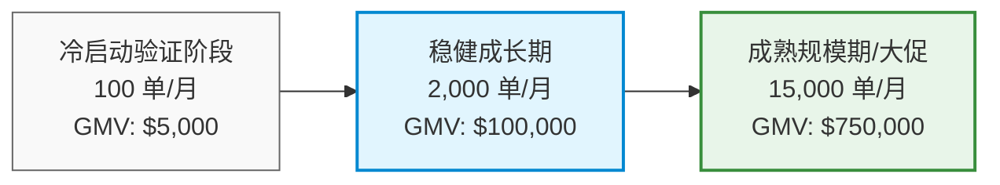
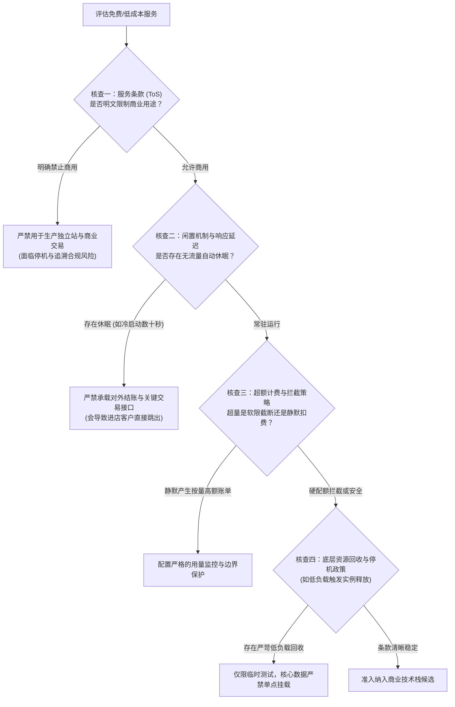
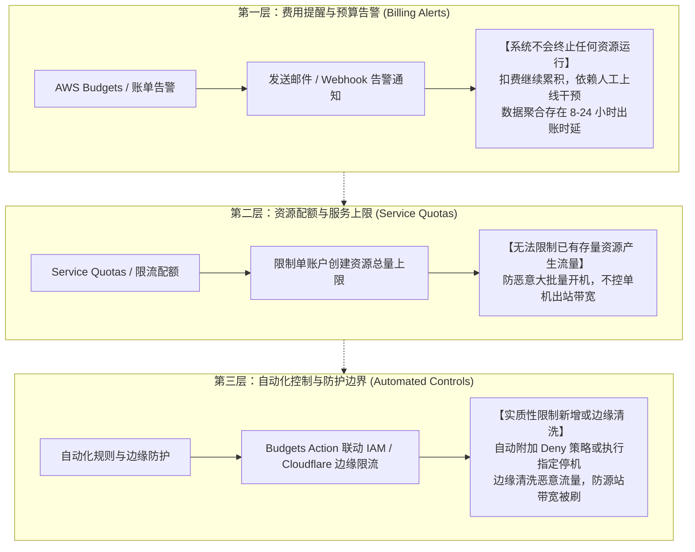
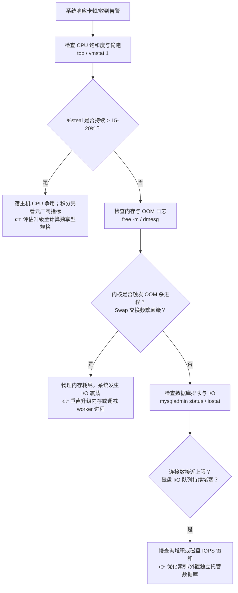
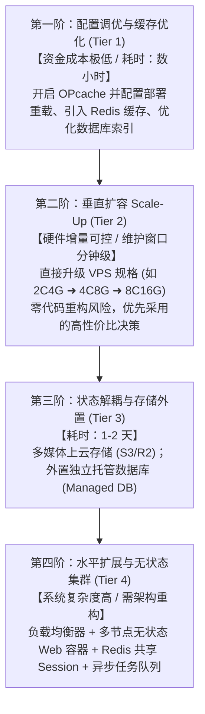
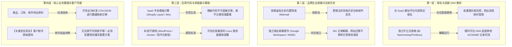
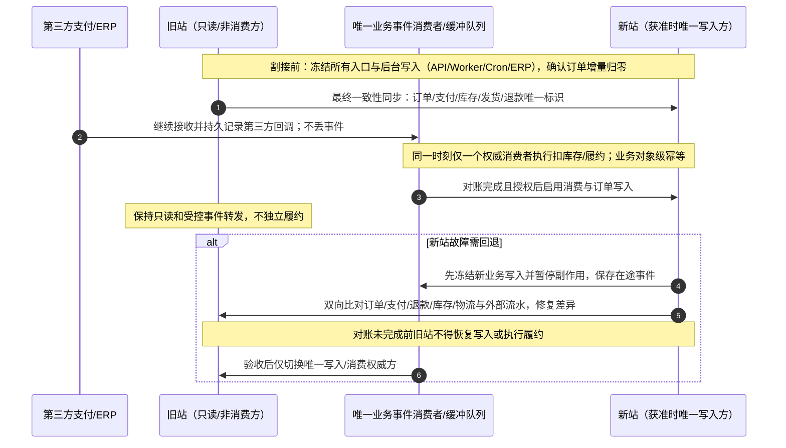
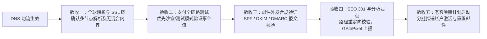
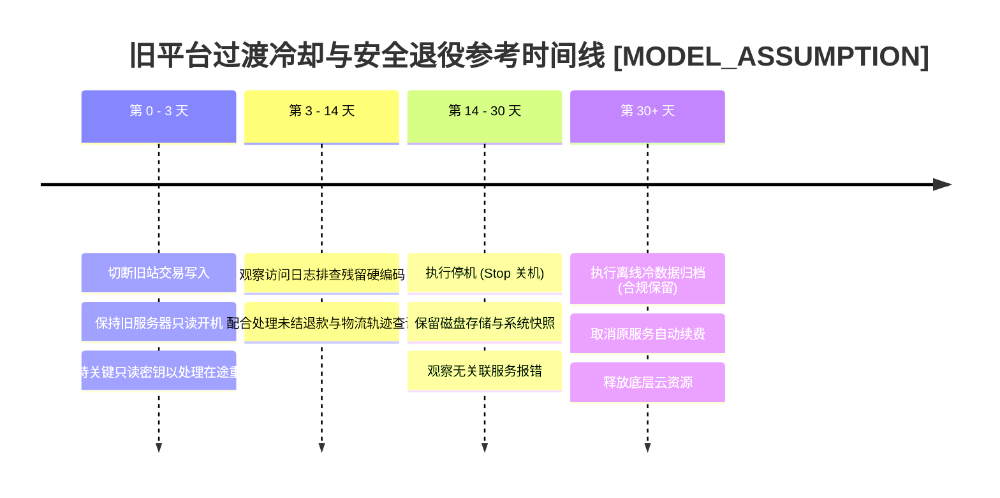

# 第八部分 成本与升级｜怎样少花冤枉钱，生意做大后又该怎么升级？

在跨境出海与独立站经营中，技术基础设施往往容易受到两个极端认知的干扰：一类是**“过早过度设计”**（Premature Over-Engineering），在月订单不足百单、商业模式尚在验证阶段时，就盲目采购高规格多可用区云集群、微服务架构以及数十个按月扣费的高阶 SaaS 插件，导致技术支出迅速侵蚀业务毛利；另一类则是**“技术债务累积”**（Technical Debt Under-Provisioning），抱着“能免费就绝不花钱”的心态，将承载真实客户与资金交易的商业站点搭建在限制商用的免费套餐、缺乏容灾机制的单点未托管 VPS 上，或者将核心业务数据完全锁定在缺乏导出途径的封闭生态中，一旦遭遇流量高峰、账号合规审查或平台策略调整，便容易陷入服务中断与客户流失的被动局面。

本章立足于中国大陆个人开发者、跨境独立站经营者以及中小出海团队的实际经营场景，系统解析**“怎样少花冤枉钱，生意做大后又该怎么升级”**这一商业与技术交织的核心问题。通过拆解真实的总体拥有成本（TCO）构成、核验免费与低成本服务的商用准入边界、建立基于自动化与防护策略的账单控制机制、明确垂直升配与架构解耦的触发指标，并制定兼顾订单对账、双向防分裂与退款保障的平滑迁移与安全停用流程，帮助出海商家在控制资金成本与保障业务连续性之间找到清晰可行的实施路径。

---

## 1. 搭建和维护这些技术环境，每个月究竟需要花多少钱？

在核算跨境技术环境的实际支出时，许多初涉独立站的商家往往仅将“云服务器租金”或“SaaS 平台基础订阅费”视作全部技术开销，直到每月信用卡对账单出炉时，才发现出站数据传输流量费、第三方插件循环扣费、企业邮箱席位费、外币交易清算手续费及汇率买卖差价等隐性与按量支出，往往显著改变了预期的资金模型。要算清技术账，必须建立全口径的总体拥有成本（Total Cost of Ownership, TCO）核算视角。

---

### 1.1 域名、邮箱、网络、托管与服务器等固定、按量和隐性费用怎样汇总？

**动态数字阅读规则（截至2026-10-19）：** 以下出现的厂商机型、订阅价、免费额度、商用资格与地区可用性只能视作当时带条件的资料快照，或已明确标记的`MODEL_ASSUMPTION`。实际决策应以经营主体所属地区、服务区域、结算币种、税费、计费周期、套餐功能及供应商最新页面/合同逐项核实，超出条件的示例一律不直接外推。建议每季度复核价格、资格和官方链接；续费、跨区迁移、服务停止维护、证书策略或法规变化时立即复核。

建立跨境技术环境的费用核算体系，应将支出细分为四维结构：**固定支出（Fixed Costs）**、**按量弹性支出（Variable/Usage-based Costs）**、**隐性与摩擦成本（Hidden & Friction Costs）**，以及**人工与维护成本（Labor & Maintenance Costs）**。其宏观核算公式可表述为：

$$\text{TCO}_{\text{Monthly}} = C_{\text{fixed}} + C_{\text{variable}}(V) + C_{\text{hidden}} + C_{\text{labor}}$$

其中 $V$ 代表业务用量变量（如月度独立访客数、完成订单数、动态请求量、数据库存储与流出公网流量）。

#### 1. 固定支出（Fixed Costs: $C_{\text{fixed}}$）
固定支出是维持系统稳定存在所必需的基础底座，通常按月或按年周期性扣除，短期内不随单日访问量的微小波动而剧烈变化：
*   **顶级域名（TLD）注册与续费**：
    *   以最通用的 `.com` 域名为例，通过平价或平进平出（At-Cost）机制的注册商购买，价格因平台政策而异：如 Cloudflare Registrar 官方现价约为 **\$9.77/年**（按批发成本价代收，不加价但要求使用其权威 NS）；Porkbun 官方标准新注与续费约为 **\$10.37/年**；Namecheap 标准续费现价约为 **\$14.98/年**；GoDaddy 续费通常在 **\$21.99/年** 左右。年费分摊至月度约为 **\$0.80 – \$1.80/月**。
    *   *注意事项*：需留意部分注册商“首年 \$0.99 促销、次年续费大幅上涨且收取 WHOIS 隐私保护费”的营销机制。
*   **企业品牌邮箱席位费**：
    *   为建立海外客户沟通的专业信任度并降低被海外主流邮件服务商拦截为垃圾邮件的概率，通常推荐配置基于自有域名的企业邮箱。
    *   Google Workspace Business Starter 官方基准现价为 **\$7.00/用户/月**（按年预订，按月扣费）或 **\$8.40/用户/月**（弹性按月方案，无合约锁定，价格依地区与货币略有浮动）；Microsoft 365 Business Basic 官方现价为 **\$6.00/用户/月**（年付约折）；Zoho Mail 轻量企业版标准起步约 **\$1.00 – \$4.00/用户/月**。
    *   *轻量替代方案*：对于起步阶段的个人开发者或微型测品卖家，亦可选用 Cloudflare Email Routing 等免费邮件转发工具将发往域名的邮件转发至个人 Gmail（固定成本为 **\$0**），但此类方案通常仅便于接收邮件，在直接对外回复时难以保障严密的 SPF/DKIM 发信签名对齐。
*   **基础计算与建站托管平台订阅**：
    *   *SaaS 托管型（以 Shopify 为例，官方美元标准价）*：Basic 方案按月计费为 **\$39.00/月**（若按年预付一次性结算折合约 \$29.00/月）；Shopify（中阶方案）按月计费为 **\$105.00/月**（年付折合约 \$79.00/月）；Advanced 方案按月计费为 **\$399.00/月**（年付折合约 \$299.00/月）。以上标价均为税前基准价格。
    *   *自建开源 VPS 基础型*：以欧洲知名高性价比服务商 Hetzner Cloud 为例，入门机型 CX22（2 vCPU, 4GB RAM, 40GB SSD, 20TB 流量，德国/芬兰机房）官方现价为 **€3.79/月（税前，折合约 \$4.10/月）**，若附加独立 IPv4 地址额外加收 **€0.60/月**；DigitalOcean Basic Droplet（1 vCPU, 1GB RAM, 25GB SSD, 1TB 流量）官方现价为 **\$6.00/月**；AWS Lightsail 入门款（1 vCPU, 1GB RAM, 40GB SSD, 1TB 流量）官方基准价为 **\$3.50 – \$5.00/月**。
*   **静态 SSL/TLS 证书**：
    *   通过 Let's Encrypt 或 Cloudflare Universal SSL 自动化分发证书，成本为 **\$0**。除非面对特定企业级金融审计要求采购专属 OV/EV 证书（通常每年 \$50 – \$200），普通跨境独立站无需将 SSL 证书列为常态化现金支出。

#### 2. 按量弹性支出（Variable Costs: $C_{\text{variable}}$）
按量支出直接随业务活跃度、访客流量和交易笔数线性或阶梯式变动：
*   **出站数据传输流量费（Data Transfer Out / Egress）**：
    *   主流公有云（AWS EC2、Google Cloud Compute Engine、Azure VMs）对流向公网的数据传输收取单价相对较高的出站流量费。以 AWS EC2 美东（弗吉尼亚北部）区域为例，超出每月默认提供的 100GB 免费出站额度后，标准公网数据流出阶梯起始单价为 **\$0.09/GB**。若独立站首页包含未压缩的高清大图，被海外搜索引擎爬虫或高并发访客高频访问，流量消耗可能显著推高账单。
    *   相比之下，Cloudflare Free/Pro 计划为标准的 HTML 网页与静态缓存资源提供不按流量计费的分发；Cloudflare R2 对象存储则实行 **免出站流量费（Zero Egress Fee）** 政策，其标准存储单价为 **\$0.015/GB/月**。
*   **对象存储与 API 调用**：
    *   以 AWS S3 标准存储为例，美东区域存储单价为 **\$0.023/GB/月**，PUT/POST 请求为 **\$0.005/1,000次**，GET 请求为 **\$0.0004/1,000次**。
*   **事务性与通知类邮件投递（Transactional Emails）**：
    *   用于发送订单确认、发货追踪单号及密码重置通知。Amazon SES（Simple Email Service）官方现行标准价格为 **\$0.10/1,000封**；专业通知邮件服务商 Postmark 入门方案为 **\$15.00/月（含 10,000 封额度）**；SendGrid 基础商业版起步约为 **\$19.95/月（含 50,000 封额度）**。
*   **支付网关交易处理与跨境费率**：
    *   以目前国际主流支付网关 Stripe 为例，其美国商业账户官方标准结算费率为 **2.9% + \$0.30 / 笔成功交易**；若顾客使用国际银行卡支付，加收 **+1.5%** 跨国处理费；涉及多币种汇兑结算时再加收 **+1%** 货币兑换费。
    *   *商用主体资格提示*：Stripe **直接开户须满足对应支持法域与业务类型的注册/身份/银行账户及审核要求**，某些地区允许个人或个体经营类别，并非全球统一要求“当地公司＋对公账户＋税号”。仅有大陆境内身份或收款账户，不代表能够直接开通 Stripe；跨境商户应按官方地区、实际经营主体及服务类型核实资格，不使用虚假属地或借名材料。PayPal/第三方收单是否准入、如何结算另查其现行官方规则；详见第三支付板块。
    *   *Shopify 平台外部交易手续费*：Shopify **未使用 Shopify Payments 且使用符合收费条件的第三方支付提供商**时，可能在网关手续费之外按套餐另收第三方交易手续费；此处 Basic 2.0%、Grow 1.0%、Advanced 0.6% 为所述套餐/市场条件下的教学示例，需查实际账单条款。**中国大陆 Shopify Payments 已有受邀 Early Access**：符合条件的大陆注册跨境经营主体在获邀后，可连接经过验证的 WorldFirst 账户申请启用，**并非所有大陆商户都已开放**，也不能假定所有大陆商户只能使用第三方支付或统一承担额外 2%。详细资格与费用见附录官方来源。

#### 3. 隐性与摩擦成本（Hidden & Friction Costs: $C_{\text{hidden}}$）
隐性支出往往不体现在产品核心标价内，极易被初期测算遗漏：
*   **闲置公网 IPv4 地址费用**：
    *   自 2024 年 2 月 1 日起，AWS 对所有分配给账户的公网 IPv4 地址按 **\$0.005/小时/IP**（折合约 **\$3.65/月/IP**）统一计费（无论其绑定在运行中实例、停止中实例还是闲置的弹性 IP 上）。测试环境遗留的未释放公网 IP 会持续产生固定计费。
*   **托管 NAT 网关底座开销**：
    *   在 AWS VPC 私有子网架构中，若配置 AWS Managed NAT Gateway 供内部实例访问公网下载依赖，单个 NAT 网关的基础小时费为 **\$0.045/小时/AZ**（折合约 **\$32.40/月/AZ**），外加 **\$0.045/GB** 数据处理费。跨 3 个可用区部署的基础闲置底座每月支出即接近 **\$100.00**。
*   **SaaS 应用市场插件堆叠（App Store Creep）**：
    *   Shopify 店铺运营中常见各类月租插件：顾客评价组件（如 Loox \$9.99 – \$29.99/月）、高级落地页设计器（\$24.00 – \$49.00/月）、多币种汇率展示工具（\$9.99/月）、营销自动化套件（如 Klaviyo 按订阅联系人数阶梯扣费）。商家若缺乏定期审计，插件月费极易累积至 **\$100 – \$250/月**。
*   **跨境结汇损耗与外币结算摩擦**：
    *   使用境内双币/全币种信用卡支付境外美元云服务账单时，部分发卡行可能产生 **1.5% – 3%** 的货币转换费（Foreign Transaction Fee, FTF）或外汇结算点差；海外销售款回流提现时，跨境资金结算工具通常按提现金额收取 **0.4% – 1.2%** 的结汇费率。
    *   云服务可能按客户所在地、税务身份、具体交易与供应商规则收取 VAT/GST/销售税，**欧盟各成员国标准与减免税率不同，不能统一写成 19%–21%**；例如新加坡 GST 标准税率是否适用还需核对当地规则。提供有效税号也不等于普遍免税，应在账单及税务要求中核实，不在本章代替税务判断。

#### 4. 人工与维护成本（Labor & Maintenance Costs: $C_{\text{labor}}$）
技术环境并不能在物理层面做到完全零维护。对于采用自建 VPS 架构（Linux + Nginx + MySQL + PHP/Node）的团队，每月必须投入工时进行操作系统内核安全补丁升级、数据库快照备份校验、SSL 证书自动续期巡检及突发故障排查。按初级运维或外包开发工程师行业工时成本折算，每月投入 3–5 小时维护即产生相对应的隐性机会成本；反之，托管型 SaaS 平台虽在软件层免除了大部分基础系统运维，但前台模版定制与多应用协同调试同样需要投入人员工时。

#### 跨境主流技术架构月度费用结构对照表
以下对照兼有服务商历史公开价快照与教学假设，**不代表2026年10月可下单的实时报价或具有等同功能、可靠性、地区资格**；每项金额须在采购时核对区域、币种、年付/月付、税费、服务等级与超量计费。为避免错误比较，表格仅示意现金账单结构，不包含完整支付、备份、存储、故障及人工成本：

| 费用构成项 | 方案 A：托管型 SaaS (以 Shopify 为例) | 方案 B：自建开源栈 (以 Hetzner VPS + WooCommerce 为例) | 方案 C：云原生轻量栈 (以 Cloudflare + 托管无服务器栈为例) | 计费性质与风险提示 |
| :--- | :--- | :--- | :--- | :--- |
| **基础计算/平台** | \$39.00/月 (Basic 月付标准价，年付折 \$29) | €3.79/月 (约 \$4.10, Hetzner CX22 2C4G 税前) | \$0.00 – \$25.00/月 (如 Supabase Pro 方案) | 固定支出；SaaS 免底层运维但底座租金较高 |
| **域名与 DNS** | \$0.81/月 (Cloudflare 注册年费 \$9.77 折算) | \$0.81/月 (Cloudflare 注册年费 \$9.77 折算) | \$0.81/月 (Cloudflare 注册年费 \$9.77 折算) | 固定支出；需警惕部分注册商次年高额续费陷阱 |
| **企业品牌邮箱** | \$7.00/月 (Google Workspace Starter 年约月付) | \$1.00/月 (Zoho Mail 轻量企业版单席位) | \$7.00/月 (Google Workspace Starter 单席位) | 固定支出；建议按实际客服与管理人数规划 |
| **公网 IPv4 费用** | \$0.00 (平台底座已内含) | €0.60/月 (约 \$0.65, 独立 IPv4 附加费) | \$0.00 (Cloudflare Anycast 边缘代理内含) | 固定支出；AWS 需按 \$0.005/小时计费 |
| **CDN 与基础安全**| \$0.00 (平台内置企业级 CDN 缓存) | \$0.00 (Cloudflare Free 基础防护与缓存) | \$0.00 – \$20.00/月 (Cloudflare Free / Pro) | 固定/弹性；免费层具备标准防 DDoS 属性 |
| **出站网络流量** | \$0.00 (套餐范围内无额外流量计费) | \$0.00 (套餐内含 20TB 公网流量包) | \$0.00 (Cloudflare Pages/R2 特定产品免出口流量费，仍须查请求/操作和容量费用) | 按区域、目的地、免费额度、服务类别/阶梯分别计费；AWS/GCP/Azure不得用统一单价套算 |
| **第三方功能插件**| 估算 \$30.00 – \$65.00/月 (评价、设计器插件) | \$0.00 – \$15.00/月 (开源插件免费版或轻量付费) | \$0.00 – \$10.00/月 (开源组件自建或基础接口) | 周期订阅；Shopify 插件堆叠极易推高实际账单 |
| **交易渠道手续费**| 网关费（按实际主体/卡种）+ 适用时第三方交易费（本表暂按2%假设） | 收单费另计（按真实准入，非所有主体可直连Stripe） | 收单费另计（按真实准入与套餐） | 按量支出；需具备对应商户资质；SaaS 外部抽成显著 |
| **人工运维与排障**| 极低 (主要聚焦前台商品配置与模版微调) | 中等 (每月需数小时执行安全补丁与备份审计) | 较低 (需保障前端代码迭代与云数据库规则安全) | 隐性工时成本；自建方案需要团队具备技术基础 |
| **月度启动基础总计**| **约 \$76.81 – \$111.81/月 + 交易手续费** | **约 \$6.56 – \$21.56/月 + 原生网关费** | **约 \$7.81 – \$42.81/月 + 原生网关费** | 未计入开发工时与税费；方案 B 资金支出低但门槛高 |

---

### 1.2 怎样结合实际订单或用户规模测算每月技术总成本及变化？

**成本比较必须先对齐责任与功能，再看价格：** 先为托管Shopify与自建WooCommerce分别列出商品管理、结账、退款/拒付、插件/营销、图片与数据库、备份/PITR、日志监控、补丁、安全事故响应、人工运维和支付服务费，并记录“供应商负责/商家负责”。下方各阶段算例故意保留原模型与不同口径以训练识别成本陷阱，**不能直接得出哪种模式更便宜**。比较时应把平台和第三方手续费、维护工时、风险及税费以同一期间计入两边；某阶段缺项标记“未报价”，不要算作0美元。

技术成本并非一成不变的静态数字，而应与业务发展阶段及客流变化紧密挂钩。评估技术投入健康度的核心量化指标包括：
1.  **单均技术成本（Cost Per Order, CPO）**：
    $$\text{CPO} = \frac{\text{月度技术基础设施与平台总支出}}{\text{月度完成订单总数}}$$
2.  **活跃用户技术成本（Cost Per Active User, CPU）**：
    $$\text{CPU} = \frac{\text{月度技术基础设施与平台总支出}}{\text{月度活跃用户数 (MAU)}}$$
3.  **技术支出占 GMV 比率（Tech-to-GMV Ratio）**：
    $$\text{Ratio}_{\text{Tech/GMV}} = \frac{\text{月度技术总支出}}{\text{月度商品交易总额 (GMV)}} \times 100\%$$

在跨境电商与独立站财务管理中，这里没有对所有商家适用的“行业标准技术费率”。**仅做可调教学假设 `[MODEL_ASSUMPTION]`**：假设高毛利场景设预算观察区间 1.5%–3.5%，低毛利场景设 1% 作为压力测试线；这些比例不是调查结果、推荐阈值或商用承诺。实际应比较订单贡献毛利、广告、退款、履约、人工及获客成本，计算自己能承担的技术费用。

#### 业务阶梯规模演进测算推演模型 `[MODEL_ASSUMPTION]`
为了展示在用户增长与订单扩张过程中不同技术架构的资金变动特征，以下设定一套标准电商测算推演模型 `[MODEL_ASSUMPTION]`：
*   商品平均客单价（AOV）：\$50.00
*   访客全站平均转化率（CVR）：2.0%（即每 100 名进店访客产生 2 笔订单）
*   跳出率 40%，平均进店访客浏览 4 个页面，单页面静态多媒体资源（经 CDN 压缩缓存）约 1.2MB，动态 HTML 约 80KB。
*   以下所有推演数据均为教学示意测算 `[MODEL_ASSUMPTION]`，用于帮助商家理解资金流转趋势与成本敏感点。



##### 阶段一：冷启动与测品验证阶段（月订单 100 单，MAU 约 5,000，GMV \$5,000）`[MODEL_ASSUMPTION]`
*   **业务画像**：新站刚上线，通过少量社媒引流测款，客流较低且并发压力极小。
*   **方案 A（Shopify Basic 极简起步）**：
    *   基础订阅：\$39.00/月（按月结算）
    *   域名与 1 席企业邮箱：\$0.81 + \$7.00 = \$7.81/月
    *   第三方插件：控制在最低，选用免费版评价与表单工具：\$0.00
    *   Shopify 使用符合条件的第三方网关时外部交易手续费（本模型按 2.0% 假设）：\$5,000 × 2.0% = \$100.00
    *   支付网关收单扣费（以 Stripe 标准 2.9% + \$0.30 计）：\$145.00 + \$30.00 = \$175.00
    *   *技术与平台服务总支出*：\$39.00 + \$7.81 + \$100.00 = **\$146.81/月**（不含支付网关原生收单成本）
    *   *单均技术成本 CPO*：\$1.47 / 单
    *   *Tech-to-GMV 比率*：约 2.94%（处于合理起步区间）。
*   **方案 B（自建 VPS 单机 WooCommerce）**：
    *   Hetzner 2C4G VPS + 独立 IPv4：\$4.10 + \$0.65 = \$4.75/月
    *   域名与 Zoho 邮箱：\$0.81 + \$1.00 = \$1.81/月
    *   Cloudflare Free CDN + Let's Encrypt 证书：\$0.00
    *   Amazon SES 邮件通知（约 300 封订单通知）：\$0.03
    *   无第三方建站平台额外抽成，仅支付网关原生扣除：\$175.00
    *   *技术服务总支出*：\$4.75 + \$1.81 + \$0.03 = **\$6.59/月**
    *   *单均技术成本 CPO*：\$0.066 / 单
    *   *Tech-to-GMV 比率*：约 0.13%（纯资金支出极低，但要求商家具备独立排查 Linux 系统与插件冲突的技术能力）。

##### 阶段二：稳健成长期（月订单 2,000 单，MAU 约 100,000，GMV \$100,000）`[MODEL_ASSUMPTION]`
*   **业务画像**：确立了稳定的细分品类复购，日均约 67 单，促销日峰值可达 200–300 单。重度使用 EDM 邮件营销、弃单挽回与定制落地页。
*   **方案 A（Shopify 方案 + 商业插件矩阵）**：
    *   升级至 Shopify 方案以降低外部抽成（月费 \$105.00/月，外部交易手续费降至 1.0%）。
    *   企业邮箱增至 3 席位（客服+运营）：\$21.00/月
    *   商业插件矩阵：Klaviyo 邮件营销（按 5,000 联系人计约 \$110.00/月）、落地页设计器（约 \$49.00/月）、高级评价套件（约 \$29.99/月）、全功能货币与运费计算（约 \$19.99/月）：插件合计约 \$208.98/月。
    *   Shopify 外部交易手续费（本模型假设符合收费条件，取 1.0%）：\$100,000 × 1.0% = \$1,000.00
    *   *技术与平台服务总支出*：\$105.00 + \$21.00 + \$208.98 + \$1,000.00 = **\$1,334.98/月**
    *   *单均技术成本 CPO*：\$0.67 / 单
    *   *Tech-to-GMV 比率*：约 1.33%（在享受平台全托管弹性与免运维价值的同时，资金支出保持在良性区间）。
*   **方案 B（自建 VPS 垂直升配 + 托管数据库与对象存储）**：
    *   VPS 垂直升配至 4C/8G（如 Hetzner CPX31 现价约 €14.50/月，折合约 \$15.70/月）
    *   外置托管数据库预算暂列约 \$15.00/月 **`[MODEL_ASSUMPTION]`**；并非某厂商已核验的“高可用＋PITR”套餐报价，须另查存储、备份、I/O、跨区及运维费用
    *   多媒体迁移至 Cloudflare R2（存储 50GB 约 \$0.75，免出站流量费）
    *   Cloudflare Pro 方案（启用高级移动端优化与 WebP 自动压缩）：\$20.00/月
    *   Postmark 事务性邮件（每月约 8,000 封订单通知）：\$15.00/月
    *   营销自动化邮件（按第三方服务对齐用量计）：约 \$110.00/月
    *   外部建站抽成：\$0.00
    *   *技术硬支出*：\$15.70 + \$15.00 + \$0.75 + \$20.00 + \$15.00 + \$110.00 = **\$176.45/月**
    *   *单均技术成本 CPO*：\$0.088 / 单
    *   *对比与考量*：**仅在上述不等价的教学假设项目下**，两列账面现金差额超过 \$1,100/月，**不能据此得出功能等价或 TCO 必然更低**：Shopify 与自建侧在插件、支付、营销、备份、数据库高可用、税费和平台能力上不一一对应。例如按假设每月自建维护 12 小时、人工机会成本每小时 \$70，即新增 \$840；再加假设灾备与存储 \$200，则差额显著缩小，还未计性能损失与恢复风险。实际应以同等功能清单和真实报价重新计算。

##### 阶段三：成熟规模期与大促峰值（月订单 15,000 单，MAU 约 750,000，GMV \$750,000）`[MODEL_ASSUMPTION]`
*   **业务画像**：多渠道规模化投放，大促活动期间瞬时脉冲并发显著。
*   **方案 A（Shopify Advanced 方案）**：
    *   升级至 Advanced 方案（\$399.00/月，外部交易手续费降至 0.6%）。
    *   企业邮箱（8 席位）：\$56.00/月
    *   高阶应用套件（大规模邮件营销、智能风控防欺诈、退换货自动化）：合计约 \$1,050.00/月。
    *   Shopify 外部交易手续费（本模型假设符合收费条件，取 0.6%）：\$750,000 × 0.6% = \$4,500.00
    *   *技术与平台服务总支出*：\$399.00 + \$56.00 + \$1,050.00 + \$4,500.00 = **\$6,005.00/月**
    *   *单均技术成本 CPO*：\$0.40 / 单
    *   *Tech-to-GMV 比率*：约 0.80%（绝对金额虽高，但团队享有近乎零运维压力的全球高并发抗峰保障）。
*   **方案 B（现代化云架构：负载均衡 + 应用节点 + 托管高可用 DB + SQS 队列）**：
    *   AWS 2 台 4C/8G Web 节点（以预留实例/Savings Plans 折算）：约 \$65.00/月
    *   AWS ALB 负载均衡器（基础小时费 + LCU 处理费）：约 \$28.00/月
    *   托管关系数据库**演算预算 \$115.00/月 `[MODEL_ASSUMPTION]`**：尚未选择有效的 RDS 实例/区域/副本数与存储。**不得将 db.t4g.medium 当作 RDS Multi-AZ DB cluster 支持规格**（三实例集群支持类见 AWS 官网）；若采用主备型 Multi-AZ DB instance，则按所选实例类、实例/备份/存储/I/O 和区域重新估价。本项不是可直接采购的报价
    *   ElastiCache Redis 缓存实例（会话共享与热点缓存）：约 \$35.00/月
    *   Cloudflare Business 方案（定制 WAF、企业级 DDoS 与服务 SLA）：\$200.00/月
    *   S3 + Cloudflare 媒体存储与访问日志：约 \$25.00/月
    *   外部建站平台抽成：\$0.00
    *   *假设硬支出*：\$65.00 + \$28.00 + \$115.00 + \$35.00 + \$200.00 + \$25.00 = **\$468.00/月**（上述 **\$468** 仅为加法示意而非可采购报价，叠加**假设**外部营销邮件等 \$800 后约 **\$1,268/月**；尚未包括相关真实的多副本、备份、出站与工程维护成本）
    *   *单均技术成本 CPO*：\$0.085 / 单
    *   *对比与考量*：适合拥有专职资深 SRE/DevOps 工程师且月交易规模庞大的团队；若缺乏专业运维人员，分布式系统的管理复杂度与事故风险将成倍增加。

#### 现金流与账期风险考量
在测算按量与云服务成本时，必须关注**资金结算周期与备付金沉淀**：
云服务商的账单结算时间、支付工具及币种取决于账户合同；跨境支付服务商也可能按品类、交易历史和争议风险设置**滚动保证金（Rolling Reserve）**、延迟结算或其他资金保留安排，具体比例与期限只以个人商户合同和账户状态为准，**不能将 5%–10%、90–180 天或 2–7 天当作行业通用区间**。若大促期间流量费用陡增，而销售款尚未到账，需预留账单支付能力，并检查不同付款方式、结算周期及云服务的欠费处置规则。

---

## 2. 哪些免费或便宜的服务，真的可以长期用来做生意？

在技术选型初期，“免费”往往极具吸引力。市场上存在大量宣称“永久免费”（Always Free）或提供免费体验配额（Free Tier）的云产品。然而，部分免费服务在服务条款中明文限制商业经营，或内置了闲置休眠、缺乏 SLA 保障等机制，若未加辨别直接用于商业生产环境，极易带来稳定性隐患。

---

### 2.1 如何核对免费套餐是否允许商业使用、有哪些额度与服务限制？

评估一项免费或低成本服务能否用于商业业务，必须完成以下四维合规与技术核查：



#### 1. 服务条款（Terms of Service, ToS）中的商业使用限制
部分知名开发者平台的免费层级在法律层面明确限制了商业经营行为：
*   **Vercel Hobby 免费套餐**：
    *   *条款约束*：根据 Vercel 官方服务条款（Section 1.1）及公平使用策略（Fair Use Guidelines），Hobby 计划明确声明**“仅限个人非商业项目（Personal, non-commercial use only）”**。任何用于盈利性质的网站（包括商业独立站、承接付费广告的站点、企业营销主页及收费 SaaS 前端）均属违规。
    *   *平台处置*：一旦检测到商业流量或关联商业域名，平台自动化合规系统可能发出警告要求限期升级至 **Pro 方案（\$20.00/席位/月起，附加弹性用量计费）**，逾期未处理可能面临项目部署受限或域名解析暂停。
*   **Cloudflare Free 计划**：
    *   *准入范围*：官方允许商业企业使用免费计划进行标准 DNS 解析、基础网页 CDN 缓存加速、Anycast DDoS 防护以及申请免费的 Universal SSL 证书。
    *   *边界约束（Section 2.8）*：服务条款明确禁止将免费 CDN 主要用于托管非 HTML 网页类大文件（如自建大容量视频点播库、离线软件安装包批量下载）。违规滥用可能导致特定二级域名被禁用缓存代理，严重者会被切断 CDN 代理模式。
*   **GitHub Free 组织与个人账户**：
    *   允许商业团队创建私有代码仓库（Private Repositories）进行商业开发，但对免费自动化 CI/CD 构建分钟数实施限额（如 Linux 运行节点每月提供 2,000 分钟配额），超出配额后流水线将终止执行，除非绑定付费账单。

#### 2. 免费计算实例的“闲置休眠”与“冷启动”延迟
部分提供免费 Web 托管的无服务器/容器平台采用闲置回收机制，这对在线零售是重大隐患：
*   **Render 免费 Web 实例**：
    *   官方规则明确：当容器连续 15 分钟未收到任何传入 HTTP 请求时，实例将自动进入休眠（Spin down）。当下一次真实客户访问进店时，平台需重新拉起镜像执行冷启动，容器启动与就绪延迟通常长达 **50 秒左右**。在电商场景下，首屏数十秒的等待会导致绝大多数顾客直接流失。
*   **Supabase 免费数据库项目**：
    *   官方规则：免费层 PostgreSQL 项目在连续 1 周未产生任何 API 请求或管理面板操作后，将被置为“暂停状态（Paused）”。虽然底层数据在标准暂停周期内予以保留，但必须由管理员手动登录后台点击恢复，恢复过程耗时数分钟，期间线上应用对外服务完全中断。此外，长期搁置未维护的项目亦可能面临平台清理策略的限制。
*   **Neon Serverless 免费层**：
    *   计算端点闲置 5 分钟后自动挂起，下一只读查询触发数百毫秒至数秒的冷启动拉起延迟，对需要低延迟稳定响应的结账流程构成影响。

#### 3. 闲置资源强制回收机制（Reclamation Policy）
*   **Oracle Cloud Always Free（甲骨文永久免费资源）**：
    *   虽然其提供最高 4 核 Arm Ampere、24GB 内存及 200GB 存储卷的免费配额，但在官方《闲置资源回收政策》中明确规定：若 Always Free 计算实例在连续 7 天内**同时满足以下全部条件（AND 关系）**时，系统有权将其判定为闲置并**可能**执行回收关机（Reclaim/Stop）：
        1. 95 百分位 CPU 利用率低于 20%；
        2. 网络利用率低于 20%；
        3. 内存利用率低于 20%（针对 A1 Ampere 实例形态）。
    *   *说明与策略*：回收属于平台的裁量权操作，并非所有触发阈值的机器均会被无差别销毁，且升级为付费绑卡（Pay As You Go）身份后的账户通常不再受此项闲置回收限制。但对于纯免费账户，**切勿将未配置多地异地备份的生产数据库单点挂载在免费实例上**。

#### 4. AWS 免费计划（新旧开户政策划分）
初学者常将“AWS 免费试用”误解为无条件的全局免费，从而导致意外扣费。AWS 官方免费体系在 2025 年进行了重大改版，需严格区分开户时间：
*   **新账户政策（自 2025 年 7 月 15 日起生效）**：
    *   新注册账户在开户时可选择**“AWS 免费账户计划（Free Tier Account Plan）”**：该方案最长支持 6 个月或提供至多 **\$200 的抵扣积分（Credits）**，用于在限定配额内体验核心服务。额度耗尽或 6 个月期限届满后，若用户未主动绑定有效支付方式升级为付费账户，**AWS 系统将自动关停并关闭账户**，从而避免产生意外欠费；
    *   用户亦可选择开通标准付费账户（Paid Plan），在此模式下持续享受“永久免费”服务并按量计费。
*   **历史账户政策（2025 年 7 月 15 日前创建的账户）**：
    *   享受原有的**“首年 12 个月免费套餐（12 Months Free）”**：例如每月 750 小时 t2.micro 或 t3.micro Linux 实例运行时间、5GB S3 标准存储、30GB EBS 存储卷。**开户满 365 天后，该项 12 个月优惠完全失效，全量转为标准原价按量计费**。
*   **永久免费（Always Free）**：
    *   不受 6 个月或 12 个月期限约束，如每月 100 万次 AWS Lambda 免费请求、每月 100GB 公网出站流量（特定服务组合）、每月 25GB Amazon DynamoDB 基础存储。

---

### 2.2 选择便宜方案前，还需要比较哪些稳定性、升级价格与数据迁移成本？

在商业经营中，“低廉的起步费用”若缺乏审慎评估，往往对应着高昂的稳定性代价与后期迁移成本。在最终确定方案前，必须对以下三项关键维度进行横向权衡：

#### 1. 服务等级协议（SLA）与故障救济机制
*   **免费层与低价非托管 VPS 的 SLA 现实**：
    *   免费、试用与低价套餐**可能没有合同 SLA 或不提供财务服务抵扣**，须按产品、套餐、国家及当期正式条款单独核对。**没有 SLA 不能表述为“0% SLA”**，也不等于服务实际可用性为零；有无赔偿还取决于服务信用申请条件和排除条款。
    *   低成本非托管 VPS（Unmanaged VPS）通常仅保障基础物理硬件与网络通畅，对于系统内核崩溃、磁盘 I/O 堵塞等软件层面故障，租户需自行承担诊断与修复工作，常规技术支持工单的响应时效通常在数小时至数天不等。
*   **商业级付费方案的 SLA 标准**：
    *   以 AWS EC2 为例，其官方服务等级协议（SLA）明确区分可用性基准：单实例层级与满足条款定义的区域级多 AZ 计算资源对应不同**服务信用 SLA**（示例为实例级 99.5%、区域级 99.99%）；并非所有“多 AZ”部署自动满足条件，也不等于终端结账可用率承诺。实际按监测口径、排除项、索赔期限与证据材料申请约定的服务信用。

#### 2. 价格断崖效应（The Pricing Cliff）
部分开发者平台在免费或入门阶段价格极具优势，但当业务用量突破配额上限时，其升级阶梯可能呈现非线性的断崖式跳跃：
*   **无服务器托管平台**：
    *   单人开发阶段为 \$0/月；一旦需要新增团队协作席位或解除个人非商业限制，必须升级至团队方案（通常每人每月 \$20 – \$40 起）；当月度带宽或函数调用超时超出包含额度后，其额外采购单价往往显著高于底层原生云厂商的大宗流量采购成本。
*   **低代码与 SaaS 自动化连接器**：
    *   免费版通常提供每月 50–100 次运行任务；若在大促期间因订单暴增触发数千次工作流调用，系统将直接熔断拦截；若想平稳放开配额，下一档套餐月费往往直接跳跃至 \$50 – \$150/月。

#### 3. 专用 API 依赖度与数据迁移成本（Vendor Lock-in）
评估技术选型时，需前置考量“退场与替换难度”：
*   **通用标准架构（低迁移成本）**：
    *   基于标准 MySQL / PostgreSQL 数据库、Redis 缓存、兼容 AWS S3 协议规范的对象存储（如 Cloudflare R2 / MinIO）及标准 Docker 容器构建的业务系统，其底层代码具备高度通用性。若现有主机商涨价或服务降级，通常可在短时间内通过常规数据导出与容器重新部署迁移至其他标准 Linux 主机。
*   **专有平台绑定（高迁移成本）**：
    *   深度依赖 Google Firebase Firestore 专有查询、AWS DynamoDB 特殊单表设计、Shopify Liquid 专用闭源模板语法。一旦平台政策收紧、服务费率大幅调整或账户遭受风控争议，相关前端模版与业务逻辑通常无法直接导出迁移，往往需要投入相当于重新建站的工程重构成本。

#### 长期商用技术选型决策红绿灯矩阵

| 服务类别与场景 | 通常可作为候选（须按条款核验） | 需专项核验的风险 | 与本场景明显不匹配时应避免 |
| :--- | :--- | :--- | :--- |
| **DNS 与边缘网络** | Cloudflare 基础/Pro 方案 (标准解析、CDN 与基础 DDoS) | AWS Route 53 (功能完备，但按托管区 \$0.50/月 + 按查询计费) | 基础注册商 DNS (按实际 SLA、DNSSEC、权威节点与监控评估，不能一概禁用) |
| **计算与网站托管** | 成熟知名 VPS (如 Hetzner / DigitalOcean / Linode) | AWS 突发型实例 (t3/t4g，需密切监控 CPU 积分耗尽) | Vercel Hobby 免费版 (商用违规); 有休眠机制的实例 (若响应目标无法容忍冷启动) |
| **生产数据库** | 配置自动化快照备份的独立托管 DB 或加固 VPS 自建 | 共享型云数据库入门版 (无读写分离, 磁盘 IOPS 易被限流) | 带自动暂停策略的免费数据库（对交易服务可能不适合） |
| **对象存储与媒体**| Cloudflare R2 (免出站流量费) / AWS S3 标准版 | 包含少量免费流量的小众免费图床 (服务协议与可用性波动大) | 将海量高清商品主图和视频直接存放于应用服务器系统根盘 |
| **通知类邮件投递**| Amazon SES / SendGrid / Postmark 商业 API 网关 | 免费 SMTP 继电器 (每日限额 100 封, 容易触发拒信) | 缺乏发信信誉及认证维护能力的自建邮件服务 |

---

## 3. 怎样避免费用突然暴涨，或者一直为没用的服务付钱？

在云计算环境中，“按量计费（Pay-as-you-go）”极大降低了启动门槛，但也伴随着账单失控的潜在风险。若系统遭遇外部恶意爬虫高频爬取、配置死循环、分布式拒绝服务（DDoS）攻击，或者长期遗留未解绑的闲置存储卷与公网 IP，云账户极易在短时间内产生预期之外的高额费用。控制成本的关键，在于看清隐蔽计费点并建立多层级技术控制防线。

---

### 3.1 哪些云服务项目容易出现按量超额或隐藏费用，应怎样持续查看？

根据跨境独立站运维与云资源排障实践，导致费用突发暴涨与隐蔽资金流失的常见诱因主要包括以下五类：

#### 陷阱一：出站数据传输流量（Data Transfer Out / Egress）
*   **计费机制**：AWS、Google Cloud、Azure 的公网出口计费不能统一概括为每GB \$0.08–\$0.09；须区分源区域、目的地区、服务品类（VM、对象存储、CDN等）、账单单位GB/GiB、免费额度和阶梯。部分入口流量免费也可能有特殊网络/服务项目计费。以Google Cloud官方网络表为例，不同目的地流量价格可显著高于这一固定区间，不能拿示例价做跨供应商预算。核验：https://cloud.google.com/vpc/network-pricing 和 https://aws.amazon.com/ec2/pricing/on-demand/ 。
*   **典型风险场景**：
    *   独立站多媒体资源未配置 CDN 边缘缓存，单张原图达数兆字节，由源站服务器直接向公网分发；
    *   恶意搜索引擎爬虫或第三方内容抓取脚本全天候高频扫描全站商品与分类列表，在未受阻断的情况下迅速产生数百吉字节出站流量，产生额外的流量费用。
*   **应对建议**：依据资源类别与服务条款比较托管平台自带媒体服务、对象存储和CDN；适用的公共静态资源可评估R2等免特定出口费用服务，但仍须计入容量、操作次数、回源/转换等项目的收费。私有/动态内容不能直接套用公共缓存。

#### 陷阱二：闲置未挂载的块存储（Orphaned EBS Volumes & Snapshots）
*   **计费机制**：在 AWS 控制台终止（Terminate）EC2 实例时，若实例创建时未启用 `DeleteOnTermination`（随实例终止时删除磁盘）选项，挂载的 EBS 卷将脱离实例并持续保留在 `available`（可用闲置）状态。
*   **资金消耗**：gp3 存储标准单价为 **\$0.08/GB/月**。若团队频繁创建测试机排障后直接销毁机器而遗漏清理磁盘，多块 100GB 的闲置卷将持续每月扣费。
*   **快照累积**：自动化备份脚本若未设定快照保留期限与生命周期规则（Data Lifecycle Manager），数月后累积的历史快照同样会产生持续的存储计费。

#### 陷阱三：公网 IPv4 地址按小时常态化计费
*   **计费机制**：自 2024 年 2 月 1 日起，AWS 对所有分配给账户的公共 IPv4 地址按 **\$0.005/小时**（折合约 **\$3.65/月/IP**）计收费用。
*   **排查重点**：该计费项不仅适用于运行中的 EC2 实例，同样覆盖已分配但**未关联（Unassociated）**至任何实例的弹性 IP（Elastic IP）、关联至处于已停止（Stopped）状态实例的公网 IP，以及负载均衡器与 NAT 网关所占用的公网 IP。

#### 陷阱四：VPC 私有子网中的托管 NAT 网关底座
*   **计费机制**：在 AWS VPC 中，托管型 NAT Gateway 仅基础运行底座单价即达到 **\$0.045/小时/AZ**（折合约 **\$32.40/月/AZ**），外加 **\$0.045/GB** 数据处理费。
*   **成本注意**：若架构盲目追求高可用而在 3 个可用区各配置 1 个 NAT 网关，全月即便几乎无实际流量通过，仅网关基础底座就将产生近 **\$100.00/月** 的固定开销。

#### 陷阱五：Shopify 插件卸载后的未结订阅
*   **扣费逻辑**：Shopify 应用市场中的付费插件通常通过 Shopify 统揽计费授权周期性扣费（Recurring Application Charge）。
*   **认知误区**：部分商家在决定弃用某插件时，仅在前台模板中删除了展示代码或在设置中点击停用，而**未在后台 Apps 管理面板中正式点击“卸载（Uninstall）”**。只要订阅授权在后台处于有效状态，云端计费系统便会按月扣除该项插件月租。

#### 自动化巡检与闲置资源排查实操指南
依托 AWS CLI 命令行工具，可执行只读脚本检索当前区域内产生不必要支出的闲置资源：

```bash
#!/bin/bash
# 巡检脚本：排查指定 AWS 区域内的闲置 EBS 卷与未关联弹性 IP (只读操作)
# 注意：执行需配置具备 Describe 权限的只读凭据，指定所需检查的目标区域

TARGET_REGION="us-east-1"

echo "=== 1. 排查处于 available (未挂载闲置) 状态的 EBS 磁盘卷 ==="
aws ec2 describe-volumes     --region "$TARGET_REGION"     --filters Name=status,Values=available     --query "Volumes[*].{VolumeID:VolumeId,Size_GB:Size,Type:VolumeType,Created:CreateTime}"     --output table

echo "=== 2. 排查已分配但未绑定 (无 AssociationId) 的弹性公网 IPv4 地址 ==="
# 注意：使用 JMESPath 表达式过滤 AssociationId 属性不存在或为空的记录
aws ec2 describe-addresses     --region "$TARGET_REGION"     --query "Addresses[?!AssociationId].{PublicIP:PublicIp,AllocationId:AllocationId,NetworkBorderGroup:NetworkBorderGroup}"     --output table

echo "=== 3. 排查处于 Stopped (停机但仍占用存储) 的 EC2 实例 ==="
aws ec2 describe-instances     --region "$TARGET_REGION"     --filters Name=instance-state-name,Values=stopped     --query "Reservations[*].Instances[*].{InstanceID:InstanceId,Type:InstanceType,Name:Tags[?Key=='Name']|[0].Value}"     --output table
```

---

### 3.2 如何区分费用提醒、资源配额和实际阻断措施，并找出闲置资源？

**单人项目的轻量FinOps：** 给每个云资源或SaaS订阅标注项目、环境（测试/生产）、负责人、到期/续费时间及成本中心；每月从云账单和API服务商用量按产品汇总“固定订阅＋计算＋存储＋公网出站＋按调用计费”，单独记录共享费用和无法分摊项目。AI API/邮件/短信增加应用层按用户/任务次数、最大输入及并发限制，并通过低余额模拟和异常增长演练测试，不能把预算报警或卡片拒付当成跨供应商的硬封顶。基础方法参考：https://framework.finops.org/framework/capabilities/allocation/ 。

在云资源管理中，许多经营者容易产生一种误解：“只要在控制台设置了 \$50 的预算告警，月度账单就绝不会超过 \$50”。当超额账单扣款时，才发现平台仅发送了邮件通知，产生费用的资源仍在全速运转。控制费用的核心，在于清晰区分**费用提醒**、**资源配额**与**实际控制措施**的机制边界。



#### 1. 三层费用控制机制的真实能力与边界

##### 机制一：费用提醒（Billing Alerts / Budgets）——仅通知，不阻断
*   **运作机制**：如 AWS Budgets、Google Cloud Billing Alerts。用户设定当月预算为 \$100，当系统检测到实际支出或基于用量算法的预测支出达到设定阈值（如 80%）时，系统自动向指定邮箱或 SNS 话题投递通知。
*   **机制边界**：**预算提醒不具备自动截断计费的能力**。更为关键的是，公有云平台的账单计量数据聚合通常存在 **8 至 24 小时的出账延迟**。若遭遇异常外部流量冲击，在收到邮件报警时，实际已发生的费用可能已显著超出告警线。

##### 机制二：资源配额与服务上限（Service Quotas / Service Limits）——防滥用，不控流量
*   **运作机制**：云厂商对单个云账户施加的默认物理资源上限（例如新账户限制最多创建 5 个弹性 IP、单可用区最多运行特定数量的 vCPU）。
*   **机制边界**：配额机制的核心目的是防止账户凭证泄露后被恶意脚本瞬间创建数百台高配置 GPU 实例用于算力滥用。它**完全无法阻止单台已运行的正常规格实例因代码死循环写入或高频出站下载产生高额网络账单**。

##### 机制三：自动化控制措施与边缘防护（Automated Controls & Guardrails）
为了防范费用异常扩散，需要通过工程化手段建立多层次的主动防御边界：
1.  **AWS Budgets Actions（预算联动执行动作）**：
    *   在 AWS Budgets 中配置规则时，可绑定 **Action（执行动作）**：
        *   当实际支出达到指定额度时，自动向目标 IAM 角色或用户附加一条显式拒绝（Explicit Deny）的服务控制策略（SCP）或 IAM 策略（如禁止执行 `ec2:RunInstances`），限制新增资源的创建权限；
        *   或者联动 AWS Systems Manager 自动发送关机指令，停止预先打上测试标签的非核心 EC2 实例。
    *   *技术边界*：Budgets Actions 同样受制于账单数据聚合延迟，无法做到毫秒级即时阻断，且无法撤销已经产生的网络传输账单或消除未挂载存储卷的既存欠款。
2.  **边缘速率限制与防刷保护（Cloudflare Rate Limiting & WAF）**：
    *   在流量到达源站服务器之前，由全球边缘 CDN 节点执行流量清洗与频次控制。例如设定规则：“若单 IP 在 10 秒内请求动态接口超过 60 次，直接在边缘阻断 10 分钟或弹出验证码挑战”。
    *   *控费效果*：恶意请求被拦截在边缘侧，显著减少穿透至源站的无效流量，从而降低云服务器的公网数据流出成本。但需要注意：**如果源站公网 IP 遭到泄露导致攻击者绕过 CDN 直接请求源站，或者请求命中的是必须回源处理的合法动态页面，源站流量费依然会如实产生**。
3.  **支付卡限额与真实商业责任考量**：
    *   许多开发者使用具备单月消费额度控制的商业虚拟卡作为云平台绑卡工具，以防止资金账户被无限扣划。
    *   *不可忽视的商业常识*：**银行卡扣款失败绝不等于云服务费用自动归零或免除商业债务**。公有云厂商（AWS/GCP）与用户签订的是具备法律效力的服务使用合同，已消耗的算力与流量费用属于真实合同债务。扣款失败将导致云账户进入宽限期催缴、随后触发全局停机、数据被冻结甚至清除，并可能对企业的境外商业信用记录产生严重影响。因此，**切勿以故意欠费或卡内拒付作为控制云成本的常规手段**，真正的成本控制必须依托系统内的资源配额、架构解耦与精细化监控。

#### 2. 闲置资源的规范化排查与清理原则
为避免因误删线上正在承载业务的依赖资源而导致生产事故，清理闲置资源应遵循稳妥的四步闭环原则：
1.  **指标识别（Identify）**：通过监控指标（如 AWS CloudWatch），筛选过去 14 天平均 CPU 利用率极低、无持续网络进出且磁盘读写量接近于零的实例与存储。
2.  **前置快照（Snapshot）**：在对任何疑似闲置的服务器、数据库或独立存储卷执行解绑前，**必须先创建一份最终离线快照备份（Final Cold Snapshot）**。快照的存储成本远低于挂载卷本身，却保留了事后复原的关键底牌。
3.  **停机观察（Stop & Observe）**：优先执行实例关机（Stop），而非直接销毁（Terminate）。保持数天至一周的静默观察期；若期间无任何业务方反馈接口异常或数据缺失，方可确认该资源确无未声明依赖。
4.  **最终释放（Terminate & Purge）**：观察期满后，执行实例释放，并同步清理关联遗留的未挂载卷与弹性 IP。

---

## 4. 生意做大后，什么时候才需要升级服务器或其他技术设施？

过早扩容会推高运营成本，过晚升级则可能在营销大促或客流激增时导致系统响应缓慢、订单流失。当独立站访问出现卡顿或错误时，盲目升级更高档次的服务器硬件往往治标不治本，瓶颈可能存在于缺少缓存、数据库慢查询或配置失调上。理性的升级策略，在于准确识别底层性能信号，并遵循循序渐进的扩容梯次。

---

### 4.1 哪些真实业务指标和资源信号说明当前配置已经不够？

**性能升级的证据链：** 规范性CWV指标、平台SLA、业务自行选择的SLO、监控阈值与纯演算假设要分别标记。TTFB、CPU steal和跳出率应以相同地区/页面/时间窗的真实基线判断，`%steal` 是主机调度现象，不自动表示CPU credit耗尽；按错误率、资源饱和、请求排队、任务积压、持续时间与最近发布变更交叉定位。未排除图片、JS、缓存和SQL瓶颈前不以单次百分比升配。

判断基础设施是否接近承载极限，不能仅凭主观直觉，而应结合前台业务表现与系统底层监控指标进行多维诊断。

#### 1. 业务与用户体验层面的恶化指标
*   **首字响应时间（Time to First Byte, TTFB）显著劣化**：
    *   **诊断参考而非服务标准**：动态页面TTFB取决于目标地区、缓存命中、请求路径和终端网络；“200–400ms”仅可作为特定教学示例，**不是普适正常值或必须升级线**。先看同一受众的真实监测基线、持续劣化幅度、5xx/业务错误、数据库等待及资源饱和，再判断问题位置。
    *   恶化预警：当全站 p95（95 百分位）TTFB 持续恶化至 **1,500ms 以上** 时，通常提示系统存在瓶颈。但必须注意排查排障顺序：应先分辨 DNS/TLS/连接耗时、CDN 命中与回源、首字节服务器处理时间，再定位后端排队与数据库锁等待。**普通第三方跟踪像素和页面 JS 加载一般影响后续资源/交互，不可直接作为主文档 TTFB 的归因**，应结合瀑布图与请求类型确认。
*   **结账与关键接口超时（HTTP 502 / 504 Gateway Timeout）**：
    *   顾客在提交订单、请求运费估算或重定向至支付页面时，频繁出现 Nginx 502/504 错误。在跨境电商场景下，结算链路的高频报错会直接破坏交易转化。
*   **广告着陆页跳出率异常升高**：
    *   广告后台投放点击量持续上升，但站点实际记录的有效会话数脱节，着陆页跳出率从正常的 35%–45% 暴增至 70% 以上，往往意味着移动端页面加载超时，顾客在内容完全渲染前便已关闭页面。

#### 2. 系统内核与底层资源饱和信号（含 Linux 排查实操）



##### 信号一：CPU 被宿主机抢占时间（CPU Steal Time: `%steal`）持续异常
*   **指标原理**：在突发型虚拟机（如 AWS t3/t4g、入门级共享 VPS）上，多台虚拟机共享底层物理 CPU。平台通常采用 CPU 积分机制平衡负载。
*   **诊断方法**：在 Linux 终端执行 `top` 或 `vmstat 1`，观察 `%steal`（或缩写 `st`）列：
    *   若 `%steal` 在高峰期长期维持在 **15% – 25% 以上**，提示**宿主机 CPU 调度争用**，不能仅据 `%steal` 断定 AWS T3/T4g 积分耗尽。后者应核对 CloudWatch `CPUCreditBalance`、`CPUSurplusCreditBalance`、`CPUSurplusCreditsCharged` 与实例 standard/unlimited 模式，再结合应用 CPU、时延和持续时间判断是否升配/迁移宿主机。

##### 信号二：内存枯竭、Swap 震荡与内核 OOM Killer
*   **指标原理**：并发客流激增导致 PHP-FPM 工作进程或 Node.js 内存占用总和超出物理 RAM 时，内核会频繁将内存数据换出至低速虚拟内存（Swap）。
*   **诊断表现**：
    *   `vmstat 1` 中显示 `si`（Swap In）与 `so`（Swap Out）持续出现高频吞吐，伴随磁盘等待率 `%iowait` 飙升，系统陷入严重 I/O 颠簸；
    *   一旦物理内存与 Swap 完全耗尽，Linux 内核底层机制 **OOM Killer（Out of Memory Killer）** 将被激活，根据评分权重强行终止内存占用最大的关键进程（通常为 `mysqld` 数据库或 `php-fpm` 主进程），引发站点服务大面积崩溃。
*   **排查诊断命令**：
    ```bash
    # 1. 实时查看物理内存与 Swap 占用情况
    free -m

    # 2. 检查系统内核日志中是否发生过 OOM 终止进程事件
    dmesg -T | grep -E -i "oom[- ]killer|killed process"
    ```

##### 信号三：数据库连接数饱和与存储 IOPS 瓶颈
*   **指标原理**：MySQL 默认最大并发连接数（`max_connections`）通常为 151。当并发访问涌入且存在未加索引的慢查询时，查询事务无法快速释放，后续进店请求因获取不到数据库连接而报错：`Error 1040: Too many connections`。
*   **存储 I/O 堵塞**：以 AWS EBS gp3 存储卷为例，默认基准提供 3,000 IOPS 及 125MB/s 吞吐量。若在营销促销期间高频并发读写商品变体表与订单表导致 IOPS 耗尽，磁盘 I/O 读写延迟可能从 1ms 飙升至数十甚至数百毫秒，导致前台请求全面积压。

---

### 4.2 什么时候先升级规格就行，什么时候才有必要增加新服务或重构？

面对性能瓶颈，部分缺乏实操经验的团队容易陷入“过度重构”的误区：一遇到系统卡顿就设想拆分微服务、引入 Kubernetes 集群与分布式事务。对于中小出海团队而言，这往往会导致架构复杂度激增。应遵循**“配置优化 → 垂直扩容（Scale-Up）→ 状态解耦（Decoupling）→ 水平集群（Scale-Out）”**的循序渐进梯次：



#### 第一阶：配置调优与本地缓存优化（优先采用的零成本动作）
在支付额外资金扩容硬件前，应首先排查基础运行环境是否已被充分释放：
1.  **开启并合理配置 PHP 字节码缓存（OPcache）**：
    在 `php.ini` 中启用 OPcache，避免脚本每次执行重复解析编译：
    ```ini
    opcache.enable=1
    opcache.memory_consumption=256
    opcache.max_accelerated_files=20000
    ; 生产环境关闭时间戳检查以达到最高性能，但必须注意：
    ; 每次代码发布更新后，必须显式重载 PHP-FPM (如 systemctl reload php-fpm) 或调用 opcache_reset()，否则新代码无法生效！
    opcache.validate_timestamps=0
    ```
2.  **配置本地 Redis 对象缓存**：
    对于 WordPress/WooCommerce 等动态建站系统，大量数据库读操作属于重复读取站点配置、类目导航与高频商品。配置 Redis Object Cache 后，可显著减少页面渲染过程中的重复数据库查询。
3.  **修补高频慢查询索引**：
    分析数据库 Slow Query Log，对订单表、关联表及用户表中缺少复合索引的查询条件补充索引，通常能将全表扫描耗时大幅缩减。

#### 第二阶：垂直扩容（Scale-Up）——性价比最高的务实选择
*   **适用场景**：通过配置优化后，单台服务器的 CPU/内存利用率在日常高峰期依然持续超过 75%–80%，且应用整体为单体架构。
*   **执行方式**：在云服务商控制台将云主机规格由 2 vCPU / 4GB 调整至 4 vCPU / 8GB，甚至 8 vCPU / 16GB。
*   **商业决策逻辑**：
    *   **业务风险极低**：在现代化云平台上，垂直调整规格通常仅需数分钟的停机重启窗口 `[MODEL_ASSUMPTION]`；
    *   **零架构改造**：无需处理分布式 Session 共享、无需改造文件上传存储路径，完全避开了分布式一致性问题；
    *   **人力经济账**：调配高级后端工程师重构分布式系统单周工时成本高昂，而将云主机升配一档每月增加的硬件支出通常仅为数十美元。能通过垂直升配稳定支撑且满足业务恢复目标时，优先比较这一方案与分布式方案的 TCO；**不以“月订单是否过万”作为通用技术架构门槛**。

#### 第三阶：状态与基础设施解耦（Decoupling）
*   **适用触发点**：当单机同时承载 Web 服务与 MySQL 数据库导致两者频繁竞争物理内存，或者本地磁盘存储了数万张多媒体图片导致日常备份与磁盘 I/O 负担过重时。
*   **解耦路径**：
    1.  **多媒体静态资产外置**：将商品图片、视频及附件从本地文件系统解耦，推送到符合安全与持久性要求的对象存储：例如 Cloudflare R2 **按其公开政策不收公网出站流量费**，但存储/操作/检索仍可能收费；**AWS S3 标准公网出站超过适用免费与豁免额度后通常收费**，还可能存在请求、跨区与 CDN 费用。前端是否配置 CDN、回源费用及缓存规则都需分项核价；
    2.  **外置独立托管数据库（Managed Database）**：将数据库迁移至云服务商的独立托管服务（如 AWS RDS 或 DigitalOcean Managed Database），使 Web 容器释放内存资源，**可能按套餐/区域/配置**获得自动备份、PITR 或高可用；这些能力并非所有托管数据库默认开启或承诺“一键”。需查询备份保留期、恢复演练、跨区恢复和费用。

#### 第四阶：水平扩展（Scale-Out）与异步架构重构
*   **适用触发点**：
    1.  业务面临大规模营销秒杀大促，瞬时并发量可能逼近单台最高物理规格主机的承载边界；
    2.  业务对单点故障（SPOF）零容忍，要求 99.99% 的高可用 SLA，不允许单台虚拟机死机造成全站断流；
    3.  耗时任务（如批量生成面单、批量邮件推送、财务报表导出）频繁拖垮 Web 请求工作线程。
*   **重构动作**：
    *   **应用节点无状态化（Stateless Web Nodes）**：将用户会话（Session）统一保存在 Redis 共享缓存中，前端通过应用型负载均衡器（ALB）实现动态流量轮询分发；
    *   **引入异步消息队列（Asynchronous Task Queues）**：引入 RabbitMQ、AWS SQS 或 Redis 异步队列，将发信通知、调用物流 API 等重型 I/O 任务移出 Web 主线程，由后台 Worker 异步消费，保障前端下单接口能够快速向顾客返回响应状态。

---

## 5. 如果现在的平台不好用了，怎样提前准备，才能顺利换一家？

在数字化出海领域，单一技术平台或服务商不可避免地存在政策调整、费率上涨、服务降级或突发合规审查的风险。提前梳理技术架构依赖、保持核心数据与资产的中立性，并制定可行的切换与应急回退机制，是确保业务长期具备自主掌控力与韧性的关键防线。

---

### 5.1 怎样判断域名、邮箱、数据和应用对某个供应商的依赖程度？

评估业务系统对特定供应商的依赖程度（Vendor Lock-in），需自下而上穿透四个关键资产层级进行系统性审计：



#### 资产层级一：域名注册商、权威 DNS 与网站宿主的三权解耦
*   **清晰界定四层边界**：
    1.  **域名注册商（Registrar）**：持有域名的注册权及授权转移资格；
    2.  **权威名称服务器（Authoritative Name Server, NS）**：负责托管域名的 DNS 解析规则（如 Cloudflare、AWS Route 53）；
    3.  **DNS 解析记录（DNS Records）**：指向具体服务器的 A、AAAA、CNAME 等记录；
    4.  **网站宿主（Hosting Origin）**：承载网站代码与数据库的服务器或 SaaS 平台。
*   **平台内购域名的考量**：
    *   在建站平台内部（如 Shopify 仪表盘）直接注册域名，便于初期一键关联；
    *   *转出流程*：Shopify 提供了将域名转出至其他注册商的官方流程（Transfer domain out of Shopify），即使店铺处于暂停或争议状态亦可通过客服渠道申请。然而，一旦涉及商标侵权投诉或店铺合规审查，管理后台受限可能带来沟通与处理时延。
*   **Cloudflare Registrar 的特性与约束**：
    *   Cloudflare Registrar 提供平价转入与续费（At-Cost），但其条款**强制要求必须使用 Cloudflare 自身的权威名称服务器（NS）**。若用户未来需要将权威 NS 变更为其他特定 DNS 提供商，必须先将域名转出至其他独立注册商。因此，它同样具备一定的 NS 生态绑定属性。
*   **ICANN 60 天域名转出锁政策（Policy on Transfer of Registrations）**：
    *   根据 ICANN 政策第 3.7.5 条规定，新注册的域名或刚刚办理跨注册商转移（Transfer）的域名，在 **60 天内受到强制锁定，禁止转出至其他注册商**。
    *   *重要区分*：**将网站流量切换至新服务器仅需修改 DNS 解析记录（A/CNAME），完全不要求办理跨注册商转移，因此不受 ICANN 60 天锁的限制！**

#### 资产层级二：企业品牌邮箱与商务沟通连续性
*   若将企业邮箱深度捆绑在低端虚拟主机（如 cPanel 自带的免费 Webmail），一旦主机服务商停机或更换服务器，历史往来邮件可能丢失。
*   **解耦实践**：企业邮箱独立签约主流商业邮箱套件（Google Workspace 或 Microsoft 365），MX 记录指向独立的第三方邮件服务商。无论前端独立站如何迁移变动，外贸与客户商务往来不受干扰。若需在不同邮箱服务商之间迁移历史归档，可使用标准开源工具（如 `imapsync`）通过 IMAP 协议进行邮箱间数据同步。

#### 资产层级三：应用代码、业务逻辑与前端模板
*   **SaaS 封闭生态的代码不可移植性**：
    *   SaaS 建站系统的前端页面基于其专有模版语言（如 Shopify Liquid、BigCommerce Stencil）渲染。这些模版具有平台专有性，**无法直接复制到 WooCommerce、Magento 或其他开源系统中运行**。
    *   从 SaaS 平台迁移至开源自建栈，在前端视觉与交互层面本质上属于一次**全新的前端重构工程**。
*   **通用标准栈的灵活性**：
    *   基于开源 WooCommerce、Node.js 框架或标准 Docker 容器构建的应用，代码完全由团队掌控，可自由部署至任何兼容的公有云、专属服务器或跨云平台。

#### 资产层级四：核心资产——客户数据与“不可平移的密码哈希”
*   **可导出的业务资产**：商品详情（SKU、属性变体、售价、主图外链）、历史订单（支付状态、履约运单号）、客户基础信息（姓名、邮箱、历史收件地址）均可通过平台后台导出为标准 CSV 或通过 API 抽取。
*   **【关键安全与技术现实】：客户密码是否能保留登录体验，取决于实际平台的数据导出与身份系统能力。**
    *   *密码学与安全合规原理*：安全的身份系统应避免存储明文密码，通常保存经加盐与适当密码哈希算法处理的验证材料。不同平台的导出权限、哈希格式、身份提供者及用户协议不同；**部分场景可合法导出兼容验证材料、采用分阶段验证算法升级或受控身份迁移**，但许多 SaaS 商店不支持导出密码材料。不得要求供应商暴露明文或私自破解。
    *   *工程事实*：能否无感登录必须由**旧平台实际导出能力、哈希验证兼容性、SSO 体系及合法授权**决定；若无法验证旧凭据，则必须提供账户激活、重设密码或官方支持的迁移流程，不能保证无感迁移。
    *   *应对方案*：在无法保留验证材料或 SSO 时，前置规划**“老客激活唤醒流程（Account Activation Flow）”**：在新系统完成数据割接后，向存量老客分批发送升级说明邮件，引导用户点击带有一键登录凭证（Magic Link）的专属链接激活新账户并重置密码；或在结账时通过邮箱/手机一次性验证码（OTP）实现免密顺畅结算。

---

### 5.2 正式迁移前，怎样确认数据可导出、域名可转移、服务可切换并能在失败时回退？

商业系统的数据割接涉及资金交易与库存状态，必须设计周密的可回退方案。实施正式切换前，应遵循以下七步标准作业程序（SOP）：



#### 迁移实操七步作业标准流程（Pre-Migration SOP）

##### 步骤一：域名与 DNS 控制权限预核查
*   确认对当前域名的权威 DNS 解析控制台拥有完全的管理权限，并已启用二次身份验证（2FA）。
*   *注意*：切换服务器解析仅需修改 DNS 记录，**无需办理跨注册商转移，无需提前索取 EPP 转移码**；若确实计划同步转移注册商，需前置确认域名注册已满 60 天（规避 ICANN 冻结期）并在原注册商处解除 Transfer Lock。

##### 步骤二：提前调减 DNS 缓存生存时间（TTL 预降温）
*   **操作要点**：根据原 DNS 记录的 TTL 设置（通常为 86,400 秒或 3,600 秒），提前相应时间（如 1 天至数天），在 DNS 解析面板中将主站相关的 A、AAAA 及 CNAME 记录的 **TTL 调减至较短周期（如 300 秒 / 5 分钟）**。
*   **技术现实**：调减 TTL 能够促使大多数遵循标准的全球递归 DNS 节点在割接时快速刷新缓存；但需要注意，**这并不意味着能在 5 分钟内绝对保证全球 100% 节点同时切流**。部分地方 ISP 缓存节点强制设定了最小 TTL 约束，且客户端浏览器既有的长连接（Keep-Alive）与代理同样需要时间自然释放。

##### 步骤三：数据全量基线导出与完整性校验
*   在选定的时间节点导出四大核心业务数据集：
    1.  `products.csv`（完整 SKU、属性多级变体、描述图文、库存与重量）；
    2.  `customers.csv`（客户唯一标识、邮箱、历史收货地址簿）；
    3.  `orders.csv`（历史订单号、支付交易号、物流履约跟踪号及行项目）；
    4.  `discounts.csv`（生效中的促销码、满减门槛及有效期）。
*   **校验手段**：通过脚本比对导出前后的记录总条数、关键金额字段总和以及文件的校验哈希，确保无导出阶段截断。

##### 步骤四：准生产环境（Staging）沙盒演练
在独立的预发布环境（如 `staging.yourstore.com`）中导入基线数据，执行闭环排查：
*   **税费与运费模板对齐**：验证美国各州销售税规则、欧洲 OSS 增值税计算逻辑以及偏远地区运费模板是否与原系统完全一致；
*   **SEO 301 永久重定向映射表制作**：
    *   不同建站引擎的 URL 结构往往存在差异（例如旧系统为 `/products/item-name`，新系统为 `/product/item-name`）；
    *   **流量风险**：若不配置重定向，搜索引擎历史收录的 URL 将返回 404 错误，导致历史权重与自然流量受损；
    *   **实施规范**：在 Web 服务器（Nginx）或 CDN 边缘规则中预先配置好旧 URL 到新 URL 的 301 永久重定向（支持 HTTP/1.1、HTTP/2 及 HTTP/3 协议标准）：
    ```nginx
    # Nginx 301 规范化重定向示例
    location ~* ^/products/(.*)$ {
        return 301 /product/$1;
    }
    ```

##### 步骤五：维护窗口开启与增量数据同步（Delta Sync）
*   选定目标市场当地客流低谷期（如欧美客群通常选择当地时间深夜）开启维护窗口。
*   **原系统进入受控停写/只读模式**：不仅下线结账按钮，还应阻断或暂缓直达下单 API、后台 Worker、定时任务、ERP/第三方同步等所有可写路径；先确认在途请求、队列和重试策略，避免重复副作用。**支付机构回调不能直接丢弃**，由唯一受权事件消费者处理或落入持久缓冲队列并监控积压。以写入审计/队列偏移与业务账单核实维护窗口内没有新旧两站双写，方进行最终增量同步。
*   从原系统导出自全量基线导出截止点至维护开启点之间产生的**增量数据（Delta Orders & Customers）**，并导入补齐至新系统。

##### 步骤六：支付网关 Webhook 与端点配置
*   在 Stripe 或 PayPal 管理后台，按实际支付平台协议**准备或更新**新接收端点（示例 `https://yourstore.com/api/webhooks/stripe`），在未完成唯一消费权威切换前只做校验和持久缓冲/转发，不让新旧端点各自驱动履约。
*   *关键安全细节*：以 **Stripe 为例**，每个端点有独立的签名密钥（Signing Secret，如 `whsec_...`），验证原始请求体和签名后可用 `event.id` 去除**同一事件重复投递**。还需以 `event.type + data.object.id` 和实际业务订单/支付/退款对象 ID 建立数据库唯一约束、状态机及**原子条件更新**，防止不同事件 ID 对同一支付触发重复扣库存/发货；调用第三方履约应携带稳定幂等键并核验外部执行结果。新旧端点不得使用各自独立去重库而同时执行副作用，必须确定**唯一消费方**；保留旧端点只是为了完成受控转发、缓冲或只读审计，消息乱序、重试和未完成事件要从支付后台做差异对账。

##### 步骤七：严密的应急回退预案（The Rollback Protocol）
任何上线必须具备清晰的回退路径。若新站切流后出现无法在预定窗口内解决的重大故障（如支付通道无法捕获资金、大面积出现 500 严重错误）：
*   **回退核心规则：绝不可直接将 DNS 切回旧站并立即放开交易！**
    1.  **冻结新站写入**：阻断前台、API、后台 Worker、定时任务及第三方同步造成的新订单/履约写入，由唯一事件队列继续持久保存支付回调，不让第三方事件丢失；
    2.  **双向交易对账**：以支付机构官方交易流水与订单、退款、拒付、库存、物流、发货/数字权益实际执行记录为外部权威证据，按业务对象 ID 对照新旧系统和待处理队列，核实事件是否已产生外部副作用；
    3.  **受控数据补偿**：对新站已产生的订单，按原业务唯一 ID 与版本进行条件导入/去重，禁止未经核验的直接手工重复录单；已经外部发货/退款/发放数字权益的项目，只能通过对账、补偿及必要的人工复核解决，不能假设回滚数据库会撤销外部交易；
    4.  **获得授权后切回**：仅在业务差异归零或已建立受控补偿清单、确认旧系统恢复点含全部已确认订单状态且唯一消费/写入方已切至旧系统时，才调整路由/DNS；完成新旧两端实际路径探测与幂等反例验收后方恢复旧站写入。**DNS 回切本身不撤销新系统交易**。

---

### 5.3 迁移完成后如何验收新平台，并确认旧服务已经安全停用？

DNS 切换完成后，仍需在上线初期及随后的过渡期内执行系统的验收与停用管理，既要防范因未及时关停闲置资源而持续扣费，也要避免因盲目过早销毁环境导致必要的审计底单丢失。

#### 1. 新平台上线验收方法（Acceptance Testing）



*   **验收项一：全球 DNS 解析扩散与 SSL 证书链深度检测**：
    *   通过分布式网络检测工具（如 `dnschecker.org`）核验欧美主要运营商节点的解析记录是否已平稳指向新主机 IP。
    *   在浏览器控制台（Console）排查全站页面，确认不存在 HTTP 混合内容警告（Mixed Content），全站图片、字体及脚本资源均通过 HTTPS 协议安全加载。
*   **验收项二：端到端交易与支付链路验收（以测试模式为基准）**：
    *   *规范方法*：优先在建站系统及支付网关开启**测试模式（Test Mode）**，使用官方测试卡号（如 Stripe 测试卡）走通完整的结算流程：
        1. 验证订单金额、运费计算与税费合并准确；
        2. 验证支付成功后 Webhook 能正常接收、验签并驱动库存状态扣减；
        3. 验证退款指令能正常调用网关退款接口；
        4. 查验系统日志，确认不存在未捕获的运行时异常。
    *   *真实交易小额核验（按需受控执行）*：若业务决策层要求在生产环境执行实盘小额核验，须在明确授权与准备下选购特制的测试商品进行。**需特别注意：部分主流支付网关（如 Stripe）在执行全额退款时，不会退还交易初始扣除的固定手续费（如 \$0.30），且短时间内连续使用自有卡自行支付与退款可能触发风控系统的防套现警告**。
*   **验收项三：事务性邮件外发能力与反垃圾认证核验**：
    *   触发订单发货通知与密码重置邮件，发送至测试专用的 Gmail 及主流企业邮箱。
    *   查看测试邮件原始报文核对 SPF/DKIM 与发件域名对齐：**DMARC 在 SPF 或 DKIM 至少一条合适对齐并通过时可以 PASS**（具体还需依当期 DMARC 标准及策略核查）。认证通过**不能保证进入收件箱**，还需看邮件是否送达、退信、垃圾箱归类、投诉率、域名/IP 信誉、内容与收件方政策。
*   **验收项四：SEO 301 重定向与数据统计埋点校验**：
    *   通过脚本对全站历史权重靠前的核心商品与分类 URL 发起自动化 HTTP 请求，确认状态码正确返回 `301 Moved Permanently` 且重定向目标 URL 路径无误；
    *   使用 Meta Pixel Helper 及 Google Tag Assistant 浏览器插件，依次触发产品浏览（ViewContent）、加入购物车（AddToCart）及发起结账（InitiateCheckout），确认分析代码与转化追踪正常工作。
*   **验收项五：老客账户激活计划受控推送**：
    *   分批次向存量老客户发送排版清晰的账户升级提示邮件，附带单点登录（Magic Link）或密码重置指引，避免全量集中推送导致客服咨询瞬间堵塞。

#### 2. 旧服务受控停用与过渡冷却机制（Shadow Cooling Protocol）
为防止过早销毁旧服务器导致未结争议的佐证底单丢失，旧环境的下线应遵循分阶段的过渡冷却节奏 `[MODEL_ASSUMPTION]`：



*   **第 0 – 3 天（隔离与在途事件消化阶段）**：
    *   旧系统保持只读维护状态，对外屏蔽前台结账入口；
    *   *凭证管理细节*：**切勿在迁移首日盲目注销所有旧 API 凭证**！旧系统可能仍需处理在途异步任务、未结订单查询及物流回调。应将旧系统的写入权限剥离，保持必要的只读监控状态，并确认旧站不能由 API、定时任务、ERP/第三方同步或后台 Worker 再写入；旧站对外只保留经授权的只读查询和必要事件转发，不能让旧站消费并履约新业务。
*   **第 3 – 14 天（被动日志观察阶段）**：
    *   查验旧主机的 Web 访问日志。若仍有外部请求直接打在旧 IP 上，说明某些外部引流短链、历史营销模版或第三方 ERP 定时任务仍在使用旧 IP，需逐一修正；
    *   利用旧平台数据配合处理迁移前发生的客户退换货申请或银行卡拒付调单（Chargeback）。
*   **第 14 – 30 天（关机冷冻阶段）**：
    *   在云控制台将旧主机执行 **Stop（关机停机）**，阻断计算费用，但**保留底层挂载磁盘与数据存储**；
    *   让旧系统处于物理断电但数据完好的状态维持观察。若期间整个业务流程运转正常、无任何深层依赖报错，方可推进最终销毁。
*   **第 30+ 天（合规归档与终审释放阶段）**：
    *   *法定数据保留义务*：根据跨国税务及消费者保护法规，商户通常负有法定凭证保留义务（例如美国国税局 IRS 或欧盟增值税合规通常要求交易与发票底单保存 3 至 7 年不等）。在释放云主机前，**必须对旧数据库与财务账单进行全量冷备份，并转存至低成本离线存储介质（如 AWS S3 Glacier 深度归档或离线加密存储）长期封存**；
    *   *资源清理*：
        1. 确认无遗留数据后，终止（Terminate）旧主机并清理不再使用的关联存储卷；
        2. 释放（Release）不再使用的公网弹性 IP 地址；
        3. 登录旧 SaaS 或第三方服务商后台，**关闭账号中的“自动续费（Auto-Renew）”**并确认解除绑定的信用卡；
        4. 核对最后一期账单扣费明细，确保无挂账与遗留计费，完成安全退役闭环。

---

## 参考文献与事实核验索引

本文涉及的各项技术资费标准、平台条款规范、算法与协议约束，均基于官方一手文档与行业规范进行交叉核验，核验基准日期为 **2026 年 10 月 18 日**：

1.  **ICANN 域名政策与转出限制**：
    *   *来源文件*：ICANN Policy on Transfer of Registrations between Registrars, Section 3.7.5.
    *   *官方网址*：`https://www.icann.org/resources/pages/transfer-policy-2016-06-01-en`
    *   *核验结论*：新注册或转移注册商未满 60 天的域名受强制锁定（60-Day Lock），禁止跨注册商转出；但修改 DNS 解析记录（A/CNAME）不受此限制。
2.  **Cloudflare 服务条款与定价标准**：
    *   *来源文件*：Cloudflare Terms of Service (Section 2.8 Limitation on Non-HTML Caching) & Cloudflare Registrar Pricing.
    *   *官方网址*：`https://www.cloudflare.com/terms/` 与 `https://www.cloudflare.com/products/registrar/`
    *   *核验结论*：免费套餐允许商业建站与基础防 DDoS，但涉及非 HTML 大文件分发须按当期产品条款核查；Cloudflare Registrar 提供平价转入，但强制要求使用 Cloudflare 自身权威 NS。
3.  **Vercel 服务条款与公平使用策略**：
    *   *来源文件*：Vercel Terms of Service (Section 1.1) & Fair Use Guidelines.
    *   *官方网址*：`https://vercel.com/legal/terms` 与 `https://vercel.com/docs/limits/fair-use-guidelines`
    *   *核验结论*：Hobby 免费计划明确限定“仅限个人非商业项目”，商业独立站与盈利应用必须采用 Pro（\$20/席位/月起）或企业套餐。
4.  **AWS 官方资费与公共 IPv4 收费规范**：
    *   *来源文件*：Amazon EC2 Pricing, New charges for public IPv4 addresses announcement (Effective Feb 1, 2024).
    *   *官方网址*：`https://aws.amazon.com/blogs/aws/new-aws-public-ipv4-address-charge-public-ip-insights/` 与 `https://aws.amazon.com/vpc/pricing/`
    *   *核验结论*：自 2024 年 2 月 1 日起，所有公共 IPv4 地址统一按 \$0.005/小时计费；NAT 网关按 \$0.045/小时加 \$0.045/GB 计收；EC2 数据流出按 \$0.09/GB（美东标准）计收。
5.  **AWS 免费计划政策更新（2025 年新政）**：
    *   *来源文件*：AWS Free Tier Account Plans (Effective July 15, 2025) & Free Tier FAQs.
    *   *官方网址*：`https://aws.amazon.com/about-aws/whats-new/2025/07/aws-free-tier-credits-month-free-plan/` 与 `https://docs.aws.amazon.com/awsaccountbilling/latest/aboutv2/free-tier-plans.html`
    *   *核验结论*：自 2025 年 7 月 15 日起，新开户提供最长 6 个月或至多 \$200 免费积分计划，到期未升级将自动关停账户；2025 年 7 月 15 日前旧账户适用传统首年 12 个月免费政策；Always Free 服务持续有效。
6.  **AWS EC2 服务等级协议（SLA）**：
    *   *来源文件*：Amazon EC2 Service Level Agreement.
    *   *官方网址*：`https://aws.amazon.com/compute/sla/`
    *   *核验结论*：EC2 单实例月度可用性承诺为 99.5%，跨多可用区（Multi-AZ）可用性承诺为 99.99%。
7.  **AWS Budgets 与 Budgets Actions 控制机制**：
    *   *来源文件*：AWS Cost Management Documentation - Managing Your Costs with AWS Budgets Actions.
    *   *官方网址*：`https://docs.aws.amazon.com/cost-management/latest/userguide/budgets-controls.html`
    *   *核验结论*：预算告警仅提供通知功能且存在出账时延；必须配合 Budgets Actions 联动 IAM Explicit Deny 策略或 Systems Manager 自动关机动作实现用量控制。
8.  **Google Workspace 官方定价与计划方案**：
    *   *来源文件*：Google Workspace Official Pricing Page.
    *   *官方网址*：`https://workspace.google.com/pricing`
    *   *核验结论*：Business Starter 方案基准价格为 \$7.00/用户/月（1年承诺期）或 \$8.40/用户/月（弹性月付方案）。
9.  **Shopify 官方套餐与第三方支付手续费规则**：
    *   *来源文件*：Shopify Pricing Plans and Third-Party Payment Gateway Rules.
    *   *官方网址*：`https://www.shopify.com/pricing` 与 `https://help.shopify.com/en/manual/payments/third-party-providers/payment-gateway-availability`
    *   *核验结论*：Basic（\$39/月月付，\$29/月年付）、Shopify（\$105/月月付，\$79/月年付）、Advanced（\$399/月月付，\$299/月年付）；未启用 Shopify Payments 时对第三方网关额外收取 2.0%、1.0%、0.6% 外部手续费；支付网关开通受商户司法管辖区限制。
10. **Stripe 官方费率与商户支持范围**：
    *   *来源文件*：Stripe Official Pricing Schedule & Supported Countries.
    *   *官方网址*：`https://stripe.com/pricing` 与 `https://stripe.com/global`
    *   *核验结论*：美国标准交易费为 2.9% + \$0.30/笔，国际卡 +1.5%，跨币种 +1%；退款时不退还固定手续费；直接开户资格按支持地区及个体/公司类别、银行验证条件判断。
11. **Oracle Cloud 闲置资源回收政策（Always Free）**：
    *   *来源文件*：Oracle Cloud Free Tier & Compute Instance Inactivity Reclamation Guidelines.
    *   *官方网址*：`https://docs.oracle.com/en-us/iaas/Content/FreeTier/freetier_topic-Always_Free_Resources.htm`
    *   *核验结论*：当且仅当 7 天内 95 百分位 CPU、网络及适用 A1 的内存利用率同时低于 20%（AND 关系）时，系统可能将其认定为闲置并回收关机。
12. **Hetzner Cloud 计费与配置标准**：
    *   *来源文件*：Hetzner Cloud Pricing Specification (CX22 / CPX31).
    *   *官方网址*：`https://www.hetzner.com/cloud/`
    *   *核验结论*：CX22（2 vCPU, 4GB RAM, 40GB SSD, 20TB 流量）现行月付价格为 €3.79/月（税前），独立 IPv4 附加 €0.60/月。
13. **IETF RFC 1035 与 DNS 缓存规范**：
    *   *来源文件*：IETF RFC 1035: Domain Names - Implementation and Specification.
    *   *官方网址*：`https://datatracker.ietf.org/doc/html/rfc1035`
    *   *核验结论*：DNS 解析由各级递归服务器根据 TTL 缓存；调减 TTL 能够加速缓存失效，但全球完全切流仍受本地 ISP 最小 TTL 强制约束与客户端连接释放周期影响。


## 附录：补充官方来源与适用边界（资料核验于2026-10-19）

> 以下来源针对本次修订的争议主张给出官方复核入口，非全文所有动态报价的无条件背书。真实购买/账户准入/执行须再次核对对应地区、服务等级与当期合同。所有未复现的操作均为 `NOT_TESTED_PRODUCTION`。

| 争议主张 | 核验边界及处理 | 官方资料 |
|---|---|---|
| Stripe Webhook 去重与乱序 | `event.id` 仅去除重复投递；同一业务对象可有不同 Event，需要对象级幂等、唯一主消费者及外部副作用对账；本文为设计原则，未接生产支付 | https://docs.stripe.com/webhooks ; https://docs.stripe.com/api/idempotent_requests |
| RDS Multi-AZ 配置 | Multi-AZ DB cluster 支持的实例族不含 `db.t4g.medium`；删除原采购假象，`$115` 仅为演算假设 | https://docs.aws.amazon.com/AmazonRDS/latest/UserGuide/multi-az-db-clusters-concepts.html ; https://aws.amazon.com/rds/pricing/ |
| AWS S3 / Cloudflare R2 出站 | S3 公网出口除适用免费或特殊免计条件外收费；R2 不收 egress 不等于无存储/操作费 | https://aws.amazon.com/s3/pricing/ ; https://developers.cloudflare.com/r2/pricing/ |
| 中国大陆 Shopify Payments | 中国大陆注册、跨境销售、受邀 Early Access、WorldFirst 验证等条件须同时核实；并非默认所有大陆商户可用 | https://help.shopify.com/zh-CN/manual/payments/shopify-payments/supported-countries/china/requirements ; https://help.shopify.com/en/manual/your-account/manage-billing/billing-charges/types-of-charges/third-party-charges/third-party-transaction-fees |
| Stripe 主体类别 | 账户类型、主体/银行/税务资料按地区和产品确定，不统一要求公司/对公户 | https://support.stripe.com/questions/selecting-a-business-type-and-business-structure ; https://stripe.com/global |
| 无 SLA 与 EC2 SLA | 没有 SLA 不是“0% SLA”；区分实例/区域条款和服务信用申请，不能承诺买家业务无停机 | https://aws.amazon.com/compute/sla/ ; https://render.com/docs/free |
| 突发 CPU、托管 DB 与密码迁移 | `%steal` 与积分不等价；CloudWatch 另查积分，托管数据库能力按套餐；密码可迁移性按合法导出/兼容身份机制 | https://docs.aws.amazon.com/AWSEC2/latest/UserGuide/burstable-performance-instances-monitoring-cpu-credits.html ; https://docs.aws.amazon.com/AmazonRDS/latest/UserGuide/USER_PIT.html ; https://cheatsheetseries.owasp.org/cheatsheets/Password_Storage_Cheat_Sheet.html |
| 邮件认证与送达 | SPF/DKIM+DMARC 对齐不能保证进箱，DMARC 通过不等于每条检查全 PASS | https://support.google.com/mail/answer/81126 ; https://datatracker.ietf.org/doc/rfc9989/ |

> **证据限度：** 本次没有访问任何真实账户、云账单、DNS、支付网关或客户数据，也未真实运行迁移与支付回滚。正文中旧的定价条目是截止旧稿编写时的示例快照，不应作为当前可购买报价；示例预算、比例、配置与冷却时间均须在实施前改按实际合同计算。
