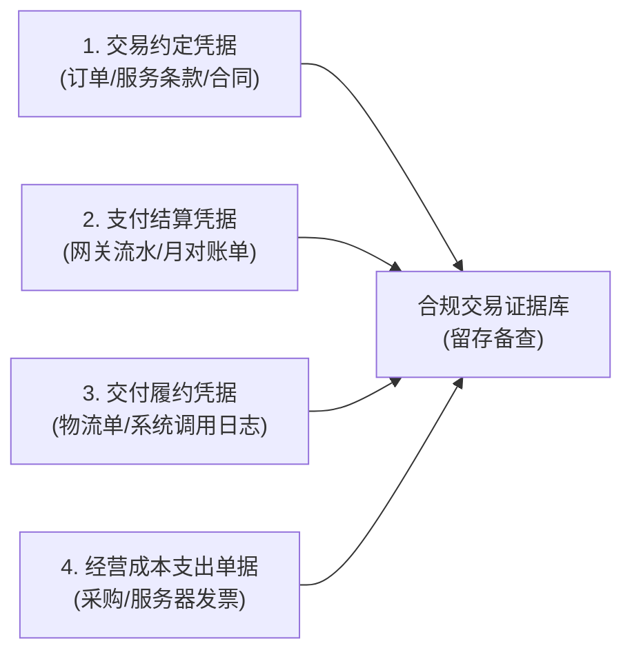
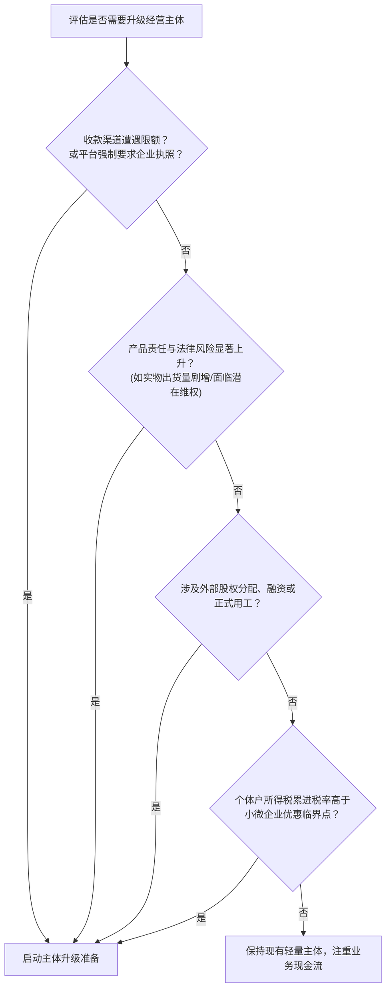
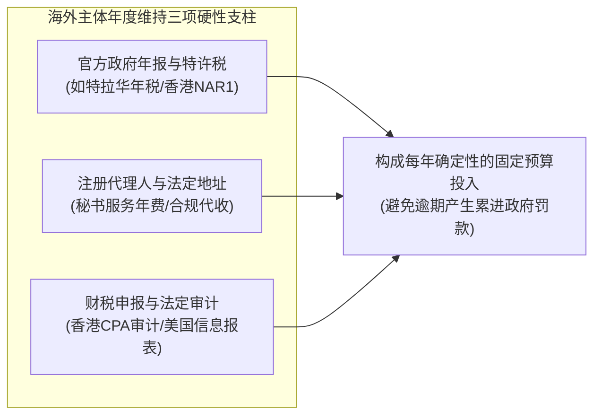
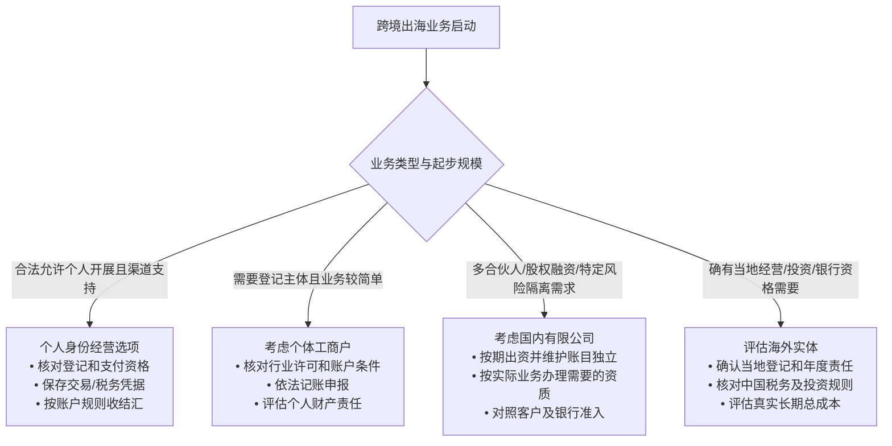

# 第1章｜做跨境生意，我需要注册公司吗？

> **唯一核心问题：做跨境生意，钱怎么收、税怎么交？**  
> **本章定位**：这是全书全流程闭环的逻辑起点。在探讨收款工具接入、收银台转化、资金合规结汇以及境内外税务之前，首先必须解决“**我是谁**”——即以何种法律身份与商业形态进入跨境市场。

---

### 本章贯穿导读案例

为了避免空泛的理论说教，本章将贯穿两类中国大陆最典型的出海创业者路径，帮助读者代入自身场景做出理性决策：
- **案例 A（数字商品与 SaaS 独立开发）**：李明，个人全栈开发者，人在杭州。独立研发了一款轻量级跨平台生产力工具，通过自建英文网站向全球用户提供按月/按年订阅服务，早期客单价低、交易频次高、交付为纯虚拟数据。*（注：涉及早期业务量指标如月订阅金额、流转规模等，均作为模型假设 `[MODEL_ASSUMPTION]` 展示，用于说明决策边界，不代表法定绝对门槛）*。
- **案例 B（实物出海独立站 / DTC 电商）**：张华，外贸创业者，位于义乌/深圳。通过 Shopify 搭建自营品牌独立站，销售自主设计的户外运动与骑行配件，货物通过国内直邮小包及海外仓发往欧美买家手中，涉及实际物理供应链与海关进出口。*（注：涉及货运规模、批次数量等，均作为模型假设 `[MODEL_ASSUMPTION]` 辅助说明）*。

---

## 1.1 不注册公司，也能做跨境生意吗？

### 1.1.1 以个人身份起步，哪些平台和收款渠道可能有准入限制？

**【核心答案】**  
**可以起步，但在主流商业渠道中面临较多资格限制。** 中国大陆自然人可以在适用法律允许、必要登记或许可已履行且平台与收款服务商同意的前提下开展相应跨境经营活动，但在实际商业落地中，必须严格区分“法律上的准入许可”与“商业机构的开户风控规则（Commercial Underwriting）”。很多时候并非法律禁止个人开展业务，而是商业收单机构与电商平台为了控制反洗钱、欺诈交易与消费者纠纷风险，在自身服务条款中设置了主体资格门槛。

#### 1. 为什么商业机构要限制个人身份？
国际信用卡组织（Visa、Mastercard）以及全球支付收单机构（Acquirer）受到国际反洗钱金融行动特别工作组（FATF）标准和各国金融监管机构的审慎监管。企业或个体工商户等市场主体具备公开的工商登记信息、较为明确的受益所有人（UBO）与受法律约束的存续责任；对自然人、个体工商户和企业的尽调所需资料和产品权限会随服务商、法域、业务类型变化。自然人账户可能需要补充收入性质与履约证明，也可能直接不符合某产品的商户准入条件；不能由主体类型推导出所有机构统一的额度、风控或合法性结论。

#### 2. 主流平台与渠道的准入现实判断（核验基准：2026-10）

| 平台 / 渠道类别 | 代表机构 | 个人身份证（自然人）准入可行性 | 限制条件与核查要点 |
| :--- | :--- | :--- | :--- |
| **电商建站与开店平台** | Shopify / WooCommerce / 自建站 | **可行** | Shopify 平台本身允许个人注册开店；但建站后的**收单通道配置**直接受后续绑定的第三方收单机构主体准入规则制约。 |
| | 亚马逊全球开店（Amazon） | **按站点核验** | 先查目标站点对应中国大陆商家的最新招商要求、卖家身份和身份证明，不能把一个站点的规则延伸至所有站点。 |
| | 自由职业与外包（Upwork, Fiverr） | **可行** | 面向个人开发者与自由职业者，支持个人身份证完成身份验证（KYC）后展业。 |
| **主流国际支付网关** | Stripe | **不支持中国大陆个人及企业原生开户** | Stripe 官方支持国家与地区列表中尚未包含中国大陆（核验出处：Stripe Global Availability）。坊间流传的“个人购买海外税号或挂靠虚假地址开通”，极易触发二级风控审核导致账户受限。 |
| | PayPal（中国区个人账户） | **可行，但商业功能有区分** | 根据 PayPal 中国官方用户协议（核验日期：2026-10-20），个人账户可以在平台适用的服务条款下用于收取销售款项；但相比企业账户（Business Account），个人账户在商业集成工具、批量支付、子账号权限以及大额交易风控支持上存在功能限制，高频商业收款建议升级为企业账户并提交商业资质。 |
| | 第三方代售平台（MoR）<br>（如 Paddle, Lemon Squeezy） | **视服务商具体政策动态变动** | 个体创作者是否可签约、是否须提供税务身份与银行资料，取决于具体代售产品、注册地和商家类别；不能笼统声称多数MoR只接受企业。 |
| **合规跨境收款结汇平台** | 万里汇 (WorldFirst)、PingPong、连连国际等 | **部分支持** | 是否有中国大陆自然人、个体户或公司可用的产品，需要逐服务商查开户地区、主体类别、允许的交易来源和出款路径；交易真实性证明的具体要求按机构和实际场景确定，**此处不构成可开户保证（UNKNOWN）**。 |

#### 3. 适用限制与失败时的处理办法
- **适用限制**：个人身份是否适合，与法定登记要求、收款渠道资格、产品责任及合同客户要求有关，而**不是月流水低于某个数字就自动合规**。例如案例A尚无稳定客户、暂以合法渠道验证需求，属于假设情境 `[MODEL_ASSUMPTION]`，不是监管规定的豁免。
- **失败与被拒时的应对动作**：
  - 若在开通支付渠道时因“无法提供商业注册证明（Proof of Business Registration）”被阻断，**切勿尝试购买他人营业执照或伪造海外地址开户**。这种虚假陈述行为一旦被风控系统识别，相关账户将被冻结排查，甚至可能被收单机构通报风险名单。
  - **合规应对方案**：
    - *方案一（轻量化升级）*：在所在地线上政务平台或市场监管所，申请设立国内个体工商户，取得合法统一社会信用代码，以个体工商户主体重新申请企业级商户账号。
    - *方案二（使用代售模式）*：对于软件与数字商品出海，评估采用支持个人创作者签约的合规代售平台（MoR），由平台作为名义零售商直接面向海外买家销售并代缴间接税。

---

### 1.1.2 个人直接收款，合同、资金和责任方面有哪些风险？

**【核心答案】**  
个人直接收款的主要风险集中在三个维度：**民事责任缺乏法定隔离屏障**、**涉外商务合作信任门槛高**、以及**银行渠道的大额/频繁资金合规核查**。自然人开展合规跨境经营并不当然违法，但未设有限责任主体时，经营债务可能直接由经营者个人财产承担。若以个体工商户经营，则须依《民法典》第五十六条区分个人经营、家庭经营及无法区分的情形，不应推定全部经营债务均由家庭财产承担。

#### 1. 合同维度的风险：B2B 商务合作受限与管辖争议
- **商业准入断层**：如案例 A（SaaS 独立开发）向海外企业客户（B2B）销售团队版席位时，中大型企业客户的采购与财务风控流程通常强制要求供应商具备合法企业主体，签署正式的主服务协议（MSA）、数据处理协议（DPA），并要求提供带有公司税号的商业发票（Invoice）。个人自然人往往无法通过其供应商准入审核（Vendor Onboarding），导致商业合作流失。
- **跨国争议应诉成本**：个人对外签署英文商业合同时，若合同约定的争议解决地或管辖法院位于境外，一旦发生违约纠纷，自然人异地聘请跨国律师应诉的财务与精力成本极高。

#### 2. 资金维度的风险：外汇合规核验与异常账户管控
- **外汇便利化额度与真实贸易结算边界**：
  - 依据国家外汇管理局《个人外汇管理办法实施细则》规定，中国境内个人享有每年等值 5 万美元的结售汇年度便利化额度。它是规定的年度便利化办理额度，**不能用“仅适用于非经营性”概括法定适用范围**，也不等于法律规定所有商业外汇收入每年最多只能兑换5万美元。
  - **重要合规事实纠偏**：很多跨境经营者误以为“个人做跨境每年最多只能收 5 万美元”。实务中，依据国家外汇管理局政策规定（如国家外汇管理局天津分局 2026-01-28 官方政策解答），《经常项目外汇业务指引（2020年版）》第六十六条及国家外汇管理局天津市分局2026-01-28答问明确：**境内个人从事跨境电子商务，可通过本人外汇账户办理相关结算；办理跨境电商项下结售汇、提供有交易额的材料或交易电子信息的，不占用个人年度便利化额度**。银行及合规支付机构仍须结合账户性质、交易真实背景、适用监管规定进行审核，既不能以“超5万美元”直接断言无法办理，也不能把“不占用额度”写成“不限金额、无需资料或银行必须放行”。官方依据：https://www.safe.gov.cn/tianjin/2026/0128/2982.html 。
  - **分拆结汇风险**：如果个人无法提供合法合规的贸易真实性证明，而试图通过借用他人额度、小额多批“分拆结汇（蚂蚁搬家）”来规避监管，一经外汇管理部门查实，将依法受到外汇行政处罚，并可能被列入外汇局“关注名单”，在一定期限内被取消便利化结售汇资格。
- **银行反洗钱排查与账户管控**：
  - 个人储蓄账户若突发性、高频次接收来自境外第三方支付机构的大额汇款，商业银行依据《反洗钱法》及大额可疑交易监测要求，有权要求个人限期提交交易背景证明材料。若无法充分说明款项性质，银行可能依法对账户采取暂停非柜面业务等限制措施。
- **严禁非法兑换渠道**：
  - 严禁通过网络中介、非法“换汇群”或地下钱庄对敲提现。这类资金链路极易混入电信网络诈骗、洗钱等上游违法资金，不仅会导致个人银行卡被司法冻结，甚至面临洗钱罪或帮信罪的刑事法律风险。

#### 3. 法律责任维度的风险：无限清偿责任的法律界限
- 依据《中华人民共和国民法典》第五十六条规定：**个体工商户的债务，个人经营的，以个人财产承担；家庭经营的，以家庭财产承担；无法区分的，以家庭财产承担。** 自然人直接以个人名义对外从事经营活动的，依法以个人全部财产承担清偿责任。
- 如案例 B（实物独立站），若张华以个人名义销售的骑行头盔因批次质量瑕疵导致海外消费者在骑行事故中受伤，受害者在目的国法院提起产品责任侵权诉讼：
  - **若以有限责任公司经营**：在股东按期足额出资、公司财产与股东个人财产保持独立的前提下，公司作为独立法人以其全部财产为限对外承担民事责任，股东以其认缴出资额为限承担有限责任；
  - **若以个人经营**：受害者直接起诉张华自然人。若境外生效判决依法获得执行，张华依法需以自身全部个人财产承担赔偿责任，缺乏有限责任的防火墙保护。

---

### 1.1.3 个人起步也有收入时，哪些交易和税务记录必须及时保存？

**【核心答案】**  
无论是否设立公司、无论流水规模大小，只要产生了跨境经营性资金流入，**建立“交易合同/订单、资金结算单、履约交付记录、经营支出凭证”四维一体的证据链档案**，是顺利办理外汇结汇入账以及满足境内外税务合规核查的必要基础。

#### 1. 为什么要从起步期建立归档？
- **银行与外汇监管核查**：依据国家外汇管理局经常项目外汇管理规定与“展业三原则（了解你的客户、了解你的业务、尽职审查）”，金融机构在为个人办理跨境电商贸易项下外汇入账时，负有核验贸易真实性背景的职责。
- **税法凭证备查要求**：依据《中华人民共和国税收征收管理法》及其实施细则规定，从事生产、经营的纳税人应当按照规定设置、保管账簿及记账凭证、完税凭证及其他有关资料。个人取得涉外收入依法负有纳税申报义务，完备的支出凭据是未来合规扣除成本、避免全额核定征税的关键支持材料。

#### 2. 个人必须日常归档的四套核心记录清单



1. **交易约定凭据（证明交易具有真实商业意图）**：
   - 独立站后台导出的电子订单明细（包含唯一订单号、下单时间戳、商品/服务名称、计价币种、金额及买家基本信息）。
   - 网站公示且在交易发生时有效的《用户协议》（Terms of Service）、《隐私政策》及《退换货条款》快照。
   - 针对定制外包开发或 B2B 服务，保存双方电子签署的正式合同（如 DocuSign 记录）、服务确认函或关键沟通邮件。
2. **支付结算凭据（证明资金通过正规支付清算渠道流转）**：
   - 收款服务商或银行提供的月度财务对账单（Monthly Account Statement）。
   - 包含明确交易流水号（Transaction ID）、结算手续费明细、退款及净到账金额的电子明细表。
3. **交付履约凭据（证明商品或服务已真实交付）**：
   - **实物商品类**：国际快递运单底单（Air Waybill）、带有完整妥投签收时间链条的物流追踪轨迹截图（如 17Track 抓取页面）、海关申报单据（若走商业报关）。
   - **虚拟商品 / SaaS 类**：系统后台用户账号激活记录、API 服务调用日志（Access Logs）、授权密钥（License Key）分发邮件记录。
4. **经营成本支出单据（证明经营活动的实际支出）**：
   - 上游商品采购合同、供应商付款银行回单；
   - 支付给海外云服务商（如 AWS、Cloudflare）、软件工具及域名注册商的官方电子收据（Receipt/Invoice）。

#### 3. 推荐操作流程
- 建立以“`年份-月份_业务平台`”命名的电子档案归档目录；
- 定期从建站后台与支付机构导出 CSV 交易明细与 PDF 账单，保存于具备版本管理与安全加密功能的云盘或本地存储中；
- **先按资料法定类别确定保管期限**：属于依法应归档的会计凭证和主要账簿，按照《会计档案管理办法》至少保存30年；月度/季度财务报告等通常10年，年度财务报告等按规定永久保存。普通沟通、经营分析辅助资料可结合合同争议时效、税务与外汇证明需求制订更长的内部留存政策，但**不能用统一“5年以上”取代法定期限**。个人是否负有单位会计档案义务，应按实际主体和法定义务判断；详见1.6.1及财政部原文：https://www.mof.gov.cn/zcsjtsgb/gztsgb/201512/t20151211_3578376.htm 。

---

## 1.2 个人、个体工商户和公司，分别适合什么情况？

### 1.2.1 个人、个体工商户与有限公司，在责任和管理成本上怎么比？

**【核心答案】**  
主体选型本质上是**在“民事责任风险暴露”与“合规制度维系成本”之间寻找商业平衡**。不同主体在法律地位、出资责任、记账要求及税制安排上存在法定差异。

#### 1. 核心维度横向对比表（法律基准：中国现行法域，核验日期：2026-10）

| 对比维度 | 个人（自然人） | 个体工商户 | 有限责任公司（标准有限公司） |
| :--- | :--- | :--- | :--- |
| **法律地位** | 自然人，不属于商业组织 | 属于市场主体，具有商号，但不具有独立法人资格 | 具有独立的**法人资格** |
| **民事出资与债务责任** | **无限清偿责任**：个人财产承担责任 | **无限清偿责任**：依据民法典第56条，个人经营的以个人财产承担，家庭经营的以家庭财产承担 | **有限责任（以出资为限）为主，存在法定例外**：<br>1. 一般以认缴出资额为限承担有限责任；<br>2. **公司法第23条例外**：股东滥用公司法人独立地位逃避债务的，应当对公司债务承担连带责任；一人有限责任公司股东不能证明公司财产独立于股东个人财产的，应当对公司债务承担连带责任。 |
| **设立流程与注册资本** | 个人作为自然人无需注册“公司”，但是否须办理个体工商户等市场主体登记、行业许可或税务登记，依具体经营方式核查 | 登记流程简便，无注册资本最低限制，通常数个工作日办结 `[MODEL_ASSUMPTION]` | 需制定公司章程、履行规范设立程序。**依据2024年7月1日施行的新《公司法》及国务院配套出资规定，有限责任公司全体股东认缴的出资额须自公司成立之日起5年内缴足**。 |
| **对公账户与跨境收单准入** | 自然人一般不以企业名称开对公账户；适用的本人外汇账户、平台收款和出款方式需逐项核验 | 可按市场主体和银行规则申请适用账户；**不是所有跨境收款产品都支持个体户** | 符合银行和服务商尽调要求时可申请企业账户；**中国大陆公司不自动获得海外支付机构开户资格** |
| **会计建账与合规维护** | 保存必要交易资料并按适用税法申报；是否有正式建账义务须结合实际经营身份和法规判断 | 符合规定标准的应建立复式账或简易账；达不到建账标准的由税务机关进行核定征收或简易管理。市场代账成本通常较低（如每月百元至数百元不等 `[MODEL_ASSUMPTION]`） | **法定必须规范建立会计账簿**（依据《会计法》与《企业会计准则》），出具资产负债表与利润表。代账或专职财务年维护支出中等 `[MODEL_ASSUMPTION]` |
| **税制结构** | 综合所得或经营所得缴纳个人所得税（适用超额累进税率） | **不缴纳企业所得税**；按“经营所得”缴纳个人所得税（5%-35% 超额累进税率），部分地区符合条件的可依规享受减免政策 | **双重税制结构**：<br>1. 公司层面计算缴纳**企业所得税**（标准税率 25%，符合条件的小型微利企业按税收优惠政策减免）；<br>2. 税后利润向个人股东分红时缴纳 20% 的**股息红利个人所得税** |

#### 2. 各主体的适用场景画像
- **个人（自然人）**：适合“超轻量业务概念验证期”。无实体库存、无员工雇佣、月度交易流水很小且处于试错阶段。
- **个体工商户**：适合“单兵作战的独立开发者与小微电商卖家”。需要符合银行及特定商业收款渠道条件的经营账户，但业务结构简单，希望避免有限公司复杂的企业所得税汇算及清算注销流程。
- **有限责任公司**：适合“具备商业扩张规划的正规团队”。涉及多位合伙人股权分配、计划招聘员工、业务包含一定潜在人身伤害或知识产权纠纷风险的实物消费品、或海外大客户明确要求具备 Corporate 资信背书的业务。

---

### 1.2.2 业务发展到什么情况时，才值得变更经营主体？

**【核心答案】**  
**不建议脱离业务实际盲目升级主体。** 只有当现有主体在资质门槛、风险隔离、用工融资或税负结构上已经实质性限制业务拓展时，才是启动主体变更的合理时机。

#### 1. 驱动主体升级的五大客观判断指标



1. **商业收款通道准入与额度受限**：
   - 现有的个人账户或个体户账户在跨境收款平台达到风险评级限额，或申请特定专业支付通道时系统强制要求提交企业法人营业执照。
2. **产品风险与法律责任敞口外溢**：
   - 如案例 B，当张华的自行车头盔月出货量扩大至较高规模 `[MODEL_ASSUMPTION]` 时，实物产品的批次质量与跨国维权风险显著上升。继续以个体工商户经营可能使经营者的个人财产或依法认定的家庭财产承担经营债务，此时升级为有限责任公司建立法定财产隔离具有实际价值。
3. **团队规模化、股权架构与正式用工**：
   - 业务扩张需要招聘全职员工，涉及规范签订劳动合同、缴纳社会保险与住房公积金；引入技术或运营合伙人，需要清晰约定出资比例、股权表（Cap Table）与表决权分配。个体工商户不像公司那样以股份或股权期权安排合伙人权益，若需要股权融资，应另行设计适法的企业组织形式。
4. **企业客户（B2B）采购准入要求**：
   - 海外企业采购方在合规审核中，明确要求供应商提供企业法人代码、对公银行资信证明或特定行业商业信用评级，无法向个人或个体户下单。
5. **财税边际效益变化**：
   - 随着经营利润增长，个体工商户经营所得适用最高 35% 的超额累进个税税率。在合法合规前提下，若测算转型为符合国家税收优惠条件的小型微利企业能够有效平衡研发投入扣除与实际税负，可考虑向公司制转型。

#### 2. 主体变更时的平滑过渡实务检查清单
主体升级绝非单纯在系统内“切换一个 API 密钥”，而是一套涉及合同、资产、客户与税务的系统性过渡流程：
- [ ] **设立新公司并开通企业商户号**：在新公司完成营业执照登记、银行对公账户开立后，向支付网关或收款机构提交全新的企业资质申请；
- [ ] **评估存量客户与签约关系迁移**：
  - 检查历史商业合同中的主体变更条款；若涉及企业级 B2B 客户，通常需要向客户发出《主体变更通知函》或签署三方转让补充协议；
  - **支付与订阅迁移边界**：更换法律经营主体或商户号，**不能只换API密钥就沿用旧支付对象与扣款授权**；但不能归因于“PCI-DSS一律禁止跨商户迁移”。Stripe等机构在符合其条件时提供由官方团队协调的合规付款资料迁移；**付款资料、客户对象、订阅计划、既有代扣授权、消费者知情及法律主体更替**应分别核验，部分对象或授权不能自动迁移，必要时重新获得客户同意或发起绑卡。先咨询原机构和新机构、测试映射及续费失败回退，再向客户通知。官方示例：https://docs.stripe.com/get-started/data-migrations/overview ；
- [ ] **未完结订单与退款预留池处理**：在旧主体商户号下保留充足余额，以应对历史订单在规定窗口内的退款（Refund）与拒付（Chargeback）申诉，切勿在迁移当日将旧账户资金提空；
- [ ] **前台协议与法律声明公示更新**：更新独立站网站底部的运营主体名称、更新《服务条款》并依规提示用户运营主体变更；
- [ ] **税务与账目结清**：旧主体停止接单后，按规定完成当期税务申报与账目结清，根据实际规划决定保持休眠存续或依法办理注销。

---

## 1.3 注册国内公司还是海外公司，怎么选？

### 1.3.1 出现哪些真实业务需求时，才需要考虑海外公司？

**【核心答案】**  
**部分刚起步的中国跨境经营者可先评估国内主体或合规个人经营路径。** 盲目设立海外公司往往不仅无法带来预期便利，反而会徒增跨国合规、年报审计及法定秘书等持续管理负担。海外设立的商业合理性应结合本地经营、合同主体、融资、支付资格及长期维护成本逐项判断，而不是把某一种需要认作唯一理由。

#### 1. 考虑设立海外实体的真实业务场景清单
1. **必须接入仅对特定海外法域开放的支付收单体系**：
   - 例如部分跨境收单机构或深度集成的金融基础设施，仅向特定司法管辖区注册的企业开放。若出海产品的底层商业逻辑高度依赖这些特定功能，且国内主体确实无法替代，海外主体构成其业务落地的必要条件。
2. **海外本地化生态渠道的强制注册要求**：
   - 部分欧美本地细分电商平台、专业软件服务商采购名录或当地行业准入协会，在条款中明确规定仅接受当地法人主体注册，不接受离岸跨国跨境卖家入驻。
3. **海外本地化实体运营、仓储与雇佣**：
   - 在目标市场自建大规模仓储设施、在当地直接招聘全职本地雇员，需要根据当地劳动法规办理当地雇主识别号（如美国 EIN）并缴纳本地法定义务。
4. **境外股权架构搭建与美元风险投资**：
   - 计划引入境外风险投资基金（USD VC），投资机构通常要求在开曼群岛、美国特拉华州或新加坡搭建标准的红筹架构或控股母公司，以满足资金出入与海外资本市场上市规划。

#### 2. 常见反例与认知误区澄清
- **误区一：“在海外开个公司就可以不用给中国交税了。”**  
  *事实澄清*：这是极度危险的合规误解。中国企业所得税法确立了“实际管理机构”原则；中国个人所得税法确立了中国税收居民的全球所得纳税义务。如果境外企业的实际管理机构位于中国境内，可能触发居民企业认定；需要依据企业所得税法及适用事实具体判断；个人取得的分红所得依法亦负有境内个税申报义务（详见 1.3.3 节）。
- **误区二：“做容易引起争议的商品或知识产权擦边业务，用海外公司平台就管不到了。”**  
  *事实澄清*：欧美法域对商业欺诈、洗钱与知识产权侵权（IP Infringement）的司法协同打击力度极强。一旦权利人在当地法院申请临时限制令（TRO），当地银行账户与支付通道将直接被依法冻结，海外壳公司不仅无法提供庇护，还会使经营者面临直接的跨国法律追责。

---

### 1.3.2 香港、美国或其他注册地，该比较哪些长期条件？

**【核心答案】**  
比较海外注册地时，不能仅看代理机构宣传的“初始代办费用”，而必须全面核算**法域适用税制、银行开户条件、年度法定审计要求以及长期维系合规成本**。

#### 1. 主流司法管辖区横向核查表（核验基准：2026-10）

| 比较维度 | 中国香港（Hong Kong Ltd） | 美国特拉华/怀俄明（US LLC / C-Corp） | 新加坡（Singapore Pte. Ltd.） | 英国（UK Ltd） |
| :--- | :--- | :--- | :--- | :--- |
| **制度与法系特点** | 普通法系；无外汇管制；中英双语商业环境；主流金融机构认可度高 | 公司法制极其成熟；特拉华州衡平法院判例体系完善；怀俄明州隐私保护较强 | 东南亚商业枢纽；国际信誉极高；拥有广泛的双边税收协定网络 | 官方注册工本费较低；公司注册处信息公开规则明确 |
| **银行与账户开立实务** | **中等**：传统物理大行（汇丰、渣打等）审核较严，通常需提供业务背景证明材料；合规虚拟银行远程开通相对灵活 | **中等**：线上金融科技银行开户流程相对便捷；传统大型商业银行对非居民无实体赴美通常审核较严 | **较高**：本地银行客户尽调（KYC）要求严格，通常要求本地董事或高级管理人员配合审核，部分需沉淀开户保证金 | **较高**：英国传统银行对非英国居民（Non-resident）董事企业的商业开户审核极为审慎 |
| **主要税制结构** | 实行地域来源征税原则；两级制利得税（符合条件的首 200 万港币应评税利润税率 8.25%，超出部分 16.5%） | **LLC**：联邦税务分类取决于成员数量及实体选择，单人通常为被忽略实体、多人通常为合伙纳税，也可选择按公司纳税；非居民所有人仍须按收入来源等规则判断申报；<br>**C-Corp**：一般适用联邦公司税，另核州税或特许税，切勿把加州最低税套给全部美国LLC | 企业所得税标准税率 17%，新创小微企业在符合条件的前提下享有阶段性税额减免 | 企业所得税标准税率（根据利润规模为 19% 至 25% 阶梯税率）；对无本地实体的非居民企业（NETP）销售实施严格增值税监管 |
| **年度硬性合规动作** | 1. 提交周年申报表（NAR1）；<br>2. 商业登记证（BR）续期；<br>3. **法定账簿审计**（符合休眠条件除外） | 1. 缴纳州年度特许经营税（Franchise Tax）或年报费；<br>2. 维持注册代理人；<br>3. **按实体税务分类与关联交易核查联邦税表及信息披露（如特定主体Form 5472）** | 1. **强制要求至少一名新加坡本地常住居民董事**；<br>2. 提交年度申报表（Annual Return）；<br>3. 编制符合财务准则的财务报告并报税 | 1. 提交年度确认声明（Confirmation Statement）；<br>2. 编制并提交年度账目（Accounts）与税务申报 |
| **年度维系成本区间估算** | **约 6,000 - 15,000 元 RMB/年** `[MODEL_ASSUMPTION]`（含法定秘书、注册地址及**审计费用**） | **约 3,000 - 8,000 元 RMB/年** `[MODEL_ASSUMPTION]`（州特许税 + 注册代理人费；不含复杂报税会计师费） | **约 25,000 - 50,000 元 RMB/年** `[MODEL_ASSUMPTION]`（本地挂靠董事服务费及秘书年费占大头） | **约 2,000 - 5,000 元 RMB/年** `[MODEL_ASSUMPTION]`（无实际本地运营的简易维护成本） |

#### 2. 核心红线与合规义务细节澄清
- **香港公司的审计与申报规则**：
  - 依据香港《公司条例》（第622章）规定，香港成立的一般适用公司须按《公司条例》准备财务报表及履行适用审计责任；利得税报税所需报表和审计文件应依据公司是否收到报税表、企业类别、适用豁免和税务局当期指引分别判断，**不是每家公司每年均需主动提交同一套审计附件**。
  - **法定例外情况**：依据《公司条例》第 447 条，公司若通过特别决议案并向公司注册处申报成为“不活动公司（Dormant Company，休眠公司）”，在该状态期间可豁免编制财务报表及审计要求。但只要公司发生任何会计交易（包括银行账户产生收付款、入账），即丧失休眠资格。
  - **合规界限**：若公司发生实际经营收支，切勿听信不良中介所谓的“只要不在香港发生业务就一律做零申报”的虚假宣传。未按实际情况填报税表属于违法行为，可能面临税务罚款或依据香港法律被提起检控。
- **美国公司 Form 5472 关联交易信息申报规则**：
  - 依据美国国税局（IRS）关于 IRC §6038A 及 §6038C 的实施指引（Instructions for Form 5472）：
    - **先分三类实体**：美国通常税务居民公司（例如选择按公司征税的C-Corp / LLC）、有多个成员且默认按合伙型申报的LLC，以及**由外国人100%持有、被联邦所得税规则视为被忽略实体的美国单人LLC（foreign-owned U.S. DE）**。LLC是州法实体，不能仅凭LLC名称确定联邦税表。
    - **5472适用条件**：应按IRS对reporting corporation、25%外国股东、关联方及具体可报告交易的定义与例外判断；外国独资被忽略实体还须特别检查业主出资、往来等报告项目。并非每个“有海外股东的LLC”都自动每年必交相同税表。
    - **提交方式不同**：一般适用的申报公司将Form 5472附在其依法应提交的公司所得税申报表上；**外国人全资的美国被忽略实体**如触发5472要求，则按IRS特殊流程提交**pro forma Form 1120 + Form 5472**。默认合伙型LLC先核实Form 1065等独立申报义务，**不能一律套用被忽略实体的pro forma 1120流程**。
    - **漏报风险**：对依法应报Form 5472却未及时报送的申报公司，IRS规定的基本罚款为每一相关年度**25,000美元**，具体加罚与救济条件依官方指引。见：https://www.irs.gov/instructions/i5472 。

---

### 1.3.3 在海外注册公司后，还要核查哪些中国境内的经营和纳税责任？

**【核心答案】**  
人在中国境内控制海外公司，绝不等于自动脱离中国税法管辖。**中国税法对企业的税收管辖权遵循“登记注册地标准”与“实际管理机构标准”相结合的原则；对自然人遵循居民个人全球所得征税原则。**

#### 1. “实际管理机构所在地”判定中国居民企业风险
- **法律依据**：依据《中华人民共和国企业所得税法》第二条及其实施条例第四条，依法在境外成立、但**实际管理机构在中国境内**的企业，属于中国居民企业。
- **认定考量因素**：国家税务总局在涉外税收管理实务中（参考《关于境外注册中资控股企业依据实际管理机构标准认定为居民企业有关问题的通知》（国税发〔2009〕82号）精神），综合考察实质管理要素：
  - 负责企业日常生产经营与财务决策的高级管理人员履行职责的场所是否主要在境内；
  - 财务决策、人事决策的决定地或批准地是否在境内；
  - 主要财产、会计账簿、公司印章、董事会纪要是否位于或存放于境内；
  - 具备表决权的董事或核心高管是否经常居住在境内。
- **潜在法律后果**：境外企业一旦被税务主管机关依实质重于形式原则认定为“中国居民企业”，其企业所得税管辖范围一般涉及境内、境外所得，但实际税额、境外税收抵免和申报责任须按法定规则计算；不能据此推断每笔境外收入自动重复缴税。

#### 2. 个人层面的涉税反避税与信息透明机制
- **共同申报准则（CRS）信息交换**：中国已正式加入金融账户涉税信息自动交换（CRS）机制。CRS是参与法域针对**可报告金融账户**的涉税信息交换制度，须区分金融机构类型、税收居民地、账户持有人/控制人、免报账户与双边交换关系。可报告字段可能包括身份及税收居民资料、账户余额、利息、股息，以及**托管金融资产出售或赎回总收益等规定项目**。**这里的金融资产总收益不等于普通电商商品销售营业额**，也不能认定全球所有境外账户都会向中国逐账户自动回传。参照OECD CRS标准：https://www.oecd.org/en/publications/international-standards-for-automatic-exchange-of-information-in-tax-matters_896d79d1-en/full-report/component-13.html 。
- **受控外国企业（CFC）反避税规则**：依据《中华人民共和国个人所得税法》第八条规定，由居民个人控制、或者由居民个人和居民企业共同控制的设立在实际税负明显偏低的国家（地区）的企业，无合理经营需要，对应当归属于居民个人的利润不作分配或者减少分配的，**税务机关有权按照合理方法进行纳税调整**。
- **分红与境外所得申报**：境外公司向中国居民个人股东实际分配股息、红利时，个人股东依法负有在境内主动申报缴纳“利息、股息、红利所得”个人所得税（法定税率 20%）的法定义务。若在境外已依法缴纳相应税额的，可按税法规定申请境外所得税额抵免。

#### 3. 资本项下外汇监管：37 号文的适用边界
- **什么是 37 号文**：即国家外汇管理局《关于境内居民通过特殊目的公司境外投融资及返程投资外汇管理有关问题的通知》（汇发〔2014〕37号）。
- **核查边界澄清**：
  - 37号文第一条界定的特殊目的公司，是**境内居民（包括境内机构与境内居民个人）以投融资为目的，以其合法持有的境内企业资产或权益，或者合法持有的境外资产或权益，在境外直接设立或间接控制的境外企业**。因此，不得仅因没有境内企业资产而排除适用；境内机构与个人的具体登记手续又不同。原文：https://www.safe.gov.cn/neimenggu/2014/0926/105.html 。
  - 海外公司若**仅从事通常贸易销售**而不是以境内外资产或权益开展投融资，未必符合37号文所述SPV定义；但是否以投资为目的、谁为控制人、注入何种资产、是否发生境外融资或返程投资，需逐案核查，不能靠“无境内资产”“只是壳公司”直接判定免登记。涉及个人境外投资或资本项下资金流动时，先向有资质银行及外汇主管部门核实实际适用要求；贸易经营收汇另按经常项目及真实交易证明规则判断。

---

## 1.4 客户付钱时，谁才是法律上的卖家？

### 1.4.1 自己直接收款、通过平台卖货和第三方代售，谁是卖家？

**【核心答案】**  
**优先看谁依据销售条款/交易合同向消费者销售并承担相应合同责任**，再结合平台入驻协议和适用法律认定法律卖方。票据抬头、支付描述符只是核对线索，**并不同时构成认定法律卖方的必要且充分条件**。“Merchant of Record（MoR）”是商业支付/代售模式的特定称谓，不可把所有普通商户卖家都自动等同于承担全世界税务义务的第三方MoR服务商。

#### 1. 三种出海交易模式法律关系对比

```mermaid
flowchart TD
    subgraph 模式一：自主收单模式
        M1["你自己的经营主体 (销售方)"] -- "直接零售合同" --> C1["终端消费者"]
        M1 -- "支付处理技术协议" --> P1["Stripe/PayPal (技术网关/收单行)"]
    end

    subgraph 模式二：平台撮合模式
        M2["你自己的经营主体 (第三方卖家)"] -- "商品销售合同" --> C2["终端消费者"]
        Plat["Amazon等平台 (撮合平台/税收代扣方)"] -. "提供货架与代扣服务" .-> C2
        M2 -- "入驻服务协议" --> Plat
    end

    subgraph 模式三：第三方代售模式
        M3["你自己的主体 (上游软件授权方/供货商)"] -- "B2B批发/转售协议" --> MoR["Paddle/Lemon Squeezy (法律卖家/MoR)"]
        MoR -- "B2C转售合同" --> C3["终端消费者"]
    end
```

1. **自主收单模式（Direct Merchant / 自建独立站 + 收单网关）**：
   - **谁是法律卖家**：**你自己的经营主体（个人、个体户或公司）**。
   - **商业与法律定性**：消费者在你的网站点击购买并付款，直接与你的主体成立买卖合同。支付通道（如 Stripe、PayPal）仅充当支付技术网关或收单机构，向你收取交易手续费后将资金结算入账。你通常承担直接销售的合同责任，但收单机构是否将你列为商户记录人，还要核对具体服务协议与支付产品。
2. **平台撮合模式（Marketplace / 亚马逊、eBay 等电商平台）**：
   - **谁是法律卖家**：**通常依然是你自己的经营主体（入驻第三方商户）**。
   - **商业与法律定性**：平台提供展示货架、技术系统与资金代收代付。平台是否按某国/州的市场促进者规则代征间接税，须看商品类别、法域与交易结构；销售者、平台、制造商、进口商等可能分别承担合同、税务、产品责任或侵权责任，不是平台代征就一律免除卖方全部义务。
3. **第三方代售 / 名义卖家模式（Merchant of Record / MoR，如 Paddle、Lemon Squeezy、FastSpring）**：
   - **谁是法律卖家**：**代售服务商实体本身（MoR），并非商户自身**。
   - **商业与法律定性**：这是一种转售代理架构。商户将软件许可或数字产品以 B2B 形式授权或转售给 MoR，MoR 再以自己的名义作为独立零售商向全球个人消费者销售。在真正转售安排且平台协议确认为法律卖方的**相应交易范围内**，消费者可能与MoR订立零售合同，由MoR处理其负责的票据、适用交易税和部分付款争议，随后按合同向上游供货商结算。**具体覆盖国家、税种、退款、拒付、产品和内容责任均须以平台条款及适用法律核对**，不保证所有目的国税务或风险均被包办。

---

### 1.4.2 真正的卖家，需要承担哪些退款、税务和消费者责任？

**【核心答案】**  
法律卖方的身份直接决定了**谁对终端消费者承担法定质保退款、谁对销售地税务局履行流转税代征义务、以及谁承担银行卡组织的拒付抗辩责任**。

#### 1. 目的地消费税与增值税合规义务（Sales Tax / VAT / GST）
- **自主收单模式（商户为法律卖家）**：商户必须依据销售目的地的税法，核算自身是否触发了税收关联（如美国的 Economic Nexus 门槛或欧盟的远程销售规定）。达到适用门槛或形成当地税务义务后，商户应核对**是否由自己登记、收取及申报，是否存在平台代征/简化申报或法定例外**；不能不加区分地要求全部境外直销商向所有目的地税局注册（细节见第10章）。
- **MoR 代售模式（代售商为法律卖家）**：对于**确实由MoR作为销售方且其合同承诺及法律要求覆盖的交易和法域**，可由MoR处理相应目的地间接税；混合销售、自营网站订单、未覆盖税区及上游供货商自身申报责任仍应单独核查。**重要界限提示**：MoR 代缴的仅为**交易环节的间接税（流转税）**；商户从 MoR 处获得的经营收入，其自身的**所得税纳税义务（企业所得税或个人所得税）依然由商户自身主体在注册地及税收居民地依法申报**。

#### 2. 消费者权益、退换货与产品责任（Consumer Rights & Liability）
- **退换货保障法案**：在欧盟《消费者权利指令》（Directive 2011/83/EU）等法规管辖下，消费者原则上享有法定 14 天撤销权（无理由退货冷静期）。
  - *法定例外*：欧盟须区分**以非实体载体提供的数字内容**（如可下载文件）与**持续数字服务**（如部分SaaS）：数字内容按《消费者权利指令》第16条(m)，在消费者事前明确同意撤销期内开始履行、确认知晓会丧失撤销权，且**商家提供含该同意和确认信息的合同确认**并实际开始提供后，才可能适用例外。数字服务的撤销权处理不同，不能凭一个勾选框即一律取消14天权利；还须核对成员国具体实施规则。依据欧盟委员会指引：https://eur-lex.europa.eu/legal-content/EN/TXT/?uri=CELEX%3A52021XC1229%2804%29 。
- **人身财产损害责任**：对于实物商品，因设计或制造缺陷造成的人身伤害或财产损失，被害消费者可依据销售合同及目的地产品责任法向适用的销售商、生产商、进口商等责任主体主张权利，**不以合同卖家为唯一被告**。即便MoR承担零售合同关系，上游生产商/开发者也不当然免于产品安全或侵权责任；平台能否向上游追偿，取决于合同、责任原因和法律。

#### 3. 知识产权（IP）责任与维权澄清
- **重要法律澄清**：**使用 MoR 绝不豁免商户的侵权责任！**
- 代售平台通常要求上游商家保证其享有适用的知识产权或授权。收到侵权投诉、下架通知或法院命令时，可能触发内容审查、账户限制、按协议保留款项或依法提供必要资料；**是否采取措施、是否披露信息以及实际责任比例**均取决于争议事实、协议、个人信息保护规则和法定程序，不应宣称平台一律立即封停或商家承担全部赔偿。

---

### 1.4.3 怎样对照客户合同和付款收据，确认实际的法律卖方是谁？

**【核心答案】**  
判断一笔跨境交易法律卖方的实际归属，不能仅凭口头宣传，而应**以销售合同、结账服务条款及平台/MoR合作协议为主证据**，付款收据、发票抬头及银行扣款描述符只能作为辅助核对线索；若三者不一致，应联系平台取得法律销售方说明，不能仅凭抬头直接推断。

#### 1. 法律卖方身份多重印证核查表

| 核对证据点 | 查看与检索位置 | 自主收单模式表现（商户自身为卖家） | 第三方代售 MoR 模式表现（服务商为卖家） |
| :--- | :--- | :--- | :--- |
| **1. 结账服务条款（Terms of Sale）** | 网站收银台结账弹窗底部的协议链接或勾选框 | 条款明确写明合同相对方为你的店铺名称或公司名称 | 条款明确写明合同由代售商（如 `Paddle.com Market Ltd` 或 `Lemon Squeezy, LLC`）订立 |
| **2. 付款收据与发票（Tax Invoice / Receipt）** | 系统自动向消费者发送的电子账单、收据或 PDF 发票 | 可能由你的主体开具销售凭证；具体税票/税号取决于交易与当地法律 | 在适用规则下可能显示代售商名称与相应税务信息，但不是每张收据都含目的地税号 |
| **3. 银行对账单描述符（Billing Descriptor）** | 买家信用卡或电子银行账单中显示的扣款明细字符串 | 显示为你设置的商业名称，例如：`MYBRAND*PRODUCT`（示例，非固定格式） | 带有代售服务商统一前缀，例如：`PADDLE.NET*PRODUCT` 或 `FS* FASTSPRING` |

#### 2. 自检核验的实务用途
当商户需要向国内银行或外汇监管部门说明“为什么海外打入对公账户的款项来自爱尔兰或英国的某支付公司”时，出具与 MoR 签署的合作协议、包含对公结算记录的月度账单，可帮助说明付款方、合同对象与所涉交易关系，但**收入应归为服务、软件授权、货物转售还是其他类型**，必须根据实际合同性质和银行审核材料认定；这些文件并不保证银行一定受理或允许结汇。

---

## 1.5 注册经营主体前，需要核实哪些条件？

### 1.5.1 经营范围、注册地址和银行开户资格，该提前查什么？

**【核心答案】**  
主体注册不能孤立看待，而必须将**工商经营范围、税务涉税税目、海关备案资质以及商业银行开户风控政策**进行前置联动核查。

#### 1. 经营范围与业务资格：分开核验
- **国内主体经营范围要点**：
  - *实物跨境电商（案例 B）*：应根据实际货物进出口、技术业务与销售模式查当地市场监管部门的经营范围规范表述；具体是否须增加相应范围、另办商品许可，应在经营前核对，**并非所有实物跨境商家都必须同时列全上述项目**。
  - **重要法规事实更新（2023年起）**：根据商务部 2023 年 1 月 3 日官方公告，依据 2022 年 12 月 30 日修订的《中华人民共和国对外贸易法》第九条，**自 2022 年 12 月 30 日起，各地商务主管部门已全面取消对外贸易经营者备案登记**。因此，不再需要旧商务部门的对外贸易经营者备案登记；**依法需要以进出口货物收发货人身份办理报关业务的市场主体**，按海关现行规定通过“多证合一”、海关政务服务平台或中国国际贸易单一窗口办理报关单位备案。备案信息可以公开查询，**《报关单位备案证明》纸质件在申请人提出需要时提供，并非取得纸质证明才算完成备案**。海关官方指南：https://online.customs.gov.cn/static/pages/guides/000729011000/000729011000.html 。
  - *软件开发与 SaaS 出海（案例 A）*：建议规范包含“**软件开发**”、“**信息系统集成服务**”、“**信息技术咨询服务**”、“**数据处理和存储支持服务**”。经营范围必须真实反映业务，**但是否适用跨境服务增值税零税率或免税，应另按具体服务类型、消费地点、合同及税务资料等当期法规判断**；经营范围文字不构成自动适用税收优惠的证明（详见第9章）。
- **海外主体经营范围要点**：
  - 香港公司通常在业务性质（Business Nature）一栏以简明中英文注明核心业务方向；美国绝大多数州（如特拉华、怀俄明）公司章程默认允许从事“任何合法商业活动（Any Lawful Activity）”，但未经特定监管牌照批准，严禁包含 *Banking*、*Insurance*、*Trust* 等金融受限词汇。

#### 2. 注册地址合规性与实地核查风险
- **国内集群注册地址与集中办公区**：小微商家是否可使用集群/托管地址依当地市场主体登记政策决定；应向市场监管部门核查真实地址、可收函条件及需要提交的住所使用证明，**不能把“合法众创空间认定”“房产证+租赁备案”当成全国统一必备组合**。切勿使用未经备案的虚构门牌，否则易因“通过登记的住所或者经营场所无法联系”被列入**经营异常名录**。
- **海外注册代理人与法定地址**：需确认实际提供的**公司秘书、信托或公司服务**是否落入该法域牌照/资格制度；例如香港TCSP牌照覆盖相应服务业务，但不能推断每一位普通公司秘书个人必须持相同牌照。代理地址必须具备稳定的法定商业公函转交与信件扫描服务，避免因遗漏政府公函、税表或法院传票导致主体被宣告失效。

#### 3. 商业银行对公账户开户资格的实质性风控核查
- **商业银行风险审查导向**：各商业银行依据反洗钱客户身份识别（CDD）规定，对涉外新开户企业实行分类分级的风险管控。
- **实地走访与核查条件差异（标明 UNKNOWN）**：
  - 实务中，部分商业银行支行在办理涉外涉诈高风险区域的企业开户时，可能会安排工作人员进行上门现场勘验（核实招牌、工位与经营环境）；部分银行针对低风险或特定产业园区企业则采用非现场视频核查或综合信息比对方式。**全国各商业银行及不同地区支行对于共享工位或集群地址的具体准入标准存在政策弹性，不能一概而论，商户必须提前向拟开户经办行网点当面确认 `[UNKNOWN]`**。
  - **业务背景材料准备**：开户前准备好上下游采购/销售意向合同草案、独立站域名所有权凭证、产品设计演示或已有业务订单记录，能够显著提升开户审核通过率。

---

### 1.5.2 销售特殊商品或服务前，需要哪些额外许可或资格？

**【核心答案】**  
普通商品是否需要许可、标签、检测或备案，取决于**具体产品属性、销售法域、销售方式和进口/生产责任人**。面对食品、药械、化妆品、电器、无线设备、含锂电池产品、儿童用品及涉个人数据的软件，先分类再查官方监管入口；**不能把以下检查清单当作所有产品的统一办证表**。

#### 1. 重点品类出海合规资质核查对照表（核验基准：2026-10）

| 业务/品类 | 法域与官方入口 | 先判断什么（非统一强制证书） | 谁负责/怎么验证 |
| :--- | :--- | :--- | :--- |
| 食品、药品、医疗器械 | 美国 FDA：https://www.fda.gov/ | 先确认FDA对产品的法律分类及对应设施登记、列名、进口要求；医疗器械还须按器械分类核查是否需510(k)或存在豁免，**不是所有产品同一许可路径** | 生产设施、美国进口商、责任方按各自法定身份履责；不以卖家一张“FDA证书”替代审核 |
| 化妆品 | 美国 MoCRA / FDA：https://www.fda.gov/cosmetics/resources-industry-cosmetics/small-businesses-homemade-cosmetics-fact-sheet | 核查设施、责任人、产品列表及小企业豁免，注意**特定产品豁免不适用**；责任人/进口商不必然等于制造商 | 依据实际制造和标签销售角色核验，避免泛称“所有化妆品强制登记” |
| 化妆品、医疗器械 | 欧盟法规：https://eur-lex.europa.eu/ | 化妆品通常需核对欧盟Responsible Person和CPNP通知；医疗器械按MDR类别、CE程序及公告机构参与条件核验。**化妆品责任人不应与全部产品“授权代表”混同** | 按进口商、制造商、欧盟责任人的具体身份保存合规材料 |
| 电气/无线/电子产品 | 欧盟CE相关立法、美国FCC：https://www.fcc.gov/ | 先判断产品电压/无线发射与适用标准；EU DoC、自我声明、公告机构，或美国FCC的SDoC/Certification取决于具体设备，不是一律“FCC认证”或强制UL证书 | 具体制造商/进口商承担适用程序，必要时独立试验 |
| 含锂电池运输 | IATA：https://www.iata.org/ | 按电池类型、容量、包装及运输方式核实UN38.3测试摘要、包装标签、危险品申报及承运人要求；**MSDS/SDS与UN38.3测试摘要不是同一证明，也非全部场景同时强制** | 发货人与货代/航空承运人确认运输分类和当期规则 |
| 儿童产品 | 美国CPSC：https://www.cpsc.gov/Business--Manufacturing/Testing-Certification/Childrens-Product-Certificate-CPC | **适用儿童产品安全规则时**，由制造商或美国进口商出具CPC，并依据CPSC认可实验室的相关检测；不是所有婴童相关商品都自动适用同一套检测 | 先用CPSC法规定义核对产品和适用条款，再核报告产品型号 |
| SaaS与个人数据 | 欧盟 GDPR（如适用）：https://eur-lex.europa.eu/ | 识别控制者/处理者角色、处理合法依据、透明说明与跨境数据传输要求；并非仅在欧盟注册公司才适用 | 按实际业务及个人数据流确认责任、合同和安全控制，深层实现见第二/第四板块 |

**操作例子（`[MODEL_ASSUMPTION]`）**：案例B计划向美国卖自行车头盔时，应先按照**具体头盔类别及标准**查询CPSC相关要求、确定进口商责任，不能照搬儿童玩具的CPC流程；案例A仅售SaaS则优先核对数据和消费者合同责任，而非机械申请货物CE认证。

#### 2. 操作防范与资质核验步骤
- **审查上游供应链资质原件**：向工厂索取报告时，核对测试报告中的申请人、产品型号（Model Number）是否与自身报关品名及产品标签一致；
- **确认出证机构资质公信力**：实物类测试报告宜由具备 ILAC / CNAS / CMA 国际互认资质的知名第三方实验室出具；
- **各法域动态准入条件独立核实 `[UNKNOWN]`**：针对特定新兴品类（如智能穿戴设备、AI 交互硬件），各国合规细则处于动态更新中，生产出货前须结合第四板块专业供应链与清关指南深入核实。

---

## 1.6 主体注册后，每年还要做什么？

### 1.6.1 国内个体户和公司，分别需要持续履行哪些申报义务？

**【核心答案】**  
主体设立后，必须建立制度化的**“工商年报 + 税务常规申报”合规日历**，确保经营主体保持正常存续状态，避免被列入异常名单或面临税收行政处罚。

#### 1. 市场监管领域的法定义务：国家企业信用信息公示系统年报
- **法定时限**：**每年 1 月 1 日至 6 月 30 日**（填报上一年度报告）。
- **申报对象**：在中国境内登记设立的个体工商户、有限责任公司等各类市场主体均须履行。
- **主要填报内容**：
  - 主体通信地址、存续状态、法定代表人/经营者联系方式；
  - 有限责任公司股东认缴与实缴出资额、出资时间、股权变更信息；
  - 上一年度的资产总额、营业总收入、纳税总额等经营财务数据（部分数据依规可自主选择是否向社会公示）。
- **未履行后果与补救程序**：
  - 未在规定期限内报送年报的，市场监督管理部门将依法在企业信用信息公示系统中将其列入**“经营异常名录”**（个体工商户标记为经营异常状态），向社会公示；
  - *补救程序*：补报未报年份的年度报告并向主管市场监管部门提出移出申请，经核实后方可移出经营异常名录。

#### 2. 税务监管领域的日常申报与年度汇算清缴
- **增值税及附加税费申报**：
  - *申报周期*：小规模纳税人通常按季度申报（季后首月征期内办理，如每年 4月、7月、10月、次年1月）；一般纳税人按月度申报。
  - **重要实务操作规范**：
    - 先登录**电子税务局→纳税人信息/税费种认定与申报事项→申报期限**，核对自己已被认定的税种、申报周期、征期及是否有申报义务。无营业收入不等于全部税种都自动需要“零申报”，也不代表可以忽略依法应申报事项；按系统申报清单和主管机关规则办理。
    - *异常认定风险*：未按期申报，税务机关可先依法责令改正并依规定处理；**负有纳税申报义务的纳税人，连续三个月所有税种均未申报时，系统自动认定为“非正常户”，停止发票领用簿和发票使用**。有欠税、逾期申报或罚款的责任按具体事实另行处理，**非正常户不等于自动产生税款滞纳金**；补办申报、接受适用处理后可按规定解除。依据国家税务总局2019年第48号公告：https://www.chinatax.gov.cn/chinatax/n810341/n810765/n4182981/201912/c5146312/content.html 。
- **所得税汇算清缴**：
  - *有限责任公司（企业所得税）*：**每年 1 月 1 日至 5 月 31 日**，向主管税务机关报送年度企业所得税纳税申报表，汇算清缴上一年度企业所得税税款，多退少补。
  - *个体工商户（经营所得个人所得税）*：**每年 1 月 1 日至 3 月 31 日**，办理上一年度经营所得个人所得税汇算清缴。
- **会计凭证档案保存法定年限（重要合规纠偏）**：
  - 依据财政部、国家档案局第 79 号令《会计档案管理办法》（2016 年 1 月 1 日起施行）规定：
    - **主要会计凭证、总账、明细账、日记账等会计账簿档案，最低保管期限为 30 年**（旧标准 15 年已全面废止）；
    - 月度、季度财务会计报告的最低保管期限为 **10 年**；
    - 年度财务会计报告、会计档案保管清册及销毁清册依法**永久保存**。

---

### 1.6.2 海外公司维持运营，可能产生哪些持续费用和义务？

> **2026年美国BOI动态核查（Owner批准补充）**：FinCEN于2026年8月发布的正式规则说明，依据美国法律成立的公司（含通常的州设LLC）目前豁免向FinCEN申报受益所有人信息（BOI）；**某些依外国法律设立、又在美国注册经营的公司**仍可能符合需报告主体定义，应核对豁免、报告人员范围和截止日。**BOI豁免绝不代表美国州年报、联邦税表、外国人持有忽略实体的Form 5472/形式封面1120自动豁免**。准入按设立地而非仅看是否有EIN。执行日核查：[FinCEN BOI](https://www.fincen.gov/boi)、[IRS Form 5472](https://www.irs.gov/instructions/i5472)。（本课程未执行实际申报，`NOT_RUN`。）

**【核心答案】**  
**设立海外公司意味着承担持续性的年度维护成本与法域合规义务。** 必须客观核算每年的固定规费、代理维护费及报税开支，并了解规范的退出注销流程。

#### 1. 各法域常态化年度维护动作与支出结构



1. **中国香港公司（年均合规维护成本约 6,000 - 15,000 元 RMB `[MODEL_ASSUMPTION]`）**：
   - **周年申报表（NAR1）与商业登记证（BR）换发**：每年在公司成立周年日后向公司注册处提交 NAR1，并按期向税务局缴纳商业登记证官费；迟报可能产生法定递增申报费用或处罚；应按实际成立周年、表格与逾期区间核算，不按统一每周累进费率猜算。
   - **持牌法定秘书与注册地址续期**：每年需向持牌公司秘书服务机构（TCSP）支付年费。
   - **法定账簿审计（Audit Report）**：对需要编制及审计财务报表的香港有限公司，应按《公司条例》和税务局当期通知完成适用审计及税务程序；**法定不活动公司及其他具体例外须分开判断**，税表是否要随附审计报告以税务局当前指示为准。
2. **美国特拉华/怀俄明公司（年均合规维护成本约 3,000 - 8,000 元 RMB `[MODEL_ASSUMPTION]`）**：
   - **州政府特许经营税（Franchise Tax）与年度报告**：例如特拉华州 LLC 每年须缴纳固定特许税 $300 美元（每年 6 月 1 日前截止）；怀俄明州 LLC 每年须提交年度报告并缴纳年报费（最低 $60 美元起）。逾期未缴将产生滞纳金并导致公司存续状态异常（Not in Good Standing）。
   - **注册代理人（Registered Agent）服务费**：每年向当地持牌代理人支付地址挂靠与商业信件转交年费。
   - **联邦所得税与信息披露报表**：根据前述 1.3.2 节规定，具备申报义务的外国持股 LLC，须按期向 IRS 提交 Form 5472 与附表申报。
3. **新加坡公司（年均合规维护成本仅作示意约 25,000 - 50,000 元 RMB `[MODEL_ASSUMPTION]`，**可能明显偏离实际报价**）**：
   - 包含法定秘书服务、ACRA 提交年度申报表（Annual Return），以及如企业无法自行满足当地常住董事要求，可能产生的**当地常住董事及秘书服务费用**，符合审计豁免条件的可编制未审计财务报告进行报税。

#### 2. 中断维护与停止经营时的合规退出路径
- **放任弃置公司的法律与信用风险**：
  - 部分经营者误以为海外公司关停“只要不交钱扔掉不管即可”。实务中，长期不履行业务申报会导致公司注册处依照法定程序向公司及董事下发补报催缴函或传票，最终可能由政府主管部门依法强制除名（Strike Off）；
  - 公司被强制除名后，公司名下的银行账户可能被金融机构注销或管控，未提取资金的处理程序复杂；在严谨法域，长期恶意欠缴合规报表的董事记录可能对个人的跨境信誉带来不利影响。
- **合规退出建议**：
  - 业务终止后，应提前结清所有供应商账款、未完结退款及税款；
  - 按注册地法定程序自行或委托具备对应资质的机构申请**撤销注册、注销或清算解散（Deregistration / Dissolution）**，取得政府正式出具的解散证明文书，完成合规闭环。

---

## 本章回顾（按实际经营条件选择主体）

### 1. 跨境经营主体选型决策树



### 2. 用七个步骤做经营主体选型复核

1. **核对经营资格**：先分辨法律登记、行业许可、平台入驻和支付机构开户，不以个人流水少或已注册海外公司代替合规准入。
2. **核对法律卖方**：检查结账合同相对方、平台代售协议，再用收据辅助验证；不把MoR代售等同所有税务和产品责任免责。
3. **核对资金合法路径**：确认主体、账户、真实交易资料、提现与汇兑规则，不借执照、不虚构地址，也不把5万美元年度便利化额度视作经营款绝对上限。
4. **核对风险与出资**：有限责任有法定例外，股东须按期履行出资；特殊产品还应核对目的国质量与消费者责任。
5. **核对总拥有成本**：分开官方规费、银行费用、记账审计、代理服务和退出成本；本文费用举例是`[MODEL_ASSUMPTION]`，不是报价。
6. **核对申报与留档**：按电子税务局确认申报义务，主要会计凭证和账簿按法定期限归档，海外公司另依当地规则年报和税务申报。
7. **核对未来变化**：客户需求、雇佣融资、渠道资格变化时再评估主体调整，迁移原合同、存量订阅和退款责任；遇到跨法域复杂安排咨询具资质专业人士。

---

## 本章官方资料与适用边界（2026-10-20 Reviewer直接修复核验）

以下为可定位到具体规则的一手核验入口，不等于所有动态账户、费率和海外法域要求均已证明。读者办理真实业务前仍须依据最新规则、交易合同与主管部门答复确认。

- **国家外汇管理局**：《经常项目外汇业务指引（2020年版）》第66条及2026-01-28官方问答（个人跨境电商交易材料、年度便利化额度）：https://www.safe.gov.cn/tianjin/2026/0128/2982.html 。
- **国家外汇管理局**：汇发〔2014〕37号文第一条（SPV定义含境内或境外合法资产或权益）：https://www.safe.gov.cn/neimenggu/2014/0926/105.html 。
- **IRS**：Form 5472 Instructions，Definitions / When and Where To File（报告公司类型、关联方、被忽略实体的pro forma 1120）：https://www.irs.gov/instructions/i5472 。
- **Stripe**：Data Migrations（在许可和操作程序内迁移付款资料；订阅需另行核验）：https://docs.stripe.com/get-started/data-migrations/overview 。
- **OECD**：CRS 报告范围及金融账户定义：https://www.oecd.org/en/publications/international-standards-for-automatic-exchange-of-information-in-tax-matters_896d79d1-en/full-report/component-13.html 。
- **海关总署**：进出口货物收发货人备案办事指南（多证合一/单一窗口、纸质证明按需提供）：https://online.customs.gov.cn/static/pages/guides/000729011000/000729011000.html 。
- **国家税务总局**：2019年第48号公告第三部分（连续三个月所有税种均未申报的非正常户认定）：https://www.chinatax.gov.cn/chinatax/n810341/n810765/n4182981/201912/c5146312/content.html 。
- **财政部**：《会计档案管理办法》第十四至十五条及附表（10年、30年及永久类别）：https://www.mof.gov.cn/zcsjtsgb/gztsgb/201512/t20151211_3578376.htm 。
- **欧盟委员会**：消费者权利指令指南，数字内容和持续数字服务不同撤销权规则：https://eur-lex.europa.eu/legal-content/EN/TXT/?uri=CELEX%3A52021XC1229%2804%29 。
- **美国FDA**：MoCRA小企业豁免及例外：https://www.fda.gov/cosmetics/resources-industry-cosmetics/small-businesses-homemade-cosmetics-fact-sheet 。
- **美国CPSC**：适用儿童产品的CPC与认可实验室要求：https://www.cpsc.gov/Business--Manufacturing/Testing-Certification/Childrens-Product-Certificate-CPC 。

**尚待具体商家核验 `UNKNOWN`**：所有服务商对自然人/个体户/中国大陆公司的即时开通资格、确切费率/维护成本、银行支行准入、特定商品安全认证、外国公司税务实务和当地消费者权利实施细节。本文费用只作`[MODEL_ASSUMPTION]`，不是已验证报价；没有真实经营注册、开户、付款、报税实测。

---

> **下章衔接**：通过本章梳理，我们明确了自身在法律与商业上的经营主体身份，并理清了谁是面对消费者的法律卖家。有了合法的身份与账户载体，**第 2 章《海外客户的钱，我该怎么收？》** 将全面深入国际支付底层体系，围绕付款涉及的机构、收款渠道资格、费用、到账时间与备用方案，建立可以核验的选型方法。
