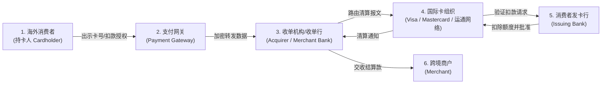
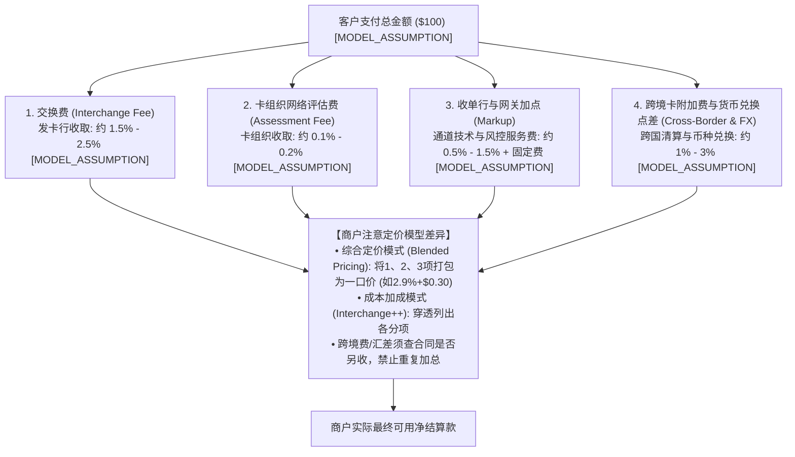
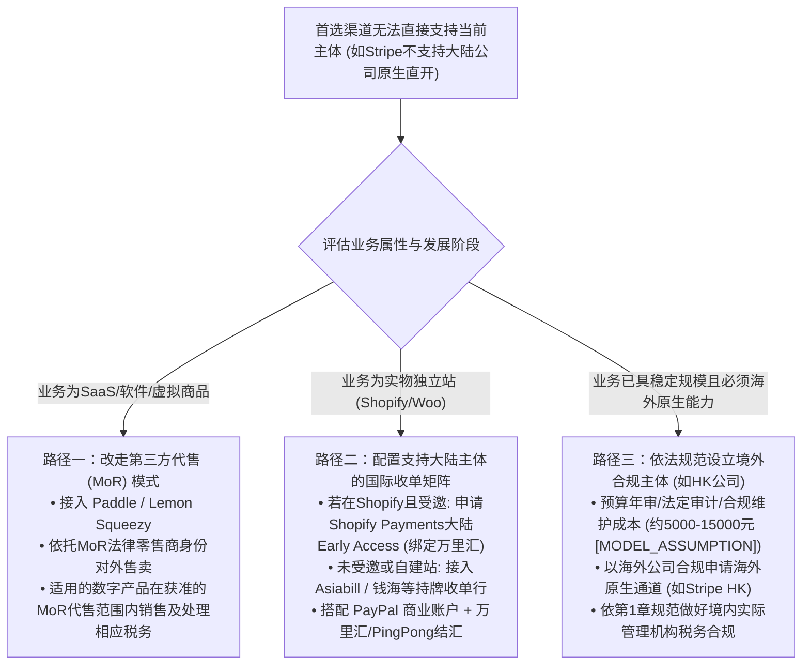
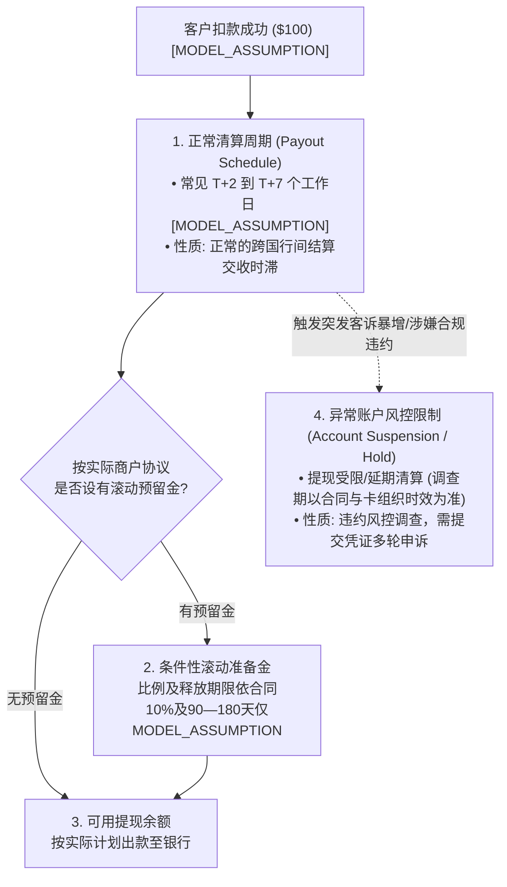
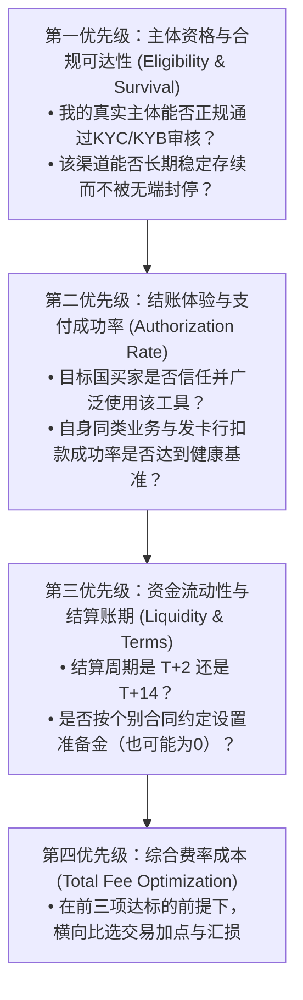

# 第2章｜海外客户的钱，我该怎么收？

> **唯一核心问题：做跨境生意，钱怎么收、税怎么交？**  
> **本章定位**：承接第 1 章已确立的经营主体资格（自然人、个体工商户、国内公司及海外实体）与法律卖方身份，本章全面解决“**收款方案认知与渠道选型**”。重点讲透跨国资金流动的底层参与机构、三种经典收款模式的本质区别、中国大陆经营者的真实准入资格、不同业务赛道的收款组合拳，以及费用、到账周期与主备通道策略。

---

### 本章贯穿导读案例

为了帮助读者针对自身业务进行精准选型，本章继续依托三类具有代表性的出海业务场景展开对比说明：
- **案例 A（SaaS / 虚拟商品独立开发）**：李明，全栈开发者，国内主体运营。自研面向欧美个人与小团队的生产力 SaaS 工具，采用按月/按年循环订阅模式，单笔订阅费用设定为 $15/月或 $120/年 `[MODEL_ASSUMPTION]`，特点是无实体物流、即时交付、交易高频低额。
- **案例 B（实物出海独立站 / DTC 电商）**：张华，外贸创业者，国内个体户/小微企业。通过独立站销售户外骑行配件，客单价设定为 $60/单 `[MODEL_ASSUMPTION]`，货物通过国内直邮小包及海外仓发运，涉及国际快递物流跟踪与实物签收。
- **案例 C（涉外技术服务 / B2B 定制出海）**：王工，小型技术服务团队负责人，国内有限责任公司。为海外中小企业提供软件定制开发与运维服务，单笔合同金额设定为 $3,000 至 $10,000 美元 `[MODEL_ASSUMPTION]`，走正式商业合同、形式发票（Proforma Invoice）与对公外汇结算。

---

## 2.1 一笔海外付款，通常要经过哪些机构？

### 2.1.1 顾客刷卡付款时，发卡行、卡组织和收单机构各做什么？

**【核心答案】**  
**一笔国际信用卡扣款，本质上是多方金融机构协同完成的“授信、信息转接、清算与资金结算”闭环。** 与中国境内微信支付、支付宝等以电子钱包账户体系和网联/银联清算为主的常见体验不同，海外以国际信用卡为主的扣款依赖成熟的“四方模式（Four-Party Scheme）”，中间涉及持卡人、发卡行、卡组织、收单机构及支付网关等多个独立角色。

#### 1. 国际银行卡支付“四方清算模型”与角色分工



1. **持卡人（Cardholder）**：拥有 Visa、Mastercard 或 American Express 信用卡/借记卡的终端消费者，在商户收银台发起支付。
2. **支付网关（Payment Gateway）**：商户收银台的前端技术接口与安全防护层（例如网关服务）。主要负责收集持卡人敏感信息、执行 PCI-DSS 标准加密与 Token 化处理、拦截初步欺诈订单，并将加密数据包安全打包路由至下游收单机构。
3. **收单机构 / 收单行（Acquirer / Merchant Acquirer）**：持有金融收单牌照的商业银行或专业金融机构。负责对商户开展资质审查（Underwriting）、为商户分配商户号（MID）、连接国际卡组织网络、在交易成功后承担垫资与最终资金结算责任。收单机构按照卡组织规则与商户协议承担相应清算、合规和风险管理责任，但通常可依协议向商户追索欺诈、违约或拒付款项；**不能理解为收单方对商户债务无条件兜底**。
4. **国际卡组织（Card Schemes / Networks）**：如 Visa、Mastercard、American Express、JCB。Visa 与 Mastercard 是典型的四方卡网络，其自身不直接向消费者发卡，也不直接向商户收单，核心职能是制定全球通用结算协议规则、维护交易信息转接清算网络并在发生消费者争议时代行仲裁职责。**注：American Express（美国运通）在多数国际市场采用自营发卡与自有清算网络闭环运作，兼具发卡行与网络职能，与 Visa/Mastercard 典型的四方分离模式存在结构差异；但在特定市场运通亦与第三方金融机构开展发卡合作。**
5. **发卡行（Issuing Bank / Issuer）**：向消费者实际发行信用卡并提供信用授信额度的本地银行（如 Chase、Citi、汇丰等）。负责校验卡号真伪、核对账户可用额度、执行 3D Secure 动态身份认证，并在判定无盗刷风险后批准授权扣除持卡人额度。后续若消费者提起拒付（Chargeback），也由发卡行代表持卡人向卡组织提交争议。

#### 2. 重要支付路径边界澄清
四方模型是国际信用卡与借记卡清算的专属架构。**它并不等同于所有海外收款的通用路径**：
- **封闭式电子钱包（Closed-loop Wallets）**：如 PayPal 内部余额互转，资金完全在 PayPal 自身账本体系内划转，不经过卡组织；但若买家在 PayPal 结账时选择调用其绑定的 Visa 信用卡，底层仍然会触发上述四方清算链条；
- **本地银行转账与替代支付（APMs）**：如欧洲的 iDEAL（荷兰）、Klarna（分期与即时转账）。**特别提示：德国历史上的本地网银支付 Sofort 已被其母公司 Klarna 整合并在主流收单服务商（如 Stripe 于 2025 年 3 月 31 日）中停止作为独立支付方式，全面迁移为 Klarna Pay Now / Bank Transfer 等新接口。商家在支持本地 APM 时需以收单机构当期实际支持清单为准。**

---

### 2.1.2 跨境支付中的费用和等待时间，主要产生在哪些环节？

**【核心答案】**  
**跨境款项的损耗是全链条累加的结果，主要由发卡行、卡组织、收单机构与跨境兑换等环节产生；资金周转时效由“即时技术授权（Authorization）”、“交易捕获（Capture）”、“清算轧差至可用余额（Settlement）”以及“最终提现出款至银行（Payout）”四个脱节阶段构成。** 商户切勿将前端页面显示“支付成功”等同于资金已经到账入袋。

#### 1. 跨境支付费用的底层构成与两种商业定价模式



1. **交换费（Interchange Fee，流向发卡行）**：
   - 收单机构向发卡机构支付的费率，用于补偿发卡行的垫资利息、账单处理及未授权欺诈坏账风险；
   - *跨境差异*：跨国交易的交换费通常显著高于本地交易。例如美国发卡行发行的卡在欧洲商户扣款，属于跨洲交易，发卡行会收取更高的跨区交换费率。
2. **卡组织网络费（Scheme / Assessment Fee，流向卡组织）**：
   - Visa / Mastercard 按每笔交易金额与笔数收取的网络转接成本，通常在 0.1% 至 0.2% 左右 `[MODEL_ASSUMPTION]`。
3. **收单机构与网关服务加点（Markup，流向收单行与网关）**：
   - 商业服务商提供 API 接口、欺诈拦截与资金结算服务的加价。
4. **跨境附加费（Cross-border Fee）与货币转换费（FX Spread）**：
   - *跨国卡处理费*：若发卡行所在国与商户注册国不同，即使计价币种一致，部分服务商可能依据其当期跨境卡条款另收附加费；**1%—1.5%只作为模型区间`[MODEL_ASSUMPTION]`，并非行业统一适用**；
   - *货币兑换点差*：买家使用欧元付款、商户后台以美元计价结算，或者从美元提现回国内人民币，金融机构可能产生汇率点差或单列兑换费用；**1%—3%只作`[MODEL_ASSUMPTION]`模拟，不表示任何机构必然收取该比例**。

**【商业定价模式重要区分】**：
- **综合打包定价（Blended Pricing，如经典的 2.9% + $0.30/笔 `[MODEL_ASSUMPTION]`）**：收单行将前述交换费、卡组织费与自身加点打包为一个一口价。适合小微商户与初创团队，费用透明可预期。**商户切记：综合定价模式下不得将基础扣率与发卡行交换费重复累加**。
- **成本加成定价（Interchange++ / IC++）**：将交换费、卡组织费与收单行加价完全拆开穿透收取。适合大交易量成熟商家，费率随卡种、地区动态变动。

#### 2. 等待时间（结算周期）的四个递进阶段
一笔交易在时间维度上被拆解为四个物理阶段：
- **阶段一：交易授权（Authorization；处理时长取决于验证及发卡行，不保证固定秒数）**  
  买家在收银台输入卡号点击付款，信息流穿透五方机构完成核验，发卡行批准授权并可能暂时占用持卡人额度；**此时只是授权，不能据此显示或认定最终付款成功，亦不能据此履约**。若交易仍需后续捕获，则须根据支付服务商的权威状态判断。
- **阶段二：交易捕获（Capture）**  
  商户系统或网关向收单行发出捕获指令，正式确认扣划已被授权的交易金额（多数电商系统设置为授权后自动捕获；部分定制或预售业务可采用延期捕获）。
- **阶段三：清算轧差与可用余额（Clearing & Settlement，常见 T+1 至 T+7 工作日 `[MODEL_ASSUMPTION]`）**  
  收单行每日夜间与卡组织、发卡行进行跨行轧差清算。收单行根据对商户的风险评级设定**平台账面资金结算和出款计划（Payout Schedule）**。在此期间，资金处于在途清算队列，期满后才正式释放至商户后台的“可提现可用余额（Available Balance）”。
- **阶段四：出款与银行到账（Payout to Bank，常见 1 至 3 个工作日 `[MODEL_ASSUMPTION]`）**  
  商户后台可用余额通过银行网络（本地 ACH、SEPA 或跨境电汇）下发至商户的实体银行账户或第三方结汇账户。
- **【实操警示】**：商户不得凭浏览器跳转、授权结果或未经核实的通知发货；应在服务端验证支付服务商签名的Webhook，必要时向官方接口主动查单，并核对状态、订单号、金额及币种。通知丢失、重复或乱序的恢复归第5章详细讲解。

---

## 2.2 平台代收、自己收款和第三方代售，有什么区别？

### 2.2.1 平台代收、商家自行收款和第三方代售，资金流向怎么不同？

**【核心答案】**  
**资金在谁的账户里沉淀、谁对外承担第一道销售法律责任与间接税义务，决定了三种出海交易模式的底层资金路径。** 必须明确：支付网关余额属于在途结算款或清算托管账户资金，并非受国家存款保险保护的商业银行存款，不同模式下商户对资金流动性的掌控力存在质的飞跃。

#### 1. 三种模式资金流动路径深度拆解

```mermaid
flowchart TD
    subgraph 模式一：平台代收模式 (Marketplace Payout)
        P1["买家付款 ($100) [MODEL_ASSUMPTION]"] --> B1["平台/合作支付机构依合同处理资金与商户结算账"]
        B1 --> B2["平台系统周期结算 (如典型14天周期 [MODEL_ASSUMPTION])<br>扣除: 平台佣金+FBA仓储物流+预留金"]
        B2 --> B3["下发至商户绑定的离岸银行账户或合规跨境虚拟收款账户"]
        B3 --> B4["商户合规提现申报结汇回国内银行账户"]
    end

    subgraph 模式二：商家自行收款 (Direct Merchant)
        P2["买家付款 ($100) [MODEL_ASSUMPTION]"] --> M1["收单机构清算处理 (如持牌收单行/PayPal)"]
        M1 --> M2["扣除收单手续费 (如打包2.9%+$0.30 [MODEL_ASSUMPTION])"]
        M2 --> M3["进入商户后台可用结算余额 (T+2至T+7 [MODEL_ASSUMPTION])"]
        M3 --> M4["按计划提现下发至商户对公/离岸实体账户或跨境结汇账户"]
    end

    subgraph 模式三：第三方代售模式 (Merchant of Record / MoR)
        P3["买家付款 ($100 + $19税) [MODEL_ASSUMPTION]"] --> R1["Paddle / Lemon Squeezy 官方账户统收"]
        R1 --> R2["MoR在其覆盖且依法应税的交易中代收代缴适用间接税 ($19仅示例)"]
        R2 --> R3["MoR扣除代售综合服务抽成 (如5%+$0.50 [MODEL_ASSUMPTION])"]
        R3 --> R4["按周期将'转售净结算款'以B2B形式电汇/下发至开发者账户"]
    end
```

1. **平台代收模式（Marketplace Payout，如亚马逊、eBay、速卖通）**：
   - **资金流向**：买家付款经平台指定的支付及结算安排处理，平台根据合同在商家结算台账中记录应付款；**实际持款机构、资金隔离及监管结构因平台和法域而异**，不一定是统一资金池。结算周期以平台协议为准（例如亚马逊典型为 14 天滚动结算周期 `[MODEL_ASSUMPTION]`，但新开店铺、高风险类目或特定国家站点可能存在更长审查预留期）。在结算日，平台扣除佣金、物流仓储费与纠纷预留款后，将净款项推送到商户指定的海外商业银行账户或第三方跨境多币种虚拟收款账户（如万里汇、PingPong 等）。
2. **商家自行收款模式（Direct Merchant / 自建独立站 + 收单网关）**：
   - **资金流向**：如案例 B（张华的独立站），消费者结账时通过商户获准的收单通道支付。资金依合约及平台账面处理，待完成对应结算后形成可用余额（T+2至T+7仅为`[MODEL_ASSUMPTION]`），**不是无条件受存款保险保护的银行存款**。出款时点可能由服务商固定计划、可选计划、人工审核和当地银行规则共同决定；实际收款账户须满足商户同名、法域与币种要求，不能假定自由设置频率或任意结汇。
3. **第三方代售模式（Merchant of Record / MoR，如 Paddle、Lemon Squeezy）**：
   - **资金流向**：如案例 A（李明的 SaaS 订阅），消费者付钱的对象是 MoR 平台（以交易条款确认为准）。MoR 作为法律零售商在**其协议覆盖的产品、顾客与销售法域**中作为合同卖方收款，并在依法需收取且由其负责的交易中计算、收取和申报相关VAT/GST或销售税；并非对全球所有交易统一代税。资金和转付依服务商的结算协议处理，不预设单一资金池结构。在约定结算周期（如每月一次或满足提现门槛），MoR 将扣除税款、通道费与代售服务抽成后的“净转售收入”，通过银行电汇（Wire）或境外汇款方式划转给开发者。

---

### 2.2.2 选择这三种模式，责任、费用和客户关系该怎么权衡？

**【核心答案】**  
**世上没有全能的收款方案，只有在“合规省心度”、“费率损耗”与“商业资产掌控权”三者之间的权衡取舍。**

#### 1. 核心维度横向权衡对比矩阵

| 评估维度 | 模式一：平台代收（Marketplace） | 模式二：商家自行收款（Direct Merchant） | 模式三：第三方代售（MoR） |
| :--- | :--- | :--- | :--- |
| **法律责任主体** | 合同销售主体依平台条款，平台可能按当地法代征特定消费税，商品义务不因此全部转移 | **商户承担其法律卖方相应的消费者及税务责任**，按法域和交易核验 | **MoR对其合同卖方范围内的销售承担**适用的间接税与消费者合同责任；开发者仍承担自身产品、知识产权、合同及税务义务 |
| **全口径综合费率** | **高**：平台佣金普遍在 **8% - 15%** `[MODEL_ASSUMPTION]`，另计 FBA 仓储物流与营销服务费 | **低至中等**：基础网关费通常在 **2.9% - 3.5% + $0.30/笔** `[MODEL_ASSUMPTION]`，加算跨境提现汇差 | **中等偏高**：统包费率通常为 **5% + $0.50** `[MODEL_ASSUMPTION]` 或更高比例的服务抽成 |
| **境外税收申报负担** | 低：平台可能依目的地和交易代征部分税；卖家剩余责任须单独核对 | 随销售法域和品类而异：应按经济关联、B2B/B2C、商品及其他代征情形逐地判断（详见第10章） | 对于MoR实际作为卖方且由其依法负责的交易，可减少相应VAT/GST或销售税处理；开发者仍须核实自己主体的所得税、其他服务税与交易义务 |
| **客户资产掌控度** | **极低**：客户属于平台；平台屏蔽买家真实邮箱与直接联系方式 | **极高**：商户拥有完整的买家联系方式、交易日志与复购触达权 | **中等偏高**：商户可在前台获取用户邮箱与业务数据，但交易合同受 MoR 约束 |
| **资金周转与被扣风险** | 受平台统一账期限制（常见 14 天 `[MODEL_ASSUMPTION]`）；平台遇纠纷可直接封店扣款 | 结算时效快（T+2 至 T+7 `[MODEL_ASSUMPTION]`）；但若争议率触发收单行与卡组织监控阈值（如 Visa VAMP、Mastercard 风险商户监控计划等），将面临整改、附加准备金或暂停通道风险 | 账期通常较长（月结居多 `[MODEL_ASSUMPTION]`）；争议及拒付责任由具体MoR协议处理，开发者亦可能受风控或分成调整影响 |

#### 2. 三类典型出海商家的选型建议
- **实物品牌独立站（案例 B）**：首选**自行收款模式（支持大陆资质的国际收单行/受邀 Shopify Payments + PayPal）**。实物商品毛利空间通常无法承受 MoR 平台 5%-10% 的高额抽成；同时独立站可在遵守隐私与平台条款的前提下维护客户关系。**如使用Shopify第三方支付商，须在其收单服务费之外单独核查Shopify按店铺套餐及具体付款方式收取的第三方交易费；启用Shopify Payments为主要服务商时部分交易（如符合条件的PayPal交易）可能豁免。** 参考：https://help.shopify.com/en/manual/your-account/manage-billing/billing-charges/types-of-charges/third-party-charges/third-party-transaction-fees。
- **独立开发者与微型 SaaS 团队（案例 A）**：起步期首选 **MoR 模式（Paddle / Lemon Squeezy）**。个人开发者难以搞懂欧美数十个法域极其复杂的增值税与流转税申报要求；将交易流转税合规外包给 MoR，虽费率偏高但极大释放了运营精力（注：仅由 MoR 承担代售交易的间接流转税，开发者自身仍须就扣除成本后的经营净收益申报所得税）。
- **大额外贸与 B2B 技术服务（案例 C）**：根据交易额度采取**条件化组合策略**。小额样品单或订阅采购可支持企业信用卡；大额合同单可根据银行/卡支付的总费用和买家采购条件评估**持牌机构跨境虚拟对公账户（ACH / SEPA / SWIFT 电汇）**，走形式发票与银行对公通道，单笔费率可压低至极低水平，但仍需核对转账撤回、付款诈骗、费用及到账最终性等风险。

---

## 2.3 我能用哪些收款渠道，怎么确认资格？

### 2.3.1 大陆个人或企业能否申请某个收款渠道，应该怎么核实？

**【核心答案】**  
**核实收款资格不能依赖二手自媒体攻略，必须对照目标支付机构当期官方网站逐一校验“准入四要素”。** 支付机构受反洗钱合规审查与金融牌照约束，其支持主体清单是动态更新的。

#### 上线前再过“资格—真实回款”六关

| 关口 | 必须实际取得的证据 | 未通过时 |
|---|---|---|
| ①法域主体 | 申请页面/合同明确支持本经营者的设立地与法律主体 | 暂停申请，不借用地址或他人主体 |
| ②具体业务 | 商品、交付国、MCC、退款模式满足**此收单产品**的政策 | 更换合规产品或调整实际业务，不隐瞒类别 |
| ③KYC/KYB | 实际权利人、账户、网站与银行资料被受理 | 补真实资料，未核准标`UNKNOWN` |
| ④正式收单 | 后台显示相应币种、支付方式与真实交易权限已开通 | 不能把注册成功当已具备收单能力 |
| ⑤出款路径 | 签约主体可使用的银行/持牌机构账户、币种及出款资格有文件证据 | 不假设能直接从海外平台提现到任意大陆账户 |
| ⑥合法结算 | 订单、发票/合同、银行或结汇机构认可的真实性单据及税务责任链 | 先解决合法入账与税务归类再扩大销量 |

六关是**审核步骤而非法定统一程序**；服务商、地区及主体随时变化，真实申请和出款未实测(`NOT_RUN`)。本章比较方案，第3章负责接入验证，第6章负责银行和结汇。

#### 1. 资格核查四要素标准流程
1. **要素一：支持设立国家与地区（Supported Country / Entity Origin）**  
   查阅官网服务条款（Terms of Service）中接受商户注册的法域。例如 Stripe 官方明确仅支持其列表内数十个国家与地区，中国大陆不在原生直开列表中（核验日期：2026-10-20）；而 PayPal、万里汇等机构具备针对中国大陆商户的合规展业方案。
2. **要素二：接受的主体组织形态（Entity Type）**  
   核实通道是仅接受持有营业执照的公司（Company），还是同样接纳个体工商户（Sole Proprietor）或纯自然人（Individual）。
3. **要素三：支持的提现目的地与币种（Payout Rail & Currency）**  
   核实款项结算后，能否将外币合规打入中国大陆的商业银行对公账户、个人储蓄卡，还是强制要求提供香港或美国的本地银行账户。
4. **要素四：业务所属行业分类代码（MCC / Industry Category）**  
   核实自身销售的商品是在其支持列表中，还是在限制/需要特殊审批名录中。

#### 2. 中国大陆经营者收款渠道核验表（检索基准：2026-10-20）

**阅读方法：以下为“值得核验的产品”，不是获批名单。** 同一机构的虚拟收款账户、平台结算、外贸B2B收款及网页信用卡收单是不同产品；每次均核实商户注册地、个人/个体户/公司、MCC、支持的电商平台与结算目的地。未取得产品级现行条款时一律标 `UNKNOWN/需预审`。

| 机构与具体产品 | 大陆主体或个人资格 | 能否直接处理独立站卡支付 | 结算目的地与必须核对的证据 |
|---|---|---|---|
| **Stripe 原生商户收单**（非Shopify中国版） | 中国大陆注册主体不在原生开户地区列表 | **中国大陆原生直开：不支持**；合法海外主体另行核验 | https://stripe.com/global；是否可提现按开通法域账户及合同 |
| **Shopify Payments 中国大陆早期访问** | **仅受邀**、大陆注册经营实体、跨境业务、WorldFirst实名核验 | 受邀获批后支持Shopify结账；非所有大陆商家均可开通 | 受邀店铺在Shopify后台设置；结算账户仅使用已核验WorldFirst；https://help.shopify.com/en/manual/payments/shopify-payments/supported-countries/china/requirements |
| **PayPal中国区适用账户产品** | 个人与企业的用途、资料及账户权限必须分别核验 | PayPal收银台方式，**不等同于通用卡收单资质** | 当期中国账号协议、提现方式及合规资金路径：https://www.paypal.com/c2/legalhub/paypal/useragreement-full |
| **WorldFirst多币种/本地虚拟收款账户**（区分WorldTrade卡支付产品） | 按“平台回款/B2B收款”等具体产品及主体材料核验；个体户不保证全部获批 | 本地收款账号**不等于网页信用卡收单**；WorldTrade卡支付独立申请审核 | https://www.worldfirst.com.cn/；核验开户合同、平台绑定、入账证明、币种与可入银行账户 |
| **PingPong跨境收款/平台结算产品** | 具体产品与个人/个体户/公司资格：`UNKNOWN/需官方预审` | 平台收款或外贸收款**不能等同网页卡收单** | https://www.pingpongx.com/；确认产品条款、支付轨道和结汇申请资格 |
| **Airwallex全球账户及支付收单（分别申请）** | 大陆主体适用产品、类目及限制：`UNKNOWN/需预审` | 账户产品不代表已获支付收单权限 | https://www.airwallex.com/；核对全球账户与Payments产品差异及结算条件 |
| **连连国际平台/跨境收款产品** | 具体大陆主体与细分产品：`UNKNOWN/需预审` | 不能以平台收款账户证明独立站收单资格 | https://global.lianlianpay.com/；核对商户准入与结算产品 |
| **Oceanpayment / Asiabill 独立站收单产品** | 大陆企业或个体户资格按签约产品与行业审核：`UNKNOWN/需预审` | 需确认**目标产品**是否具卡收单、插件及交易币种权限 | https://www.oceanpayment.com/；https://www.asiabill.com/；合同/费率/出款条款为准 |
| **Paddle / Lemon Squeezy MoR代售** | 根据销售品类、开发者所在地、结算地与合同逐一审核；**不保证个人或国内公司都可入驻** | MoR作为合同卖方售卖适用数字产品，**不是把普通信用卡网关账号借给开发者** | https://www.paddle.com/legal/terms；https://www.lemonsqueezy.com/terms；确认卖方、税务覆盖和可用转付目的地 |

**具体操作：** 打开各目标服务商的 *Supported Countries / Eligibility / Restricted Businesses / Payouts / Pricing* 页面，保存日期和链接；必要时提交主体执照、商品类别及结算地获得书面预审。正式获批前请把方案表中的该渠道状态保持 `UNKNOWN`，不得据此承诺买家能付款或资金必到境内账户。

---

### 2.3.2 收款机构限制哪些业务，怎么知道自己是否符合要求？

**【核心答案】**  
**支付机构将所有商业行为划分为“禁止”、“受限”与“标准支持”三类；切勿将属于“需前置审批的受限类目”误当成必然封号的违禁黑产，也不得侥幸隐瞒真实经营类目。**

#### 1. 收款机构业务三级风险分类原则
- **第一级：绝对禁止开展的业务（Prohibited Businesses）**  
  任何正规持牌机构均有一票否决的禁运清单。涵盖：假冒名牌与未经授权侵权商品（Counterfeit Goods）、武器弹药与管制器具、违禁精神药物与处方药、成人色情暴力内容、庞氏骗局与非法集资、未经许可的网络赌博。**服务商可能拒绝准入、要求补件、限制交易或出款、解除服务，具体依禁止业务政策、协议及事实处理；MATCH等卡组织名单仅在满足相应计划的特定条件下涉及，不是违规即自动登记。**
- **第二级：受到限制但允许在满足条件时准入的业务（Restricted / Requires Pre-Approval）**  
  包括：跨境膳食补充剂与保健品、数字虚拟资产、游戏充值点卡、知识产权敏感软件与工具、长周期大额预售订单。**此类业务并非绝对禁止，但商户申请开户时通常须提供前置行业经营许可或产品合规材料，并可能被要求接受更长的清算交收周期或更高的约定风险准备金比例**。
- **第三级：标准常规支持的业务（Standard Supported Businesses）**  
  包括：拥有合法自主品牌的实物日用品、自主知识产权的通用办公 SaaS 软件、原创数字创意素材、常规跨境技术服务外包。

#### 2. 自查业务合规性三步实操
1. **调阅官方 Acceptable Use Policy（AUP）**：在目标支付机构官网底部点击“Legal”或“Restricted Businesses”，全文检索自身业务关键词（如 *Subscription*, *Digital Content*, *Supplements*）；
2. **审查网站公开信息合规度**：支付机构人工审核员会模拟买家深度浏览你的网站。若网站缺少所要求的退款规则、服务条款、有效联系途径与真实主体说明，可能导致补件或拒审；具体是否需要展示办公地址以渠道、市场与商业模式为准；
3. **主动联系招商或合规经理预审**：对于边界模糊的业务（如开源代码衍生商业插件），开户前主动向客服提供业务说明文档，明确获得书面合规确认后再行对接。

---

### 2.3.3 首选收款渠道不接受我的主体，还有哪些合规备选方案？

**【核心答案】**  
**渠道准入受阻时，合规是唯一的生存底线；严禁采用“黑中介买号、虚构境外地址、借壳开户”等歪门邪道。** 国际收单体系对最终受益所有人（UBO）与实际运营环境的核验（KYB）极为严密，虚构资料会触发拒绝、重新KYC/KYB、限制账户、终止服务及可能的法律风险；实际资金限制期或网络名单处理须看官方通知和适用规则，**不存在全行业自动冻结或统一名单**。

#### 1. 合规替代备选路线图



1. **路径一：通过商业模式重构转为代售（针对数字产品 / 开发者）**  
   若李明无法直接开通海外原生收单通道，在符合代售机构准入政策的前提下，可切换为 MoR 模式（如接入 Paddle）。李明在法律上作为软件版权提供方，由 Paddle在其符合条件的代售交易中作为合同零售商收款，并处理其负责的适用增值税，合规解决初期海外直连收单的准入难题。
2. **路径二：配置支持大陆主体的本土化国际收单矩阵（针对实物电商）**  
   若张华的独立站建在 Shopify 上：若获得官方定向邀请，可申请“Shopify Payments 中国大陆早期访问计划（需绑定已核验的万里汇账户）”；若未获受邀或使用 WooCommerce 等独立站，合规解法是采用“**支持大陆执照的持牌收单行（如钱海、Asiabill）负责信用卡收单 + PayPal 商业账户提供对应钱包方式 + 获批的跨境收款产品在其允许的场景下处理结算**”的备选组合（**需逐个核实产品及支付连接，不能推定任意组合可集成**）。若使用Shopify第三方支付，还应按其套餐及豁免规则计算**额外平台交易费**，该费用不包含在网关报价中。
3. **路径三：按需依法设立境外合规主体（进阶路径）**  
   当真实业务确实需要海外主体才能合法获得的收单能力，并已评估设立与运营的持续条件时，按照第 1 章所述规范设立中国香港或特定在岸公司。必须明确：海外主体设立必须伴随真实的年审维护、法定审计与合规申报开支（年维护成本预算约 5,000 至 15,000 元人民币 `[MODEL_ASSUMPTION]`；注：香港有营运之公司依法须进行年度法定审计，若为符合香港《公司条例》第 447 条的不活动/休眠公司则可免除审计），不能搞空壳逃避监管。

---

## 2.4 卖实物、软件、订阅或企业服务，收款方式一样吗？

### 2.4.1 卖实体商品时，支付方式需要考虑哪些物流与收货条件？

**【核心答案】**  
**实物跨境电商的支付通道稳定性与物流履约时效紧密捆绑。** 国际卡组织与支付机构建立了以妥投凭据为核心的风控与卖家保障体系，缺乏有效国际物流跟踪的交易极易引发客诉与账户风险。

#### 1. 实物销售必须考量的三项核心履约条件
1. **妥投追踪凭据（Proof of Delivery, POD）与单号回传联动**：
   - 应依据订单、发货地、PayPal中国账户条款和支付方式分别核验保障资格；**符合要求的追踪或妥投证据可能是必要条件，但上传单号本身并不保证获得卖家保障或争议胜诉**。PayPal订单详情须符合交易资格、适用争议类型与提交期限等条件。官方条款：https://www.paypal.com/c2/legalhub/paypal/seller-protection；
   - 若长期没有可核实的履约证据，支付机构可能按行业风险、订单表现及合同要求补充说明或调整出款安排；应保留订单、物流与客户沟通资料，但不将所有收单机构等同于同一卖家保障计划。
2. **买家付款习惯的地域性匹配**：
   - *欧美成熟市场*：国际信用卡（Visa, Mastercard, Amex）与电子钱包（PayPal, Apple Pay, Google Pay）占据主导；
   - *欧洲细分市场*：对本地借记系统高度依赖。例如荷兰买家超 60% 习惯使用 iDEAL；德国买家偏好 Klarna Pay Now / Bank Transfer 等（注：原德国 Sofort 方式已整合停用）；
   - *新兴市场（拉美、东南亚、中东）*：信用卡普及率较低。巴西买家偏好 PIX 本地即时转账，东南亚及部分中东地区买家高度依赖**货到付款（Cash on Delivery, COD）**。COD 模式在实物出海中伴随着高达 15% - 30% `[MODEL_ASSUMPTION]` 的高拒签退回率，对商户头程物流成本控制是巨大考验。
3. **退货与逆向物流中的资金损耗**：
   - 实物商品面临破损退换货问题。退款时原收单费是否返还、是否另外收取退款服务费，**因机构、注册地区、套餐及当期协议不同**；例如Shopify Payments在其适用规则下处理费可不退，而不能推导为所有网关一致。因此，实物销售在收款端必须预留足够的退货坏账准备金。

---

### 2.4.2 卖软件、订阅或企业服务时，收款方式该怎么搭配？

**【核心答案】**  
**虚拟商品出海的核心在于“订阅计费授权”与“B2B 对公低成本结算”，决不能盲目套用实物电商的收银台方案；对于 B2B 业务，应根据交易额度灵活搭配企业信用卡与本地对公虚拟账户。**

#### 1. 软件/SaaS 与 B2B 企业服务的收款搭配策略

| 业务类型 | 典型代表场景 | 推荐支付方式搭配组合 | 底层考量与技术/业务关键点 |
| :--- | :--- | :--- | :--- |
| **一次性数字虚拟商品** | 独立游戏下载、设计模板、电子书 | **国际信用卡 + PayPal + 移动端 Apple/Google Pay** | • 追求极简一键结账，防止在收银台流失；<br>• 即时交付，无须追踪运单，但须严防黑客利用“批量黑卡测卡（Card Testing）”盗刷攻击。 |
| **SaaS 循环订阅服务** | 案例 A（李明的生产力工具）<br>（月度/年度自动扣费） | **资格获批的MoR（Paddle/Lemon Squeezy）或支持周期扣款的网关** | • 采用卡片续费时须确认经过客户授权的Card-on-file与必要认证；<br>• 视服务商支持程度设置续费失败提醒/重试；<br>• 只有MoR担任卖方且相应税种落在其服务范围内时，才由其负责交易间接税。 |
| **B2B 企业服务 / 大额外贸** | 案例 C（王工的技术外包团队）<br>（单笔数千至数万美元） | **根据客户采购流程、实际手续费和时效比较企业采购卡、可用的ACH/SEPA与SWIFT电汇** | • **示例采购单（如$500—$2,000 `[MODEL_ASSUMPTION]`，并非渠道门槛）**：可支持买方使用企业采购信用卡（Corporate Purchasing Card）在线快速付款，提供采购便利与即时入账，但需将约 2.5%–3.5% `[MODEL_ASSUMPTION]` 的刷卡手续费纳入综合商业报价；<br>• **大额合同单（如 $3,000–$10,000 美元 `[MODEL_ASSUMPTION]`）**：把企业采购卡、适用的ACH/SEPA、SWIFT汇款逐项比较：商户及买家实际费率、到账时间、退款或争议处理、购货方采购流程、收款资格与贸易证明。并无通用金额门槛要求一律电汇；电汇也可能有中间行费用、退汇和欺诈风险，企业卡也并非必然不适用。 |

---

## 2.5 不同方案的费用、到账速度和风险怎么比较？

### 2.5.1 怎样算出不同收款渠道的全部实际费用？

**【核心答案】**  
**切勿仅看宣传单页上的“基础交易费率”（如 2.9%），跨境资金的真实成本必须通过全口径公式逐项穿透核算。**

#### 1. 跨境支付全要素综合成本测算公式

**Shopify特别注意：** 使用第三方支付服务商时，除收单机构手续费外，Shopify还可能按套餐和订单类型收取**第三方交易费**（部分支付方式可能豁免）；查看Shopify后台 `Settings > Billing` 以及 `Settings > Payments`，对照 https://help.shopify.com/en/manual/your-account/manage-billing/billing-charges/types-of-charges/third-party-charges/third-party-transaction-fees 。**下面60美元例子不是Shopify订单全成本模型，不含Shopify平台额外交易费**，也不覆盖所有法域的税费。
$$\text{商户最终可用现金} = \text{订单面额} - \text{基础收单手续费} - \text{跨境交易附加费} - \text{货币转换点差 (FX)} - \text{提现入账费} - \text{退款与拒付罚金摊销}$$

#### 2. 两个可复算的 [MODEL_ASSUMPTION] 典型案例精算对比

##### 【精算案例 1】张华 DTC 实物独立站——小额多笔信用卡收单
- **基础业务假设 `[MODEL_ASSUMPTION]`**：张华独立站销售一件骑行装备，单笔订单标价 **$60.00 USD**。买家使用美国以外国家（如英国银行发卡）的 Visa 信用卡购买。张华采用支持大陆主体的独立站收单网关收单，并提现至境内人民币银行账户。
- **全链路扣费测算明细**：
  1. *网关基础交易手续费*（假设为综合打包费率 2.9% + $0.30）：  
     $$\$60.00 \times 2.9\% + \$0.30 = \$1.74 + \$0.30 = \$2.04$$
  2. *跨境卡附加费（Cross-border Card Surcharge，跨国发卡行加收 1.0%）*：  
     $$\$60.00 \times 1.0\% = \$0.60$$
  3. *网关净入账至商户可用余额*：  
     $$\$60.00 - \$2.04 - \$0.60 = \$57.36 \text{ USD}$$
  4. *合规跨境结汇提现服务费（持牌跨境结汇平台按 0.4% 收取）*：  
     $$\$57.36 \times 0.4\% = \$0.22944 \approx \$0.23 \text{ USD}$$
  5. *外汇汇率兑换点差折损（Spread，相较中国外汇交易中心基准中间价下浮约 0.5%）*：  
     $$\$57.36 \times 0.5\% \approx \$0.29 \text{ USD}$$
- **计算结论**：
  - 扣除所有摩擦成本后，商户实际落袋金额折合等值约 **$56.84 USD**；
  - **实际综合费率损失率**为：$(\$60.00 - \$56.84) / \$60.00 \approx \mathbf{5.27\%}$！显著高于表面的 2.9%。

##### 【精算案例 2】李明 SaaS 软件订阅——采用 MoR 代售模式
- **基础业务假设 `[MODEL_ASSUMPTION]`**：李明独立开发软件，德国个人买家订阅其工具，标价 **$15.00 USD/月**。李明接入 Paddle 代售。
- **全链路扣费与税费测算明细**：
  1. *目的地增值税（VAT）代征*：德国数字服务 VAT 税率为 19%。结账时系统自动向买家加收 19% 税费，买家实际刷卡支付总额为：  
     $$\$15.00 \times (1 + 19\%) = \$17.85 \text{ USD}$$  
     该 $2.85 增值税由 Paddle 作为法律零售商依法全额代缴至德国税务局，不计入李明的经营收入。
  2. *MoR 代售服务抽成（按 Paddle 官方计费规则，费率计费基数为含税总交易额 $17.85，标准合同费率模型设定为 5% + $0.50 `[MODEL_ASSUMPTION]`）*：  
     $$\$17.85 \times 5\% + \$0.50 = \$0.8925 + \$0.50 = \$1.3925 \approx \$1.39 \text{ USD（分笔舍入到美分）}$$
  3. *Paddle 扣除增值税及代售费后的商户结算款*：  
     $$\$17.85 - \$2.85 - \$1.39 = \$13.61 \text{ USD}$$
  4. *月度批量提现至中国外币对公账户/国内结汇平台（批量转付分摊成本估算约 $0.07 `[MODEL_ASSUMPTION]`）*：  
     $$\$13.61 - \$0.07 = \$13.54 \text{ USD}$$
- **计算结论**：
  - 李明最终实际可支配结算净收入约为 **$13.54 USD**；
  - 相较于标价 $15.00，**综合服务抽成与提现损耗率**约为：  
     $$(\$15.00 - \$13.54) / \$15.00 = \$1.46 / \$15.00 \approx \mathbf{9.73\%}$$  
  - *实务辨析*：虽然 9.73% 的综合损耗高于张华的自主收单模式，但 MoR在该示例假设的德国B2C应税交易中依协议与法律负责相应VAT计算、申报及缴纳，可能降低其适用交易的跨境间接税申报管理负担，但节省金额取决于目标法域、销售规模、人工/代理申报方案，不能无来源地推断每年必省数千欧元。注：MoR 仅负责其自身作为法律卖方交易的间接流转税，李明仍须对企业/个人在中国境内的最终净收益依法申报所得税。

---

### 2.5.2 到账周期、预留金和账户限制，怎样分别评估？

**【核心答案】**  
**将“正常清算周期”、“合同约定风险准备金（Rolling Reserve）”与“异常风控账户限制”三者混为一谈，是导致小微跨境卖家现金流断裂的常见诱因。** 必须根据三者的不同法律性质、合同依据与触发机制建立独立的流动性评估体系。

#### 1. 资金到账与风险管控三层机制深度辨析



1. **正常清算周期（Payout Schedule）—— 正常的在途结算时滞**：
   - 指收单行从完成交易到将资金转为商户后台“可用余额”的常规周期；
   - 欧美主流成熟通道通常为 **T+2 至 T+7 个工作日** `[MODEL_ASSUMPTION]`。该周期由收单行根据商户的历史信用记录、履约表现确定，属于正常商业运作时滞。
2. **约定风险准备金（Rolling Reserve）—— 应对潜在争议的合同流动性缓冲机制**：
   - **机制运作**：收单行对于新开户商户、缺少长期信用记录或处于客诉风险较高类目的商户，依据《商户服务协议》约定，可能按约定比例和期限留存，也可能**完全不设置预留金（0%）**；10%与90—180天仅作`[MODEL_ASSUMPTION]`测算，不能代表行业通例；
   - **财务影响**：准备金属于商户资产，是商户服务协议约定的违约/争议抗风险流动性池，而非某种外部法定冻结资金；商户在预算编制时必须预留该部分流动资金敞口，避免发生采购周转断流。
3. **异常风控账户限制（Account Suspension / Limitation）—— 突发风险调查机制**：
   - **触发诱因**：短期内交易额突发暴增引发反洗钱风控警报、争议欺诈率触发收单行监控阈值或卡组织合规监控计划（如 Visa VAMP、Mastercard 风险商户监控计划等），或被权利人投诉仿牌侵权；
   - **处置与影响**：账户提现功能被临时限制或延期交收。受限处置期根据争议申诉时效、调查进展及各卡组织网络规则（Reason Codes）动态确定，并非全行业统一固定的 180 天。商户应依官方通知准备与自身业务相符的证明（如服务合同、数字交付记录、物流或采购单据），按要求补件或申诉；服务商可依据审查决定恢复、继续限制或终止服务，不能承诺提交特定材料就必然解封。

---

## 2.6 主用收款方式怎么定，什么时候需要备用？

### 2.6.1 选主用渠道时，资格、收款成功率和成本先看什么？

**【核心答案】**  
**渠道选型的黄金准则是：主体资格与存活合规是“1”，收款成功率是“乘数”，资金流动性是“防线”，手续费率只是最后考虑的“小数”。** 许多新手只为了省 0.5%（假设）的手续费去选择没有验证的渠道，结果因拒卡率高白白损失数倍于费率的订单利润。

#### 1. 选型评估的四级漏斗优先级模型



1. **第一优先级：主体资格与长期存续可达性**  
   若渠道不支持你的主体（如大陆个人强开 Stripe），哪怕费率再低也坚决不能选作为主用通道。若资格不符合要求，可能开户失败或后续交易受限制，无法把该渠道作为稳定收款前提。
2. **第二优先级：买家信任度与发卡行授权成功率（Authorization Rate）**  
   欧美买家看到熟悉的收银界面（如原生 Apple Pay、PayPal 快捷登录）能显著提升结账转化率。收单机构在当地银行的清算路由质量直接决定支付成功率。商户应以自身业务历史、相同支付方式及买家发卡国的数据为基准进行跟踪；若因通道清算链路质量差导致信用卡被发卡行误杀拒绝，损失的销售利润远超手续费的节省。
3. **第三优先级：资金结算周期与预留金条款**  
   对于实物电商，结算周期从假设的T+2延长至T+14可能增加营运资金占用；实际占用还取决于订单量、供货付款账期、库存和退款节奏，不能直接把天数线性等同资金占用金额。评估主用渠道必须确保其提现时序能与自身供应链付款周期相匹配。
4. **第四优先级：综合费率成本**  
   在前三项达标的前提下，横向比选综合扣除率，选择费率透明、无隐形汇率惩罚的合规服务商。

---

### 2.6.2 何时该准备备用通道，怎样确保切换仍然合规？

**【核心答案】**  
**备用通道是跨境业务连续性（Business Continuity）的生命线，但备用通道必须是“阳光获批的技术冗余”，决不能沦为“违规倒账、规避风控的逃避手段”。**

#### 1. 何时必须启动备用通道建设？
1. **单月交易额放量突破警戒线**：当业务月流水稳定超过一定规模（例如月营收突破 $10,000 美元 `[MODEL_ASSUMPTION]`），单通道依赖即构成重大经营单点故障（Single Point of Failure）；
2. **核心业务处于重大会员营销节点前夕**：在“黑五网一（Black Friday / Cyber Monday）”或大促前，主用通道可能因突发流量洪峰被收单机构风控系统临时限流，必须预备分流通道；
3. **主用通道出现技术或网络故障**：若已获批通道发生服务宕机、银行网络路由失败或服务商确认可切换的技术异常，可以按事先约定的合法容灾流程测试备用能力。**独立处理合规问题**：如收到KYC/KYB补件通知、违规警告或客诉异常，先暂停风险订单、联系服务商并提交真实整改材料；不得据此把同类争议业务自动切到备用通道。

#### 2. 合规备用通道切换的三大铁律
- **铁律一：双通道必须均以同一合法主体独立完成正式审核**  
  主用与备用服务商应各自独立审核真实经营主体与业务资料，具体材料及开户协议可不同，但主体身份、受益所有权和经营事实不得互相矛盾。严禁在主通道被封后，使用他人虚假身份或未经报备的违规主体“借壳”切换通道。
- **铁律二：备用通道仅用于技术冗余，严禁用于规避风控调查**  
  备用通道的核心价值在于防范单点服务宕机或特定银行网络清算失败。若主通道因涉及仿牌侵权、虚假发货或严重客诉而收到合规调查或被关停，商户必须依法配合调查、整改业务，严禁通过备用通道切流继续销售违规产品；卡组织具备跨机构反欺诈共享网络（如 MATCH 名单），恶意规避只会导致备用通道迅速被连带封禁并追究法人责任。
- **铁律三：存量订阅凭证迁移与退款资金池必须合规处置**  
  对于 SaaS 订阅业务，不同收单机构之间的专有网关 Token 本身无法直接跨系统调用；部分服务商提供**受授权、经安全审查且符合支付数据保护规则**的迁移服务；能否迁移取决于原网关配合、数据范围、支付权限和新服务商接收能力，**不是PCI-DSS统一要求双方都为Level1，也不保证一定能迁成功**。商户不能自行导出卡号或把旧Token当作新网关通用Token。商户需要注意：存量循环订阅计划（Subscription Objects）通常需要在新系统重新配置建立映射，部分依赖特定授权协议（如 3DS 授权或特定银行授权）的扣款可能需要引导用户完成一次性重新授权。

---

## 本章小结与第 3 章接口

### 1. 跨境收款全景选型快速决策表

| 你的主要业务形态 | 首选主用收款路径组合 | 核心备用通道配置 | 关键合规与风险注意要点 |
| :--- | :--- | :--- | :--- |
| **A. 个人/小微 SaaS 与数字虚拟出海**<br>（轻资产、无物流、订阅交付） | **在符合服务商入驻资格及交易范围时使用第三方MoR代售**<br>（如 Paddle / Lemon Squeezy） | 辅助开通支持个人的跨境虚拟外币收款账户 + PayPal | • 核对MoR作为卖方交易的目的地间接税覆盖，开发者仍须履行自身税务责任；<br>• 防范卡组织黑卡测卡盗刷攻击；<br>• 开发者仍须对自身境内所得依法申报所得税。 |
| **B. DTC 实物独立站电商**<br>（重供应链、国际直邮、小包物流） | **经官方确认接受该主体及商品的独立站收单产品**（如经审核的钱海、Asiabill）或**受邀开通Shopify Payments**（中国大陆Early Access须绑定核验WorldFirst）<br>**及符合业务资格的PayPal商家收款方案** | 备选获批收单产品/目标国适用APM（以商户及买家可用性为准） | • 保留物流与妥投记录；卖家保障须另核对PayPal订单资格、争议原因与条款；<br>• 严格控制消费者争议率，避免触发收单行与卡组织监控阈值（如 Visa VAMP 等规则）。 |
| **C. 涉外技术服务 / B2B 大额外贸**<br>（低频大额、合同履约） | **持牌机构外币虚拟对公账户**<br>（走本地 ACH / SEPA / SWIFT 电汇） | 允许买方在小额样品单使用企业采购信用卡；国内商业银行涉外对公外汇账户 | • **大额合同可比较**企业采购卡与ACH/SEPA/SWIFT的报价、账期及买家付款便利；不存在统一$3,000禁卡门槛；<br>• 必须凭真实的 B2B 合同与形式发票合规结汇。 |

---

> **下章衔接**：通过本章梳理，我们全面掌握了跨境支付资金链条、理清了三种商业模式的优劣，并为自身业务明确了主备收款渠道方案。选好渠道只是第一步，**第 3 章《选好收款方式，怎么才能用起来？》** 将带你进入实操实装阶段，详细讲解商户开户审核（KYC/KYB）通关物料准备、独立站收银台插件配置与 API 联调，以及沙箱测试、测试模式（Test Mode）验证与在服务商允许规范下的正式生产环境验收流程。
