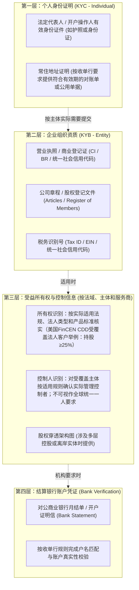
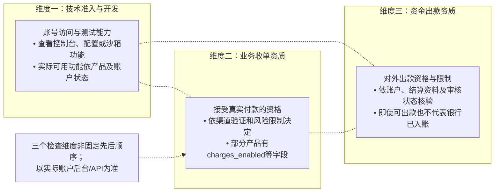
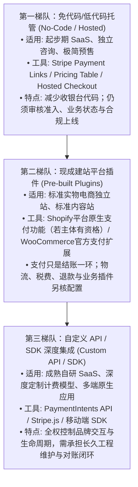
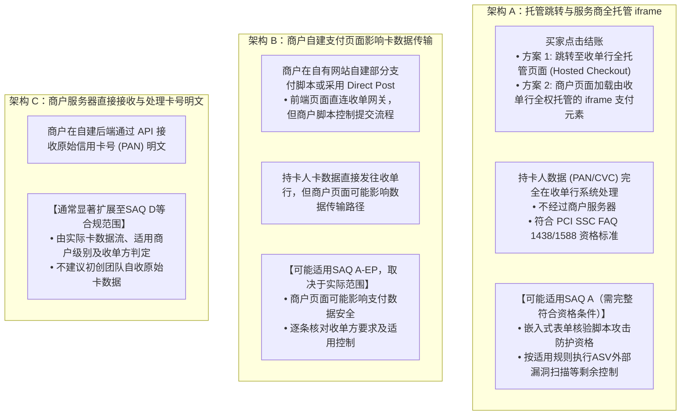
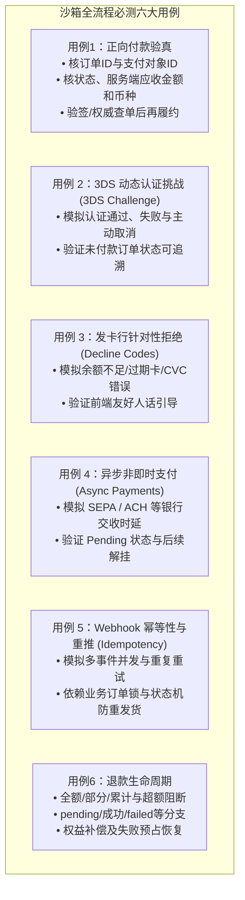
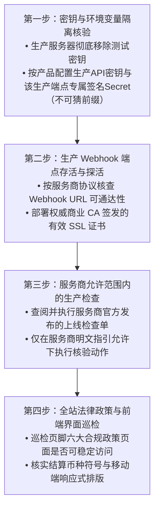

# 第3章｜选好收款方式，怎么才能用起来？

> **唯一核心问题：做跨境生意，钱怎么收、税怎么交？**  
> **本章定位**：承接第 2 章已确立的收款方案选型（独立收单、平台代收与第三方代售），本章全面解决“**商户准入实操、技术接入选型与上线安全验收**”。重点讲透 KYC/KYB 资料合规准备、账户“注册-收单-出款”多阶段资格解耦、收款链接与现成插件及自定义 API 的渐进式选型、托管与嵌入式支付的 PCI-DSS 安全责任边界，以及正式上线前必不可少的沙箱测试、异常付款防御与生产环境验收闭环。

---

### 本章贯穿导读案例

为了帮助读者理解不同业务类型在实际开户与接入中的实操差异，本章继续依托三类具有代表性的出海业务画像展开说明：
- **案例 A（SaaS / 虚拟商品独立开发）**：李明，全栈开发者，国内主体运营。自研面向欧美个人与小团队的生产力 SaaS 工具，采用按月/按年循环订阅模式（$15/月或 $120/年 `[MODEL_ASSUMPTION]`），既可采用极简托管收银台快速起步，亦可在产品成熟后通过 API/SDK 深度整合用户权限与计费流。
- **案例 B（实物出海独立站 / DTC 电商）**：张华，外贸创业者，国内主体运营 Shopify/WooCommerce 独立站销售户外骑行配件，客单价 $60/单 `[MODEL_ASSUMPTION]`，主要依托成熟电商插件打通购物车、税费运费计算、物流单号回传及售后退换。
- **案例 C（涉外技术服务 / B2B 定制出海）**：王工，小型技术服务团队负责人，国内有限责任公司。为海外中小企业提供软件定制开发与运维服务，单笔合同金额 $3,000 至 $10,000 美元 `[MODEL_ASSUMPTION]`，以定制商业发票、形式发票（Proforma Invoice）结合专属账单链接或本地虚拟对公账户完成履约。

---

## 3.1 开通收款账户，需要准备哪些资料？

### 3.1.1 开户时哪些身份、企业与受益所有人资料可能需要提交？

**【核心答案】**  
**开通海外收款账户是跨国金融机构受各法域反洗钱（AML）与客户尽职调查（CDD）规则约束的法定准入审查过程。** 具体所需资料与核验方式因开户服务商所在法域、账户类型及具体产品而异，并不存在全行业放之四海而皆准的绝对清单；商户应从“个人身份、企业法人、最终受益所有人（UBO）与银行结算凭证”四个核心维度系统化梳理材料。

#### 1. KYC 与 KYB 的多法域通用架构与审核维度



1. **第一层：个人身份与住址证明（针对法定代表人、开户授权人）**：
   - **有效身份证件**：政府签发的带照片有效证件。国际收单机构通常支持有效**护照（Passport）**，多数机构亦支持本国**法定身份证（National ID）**或驾照。商户应提供证件原件清晰、完整且在有效期内的扫描件或照片。姓名拼音应与官方证件保持一致；若服务商要求英文或拼音核验，需按照服务商指引提供标准拼写（如拼音顺序建议与银行账户或护照保持一致）。
   - **居住地址证明（Proof of Address）**：用于核实个人常住地真实性。通常可接受近 3 至 6 个月内签发、包含全名与详细地址的银行月结单、水电燃气缴费单或电信账单（具体受支持单据类型与签发时效以目标机构官方公布列表为准）。**澄清**：多数主流机构接受受认可金融机构开具的官方电子 PDF 账单，并非所有场景都强制要求昂贵的公证件或实地上门核验。
2. **第二层：企业组织登记资料（针对个体工商户、有限公司或境外实体）**：
   - **注册登记文件**：中国大陆实体提供《营业执照》（正本或副本彩色件）；香港公司提供公司注册证书（CI）与有效商业登记证（BR）；海外公司提供各州签发的注册证书（Certificate of Incorporation / Formation）及联邦税号文件（如 IRS EIN 确认信）；
   - **公司治理文件**：公司章程（Articles of Association）、董事登记册（Register of Directors），用于证明申请人具备代表公司开设金融账户并处置资金的法定授权。
3. **第三层：最终受益所有人（UBO / Beneficial Ownership）的两大核验维度**：
   - **先确定适用的法域、受监管机构和“法人客户”范围，再看识别标准。** 美国FinCEN CDD规则对其**受覆盖金融机构**所服务的**受覆盖法人客户**，采用“所有权维度（每位直接或间接持有至少25%股权的个人，如有）＋控制权维度（一名具有重大管理控制权的人）”的特定定义；即使没有符合该规则25%所有权标准的人，相关受覆盖法人客户仍涉及控制权维度的识别。**这一阈值和人数不能直接推广到所有国家、个人商户、个体工商户或全部PSP产品。** 某机构依其风险评估可采更低的内部识别界限，但须以该机构和相关法规的实际文件核验，不能虚构统一“10%法定门槛”。参见 [FinCEN CDD FAQ B.5/B.7/B.12](https://www.fincen.gov/resources/statutes-and-regulations/cdd-rule-faqs)（2026-10-20核验）。
   - **穿透架构材料**：若申请主体涉及多层母子公司、合伙或境外持股结构，按目标服务商的开户流程提供其要求的股权图、受益所有人/控制人信息以及必要身份证明。股权图是否必须董事签字、盖公章、公证，均非一律适用的全球硬条件。
4. **第四层：银行账户结算凭证（Bank Account Verification）**：
   - 提交用于接收下发出款的商业银行账户证明信（Bank Confirmation Letter）或近期银行流水月结单；
   - **核验要点**：银行账户开户名及收款人权益须遵循目标出款机构的匹配、第三方账户接受政策及其认可的证明方式；虚拟收款账户并非总能作为商户出款账户，也不统一强制出具盖章证明信。

#### 2. 实操准备技巧与边界澄清
- **资料清晰度与格式**：建议提交全彩、四角完整、文字与印章清晰可辨的原件电子扫描件（PDF 或高分辨率图片格式），避免黑白复印、反光遮挡或截图裁剪；
- **名称顺位与翻译件要求**：对于非拉丁字母的执照或证件，部分跨国收单机构可能需要商户在系统后台补充拼音对照或提供由正规翻译机构出具的英文翻译件，具体要求以开户页面指引为准；
- **主体性质与产品准入边界**：中国大陆个人、个体工商户与有限公司在不同收单机构的准入规则不同（如第 2 章所述，海外原生 Stripe 不支持大陆企业直接开户，而受邀 Shopify Payments 仅限特定大陆商业实体并需绑定万里汇；钱海、Asiabill 则按自营独立站资质审批企业商户）。商户开户前务必先确认目标机构当前支持的主体类型。

---

### 3.1.2 经营说明与网站政策，怎样准备才便于真实审核？

**【核心答案】**  
**收单机构与风控审核员在评估商户申请时，核心目标在于确认业务真实存在、评估商业履约能力、测算潜在的交易欺诈与消费者客诉争议风险。** 商户网站应当具备清晰的产品信息与基础合规政策说明；而针对 B2B、SaaS 试用或预上线网站，则应根据渠道特征提供合理的业务证明与受控访问途径。

#### 1. 便于真实审核的“网站合规六要素”参考建议

收单机构与卡组织通用指引通常建议商户在公开销售网站中妥善披露以下商业信息：

| 政策要素 | 审核关注的核心内容 | 准备建议与注意事项 |
| :--- | :--- | :--- |
| **1. 产品/服务描述与计价**<br>(Catalog & Pricing) | • 真实的商品图文说明、技术参数或服务范围；<br>• 明确标注结算币种与标价；<br>• 订阅业务清晰明示续费周期与扣款规则。 | • 避免网站充斥大量未完工的占位假文本；<br>• 确保前台展示币种与后台申请的主结算币种逻辑自洽；<br>• SaaS 明确展示月付/年付价格及试用期转付费机制。 |
| **2. 服务条款与销售协议**<br>(Terms of Service) | • 完整的服务订立与履约准则；<br>• 明确适用的法律管辖地与争议解决条款；<br>• 合规的免责声明与服务终止条件。 | • 依据自身业务实际撰写，避免照抄无关第三方平台名称；<br>• 确保条款链接在全站各页面可稳定打开。 |
| **3. 退款、退货与取消政策**<br>(Refund & Cancellation) | • 明确退换货受理条件、时效窗口及退款途径；<br>• 明确退换货运费与相关费用的承担规则；<br>• 软件/订阅明确披露取消订阅后的权益终止时点。 | • 政策应符合目标销售法域的法定消费者权益要求；<br>• 澄清：某些特定商品（如定制化实物、经消费者同意并已开始履约的数字内容）在部分法域依法享有退款例外，但需在政策中明确声明。 |
| **4. 发货与履约时效政策**<br>(Shipping & Delivery) | • 实物明确说明承运物流、大致处理时限与妥投周期；<br>• 说明运单追踪号（Tracking Number）的提供形式；<br>• 数字内容/SaaS 明确交付方式（即时下载、账号开通等）。 | • 履约承诺须与实际跨境供应链时效相匹配；<br>• 明确跨境关税与进出口税费（DDP/DDU）的承担责任划分。 |
| **5. 隐私政策与数据说明**<br>(Privacy Policy) | • 披露收集哪些客户个人数据（如姓名、邮箱、收件地址）；<br>• 说明第三方支付组件与数据处理者的协作关系；<br>• 依据适用法域（如 GDPR/CCPA）披露用户权利。 | • 政策应如实反映网站的数据采集行为；<br>• 若网站部署了非必要的第三方分析或营销追踪脚本，按目标市场监管要求配置合规的用户授权机制。 |
| **6. 真实联系方式与经营主体**<br>(Contact Information) | • 网站公示有效的客服联系方式（如客服邮箱或工单链接）；<br>• 公示企业法定注册名称或合法经营主体信息；<br>• 提供企业实际办公或注册地址。 | • 确保所留联系方式真实可通达且有专人响应；<br>• 主体名称应与开户申请资质文件保持逻辑对应。 |

#### 2. 不同销售渠道与业务形态的差异化审查应对
- **实物品牌独立站（案例 B 张华）**：若商城处于上线准备阶段，应确保至少完成核心产品上架与结账链路配置；若店铺设置了访问密码，可在开户申请的补充说明中主动向审核团队提供临时访问密码（Storefront Password），方便审核人员查验商品与页面政策；
- **SaaS 软件与数字订阅（案例 A 李明）**：审核人员通常需要评估软件的真实功能与交付形式。李明可提供公开的产品演示页面（Demo）、功能视频，或在申请备注中附带一个临时的测试试用账号供合规人员登录查验；无需向外部提供包含敏感商业机密的生产管理员权限；
- **涉外技术服务与 B2B 定制出海（案例 C 王工）**：B2B 业务通常不依赖在线购物车零售。王工无需强行搭建电商收银台，而是提供展示企业专业背景与技术实力的官方展示网站，并附带代表性的商业服务合同模板、形式发票（Proforma Invoice）范本及项目技术方案建议书，以佐证其业务真实性。

---

## 3.2 为什么注册了账号，却还收不了钱或提不了现？

### 3.2.1 账号注册后，为什么还要补做身份或业务审核？

**【核心答案】**  
**在现代金融收单体系中，“账号创建成功”仅仅代表获得了访问管理后台的技术凭证，并不等同于获得了完整的金融展业许可。** 支付机构出于反欺诈、合规反洗钱与审慎垫资风险考量，普遍在产品架构上对“平台登录、接受付款（Charges）与出款提现（Payouts）”实施多维度的权限管理与动态审查。

#### 1. 支付商户权限解耦机制与状态辨析



1. **三项关键权限维度的解耦本质**：
   - **账户访问与测试能力**：先核实是否可以登录及使用测试环境；账号建立本身不等于正式收款资格，部分机构还可能要求先通过身份审核才开放某些测试能力。
   - **接受真实付款的资格**：查看该服务商对当前主体、国家、行业及产品的收单许可、交易限额和风险限制。Stripe Connect的`charges_enabled`可作**特定产品示例**，其他产品未必提供此字段，也不能由这一字段推定资金已清算或可提现。
   - **对外出款资格**：按官方后台及API核验出款允许状态、所需资料、结算账户、付款计划和余额限制；Stripe Connect的`payouts_enabled`只是一个示例。审核步骤**不一定排在收单之后**、不一定人工进行，也不保证所有渠道都有独立的“点亮”状态。进一步区分可出款、出款已发起和银行最终入账（详见第6章）。
2. **为什么支付服务商会实施“触发式或延迟审核（Triggered / Ongoing Review）”？**
   - **体验平衡考量**：部分服务商为了降低初创商户准入门槛，允许在提交基础信息后快速开启测试或限额收款能力；
   - **动态审查触发机制**：随着交易开展，收单风控系统可能依据合同和具体事件要求补件、调整交易额度、暂停特定能力或审查出款（均非必然）：
     - *交易规模突破初始风控梯度*：如新店铺累积交易量达到服务商设定的初始观察额度 `[MODEL_ASSUMPTION]`；
     - *交易特征发生显著波动*：短期内单笔交易金额异常偏大、交易频率突增，或买家发卡地集中在极高风险区域；
     - *出现争议或高风险预警*：可能触发附加审核，不能把首笔拒付一概视为必然人工复核；
     - *例行监管复核*：依据反洗钱法律法规进行的定期合规资质抽检。
   - **经营现金流风险防范**：商户在对接收款通道初期，应当密切关注控制台中的合规状态指示。在提现资格尚未完全激活、银行账户尚未通过验证前，实物电商商户应谨慎控制大规模备货垫资节奏，避免因后续资质补件不顺畅而面临结算资金滞留与采购周转承压。

---

### 3.2.2 审核遇到身份、资料或登录环境问题，应怎样查明原因？

**【核心答案】**  
**审核受阻时，盲目重复提交相同材料或试图通过“更换代理 IP 绕过”不仅无法解决问题，反而极易触发风控升级。** 正确的处理方式是依据官方后台通知与合规状态代码准确定位卡点，区分“资料技术瑕疵”、“业务合规存疑”与“网络安全警报”，通过正规官方工单渠道提供真实、充分的补充证据。

#### 1. 四类高频审核卡点与诊断排查指引

| 卡点分类 | 官方常见表现与状态提示 | 常见诱因分析 | 合规排查与修复建议 |
| :--- | :--- | :--- | :--- |
| **A. 身份/企业登记文件未通过**<br>(Identity & Verification) | • 提示证件不清晰、无法验证身份<br>• 提示商业实体登记信息无法匹配 | • 证件反光、边缘缺失、有效期限过期；<br>• 填报的法定代表人拼音与证件不符；<br>• 公司名称英文拼写与官方登记有差异。 | • 调阅后台具体驳回字段说明；<br>• 重新提交原件高清无修图扫描件；<br>• 必要时附带官方商事登记公示报告。 |
| **B. 业务模式与经营政策存疑**<br>(Business Model / Policy) | • 收到合规问询信，要求提供经营说明<br>• 提示网站销售类目受限或存疑 | • 网站尚未上架真实商品或缺少退款政策；<br>• 商品描述涉及受限品类（如医疗、虚拟币）；<br>• 缺少供应链采购或知识产权授权凭证。 | • 完善网站六大合规政策页面；<br>• 整理合法的供应链采购合同或授权书；<br>• 提交正式的业务模式说明信（Business Profile）。 |
| **C. 出款银行账户核验受阻**<br>(Bank Account Mismatch) | • 提现发起失败，提示账户信息有误<br>• 微存款验证（Micro-deposits）未收到 | • 银行账户开户名与企业法定名称不一致；<br>• 混淆了本地清算 Routing 号与国际 SWIFT；<br>• 填报币种与接收银行账户支持币种冲突。 | • 核对结算账户法定所有权归属；<br>• 使用官方出具的正式对公账户证明信核对；<br>• 及时查阅银行流水获取微存款代码并回填。 |
| **D. 登录环境与网络关联异常**<br>(Network & Access Risk) | • 登录受限，提示账户存在安全风险<br>• 要求进行人脸生物识别或二次多因子验证 | • 使用了万人共享的高风险公共数据中心代理；<br>• 登录 IP 发生跨国、跨大洲瞬间漂移；<br>• 浏览器特征指纹与受风控账户存在交叉。 | • 使用与真实经营地及服务商账户声明相符的受信任网络和登录设备，并按官方通知排查安全事件；<br>• 遵循官方指引完成法人活体人脸核验；<br>• 诚实向客服说明实际运维管理背景。 |

#### 2. 正规沟通与 MATCH 机制的边界澄清
- **标准沟通流程**：
  1. 查阅管理后台“账户设置 / 合规（Compliance / Verification）”专区，记录具体的问询编号（Case ID / Ticket ID）；
  2. 按照官方列明的补充文件清单（RFI），准备命名规范、内容详实的证明材料包；
  3. 撰写一份客观、清晰的说明信，阐明业务背景、产品供应链、目标客户群及典型订单履约流程。
- **关于 MATCH 机制的边界澄清**：
  - **规则澄清**：Mastercard 的 MATCH/MATCH Pro 属于**卡组织商户风险管理项目**，并非各国统一“法定黑名单”。是否符合录入原因、由何种收单成员提交、记录保留与特定条件下的纠错或删除，均按其当期项目规则、原因代码与收单机构调查程序处理；不能从一般资料补件、单次拒付或账号被限制直接推定列入名单，也不能承诺商户可直接要求立即删除。具体原因代码及当前版本须核对 [Mastercard官方项目规则](https://www.mastercard.com/content/dam/public/mastercardcom/na/global-site/documents/SPME-Manual.pdf)，未逐码核实处标记`UNKNOWN`；
  - **排查心态**：初期的资料不匹配、补充水电单要求或一般性退款政策核查，属于常规商业风控问询，**绝不等于自动被列入跨行黑名单或导致终身无法开户**；商户无需过度恐慌，但严禁通过伪造公章、虚构假地址或买号等违法手段应对，真实透明是唯一合规准则。

---

## 3.3 收款链接、现成插件和自己开发，怎么选？

### 3.3.1 什么业务直接用收款链接就够了？

**【核心答案】**  
**收款链接（Payment Links）是将收银台能力高度封装的轻量化无代码工具。** 现代收款链接支持通过后台手动生成或通过 API 批量编排，并可配置多行商品、指定购买数量、集成自动算税与基础订阅；其核心边界在于**缺少与独立站前端复杂购物车的深度动态联动**，适合交易频次较低、无需动态锁定多 SKU 库存、或以发票化对公结算为主的商业场景。

#### 1. 收款链接的核心特性与适用场景对比

```mermaid
flowchart LR
    subgraph 方式一：收款链接 (Payment Links)
        M1["商户后台或 API 生成链接"] --> L1["通过邮件/微信/即时通讯发送"]
        L1 --> C1["买家在收单机构安全托管页付款"]
        C1 --> W1["收单行发送 Webhook / 邮件"]
        W1 --> F1["后端系统查验后履约"]
    end

    subgraph 方式二：动态在线商城收银台 (Full Cart)
        M2["独立站动态购物车选购多 SKU"] --> L2["本地实时算税、算运费、核减库存"]
        L2 --> C2["调用集成收银台完成扣款"]
        C2 --> W2["系统自动闭环履约发货"]
    end
```

1. **收款链接的内建能力**：
   - **多行明细与数量配置**：主流收款链接（如 Stripe Payment Links）支持添加多个商品行（Line items）、允许买家自选购买数量、收集自定义留言字段（Custom Fields）以及收集买家开票与邮寄地址；
   - **支持循环订阅与自动算税**：可直接挂载按月/按年循环计费商品，并可联动服务商的自动化税收引擎计算销售税；
   - **免除前端页面维护负担**：直接托管在收单机构的高可用服务器上，天然兼容移动端与主流数字钱包。
2. **收款链接与传统购物车的核心边界对比**：

| 评估维度 | 收款链接 (Payment Links) | 动态独立站购物车 (E-commerce Cart) |
| :--- | :--- | :--- |
| **典型适用场景** | B2B 定制出海（王工）、技术咨询、原型预售、软件早鸟赞助。 | DTC 品牌实物站（张华）、多品类零售商城、数字商品应用商店。 |
| **多 SKU 选购与库存管理** | 适合单一商品或简单组合；无法实现复杂的跨品类加购、尺码颜色动态联动及毫秒级库存预占。 | 深度支持复杂变体、实时仓储库存同步扣减与组合促销折扣。 |
| **与发票（Invoice）的区别** | 链接主要用于即时刷卡；而发票产品（Invoicing）具备明确的付款账期（Due Date）、支持对公电汇附言匹配与催款流。 | 结账即完成订单创建，由电商系统集中管理发票与发货面单。 |
| **订单履约与支付状态确认** | **警示**：管理人员收到的通知邮件不可作为放行权益的唯一依据；仍需系统通过服务端 Webhook 校验。 | 订单状态由建站平台或服务端 Webhook 自动闭环更新。 |

---

### 3.3.2 现成插件与自己调用支付接口，该怎么选？

**【核心答案】**  
**技术接入选型并非“实物必须选插件、SaaS 必须自研 API”的非黑即白判定，而是一个根据团队技术储备、业务计费复杂度和维护成本建立的渐进式决策光谱。** 从完全无代码的托管收银台，到成熟建站插件，再到深度集成的 SDK/API，每种方案都有其最契合的商业发展阶段。

#### 1. 常见技术接入路径的梯队分布与边界



1. **第一梯队：免代码/托管式方案（适合初创及标准业务）**：
   - *打破迷信*：SaaS 业务初期绝非必须从零手写全套计费系统。利用收单机构提供的官方“定价表组件（Pricing Table）”结合 Hosted Checkout，李明可以在自研前端仅粘贴几行嵌入脚本，即可实现月付/年付切换、自动客户门户（Customer Portal，允许用户自主取消或换卡）与账单管理，极大节约早期开发成本。
2. **第二梯队：现成建站插件方案（适合标准独立站，张华案例）**：
   - **生态价值**：**Shopify Payments是Shopify平台内置的支付服务，不是独立可安装插件**；WooCommerce的支付扩展属于插件。它们可以对接结账及部分订单事件，但税费处理、库存、物流、退款规则和弃单提醒需要按具体平台版本、业务插件与商户设置分别验证，不能假设安装支付扩展后全自动闭环；
   - **渠道与平台费边界澄清**：
     - *官方服务与第三方收单*：Shopify Payments属于平台集成支付方案；**中国大陆跨境企业目前存在仅限受邀的Early Access计划且须绑定已验证WorldFirst账户**（参见Shopify官方[China Requirements](https://help.shopify.com/en/manual/payments/shopify-payments/supported-countries/china/requirements)，核验于2026-10-20），并不是所有大陆店铺均已开放；另有针对“一般在中国销售商家”的官方[设置指南](https://help.shopify.com/en/manual/intro-to-shopify/initial-setup/sell-in-china/set_up_payments)仍列默认第三方方案，须以明确的项目入口及商户实际资格为准；若商户使用其他第三方收单通道（如经获批的 Asiabill/钱海），Shopify 会依据商户选用的店铺套餐加收一定比例的**第三方交易手续费（Third-party transaction fee）**。Shopify[中国商家指南](https://help.shopify.com/en/manual/intro-to-shopify/initial-setup/sell-in-china/set_up_payments)在2026-10-20列出 Basic 2.0%、Shopify 1.0%、Advanced 0.6%、Plus 0.2%，仅适用于其说明的第三方交易费场景；具体套餐、地区、支付方式仍需核对当期合同与后台，且符合收费条件时**另于PSP处理费之外**；
     - *插件非万能*：插件能解决前端展示与订单自动流转，但在复杂的分布式系统架构中，商户仍需关注退款与财务对账接口的一致性。
3. **第三梯队：自定义 API / SDK 方案（适合成熟定制平台）**：
   - 适用于需要深度自定义收银台交互、实施复杂的按用量计费（Usage-based Billing）、支持跨应用多端内购或需要将支付界面与软件功能无缝融合的业务场景。商户需承担 API 版本维护、安全防护及异常补偿逻辑的开发工作。

---

### 3.3.3 托管收银台与嵌入式支付表单，在安全责任上有何不同？

**【核心答案】**  
**支付交互架构直接决定了商户在 PCI-DSS（支付卡行业数据安全标准）项下的合规范围与法律责任。** 依据 PCI SSC 官方规范及收单机构指南，托管收银台与完全由服务商托管的 iframe 嵌入式组件均具备显著缩小商户安全合规范围的能力；但商户必须清楚：**采用嵌入式组件绝不意味着商户自身 Web 服务器免除了一切安全责任**。

#### 1. 前端接入架构与 PCI-DSS 适用问卷（SAQ）对照



1. **SAQ A 与 SAQ A-EP 的真实官方边界（依据 PCI SSC FAQ 1438 / 1588）**：
   - **SAQ A 适用场景**：符合**全部**SAQ A范围和资格条件且卡数据处理外包的商户，可能采用纯重定向的托管支付页，也可能采用由合规第三方支付服务商托管、符合条件的iframe嵌入方案（例如某些Stripe Elements/Checkout集成）。技术名称不直接决定问卷类别，仍需与收单方/卡品牌核对。
   - **SAQ A-EP 适用场景**：商户电子商务网页环境能够影响付款数据安全、但又不满足SAQ A的简化范围且其实际数据流符合A-EP的完整资格条件时可能适用，例如某些Direct Post方案；不能单凭“嵌入式”标签决定。
   - **实际认定标准**：商户须完整检查最新PCI SSC SAQ资格条件、实际页面/服务器的卡数据接触范围，并与收单行或卡品牌确认合适的SAQ和验证等级；不能凭接入厂商宣传承诺免除责任。
2. **商户剩余安全责任与 PCI-DSS v4.0 最新考量**：
   - **即使在 SAQ A 架构下，商户也非“零责任”**：
     - *前端注入防御（Anti-Skimming）*：攻击者若攻破商户主站 Web 服务器，可通过植入恶意 JavaScript 脚本（即 Magecart 供应链攻击）在主页面上叠加伪造输入框窃取卡号；
     - *2025年SAQ A规则修订*：PCI SSC的[正式公告](https://blog.pcisecuritystandards.org/important-updates-announced-for-merchants-validating-to-self-assessment-questionnaire-a)确认，自2025年3月31日起，**SAQ A问卷本身移除了6.4.3、11.6.1及为11.6.1服务的12.3.1直接条目**，转而增加特定嵌入式支付页面有关脚本攻击防护的**资格条件**；这**不等于PCI DSS完整标准删除了相应要求**。嵌入TPSP iframe的网站应依[PCI SSC FAQ1588](https://www.pcisecuritystandards.org/faqs/1588/)评估脚本攻击影响、采用适用防护技术，或依据官方规则取得其合规TPSP就嵌入方案保护措施的有效确认；纯跳转模式的这一资格条件适用范围不同。
     - *ASV外部漏洞扫描*：按照[PCI SSC FAQ1604（2026年6月）](https://www.pcisecuritystandards.org/faqs/1604/)，符合SAQ A的电商商户页面，**即使跳转至第三方或嵌入其iframe，也有SAQ A所列11.3.2/11.3.2.1的适用ASV扫描义务**，须按要求使用PCI SSC批准的ASV服务并核对实际扫描范围。是否还有额外控制、扫描频率及实际执行方式，应对照当期SAQ、收单方要求与自家页面架构确认；HTTPS/CSP并不能替代适用的ASV和其他安全检查。
3. **关于 SAQ D 的客观认知**：
   - 任何在商户自身服务器上存储、传输或处理原始信用卡明文（PAN/CVC）的系统均归入 SAQ D 范围。尽管中小商户在特定收单规则下可能提交 SAQ D-Merchant 自评估问卷，但其安全技术要求极其严苛（涉及网络分段、硬件加密机、脆弱性扫描与复杂运维审计）；对于出海初创团队而言，**强烈建议彻底规避由自身服务器触碰原始卡号明文**，坚定采用合规服务商提供的 Token 化或托管组件方案。

---

## 3.4 正式上线前，怎么确认收款流程真的能用？

### 3.4.1 沙箱里要测试哪些成功、失败和异常付款？

**【核心答案】**  
**沙箱测试绝不能仅仅验证一笔“扣款成功”，更重要的是检验系统的“抗逆能力与状态一致性”。** 线上真实交易中存在一定比例的拒卡、3DS 挑战中断或网络延迟波动 `[MODEL_ASSUMPTION]`。商户必须按照标准化用例矩阵，在沙箱环境中全面验证正向流、异常流、部分退款及服务端防重幂等机制。

#### 1. 沙箱环境全流程必测用例矩阵



1. **用例 1：标准扣款成功与服务端权威核验（Happy Path）**：
   - 使用收单机构提供的免验证成功测试卡；
   - **关键核验边界**：前端跳转、`success_url`或邮箱通知不能作为履约凭据。服务端须验证适用Webhook的签名/防重放信息，必要时向官方接口查单，并把**网关付款对象ID、预绑定的本地订单ID、服务端预期的金额（正确货币最小单位）、币种、商户归属及适用的终态**逐项匹配成功后，才能按订单状态机一次性释放对应商品/权益；不能仅凭事件类型或`status=succeeded`放行他单（完整实现与乱序补偿见已封板第5章）。
2. **用例 2：3D Secure 动态身份认证挑战与未完成订单处理**：
   - 使用官方指定的强制 3DS 挑战测试卡；
   - **状态追溯**：测试买家输入正确验证码完成扣款的顺畅流程；**更要测试买家主动关闭弹窗、认证超时或银行拒绝的场景**。在业务数据库中，未付款订单应当合规标记为 `PENDING` 或 `PAYMENT_FAILED` 并妥善归档，以便买家重新发起支付或进行弃单归因分析，而非在系统中无迹可查。
3. **用例 3：发卡行拒绝代码的人性化引导（Decline Codes）**：
   - 依次测试模拟“余额不足（`insufficient_funds`）”、“卡片过期（`expired_card`）”、“安全码错误（`incorrect_cvc`）”等测试卡；
   - **体验标准**：前端界面应将技术报错代码转化为清晰的本地化提示文字，引导客户检查卡号信息、更换其他银行卡或选用其他支付方式。
4. **用例 4：异步延时到账流程（Asynchronous Payments）**：
   - 模拟处理本地银行转账或借记网络；
   - **核验逻辑**：结账后系统先生成处于“等待付款中”状态的订单，前端明确向客户展示付款指引与预估处理时效；待数小时或数天后系统真正接收到 `payment_intent.succeeded` 终态事件后，才触发自动化交付。
5. **用例 5：Webhook 业务幂等性与防重防御（Business Idempotency）**：
   - **边界澄清**：*单个 Event ID 去重并不等同于完整的业务订单幂等*（例如收单行在不同阶段可能发送类型不同但指涉同一笔支付的事件）；
   - **测试操作**：在控制台重发相同事件，或模拟网络超时重试；
   - **达标标准**：商户系统必须在数据库层面通过事务锁、订单唯一业务索引（如 `merchant_order_id`）与状态机流转控制，以可重复执行的测试和唯一约束**防止重复充值、重复激活订阅或重复扣库存**；不能把静态设计等同于已完成真实并发验收。
6. **用例 6：退款生命周期与部分退款处理（Refund Handling）**：
   - **边界澄清**：发起退款并不等于款项瞬时到达买家账户（银行处理通常需要数个工作日）；且**部分退款绝不等于全部订单退款**；
   - **测试操作**：使用目标机构**实际提供**的沙箱/官方模拟工具，验证部分退款、累计退款、全额退款、并发超额拒绝及支持的退款`pending/processing→succeeded`和`failed`/等价失败通知；不同机构事件名不同，无法沙箱复现时须登记`NOT_RUN`与人工应急预案。
   - **达标标准**：原付款币种和最小单位一致，数据库将`reserved/submitted/pending/unknown`占款与已成功退款合并计入防超额校验（详见第5、7章）；**仅在网关已确认退款成功时**更新`amount_refunded`，处理中不得提前注销全部权益；失败要核实退款平台状态、受控释放预占或重试同一业务操作，保留审计记录，不能新建请求盲目二次退款。

---

### 3.4.2 正式上线前，怎样按照支付机构要求验收真实环境？

**【核心答案】**  
**从沙箱切换至生产环境，必须严格遵循收单机构的操作红线：正式生产密钥严禁用于模拟自刷测试。** 生产环境验收应当聚焦于“环境变量与密钥隔离检查、生产 Webhook 端点存活与健康探活、全站合规链接巡检”；所有交易功能验证均须在服务商明文准许的合规路径下进行。

#### 1. 严正风控禁令：严禁在生产环境使用真实卡违规测试
- **规则红线**：Stripe 等国际收单机构在服务协议与测试指引中明确规定：**禁止在 Live Mode 下使用真实支付工具（如个人信用卡）进行模拟测试交易**；
- **错误规避手段澄清**：人为安排朋友、员工或外部兼职人员在生产环境“购买一个虚拟的 $1 美元商品并随后退款”，**绝非收单机构认可的合规生产验证方案**。收单机构的反欺诈引擎对涉及虚假交易、非真实贸易背景的自刷自退行为高度敏感，此类操作极易引发洗钱防范风控拦截；
- **正确原则**：应优先在测试环境（Test Mode / Sandbox）覆盖服务商**实际支持**的支付功能、常见异常与状态恢复；无法在沙箱复现的边界必须记录`NOT_RUN`和补偿措施，不承诺百分之百可模拟所有真实银行行为；生产环境只开展真实、获准的合规业务和服务商允许的检查。

#### 2. 合规的生产环境四步验收检查法



1. **第一步：密钥与配置逻辑隔离核验（Key Isolation Check）**：
   - 彻底检查生产运行环境配置，确保生产公钥（`pk_live_...`）与私钥（`sk_live_...`）配置无误，严防测试公私钥被遗留在生产构建包中；
   - 为生产环境对应的Webhook端点配置从服务商后台或官方接口获取的签名密钥；**Stripe示例格式为`whsec_...`（并非`whsec_live_...`）**，可从Webhook端点配置读取，并按端点`livemode`/所处环境区分测试与生产；与测试凭证实行逻辑隔离、最小权限和安全保管，**不要将Secret放入前端包或代码仓库**。参见[Stripe Webhook Endpoint API](https://docs.stripe.com/api/webhook_endpoints)。
2. **第二步：生产 Webhook 端点存活与安全配置核验（Endpoint Health Check）**：
   - 检查生产服务器 Webhook 接收端点的公网可达性与证书链完整性（必须采用权威 CA 机构签发的有效证书）；
   - 确保 Webhook 处理服务能够根据服务商推荐规范，在合理超时时限内快速向调用方返回确认响应，耗时的下游业务逻辑交由后台异步队列处理。
3. **第三步：服务商允许范围内的生产上线检查（Processor-approved Checks）**：
   - 严格遵循服务商官方提供的《上线检查清单（Go-live Checklist）》；
   - 验证服务商后台各项通知邮件模板、公司抬头、对账单描述符（Statement Descriptor）设置准确；
   - 严禁自行编造虚假测试交易；通道上线后首批订单应来源于真实消费者的自然购买，运营人员密切监控后台首笔真实订单的流转与到账状态。
4. **第四步：全站法律政策与前端界面巡检（Front-end Integrity Audit）**：
   - 逐一点击检查网站页脚公示的《服务条款》、《退款政策》、《发货政策》等核心链接是否均可通达；
   - 在多款主流移动端浏览器上测试结算页面的排版渲染与交互流畅度。

---

### 3.4.3 验收时怎么核对退款、提现资格和失败回退是否已就绪？

**【核心答案】**  
**通道能正常发起扣款仅仅代表收银前端链路跑通，只有当“退款负余额规则明确、提现出款资格点亮、支付异常回退与客诉挽留体系就绪”时，整套跨境支付系统才具备完整的抗风险韧性。**

#### 1. 验收时三大关键就绪状态核对清单

1. **核对点一：退款能力与资金池负余额规则核对（Refund Readiness）**：
   - **权限与功能核验**：在收单后台核实管理账号是否已被授予退款操作权限，测试后台或 API 退款接口调用权限是否正常；
   - **负余额处理规则确认**：详细阅读收单服务协议中关于“可用结算余额不足时处理退款”的条款。不同收单服务商处理机制不同：部分机构支持在后续入账流水中自动抵扣，部分机构在开启授权后可对绑定的结算银行账户发起自动借记（Auto-debit），亦有机构可能要求商户向备付金账户补充资金后方可执行退款。商户需提前明确本通道规则，避免因余额不足导致客户退款延误引发争议。
2. **核对点二：提现出款（Payouts）资格与结算周期确认**：
   - **出款状态核对**：在控制台确认 Payouts 功能处于激活可用状态（如显示为 `Active / Enabled`），无未完成的强制合规待办事项；
   - **银行账户与出款时滞认知**：核实绑定的结算银行账户已通过验证。**澄清**：商户应明确区分“支付平台发起提现（Payout Initiated）”与“商业银行最终外币入账（Bank Settled）”两个不同节点；不同收单机构对新商户可能设置不同的风险观察期或滚动结算计划 `[MODEL_ASSUMPTION]`，具体跨国汇兑与银行入账细则衔接第 6 章。
3. **核对点三：支付异常回退与客诉挽留机制（Failure Handling & Recovery）**：
   - **不确定状态防重复扣款原则**：当买家支付遭遇网络超时或返回不确定状态时，**严禁在未确认前序交易状态前盲目引导买家无缝切换至其他通道重新付款**，否则极易导致买家在两边均被扣款从而引发严重客诉；系统应提示订单处理中或主动向网关探查最终状态；
   - **人性化失败引导与购物车保留**：当收到明确的发卡行拒绝时，向买家展示清晰、通俗的本地化故障说明，并完整保留当前购物车已选商品，降低买家挫败感；
   - **弃单挽回邮件的法域差异**：先判断邮件是否属于营销信息、客户所在地与适用法律，核对个人信息处理依据、联系方式取得方式及退订权利。**建议优先取得明确营销同意（Opt-in）并保留记录作为审慎策略，但这不是所有市场相同的法律强制前提**：美国联邦[FTC CAN-SPAM官方指南](https://www.ftc.gov/business-guidance/resources/can-spam-act-compliance-guide-business)一般侧重真实发件信息、广告识别、邮寄地址、退订及按时处理等要求，并不把预先Opt-in设为所有商业邮件的统一前提；欧盟营销电子邮件还须结合当地电子隐私/电子通信法、GDPR及可能的既有客户关系例外逐国判断。相关转化率未有本章实测，标为`UNKNOWN`。

---


> **规则核验注（2026-10-20）：** 本章记录的PCI SSC SAQ A修订、FAQ1588、FAQ1604、FinCEN CDD以及Shopify中国Early Access和第三方交易费均有特定法域、账户、产品或时间范围。本文不是某个商户的PCI合规确认书、金融开户批准或真实支付测试报告。服务商规则升级时，应重新查阅当前官方版本。

## 本章小结与第 4 章接口

### 1. 跨境支付上线全流程实操就绪对照表 (Launch Readiness Checklist)

| 阶段 | 核心实操自检动作 | 达标合格判据 | 关键合规与风险注意要点 |
| :--- | :--- | :--- | :--- |
| **阶段一：KYC/KYB 物料准备** | 梳理个人身份、企业登记、UBO（所有权与控制权双维度）及银行证明。 | 证件清晰有效，拼音与信息严格按服务商指引对齐。 | 美国FinCEN受覆盖法人客户可按25%股权＋控制人举例；其他主体及PSP按各自法域与产品核验，非全球硬门槛。 |
| **阶段二：网站政策与审查准备** | 上线清晰商品图文与定价，页脚配置《服务条款》、《退款政策》等通用合规政策。 | 网站无占位假文本，政策完备可通达，与实际业务模式一致。 | 政策应符合适用消费者保护法；针对 SaaS/B2B 准备合理的演示或脱敏业务资料。 |
| **阶段三：技术选型与架构实施** | 根据技术储备与计费复杂度，在托管收银台、现成插件与自主 API 间渐进式选型。 | 选型契合当前业务规模；依据 PCI SSC 规则准确评估自身 SAQ 分类（如 SAQ A / A-EP）。 | 起步期 SaaS 可选无代码托管；符合条件的嵌入式页面才可能适用SAQ A；核对脚本攻击资格、ASV外部扫描和商户剩余责任，收单方确认最终适用问卷。 |
| **阶段四：沙箱极限抗逆测试** | 在测试环境中测试正向扣款、3DS 挑战通过/取消、发卡行错误码、异步延时、Webhook 重发及部分退款。 | Webhook验签/必要时查单，并核订单ID、支付对象ID、应收金额与币种、可履约状态及业务幂等；部分退款还要测试处理中与失败恢复。 | 严禁只跑通正向成功即草率上线；未付订单合理归档追溯；退款失败保留待核验状态。 |
| **阶段五：生产环境验收与后延就绪** | 生产与测试密钥逻辑隔离、Webhook端点与签名Secret正确配置；按实际机构核对出款资格、负余额与限制。 | 生产密钥已配置；以各机构实际后台/API可出款状态为准（Stripe Connect可参考`payouts_enabled`）；明确退款负余额规则；知晓首笔结算时滞。 | **不得在生产环境进行违反服务商测试规则的虚假自刷/自退；优先采用官方测试环境和允许的生产检查**；防范支付超时盲目切通道导致的重复扣款；弃单邮件守法合规。 |

---

> **下章衔接**：通过第 1 章明确法律主体、第 2 章完成渠道选型，以及本章第 3 章严格落实商户开户审查、技术接入与上线验收，商户端已具备可供逐项执行的开户与接入检查方法；**是否真实准入、通过沙箱或完成生产验收仍须依据本账户实际结果确认（NOT_RUN）**。
>
> 然而，管道通畅只是商业成功的起点，真正的交易转化取决于终端消费者的付款体验。海外买家在收银台究竟习惯用什么方式付款？不同国家对币种透明度和附加费有什么心理预期？3D Secure 认证在拦截欺诈的同时如何避免让买家感到繁琐而弃单？**第 4 章《怎么让海外客户顺利付款？》** 将切换至海外消费者的第一视角，深度剖析结账转化率优化、本地化支付方式匹配、币种展示与防范付款失败的核心策略。
