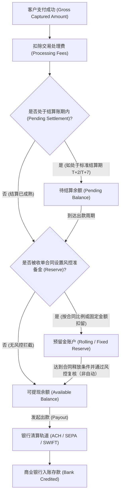
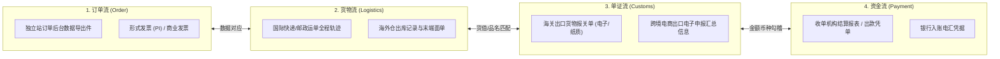
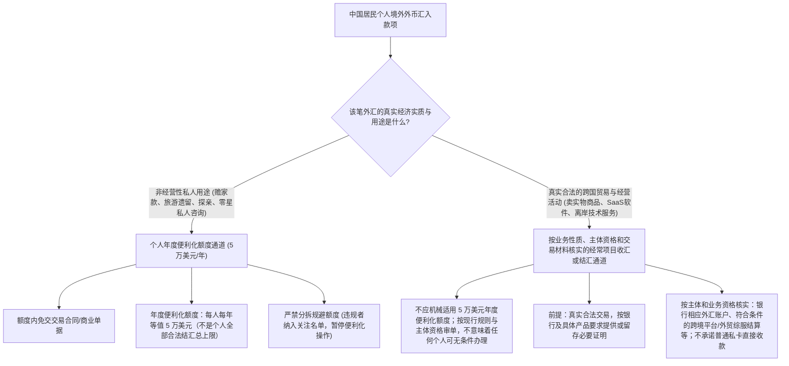
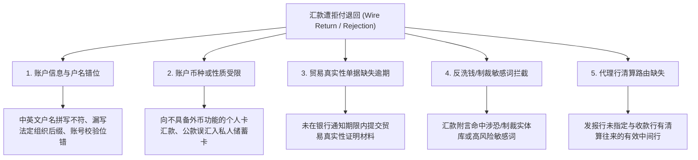

# 第6章｜客户付的钱，怎么进我的银行账户？

## 引言（非冻结）

在跨境业务的实际运营中，许多刚起步的开发者与中小卖家最常遭遇的困惑，往往发生在“顾客付款成功”之后：在独立站管理后台或收单机构仪表盘上看到订单状态显示为绿色“Succeeded / Paid”，但打开自己的境内招商银行、中国银行或工商银行账户，余额却分文未增；好不容易等到了出款日，原本 1000 美元的销售额，最终落到银行卡里的实际金额却变成了 930 美元甚至更少；更有甚者，资金在跨境汇款途中耗时数周，或者遭遇境内银行合规部门的电话核查，被要求解释款项性质或补充与实际业务相符的合同、订单、结算报表及物流/交付证据；若未通过审查，可能延迟入账或退汇并产生费用。

出现这些现象的根源在于：**付款页显示成功可能表示授权、捕获或平台确认的某个阶段，不能单凭页面提示推断跨行清算完成，更不等于款项已进入境内经营者银行账户。**资金结算与纳税申报也是两套不同的法律与时间口径；银行入账并不等于已经完税。

一笔跨境资金从海外买家的支付工具，最终转化为经营者在指定银行账户中的人民币或外币存款，视实际路径可能涉及不同法域、清算网络、外汇合规和反洗钱审查；部分境外本地出款并不经过国际电汇，也不要求自动兑换成人民币。可以用五个里程碑理解常见路径：
1. **交易授权与捕获（Authorization & Capture）**：买家发卡行确认授信并锁定额度，收单机构确认捕获；
2. **卡组织与收单清算（Clearing & Acquirer Settlement）**：资金经卡组织或本地清算网络清算至收单机构的清算托管账户；
3. **平台结算与可用余额（Processor Settlement & Available Balance）**：收单机构或代售平台根据合同约定扣除服务手续费与风控准备金后，记入商户可用账簿；
4. **出款与跨境流转（Payout & Cross-Border Rails）**：资金通过本地清算网络（如美国 ACH、欧洲 SEPA）或跨国银行网络（SWIFT）向指定银行账户划转；
5. **银行合规核验、入账及可选的换汇（Compliance Review, Crediting & Optional FX）**：开户行或相关合规机构按适用规定核验资金性质及必要单证；依账户币种、产品和业务条件直接入账外币或换汇入账，**不能把结汇视为每一笔交易的必经步骤**。

为了帮助读者在不同业务形态下建立清晰可执行的资金归集与合规操作路径，本章在涉及具体业务场景时，以三类典型的教学场景作为统一分析基准：
* **场景 A（独立开发者出海）**：中国大陆自然人开发者，独立开发并运营一款面向欧美个人及小微企业的英文 SaaS 工具，采用按月/按年循环订阅制；
* **场景 B（跨境实物电商独立站）**：中国境内个体工商户，搭建独立站（如 Shopify / WooCommerce）面向欧美消费者零售家居轻工或 3C 配件产品，采用国内直邮或国际快递履约；
* **场景 C（B2B 软件与技术外包出海）**：中国境内有限责任公司，为海外企业客户提供定制化软件开发、技术支持或远程技术外包服务，按项目里程碑收取服务费。

> [!NOTE]
> 本章出现的上述业务场景，以及所有涉及的订单金额、结算费率、点差比例、到账时效和审核天数等数值，除引述官方公布的既定规则外，均为用于教学论证的设定案例（统一标记为 `MODEL_ASSUMPTION`），不构成特定金融机构或支付服务商的固定商业承诺。真实经营中的费率和结算条件以签约主体合同与各机构实时政策为准。

---

## 6.1 付款成功后，钱会先到哪里？

### 6.1.1 顾客付款成功后，钱可能停在哪些平台或资金账户？

要理解资金流向，首先必须建立正确的法律与金融认知：“支付服务商账簿上的数字，并不等同于商户名下受国家法定存款保险直接保障的银行存款”。

当海外顾客在结账页面点击“确认付款”并提示成功后，资金并不会直接穿透网络飞入商户的银行卡，而是按照底层接入的商业收款架构，停留在不同法律属性的过渡性账户或机构账簿中。

#### 1. 支付交易的资金状态跃迁

任何一笔线上跨境卡基交易，在资金最终到达银行之前，通常经历以下状态演变：
1. **Authorized（已授权）**：买家发卡行验证持卡人身份（如通过 3DS 校验），在买家信用额度或账户余额中冻结对应金额，此时资金并未划拨出买家开户行；
2. **Captured（已捕获）**：收单机构向卡组织提交批处理结算请求，确认该笔交易正式生效，进入清算管道；
3. **Settled（已清算/收单到账）**：卡组织（Visa / Mastercard 等）完成跨行多方清算，资金依交易链条向收单机构或相关结算主体完成划转；具体银行账户结构因支付产品、牌照及法域而异；
4. **Available（平台可用余额）**：收单机构根据与商户签订的服务协议约定的成熟期（如 T+2 或 T+7 工作日，`MODEL_ASSUMPTION`），在计入适用费用、退款及可能的预留金或其他调整后，显示可申请出款的账面余额；
5. **Payout / In Transit（出款在途）**：商户手动触发或系统自动触发提现，出款机构生成转账指令，资金进入银行间传输清算网络；
6. **Bank Credited（银行已入账）**：收款商业银行收到资金，依法完成必要核验后记入约定银行账户；账户可能保留外币，也可能按规定办理换汇。

#### 2. 四大主要停靠路径与资金法律属性区分

不同收款模式下，付款成功后资金所停靠的机构主体与法律性质截然不同：

| 收款业务模式 | 典型代表机构 | 付款成功后资金停靠位置 | 账户的法律与监管属性 | 经营者面临的主要资金风险 |
|---|---|---|---|---|
| **独立收单（PSP/收单机构）** | Stripe、PayPal 等（以实际签约法人和产品为准） | 收单机构或相关支付实体的内部结算账簿及相应资金保障安排 | 商户对结算款的请求权、资金隔离/信托/备付金等安排取决于合同、当地牌照和账户结构；**并非所有 PSP 资金均在 FBO 或信托账户** | 预留金、出款审核、合同终止、支付机构经营风险 |
| **平台代收（Marketplace）** | Amazon、eBay 等 | 平台或其支付实体的清算账簿 | 平台依据卖家协议结算应付款；平台角色、是否代售或仅代收须按合同核实 | 平台调整、退款、冻结与账期 |
| **代售商（MoR）** | Paddle、Lemon Squeezy 等 | MoR 或其支付合作机构的适用结算体系 | 终端客户交易的法律卖方通常为 MoR；开发者对分成或供应商应付款的权利由合同决定。**资金不宜一概定性为 MoR“自有运营资金”** | MoR 合同、支付能力、结算周期 |
| **银行直收（B2B 电汇）** | 汇出行、中转行、收款行 | 银行往来账户及收款行待处理/已记账余额 | 款项实际贷记收款人存款账户后，客户对银行享有**依存款合同及法律形成的存款债权**，不是对银行库款的“完全物权” | 付款指令错误、合规核查、退汇、代理行扣费 |

* **收单机构模式（以场景 A 为例）**：中国开发者若通过海外主体设立 Stripe 账户，顾客购买 10 美元（`MODEL_ASSUMPTION`）SaaS 订阅。扣款成功瞬间，Stripe 在其记账系统（Ledger）中为开发者记录一笔待结算资产，但底层资金如何在收单机构、合作银行和其他结算参与方之间归集，必须以具体机构的资金保障披露及协议为准，不能推断一定有 FBO 账户；平台账面余额通常不同于开发者在本人银行名下持有的存款。
* **MoR 代售模式（以场景 A 的代售合规为例）**：若开发者采用 Paddle 或 Lemon Squeezy，在法律关系上，终端买家是直接向 MoR 采购软件使用许可，MoR 作为法律卖家（Merchant of Record）开具发票并承担间接税征管责任；MoR 随后依照其《商户协议》（Merchant Agreement）以供应链分成款（Vendor Payout）形式在固定结算周期向开发者合并支付。开发者对分成款的请求权取决于实际协议；不同 MoR 的合同安排、结算实体与资金保护机制未必相同。
* **平台代收模式（以场景 B 为例）**：若卖家入驻亚马逊欧美站点，海外消费者的货款由亚马逊支付实体统一收取并托管。平台通常执行固定的 14 天滚动结算周期（`MODEL_ASSUMPTION`），待订单确认妥投且度过早期退货风险期后，才将可出款金额划拨至卖家绑定的收款账户。
* **银行电汇直接到账模式（以场景 C 为例）**：境内外包公司向海外机构客户交付企业级管理系统，合同金额 50,000 美元（`MODEL_ASSUMPTION`）。客户通过其本地商业银行发起跨国电汇，款项通过银行间清算网络进入中国境内银行的国际业务待核查账户，资金从始至终在商业银行体系内部流转。

#### 3. 客户备付金隔离与穿透式存款保险（Pass-through Insurance）的客观边界

在探讨第三方支付机构资金安全性时，既不能盲目宣称“资金享有商业银行存款保险”，也不能一概断言“所有收单资金完全不受任何保护”。

* **美国 FDIC 穿透式存款保险（Pass-through Deposit Insurance）的适用条件**：
  根据美国联邦存款保险公司法规（12 CFR Part 330，[FDIC 官方指南](https://www.fdic.gov/financial-institution-employees-guide-deposit-insurance/pass-through-deposit-insurance-coverage)）：当非银行机构（如合格支付机构）在具备 FDIC 保险资格的受保银行开立“为客户利益（For Benefit Of, FBO）”的代管账户时，若要使账户内的底层商户享受每位最高 25 万美元的 FDIC 存款保险覆盖，**必须同时满足严苛的法定条件**：
  1. 账户抬头与银行记录中必须明确载明该账户为代理/信托性质（Fiduciary/Agency Capacity）；
  2. 支付机构必须在内部保持健全、准确且能够随时供审计调阅的账簿记录，明确记载每一位底层权益所有人的真实身份及具体资金份额；
  3. 真实的资金所有权确属底层客户，而非支付机构的自有借贷资金。
  如果穿透条件不满足，则不会自动按每名底层客户分别享受穿透式保障，具体按FDIC对保额、开户持有人和实际存款权属的认定处理；**FDIC针对受保银行倒闭而非支付机构倒闭提供保障**。
* **英国与欧盟的客户资金安全保障（Safeguarding）**：
  在英国金融行为监管局（FCA）及欧盟成员国主管机构监管下，电子货币机构（EMI）与支付机构（PI）吸收的商户资金**不属于银行存款，不受英国 FSCS 或欧盟各国的银行存款保障计划（DGS）直接保护**。监管法律要求其必须采取“安全保障措施（Safeguarding）”——将客户资金隔离存放在具有信誉的持牌信贷机构的专用独立账户中，或通过合规保险单/担保函予以覆盖，确保在支付机构破产清算时，客户资金独立于普通破产财产优先偿付。

---

### 6.1.2 支付平台预留金与可提现余额，怎样区别？

登录主流跨境支付后台（如 Stripe、PayPal），商户仪表盘通常会呈现三种维度的资金状态：



#### 1. 核心概念界定

1. **待结算余额（Pending Balance）**：
   * 已经发生并捕获成功，但尚未达到收单机构合同约定清算成熟期的款项。属于正常的银行清算时间差，在到达结算周期后自动转化为可用余额。
2. **可提现余额（Available Balance）**：
   * 已经完成收单清算、扣除了通道手续费、且已剥离风控预留金的资金。商户通常可依合同和平台当前状态申请出款，但仍可能受出款周期、最低金额、合规审核、冻结和暂扣限制，**可用余额不等于银行已收款**。
3. **预留金（Reserve Funds / 风控准备金）**：
   * 收单机构依据服务协议与承兑风控评估，为防范商户未来可能发生的客户退款、信用卡拒付（Chargeback）、欺诈索赔或监管罚款而暂时冻结扣押的资金。商户对预留款的权利及释放条件以协议和适用法律为准；锁定期间通常不可自由出款，是否存在提前释放或额外扣抵需按合同核实。

#### 2. 预留金的三种主流形式与设置机制

国际金融监管规则与卡组织准则**从未规定统一的法定预留金比例与锁定期限**。预留金条款完全属于收单机构与商户之间的商业合同约定，由收单机构的授信风控模型根据行业风险、履约周期与历史纠纷动态裁量。

常见的预留金机制包括：
* **滚动预留金（Rolling Reserve）**：
  * **机制**：从每一笔交易款中固定扣留一定比例（例如 10%，`MODEL_ASSUMPTION`），锁定固定周期（例如 90 天或 180 天，`MODEL_ASSUMPTION`），期满后逐日释放至可用余额。
  * **适用场景**：新设立的跨境实物电商独立站（场景 B）、跨境货运长周期履约业务。
* **固定准备金（Static / Fixed Reserve）**：
  * **机制**：平台要求商户账户中保持一笔固定额度的储备金（例如 5,000 美元，`MODEL_ASSUMPTION`）。前期销售款将被 100% 留存，直至达到该限额后，超额部分才释放为可用余额。
  * **适用场景**：高客单价业务、争议申诉率异常上升的主体。
* **阶梯/动态预留金（Dynamic Reserve）**：
  * **机制**：收单机构基于商户实时的交易异常度、拒付率或退款率动态调整预留金比例。例如，在演示模型中假设：基础状态不设预留金；若月度纠纷率上升，则动态触发 10% 到 20% 的准备金扣押（`MODEL_ASSUMPTION`）。

> [!NOTE]
> 国际卡组织（Visa 与 Mastercard）设立了各自的争议与欺诈监控程序（如 Visa 现行 **Visa Acquirer Monitoring Program（VAMP）**、Mastercard 的争议监测项目），各程序具有特定的监控门槛、计算公式与最低月度纠纷笔数要求，并非全行业通用单一的“0.9% 拒付警戒线”。Visa 已于 2025 年将旧的 VDMP/VFMP 相关监测整合进 VAMP；具体实施地区、门槛和更新日期依 [Visa 官方说明（2025）](https://corporate.visa.com/content/dam/VCOM/corporate/visa-perspectives/security-and-trust/documents/visa-acquirer-monitoring-program-fact-sheet-2025.pdf) 核验。关于争议监控及抗辩实操由本书第 7 章展开，此处不预设统一警戒线。

---

## 6.2 什么时候到账，为什么到手金额会变？

### 6.2.1 交易成功、可提现与银行到账各要等多久？

在测算跨境业务现金流时，必须充分考虑跨国资金流转的复合时间链条：

$$\text{总在途等待时间} = T_{\text{结算成熟}} + T_{\text{平台出款批处理}} + T_{\text{银行间网络清算}} + T_{\text{收款行合规核验}}$$

| 流转阶段 | 涉及机构 | 常见时效参考 (工作日) | 影响耗时的核心变量 |
|---|---|---|---|
| **第一阶段：交易确认至可提现** | 收单机构（Stripe、PayPal 等） | **T+2 至 T+7 工作日**（特定新兴市场或高风险评级可达 T+14 甚至更长，`MODEL_ASSUMPTION`） | 商户注册地法域、所属行业风险等级、账户历史交易信用（Account Seasoning） |
| **第二阶段：平台出款批处理** | 收单机构 / 平台系统 | **即时至 24 小时**（手动触发）或按周/月固定批次 | 平台每日结算截单时间（Cut-off time）、周末与公众假日 |
| **第三阶段：银行间网络清算** | 清算网络（本地清算网 / 跨境 SWIFT） | **本地网：数分钟至 2 工作日**；**跨国电汇：1 至 5 工作日** | 清算轨道类型（ACH/SEPA/SWIFT）、中转代理行层级、欧美与亚洲时区重叠度 |
| **第四阶段：收款行合规入账** | 境内外商业银行 / 持牌结汇机构 | **即时（便利化直通）至 3 工作日（单证人工核验）** | 贸易单证完备性、单笔金额是否超出便利化审单范围、反洗钱命中排查 |

#### 清算轨道与出款时效的现实边界
1. **本地清算网络（Local Clearing Rails）**：
   * **美国 ACH**：标准 ACH 批处理通常需要 2 到 3 个美国银行工作日；当日 ACH（Same-Day ACH）可在当天清算窗口完成。
   * **欧洲 SEPA**：标准 SEPA 贷记转账（SCT）通常需要 1 到 2 个欧盟银行工作日；SEPA 实时转账（SEPA Instant）可在数秒内完成。
   * **英国 FPS（Faster Payments）**：通常实时至数小时内完成。
   * *实操应用*：若使用持牌第三方跨境虚拟收款账户，收单平台将款项划拨至该虚拟账户所走的是买家本地清算网，费用较低且时效相对确定。
2. **跨国 SWIFT 电汇网络**：
   * 跨国商业银行之间的直接外币电汇依赖 SWIFT 报文与代理行往来账户清算。从汇出银行到国内收款银行，通常耗时 1 到 5 个跨国银行工作日；遇周末或发报国、中转国、目的国法定假日叠加时，在途时间将顺延。
3. **首笔出款风控考察期（First Payout Delay）**：
   * 主流国际收单机构针对新开设的商户账户，通常会根据注册法域、销售品类及风控模型，设置从首笔成功扣款起 **7 到 14 个自然日**（`MODEL_ASSUMPTION`）的首笔提现保护期（例如 Stripe 针对特定国家新商户的既定风控规则，详见 [Stripe 官方说明](https://support.stripe.com/questions/waiting-on-your-first-stripe-payout-what-you-need-to-know)）。不同收单机构的考察期天数并不统一，经营者需在签约前查阅具体平台规则以安排初期流动资金。

---

### 6.2.2 到账金额变少，应该先核对哪些收费和换汇项目？

当最终入账金额与后台订单原始销售额存在差额时，切忌盲目假设被乱扣费。跨境结算涉及不同商业模式，费用扣除呈现结构化分布。

#### 1. 四条典型收款模式的费用扣减路径

在实际业务中，各收款模式可能**有重复、替代或额外收费项**，同一实际服务不能在估算中重复计费，不能把不同商业模式所有费用机械相加：

```mermaid
flowchart TD
    subgraph PathA["路径 A：自建独立站 + 独立收单 (PSP) + 跨国电汇入账"]
        A1["原始交易额"] --> A2["- 基础收单手续费 (如 2.9% + $0.30)"]
        A2 --> A3["- 国际卡跨境费 (如 +1.0%~1.5%)"]
        A3 --> A4["- 平台提现出款费 (固定或比例)"]
        A4 --> A5["- 国际中间代理行扣款 (SHA模式 $15~$35)"]
        A5 --> A6["- 境内收款行汇入费 (如有)"]
        A6 --> A7["= 最终银行入账净额"]
    end
    subgraph PathB["路径 B：第三方代售平台 (MoR 模式)"]
        B1["原始交易额"] --> B2["- MoR 综合分成费率 (如 5% + $0.50，含收单/税管)"]
        B2 --> B3["- MoR 出款转账费 (按所选出款方式)"]
        B3 --> B4["= 净供应商应收分成款"]
    end
    subgraph PathM["路径 C：电商 Marketplace 平台代收"]
        M1["订单成交总额"] --> M2["- 平台佣金/配送/广告等实际发生费用"]
        M2 --> M3["- 退款/争议及平台调整"]
        M3 --> M4["- 平台出款费、换汇费（如有）"]
        M4 --> M5["= 平台卖家结算净额（再查收款机构/银行到账）"]
    end
    subgraph PathC["路径 D：大宗 B2B 贸易 + 传统银行电汇直收"]
        C1["合同外币发票额"] --> C2["- 中间代理行电汇扣费 (SHA/BEN 模式)"]
        C2 --> C3["- 境内收款行入账手续费"]
        C3 --> C4["= 最终经常项目外汇入账额"]
    end
```



#### 2. 八大潜在扣费与汇兑项目详解清单

1. **基础收单处理费（Acquiring Processing Fee）**：
   * 支付网关提供网络通讯与交易路由收取的固定费率（例如示例模型设定为 `2.9% + $0.30`，`MODEL_ASSUMPTION`）。
2. **国际/跨法域卡附加费（Cross-Border Scheme Fee）**：
   * 当买家卡片的签发国与商户收单账号所在国不一致时，卡组织会向收单行征收跨境转接费，收单行通常转嫁给商户（例如加收 `1.0% - 1.5%`，`MODEL_ASSUMPTION`）。
3. **平台佣金 / MoR 代售综合服务费（Platform / MoR Commission）**：
   * 电商平台或代售商依据合同收取的抽成。代售商（MoR）费率通常包含收单通道、国际消费者欺诈防护与当地税款代征代缴成本。
4. **收单机构外汇兑换点差（Gateway FX Markup / Spread）**：
   * 如果海外买家支付的是欧元，而商户收单账户币种为美元，收单机构会在中间价（Mid-market rate）基础上加收通常为 **1% 到 3%** 的隐性汇率点差（`MODEL_ASSUMPTION`）。
5. **出款提现手续费（Payout / Withdrawal Fee）**：
   * 将资金从支付机构转出时的通道费。例如电汇出款可能按笔收取固定费用（如 15 美元，`MODEL_ASSUMPTION`），或通过持牌跨境结算机构提现时按比例收取服务费（如 0.2% - 1.0%，`MODEL_ASSUMPTION`）。
6. **国际中转行/中间行扣款（Correspondent Bank Deductions）**：
   * 国际 SWIFT 电汇经过中间清算代理行时，应按付款产品支持的费用承担方式判断（历史 MT103 报文字段 `71A` 使用 OUR/SHA/BEN 标识；**2026 CBPR+ 通常使用 ISO 20022 结构化报文，不要把 71A 当作其默认字段**）：
     * **OUR**：汇款方承担约定的相关费用，但若银行产品或代理行规则有例外，实际净额仍可能与订单金额不同；
     * **BEN**：收款受益人承担全部中间行费用；
     * **SHA（常见选项之一）**：发报行与收报行各付己方费用，中间代理行扣取的转接费（通常每家机构扣除 15 到 35 美元，`MODEL_ASSUMPTION`）直接从汇出本金中逐级扣减。
7. **收款银行入账手续费（Inward Remittance Fee）**：
   * 部分商业银行在接收境外汇入款项时，依规定收取入账处理费（例如每笔 10 到 20 美元，`MODEL_ASSUMPTION`）。
8. **当期退款与争议冲减（Refunds & Dispute Adjustments）**：
   * 在结算批次周期内发生的消费者退款，以及因争议产生的拒付手续费（Dispute Fee），会直接从当期可出款池中扣减。

#### 3. 典型独立收单电汇算例（MODEL_ASSUMPTION）

以**场景 A（独立开发者出海）**采用独立收单与 SWIFT 电汇回国的一期出款批次为例（本算例仅用于论证计算逻辑闭合，不代表任意特定机构的固定费率标准）：
* 周期内名义总销售额（Gross Sales）：10 笔订单，合计 $1,000.00 美元（其中 5 笔来自欧洲跨国卡，5 笔来自美国本土卡）。
* **基础收单手续费**：按 $2.9\% + \$0.30$ 测算为 $1,000 \times 2.9\% + 10 \times \$0.30 = \$29 + \$3 = \$32.00$；
* **跨境卡附加费**：5 笔欧洲卡总额 $\$500.00$，加收 $1.5\%$ 跨境费，扣除 $\$7.50$；
* **争议与扣回**：发生 1 笔客户拒付，扣回交易本金 $\$100.00$，并扣取卡组织拒付处理费 $\$15.00$；
* 出款前平台账面净额为：$\$1,000.00 - \$32.00 - \$7.50 - \$100.00 - \$15.00 = \$845.50$；
* 开发者发起 SWIFT 国际电汇，平台扣除出款电汇费 $\$15.00$，实际汇出本金 $\$830.50$；
* 经由两家国际中间代理行中转（SHA 代码），分别扣取 $\$20.00$ 与 $\$15.00$ 中转费；
* 境内商业银行收到电汇本金 $\$795.50$，扣收境外汇入入账费 $\$10.00$；
* **境内商业银行最终实际入账存款**：**$\$785.50$** 美元。

> **数学平衡性复核**：
> 入账净额 = $\$1,000.00 - \$32.00 - \$7.50 - \$115.00 - \$15.00 - \$35.00 - \$10.00 = \$785.50$。
> 累计综合扣减金额为 $\$214.50$，综合名义变动率为 $21.45\%$。该差额并非单一环节的损耗，而是综合了收单处理、跨境卡转接、争议扣回、出款汇费、跨国中转行及银行入账费的总体结果。

---

## 6.3 营业款应该收进哪种账户？

### 6.3.1 个人卡、对公账户和第三方收款账户，应该怎么区分？

选择何种账户接收跨境业务款项，直接影响经营者的法律责任形式、税收遵从路径以及银行合规核验通过率。

#### 1. 经营主体的法律性质分界（中国法域）
根据《中华人民共和国民法典》及相关商事法律规则：
* **有限责任公司 / 股份有限公司**：属于**企业法人**，依法享有独立的法人财产权，以其全部财产对公司的债务承担责任，股东以其认缴的出资额或认购的股份为限承担有限责任；
* **合伙企业**：属于**非法人组织**，不具有法人资格，普通合伙人对合伙企业债务承担无限连带责任；
* **个体工商户**：属于**自然人从事工商业经营的法定形式**，公民在法律允许的范围内依法登记从事工商业经营，其债务由个人经营的以个人财产承担，家庭经营的以家庭财产承担，不具备独立的法人财产。

因此，在银行开户与财务处理上，有限责任公司必须依法建立规范的对公会计账目；合伙企业与个体工商户虽可开立结算账户，但其财产归属与无限民事责任形态与有限公司截然不同。

#### 2. 三种收款账户类型的对比分析

| 账户类型 | 法律权属与开户主体 | 资金属性与存款保障机制 | 核心优势与适用场景 | 劣势与合规限制 |
|---|---|---|---|---|
| **个人银行借记卡（境内/境外）** | 自然人凭居民身份证或护照开立 | 若为符合保障条件的银行存款，适用开户法域及账户持有人资格对应的存款保障规则；中国境内法定存款保险限额通常为每一存款人在同一家投保机构本息合计人民币50万元 | 开立便捷、日常提支灵活；适合极早期自然人个人开发者（场景 A）进行小额业务概念验证 | 个人年度结售汇便利化额度主要用于符合规定的个人经常项目非经营性需求；经营性资金不得简单伪装为该用途，办理路径须按主体和业务性质核实；欧美 B2B 机构客户通常拒绝电汇至私人账户；公私混同易触发反洗钱大额监测 |
| **企业银行对公账户（境内基本户/一般户/经常项目外汇户）** | 依法登记设立的企业法人（有限责任公司等）或合伙企业、个体工商户凭执照开立 | 作为银行存款时，符合条件的本息按投保机构、存款人等法律规则适用存款保险；经营收入确认和资金入账口径另见第8章 | 法律权属明晰，权责分明；可根据主体、开户银行与业务需要办理贸易外汇收支；具体出口退免税和外汇单证条件另行核验，**不设出口收汇逐笔核销**；满足 B2B 海外客户合规背调（场景 C 必备）；凭真实贸易单证结汇无额度上限 | 银行开户审查严格（实地核实经营地址、法人意愿核实）；存在账户维护与网银服务费；有限责任公司款项转出至个人卡需具备合法财务事由 |
| **第三方虚拟收款账户（Virtual Account / vIBAN）** | 经营者在持牌跨境支付机构注册的虚拟子账簿（如 Airwallex、万里汇、PingPong） | **非经营者直属银行商业存款**；基础资金保障可能为隔离账户、托管、备付金、合作银行账户等具体法律安排，**不得假设全部为信托或 FBO** | 提供美欧英等本地清算虚拟路由（如 US Routing、EU IBAN）；支持低成本接入本地清算网；可直连部分电商平台推单结算 | 依赖支付机构资质与牌照信用；直属银行存款保险覆盖存在严苛的穿透前置条件（详见上文 FDIC 释疑）；若发生机构流动性危机，追偿程序受机构注册地破产法管辖 |

#### 3. 跨境支付机构监管牌照的辨析
评估第三方跨境收款服务商的合规资质时，必须以其**具体签约签约法律实体**在各法域实际取得的金融牌照为准，不能仅凭集团品牌宣传混淆牌照性质：
* **美国**：金融犯罪执法网络（FinCEN）的 **MSB 登记（Money Services Business Registration）** 仅属于联邦层面的反洗钱反恐融资合规登记，**并不等同于各州的货币转移牌照（Money Transmitter License, MTL）**。在美国从事面向公众的货币传输业务，通常需要依各州法律分别取得该州的 MTL 牌照或依靠合规银行伙伴资质；
* **英国**：由英国金融行为监管局（FCA）依据《电子货币条例》（Electronic Money Regulations）和《支付服务条例》颁发授权电子货币机构（Authorized EMI）或支付机构（API）牌照；
* **欧盟**：由**各欧盟成员国的主管金融监管当局**（如爱尔兰央行 CBI、荷兰央行 DNB、德国联邦金融监管局 BaFin、立陶宛央行等）依据欧盟电子货币指令（EMD2）与支付服务指令（PSD2）实施许可与审慎监管，在单一成员国取得牌照后可通过“欧盟护照机制（Passporting）”在欧洲经济区展业；
* **中国香港**：由香港海关依《打击洗钱及恐怖分子资金筹集条例》颁发金钱服务经营者（MSO）牌照；由香港金融管理局（HKMA）监管储值支付工具（SVF）。

#### 4. 主体映射与授权链条规范（替代“机械四同”误区）
在跨境实操中，直接贸易通常遵循“合同相对方 = 收单认证主体 = 收款银行账户名 = 税务纳税人”的同名一致性原则，这有助于降低银行外汇核验阻力。
**但“同名”并非不可变通的绝对教条。** 在真实的跨境商业架构中（例如采用 MoR 代售模式、集团香港子公司集中收付、或依有效法律及银行审查委托符合条件的外贸综合服务企业收汇），各环节主体存在合法的结构性分离。
* **合规底线要求**：必须具备**清晰的法律关系映射与完整的书面授权链条**。例如，如果由境外子公司代为收单，境内母公司必须与子公司签署正式的跨境委托代理结算协议、知识产权许可协议或服务分销合同，并在财务上进行清晰的往来记账；若缺乏任何法律协议与授权文件，擅自将公司收入截留至股东私人账户，方会引发外汇与税务合规风险。

---

### 6.3.2 企业经营收入转进个人账户，哪些情况需要特别核查？

在中小企业和初创团队中，“公转私”往往是财务合规与银行反洗钱排查的高频触发点。

#### 1. 概念澄清：公转私在法律上并不一律被禁止
中国人民银行《关于加强支付结算管理防范电信网络新型违法犯罪有关事项的通知》（银发〔2016〕261号）等法规的核心宗旨，是防范利用对公账户从事电信诈骗、非法资金转移与洗钱。**法律法规从未绝对禁止企业对公账户向个人账户转账。** 只要存在真实合法的商业往来、符合企业财务准则并依法履行税收扣缴义务，公转私完全具备合法空间。

#### 2. 合法“公转私”的六大商业事由与凭证要件

| 合法事由 | 法律依据与操作前提 | 必备支撑凭证 | 税收处理要点 |
|---|---|---|---|
| **1. 员工薪酬与年终奖发放** | 存在合法的劳动合同或聘用关系，按期计提发放 | 劳动合同、工资考勤记录表、全员全额个人所得税明细申报表 | 依“工资、薪金所得”按累计预扣法预扣预缴个人所得税 |
| **2. 股东分红与股息分配** | 公司当年实现净利润，弥补以前年度亏损并依法提取法定公积金后，经股东会决议分配 | 股东会分红决议书、年度财务审计报告、完税申报单 | 对符合该税目且适用中国现行个人所得税规定的自然人股东，通常适用 **20%** 比例税率，企业按规定履行扣缴；非居民及特别税收安排需另行核实 |
| **3. 员工因公差旅与费用报销** | 员工为企业经营活动垫付实际支出，符合企业财务报销管理规定 | 费用报销审批单、真实合法的增值税发票（抬头须为企业全称及纳税人识别号）、行程单/差旅凭证 | 属于企业经营成本费用支出，不征收个人所得税 |
| **4. 偿还股东借款或企业归还垫资** | 经营初期股东以自有资金垫资或借款支持企业，企业资金充裕后归还本金 | 借款协议、股东此前将借款打入公司对公账户的银行进账单 | 归还借款本金不产生所得税负；若产生利息支出，个人应向税务机关申请代开发票，企业代扣 20% 个税 |
| **5. 采购个人零星劳务或商品** | 向外部自由职业者采购设计、开发、翻译等独立劳务（金额在法定范围内） | 劳务外包合同、工作验收单、个人在税务机关申请代开的发票及完税证明 | 依法按“劳务报酬所得”预扣预缴个人所得税 |
| **6. 个体工商户/个独企业经营所得提支** | 经营主体登记为**个体工商户**或**个人独资企业**，投资人承担无限责任 | 营业执照、年度经营所得申报表及完税证明 | **重要法定属性**：个体户或个独企业在按“经营所得”结清税款后，税后利润全部归经营者个人所有，转入经营者个人银行卡合规合法，不额外征收 20% 股息红利税 |

#### 3. 银行反洗钱与税务关注的高风险特征

根据中国人民银行《金融机构大额交易和可疑交易报告管理办法》（中国人民银行令〔2016〕第3号，[中国人民银行网站](https://www.pbc.gov.cn/tiaofasi/144941/144957/5863650/index.html)）等法规，商业银行建立的反洗钱模型会对对公向私人账户划款进行动态指标监测，以下特征属于高频预警情形：
1. **大额频繁快进快出**：对公账户刚从海外收到大额外汇，结汇后在极短时间内分拆为多笔整数（如每笔接近特定报告门槛）转入企业高管或关联人个人账户，账户留存余额极低（即“过桥不过夜”）；
2. **缺乏日常运营特征**：对公账户长期缺乏水电费、社保公积金、租金或日常采购支付，流水呈现单一的“境外汇入 $\rightarrow$ 私户转出”特征；
3. **模糊附言与无据转账**：转账附言长期标注为“往来款”、“借款”、“备用金”或“咨询服务”，且无法在银行核查时提供对应的真实合同、立项报告、验收凭据或财务核销凭单；
4. **股东长期借款不归还的税务风险**：
   * 根据《财政部 国家税务总局关于规范个人投资者消费性支出和借款征收个人所得税问题的通知》（财税〔2003〕158号）第二条：**纳税年度内个人投资者从其投资企业（个人独资企业、合伙企业除外）借款，在该纳税年度终了后既不归还，又未用于企业生产经营的，其未归还的借款可视为企业对个人投资者的红利分配，依照“利息、股息、红利所得”项目计征个人所得税（税率 20%）。**
5. **公私混同逃避税收**：将企业经营收入直接引流至个人私卡，隐匿销售收入不记账、不申报增值税与企业所得税，构成偷税违法的，将面临税务机关补税、滞纳金及罚款追责。

---

## 6.4 提现、换汇时，需要提供哪些交易证明？

### 6.4.1 卖实物商品时，怎样准备银行要求的贸易证明？

当跨境电商独立站卖家（场景 B）向境内银行申请外币资金入账或办理结汇时，境内商业银行作为办理外汇业务的金融机构，依据国家外汇管理局法规履行**“展业三原则（了解客户、了解业务、尽职审查）”**。银行有法定责任对交易背景的真实性与合规性实施合理审查。

#### 1. 贸易真实性审核的基础单据链条

银行外汇合规审查的核心诉求，是验证资金具有真实合法的涉外实物贸易背景。实物出口贸易通常需要建立互为印证的证明链条：



* **订单流**：独立站平台（Shopify/WooCommerce）后台导出的订单明细表，载明买家姓名、交付国家、下单时间戳（UTC/本地时间）、购买商品 SKU、单价、计价币种及总金额；
* **货物流**：国际商业快递（DHL/FedEx/UPS）或邮政小包的货运底单与全程妥投追踪记录；采用海外仓模式的，提供国内集装箱海运提单（Bill of Lading）及海外仓系统出库面单；
* **单证流**：中国海关出具的出口报关单据（或在跨境金融服务平台经核验的电子报关数据）；
* **资金流**：收单机构或持牌支付平台出具的周期结算对账单，结算批次净额与银行收款金额相勾稽。

#### 2. 海关监管方式代码与银行审单的关系
海关监管方式代码是中国海关总署对进出口货物实施行政监管与海关统计的分类制度，**它规定的是通关报关与海关征免税模式，并非银行支付结算通道**。银行对不同监管模式下的结汇审单要求各有侧重：
* **0110（一般贸易出口）**：
  * 传统大宗出口模式。**自2012年8月1日起已取消出口收汇逐笔核销单及企业逐笔核销手续**，不能以“报关单剩余可收汇额度”或“重复核销”为当前所有 0110 出口收汇的一般判断规则。外汇管理改为货物流、资金流总量监测和 A/B/C 类动态管理：A 类出口收汇无须联网核查；B/C 类及异常交易依法采取更严格的电子核查、登记和单证措施。银行仍会按客户风险、实际贸易模式与现行政策履行真实性审核。依据：[外汇局、海关总署、税务总局公告2012年第1号](https://www.safe.gov.cn/safe/2012/0629/21898.html)；相关细则应按现行有效版本核对。
* **9610（跨境贸易电子商务直购/直邮出口）**：
  * 面向 B2C 跨境小包，采取“**清单核放、汇总申报**”模式。因单笔货值小、批次零碎，需按海关监管要求提交出口申报清单。**一般“清单核放、汇总申报”**路径可汇总形成出口报关单；**跨境电商综试区内符合条件的零售出口**还可采取“清单核放、汇总统计”，不再汇总形成出口报关单。银行应依实际通关方式、交易电子信息、结算单和贸易单证判断真实性，不能统一要求“必须有汇总报关单”。依据：[海关政务服务办事指南](https://online.customs.gov.cn/static/pages/guides/000629020000/000629020000.html)。
* **9710（跨境电商 B2B 直接出口）** 与 **9810（跨境电商出口海外仓）**：
  * 依托跨境电商平台完成交易或先批量备货至海外仓。应按实际 9710/9810 申报数据、订单/合同、物流及海外仓销售与平台结算证据建立可追溯对应关系；银行有权在适用规定下按风险确定需要补充哪些材料，而不是每笔必审同一套固定表单。
* **1039（市场采购贸易方式）**：
  * 国家在指定专业市场试点的针对小批量、多品种、无进项发票采购的贸易方式。各试点监管与税务优惠有明确条件，不因选择该代码就自动具备“无票免税”或出口退税资格；符合条件的货物可按适用政策办理免税（通常不退税），办理 1039 贸易外汇收支时，需按试点监管要求及银行真实性核验清单提供联网交易、报关、市场采购等相应证明材料；不能仅凭监管代码自动结汇。具体税收免征资格需严格依照财税部门现行试点细则核定，本章不作税务免除的普遍性定论。


#### 3. 首笔货物贸易收汇前先核对企业名录登记

中国境内办理货物贸易外汇收支的企业、符合条件的机构及个体工商户，原则上应在**首笔货物贸易收支前于境内银行办理“贸易外汇收支企业名录”登记**；自 2024 年 6 月 1 日起，登记已由外汇局分支局核准转为银行直接办理。**小微跨境电商企业凭电子交易信息办理货贸收支的，符合规定可以免于名录登记**；按该通知，小微跨境电商是**年度货物贸易收汇或付汇累计金额低于等值20万美元（不含）**的跨境电商企业，且本例外须凭交易电子信息办理；不是所有 SaaS/服务贸易业务或所有个体户均自动符合。办理前应向拟收汇银行确认主体资格、交易性质、名录状态及所需电子凭证，避免将“免登记”理解为“无需真实交易审核”。依据：[外汇局汇发〔2024〕11号](https://www.safe.gov.cn/safe/2024/0407/24204.html)、[外汇局青岛分局办理解释](https://www.safe.gov.cn/qingdao/2024/0530/2605.html)。

**操作顺序**：①区分货物/软件服务与资金实际收款主体；②用营业执照与拟收汇银行确认名录是否需要、是否已有登记及例外资格；③按通关模式准备订单、物流、电子申报和平台净额对账；④收汇后保存银行入账与平台出款凭证供审查。海关报关方式与银行出款路线是两个不同概念。
---

### 6.4.2 卖软件或服务时，怎样证明境外客户确实购买了服务？

与实物贸易不同，独立开发者（场景 A）与技术外包公司（场景 C）出口的是软件许可、在线 SaaS 订阅或远程技术服务，在很多情况下可按**服务贸易或相关知识产权许可/数字产品业务**核验，但不能仅凭“软件、SaaS”标签统一决定资金性质或税务归类；通常不需实体货物的出口报关单或物流提单，具体按交易实质判断。

根据《国家外汇管理局关于印发服务贸易外汇管理法规的通知》（**汇发〔2013〕30号**，[外汇局河北分局政策问答](https://www.safe.gov.cn/hebei/2016/1107/708.html)）：金融机构办理服务贸易外汇收支，应当按照展业三原则要求，对交易单证的真实性及其与外汇收支的一致性进行合理审查。单笔5万美元（含）以下的审单原则与例外见[外汇局2013年服务贸易改革答问](https://www.safe.gov.cn/safe/2013/0724/14706.html)，实际办理时还须核实现行修订与银行规则。

#### 1. 三类数字化出海业务的真实性证据包

| 数字化业务形态 | 交付特征与法律关系 | 提交银行审查的核心证据包 | 银行合规关注要点 |
|---|---|---|---|
| **SaaS 软件与数字订阅 (场景 A)** | 标准化线上软件许可；无线下纸质合同；自动化开通交付 | 1. 网站公开有效的《服务条款与最终用户许可协议》（Terms of Service / EULA）；<br>2. 收单机构（Stripe/Lemon Squeezy）后台导出的交易流水（包含 Invoice ID、交易时间、买家邮箱、支付币种）；<br>3. **数字化交付证据**：用户账号激活数据库日志、API 调用记录、服务器登录审计日志或电子授权码发放记录 | 交易笔数与出款金额勾稽；买家地域分布合理性；有无单笔大额异常注资 |
| **B2B 定制开发与外包服务 (场景 C)** | 面向海外机构；按项目里程碑交付；单笔金额较大 | 1. 经双方签字或电子签署（如 DocuSign/Adobe Sign）的主服务协议（MSA）与工作任务书（SOW）；<br>2. 商业发票（Commercial Invoice），载明项目代号与付款阶段；<br>3. **交付验收凭据**：境外客户盖章或企业邮箱发送的验收确认函（Sign-off letter/email）、Git 代码仓库合并记录（PR/Release Log）、生产环境上线交付备忘录 | 合同相对方与汇款人主体一致性；发票金额与汇入金额是否匹配；电汇附言是否对应服务项目 |
| **应用商店与平台分成 (App Store / AdSense)** | 平台生态分成；开发者接受平台统一格式化收益结算单 | 1. 平台开发者许可协议（如 Apple Developer Agreement）；<br>2. 平台后台出具的正式月度收益结算报表（如 Apple Financial Report、Google AdSense 结算付款收据）；<br>3. 包含开发者 ID 与绑定收款信息的后台设置页截图 | 汇款发起人必须为平台法定付款实体；汇款金额与月度报表净收益一致 |

#### 2. 服务贸易收结汇的审单梯度与对外支付税务备案区分

* **服务贸易收入收汇与结汇审单要求**：
  * **单笔等值 5 万美元（含）以下**：根据汇发〔2013〕30号文及现行便利化操作指引，金融机构对单笔等值 5 万美元（含）以下的服务贸易外汇收支业务，**原则上可不审核交易单证**（含等值 5 万美元）；但这不是手机网银必然支持的操作承诺，能否线上提交及结汇取决于客户、产品和银行规则。
  * **审单例外条件**：外汇法规同时明确，**对资金性质不明确的业务，金融机构仍应要求客户提交交易单证合理审查**。免于事前审单不代表免除保存真实资料的责任，银行还可能按风险开展后续核查，但**没有统一的抽查比例承诺**。经营者应当对底层业务合同、发票与交付日志予以留档备查。
  * **单笔等值 5 万美元以上**：应依交易性质及金融机构的当期审单清单提供能够证明真实性、一致性的合同、订单、发票、平台结算或交付证明等**适用材料**；提交渠道可为线上或线下，不能统一要求固定三件套或保证由专岗人工在固定期限内办结。材料暂缺应询问银行认可的补充解释与替代凭证。
* **留存备查年限的法律界定**：
  * 外汇局《服务贸易外汇管理法规》（汇发〔2013〕30号）第十五条规定，境内机构和个人办理服务贸易外汇业务的相关单证应保管 **5 年** 备查；
  * 但需注意，根据《中华人民共和国会计档案管理办法》（财政部 国家档案局令第79号），会计凭证、账簿等财务核算资料的法定保存期限通常为 **10 年或 30 年**，年度财务报告须永久保存。外汇单证如同时作为企业会计记账凭据的，应当按照更严格的财会档案期限妥善保管。
* **对外支付税务备案（与收汇明确区分）**：
  * 《国家税务总局 国家外汇管理局关于服务贸易等项目对外支付税务备案有关问题的公告》（国家税务总局 国家外汇管理局公告2013年第40号，[官方公告直链](https://www.safe.gov.cn/safe/2013/0724/5435.html)）所规范的是**境内机构向境外支付外汇资金**的税务监管要求。单笔对外支付等值 5 万美元以上的特定服务贸易项目，境内支付人需向主管税务机关办理税务备案。对于跨境出口业务中的**境外资金收汇进入境内**，并不适用对外支付税务备案程序。

---

### 6.4.3 个人年度5万美元便利化额度，与真实经营收汇有什么区别？

这是中国大陆跨境初创人员中最常见、最容易产生法律风险的概念误区。

#### 1. 深度辨析：个人结售汇年度便利化额度 vs 真实合法经营性收汇

我国现行外汇管理体系对“个人非经营性结汇”与“真实合法经营性结汇”设立了完全不同的管理原则：



| 对比维度 | 个人结售汇年度便利化额度 | 真实合法经常项目经营性收汇 |
|---|---|---|
| **法规依据** | 《个人外汇管理办法》（中国人民银行令〔2006〕第3号）、《个人外汇管理办法实施细则》（汇发〔2006〕52号，[外汇局天津分局政策解释](https://www.safe.gov.cn/tianjin/2026/0706/3085.html)） | 《中华人民共和国外汇管理条例》、现行《经常项目外汇业务指引》及相关修改、[汇发〔2024〕11号](https://www.safe.gov.cn/safe/2024/0407/24204.html)、[汇发〔2025〕47号](https://www.safe.gov.cn/safe/2025/1027/26742.html)（按具体主体和事项适用；**汇发〔2020〕11号已被47号废止**） |
| **资金性质界定** | **个人经常项目非经营性结售汇**（如探亲、境外旅游支出结存、赡家款等纯私人非商业外汇） | **经常项目合法商业经营性外汇收入**（真实的货物销售、软件授权许可、离岸技术开发与咨询劳务） |
| **金额限制** | **每人每年等值 5 万美元**（每年 1 月 1 日至 12 月 31 日，次年自动刷新，不得跨年结转） | **5 万美元便利化额度并非全部真实合法经营性外汇收入的统一总上限**；但能否办理、账户与金额限制须按主体、贸易性质、银行展业和当前政策分别判断 |
| **审单与办理要求** | 额度范围内实行**便利化操作**；个人通过手机网银勾选对应资金用途即可在线直接办理 | 实行**真实性与合规性审查**；经营者应按适用业务规则备妥或保留可追溯交易证据；银行与经批准的服务机构按风险审核，非所有交易都要求相同纸件 |
| **个人借记卡可用性** | 须符合本人身份、银行支持的账户/产品和个人结售汇便利化业务条件；是否可网银办理以银行当期规则为准 | **不可简单等同于任意普通个人私卡直接收款**；经营性外汇通常需通过合规企业账户、个体工商户外汇结算账户，或经批准具备试点资质的第三方跨境电商结汇通道办理 |

> **2026 年法规更新（核验于 2026-10-20）**：外汇局[汇发〔2025〕47号](https://www.safe.gov.cn/safe/2025/1027/26742.html)第 5—6 项规定跨境电商及外贸综合服务等贸易新业态的特定便利化和电子交易信息办理条件，第 9 项明确银行审查真实性；其末段明确**废止汇发〔2020〕11号**。它不是对自然人、任意境外 SaaS 收入或所有第三方虚拟账户的通用收汇许可证。

#### 2. “不占额度”绝非“无限制免审提现”
听到“真实经营收汇不占 5 万美元额度”，绝不能推论出“做跨境生意只要随便写个理由，几百万外币就能无障碍进个人卡随意提现”。

商业银行与持牌机构在办理不占用 5 万美元额度的经常项目经营性结汇时，承担严格的审查与反洗钱职责：
* **单证真实性穿透**：通过持牌跨境结汇通道办理的，平台通常需要接入独立站或电商平台的交易数据，核验订单号、买家信息与资金流；
* **行业合理性逻辑**：单笔交易金额与流向必须符合经营主体的行业常理。如个人卡突然收到性质不明的大额境外公司汇款，银行可能进一步询问资金用途、补充材料或依风险采取限制；
* **资金去向合规**：结汇所得资金应归属于合法经营所得，严禁利用经营名义伪造交易掩盖非法资金转移。

#### 3. 分拆结汇（“蚂蚁搬家”）的违规风险与“关注名单”管理
在实操中，部分卖家由于缺乏合规意识或嫌准备单据繁琐，借用亲友、员工的身份证及银行卡，将大额外汇货款拆解为多笔每人 5 万美元以下汇入，分别在网银结汇后汇总转至实际控制人。这种行为属于典型的**分拆结售汇规避监管**。

* **现行监管与“关注名单”机制**（依据国家外汇管理局现行个人外汇管理业务指引及官方政策释疑，[外汇局天津分局政策释疑](https://www.safe.gov.cn/tianjin/2020/1105/1532.html)）：
  * 外汇局依托个人外汇业务系统对个人大额、高频异常结售汇行为实施智能化监测排查；
  * 发现借用他人额度或分拆规避便利化额度管理的，银行将暂缓业务办理并开展核查；对确属违规出借额度或组织分拆的主体，外汇管理机关将其纳入外汇局**“关注名单”**管理。
* **纳入“关注名单”的实际法律后果**：
  * **暂停个人线上便利化结售汇功能**：在纳入“关注名单”的当年及随后两年内，相关个人**失去通过手机银行、网上银行等电子渠道直接凭身份证办理结售汇的资格**。在此期间，其办理任何结汇业务，无论金额大小，必须持本人有效身份证件及有交易额的相关证明材料前往银行柜面办理，经银行人工逐笔实质审核真实性后方可实施（并非“三年内绝对禁止结汇”）；
  * **行政处罚与法律责任**：依据《中华人民共和国外汇管理条例》第四十四条等规定，违反规定办理结汇的，外汇管理机关可责令对非法结汇资金予以回兑，处以罚款；情节严重、构成犯罪的（如勾结地下钱庄非法买卖外汇、洗钱等），依法追究刑事责任。至于是否联动至个人征信系统，应视司法机关与人民银行征信中心具体对接政策而定，不可泛化为全自动必然结果。

---

## 6.5 钱没到账、到账少了或被退回，怎么查？

### 6.5.1 汇款迟迟不到账，怎么利用出款记录和银行回单追踪？

当平台显示“出款已成功（Paid / Transferred）”，但国内银行账户历经多日依然未入账时，盲目致电国内银行网点普通个人业务柜员询问“有没有一笔从美国打来的钱”，往往得到“系统未查到”的答复。这是因为跨国汇款在未完成终审入账前，通常停留在总分行的国际业务或跨境清算专用大账中。

排查资金在途问题，必须遵循清算轨道的通信机制调取对应层级的凭据。

#### 1. 不同清算网络的追踪标识代码速查

| 清算网络类型 | 适用交易场景 | 核心追踪凭据 (Trace Identifier) | 查询定位途径与实操方式 |
|---|---|---|---|
| **美国本地 ACH 链路** | 从收单机构出款至美国银行账户或第三方虚拟收款账户 | **ACH Trace Number（15位纯数字）** | 凭 Trace Number 联系出款方或接收方银行客服。前 8 位通常对应发起行的路由号，后 7 位为清算流水号；银行后台清算专员可凭此在 ACH 清算系统中定位批次状态 |
| **欧洲本地 SEPA 链路** | 从欧洲收款平台出款至欧元虚拟账号或欧盟本地银行卡 | **End-to-End ID (端到端识别码)** | 由发报机构在支付指令中填入，沿清算链条传递。若款项在途超时，由收款机构凭此参考号向泛欧清算系统（STEP2/RT1）提交查询工单（终端商户无法自行直连清算系统） |
| **跨国 SWIFT 电汇链路** | 从海外银行或支付平台向中国境内商业银行跨国电汇外币 | **出款回单/付款确认与汇款参考号，SWIFT CBPR+ 支付可提供 UETR（UUID 格式）**；MT103 可作为历史/少数兼容示例，但非2026 CBPR+默认付款报文 | 向汇款方或平台索取付款凭据、出款号和 UETR（**若机构提供**）；请汇出行发起查询，收款行国际业务部门可按其系统权限核查。**商户通常无权直接登录 SWIFT 网络或保证拿到底层报文** |

#### 2. SWIFT ISO 20022 演进与 GPI UETR 追踪技术实操

在跨国银行间通信中，国际金融体系自 2023 年至 2025 年 11 月期间全面推进向 **ISO 20022 报文标准（CBPR+）** 的迁移转型（参见 [SWIFT 官方标准说明](https://www.swift.com/standards/iso-20022/iso-20022-financial-institutions-focus-payments-instructions)）：
* **现代标准**：跨国金融机构间客户贷记转账的主流标准报文采用 **`pacs.008`（Financial Institutional Customer Credit Transfer）**，其包含了更丰富的结构化汇款人与收款人数据；
* **历史兼容**：**2025 年 11 月 22 日 CBPR+ 跨境付款指令的 MT/ISO 20022 共存期已结束**，2026 年该范围支付指令以 ISO 20022 为准。历史 MT103 或部分非 CBPR+ 产品生成的 MT 格式凭证仍可能用于识读，SWIFT 对少量遗留付款报文设有条件性应急自动转换机制；**不能将其称作未升级银行普遍继续原生运行的标准通道**。资料：[Swift 迁移公告（2025-11-25）](https://www.swift.com/news-events/news/iso-20022-new-era-global-payments)。

**UETR（Unique End-to-end Transaction Reference）**是 SWIFT 跨境付款追踪的统一标识，但商户能否获得 UETR、能否看到完整路径取决于其汇款产品和服务机构；拿不到时以平台出款号、银行参考号发起人工查询。

* **UETR 技术特征**：
  * UETR 必须是一个符合 RFC 4122 标准的 **UUID Version 4（随机生成的 36 位十六进制字符串）**，例如：`9d017ae1-a8b7-4388-9409-f0f9e68c466f`（注意第三段首位数字必为 `4`）。
  * 该字段在资金从汇出银行经过任意层级的中间代理行直至到达目的银行的全程中保持恒定不变。

* **教学模拟电汇报文样本（MODEL_ASSUMPTION）**：
  以下是一段**历史 MT103 格式**的教学示意（`MODEL_ASSUMPTION`，不是2026 CBPR+ 默认付款指令、更非真实银行回单）：

```text
{1:F01TESTUS33AXXX0000000000}{2:I103BKCHCNBJXXXXN}{3:{108:BATCH-20261020}{121:9d017ae1-a8b7-4388-9409-f0f9e68c466f}}{4:
:20:PAY-OUT-20261020-001
:23B:CRED
:32A:261020USD10000,00
:50K:/12345678
CUSTOMER OVERSEAS CORP LTD
:59:/6222021234567890123
SHENZHEN TECH EXPORT CO LTD
:70:/INV/2026-OCT-8890 IT CONSULTING SERVICE
:71A:SHA
-}
```
*(注：块 `{3:}` 中的 `{121:9d017ae1-a8b7-4388-9409-f0f9e68c466f}` 即为 UETR 字段)*

* **标准四步排查流程**：
  1. **核对出款状态**：首先在发起平台确认状态确为“已汇出（Sent / Completed）”，而非内部风控挂起或等待批处理；
  2. **核验银行工作日**：排查汇出地、中转地与接收地的法定节假日错位情况；
  3. **索取出款凭据**：向平台/汇款行请求出款交易号、付款凭据、金额币种、日期和银行参考号；**如支持**再索取 UETR 或其他跨行追踪号。未提供 UETR 记 `UNKNOWN`，不视为未汇出。
  4. **联系收款行专业单证部门**：致电境内收款银行，要求转接“**分行国际业务部（或跨境清算结算处）**”，提供 UETR（如有）及出款日期、金额、币种、汇款人、收款人和参考号；同时请汇出机构正式调查，避免只依赖收款行。
     * *现实权限提醒*：由于各商业银行内部系统的权限隔离，普通网点柜员通常无权直接查阅 SWIFT GPI 全球跟踪系统。银行**可能**按其权限获得部分路由、状态或退回原因，也可能因为中间行信息限制无法明确停留环节；无法确认时登记工单号、查询时间与下一次反馈日期，勿猜测资金已经被拦截。

---

### 6.5.2 汇款被银行退回时，怎样查明原因并重新办理？

汇款未能成功入账，最坏的情况是被目的行或中间行直接执行**退汇（Return / Rejection）**。退汇往往伴随着周期延误与次生财务折损。

#### 1. 常见退汇诱因分析



1. **账户信息与户名不一致**：
   * 境外银行转账对英文拼写高度敏感。例如公司英文名称在银行备案为 `SHENZHEN HUASHENG TRADING CO., LIMITED`，付款单上漏写了 `, LIMITED` 或写为不规范的简称；
   * 个人姓名拼音颠倒（名与姓填错栏位）或带有拼音重名导致银行核心系统匹配失败；
   * 填错了收款银行的 SWIFT BIC 机构代码或本地清算代号。
2. **账户性质不兼容**：
   * 收款借记卡未开通外币储蓄功能，或该卡长期未使用处于休眠状态、反洗钱限额管控状态；
   * 境外对公商业汇款误填入境内个人卡，收款行经审单判定不属于个人非经营性结算范围且无法提供个人贸易审批资质。
3. **未在限期内补充贸易真实性证明材料**：
   * 资金到达收款行待核查账户后，银行电话或短信通知客户提交合同、发票或说明文件。若商户未在银行规定的窗口期内（例如通常为 3 到 5 个工作日，`MODEL_ASSUMPTION`，具体依银行内控规定为准）补充单据，系统将自动触发退回指令。
4. **触发反洗钱制裁筛查黑名单（Sanctions Screening）**：
   * 汇款附言（Field 70 / Remittance Information）中包含了敏感地名、受制裁国家/实体缩写，或客户名称与国际制裁名单高度相似，导致中间代理行或接收行直接拦截退回。
5. **代理行清算路由断裂**：
   * 部分中小地方商业银行缺乏直接的境外美元或欧元清算账户，若汇款人未在报文中指定正确的清算中间行，国际网络无法完成头寸路由。

#### 2. 退汇产生的次生财务折损
退汇并非将原始资金原封不动地还回，它属于一次反向的资金清算：
* **中间行退汇处理费扣减**：经手退回的各中间清算代理行依规则扣除退汇处理手续费（通常每家机构扣除 20 到 50 美元，`MODEL_ASSUMPTION`），退回至汇出方账面的金额通常明显小于原始汇出本金；
* **双向汇率点差折损**：如果平台在出款时自动执行了币种兑换（例如将美元按结汇汇率转为离岸人民币出款），一旦退回，资金将被迫再次按照反向汇率兑换回外币，商户将在短时间内承担双向买卖点差损失。

#### 3. 查明退汇原因与恢复重办流程

* **第一步：索取官方退汇通知与原因代码**：
  * 在适用的 ISO 20022 支付流程中，退汇或状态反馈可能通过 **`pacs.004`（Payment Return）** 报文或 **`pacs.002`（Payment Status Report）** 传输，若回传完整报文，可能包含标准化退汇原因代码（External Return Reason Codes），例如：
    * `AC01`：Incorrect Account Number（账号或 IBAN 格式错误）；
    * `BE04`：Missing/Incorrect Creditor Address（要求提供的收款人地址缺失或有误，**不是通用的收款人姓名不符码**）；
    * `RR04`：Regulatory Reason（因监管合规或单据不足被拒）；
    * `AG01`：Transaction Forbidden（该类型账户受限，禁止此类转账）。
  * 传统报文环境中可能通过 MT199/MT202 自由格式电文附带说明。商户可以请求平台或汇款行提供可分享的退回原因、参考号、费项及到账状态；机构未必交付底层报文或标准码，此时记 `UNKNOWN` 并保留工单。
* **第二步：核对退回资金到账与费用账务记录**：
  * **先核实款项已被拒付并实质退回**（或由出款机构正式撤销并确认可重发），核对原出款ID、退回金额、退款费用与平台实际可用余额；费用会计科目依第8章适用账务规则确定，不统一归为营业外支出。
* **第三步：校准基础收款信息**：
  * 从国内收款银行网银导出标准的《境外汇款入账指引单》，按收款银行公开的入账指引重点核对开户主体法定名称、账号/IBAN、收款银行 BIC/路由码、币种和所需地址字段；名称格式是否允许标点、缩写及空格差异应以相关机构匹配规则为准，**不是全球统一的逐字符硬标准**。
* **第四步：预先与收款银行建立沟通**：
  * 若前次退汇因单证滞后引起，重新办理前应主动携带商业合同、商业发票或平台订单报表，与开户网点国际业务人员提前对接，确认单据合规并预留专项联系渠道。
* **第五步：重新提交出款并全程跟踪**：
  * **仅在原笔失败或已实际退回、出款机构确认不会重复付款、账户与单证仍满足要求后**，再更新信息并重新申请出款；保存旧新两笔 ID 与费用，UETR 仅在新支付提供时记录。

---

## 本章小结与下一章接口（非冻结）

### 1. 本章核心知识回顾

本章系统梳理了海外客户付款成功后，资金安全、合法进入境内银行账户的全流程机制：
1. **资金性质厘清**：明确了收单机构账簿、平台代收、MoR 代售与商业银行存款的法律地位差异。预留金属于收单合同约定的风控防线，无统一定量比例，受履约周期与客诉风险动态影响；
2. **时效与费用透明**：建立了从交易捕获至银行入账的在途时间预期模型，分析了本地清算网与跨国 SWIFT 电汇差异；剖析了八大潜在损耗项目，纠正了多模式费用机械累加的误区；
3. **主体合规与账户配置**：对比了企业法人（有限公司）、非法人组织（合伙企业）与自然人经营形态（个体工商户）的民事责任与账户规则；确立了“授权链条完备、法律关系映射明确”的合规原则；澄清了企业“公转私”的合法途径与税务反洗钱红线；
4. **单证闭环与外汇边界**：基于“展业三原则”，构建了实物出口“四流合一”及服务贸易数字化交付证据链；明晰了 0110/9610/9710/1039 的海关监管通关属性；透彻辨析了个人非经营性 5 万美元便利化额度与真实合法贸易收汇的本质区别，严肃提示了分拆结汇列入“关注名单”的合规后果；
5. **链路追踪与退汇恢复**：掌握了利用 ACH Trace、SEPA E2E ID 以及 ISO 20022 / SWIFT gpi UETR 定位在途资金的方法，建立了查明退汇原因及重新办理的标准化流程。

### 2. 跨章承接与下一章接口

完成本章的资金流转梳理后，经营者必须认识到：**款项进入银行账户，并不意味着跨国商业风险的终结。**

* 卡支付争议可能在资金入账之后出现；具体提出争议的期限随卡组织规则、交易原因、地区及特殊情形而不同，**不能用统一的 120—180 天推定全部订单的追索周期**。
* 发生拒付后，收单机构或 MoR/平台**可能**按适用卡组织规则、合同和争议进度暂扣、扣减或追索相应款项；持续高风险也可能触发额外审核、预留金或账户限制，但不保证必然发生或必然解封。处理方式及监测标准将在第7章展开。

面对海外客户的主动退款诉求该如何规范操作？遭遇恶意信用卡拒付与盗刷争议时该如何组织抗辩证据链？收款账户突遭收单平台冻结或出款暂停时应如何准备申诉材料进行自救？
这些关于资金安全防护、争议博弈与极端风控处置的实操方案，将在下一章——**第7章《遇到退款、拒付或资金冻结怎么办？》**中全面展开。

同时，银行入账的现金金额，绝不直接等同于一笔跨境业务的真实利润，更不能将银行流水简单视作纳税申报时点。关于资金流水如何与业务订单系统勾稽对账、如何剥离多层成本测算实际贡献利润，将在**第8章《这门生意到底赚了多少钱？》**中详细解析；而这些进入银行账户的营业款项，在中国境内应如何合规履行增值税、企业所得税与个人所得税申报，以及在销售目的国是否涉及境外远程消费税与平台代征代缴责任，则由**第9章《在国内做跨境生意，要交哪些税？》**与**第10章《卖给海外客户，还要在当地交税吗？》**共同予以法理与操作定性。


> **动态资料核验与实操边界**：法律、清算标准与机构产品页面核验日期为 **2026-10-20**，适用于文中明确列出的法域与业务类型；具体账户签约资格、出款手续费、银行柜台审单材料及出入金时效可能变化。未使用真实商户账户、未发起任何付款或结汇，实机结果 `NOT_RUN`；所有算例金额、时间及模拟电汇报文为 `MODEL_ASSUMPTION`。遇到文件证据不足时应按 `UNKNOWN` 处理，不构成法律或税务专业意见。
