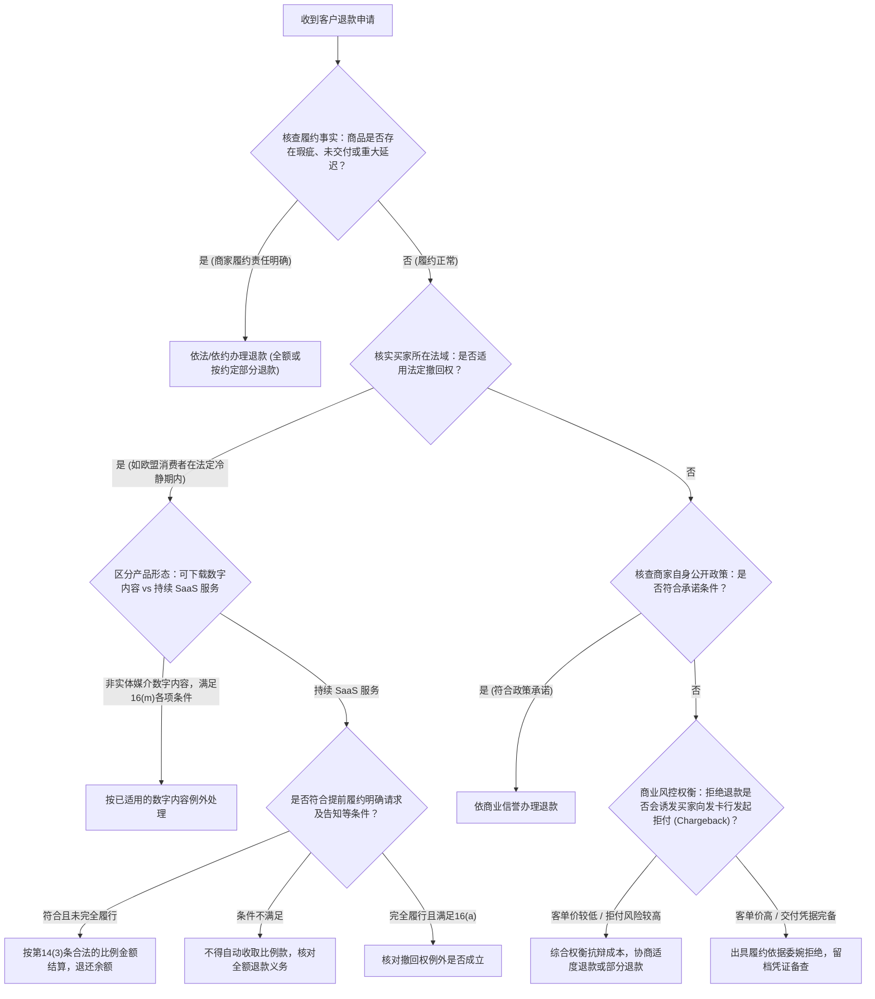
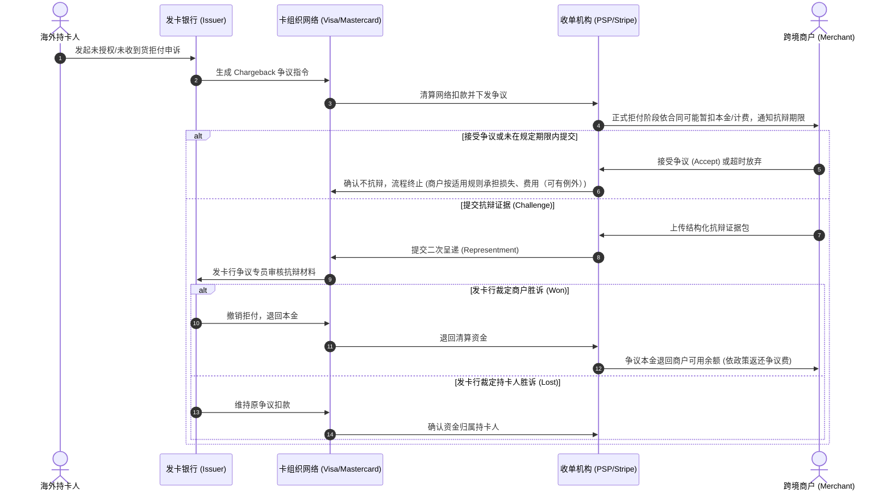
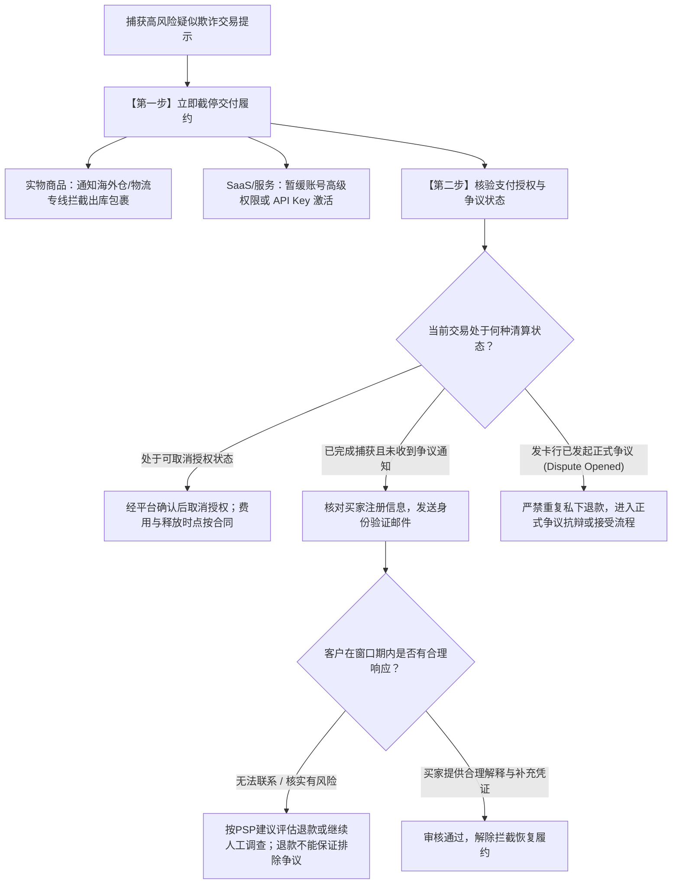
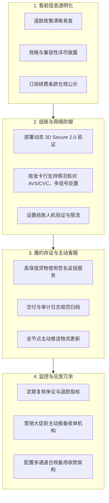

# 第7章｜遇到退款、拒付或资金冻结怎么办？

## 引言（非冻结）

在第6章中，我们详细梳理了跨境资金从海外买家付款到合法结算入账的顺向流转过程。然而，在真实的国际商业运营中，资金进入商户账簿并不意味着交易风险的彻底消除。不同于国内移动支付多由中心化平台客服协调调解的环境，出海经营者面对的是不同法域的消费者保护法规、国际卡组织向持卡人倾斜的争议机制，以及支付服务商严密的反洗钱与反欺诈风控规则。

在跨境业务的日常运行中，经营者通常会面对四类“逆向资金流与合规风险”：
* **主动退款（Refund）**：买家因商品瑕疵、物流延误、服务体验未达预期或行使法定撤回权，直接向商家申请协商退款；
* **信用卡拒付（Chargeback / Dispute）**：持卡人绕过商家，直接向其发卡银行提出撤销交易申诉。收单机构可能在正式拒付环节暂扣争议款项并依据具体协议计提处理费，商家需按限期提交证据抗辩；
* **疑似盗刷与恶意测卡（Fraud & Card Testing）**：不法分子利用自动化脚本在网站结账页批量测试被盗信用卡信息，或利用他人失窃卡片下单，引发集中拒付与手续费损失；
* **收款账户风控受限与冻结（Account Restriction & Freeze）**：收单机构（如 Stripe、PayPal）或平台根据风险算法、尽职调查（KYC）更新、品类合规性审查或法院临时保全令（TRO），对商户采取暂停提现、加设准备金或终止服务等处置。

面对这些逆向流程，关键在于厘清法律规则、掌握不同收款渠道的操作差异，并建立结构化的证据留存与防御流程。为了提供具可操作性的业务参考，本章将贯穿采用三类教学场景作为统一分析基准：
* **场景 A（独立开发者 SaaS 出海）**：中国大陆自然人开发者，独立开发并运营一款面向欧美个人及小微企业的英文在线 SaaS 生产力工具，采用按月/按年循环订阅制；
* **场景 B（跨境实物电商独立站）**：中国境内个体工商户，搭建独立站（如 Shopify / WooCommerce）面向欧美消费者零售家居轻工或 3C 配件产品，采用国内直邮或国际快递履约；
* **场景 C（B2B 软件定制与离岸技术外包）**：中国境内有限责任公司，为海外企业客户提供定制化系统开发、技术支持或远程技术外包服务，按项目里程碑收取服务费。

> [!NOTE]
> 本章出现的上述业务场景，以及所有涉及的订单金额、争议处理费、预留金比例、监控警戒阈值和申诉周期等数值，除引述国际卡组织与支付机构官方公布的标准规则外，均为用于教学论证的设定案例（统一标记为 `MODEL_ASSUMPTION`），不构成特定商业机构的固定承诺。真实业务中的风控参数以商户签署的服务协议与机构实时政策为准。

---

## 7.1 客户提出退款，什么时候退、怎么退？

### 7.1.1 客户要求退款时，怎样判断是否应当退？

当海外买家通过客服邮件、工单系统或平台对话框提出“I want a refund”（我要退款）时，经营者首先需要依据客观规则进行决策：**在什么情况下属于法定或约定义务必须办理？在什么情况下可以依法或依规协商拒绝？**

退款决策不能仅凭商户主观意愿，应综合考量以下四个维度的交叉约束：



#### 1. 销售目的国法定消费者权益规范

不同国家和地区对远程销售（Distance Selling）设立了差异化的强制性消费者保护规则，商家的自拟政策不得抵触当地法律：

* **欧洲联盟（EU/EEA）**：
  * 根据欧盟《消费者权益指令》（Directive 2011/83/EU，参见 [欧盟委员会法律指南 2021/C 525/01](https://eur-lex.europa.eu/legal-content/EN/TXT/?uri=CELEX%3A52021XC1229%2804%29)）：
    * **实物商品销售（场景 B）**：消费者原则上享有自收到商品之日起 **14 个自然日的法定无理由退货撤回权（Right of Withdrawal / 冷静期）**。除定制商品、易腐品或开封卫生用品等法定例外情形外，商家不能通过格式条款直接排除该权利；
    * **非实体媒介数字内容（如直接下载的电子书）**：根据《消费者权益指令》第16条(m)，在有偿合同下须同时核实消费者事前明确同意撤回期内开始供应、明确承认开始供应即失去撤回权、商家按照第7(2)或8(7)条提供合同确认，且确已开始履行，才可能适用例外；不能简单把任何SaaS当作一次性数字内容；
    * **持续在线数字服务与 SaaS 订阅（场景 A）**：先核实合同是否属于指令保护的B2C远程服务合同、是否存在特殊例外以及消费者所在地成员国实施规则。消费者在撤回期内仍可能享有撤回权；只有消费者依第8(8)条等要求**明确请求**在撤回期内开始履约，且经营者履行适用的撤回权告知/确认义务时，才根据第14(3)条评估应支付的**与已提供服务相称**的价款。计算原则上根据合同整个服务期的总价按比例计算；仅在合同明确约定可分服务及其独立定价等条件下采用不同处理（欧盟法院 C-641/19）。若法律规定的告知或明确请求条件不满足，可能不得向消费者收取已提供服务费用，不能机械按已用天数扣费。**服务合同第16条(a)**在服务已完全履行、消费者事前明确同意开始履约且确认完全履行后失去撤回权等条件下，才可能构成例外；这与**非实体载体数字内容第16条(m)**不能混同。出处：[欧盟委员会2021指引](https://eur-lex.europa.eu/legal-content/EN/TXT/?uri=CELEX%3A52021XC1229%2804%29)、[欧盟法院C-641/19](https://eur-lex.europa.eu/legal-content/EN/TXT/?uri=CELEX%3A62019CJ0641)，核验于2026-10-20。
* **美国（US）**：
  * **联邦层面发货与退款规则**：美国联邦贸易委员会（FTC）施行《邮购、互联网及电话订购商品法规》（16 CFR Part 435，参见 [FTC 官方业务指南](https://www.ftc.gov/business-guidance/resources/business-guide-ftcs-mail-internet-or-telephone-order-merchandise-rule)）。如果商家未能按广告宣称的期限（未宣称则默认为下单后 30 天内）发货，必须主动通知买家并取得其同意延期；若买家选择取消订单或未作明确答复，商家必须在规定时限内全额退款。退款时限依据买家支付方式区分：以支票或现金支付的订单，应在收到取消请求后 7 个工作日内寄出退款；以信用卡等循环授信方式支付的，商家必须在收到取消请求后的**一个账单周期（One Billing Cycle）内**向发卡行发送贷记入账指令。
  * **“最终销售（All Sales Final）”的法律边界**：虽然美国合同法允许商家设定“不予退换（All Sales Final）”条款，但前提是该政策必须在结账前以**清晰显著的方式（Clear and Conspicuous）**明确告知买家。此外，许多州（如马萨诸塞州、新泽西州、缅因州）通过州消费者保护法明确禁止对具有严重质量缺陷、隐蔽瑕疵或不符合默示担保（Implied Warranty of Merchantability）的商品实施免责排他。如果商品存在质量缺陷或与描述严重不符，“最终销售”声明在法律上无法阻挡买家维权。

#### 2. 主动退款与被动拒付的商业成本对比
在处理未构成严重违约但买家坚持退款的情形时，经营者需客观权衡处理成本：
* **主动退款（Refund）的成本**：退还交易款项本金，承担该笔交易原始被扣除的收单通道手续费（例如 2.9% + $0.30，`MODEL_ASSUMPTION`），以及可能的物流单程损耗；
* **信用卡拒付（Chargeback）的代价**：进入正式拒付阶段时收单机构可能暂扣本金，并按服务协议收取争议费（如每笔15—25美元仅为`MODEL_ASSUMPTION`）；费用能否退还、何时扣款、哪些欺诈和争议事件计入卡组织指标需逐渠道核对，预争议询问/预警与正式拒付不能混为一谈。
* **决策建议**：对于小客单价订单（例如 10 到 20 美元的软件订阅或低价轻工配件），若买家态度坚决且具有较高的拒付倾向，即使商家无违规事实，通常协商退款或给予部分折价补偿（Partial Refund）是成本更可控的商业防线。

---

### 7.1.2 全额退款和部分退款，怎样操作并避免超额？

在跨境收单系统的技术与业务操作中，必须遵循资金安全与防范洗钱欺诈的基本原则。

#### 1. 原路退款原则与安全替代路径

* **原路退款的基本原则**：
  国际卡组织与支付服务商（如 Stripe、PayPal）普遍推行原路退款（Refund to Original Payment Method），即退款资金沿原交易清算链条回退至最初扣款的银行卡、电子钱包或银行账户。
* **警惕“改道退款”跨境欺诈**：
  在跨境实操中，常见的欺诈套路是：不法分子利用窃取的他人信用卡下单购买商品或软件，随后联系客服声称“我原先的卡已销户/被盗，请将退款转账至我的私人 PayPal 账号或加密货币钱包”。若商家轻信并另行汇款，真实持卡人发现盗刷后仍会向发卡行提起正式拒付，导致收单行再次从商家账户扣除争议款项，造成双重本金损失。
* **真实银行端失败后的合规替代路径**：
  当原卡因账户注销、银行合并等技术原因导致退款指令在银行清算层级被拒（状态转为 `Failed`）时，资金会在清算周期后退回商户的可用余额。此时，商家应先通过收单后台工单核实退款失败的官方凭据（Failure Reason），再通过官方认证邮箱联系客户，在取得买家身份证明、银行清算异常证据及双方签署的书面结算确认后，在收单机构支持指导下通过受控的替代方式（如转为平台消费抵扣券 Store Credit，或对公电汇）进行最终清结，严禁在未确认原退款清算状态前私下转账。

#### 2. 全额退款与部分退款的场景适用
* **全额退款（Full Refund）**：
  退还原始扣款金额的 100%。适用于订单在发货前取消、SaaS 在约定退款期内申请全额退订、或商品存在根本性缺陷的情况；
* **部分退款（Partial Refund）**：
  退还原始金额中的特定数额。适用于多件商品订单中部分退货、实物商品存在轻微瑕疵经买家同意折价保留（避免跨国双向退运运费）、或持续 SaaS 服务在适用消费者法、提前履约明确请求、告知义务及合同条件均满足时，依据合法计算口径退还应退金额；不得将“已使用天数”一概当成法定扣费标准。

#### 3. 防范超额退款的系统控制机制与 API 幂等性

$$\text{累计退款约束公式}：\sum_{i=1}^{n} \text{RefundAmount}_i \le \text{GrossCapturedAmount}$$

为了防止并发点击或网络重试导致超额扣款，系统开发与日常操作中需设置三道防护屏障：

```text
// 教学伪代码（MODEL_ASSUMPTION，非可直接上线源码；Stripe 示例）
// 数据表：RefundOperation(id, order_id, amount_minor, currency,
//                   idempotency_key, status, provider_refund_id, last_error)
// order.capture_minor, order.refunded_minor（已成功/不可撤销金额）与
// order.reserved_refund_minor（处理中预占金额）均须按同币种最小单位存储。
// 数据库设置：RefundOperation.id 是全局唯一业务退款操作号，不能按HTTP请求重新生成。
function requestRefund(orderId, refundOperationId, amountMinor) {
  BEGIN TRANSACTION;
  order = SELECT order FOR UPDATE WHERE id=orderId;
  old = SELECT refund_operation WHERE id=refundOperationId FOR UPDATE;
  if (old exists) {
    if (old.order_id!=orderId || old.amount_minor!=amountMinor) ROLLBACK_AND_ERROR;
    COMMIT; return reconcileOrRetryExisting(old); // 重试复用相同业务号和幂等键
  }
  if (order.has_open_dispute) ROLLBACK_AND_ROUTE_TO_DISPUTE_WORKFLOW;
  available = order.capture_minor - order.refunded_minor - order.reserved_refund_minor;
  if (amountMinor<=0 || amountMinor>available) ROLLBACK_AND_ERROR;
  key = "refund_" + refundOperationId; // 稳定、随机且不可重复的业务操作ID
  INSERT RefundOperation(refundOperationId, orderId, amountMinor, key, "pending");
  UPDATE order SET reserved_refund_minor += amountMinor;
  COMMIT;
  return processRefundOperation(refundOperationId);
}
function processRefundOperation(refundOperationId) {
  op = READ persisted RefundOperation;
  if (op.provider_refund_id) return queryProviderRefund(op.provider_refund_id);
  if (op.status=="unknown" || elapsedSinceFirstAttempt(op)>providerIdempotencyWindow) {
    // 超时未知、或Stripe幂等窗口可能已清理（最少24h）时，
    // 先用原交易/元数据/网关订单记录核对是否已退款；不能盲目重发POST。
    return reconcileByProviderSearchOrHumanReview(op);
  }
  // 以下示例使用Stripe SDK：幂等键属于请求选项，不在HTTP业务参数体中。
  result = stripe.refunds.create(
    {payment_intent: order.payment_intent_id, amount: op.amount_minor,
     metadata: {refund_operation_id: op.id}},
    {idempotencyKey: op.idempotency_key}
  );
  PERSIST provider_refund_id and actual state; // Stripe可返回pending/succeeded/failed
  return result;
}
function onVerifiedRefundWebhookOrPolling(refundId, providerStatus) {
  // 验证事件来源、签名及对象；并发更新须以本地事务/唯一索引保证恰好处理一次。
  BEGIN TRANSACTION; lock RefundOperation and order;
  if (providerStatus=="succeeded" && !op.finalized) {
    reserved_refund_minor -= op.amount_minor;
    refunded_minor += op.amount_minor; op.finalized=true;
  } else if (providerStatus=="failed" && !op.finalized) {
    reserved_refund_minor -= op.amount_minor; op.finalized=true; // 原因留档、再决定新动作
  }
  COMMIT;
}
// 争议、重复Webhook、平台不同退款状态、Webhook丢失等需额外对账与状态机验收。
```


1. **未捕获支付的取消（Cancel/Void）**：若网关允许且交易仍处于可取消状态，可使用对应撤销/取消接口（如Stripe部分`requires_capture`的PaymentIntent）；发卡行解除授权占用的显示时间、是否产生授权费或其他费用，视发卡行、支付方式及合同而定。
2. **幂等键与持久化**：同一个`refund_operation_id`对应**持久保存、反复重试不变**的幂等键；不同部分退款必须用不同业务操作号。Stripe 的`idempotencyKey`应位于SDK请求选项或HTTP头；Stripe可能在至少24小时后移除幂等键，过期后重复发送可能创建新退款，因此须优先查询原退款ID及对账，不能认为网关长期自动去重。数据库应原子预占处理中金额，按经核验的异步状态释放或核销；对于已开启争议的交易按PSP流程分流。参考 [Stripe幂等请求](https://docs.stripe.com/api/idempotent_requests)、[退款接口](https://docs.stripe.com/api/refunds/create)，2026-10-20核验；本伪代码`NOT_RUN`。
3. **收单手续费的损耗核算（Fee Loss）**：
   * 在当代主流收单机构（如 Stripe、PayPal）的通行费率政策下，**商户发起主动退款时，收单机构通常不退还原始交易的处理手续费**。
   * **示例测算（MODEL_ASSUMPTION）**：一笔 100 美元订单，收单费率假设为 $2.9\% + \$0.30 = \$3.20$。商户原始入账净额为 $\$96.80$。商户随后全额退款 100 美元给买家，收单机构从商户可用余额中扣除 $\$100.00$。此时商户账面实际净现金流变动为 $-\$3.20$（即损失通道服务费）。

---

### 7.1.3 退款发起后，怎样确认真正退回客户并处理退款失败？

#### 1. 退款状态的流转周期
在主流支付网关中，退款从发起至买家实际入账通常经历以下阶段：
1. **Submitted / Pending**：商户后台已生成退款指令。若商户可用余额不足以抵扣退款本金，退款可能处于 `Pending` 状态，等待后续销售款补充或银行转账补足；
2. **Succeeded / Processed**：退款在PSP一侧已完成或达到其成功状态，但**不能仅凭该状态证明持卡人银行账单已经出现贷记**；状态名及含义随支付方式、PSP和版本变化；
3. **In Transit / Credited**：发卡行接收清算并向持卡人账单入账，通常需要 **5 至 10 个银行工作日**。若退款发生在授权尚未清算结账的时间窗口内，发卡行通常直接执行“授权撤销（Drop-off / Reversal）”，持卡人账单中将不显示负数退款条目，而是原始预授权冻结额度直接消失。

#### 2. 退款参考标识（ARN / STAN / RRN）的实战作用
当买家在 10 个工作日后声称未收到退款时，仅向其发送商户系统截图往往难以解决分歧。商户应通过收单后台调取银行间清算参考号协助买家查证：
* **Acquirer Reference Number (ARN)**：某些银行卡清算退款具备的收单参考标识，并非所有交易都会生成，也不保证提交退款时立即可见、统一长度或在固定天数内可用。以具体PSP返回的`reference_type`、`reference_status`、`reference`为准；
* **局限性与替代参考标识**：
  * ARN 仅适用于通过 Visa / Mastercard 等银行卡网络处理的交易；
  * 如果交易属于“未清算直接撤销（Reversal）”，银行网络不会生成 ARN；
  * 对于非银行卡支付方式（如本地银行转账、ACH、SEPA），清算网络采用的是端到端编号（End-to-End ID）或转账凭单流水号；在部分 POS 或特定清算环境中，参考号可能采用系统跟踪审计号（STAN，通常 6 位）或检索参考号（RRN，通常 12 位）；
  * **客服沟通指引**：商户可向买家提供 ARN 等清算参考号，供买家致电其发卡行客服专柜，由发卡行业务人员在清算底层进行定位。需注意，向买家提供参考号代表退款已进入银行通道，但并不构成资金已到达持卡人账户的法定保证。

#### 3. 退款失败（Refund Failed）的排查与处理
退款在极少数情况下会出现清算失败（状态变为 `Failed`），常见诱因包括买家原发卡行账户被注销且发卡行系统拒收贷记款项、卡片已被清算网络彻底注销等。
* **排查步骤**：
  1. 按支付方式查询Refund对象的`status`、`failure_reason`和相关资金流水；具体错误枚举与界面字段以PSP当期API为准，不将示例错误字符串视为通用代码；
  2. 对照退款的失败资金流记录和账户余额，确认资金是否实际回退；预计时长应向PSP查询，不能保证所有银行固定期限；
  3. 严禁在原退款状态未结清之前轻率私下打款，以防后续原退款成功入账导致双重划扣。

#### 4. 全链路模型案例演练：SaaS 订阅误操作重复扣款与退款处置（场景 A，MODEL_ASSUMPTION）
* **背景与订单状态**：
  * 某英国企业客户在自然人开发者张某的在线 SaaS 平台订购了按月专业版服务，月费为 50 美元。因客户网络抖动，系统在 2 分钟内连续捕获（Capture）生成了两笔相同的 50 美元扣款记录（订单 #A101 与 #A102），总金额 100 美元；
  * 收单平台手续费假设为每笔 $2.9\% + \$0.30 = \$1.75$，两笔合计扣取手续费 $\$3.50$，商户净入账 $\$96.50$。
* **业务处置与状态流转**：
  1. 客户客服工单反馈重复扣费并要求退还其中一笔。张某在系统后台锁定订单 #A102；
  2. 开发者调用收单 API 发起全额退款，生成与业务操作绑定的唯一幂等键 `Idempotency-Key: ref_A102_dup_cancel`；
  3. 收单机构受理后返回退款对象ID（示例`re_DEMO_A102`）及可能的`pending`或`succeeded`状态；系统保存ID并通过网关查询/经验证的事件更新，**不预设立刻生成ARN**；
  4. 系统给买家发送已提交退款通知，注明状态和以收单机构/发卡行预估为准的到账时间；当网关后台后续提供`reference_type`和`reference`时再补充给买家（可能是ARN、STAN、RRN，也可能不可用）。若逾期买家未收到，应提供退款ID并联系PSP/发卡行追踪，避免声称`processed`等于银行到账；
* **财务损益核算（MODEL_ASSUMPTION）**：
  * 订单 #A101 正常保留（收入 $\$50.00$，手续费 $-\$1.75$）；
  * 订单 #A102 全额退还本金 $\$50.00$；收单机构不予退还该笔手续费 $\$1.75$；
  * 商户最终综合现金流净额：$\$100.00 - \$50.00 - \$1.75 - \$1.75 = \$46.50$；
  * 该主动退款未产生拒付争议费，拒付率指标无不良变动。

#### 5. 按交易渠道选择正确操作入口（跨7.1—7.4速查）

| 交易与资金模式 | 商家先到哪里操作退款/查询 | 谁主导正式争议举证 | 客户与资金核验要点 |
|---|---|---|---|
| **自营站PSP直收卡款**（如适用主体的Stripe/Adyen） | 自己的PSP交易详情页/API，查询原交易、Refund和争议状态 | 经营者经PSP平台上传证据，收单行按规则代表呈递 | 核对余额、资金扣划、争议截止日；有争议时不要在平台外重复退款 |
| **Marketplace**（如电商平台订单） | 订单售后/退款中心，先看该商品与物流计划的退款权限 | 平台与卖家依平台政策分工，不假定卖家可以直接向卡组织呈递 | 提交平台要求的运单、退款记录；核对卖家扣款与平台保护资格 |
| **第三方代售 MoR**（例如平台作为消费者法律卖方的合同） | MoR合作商户后台/工单；按合作协议请求退款，不绕过法律卖方私自刷退 | MoR通常处理其作为销售方的卡争议，上游供应商提供许可/交付资料并按协议承担分摊 | 核对结算调整、费用和消费者退款归属；仅适用于该笔确实由MoR售出的交易 |
| **PayPal钱包/商家收款** | PayPal争议处理中心与原交易退款入口，识别钱包争议、卡争议或银行退单 | 按PayPal所通知的程序提交证据；可能不同于直接持有卡收单的流程 | 分清PayPal站内纠纷与发卡银行拒付，留意时限和卖家保障资格 |
| **B2B银行转账/电汇** | 双方银行转账参考号、付款凭证、银行查询或Stop & Recall业务 | 通常不走银行卡Chargeback；合同争议走协商/诉讼/仲裁或法定支付追索 | 首先核实款项是否贷记、是否可拦截，再对照合同、法域与银行退汇条款 |

上述渠道资格、法律卖方及合同责任由第1—3章主讲；本表只提供本章实际退款/拒付的入口与处理次序，交易不存在的功能不可自行假定。适用入口参考[Stripe争议回复](https://docs.stripe.com/disputes/responding)、[PayPal Resolution Center](https://www.paypal.com/us/cshelp/article/what-is-the-resolution-center-help246)与对应平台当前商户政策（2026-10-20核验）。

---

## 7.2 客户向银行发起拒付，我该怎么办？

### 7.2.1 拒付与商家主动退款有什么区别，会产生哪些费用？

**信用卡争议（Dispute）可能从查询或预警开始，正式拒付（Chargeback）才进入相应的卡组织资金与抗辩程序；与商户自主退款的流程、费用、指标不同。**

#### 1. 主动退款与银行拒付的核心差异对比

| 比较维度 | 商家主动退款 (Refund) | 银行信用卡拒付 (Chargeback / Dispute) |
|---|---|---|
| **启动主体** | 买家向商家提出，**商家在支付后台主动发起** | **持卡人直接向其发卡银行提出申诉**，银行直接介入 |
| **资金变动机制** | 商家自主确认后，款项由平台正常回退买家 | 可能先经历预争议预警或资料询问；正式拒付时**可能暂扣本金并按PSP规则处理费用**，扣款时点依渠道 |
| **费用惩罚** | 可能损失原交易手续费；退款额外费用及手续费退还规则依PSP/支付方式 | 收单机构征收 **争议处理费**（例如每笔约 15 至 25 美元，`MODEL_ASSUMPTION`，具体依地区与服务商政策，部分机构获胜后退还） |
| **渠道指标影响** | **不计入**卡组织与收单机构的违规争议监控指标 | 按卡组织统计规则纳入符合条件的欺诈/争议事件；预争议解决、剔除与重复计数有例外 |
| **处理周期** | 通常即时发起，5-10 工作日入账 | 历经证据提交、发卡行审核、预仲裁，通常耗时 **30 至 90 个自然日** |

#### 2. 拒付流转全景与各模式处理机制



* **不同商业模式下的争议责任分工**：
  * **独立收单模式（PSP，如自营独立站接入 Stripe/Adyen）**：商户直接作为收单合同主体，必须自行负责在后台限期内上传证据并承担胜负损益；
  * **第三方代售模式（MoR，如 Lemon Squeezy、Paddle）**：MoR 是消费者的法律卖家（Merchant of Record），**拒付直接由 MoR 统一应对发卡行抗辩**。MoR 会在其管理后台向商户调取履约底单，若最终败诉，相关争议扣款与罚费将反映在 MoR 向商户发放的分成结算单中；
  * **电商平台模式（Marketplace，如 Amazon、eBay）**：平台多设有内置买家保护机制（如亚马逊 A-to-z 索赔）。买家若绕过平台直接向银行发起银行卡拒付，平台根据履约记录（如使用平台购买配送服务的物流追踪）代为向银行抗辩，并根据政策决定是否追溯扣减卖家余额；
  * **传统 B2B 银行电汇（TT Wire）**：通常不适用银行卡Chargeback，但仍可能有银行止付、退汇/召回（Stop and Recall）、欺诈追款、法定冻结、银行纠错或诉讼保全。资金尚未贷记收款人时，汇出行/中间行可能按支付状态和制度拦截；已贷记后则需核对相关银行规则、付款依据、收款人授权以及所在法域法律，**不能断言任何召回均须两家银行和收款人双重书面同意**。商家应保留合同、发票、往来确认及银行参考号，立即联系双方银行核实状态；因货品质量或合同违约产生的商业争议通常仍须协商或法定争议解决。参考[SWIFT付款追踪/Recall业务](https://www.swift.com/your-needs/banking/instant-and-frictionless-payments/swift-gpi)、银行适用规则（2026-10-20核验）。

---

### 7.2.2 收到拒付争议后，应该按理由准备哪些证据？

一旦收到拒付通知，商户应在收单机构通知列明的**实际提交截止时间**之前，决定接受争议或提交针对性证据；可用期限和时间区因发卡行、卡组织、争议类别及PSP而不同，不应机械套用“7—21天”。如未按要求回应，商户通常丧失该轮抗辩机会，最终处理取决于该机构规则。

#### 1. 四大主流争议类型与举证要点

1. **未授权交易 / 欺诈类争议（Fraud / Unauthorized Transaction）**：
   * **常见原因代码**：Visa Reason Code 10.4、Mastercard Reason Code 4837；
   * **举证核心**：证明交易确系持卡人本人授权或享受了卡组织免责保护：
     * **SaaS/数字服务（场景 A）**：注册与登录时间戳、访问 IP 地址（显示与账单国籍对应）、设备指纹、账号激活日志、API 调用记录；若交易通过了 3D Secure 强身份验证，提供收单网关返回的责任转移凭据（详见下文 3DS 说明）；
     * **实物商品（场景 B）**：物流承运商出具的签收记录，收货地址与发卡行账单地址验证（AVS）结果一致的证明。
2. **未收到商品或服务（Product / Service Not Received）**：
   * **常见原因代码**：Visa Reason Code 13.1、Mastercard Reason Code 4855（亦见 4853 分类）；
   * **举证核心**：证明商品或服务已在争议发起日前完成交付：
     * **实物商品**：物流单号、带有承运商签章或签收人签名的妥投凭证（Proof of Delivery, POD）、派送地址与订单一致的追踪记录；
     * **软件服务**：系统登录记录、许可激活码发送成功的邮件递送日志、云端资源实际使用计量报表。
3. **商品或服务与描述显著不符（Not as Described / Defective）**：
   * **常见原因代码**：Visa Reason Code 13.3、Mastercard Reason Code 4853；
   * **举证核心**：证明交付内容符合售前披露的规范标准：
     * 下单时网站公开展示的规格参数、兼容性要求截屏；
     * 售前已明示的限制性条款；
     * 售后客服沟通记录，证明商户已主动提供故障排查、维修指导或补发配件，而买家无故拒绝配合或拒绝退还实物。
4. **循环订阅取消后仍被扣款（Canceled Recurring Transaction）**：
   * **常见原因代码**：Visa **13.2 — Cancelled Recurring Transaction（取消循环交易）**，而Visa **13.6 — Credit Not Processed（贷记未处理）**涉及应退贷记未完成，二者不能混用。Mastercard可能按具体争议与版本归入不同子类，不能把4853作为统一“取消订阅”必然代码；请以收到的PSP通知和卡品牌最新规则为准（[Visa 2026 Rules](https://usa.visa.com/dam/VCOM/download/about-visa/visa-rules-public.pdf)、[Visa争议指南](https://by.visa.com/dam/VCOM/global/support-legal/documents/merchants-dispute-management-guidelines.pdf)，2026-10-20核验）。
   * **举证核心**：证明扣款发生时订阅关系尚在有效存续期：
     * 买家注册签约时主动确认订阅周期与扣费标准的条款记录；
     * 在合同/法域/卡组织要求或商家确已发送时，附续费提醒记录；不能把所有订阅的提醒视为美国联邦统一义务；
     * 系统审计日志，证明买家发起取消订阅的时间戳晚于本次自动扣款发生的时间戳。

#### 2. 3D Secure 责任转移（Liability Shift）的适用条件与例外

在抗辩相关未授权欺诈类拒付（如Visa 10.4，Mastercard原因码须核对当前争议通知）时，**3D Secure（3DS）强身份验证**是最具抗辩效力的技术凭据：
* **责任转移的基本机制**：如果交易成功通过了 3DS2 验证（持卡人完成了短信验证码或生物指纹认证），在符合卡品牌、认证结果、交易类型与适用地区条件时，可能发生欺诈责任转移，但不保证每次完成3DS挑战就必然转移；由PSP实际返回/后台责任转移判定及争议原因综合核实；
* **3DS 免责的严格边界与例外**：
  * **非欺诈争议完全不豁免**：3DS 责任转移**仅覆盖未授权欺诈类原因代码**。如果买家以“未收到货物”、“商品质量瑕疵”或“已取消订阅”为由发起拒付，3DS 认证结果不能作为免责依据，商家仍须提供履约证据抗辩；
  * **商户发起交易（MIT）与免除认证交易**：商户发起的MIT及免认证交易通常不能直接以初次持卡人交互认证推定后续每笔都获得责任转移；卡网络和PSP有特定例外或关联认证规则时，依交易记录逐笔核实；
  * **特殊卡种与无卡组织豁免通道**：部分特定地区的预付卡、商业采购卡或发卡行未加入 3DS 网络的，可能不适用责任转移。**不得假设Stripe或所有PSP统一返回`liability_shift: true`布尔字段**。以实际支付后台的3DS认证/责任转移状态及PSP针对该笔交易的解释为准；Stripe可结合 `Charge.payment_method_details.card.three_d_secure` 的结果和Radar/争议页面信息核对，认证成功仍不等于全部原因的免责，参考[Stripe 3DS文档](https://docs.stripe.com/payments/3d-secure)、[Stripe欺诈争议与责任转移](https://support.stripe.com/questions/using-radar-plus-to-prevent-charges-without-liability-shift)，2026-10-20核验。

#### 3. 证据组织与上传规范
发卡行争议专员审理材料时间极其有限，材料组织应遵循清晰、针对性强的原则：
* **格式要求**：依据收单机构后台字段指引提交清晰文档（支持 PDF、JPG、PNG 等常用格式，具体大小以平台接口为准，通常单文件建议控制在 2-4MB 左右）；
* **首页事实摘要（Executive Summary）**：用简明英文写清订单编号、交易日期、争议原因代码、针对客户主张的核心事实反驳，以及附件证据目录；
* **证据关键点高亮**：在物流签收单、系统日志中将客户姓名、送达地址、关键时间戳用色块高亮标注，避免纯原始数据倾倒导致重要凭据被遗漏。

#### 4. 全链路模型案例演练：跨境实物“未收到货物”拒付抗辩与二次呈递（场景 B，MODEL_ASSUMPTION）
* **背景与争议触发**：
  * 美国买家在李某的 3C 独立站购买了一台价值 200 美元的降噪耳机（订单 #B205），订单采用美国信用卡在线支付，收单机构收取手续费 $2.9\% + \$0.30 = \$6.10$，商户净入账 $\$193.90$；
  * 发货 20 天后，买家向其发卡行发起“未收到商品”正式拒付（Visa Reason Code 13.1）。
* **收单机构划扣与抗辩流程**：
  1. 收单平台依据卡组织规则，从李某账户中自动冻结扣除争议本金 $\$200.00$，并征收固定争议处理费 $\$15.00$（`MODEL_ASSUMPTION`），李某后台显示争议状态为 `needs_response`，剩余抗辩时限为 14 天；
  2. 李某联系国际专线物流承运商，调取该订单的妥投数据：运单显示包裹在争议发起前 5 天已派送，且包含收件人签名的交付证明（POD），签名姓名与订单收件人一致，派送地址邮编与发卡行预留账单地址一致；
  3. 李某整理一份结构化英文 PDF 证据包：第一页为事实摘要，第二页附带结账订单详情及物流追踪记录，第三页附带带签名的妥投凭据，上传至收单机构争议中心；
  4. 收单机构将证据向发卡行进行二次呈递（Representment），争议状态转为 `under_review`；
* **争议裁决结果与最终损益（MODEL_ASSUMPTION）**：
  * 45 天后，发卡行争议专员审定李某提交的签名妥投证据充分有效，裁定商户胜诉（`Won`）；
  * 收单平台将此前划扣的 $\$200.00$ 争议本金全额退回李某的可用余额，同时假设该服务商的本次规则允许返还 $\$15.00$ 争议处理费；
  * 李某最终保留了该笔订单的正常结算款 $\$193.90$，成功防御了恶意拒付冲击。

---

### 7.2.3 怎么跟踪自己的拒付情况，判断是否接近渠道警戒标准？

经营者必须建立基于卡组织官方口径与收单服务商指标的监控体系。

#### 1. 分清品牌正式指标与商户内部预警

不同卡组织、地区、收单组合及报告时点的指标并不等同；**不存在对所有商户适用的统一1%/0.5%强制罚款线**。以下为**2026-10-20核验**的公开口径，读者应通过服务商对应国家/版本的最新通知再核实。Visa 官方 [VAMP 事实表](https://corporate.visa.com/content/dam/VCOM/corporate/visa-perspectives/security-and-trust/documents/visa-acquirer-monitoring-program-fact-sheet-2025.pdf)；Mastercard分级对照可参照[Shopify Payments 官方商户帮助](https://help.shopify.com/en/manual/payments/chargebacks/monitoring-programs)，具体执行以收单行和Mastercard当前规则为准。

| 卡品牌/项目 | 计数和计算口径 | 公布的相关等级门槛与适用前提 |
|---|---|---|
| **Visa VAMP（商户 Excessive）** | 月度VAMP ratio = **符合规则的Visa无卡交易欺诈报告TC40件数 + 争议TC15件数** ÷ **符合条件的当月已结算Visa CNP交易TC05笔数**；个别预争议解决、CE3.0等符合条件的事件可能被排除，取决于数据提取时间和规则。 | Visa事实表：**2026-04-01起**亚太、加拿大、欧盟、美国相关商户阈值为**≥1.5%且月度欺诈+争议事件数≥1,500**；**1,500是分子相关事件数，不是销售交易笔数**。此商户Excessive识别还受收单行整体组合是否已进入Above Standard/Excessive等前提约束。拉美与CEMEA地区的阈值和最低事件数不同，部分国家的计划安排另行公布。 |
| **Mastercard ECP / ECM** | Mastercard 拒付率（CTR）通常以**当月符合条件的拒付笔数 ÷ 上个月Mastercard已捕获交易笔数**计；与Visa分子/分母不同。 | Shopify Payments当前公开说明：**ECM ≥100笔且≥1.5%**（与更高HECM等级区分），是否计入由项目规则和服务商确认。 |
| **Mastercard ECP / HECM** | 沿用符合条件的Mastercard拒付计数和CTR。 | Shopify Payments公开说明：**HECM ≥300笔且≥3.0%**，不是2.0%；分母、计数、适用市场及评估期需按收单行通知确认。 |

**不能据此宣称低于最低事件数量就“绝不被处理”。** 即便商户未达到卡组织商户级别正式识别门槛，收单机构仍可能依据合同/自己的欺诈风控调查、预留资金、限制交易；收单行层面的组合监控也另有要求。

#### 2. 用小微商户示例区别“内部比率”和“正式监控”（MODEL_ASSUMPTION）

假设某独立站8月有1,000笔结算交易，9月100笔结算交易，9月收到5笔Mastercard拒付。仅为学习口径：
- **当月简单自测**：5 ÷ 100 ×100% = **5%**。这是团队自定义粗略监控率，不自动等于卡品牌正式CTR。
- **若全部满足Mastercard可计入条件**：以8月Mastercard捕获交易数为正式分母（如果8月1,000笔均是Mastercard则5 ÷ 1,000 = **0.5%**；如果并非均为Mastercard，须另查品牌交易数）。只有5笔拒付，不满足公开ECM/HECM最低笔数条件，但不意味着收单行不会风控。
- **Visa不能套用上面5笔拒付来直接判定VAMP**：须分别取Visa CNP已结算交易TC05、TC40与TC15符合计数的事件，核对排除条件、法域和收单行组合，再与事件最低量**1,500（相关地区）**等条件比较。

**实操监测表**：每月独立记录支付通道、卡品牌、收单主体、交易成功/结算口径、收到的正式争议、欺诈报告、预争议解决事件、期间与计数规则；先和PSP后台确认官方统计报表。自定提前预警线可以用`MODEL_ASSUMPTION`（例如企业自定0.5%），但不能误称Visa或Mastercard硬性阈值，也不能保证低于此值账户安全。

---

## 7.3 遇到盗刷或可疑订单，该怎么处理？

### 7.3.1 哪些交易迹象可能表示盗刷或恶意测卡？

#### 1. 恶意测卡攻击（Card Testing Attacks）的特征
不法分子获取大批未校验的失窃卡号后，常利用中小网站作为低成本验证工具：
* **高频低额密集请求**：在数小时内连续出现几十至数千笔极低金额交易（如 $0.50 至 $2.00，`MODEL_ASSUMPTION`）；
* **极高授权失败率**：短时间失败率异常升高（例如失败100次占120次尝试中的83.3%，仅为`MODEL_ASSUMPTION`示例）；应结合历史基线、支付失败原因及收单风险警报判断，**不存在统一70%—90%官方阈值**；
* **环境集中与卡号离散**：不同国家卡号却来自同一 IP 网段、相同的设备指纹或缺失常规浏览器特征的自动化 User-Agent。

#### 2. 单笔高危盗刷订单的综合识别
在评估单笔订单欺诈风险时，应采用**多信号加权评估**，避免因单一特征导致误伤：

| 风险维度 | 相对低风险特征 | 需重点复核的高危特征 | 误判注意点 |
|---|---|---|---|
| **网络与地理** | IP 地址、账单地址、收件地址位于同一国家 | IP 所在地与账单国或收货国跨越不同大洲；使用高危数据中心匿名代理 | 跨国出差、留学、或开启苹果 iCloud 私密代理等正常场景可能导致 IP 偏移 |
| **安全校验** | 3DS 认证通过，AVS 邮编地址完全匹配，CVC 验证完全一致 | 未通过 3DS 认证，AVS 邮编完全不匹配，曾发生多次 CVC 输错后勉强通过 | 部分国家（如部分亚洲/拉美发卡行）本身不支持 AVS 地址验证 |
| **买家联络** | 真实日常使用的个人或企业域名邮箱 | 临时一次性邮箱域名，或随机字母无序排列的邮箱名 | 部分科技极客或隐私敏感型用户亦可能使用域名别名服务 |
| **购买行为** | 购买合理数量的常规商品，有正常浏览加购耗时 | 首次下单即大批量购买极易转售变现的高保值标品，且要求加急最昂贵的快递 | 节假日礼品采购亦可能出现加急运输，需结合身份综合研判 |

---

### 7.3.2 遇到疑似欺诈订单，先停止发货还是先退款？

当风控系统（如 Stripe Radar）对某笔交易提示高风险（High Risk）时，商户应当建立标准化的处置流程：



* **首要操作法则**：**先核实是否存在可疑交易并在合同/法律允许时暂停未交付部分，同时避免误伤真实客户**。一旦高价值实物被发运妥投，若后续发生拒付，商户将同时损失商品与款项；
* **区分未捕获与已捕获**：若收单网关配置为“先授权后捕获（Manual Capture）”，在发现异常时直接调用取消指令（Void），资金在授权层级解除，不发生实际清算划转；
* **已捕获订单的退款考量**：若交易已完成捕获且买家无法证实身份，主动退款可能降低部分纠纷风险，但应依据风险与PSP指引作决定。但需客观认识到，**主动退款并不构成 100% 杜绝拒付的绝对技术保证**——如果持卡人在商户操作退款的同时已在其发卡行端正式立案，清算网络中退款与拒付可能发生碰撞，商户需密切留意收单后台争议状态，避免重复赔付。

---

## 7.4 收款账户被冻结或提现被暂停，怎么办？

### 7.4.1 账户被限制或冻结时，常见原因有哪些？

在跨境收单中，账户受到功能限制通常分为四类不同性质的诱因：

| 限制类型 | 主导驱动主体 | 触发核心动因 | 典型影响与账户表现 | 资金状态与处置预期 |
|---|---|---|---|---|
| **商业风控与业务突增限制 (Velocity & Risk Hold)** | 收单机构内部风控算法 | 交易金额短期内出现爆发式异常突增（如新账号从日均 $100 骤增至 $10,000）；未发货订单比例过高；退款拒付指标波动 | 账户通常仍可接收收款，但出款提现功能（Payouts）被临时推迟或加设准备金 | 提交供货发票、物流妥投清单并经业务复核后，出款通常可逐步恢复 |
| **定期尽职调查与资质更新 (KYC / CDD Remediation)** | 支付机构合规审计部门 | 最终实益拥有人（UBO）身份证件过期；企业注册地址发生变更；税务身份识别号（TIN）未定期更新 | 仪表盘出现倒计时预警；超期未提交则暂停出款 | 补齐真实企业证照与身份证明后，经审核通过即可恢复正常功能 |
| **品类违规与服务条款触碰 (Acceptable Use Policy, AUP)** | 支付机构法遵合规调查组 | 销售假冒侵权产品（IP Infringement）、未取得法定许可销售受限商品、成年人限制内容或高风险违禁品 | 账户被终止服务并关闭（Account Closed）；无法接收新交易 | 依据《商户服务协议》（TOS），可能发生暂停出款、滚动/固定风险准备金或其他合同措施；比例、期限、可抵扣金额与释放条件须看账户通知、适用服务协议及持续风险评估，**无统一180天上限或期满自动全额返还保证** |
| **司法协助与法庭保全禁令 (Judicial Injunction / TRO)** | 司法机关或境外法院（如美国联邦法院 TRO 禁令） | 海外知识产权人聘请律所针对商标侵权、外观专利发起的涉外批量诉讼 | 支付机构依据司法协助要求冻结商户特定金额，后台注明法院指令编号 | 普通客服通常无权解除司法措施；应保留案号、核实司法命令，必要时咨询诉讼地合格律师并依法申请变更/解除冻结，不保证必然解冻 |

#### 澄清误区：准备金保留不等于资金没收
**风险准备金（Reserve）、出款暂停、终止商户协议、银行冻结与法院保全是不同措施**，不能一律定性为“质押”。释放前应读取商户合同、准备金通知、实际扣划和待决索赔，并通过正式申诉入口核对可用余额、预计解除条件；即使约定了预计日期，也不保证到期自动放款。以 [Stripe Services Terms 的Reserve条款](https://stripe.com/legal/ssa-services-terms)为示例：释放还取决于PSP是否认定相关风险敞口已缓解（核验于2026-10-20），不同国家、协议和司法命令下结论可能不同；不得用“统一180天”描述法定义务。

---

### 7.4.2 账户受限后，怎样提交真实证明并处理未履约订单？

#### 1. 结构化申诉指引
一旦遭遇风控限制，经营者应当保持理性沟通，切忌盲目重复点击提交或向客服发送情绪化邮件：
1. **仔细通读官方通知**：明确受限是属于常规 KYC 补单、业务量突增调查，还是涉嫌品类违规；
2. **准备真实的业务链条证据包**：
   * **主体证件**：法人身份证件、营业执照扫描件、近 90 天内的企业银行对账单或真实经营场所水电气账单；
   * **供应链真实性证明（实物场景 B）**：向上游供应商采购货物的采购合同、付款发票、工厂供货清单、带有日期的仓库实体库存照片；
   * **历史履约妥投凭证**：导出近期订单的国际快递运单明细表，附带承运商官方妥投轨迹；
   * **知识产权合规文件**：品牌授权书（Authorization Letter）或商标注册证。
3. **撰写商务行动改进计划（Plan of Action, POA）**：
   * 采用客观、事实导向的商务英语，分层次陈述：
     * **Root Cause（根因分析）**：客观解释指标异动的原因（如由于重大节假日促销导致订单短期放量，备货仓配未能及时同步）；
     * **Immediate Remediation（已采取的即时纠偏措施）**：说明已为延误买家办理退款或主动发送追踪说明；
     * **Long-Term Preventive Controls（长效预防控制机制）**：说明未来在库存管理、客服响应及风险拦截方面的系统性改进措施。
4. **恪守真实性红线**：
   > [!IMPORTANT]
   > 严禁提交任何经过图像处理软件修改（PS）的发票、虚假流水或伪造授权书。国际主要收单机构均部署有自动化图像鉴伪算法与外部企业信用数据查验接口。一旦被判定存在伪造材料欺诈行为，商户账户将面临不可逆的直接永久关闭；严重的违约行为还可能导致符合卡组织记录条件时，商户相关资料可能进入卡组织或收单机构风险数据库（如万事达卡的 **MATCH 系统**）。根据万事达卡公开规则（参见 [Mastercard MATCH 隐私规范](https://www.mastercard.com/global/en/match-privacy-notice.html)），MATCH 系统的记录留存期通常为 **5 年**，在此期间相关主体未来申请某些收单服务时可能面临额外审核；具体覆盖地区与资格由收单行核实。

#### 2. 受限期间在途未结订单的处置方案
账户受限往往导致商户现金流紧张。此时必须审慎处理在途订单，防止演变为系统性拒付：
* **对具备履约条件的订单**：应尽可能继续按期发货并及时回传有效单号。完整的履约证明是推动申诉审核的重要证据；
* **对确实无法履约的大额订单**：严禁长期挂起置之不理。商户应主动联系买家解释情况，并在收单平台权限允许的情况下，由商户按渠道权限与合同**评估并执行合规退款**，同时记录拒付/退款处理状态。主动退款可能缓解投诉，却不能保证杜绝后续拒付，也不能在正式争议处理中重复划款。

---

## 7.5 平时怎么减少退款损失和账户风险？

风险治理绝非危机发生时的被动补救，而应建立在贯穿售前、结账、履约与日常运营全流程的常态化防御机制之上：



#### 1. 售前信息透明化
* **政策前置展示**：在网站页脚、购物车结算页清晰公示《退换货政策（Refund & Return Policy）》，明确退款申请窗口期、运费承担方式及退款流程；
* **商品与服务准确描述**：
  * 实物商品（场景 B）：提供无色差实拍图、清晰的英制/公制尺寸对照表。对于易碎品注明包装防护规范；
  * SaaS 软件（场景 A）：明确标注支持的操作系统、浏览器版本及配置要求。建议提供免费试用期（Free Trial）或沙箱环境供买家先行体验；
* **订阅循环计费合规提示**：
  * **美国向消费者在线销售带自动续费的产品**，应按适用范围核对联邦 ROSCA 的关键要求——在扣费前清晰披露重要条件、获取明确知情同意、提供简便方式停止连续扣款；还要按消费者所在州的自动续费法（例如加州ARL）、卡组织与合同要求核实**确认邮件、续费前提醒、年度通知及取消路径**等具体义务。**不能断言美国所有订阅每次扣款前都必须发提醒邮件。** 即使没有统一提醒义务，提前适时提醒仍可作为减少误解的运营建议。FTC 2024 Click-to-Cancel最终规则已于2025年被法院撤销，不能当作2026现行普适法条；ROSCA仍适用。来源：[FTC 2025 ROSCA执法](https://www.ftc.gov/news-events/news/press-releases/2025/09/ed-tech-provider-chegg-pay-75-million-settle-ftc-allegations-concerning-unlawful-cancellation)、[FTC 2026后续规则讨论](https://www.ftc.gov/news-events/news/press-releases/2026/03/ftc-seeks-public-comment-response-advance-notice-proposed-rulemaking-regarding-negative-option)，2026-10-20核验。其他国家法规应另查，不可将美国ROSCA称作全球规则。

#### 2. 结账与网络安全防御
* **部署动态 3DS2 规则**：在收单后台对高风险交易、跨大洲交易或特定金额以上订单动态触发 3D Secure 2.0 验证，争取卡组织欺诈拒付免责保护；
* **按支持条件使用 AVS/CVC**：先区分“不支持/未返回”与“明确不匹配”，结合发卡地区、3DS、历史设备和金额决定挑战验证、人工复核或拒绝；不能把全球不支持AVS的订单统一视为诈骗，亦不要宣称任一信号绝对准确。参考[Stripe Radar规则](https://docs.stripe.com/radar/rules)（2026-10-20核验）；
* **防范自动化测卡**：在购物车与结账页面接入 Cloudflare Turnstile 或 Google reCAPTCHA 等人机验证服务，针对同一 IP 或单一设备指纹设置支付尝试频率限制（Rate Limiting），阻断自动化撞库测卡脚本。

#### 3. 履约存证与主动式沟通
* **签名妥投服务（Signature Confirmation）**：对于客单价较高的实物商品，采购国际快递面单时建议加购收件人签收证明服务，避免因“门口丢包”导致抗辩证据不足；
* **技术日志的规范留存**：
  * SaaS 开发者应当建立合规的系统访问审计日志，留存用户登录 IP、操作时间戳与功能调用凭据。**关于日志保留期**：在满足卡组织常规争议抗辩期（通常最长 120 天，个别复杂场景可能延展）需求的同时，必须兼顾目标法域的数据保护法规（如欧盟 GDPR 第 5 条(1)(e) 款关于数据存储期限最小化限制的规定），保存期必须同时核对卡组织/商户协议、未决争议、账务与消费者法定要求和GDPR数据最小化原则；**120至180天仅为教学示意（`MODEL_ASSUMPTION`），不是适用于全部日志的统一合规期限**，保留期届满且无其他法定义务后按策略删除或去标识化；
* **全程主动推送物流节点**：通过集成自动化物流通知系统，在包裹发出、出境、到达目的国及派送等关键节点主动向买家发送邮件或短信更新，压缩因信息不透明引发的买家焦虑与无谓投诉。

#### 4. 常态化指标监控与备用冗余架构
* **指标台账管理**：定期核查业务全渠道的退款率与拒付争议率，分析高频发生纠纷的特定 SKU 或特定国家，及时排查产品质量或物流合作伙伴问题；
* **放量促销提前报备**：在开展大型推广促销前，若预计当周销售额将出现数倍爆发性增长，建议提前向收单机构客服或客户经理报备促销计划与供应链备货证明，降低被自动化反洗钱算法误判为异常欺诈的概率；
* **构建备用收款通道**：为保障业务连续性，成熟的跨境团队在资质齐备的前提下，宜构建“主用收单通道（如 Stripe） + 合规备用收款渠道（如 PayPal / Adyen / 独立站第三方代售）”的容灾架构，避免单一渠道突发风控审计导致企业日常经营停摆。

---

## 本章小结与下一章接口（非冻结）

#### 1. 本章核心知识回顾

本章系统剖析了跨境商业顺向流转背后的“逆向资金流与风险治理”体系：
1. **退款决策与规范操作**：明确了依据销售国法律（如欧盟消费者撤回权中数字内容和数字服务不同的前置条件、比例计费与完全履行例外）、商家政策与事实证据的决策树；恪守原路退款原则，掌握了银行端失败后的受控替代处置；依托 API 幂等键与数据库锁机制规避超额退款；掌握了利用 ARN/STAN/RRN 清算标识协助买家查证的标准流程；
2. **拒付博弈与监控规则**：深入对比了主动退款与信用卡拒付的本质差异与经济代价；剖析了未授权交易、未收到货、货不对板、取消订阅 4 类主流争议的证据准备规范；全面纠正了单一“1% 门槛”误区，系统解析了 Visa 2026 VAMP相关地区的1.5%与**至少1,500宗欺诈及争议事件**门槛与 Mastercard ECP 的动态违规监控逻辑；
3. **盗刷拦截与账户自救**：建立了识别自动化测卡与异常交易的多信号加权评分体系；确立了“先截停交付、立即核验、审慎处置”的原则，区分了未捕获撤销与已捕获退款；深入剖析了账户风控、KYC 审计与违规终止的法律本质，澄清了准备金保留与资金没收的界限，给出了撰写严谨 POA 行动方案并妥善处置在途未履约订单的专业自救指引；
4. **日常全流程合规防御**：围绕售前信息透明、结账 3DS2 责任转移与防测卡部署、履约存证与多通道容灾，构建了全生命周期风险防御清单，并通过 SaaS 与实物两大模型案例演示了全链路操作。

#### 2. 跨章承接与下一章接口

完成本章的退款、拒付与账户风控学习后，经营者必须认识到：**所有这些退款手续费损耗、依据合同可能收取或返还的争议处理费、风控准备金锁定以及在途账期纠纷，绝不仅仅是运营与客服人员的临时技术处置，它们最终都会直接转化为财务账簿上的各项会计科目。**

* 在日常核算中，一笔 100 美元的订单被退款后，此前被收单机构扣除的 3.20 美元手续费该如何记账？
* 收到一笔 15 美元的银行争议处理费，在财务利润表中应当归入主营业务成本还是营业外支出？
* 被收单机构依据协议暂缓释放的滚动准备金，在资产负债表与现金流量表中应如何定性与折算流动性？
* 许多出海经营者常常困惑：“为什么我后台的销售流水看起来非常红火，但扣除各项退款、拒付损失、广告成本与通道杂费后，年底银行账户里却几乎没有净利润，甚至出现了流动资金周转断裂？”

这门跨境生意到底赚了多少钱？销售毛额、会计营业收入与银行实际到账金额之间到底该怎样建立严丝合缝的勾稽核对关系？
这些关乎企业生存底层命脉的财务测算、单笔贡献利润分析与三方对账实操，将在下一章——**第8章《这门生意到底赚了多少钱？》**中全面展开。


> **来源、口径与实测边界（2026-10-20）**：本文动态制度主要据Visa VAMP 2025事实表及2026门槛脚注、Visa 2026公开规则、Mastercard ECP的收单机构公开说明、Stripe API文档、欧盟委员会指引与C-641/19裁判、美国FTC ROSCA执法材料核对。具体法域/卡品牌/收单合约适用存在变更风险，读者应向负责机构核验。实机退款、拒付抗辩、账户冻结申诉与银行退汇均`NOT_RUN`；金额、动作/邮箱、案例和政策未明的费用均为`MODEL_ASSUMPTION`，不等于真实客户或成功履约证明。
