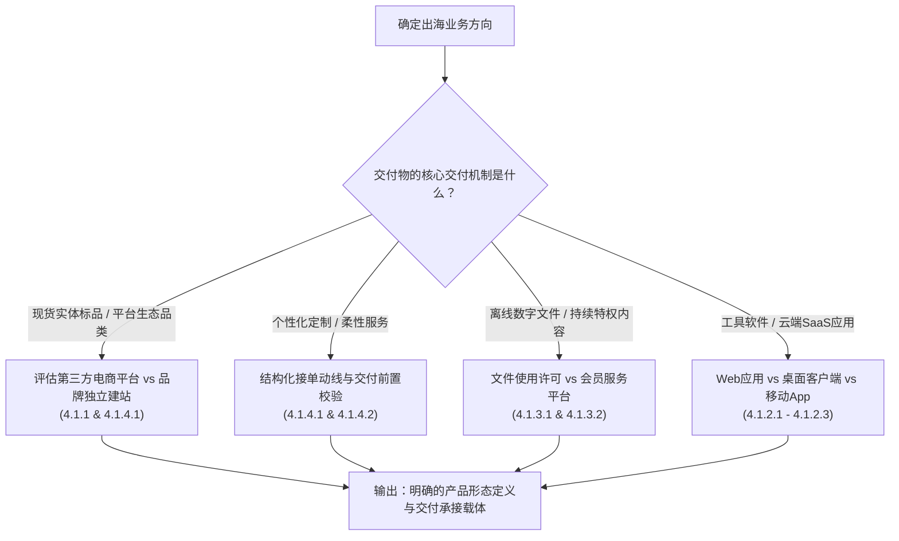
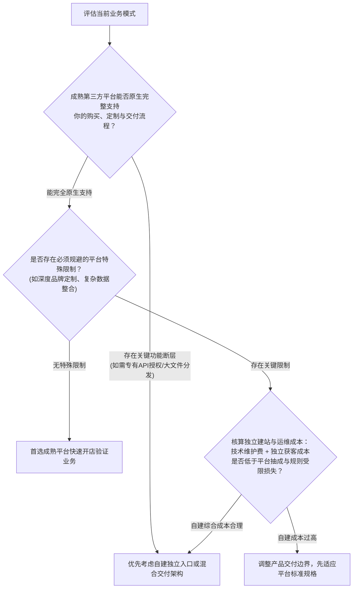
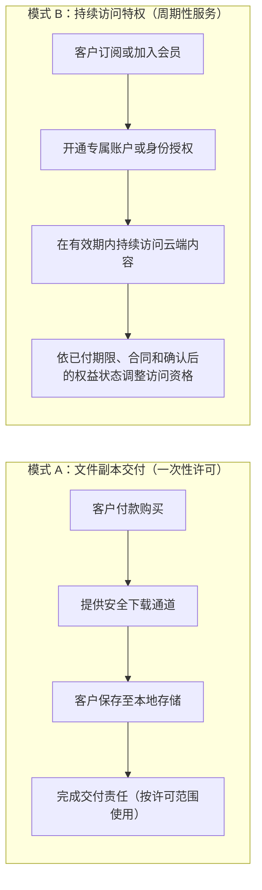
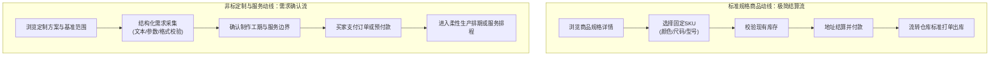

# 4.1 我该把产品做成什么形式？

## 本章导读：产品形态即交付承诺

在跨境商业中，选定业务方向之后，首要决策是**选定适合该业务的交付承接形态**：
- 如果将适合即用即走的轻量在线工具，过早投入成本开发多端原生移动 App，可能会面临漫长的应用商店审核周期与额外的分发维护成本；
- 如果将高度依赖定制参数的实物产品，套用标准商品的常规结账动线，可能导致买家无法便捷提交规格，引发繁重的跨时差沟通与履约延误；
- 如果将带有特定技术交互或 API 授权机制的产品，强行放入不支持此类交付的封闭电商平台，可能会因平台接口或通信限制而无法顺畅闭环。

“产品怎么做、怎么交付”的第一步，在于清晰回答：**我的产品到底该以什么形式呈现在客户面前？** 不同的交付形态，直接决定了交易信任的建立门槛、履约交付的操作路径、长期的技术维护边界以及业务的合规义务。



---

## 4.1.1 平台开店还是自己开网站？

对于出海经营者而言，“在成熟第三方平台（如 Amazon、Etsy、eBay、Gumroad 等）开店”，还是“搭建自有独立网站（如基于 Shopify、WooCommerce 或自研前端）”，代表了两种不同的交易承接路径、数据控制权限与技术维护边界。

### 4.1.1.1 客户是否能在平台内完成购买和交付？

评估第三方平台能否完整承接业务的第一步，是**核对客户能否在平台规则与技术框架内完成从选购、付款到获取交付物的完整闭环**。

#### 1. 第三方平台原生提供的交易与履约支撑
成熟平台为卖家提供了封装度较高的跨境基础设施：
- **交易信任与结算集成**：主流平台通常自带成熟的国际卡组支付、区域电子钱包及风控审核机制，海外消费者在平台已有支付凭据与账户习惯，下单信任门槛相对较低。
- **结构化订单与仓配体系**：实体电商平台（如 Amazon）提供可选的仓配整合服务（如 FBA），由平台负责仓储入库、包装打单与标准售后追踪；部分数字平台则提供付款后自动生成受控下载链接的基础机制。

#### 2. 平台的规则限制与能力边界
平台的标准化交易动线对非标业务存在明确的边界约束，经营者需核验自身业务是否存在以下摩擦点：

| 业务场景 | 主流平台的实际规则与能力边界 | 真实经营考量 |
| :--- | :--- | :--- |
| **个性化交互与即时预览** | 多数主流电商平台仅提供基础文本输入框或静态图片上传附件，缺乏复杂的动态 Web 3D 渲染或交互式参数计算器。 | 若定制商品需要客户实时调整材质并即时预览效果，通用平台的标准化表单难以满足深度交互需求。 |
| **API/动态密钥分发** | 仅部分专门的创作者/数字平台（如 Gumroad License API）支持在订单生成时自动签发许可证；主流实体电商平台一般不提供面向买家的实时动态 API 密钥派发体系。 | 若销售需要即时联网激活的软件授权，需核对平台是否具备 Webhook 或官方许可证生成支持，不可假设所有电商平台均支持软件授权自动化交付。 |
| **外部通信与链接规则** | 各大平台普遍对站内信沟通实施合规管控。以 Amazon 为例，其官方买家与卖家消息服务规范明确禁止发送包含营销推广、要求绕过平台支付或非交易必需的外部链接。 | Amazon Seller Central 的 [Communication Guidelines（G1701）](https://sellercentral.amazon.com/help/hub/reference/external/G1701?locale=en-US)可能要求登录才显示完整规定，登录页面本身不能证明某种外链已经获准。必须按实际站点的最新正式条款，区分交易必需材料与促销、引导脱离平台支付的链接；未经确认不发送外链，也不把某一站点规定推广至所有平台。 |
| **大体积虚拟资源托管** | 部分平台对虚拟商品的文件数量和存储上限设有具体限制。例如 [Etsy 官方数字商品指南](https://help.etsy.com/hc/en-us/articles/115015628347-How-to-Manage-Your-Digital-Listings) 明确规定单个数字 Listing 最多上传 5 个文件，每个文件大小上限为 20MB。 | 若销售大型音视频工程文件、高清三维素材包或体积达数十 GB 的数据集，平台的原生上传上限无法直接满足需求，必须核验外部安全交付的可行性。 |

> **判断准则**：如果产品形态与交付文件符合平台的类目规格标准，且业务不依赖复杂的前端定制计算，借助平台成熟的结算与买家信任能够快速启动；如果核心交付依赖专有算法调度、大文件高速分发或深度的第三方 API 实时通信，则需评估平台的技术承接缺口。

---

### 4.1.1.2 自有网站新增了哪些自由和责任？

建立自有网站（独立站或自主 Web 应用）赋予了经营者更高的产品自主权，但同时也带来了完整的系统维护与合规运营责任。

#### 1. 自有网站带来的业务控制力
- **交易体验自主定制**：能够根据产品特性设计无干扰的购买动线、多规格联动展示、定制问卷与交互式配置工具。
- **业务数据掌控度**：能够直接留存交易记录、联系方式与订单历史，便于在合规前提下开展后续客户支持与长期服务维护。
- **商业模式灵活性**：可根据产品演进自由设计阶段性订阅、用量计费、功能包捆绑等复合销售模式，不受特定平台固定收费结构的约束。

#### 2. 自有网站新增的运维与法律合规责任
离开平台的统一托管环境，经营者需要自主建立并承担以下责任体系：
- **安全交易环境构建**：必须全站部署有效的 HTTPS 安全加密协议（现代主流浏览器会对未加密的 HTTP 站点显示“不安全”警告），并在结账链路采用符合 PCI-DSS 标准的安全方案（例如使用符合实际准入的第三方托管结账或嵌入式方案），降低自身系统触达卡数据的范围。**使用托管输入框或 iframe 不自动取得 PCI DSS SAQ A 资格**；付款页元素来源、嵌入脚本风险与全部适用条件都必须核实，最终需向收单方或支付品牌确认自评类别，见[PCI SSC FAQ 1438](https://www.pcisecuritystandards.org/faqs/1438/)及[FAQ 1588](https://www.pcisecuritystandards.org/faqs/1588/)。具体支付合规流程归第三板块。
- **数据合规与隐私保护义务**：根据欧洲数据保护委员会（EDPB）关于 GDPR 第 3 条地域范围的 [3/2018号指引](https://www.edpb.europa.eu/our-work-tools/our-documents/guidelines/guidelines-32018-territorial-scope-gdpr-article-3-version_en)，如果独立网站明确面向欧盟消费者提供商品或服务（如使用当地语言、标明欧元价格或支持配送至欧盟境内），即便运营主体位于欧盟境外，亦须履行 GDPR 规定的数据控制者法定义务（包括提供透明的隐私政策、合法处理依据、用户访问及数据擦除通道等）。类似地，面向美国各州的销售也需视业务体量核对是否达到特定州隐私法（如加州 CCPA 对营收或处理数据量的法定门槛）的适用范围。
- **欺诈交易与拒付成本兜底**：自有网站直接接入支付渠道时，商户需自主配置基础反欺诈风控规则；若遭遇未经授权的盗刷或买家提起拒付（Chargeback），商户通常需自行承担交易损失并向支付机构支付争议处理手续费（具体费率视服务商合同与币种而定，例如 Stripe 在各币种下收取对应的固额争议费用）。

---

### 4.1.1.3 怎样判断是否必须拥有独立入口？

是否建立独立入口，应基于业务支撑能力、边际成本与合规要求进行综合条件判断，而非盲目跟风。

#### 独立入口决策评估逻辑



#### 关键判断维度
1. **交付机制的契合度**：如果产品必须通过外部特定服务器进行 API 实时鉴权、动态渲染或专有格式交互，且已有平台功能、合规插件或允许的混合交付方案均无法满足时，应比较平台接单配套外部交付、托管服务和自有入口。是否**必须**自建入口取决于平台规则、数据流和真实功能缺口，而非只因使用外部API。
2. **综合成本与维护投入权衡**：第三方市场平台可按交易收佣金；但**自有网站不等于零平台交易费**：自管站点仍有主机、软件和支付处理成本，托管型SaaS独立站（如Shopify）还可能依据套餐、支付方式和商店条件收取第三方交易费，且可能与支付机构处理费叠加；详见[Shopify官方费用说明](https://help.shopify.com/en/manual/your-account/manage-billing/billing-charges/types-of-charges/third-party-charges/third-party-transaction-fees)。比较时逐项核算适用费用。
3. **合规与经营资格核验**：
   > [!IMPORTANT]
   > 搭建独立网站**并不代表**可以规避法律法规或支付通道的合规审查。如果某类产品属于国际公约禁止、受限或缺乏进出口资质的范畴，转移到自有网站同样会面临支付网关冻结、域名解析服务商终止服务或法律追责。合规性取决于产品本身的经营资质，而非承接形式。

---

## 4.1.2 做软件该做网页、App还是桌面版？

对于开发软件与数字化工具的独立开发者或技术团队，载体形态的选择直接关系到首发工程复杂度、跨平台适配成本以及版本迭代周期。

### 4.1.2.1 用户实际使用哪些设备、多久用一次？

软件形态首先取决于**用户执行核心目标任务时的典型物理环境与使用频次**。

#### 1. 任务类型与使用场景的匹配
- **深度处理与多任务桌面场景**：如果产品涉及复杂表格编辑、多窗口数据比对、大篇幅代码/文本创作或专业图形设计，用户的操作通常在配备键鼠与大屏幕的电脑前完成。优先提供经过桌面端屏幕适配的 Web 应用，能够提供更高效的工作流承接。
- **移动在途与现场即时采集场景**：如果核心功能高度依赖随时随地的便携操作、现场拍照扫描、即时推送通知提醒或移动定位（如仓储物流手持扫码、外勤打卡），移动 App 或轻量自适应移动网页才能贴合现场使用。
- **低频/即用即走型工具**：对于用户单次使用、按季度或按年偶发使用的工具（如特定格式转换、单次申报计算），用户安装客户端软件的心理阻力较大，通过浏览器直接访问的 Web 页面能显著降低使用门槛。

---

### 4.1.2.2 有没有离线使用或调用本机设备的需求？

技术底层能力是决定采用 Web 页面还是本地客户端的硬性指标。

#### 常见软件载体底层能力对比

| 系统与硬件能力 | 现代 Web 应用（HTML5 / PWA） | 桌面客户端（如 Tauri / Electron） | 原生移动 App（iOS / Android） |
| :--- | :--- | :--- | :--- |
| **本地文件直接读写** | 需用户通过系统对话框（如 File System Access API）显式选取并逐次授权，受浏览器同源沙箱限制，无法在后台随意静默读写系统任意目录。 | 可根据代码逻辑访问宿主操作系统的本地文件系统，但仍受操作系统层面的用户权限（如 macOS TCC 权限弹窗、Windows UAC）约束。 | 严格受移动操作系统沙箱隔离，仅能读写自身私有数据目录，访问公共相册或文档需系统级授权。 |
| **全局系统热键与后台常驻** | 仅当浏览器标签页处于激活状态时可捕获网页内按键；无法注册全局系统级快捷键；后台标签页易被浏览器省电机制挂起。 | 支持注册操作系统全局系统快捷键（如后台常驻随时呼出面板）；可配置为系统托盘常驻守护进程。 | 受移动系统省电策略与后台冻结机制严格管控，后台无声常驻易被系统调度杀进程，通知需依赖系统级推送服务。 |
| **离线运行与本地缓存** | 依赖 Service Worker 与 IndexedDB 缓存静态资源和业务数据，可实现基本离线可用；但受浏览器单域存储配额限制，不适合离线加载超大型模型或高负载离线渲染。 | 本地独立运行，可内嵌本地数据库（如 SQLite）或直接调用本地计算资源，不依赖网络连接即可执行完整离线功能。 | 天然支持本地离线数据存储与后台连网同步机制。 |
| **硬件接口与专业驱动** | 仅支持部分标准 Web API（如 WebUSB、WebBluetooth、WebHID），且依赖浏览器内核支持；无法直接挂载专用内核级驱动程序。 | 可直接调用操作系统原生 C/C++ 动态库、系统底层驱动，支持各类工业串口设备与专用外设直连。 | 原生支持蓝牙 BLE、NFC、摄像头传感器、生物识别（Face ID / 指纹）等移动硬件模块。 |

> **架构建议**：如果产品核心逻辑在云端服务器执行、或属于标准数据增删改查交互，首版采用标准 Web 架构能以较低成本覆盖多端；仅当业务存在高频本地文件操作、全局快捷操作、深度离线计算或特定硬件外设直连诉求时，才需引入本地客户端打包技术。

---

### 4.1.2.3 不同版本怎么发布更新和兼容旧数据？

软件形态的选择直接决定了后期的**分发维护代价、缺陷修复时效与客户端版本兼容策略**。

#### 1. 各形态的分发与发布生命周期
- **Web 应用的持续交付与缓存管理**：
  - *发布机制*：服务端部署更新后，用户重新访问或刷新即可拉取最新前端代码，修复线上阻塞性缺陷相对敏捷。
  - *维护挑战*：需合理配置 HTTP 缓存响应头与 Service Worker 缓存清理策略。若未采用合理的文件指纹（Hash）版本控制，部分用户的本地浏览器缓存可能导致新旧前端静态文件混合加载；服务端数据库架构升级时，需考虑正在进行中的会话连接。
- **移动 App 的应用商店审核与分发约束**：
  - *发布周期与规则审查*：移动 App 通常必须经过各大应用商店（Apple App Store / Google Play）的审核。根据 [Apple App Store 审核指南](https://developer.apple.com/app-store/review/guidelines/) 规定，在应用内销售数字内容、虚拟特权或软件功能通常必须采用其官方应用内购买（IAP）系统（适用阶梯抽成规则；对于符合资格的小型企业项目适用 15% 费率，标准费率为 30%）；虽在特定合规类别（如指南第 3.1.3(a) 条的“阅读器”应用允许用户登录并消费在外部购买的杂志/音频等内容）及特定司法管辖区（如美国店面根据法院判决支持的外部购买链接授权）存在特定例外，但审核政策严格且常有更新。
  - *多版本长期共存债务*：移动用户通常不会在应用发版后立即全量升级，导致线上必然存在运行历史版本的客户端，后端 API 必须设计版本容差机制（如 `/v1/`、`/v2/` 路由隔离），维护负担较重。
- **桌面客户端的代码签名与分发信誉**：
  - *系统信任安全门槛*：Windows 系统的 SmartScreen 筛选机制会对未建立信誉的可执行安装包弹出阻止提示。根据 [微软官方 SmartScreen 信誉机制说明](https://learn.microsoft.com/windows/apps/package-and-deploy/smartscreen-reputation)，代码签名证书（无论标准 OV 还是 EV 证书）均需在分发过程中逐步积累有效下载量和遥测声誉，无法通过购买证书直接消除所有风险提示；亦可通过 Microsoft Store 或可信签名服务进行分发以降低信任阻力。macOS 则强制要求通过 Apple 开发者体系进行公证（Notarization），否则系统会默认阻止运行未知开发者的二进制文件。

---

## 4.1.3 卖数字文件或会员内容，要用专门平台吗？

销售虚拟资产（包括电子书、工程图纸、音视频素材、代码样板、会员知识库等）具有边际分发成本低的特点。经营者必须先在业务底层厘清交付承诺的本质属性，再评估技术实现载体。

### 4.1.3.1 客户买的是文件，还是持续访问资格？

区分一次性文件分发与持续性服务特权，决定了后续的履约范围与承诺义务：



#### 商业承诺与责任深度对比
1. **卖文件副本（交付离线资产许可）**：
   - *法律与商业本质*：买家购买的通常是**根据合同或许可协议（License）约定使用该数字文件的非排他性权利**，而非转移该知识产权的底层版权。
   - *商家责任边界*：核心责任集中在交付环节——保证文件完整无损、格式符合标称规范、并在合理时间内提供稳定下载通道。一旦文件成功下载至买家本地设备，商家通常不承担长期的持续更新或云端托管义务。
   - *防护与扩散局限*：通过带有效期的预签名下载链接（Signed URLs）可以防止直接公开外链盗链，但文件一旦落地至用户本地磁盘，从技术底层无法完全杜绝用户的离线复制或二次外传，通常主要依靠商用许可协议与水印追踪进行版权维权。
2. **卖持续访问资格（会员与订阅服务）**：
   - *商家责任边界*：属于持续性履行合同。商家承诺在服务期内维护线上系统的可用性、按合同维持已承诺的线上功能与访问权限；仅在确实承诺定期更新内容时，才承担相应的内容更新义务，并对受限资源进行适当访问鉴权。
   - *权益调整机制*：必须区分具体事件：**取消自动续费**通常意味着不再下期扣费，并不自动终止已经购买的当前服务期；**当前服务期到期**、合同允许的立即终止、全部或部分退款、已经消费的服务须分别依合同和已确认的订单/支付事实调整权益。已经下载至本地的文件通常无法技术性追回。详细产品侧撤权属4.7，资金退款属第三板块。

> [!CAUTION]
> **商业边界提示**：避免在一次性低价数字文件中随意承诺“终身免费更新服务”。若商业模式仅为一次性单笔低客单价交易，却附带长期的维护与内容增量更新义务，随着存量买家增多，后续履约与沟通成本将严重透支新业务利润。

---

### 4.1.3.2 第三方平台能否管好使用资格和期限？

在销售虚拟商品时，采用专门的创作者/数字商务平台（如 Gumroad、Lemon Squeezy 等）与自建系统相比各有优劣。

#### 1. 专门平台提供的核心能力与适用场景
- **Merchant of Record（MoR）交易间接税代缴支持**：以 [Lemon Squeezy 官方说明](https://docs.lemonsqueezy.com/help/payments/merchant-of-record) 为例，作为记录在案商户（MoR），平台按其交易合同及实际适用法域，通常承担作为销售方的有关销售税（Sales Tax）、增值税（VAT）和商品服务税（GST）计算、收取、申报与缴纳责任；并不能概括成“全球任何税务义务全部由平台承担”。这对于缺乏多国税号登记能力的小微卖家，能够显著降低交易流转环节的税务合规门槛。但需要明确：MoR 仅负责处理该平台交易的间接流转税，**并不代办**卖家自身的企业所得税申报或个人经营所得合规义务。
- **开箱即用的数字权益管理**：多数虚拟商务平台原生提供一次性或按席位激活的 License Key 派发、与第三方通讯工具（如 Discord 角色权限）的 Webhook 绑定、以及订阅扣费失败时的自动催缴重试。根据 [Lemon Squeezy 用量计费文档](https://docs.lemonsqueezy.com/help/products/usage-based-billing)，部分现代数字平台亦支持通过 API 上报用量事件进行计费。

#### 2. 专门平台的成本结构与局限性
- **服务费率与成本构成**：专门平台的费率通常高于基础底层支付网关。例如[Gumroad官方资费](https://gumroad.com/pricing)截至2026-10-18按来源区分：通过创作者主页或直接链接成交**每笔10%＋$0.50**；由Discover市场为创作者带来新买家并成交则**每笔30%**。不能把直连费再机械叠加一笔未列明的“标准卡支付处理费”；而 [Lemon Squeezy 官方资费说明](https://docs.lemonsqueezy.com/help/getting-started/fees) 标准费率为 5% + $0.50（已包含基础卡处理成本），若涉及国际卡、PayPal 或特定订阅功能还需加收对应的通道附加费。经营者需结合自身毛利水平核算平台手续费的长期承受力。
- **品牌沉淀与复杂业务支持上限**：此类平台通常采用相对固定的结账页面模板，无法完全嵌入复杂的自研前端工作台；且若业务涉及跨系统的多层级企业账户组织架构或深度定制的本地安全私有化部署，现成平台的标准化账户体系难以完全契合。

---

## 4.1.4 卖实物或服务，怎么安排接单入口？

无论是实体外贸零售还是跨境专业服务，前端接单入口是确立买卖双方履约范围的关键界面。入口交互设计若与交付能力脱节，极易导致履约延误或客户纠纷。

### 4.1.4.1 订单是选择现成商品，还是提交个性化要求？

产品特性的差异决定了结账动线的核心逻辑：



#### 两类动线的关键设计考量
1. **现成标品动线：最小化结账摩擦**：
   对于海外仓现货或标准化工业品，结账流程的核心是**减少非必要输入**。地址字段需适配目的地国家的标准规范，避免在结账链路强插多余的调查问卷导致潜在买家流失。
2. **定制/非标服务动线：输入物结构化前置校验**：
   对于手工雕刻、印花定制、软件定制配置或专业咨询等业务，必须明确定义**买家输入物的规格门槛与提交机制**：
   - *避免无门槛扣款后盲目追讨*：若仅允许买家随意付款而不在前台收集具体要求，往往会导致商家需通过跨国邮件反复询问尺寸或素材，造成履约流程严重停滞。
   - *合理安排输入环节*：针对轻量文本刻字或简单选项，建议在加购前直接通过前端必填字段进行结构化采集并限制最大字符；针对大容量设计文件或复杂问卷，可在支付成功感谢页或订单详情页设置清晰的“资料补充提交通道”，并在**下单前明确披露且符合适用合同/消费者规则**的条件下约定：如果双方同意从提交并确认合格素材后开始计制作周期，应事先定义所需资料、补交机制与延误处理。不能仅靠付款后感谢页单方延后此前承诺的交期。

---

### 4.1.4.2 接单前必须确认哪些交付条件？

为了避免生成无法履约的异常订单，接单入口必须在系统或界面层面做好基础边界校验。

#### 接单前需明确的四大交付边界

```
【接单入口交付条件前置自检表】

1. 配送范围与目的国海关基础字段确认
   - 配送区域限制：基于可达的跨境物流渠道，在结账系统中准确配置支持发货的国家/地区列表，对无法通达的偏远区域实施前端拦截。
   - 清关必要字段提示：
     * 针对韩国个人自用海关清关：根据韩国关税厅（Korea Customs Service）规范，通过跨境电商通关需提供 13 位个人通关代码（PCCC）；若在结账地址页引导收件人填报，可显著降低在途通关停滞风险。
     * 针对巴西进境包裹：根据巴西联邦税务局（Receita Federal）规定，国际邮件面单需包含收件人税号（CPF 或 CNPJ）；若前端未留存，虽承运商通常提供后续通关补录通道，但可能带来额外的滞关与退运风险。
   - 产品合规要求：对于销往欧盟的实体消费品，经营者需核验自身是否符合欧盟通用产品安全法规（GPSR, Regulation EU 2023/988）关于欧盟境内经济运营商标识及可追溯标签的要求，从选品和供应链侧做好合规准备，避免在目的国遭遇海关查扣。

2. 制作工期与时区排期边界
   - 生产周期公示：非标实物必须在前台明确标注“制作工期”（Production Lead Time），并与“跨国运输时效”（Transit Time）清晰区分，防止客户产生下单后次日即可派送的误判。
   - 服务预约时区对齐：提供真人视频咨询或技术支持的服务类业务，入口应集成具备时区自动转换功能的预约日历工具，避免因夏令时转换或跨时区偏差造成沟通延误。

3. 买家运行环境与资料规格约束
   - 兼容性预先声明：针对特定代码插件、模板或硬件配件，需在商品关键参数栏显式声明所支持的宿主版本或系统运行环境，并设置确认提示。
   - 素材质量规格引导：若需买家提供印刷素材，应明确标注所支持的文件扩展名格式与基础清晰度建议，降低因客户提交模糊手机截图引发的次品争议。

4. 商家服务容量与并发承载边界
   - 产能与日历档期保护：个人开发者或中小工作室的单月履约能力存在物理极限，服务类接单入口应配置日程档期锁定或可售名额上限机制，避免在短期内承接超出负荷的过量订单引发大面积逾期交付。
```

---

#### 补充核对：客户眼中的卖家与实际履约责任是谁？（R06/R11）

产品形态选定前，先写清四个不同问题，**支付服务商、平台、Merchant of Record（MoR）、3PL或承包商并不自动等于与消费者缔约的同一主体**。责任以合同、平台条款和适用法律为准，不能仅看谁在页面上展示商品。

| 购买情景 | 顾客看到谁销售？ | 法律上谁对销售合同负责？ | 谁实际交付、客服先找谁？ |
|---|---|---|---|
| 平台商家店铺 | 平台页面和店铺名 | 按平台及交易合同核实是卖家、平台还是其他销售方 | 核实平台自营/卖家/3PL职责，不能以“平台收款”推定全部包办 |
| 自有独立站 | 商家展示的品牌 | 按结账条款及当地准入确认合同销售方 | 商家协调仓库、数字交付服务商及退款售后 |
| MoR代售数字商品 | 可能是品牌与MoR并列 | 核对MoR条款所承担的销售、收款及税务角色 | 明确软件支持、服务水平、权限修复和消费者沟通的实际责任人 |
| 委外定制/软件服务 | 可能是品牌或代理商 | 看消费者或企业客户实际签署的合同 | 外包商交付不当然免除对客户的约定义务 |

**最小行动**：保存“销售方—收款方—交付方—售后责任方”四栏；发现角色或目的国资格尚不明确时，先暂停该市场接单。支付准入、报税细节在第三板块，第四部分只决定能否作出并兑现交付承诺。

---

## 本章决策矩阵：不同形态的综合对比

下表综合展示了本章讨论的主要产品形态特征与选型评估维度：

| 业务产品大类 | 典型承接形态 | 核心履约交付机制 | 主要优势 | 核心管理与合规责任 |
| :--- | :--- | :--- | :--- | :--- |
| **标准现货实物** | 成熟跨境电商平台店铺 或 托管型独立建站系统 | 海外仓/专线物流配送，回传多语言运单追踪号 | 交易链路成熟，买家购买与支付认知摩擦较小 | 国际物流时效控制、逆向退换货、多国进境申报要求 |
| **个性化定制实物** | 可选择支持定制字段的平台（如Etsy的[Custom options](https://help.etsy.com/hc/en-us/articles/360000344528-How-to-Offer-Personalized-Listings)）、托管店铺或自有入口，须按实际资格及需求判断 | 结构化需求前置校验 $\to$ 柔性生产 $\to$ 跨境物流 | 差异化竞争明显，更易承接个性化品牌诉求 | 需防范素材迟交滞产风险，明确制作工期与运时差异 |
| **离线数字文件** | 专门虚拟商品平台 或 带有防盗链的独立站存储 | 结账后生成带有过期时效的安全预签名下载链接 | 边际交付成本极低，无实物仓储物流周转负担 | 文件外传扩散防范、明确软件使用许可授权范围 |
| **在线持续会员** | 具备持续权限管理能力的会员平台、托管门户或自有站点 | 账号鉴权中心、基于 Webhook 的订阅到期权限联动 | 现金流可预期，长期用户生命周期价值（LTV）高 | 需长期保持系统可用性，持续提供增量价值与权益维护 |
| **软件与SaaS应用** | 现代响应式 Web 应用（必要时辅助桌面/移动端） | 云端租户自动化初始化、软件许可证密钥在线激活 | 功能部署更新敏捷，多端访问便捷；仍需管理本地浏览器缓存、旧会话和前后端兼容 | 需保障服务端高并发稳定、处理离线/权限系统安全限制 |
| **专业出海服务** | 品牌介绍落地页 + 跨时区预约表单与看板 | 线上排期日历对接 $\to$ 数字化成果交付与完工签署 | 启动技术资金门槛低，能灵活输出高客单专业能力 | 需设立清晰的修改轮次与验收边界，防止服务范围蔓延 |

---

> **全书导引提示**：  
> 当你通过本章理清了产品的交付承接形式与输入边界后，下一阶段需进入 **4.2《第一版先做哪些东西？》**，系统拆解如何在启动阶段科学梳理首发功能清单、权衡人工与自动化分工，并确立最小可行性交付闭环。

---

> **正式状态与封板溯源（2026-10-18 / G7语言润色：2026-10-19）**：  
> - **正式状态**：`CHAPTER1_FINAL_SEALED / G7_EDITORIAL_OPTIMIZED`  
> - **来源说明**：本章以独立Writer R2完整稿为基线，经Reviewer对六组阻断事实最小修订，并由G7独立Reviewer完成语言流畅度与跨章连贯性优化；不存在Writer R3交稿。  
> - **核心命题**：**产品怎么做、怎么交付？**  
> - **本章定位**：界定业务载体与交付边界。在确立商业机会后，将抽象的产品构想具象化为海外客户可识别、可购买、可交付的数字化或实体承接形式。  
> - **服务受众**：中国大陆个人开发者、跨境独立站/平台卖家、中小跨境企业（涵盖零代码、轻量研发到多渠道运营团队）。  
> 修订矩阵、官方依据与全文校验见[本章封板证据](CHAPTER1_SEAL_EVIDENCE_20261018.md)。本次为知识教材质量审核，不代表完成商家开户、付款、实物通关或部署实测；使用时须核对当期服务商规则、所在地法域与合同资格。
