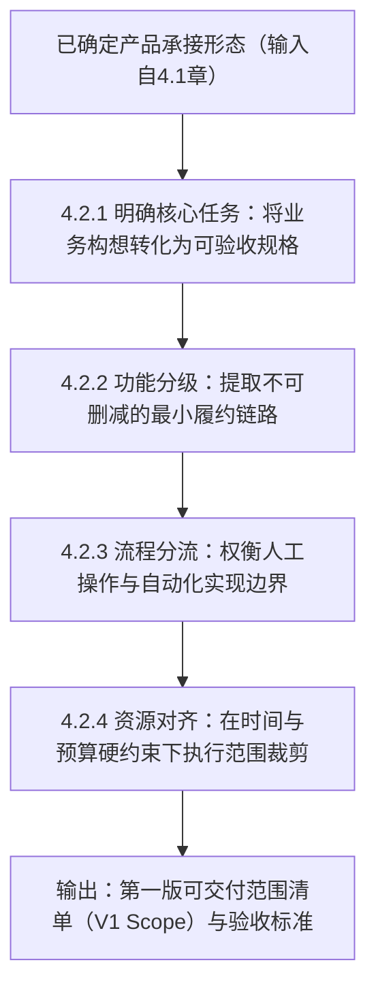
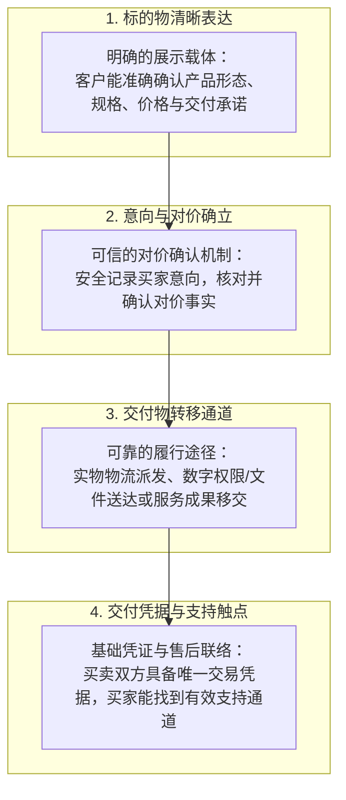
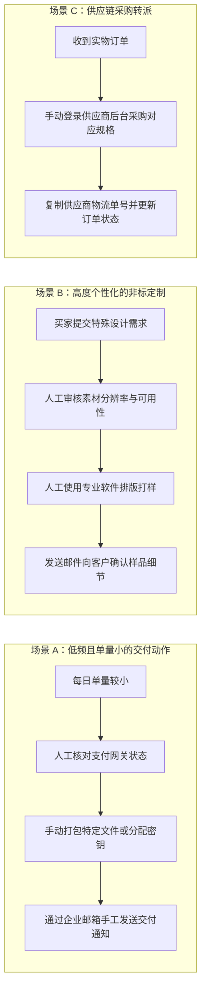
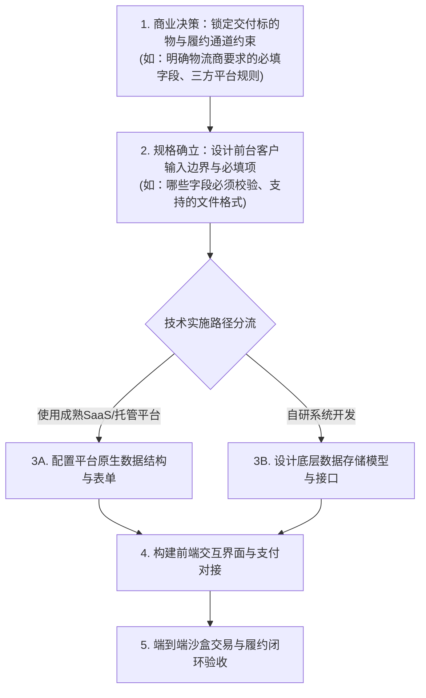
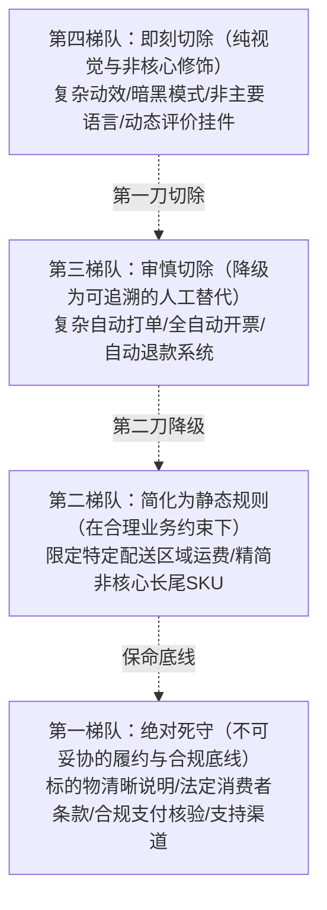

# 4.2 第一版先做哪些东西？

## 本章导读：从“想要什么”到“交出什么”

在跨境商业实践中，初创项目面临的普遍挑战之一是**首版范围无限蔓延（Scope Creep）**：
- 很多独立开发者在第一笔真实交易尚未跑通前，就耗费数周构建复杂的多租户权限体系、暗黑主题切换、多级推荐分销系统与积分商城；
- 很多跨国实物卖家在未验证海外买家真实需求前，就试图开发自动化多仓调度算法和实时 ERP 双向同步，导致上线周期一拖再拖；
- 还有的服务型团队试图在首版就实现全自动化的需求排期与自动化交付，最终因流程过于僵化而无法满足客户个性化诉求。

第 4.1 章解决了产品“做成什么形态”，而本章要解决的核心痛点是：**在有限的时间与资金预算内，第一版到底先做哪些东西，才能以最低代价完成第一次真实的海外交付？**



---

## 4.2.1 怎么把想做的产品写成可交付清单？

许多初创者在规划产品时，习惯写下一堆诸如“界面要美观大气”、“支持海外主流支付”、“系统稳定流畅”等抽象形容词。这些模糊的愿望无法指导实际开发或外部采购，更无法用于客观验收。要把抽象构想落地，必须将其转化为**清晰、有边界且能测试的交付规格**。

### 4.2.1.1 客户要完成什么事，才算产品有用？

界定第一版产品价值的起点，不是罗列“系统包含哪些技术功能”，而是识别**“客户使用你的产品究竟要完成什么核心任务（Jobs-To-Be-Done）并获得什么确定的成果”**。

#### 1. 从“功能清单”转向“目标任务成果”
客户购买产品不是为了欣赏技术架构，而是为了获取某个确定的结果。如果抽离了具体的成果产出，堆砌再多功能也无法证明产品具备可用性：

| 业务产品大类 | 常见的“功能堆砌”（初期宜警惕） | 客户真正要完成的核心任务与成果产出 |
| :--- | :--- | :--- |
| **实物跨境电商（如定制皮具）** | 3D 全景旋转展示、AR 虚拟试戴、会员等级成长树、买家社区论坛。 | **挑选合适规格并准确下单**：确认皮质颜色与尺寸，正确填写符合目的国派送格式的收件地址，完成付款并获得明确的发货时效承诺。 |
| **数字效率工具（如发票生成器）** | 社交账号登录绑定、多团队协作权限、暗黑主题切换、PDF 阅读器内嵌批注。 | **快速产出合规文件**：输入账目明细与客户信息，一键导出排版规整、符合当地商业习惯的 PDF 发票文件并下载到本地。 |
| **SaaS应用（如跨境关键词抓取）** | 复杂的自定义仪表盘拖拽、多维角色权限 RBAC、即时通信集成、批量导出为 10 种格式。 | **获取目标关键词列表**：输入竞品 ASIN 或核心词，能稳定查询并返回目标搜索词列表及其核心热度指标。 |
| **出海专业服务（如海外商标检索）** | 线上工单流转系统、在线即时聊天客服、客户画像标签库。 | **获取专业风险评估**：提交拟注册商标名称与类目，在约定时限内收到一份明确标注“驳回风险等级与规避建议”的文字报告。 |

#### 2. 提取业务的“黄金主干链路”
许多产品在初始阶段都可以画出一条从“产生需求”到“获得成果”的短路径；对免费试用、B2B人工洽谈等业务，其具体步骤与付费结账路径不同。这条路径被称为**黄金主干链路（Golden Path）**。在第一版规划中，所有偏离这条主干链路的辅助诉求，都属于次要优先级。


---

### 4.2.1.2 客户需要提供什么，商家必须交出什么？

产品交互的本质是买卖双方的“契约履行”。在首版清单中，必须精确定义**双方输入与输出的边界条件**，否则极易导致业务在交付阶段出现严重扯皮或不可履约。

#### 1. 客户必需输入物（Inputs）的最小集合
梳理客户必须提供的信息，原则是**按交付渠道与商品形态进行最小必要采集**，多索要一个非关键字段，就会增加一层流失与数据合规风险：
- **物理交付必要信息**：依据承运商及目的国海关要求确定字段。例如：标准收件人全名、可派送地址行（门牌号/街道）、城市、邮编、收件人联系方式（用于物流派送通知）以及特定国家清关所需的税号信息（如韩国 PCCC 或巴西 CPF/CNPJ，视物流通道要求而定）。对于不需要物理配送的纯线上服务，则无需强制收集街道地址。
- **定制加工必要参数**：根据实际工艺要求界定。例如：激光雕刻仅需纯文本字符并设置最大字符数上限；而高精度数码印花若需买家提供位图素材，应提示对应的分辨率标准（如建议 150~300 DPI 适合实际印刷尺寸）与文件格式（JPG/PNG/PDF），并注明大容量文件的提交方式。
- **软件运行必要数据**：用户执行任务所需的原始数据（如需要分析的文本、待处理的文件）。系统应遵循最小必要权限原则，严禁强制要求客户上传可复用的第三方顶级管理员密码或敏感私钥。

#### 2. 商家承诺输出物（Outputs）的履约边界
明确界定你交付给客户的最终成果物形态，并划清**“责任终点线”**：
- **交付物的物理/数字规格**：
  - 数字文件：明确文件格式（如 `.zip` 压缩包内含 `.pdf` 报告）、内容版本及获取方式（网页即时下载通道或备份邮件发送）。
  - 实物商品：明确发件包裹内包含的主体物件、标准配件、包装形式及真实有效的物流追踪单号。
  - 专业服务：明确交付物的形式（如 `一份符合约定篇幅与审核维度的 PDF 报告`）、交付方式（邮件投递）以及修改轮次上限（如 `交付后约定工作日内提供 1 次范围内的微调`）。
- **防范范围蔓延（Scope Creep）的免责边界**：
  必须在前台清晰声明**“什么是本产品不包含的”**。例如：销售独立站 Shopify 模板，交付承诺是“提供模板安装包与标准文档”，必须明确“不包含为客户免费排版全部商品详情页或定制修改底层代码”。

---

### 4.2.1.3 如何把模糊描述变成能验收的要求？

产品需求如果写得含糊其辞，无论是自己开发、指挥团队还是委托外部人员制作，最终交付时必然产生严重分歧。必须使用**可观察、可执行、可判定对错的验收标准（Acceptance Criteria, AC）**来替代主观愿望。

#### 模糊描述与可验收标准对照表

| 常见模糊描述（无法验收） | 为什么会导致扯皮与失败 | 规范的可验收要求（Pass/Fail 明确界定） |
| :--- | :--- | :--- |
| “结账流程要顺畅、体验要好” | 什么是顺畅？主观感受无法作为工程验收依据。 | **验收标准**（适用于需要在线结账的首版）：买家完成适用字段后可提交订单、进入约定支付方式，并可在成功页**或订单查询入口**找到订单编号与“待确认/已确认”等真实状态；后台须依据可信支付服务端事件或经授权的官方渠道查询确认支付事实，核对订单、金额和币种，再推进可履约状态。分别模拟买家**关闭页面不回跳**、通知**延迟/重复**、异步支付成功与失败：订单不得因回跳误判“已付款”，也不能因没有回跳丢单或重复交付；**前台跳转与后台通知不要求同时发生**。人工订单按已约定的线下确认路径另设验收。 |
| “图片上传功能不能崩” | 没有界定上传边界，用户上传非图片格式或超大文件必然报错。 | **验收标准**：前端上传组件限定支持特定格式（如 `.jpg`、`.png`）；当用户选择超过指定大小（如设定上限 15MB）的文件时，组件在前台即时阻断并显示明确的错误文案“文件大小超出限制”，且页面不发生异常刷新；上传合规图片后显示可撤销的预览缩略图。 |
| “产品支持海外常用语言” | 全球有上百种语言，全做会导致工期无限拉长。 | **验收标准**：首版仅支持通用国际英语（en-US）；前台界面所有系统提示、按钮文案、自动邮件通知均无非目标语言的硬编码残留；当检测到未知语言环境时，系统默认回退显示英语。 |
| “系统能防止超卖” | 技术实现复杂，没有界定并发场景与业务策略。 | **验收标准**：设定某独立库存单位（SKU）可售数量为 1，在沙箱测试环境下模拟两个独立客户端几乎同时发起结算。系统必须保证：要么只有首个通过校验的请求成功进入待发货，后续请求明确提示售罄；要么在发生并发竞争时，系统能正确拦截第二笔订单的履约并触发合规的取消退款流程，绝不产生无库存却静默标记为已履约的假状态。 |

---

## 4.2.2 哪些功能是第一版非做不可的？

面对各种看似有价值的功能，经营者必须建立清晰的优先级体系。第一版产品的设计原则不是“还能往里加什么”，而是**“还能拿掉什么，而核心商业交付承诺依然能完整履行”**。

### 4.2.2.1 去掉哪些功能，就无法完成一次交付？

判断某项功能是否属于第一版“非做不可”，应看**移除之后，目标客户是否仍能依约、安全、可核验地完成核心任务并取得承诺成果**；对于付费订单还需可核对交易与对价，对于免费试用则无需强加收款模块。合法合规、隐私、安全与必要售后义务不能因为可以暂时绕过就被删掉。

#### 构成最小可交付闭环的基础支柱（参考交易模型）

对于典型的线上直接付费交易，以下四个支柱构成了最精简的闭环骨架。但在不同业态下，其具体实现形式存在显著差异：



#### 不同业务形态的最低闭环差异
上述四项支柱是一套**抽象参考骨架**，绝不可生搬硬套到所有跨境业务中：
- **自营标准电商独立站**：需要完整的单品展示页、集成合规支付网关（如信用卡/电子钱包）、物流打单发货通道以及带订单号的自动邮件通知。
- **B2B 大额贸易或深度定制服务**：并不需要前台即时刷卡结账。其最小闭环通常是“专业方案展示页 $\to$ 结构化询盘/需求表单 $\to$ 线下/邮件确认商务条款 $\to$ 银行转账或形式发票（Proforma Invoice）确认 $\to$ 分阶段交付成果物”。在此类场景下，商务对话与人工确认是合法且必要的履约环节。
- **软件产品免费试用（Freemium / Free Trial）**：首版完全可以不接入复杂的计费扣款引擎，其最小闭环仅需“登录/访问入口 $\to$ 核心功能使用 $\to$ 用户满意度反馈”，验证核心工具价值之后再补充付费模块。
- **第三方平台开店（Amazon / Etsy 等）**：结算、账单、部分客服通信及退款体系均由平台原生承载，卖家在第一版只需做好商品详情配置、库存同步与发货打单，无需自建支付网关与邮件通知系统。

> **必要性判断准则**：问自己一个问题——**“删掉这个功能后，客户是否依然能获得预期的核心价值，双方是否依然能安全、无争议地确认这笔交易？”** 如果答案是肯定的，该功能在首版即可裁剪。

---

### 4.2.2.2 哪些看着高级的功能可以后做？

许多初学者容易被成熟成熟大企业的复杂系统所吸引，将大量“规模化后才需要的运营功能”误当成首发必做项。以下列出的高级特性，在第一版中**应审慎评估，优先推迟至业务获得市场初步验证后再实施**：

#### 第一版可审慎推迟的高级功能清查表

```
【第一版可推迟功能自检清单】

[ ] 复杂的用户中心与全套账户权限体系
    - 表现：非要开发“账号密码注册、强制邮箱激活、手机验证码绑定、社交第三方一键登录、多级角色权限分配”。
    - 替代方案：实物电商首版可优先支持游客结账（Guest Checkout），仅凭收件邮箱发送订单凭据；数字工具类应用首版可采用无密码的“邮箱魔法链接（Magic Link）”或基础会话机制，大幅减少账户模块的技术负债与密码泄露安全合规风险。

[ ] 营销膨胀与促销裂变引擎
    - 表现：多级分销返佣（Affiliate）、积分商城、会员等级成长值、动态拼团、满减阶梯券复杂叠加计算器。
    - 替代方案：首发期如果商业模式不重度依赖裂变分销，只需支持最基础的固定金额/百分比折扣码即可，甚至初期可直接通过调整商品标价进行促销，避免复杂的优惠券互斥逻辑拉长工期。

[ ] 自动化多仓调度与复杂 ERP 接口集成
    - 表现：试图对接多家海外仓 API 实现自动化分仓拆单、实时与复杂财务进销存系统双向同步。
    - 替代方案：初期单仓发货，定期手工导出订单表格交由货代或海外仓系统打单，手动回传运单号，待单量具备一定规模后再行系统集成。

[ ] 站内自研即时聊天（IM）系统
    - 表现：花费大量精力自研基于 WebSocket 的双向在线客服聊天窗口、客服坐席排队系统。
    - 替代方案：在页面显著位置放置官方支持邮箱（如 support@yourdomain.com），或嵌入经过市场验证的免运维轻量第三方客服小组件，把工程精力集中在交付本身。

[ ] 全球全语种与冷门本地支付方式过度覆盖
    - 表现：首版试图一次性翻译支持 20 种语言站点，接入各区域冷门的本地电子钱包。
    - 替代方案：首版聚焦于最核心的目标市场，优先采用国际通用语言（如英语）与该市场最通用的主流支付渠道启动，待核心业务模型跑通后再做多区域扩展。
```

---

## 4.2.3 哪些步骤先靠人工做更合适？

在精益创业与敏捷开发中，**“人工礼宾模式（Concierge MVP）”**是验证跨境业务最实用的手段之一：前端呈现给海外客户的是一个清晰规范的交互界面，而后端部分复杂的流转流程，在业务初期完全可以依靠人工在幕后操作完成。

### 4.2.3.1 单量小、需求多变时哪些动作适合人工？

代码一旦写死，修改成本较高；而人工介入具有极强的柔性，能够让团队在第一线直接观察客户真实行为与异常反馈。

#### 人工替代自动化的典型适用场景



#### 人机分工的经济学评估公式
何时应维持人工操作，何时必须引入系统自动化？这取决于**人工处理的边际时间成本与错误损失，同自动化构建及维护成本之间的动态权衡**：

$$\text{人工处理总成本} = \text{订单量} \times \text{单均人工耗时} \times \text{时薪折算} + \text{人工失误造成的赔付损失}$$
$$\text{自动化净收益} = \text{节省的人力价值} + \text{失误率降低挽回的损失} - (\text{系统开发分摊成本} + \text{持续接口与维护费用})$$

> **教学情景测算 [MODEL_ASSUMPTION]**：  
> 假设某独立开发者销售一款小众定制数字模板，初期单日订单量为 10 笔，单笔人工核对并生成定制文件耗时约 5 分钟，全天人工耗时约 50 分钟（50 分钟 $\approx$ 0.83 小时）。在单量较小、定制规则尚未完全固化的阶段，依靠人工操作具有极高的柔性调整空间；  
> 若未来单量增长至每日 50 笔，即便单笔耗时压缩至 3 分钟，纯处理耗时亦达 150 分钟（2.5 小时）；如果还发生错发、漏发或额外沟通，真实成本会增加。**是否值得自动化仍须计算**节省的工时与风险损失、一次性开发费用、持续维护及失败后的人工接管成本，不能仅凭“日订单50笔”断言一定划算。  
> **注意**：上述单量与时间仅为教学推演模型，实际业务中，若某环节涉及高资金风险（如大额库存超卖）或强合规要求，哪怕每日只有 1 笔，也必须采用足以控制该项风险的可靠措施；某些风险需要程序化校验，另一些可由平台既有机制、职责隔离或可审计的人工双人核对控制，具体取决于损失后果及适用合规要求。

---

### 4.2.3.2 哪些步骤不能因人工代替而降低安全要求？

可以采用人工处理流程来降低开发成本，但**绝不能以牺牲交易安全、支付事实核实与客户隐私为代价**。以下四个核心环节是跨国商业的生命线，即便全流程人工跑通，也必须恪守严格的安全底线：

#### 人工介入不可触碰的四大安全底线

```
【人工操作安全合规底线检查清单】

1. 付款事实核验底线：不得仅凭“聊天截图”或未经官方核实的付款凭据发货
   - 风险：海外跨境欺诈中极度普遍的“伪造网银转账水单”、“伪造 PayPal 扣款成功邮件截屏”。
   - 操作规范：人工履行发货或交付前，操作员必须亲自登录对应的官方支付机构后台（如 Stripe Dashboard、PayPal 官方商户后台或指定结算银行后台），核实该笔交易存在唯一对应的交易 ID、金额与币种准确无误，且交易状态处于官方认可的可履约状态（如 Stripe 的 PaymentIntent status 为 succeeded）。严禁仅凭买家发来的截图直接交付。

2. 支付卡敏感数据底线：首版应避免人工接收卡号/CVV，不用普通聊天发送未受保护的PAN
   - 风险与行业标准：PCI DSS v4.0 **要求3.3.1**规定：交易授权完成后不得保留敏感认证数据（SAD，包括 CVV/CVC），即使经过加密也不行；其**要求4.2.2**禁止经终端消息技术传送未经保护的主账号（PAN），普通邮件、SMS或即时聊天发送明文卡号不符合要求。官方依据为 [PCI SSC FAQ 1533（SAD禁存）](https://www.pcisecuritystandards.org/faqs/1533/)、[FAQ 1085（未加密PAN消息）](https://www.pcisecuritystandards.org/faqs/1085/)和[FAQ 1310（受保护消息渠道的合规条件）](https://www.pcisecuritystandards.org/faqs/1310/)。严重违规可能导致收单方采取纠正措施、收费或终止合作等后果，**不能断言全球一律罚款或必然进入某个黑名单**；具体取决于卡品牌、收单合同与适用合规计划。
   - 操作规范：对本章面向的低资源首版，**优先**使用符合准入条件的支付服务商托管结账或其它经收单方认可的方式，尽量让运营人员不接触原始卡数据。PCI DSS并非声明托管PSP是全球**唯一**合规收款方式：某些MOTO/虚拟终端或实体收单方案也可能合规，但涉及不同范围和控制要求，须与收单机构确认；无论采用何种模式，均不能在授权后保存CVV，不能用普通聊天明文索取PAN。

3. 人工协同防重与状态控制：避免重复交付与资产漏管
   - 局限澄清：共享在线表格（如 Google Sheets 或 Excel 协作版）中的“状态下拉菜单”（如从 Pending 改为 Processing）属于“流程提示”，在技术底层并不等同于数据库的事务性原子锁（Atomic Lock）。当多名操作员同时打开表格时，极易因查看延迟导致两人同时认领同一笔订单，造成重复发货或虚拟卡密被重复分配给不同买家。
   - 操作规范：
     * 低单量人工阶段：采用“单人单批次分派制”（如操作员 A 仅处理订单号末尾为奇数的订单），建立清晰的操作责任认领，并在交付后将唯一运单号或卡密在受控台账中登记、复核和留痕；此操作是**人工防重流程**，不构成技术原子锁；
     * 需程序化控制时：必须使用具备并发保护的系统（如在 Google Apps Script 中使用 LockService 阻止并发写冲突，或依赖业务系统的原子更新状态机）。

4. 客户隐私数据保护底线：严禁随意共享与明文外泄
   - 风险：为了人工打单方便，将包含海外客户姓名、真实住址、私人电话的 CSV 导出文件随意上传到未经加密的公共网盘，或在非工作社交群组中明文传播，极易引发严重的数据外泄法律风险。
   - 操作规范：导出包含个人身份信息（PII）的数据文件必须存储在受密码保护的受控工作设备上，严格遵循最小必要知悉原则，并定期清理过期的本地导出历史文件。
```

---

## 4.2.4 预算和时间不够，怎么确定首版范围？

资源永远是有限的。面对临近的上线期限或干瘪的启动资金，经营者必须建立起清晰的成本分类模型，理解任务之间的内在路径依赖，并掌握一套科学的范围裁剪法则。

### 4.2.4.1 工具费、人工和交付成本怎么估算？

很多创业者只计算“建站软件一个月多少钱”，结果项目跑起来才发现隐性支出层出不穷。必须将第一版的成本清晰划分为三种完全不同性质的资金池：

#### 1. 首发成本的三大构成维度
- **固定基础设施与订阅费用（Fixed Infrastructure Cost）**：不随单量变动的基础开销。包括：域名年费（通常约数十美元/年，视后缀而定）、托管建站或云服务器基础套餐月费、核心业务必需的基础插件月费。
- **人力与工时沉没成本（Labor & Opportunity Cost）**：团队自身的研发、设计、物料准备时间，或委托外部人员的一次性制作费用。应通过设定首发截止期限（Time-boxing）加以严格控制，避免工期拖延带来的隐性人力消耗。
- **单位交易与边际履约成本（Marginal Transaction & Delivery Cost）**：每发生一笔交易必然产生的直接成本。可能包括：适用的支付处理费、第三方按量调用费（如AI接口Token或短信）、实物包装和配送费用；收费触发和承担方随合同及商品模式而异，不是每笔订单必然同时发生全部费用。

#### 2. 可复算的首版成本核算模型演练

为了在预算不足时量化评估首版范围，经营者应将上述三类成本统一折算至同一核算周期（例如：首发验证期 3 个月），建立量化的测算模型：

> **首发3个月预算与现金流边界演练 [MODEL_ASSUMPTION]**（所有金额均为假定美元数，不是服务商现行报价、支付通用费率或真实销量）：  
> - **可用首期现金预算**：$1,500；**验证期**：3个月。保守假设验证期内的收入**不能提前用来支付已承诺的支出**，以避免把尚未收到的钱当作启动资金。  
> - **固定支出**：域名1年$15，基础托管3个月 $40×3=$120，事务邮件3个月 $15×3=$45；合计 **$180**。  
> - **单笔假设**：产品售价$30；支付通道按教学费率2.9%+$0.30计算为$1.17，接口/计算成本$2.50，故单笔变动履约成本 **$3.67**。该费率是`MODEL_ASSUMPTION`，不是对任何国家或机构当期价格的保证。  
> - **订单量情景**：保守预算中预留验证期 **Q=100笔** 完成交易及履约的现金支出，合计 **100×$3.67=$367**；若实际订单量不同，必须按真实用量重算。  
> - **风险缓冲**：在启动现金预算上按**10%**预留，即 **$1,500×10%=$150**；退款/争议/附加费有不确定性，此缓冲仅为示例，未必覆盖实际风险。  
> - **可投入首版开发/采购的现金上限**：  
>   \[\text{可用开发预算}=\text{首期现金}-\text{固定支出}-Q\times\text{单笔变动成本}-\text{风险缓冲}\]  
>   代入：**$1,500−$180−100×$3.67−$150=$803**。这是**尚未扣除开发者自身工时机会成本**的剩余现金，不是项目预计利润，也不是通用的收支平衡点。  
> - **决策示范**：若非必要的“多语言+多租户后台”外包报价$2,500或精简后报价$1,100，**两者均高于本情景的$803现金上限**，应继续缩减、改用现成方案，或在获得可靠新增预算之后重新评估，而不能为了满足报价挪用已承诺的逐单履约资金。  
>
> **如何用于真实经营**：先明确核算周期、币种、期初现金和预计订单量；固定成本、每单/每次调用成本、人工外包、退款/争议缓冲分别列示。若订单收入已真实收到且可依法支配，可以另做逐期现金流预测，但必须区分支付成功、资金可用与银行到账时间；如果没有足够首期现金覆盖下一阶段必须支付的成本，即使预计有利润，也应调整范围或暂停接单。

---

### 4.2.4.2 哪些任务依赖前面的决定，不能随便跳过？

在产品搭建过程中，任务之间存在着严格的**决策依赖与约束前置关系**。如果颠倒了决策次序，会导致极其痛苦的全盘返工。

#### 关键决策与约束依赖逻辑流



#### 常见因果倒置导致的返工教学情景
- **情景 A（未明确物流商约束便写死前端表单）[MODEL_ASSUMPTION: 教学假设情景]**：  
  团队在尚未与特定跨境物流专线确认运单格式要求之前，便先行开发了极简的结账表单，仅包含姓名与单行地址。临近发货时才发现，该专线物流 API 强制要求拆分街道门牌、城市代码并必须提供收件人联系电话以便海外末端派送。团队不得不临时推倒前端代码，并对早期已下单的客户逐一发邮件补要信息。
- **情景 B（未明确支付机构模式便开发自定义收银动效）[MODEL_ASSUMPTION: 教学假设情景]**：  
  独立开发者耗费数天打磨了精美的前端内嵌刷卡动画，最终接入支付机构时才得知，由于自身属于个人资质，当前仅能使用支付机构提供的外部跳转式托管收银台（Hosted Checkout），前期编写的内嵌卡片 UI 与动效代码无法派上用场。

> **规则总结**：履约通道与外部规则通常约束所需输入和记录方式，但字段、界面与流程允许迭代并行；先确认关键不可逆限制，再决定是否使用托管平台的数据模型、自建存储或安全的人工台账。**先锁定履约规则与外部接口约束，再规划前台表单与视觉交互，能够最大限度规避重复开发。**

---

### 4.2.4.3 临近预算或期限上限，先删什么、保留什么？

当既定上线日期已经临近，或者启动资金即将见底时，切忌全盘崩溃或无休止延期。必须在**满足法定合规要求、合同责任与核心质量红线**的前提下，进行有序的功能裁剪：

#### 临界状态功能裁剪四级执行表



1. **第一刀：切除“纯视觉与体验修饰项”（第四梯队）**：
   - 立即下线自定义加载动画、多主题切换、产品分享生成海报、动态排行榜与复杂的商品评分过滤小挂件。使用平台或框架默认原生样式，这些修饰完全不影响交易的核心闭环。
2. **第二刀：将部分复杂自动化降级为“合规的人工协同”（第三梯队）**：
   - 如果自动化发票系统调试受阻，可在结账与政策页注明“如需商业发票请联系客服人工开具”，并建立明确的人工开票与归档台账，按照**实际商家身份、交易类型、税务适用地与合同要求**及时开具、保存应出具的单据；不能把“欧盟VAT凭单”泛化成所有卖家的统一开票规则；
   - 砍掉与第三方物流的双向实时 Webhook 同步，改为每日固定批次由人工导出订单、打单并在后台回填单号；
   - 砍掉复杂的自动退款退差价逻辑，保留人工在支付网关后台核对并执行原路退款的受控流程。
3. **第三刀：将复杂动态逻辑收敛为“可覆盖成本的静态规则”（第二梯队）**：
   - 如果多区域动态实时算费系统存在技术卡点，切忌盲目设置一个全球无条件低价包邮（极易导致偏远地区大额运费亏损）。**合规的做法是限定销售区域（Shipping Zones）**：仅开放运费确定可控的核心国家/地区，在这些特定区域内实施测算后可覆盖成本的阶梯固定运费；对无法准确测算运费的偏远区域直接设置为“暂不支持配送”，从而守住利润底线；
   - 如果多属性变体联动容易引发系统异常，可暂停上架低频长尾规格，优先保留经过充分准备的 2~3 个核心主力 SKU 开展首发销售。
4. **绝不可动摇的底线资产（第一梯队）**：
   - 无论资源多么紧张，**“商品/服务的真实关键信息与规格”、“符合法律法规的消费者条款（含明确的退换货政策与配送时效说明）”、“安全合规的款项核验链路”以及“真实可达的支持联络方式”**必须坚决守住。删掉这些核心合规与交易底线换取盲目上线，带来的不是敏捷验证，而是严重的合规阻断、商户罚单与用户争议。

---

#### 一页纸的首版定义卡：从4.2带到4.8实际验收（R09/R11）

这是一份需要真实填写的业务记录，而不是要求使用某一种开发框架。**平台、人工和自建三条路径可使用同一张卡**。

| 需要填写 | 示例（数字定制文件；数值均为 MODEL_ASSUMPTION） |
|---|---|
| 谁要完成什么任务？ | 海外客户上传3张照片并收到可打印纪念册PDF |
| 首版承诺/不承诺什么？ | 承诺48小时内提供1份PDF；不承诺纸质邮寄 |
| 接受与拒绝条件 | 支持JPG/PNG且文件符合隐私与安全要求；无法履约的订单先人工评估 |
| 数据与权益责任 | 上传资料的用途、第三方处理商、访问者、删除窗口与交付下载授权需核实 |
| 下单→核款→交付 | 托管付款回执→对订单与支付对象→经授权生成文件→验证下载 |
| 哪些步骤可以人工？ | 初期由本人在权限受控后台人工排版与校对；不要求先自研队列 |
| 怎样证明交付？ | 保存订单号、许可的交付时间戳、文件版本与授权的下载/确认事实 |
| 成本上限与异常补救 | 核算每单API/人工成本及退款缓冲；交付失败暂停重做并核对是否已履行 |
| 下次复评 | 如4周后或满足客观单量/异常率阈值后复盘；阈值须先标为教学假设 |

**必填原则**：每个“完成”必须对应可观察证据；4.8按此卡做实际试买，若真实测试未执行，状态记录为`NOT_RUN`，不能假填PASS。

---

## 本章自检与首版范围决策清单

在正式启动首版开发或采购前，经营者可对照下表进行首版范围自检：

| 评估维度 | 核心检验问题 | 合格判定标准（Pass） | 风险警示（Fail） |
| :--- | :--- | :--- | :--- |
| **任务闭环度** | 客户是否能通过**本业务承诺的合理流程**完成核心任务并获得成果或交付凭据？如采用B2B沟通、人工报价/确认或免费试用，相关步骤是否有明确责任、响应方式与记录？ | 符合约定的自助、平台或人工混合链路可被重复验证；买家知道下一步以及怎样确认成果；免费试用不强加付款测试。 | 核心链路断档，买家无法得知如何付款或无法获取交付凭据。 |
| **输入输出边界** | 客户所需提交的数据是否已压缩至交付所需的最小必要？交付物规格与责任终点是否清晰无歧义？ | 字段无多余索取；前台明确标明交付规格、制作工期及不包含的衍生事项。 | 交付承诺含糊其辞，未对输入物做基础格式约束，极易引发交付争议。 |
| **人机分工合理性** | 第一版规划中的自动化功能，是否存在“当前单量极小却花费巨资研发”的过度工程现象？ | 核心安全按风险采用平台机制、必要的程序化防护或可追溯的人工核对；付费场景先核实支付事实，免费/线下协议场景按实际约定履行。 | 连一笔真实业务都未验证，却耗费大量工期自研多仓调度与复杂分销算法。 |
| **安全合规底线** | 支付卡数据是否按适用行业要求保护，首版是否避免运营人员人工接触PAN/CVV？付费订单是否核对可信支付或合同付款状态？人工操作是否能防重复并留痕？ | 采用获准的安全支付/结算方案（适用时）；经可信来源确认订单可履约；人工交付有明确责任归属与记录。 | 允许客服人工索要卡号代刷；凭买家发来的伪造水单截图直接发货。 |
| **裁剪与上线门槛** | 如果当前面临预算或期限上限，团队是否清楚如何按顺序剥离修饰项并保留合规底线？ | 具备清晰的战地分诊裁剪阶梯，能优先降级自动化为人工，死守第一梯队底线。 | 认为“所有功能都非做不可，少一个都不能上线”，导致项目无限期拖延。 |

---

> **全书导引提示**：  
> 当你通过本章成功确立了第一版不可删减的交付清单与人机分工边界后，下一阶段需进入 **4.3《怎么用最省事的方式把产品搭出来？》**，系统拆解如何利用现成的建站模板、开源框架、SaaS工具及无代码/低代码方案，以最高效、最省成本的技术路径将这份清单真正落地实现。

---

> **正式状态与封板溯源（2026-10-18 / G7语言润色：2026-10-19）**：  
> - **正式状态**：`CHAPTER2_FINAL_SEALED / G7_EDITORIAL_OPTIMIZED`  
> - **修订基线**：独立 Writer R2 完整稿；由 Reviewer 依据 Owner 特别授权定向修订，并由 G7 独立 Reviewer 完成语言可读性与跨章衔接优化；不存在 Writer R3。  
> - **核心命题**：**产品怎么做、怎么交付？**  
> - **本章定位**：在第 4.1 章明确了产品交付承接形态后，聚焦于首版功能范围界定、人机分工边界与资源硬约束下的取舍决策。  
> - **服务受众**：中国大陆个人开发者、跨境独立站/平台卖家、中小跨境企业（涵盖零代码、轻量研发到多渠道运营团队）。  
> 完整修订、出处与QA证据见[第4.2章封板记录](https://github.com/entropy-student/project/blob/b1335eab85c91d111541117a5e723a3894ee907a/cross-border-business/04-product-building/docs/CHAPTER2_SEAL_EVIDENCE_20261018.md)。本章为知识教材质量审核，不构成实际支付服务商准入、税务/消费者法合规意见或真实系统测试。
