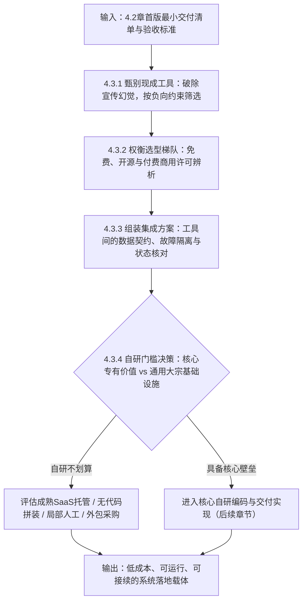
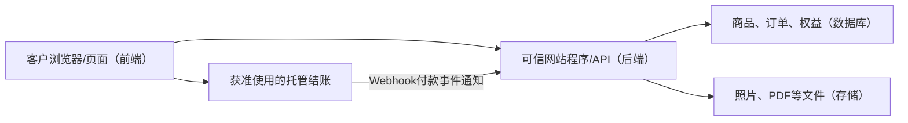
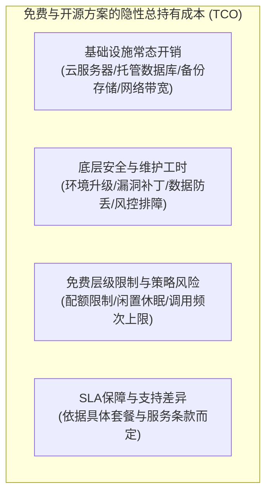
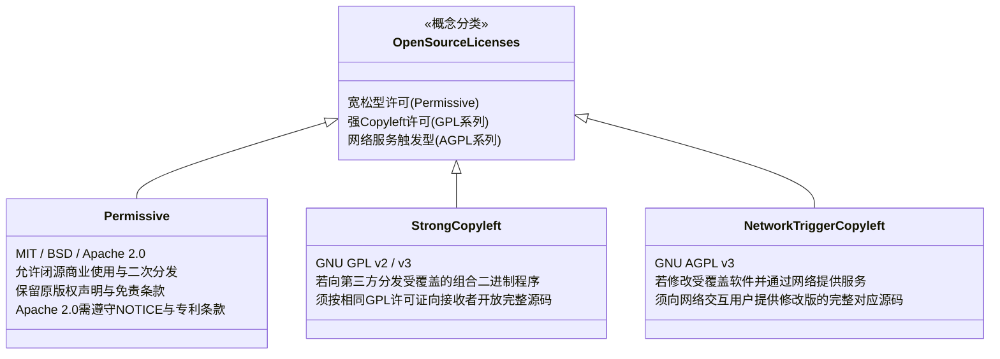
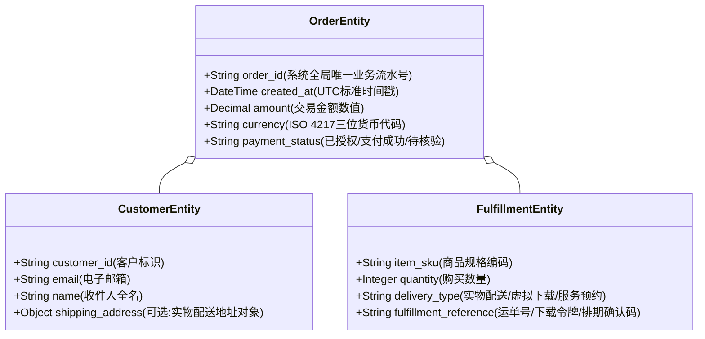
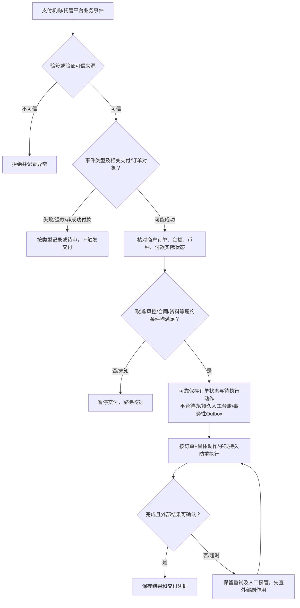
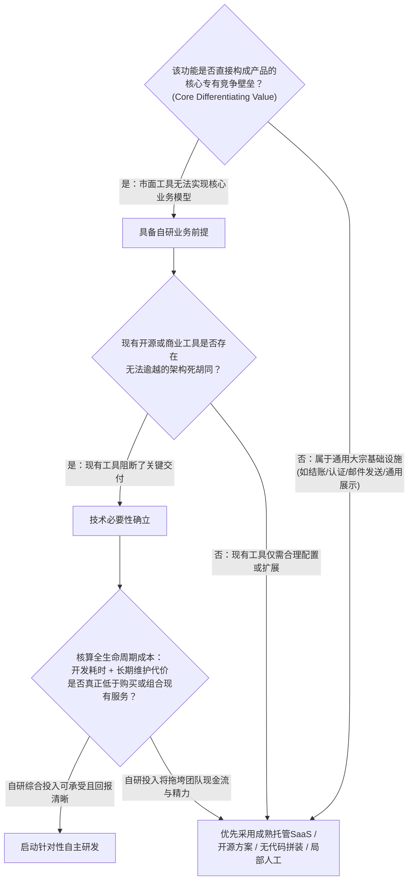

# 4.3 怎么用最省事的方式把产品搭出来？

## 本章导读：软件工程的精髓是“避免不必要的开发”

在跨境商业出海过程中，许多团队在确定了业务需求后，往往会走入两个极端误区：
- **“技术重造轮子迷信”**：以为凡是商业系统就必须从零手写代码、自建数据库和开发全套后台。耗时数月、耗资不菲后，真正的海外客户甚至还没见过产品雏形，项目资源便已耗尽；
- **“拿来主义拼装灾难”**：以为随便在网上下载一套免费开源模板或未经验证的代码就能直接开门接客。上线后遭遇恶性后门勒索、开源协议商用纠纷、第三方接口版本冲突瘫痪，甚至在供应商离场后连基础配置都无法维护。

成熟的商业决策者明白：**最省事的搭建方式，绝不是盲目追求零成本或盲目全自研，而是在深入理解自身交付边界的前提下，以可承受的技术负债与维护成本，把经过检验的成熟方案可靠地组装成运转通畅的履约系统。**



---

#### 第一次接触网站技术，先看这一张关系图（R01）



**前端**是客户看到并填写的部分；**后端**负责可信地检查订单与权限。**API**是程序交换信息的接口，**REST API**是常见接口形式；通过API主动查询称为**请求/响应**，外部服务主动通知发生了什么称为**Webhook**，通知可能重复或迟到。**数据库**保存记录，**对象存储**常存照片/成品文件。**CMS**管理网站内容，**插件**扩展功能，**主题**主要管理外观，**SaaS**由供应商托管软件，**自托管**则要自己负责相应运行维护。**测试环境**用于隔离验证，**日志**帮助排障，但不能独自证明已真实交付。

**哪些需要自己做？** 能由平台安全承接订单与交付时不必自建后端、数据库或Webhook接收器；只有平台、适用插件、受控人工方式都不能满足关键需求时，再评估局部自研。参考[MDN客户端/服务器基础](https://developer.mozilla.org/en-US/docs/Learn_web_development/Extensions/Server-side/First_steps/Client-Server_overview)。

---

## 4.3.1 哪里能找到可直接复用的工具和模板？

寻找现成方案的第一步不是盲目在搜索引擎输入宽泛的关键词，而是建立一套**以自身业务硬约束为准绳的筛选雷达**。

#### 按实际生意选择首批候选（R02）

| 业务 | 优先核查 | 何时放弃 |
|---|---|---|
| 标准实物 | 允许该商品的市场或Shopify等托管店 | 主体/国家不准入、规则不允许或履约成本不可承受 |
| 定制实物/数字纪念品 | 托管独立站的受支持扩展，或WordPress + WooCommerce | 必需的上传、订单关联、素材安全和交付无法验证 |
| 一次性数字资源 | 专门数字平台或可下载商品插件 | 文件/授权/售后规则、费用或准入不符合业务 |
| 软件/持续会员 | 会员托管工具或可扩展Web应用 | 核心在线功能及复杂权限确实无法托管时局部自研 |
| 专业咨询 | 合规展示页、预约工具、人工报价 | 不应因为“跨境”就强加购物车或自建后台 |

先核验**商品政策、卖家主体和目标地区、收款方式**，再核对交付功能、收费方式、数据导出和维护责任；候选是研究入口，并不保证任何个人主体已获准使用。

### 4.3.1.1 怎么按必要功能找候选而不是只看宣传？

市面上的建站模板、SaaS 启动脚手架（Boilerplates）与现成管理后台，其宣传页充斥着“功能强大”、“全平台支持”、“开箱即用”等诱人文案。如果不加甄别，买家极易被精美的排版误导，选用根本无法承载自身业务的方案。

#### 1. 建立“负向约束”排查清单
不要被宣传页罗列的通用功能分散注意力，而要首先用你的**刚性业务底线（Dealbreakers）**对候选方案进行前置过滤：

| 关键审查维度 | 必须核验的刚性业务约束 | 典型风险与排查方式 |
| :--- | :--- | :--- |
| **交易与收款兼容性** | 方案是否原生支持你的结算通道？若需对接特定国际收银台（如 Stripe Checkout），是否支持开箱即用的 Webhook 回调接收与订单状态更新？ | 很多海外主题仅支持纯展示或仅集成单一特定网关，强行修改底层支付结算逻辑的开发成本往往高于重新搭建。 |
| **交付形态契合度** | 如果卖数字资源，系统是否支持生成带时效的临时安全下载通道？如果做定制业务，前台是否允许买家在下单时提交特定格式的设计参数或附件？ | 许多纯电商模板仅支持标准尺码/颜色选项，无法扩展复杂的结构化表单；后期追加动态字段可能导致与原生结账逻辑冲突。 |
| **数据导出与接口扩展性** | 系统是否提供标准的 REST API、Webhook 或成熟的自动化连接器？是否支持将订单、客户数据导出为通用 CSV/JSON 格式？ | 警惕封闭式系统：虽然初期搭建迅速，但若不提供标准数据导出且无法通过外部接口通信，业务扩展时将面临较高的迁移壁垒。 |
| **运行基础设施门槛** | 该开源方案或模板基于什么技术栈？需要什么规格的服务器？需要多少外部收费依赖组件？ | 某些开源系统架构复杂，依赖多套中间件与大型数据库，后续云服务器月度开销可能超出初创阶段预算。 |

---

### 4.3.1.2 演示能用，怎样核实购买后真能部署和交付？

软件选型中存在常见的**“演示幻觉（The Demo Illusion）”**：演示站点（Demo）通常运行在作者调优的专属服务器上，预填充了格式规整的素材与测试假数据，并且屏蔽了跨国高延迟、并发冲突与退款异常分支。

#### 跨越“从演示到部署”的五重验证法
在正式采用开源仓库或付费购买商业代码前，建议通过以下步骤进行核验：


1. **文档完整性审查**：优质的现成方案通常配备详尽的工程文档。检查是否包含清晰的环境变量配置说明（如规范的 `.env.example` 模板）、安装与初始化指南、以及常见错误的故障排查说明。如果文档语焉不详，意味着后续需要耗费大量时间阅读源码摸索。
2. **代码维护状态与社区反馈**：
   - 针对开源仓库：核验其提交历史与发布节奏，查看 Open Issues 列表，重点关注作者对阻断性缺陷（如支付回调异常、关键依赖废弃报错）的响应情况与版本维护周期；
   - 针对商业市场（如 Envato / ThemeForest 等）：检查作品的兼容说明、近期更新日志以及买家讨论区，评估作者是否积极跟进底层运行环境（如 PHP 或 Node.js LTS 版本）的兼容升级。
3. **隐性依赖排查**：核查演示效果是否依赖额外的第三方商业服务或按量付费插件。需将运行该方案所需的完整软件栈与外部服务费用纳入整体预算评估。
4. **测试环境部署验证**：对于提供试用或开源的系统，在独立的测试沙盒或云主机中执行完整的依赖安装与服务拉起，观察依赖安装过程中是否存在严重安全警告或弃用错误。
5. **真实交付闭环沙盒测试**：切勿只看前端展示页面。必须在测试环境中完整模拟一笔“选购 $\to$ 模拟支付 $\to$ 订单生成 $\to$ 触发交付动作”的全流程。检验系统在真实触发时，邮件是否能成功投递、虚拟凭据是否能正确核发、实物发货标记是否能准确留存。

---

#### 两条可复现的入门路线（R03/R08）

**路线A：Shopify等托管店铺。** 按[官方新店清单](https://help.shopify.com/en/manual/intro-to-shopify/initial-setup/new-to-shopify-checklists/general-checklist)检查所在地、业务和服务商准入→创建未公开测试商品→在所选支付服务商实际支持时启用测试方式→使用测试买家下单→核对后台订单、金额、可信支付状态和交付入口→测未付不可领取。若产品需要上传照片但平台不能安全实现，可先规划受控人工补件，不能假定平台已集成所需插件。

**路线B：WordPress + WooCommerce。** 在隔离网站按[WooCommerce安装设置向导](https://woocommerce.com/document/woocommerce-setup-wizard/)完成基本设置→建立虚拟/可下载测试商品→在`WooCommerce > Settings > Payments`确认测试网关能力→以非管理员测试账户按网关沙盒说明提交订单→在`WooCommerce > Orders`核对支付与订单→以买家身份实测PDF能打开、他人不能领取，并清理测试单。参考[官方测试订单指南](https://woocommerce.com/document/managing-orders/testing-orders/)。

**判定分层**：本地预览只证明页面可看，隔离测试只证明模拟链路；部署可访问、测试网关付款成功、生产真实付款及实际客户取得成果是不同证据。官方提示WooCommerce测试订单可能触发邮件或外部插件副作用，**优先在Staging而非生产站测试**。没有合法网关资格或可信状态时停止放行，不得用线下付款选项产生的订单冒充卡支付测试成功；所有未执行节点保持`NOT_RUN`。

---

## 4.3.2 免费、开源和付费工具该怎么比？

在选择技术组件时，经营者必须建立清晰的经济与法律认知：**免费不等于总成本为零；付费不等于确定的SLA、合规保证或无条件客服支持。** 应按实际合同、套餐、用量和维护能力比较。

### 4.3.2.1 免费工具有哪些使用和维护成本？

免费工具与自托管开源系统绝非真正的零成本，其主要成本通常以维护工时与基础设施开销的形式出现：



- **基础设施底座成本**：使用开源/自托管系统时，应按实际技术方案配置计算、存储、备份与数据安全控制，**并不必然需要单独购买云主机加托管数据库**；本地、单机数据库、外部托管、无数据库等方案均可能可行。与商业SaaS比较时应计入真实依赖及维护人工。
- **安全补丁与漏洞修复的维护投入**：开源代码往往受到广泛的安全审计，但也容易成为自动化漏洞扫描脚本的目标。自建团队必须自主关注安全更新公告、配置防火墙并防范恶意刷单。一旦系统出现安全隐患，排查与修复均需投入专职人力。
- **云服务免费层级的约束边界**：许多云基础设施平台提供免费开发层级，但通常设有明确的资源限制。例如根据 [Supabase 官方免费层项目暂停说明](https://github.com/supabase/supabase/blob/master/apps/docs/content/guides/platform/free-project-pausing.mdx)，若项目在一段时间内缺乏足够的计算或数据库活动，系统可能会自动将免费项目暂停休眠，恢复需重新激活或升级付费。经营者在将免费层级用于正式商业承接时，必须清楚这些运行规则。
- **服务保障（SLA）与技术支持权衡**：具体服务是否具有SLA、专属支持或故障补救，取决于**供应商、套餐与实际有效合同**；有些付费服务只提供有限支持/服务抵扣，免费服务也可能有支持机制。自托管的日常维护通常由经营者或其委托方负责，**付费不能替代商户准入、隐私和安全义务**。

---

### 4.3.2.2 许可证和第三方素材能否合法用于商业交付？

跨国商业交付高度注重知识产权合规。在集成现成代码、调用外部 API 或使用设计素材时，必须对**法律授权边界**建立清晰的审查认知：

#### 软件代码许可证与素材商用许可辨析



1. **开源代码许可证（Open Source Licenses）辨析**：
   - **宽松型许可证（Permissive Licenses，如 MIT、BSD、Apache 2.0）**：商业化极为友好。允许你自由复用代码、进行私有化闭源修改并作为商业产品交付。其中，MIT 与 BSD 要求在源码或衍生品中保留原作者版权声明与免责条款；而 [Apache License 2.0 第4条](https://www.apache.org/licenses/LICENSE-2.0) 明确规定，分发时还需附带许可证副本、保留修改文件说明，若原作品包含 `NOTICE` 文件亦须一并保留，同时包含明确的专利授权与保护条款。
   - **强 Copyleft 许可证（如 GNU GPL v2/v3）**：核心原则是保障软件自由的延续。[GNU GPL 官方常见问题解答](https://www.gnu.org/licenses/gpl-faq.en.html) 明确指出：若团队仅在自身内部服务器运行修改版 GPL 软件而不向外部第三方分发二进制安装包，并不触发源码公开义务；但如果将 GPL 代码与自身专有代码深度结合构成衍生作品，并向海外客户**分发传播（Convey/Distribute）**编译好的可执行程序（如桌面客户端或独立移动 App 安装包），则必须按照 GPL 协议向获得该程序的受众开放该组合作品的完整源代码。
   - **网络服务触发型许可证（GNU AGPL v3）**：针对通过网络提供软件服务（SaaS）的场景，[GNU AGPL v3 第13条](https://www.gnu.org/licenses/agpl-3.0.en.html) 规定：若服务商修改了受 AGPL 保护的程序，并通过计算机网络向远程用户提供交互式服务，服务商必须通过网络向所有使用该服务的用户开放**该受覆盖修改版本的完整对应源代码（Corresponding Source）**。商业团队在开发闭源 SaaS 时，若计划直接修改并运行 AGPL 后端模块，应当在技术选型阶段深入评估其合规约束与源码开放边界。
2. **非代码数字资产（字体、图标与多媒体）商用权**：
   - *字体使用场景区分*：系统默认安装的很多商业字体，其授权范围通常仅涵盖本地操作系统显示或特定离线排版。若在商业网页中通过 CSS `@font-face` 直接向全球买家分发字体源文件，或将字体直接嵌入商业应用二进制包中分发，需要核实是否具备对应的 Web 字体或分发嵌入授权。出海项目可优先选用明确允许商用且开放嵌入的开源字体（如采用 [SIL Open Font License 1.1](https://software.sil.org/ofl/) 发布的开源字体族）。
   - *商用图库授权范围*：免费图库网站通常允许一般的商业网页宣传配图，但通常严厉禁止将原始素材打包作为核心商品直接转售。商业使用时必须核查具体素材的最终用户许可协议（EULA）。

---

### 4.3.2.3 用量增长后费用、导出能力会怎样变？

在业务启动时看似低成本的工具，随着交易量与客户规模的上升，其计费模式与数据控制权可能发生显著变化。经营者必须预判**规模化之后的边际成本曲线与系统退出通道**。

#### 1. 评估“阶梯式收费（Step-function Pricing）”模型
许多现代无代码或低代码 SaaS 平台采用分层用量阶梯设计：
- 例如：某一自动化流转工具可能规定基础套餐每月包含一定量的免费任务配额；一旦单月任务用量突破该阈值，可能需要升级至高阶套餐或按超额用量付费。
- **教学假设模型 [MODEL_ASSUMPTION]**：  
  假设某自动化集成工具基础版月费为 \$15 美元（包含 1,000 次操作配额），当业务放量达到单月 1,001 次操作时，系统可能要求升级至 \$100 美元以上的团队版套餐，造成单月工具支出发生阶梯式跳跃。经营者在选型时，需查验候选工具在用量激增时是平滑按量计费还是强制阶梯升级。

#### 2. 核验“数据可导出性与退出机制（Exit Strategy）”
在接入任何第三方管理系统前，必须确认当未来业务演进或平台政策调整时，你是否能够完整迁移核心商业资产：
- **核心业务数据能否自主备份**：系统是否支持定期将历史客户名单、订单交易记录无损导出为通用标准格式（如 CSV 表格或 JSON 数据包）？
- **多媒体与用户文件存储位置**：买家上传的定制设计文件或系统的数字资源，是直接存储在商户自主拥有访问权限的对象存储桶中，还是被锁定在第三方专有的私有存储内部？如果第三方工具不提供批量导出接口，未来更换系统时将面临极高的数据迁移成本。

---

## 4.3.3 几种现成工具能不能拼起来用？

> [!TIP]
> **读者路径分流指引**：  
> - **SaaS 平台经营者（如 Shopify / Shopline 卖家）**：本节讨论的工具数据契约与接口通信，部分能力可由平台原生功能或适用的官方生态应用封装；仍须核对实际订单、通知、权限与集成责任，可以先阅读原理再按需要深入；  
> - **轻量拼装团队与开发者**：本节核心关注多个独立工具（表单、支付、通知、表格）连接时的“数据契约与单点故障隔离”，请重点阅读数据最小化与事件处理机制。

对于中小出海团队而言，将数个专注于特定垂直领域的专业工具通过接口连接起来，构筑**组合式系统（Composable Architecture / 胶水架构）**，往往比从零自研一套复杂的单体系统更为敏捷。然而，工具拼装的稳定性完全取决于其**数据传递契约与单点故障隔离能力**。

#### 一张表理解API与Webhook（R04）

以`DEMO-PDF-001`为例：后台可通过**API主动查询**外部可信支付对象的状态；外部系统也可能通过**Webhook异步通知**发生的支付事件。无论哪条路径，都要核实付款对象与商户订单、金额、币种、状态匹配，再检查是否允许履约；**收到事件不代表成功付款**。

| 发生的事情 | 最小正确处理 |
|---|---|
| 未付款或状态未知 | 保持待确认，不发下载权益 |
| 收到真实成功事件 | 记录核验结果与待办，再执行符合条件的交付 |
| 通知重复/乱序 | 使用订单及具体业务动作的持久记录去重，不重复发权益 |
| 发货/发文件接口超时 | 不知对方是否已执行，先查询外部实际结果，再决定补救 |

托管平台通常可利用原生订单流程，无须自己编写Webhook接收器。自建程序应继续阅读本章后文和[Stripe Webhooks文档](https://docs.stripe.com/webhooks)的重试、验签和幂等边界。

### 4.3.3.1 工具之间到底需要传递哪些业务数据？

跨系统协同失败的常见原因之一，是不同工具对业务对象的定义各不相同，导致关键字段在流转中发生丢失或错配。

#### 核心业务对象与数据契约规范
在串联多个工具（如“前端表单 $\to$ 支付网关 $\to$ 协作后台 $\to$ 邮件通知”）时，建议统一基础实体数据结构：



- **数据传递准则**：
  1. **金额与币种字段必须对齐**：注意区分整数金额（部分支付网关以“分/Cents”为传递单位，如 1000 代表 \$10.00）与浮点金额，并在跨系统传输时始终附带标准三位币种代码（如 `USD`、`EUR`），防止单位误读导致的财务偏差。
  2. **地址对象按需结构化拆分**：对于实物商品，收件地址应拆分为街道、城市、省/州、邮编及国家代码；而对于纯数字文件或无物理发件的线上服务，收件地址并非必传字段，避免强加不必要的参数约束。
  3. **数据最小化与敏感信息隔离**：传递给下游通知或协作工具的数据，仅限完成该操作所需的最小集。严禁将买家完整的敏感支付数据（如银行卡卡号明文）作为普通业务参数在第三方流转工具中明文透传。

---

### 4.3.3.2 其中一环出错，怎样不影响整笔订单？

拼装架构中链路环节越多，外部网络异常的暴露面就越大。如果下游的邮件通知服务突发超时，系统绝不能直接判定整笔订单交易失败。

#### 可靠事件接入与故障隔离的最小闭环



1. **先核实事实，后决定是否交付**：验签只是排除伪造，不代表事件是“支付成功”。自行接入Stripe等Webhook须检查`event.type`、商户/订单关联、金额、币种、可信支付状态，结合风控、取消、退款、合同、待补资料等条件决定能否交付。失败事件、附加支付方式等通知不能直接触发发货；客户不回跳或下游邮件失败，也不应抹除正确的支付事实。
2. **三层防重各有作用**：用`event.id`识别相同通知的重复投递；不同事件ID可能描述同一付款对象；实际发卡、物流、权益操作要用“订单+动作/子项”做**持久且可核对的业务幂等**，保存外部执行凭据。Webhook去重并不防止用户二次发起付款，**不能作为防重复扣款的保证**。
3. **保存记录与任务必须能共同恢复**：如果订单标已付后、交付待办入队前进程崩溃，不能因回调事件已登记便永久跳过动作。可采用同一事务保存订单和事务性Outbox、成熟托管系统自带的持久任务机制，或低量业务的**可审计人工台账+定期对账**，保证失败后可重建待办；不是所有商家都需要自建消息队列。接收端可靠记录必须动作意图后可快速返回`2xx`，耗时动作异步或人工处理，重试先查外部副作用。
4. **至少覆盖的反例**：签名正确但事件为支付失败；不同`event.id`重复指向同一交付；订单落库与待办登记之间崩溃；第三方发件超时而外部实际已成功。每种情况都要能恢复、核对且不重发同一权益。参考[Stripe Webhooks官方文档](https://docs.stripe.com/webhooks)；Outbox只是工程可选模式，不是该服务商强制技术栈。

**托管平台路径**：使用平台原生订单及交付服务时，商家无需自行实现Webhook接收器，但仍应核对平台状态、失败重试、防重与必要人工交接。
---

### 4.3.3.3 两个工具状态不同，哪个记录是依据？

当几个工具显示不同的状态时，首先明确**在核对哪一种事实**。单一真实源（SSoT）是工程上的字段责任与对账安排，不是跨支付、物流、授权的法定绝对证据。各系统在不同环节都可能暂时延迟或出现错误。

#### 分别核对事实、履约资格与交付证据

| 事实类别 | 主要事实依据 | 不能混淆的结论 | 发生冲突时 |
| :--- | :--- | :--- | :--- |
| **付款与订单交易** | 支付机构或平台官方交易对象、支付状态、商户订单号、金额币种及退款/争议信息 | 支付`succeeded`不等于银行到账，**也不意味着订单必然可以立即履约**；取消、争议、风控冻结、资料未齐仍可能阻止交付 | 独立确认付款事实，再按订单合同、风险及交付条件决定可履约/待审/待补资料，不凭网页跳转或同步表格直接发货 |
| **余额与银行入账** | 实际支付服务商资金余额、结算/提现和银行对账记录 | 支付成功不等于可用余额或银行到账 | 资金流程属于第三板块；本章仅提醒技术系统保留独立状态 |
| **物流与签收** | 承运商实际揽收、运输、投递节点及签收凭据（如有） | 创建运单不等于揽收；扫描节点也不自动证明最终签收或消除争议 | 按具体节点排查，保存物流/签收与异议资料，履约和售后细节归4.6/4.7 |
| **数字权益与会员资格** | 托管平台权限状态或实际负责授权的商户受控系统，结合订单期限/合同 | 已付款、前端缓存、邮件凭据都不自动证明当前仍有权益；不要求全部商家自建权限数据库 | 按产品规则核对期限、取消/退款、人工冻结及授权事实并留痕 |

经营者应明确每个关键字段的负责系统、更新时间、外部ID和异常复核责任；没有一个系统的单一状态能够代替所有合同与履约条件。
---

## 4.3.4 什么情况下值得自己开发？

> **本节说明**：本节为正式直接成节（独立二级模块，不设第三级问题）。深入探讨个人开发者与中小跨境团队关于“自研还是复用”的根本战略抉择。

在软件工程与跨境创业中，最常见的误判之一就是低估自研的长期维护成本。具备编程能力的开发者往往容易陷入“这个功能我写几天代码就能跑起来，何必每月花几十美元买现成工具”的技术执念。然而，**初版功能的编码实现往往只占系统全生命周期投入的一部分，后续的系统维护、安全依赖修补、边缘异常处理与基础运行环境保障将持续消耗团队精力。**

#### 自研价值与维护成本权衡评估模型



#### 真正值得启动自研的典型场景
1. **该模块本身即产品的核心价值标的（Core Intellectual Property）**：
   如果你的业务是一个基于独特算法的图像特定风格转换工具、或者一套独创的跨境物流路线智能优选计算器，此类差异化计算逻辑可能值得自研，但仍须比较开源实现、合法商用授权、API与外包服务；若外部方案能以合适成本、质量及控制权达到交付目标，就不必自己开发。然而，其配套的买家登录注册、结账收银台、发票邮件通知等通用边缘管道，依然应当优先复用成熟的现有组件。
2. **现成方案存在绝对的架构断层与功能封锁**：
   经过详尽的技术调查后，市面上已知的成熟平台或开源系统，因底层数据模型或接口权限设计的局限，无法承载你的特异性业务流程（例如：业务需要通过特定底层协议与特定硬件外设进行毫秒级双向数据交互，而通用电商系统无法提供该接口支持）。
3. **规模化极值点产生的严重成本倒挂**：
   当业务已经脱离初创期、达到极高交易规模时，继续使用按交易量抽成或高频调用的第三方托管方案，其累积缴纳的服务费总额已显著超过维护自主专属系统的全口径工程成本。
4. **自主数据主权与架构独立性考量**：
   对于合法合规经营但对数据主权有极高安全诉求的企业级业务，若第三方商业 SaaS 存在单方面变更服务条款或技术架构锁定的风险，采用可迁移的开源方案或自主构建，可能提高数据和架构可控程度，**不自动保证业务连续性或安全**，仍须考量维护、备份、平台条款及法域要求。*(注：自研系统并不代表可以规避法律法规或支付网络的合规审查，任何经营活动均须符合所在法域的法定监管要求)*。

> **资源投入演示 [MODEL_ASSUMPTION]**：假设某项目投入10%–20%的精力在独有业务逻辑，其余80%–90%在集成和运营，这只是用于说明“先评估复用”的**人为例子，并非行业真实分布、统计或固定配比**。某些产品不需任何自研，某些因安全、合规、硬件或质量缺口需要较多自主代码；应按替代可用性、许可证、全生命周期成本、数据控制、技术团队维护能力决定。

---

## 4.3.5 购买源码或委托外包，怎么验收？

当团队缺乏特定技术能力、或为了争取时间窗口而选择“购买现成商业源码授权”或“委托外部技术团队定制开发”时，**验收环节不仅是检验功能是否能跑通，更是对代码合法授权、数据控制权、系统安全与后续接续运营能力的全面审查。**

### 4.3.5.1 需求、里程碑和验收结果怎么写清楚？

外包合作最普遍的纠纷根源在于“需求描述口头化、验收标准主观化”。委托方以为对方清楚自己的设想，受托方按最省事的路径制作，最终交付时容易陷入分歧。

#### 1. 将需求转化为可检验的“工作任务说明书（SOW）”
合同附件中应避免出现“仿照某某网站制作”、“界面现代美观”等不可量化的词汇。必须依据第 4.2.1 节确立的方法，以**明确的工作任务说明书（Statement of Work, SOW）**作为法律附件，明确界定交付的页面数量、具体入参出参规格、支持的浏览器基准版本及显式不包含的边缘需求。

#### 2. 设立“阶段性成果与资金挂钩”的里程碑机制
建议将工程款项划分为清晰的递进里程碑，并设置与阶段验收结果严格挂钩的付款节点：


> **合同阶段约定示例 [MODEL_ASSUMPTION]**：  
> 在中小型定制开发合同中，常见的资金分配阶梯为：里程碑 1（需求与原型确认）支付约 20%，里程碑 2（核心交易主链路跑通）支付约 30%，里程碑 3（全功能测试通过并移交代码）支付约 30%，预留约 20% 作为质保金，在系统于生产环境稳定运行一定周期（如合同约定 30 天质保期）并修补完上线初期缺陷后结清。各方可根据项目风险与信任基础协商具体比例。

---

### 4.3.5.2 如何检查源码、依赖、账户和数据控制权？

签署最终验收确认单并结清款项前，必须实施**资产控制权与底层安全性审查**：

#### 外部交付技术控制权审查要点

```
【源码与控制权验收审查要点】

1. 源码交付形式与知识产权授权范围区分
   - 购买现成商业模板/源码授权：必须取得正规的最终用户许可协议（EULA）或商业授权凭证。明确核验其授权类型（如单一域名使用许可 vs 允许用于商业运营的扩展许可），理解商业模板代码版权通常归原作者所有，买方获得的是合法使用授权而非排他性著作权。
   - 委托定制开发原创成果：合同应明确约定受托方为本项目专门定制编写的原创业务代码与设计成果归委托方所有；对于其中引用的第三方开源组件，受托方必须提供开源依赖清单并确保许可证符合商业交付要求。

2. 依赖项健康度与已知安全漏洞审查
   - 检查方式：在受控测试环境中运行官方依赖审计命令（如前端项目执行 npm audit，Python 项目执行 pip-audit 等工具）。
   - 审查要点：排查交付物中是否存在已被公开发布的高危已知安全漏洞（CVE），要求受托方升级存在明显漏洞的依赖包至安全版本。

3. 混淆代码与异常网络请求排查
   - 检查方式：对源码进行全局代码检索与静态扫描。
   - 审查要点：排查源码中是否存在未经说明的密集加密混淆段落，核实是否包含未披露的硬编码超级管理员后门、或向未知第三方服务器发送敏感数据的外部脚本。

4. 云资源与第三方服务账户控制权
   - 检查方式：生产资源和商户服务须由**实际符合对应平台资格及法律要求的个人或经营主体**控制或依合法合同管理；账户资格、是否允许转让及权限移交随服务商而异，不能统一要求企业账号，也不应把不可转让账号转给他人。
   - 审查要点：受托方在开发期间仅应持有最小必要的操作员访问权限；验收移交时，经营者必须重置主账号凭证，强制开启双重身份验证（2FA），并注销受托方团队的所有临时开发访问密钥。
   - 安全提示：严禁在任何交接文档或配置文件中明文记录银行卡卡号、CVV 安全码等敏感支付认证数据。
```

---

### 4.3.5.3 对方不再服务时，我能否继续运营？

外部开发合作中最具破坏性的结局之一，是系统上线不久后，外部开发者因故失联；一旦系统发生报错或需要调整参数，委托方因缺乏文档与部署能力，业务陷入停滞。

#### 建立“可接续运营”的自检标准
在最终结项前，建议在技术层面进行**独立部署可复现性核验**：

1. **环境自生复现核验**：
   - 假定原开发团队不再提供实时协助，由另一名具备同技术栈背景的工程师，仅凭受托方交付的工程文档（如包含运行环境要求、构建命令、数据库初始化指南的说明文档），对合同约定可交付并自部署的源码，在干净的测试环境执行部署；**纯SaaS、无代码或仅购买使用权**则改为核验受控租户/账号权限、配置、导出与数据恢复，不能要求供应商交出内部源码。
   - 检验是否能依据文档成功拉起系统并走通基础交易流程，以此检验交接文档的完整度。
2. **完备交接资产包核对**：
   - **系统环境变量模板（`.env.example`）**：交付物必须提供规范的环境变量模板文件，详细说明系统中引用的每一个配置项的作用与格式，且**严禁在模板中保留真实的生产数据库密码或支付私钥**。
   - **第三方服务清单与运营成本账单**：受托方应列出系统所依赖的所有外部第三方云服务（如数据库托管、邮件推送通道、地图接口等）的官方服务商名称、管理后台地址与计费周期，便于经营者清晰掌握后续的经常性维护支出。
   - **数据备份与还原操作说明**：受托方应提供明确的书面说明，指导经营者如何定期导出核心数据库冷备份，以及当遭遇服务器异常时如何执行基本的数据还原操作。

---

#### 外部依赖与供应商的简明复核卡（R08/R11）

这一核验卡只串联已有的许可证、`npm audit`、`pip-audit`和外包验收方法，**不强制所有平台卖家建设企业级供应链审计系统**。

| 问题 | 使用成熟平台时 | 自建或委托开发时 |
|---|---|---|
| 使用权 | 查验商业许可、产品范围、地区限制 | 留存软件及素材许可证，明确源码移交权 |
| 安全与维护 | 查看安全公告、状态页面、升级与客服支持 | 明确依赖更新责任、漏洞修补、版本回退 |
| 用量成本 | 查看套餐、调用上限及超额规则 | 增加配额与异常消耗告警 |
| 数据退出 | 演练合法可导出的订单与交付数据 | 确认可恢复的备份、运行文档及切换责任 |
| 终止合作 | 确认停服预告及既有客户服务衔接 | 确认接管人、密钥更替及交付代码完整性 |

对高风险自研项目可选读 [NIST SSDF](https://csrc.nist.gov/pubs/sp/800/218/final)；轻量平台卖家只需查清供应商已有能力与经营者自己的责任。

#### 客户上传材料经过哪些服务：五节点数据流向卡（R07）

按**接收→受托加工→存储→交付→删除或依法留存**记录供应商、使用目的、可能接收的数据类型、实际访问权限和资料退出办法。涉及外部AI、云存储或邮件服务时，核验服务条款、适用的数据处理协议、再处理者和保留规则；涉及国际传输应先判定适用法及实际处理关系，而不是把跨国服务一律视为同一种审批。用户通知、事故响应和停业删除要有负责人及记录。参考：[EDPB控制者/处理者指南](https://www.edpb.europa.eu/sme/learn-the-basics/data-controller-or-data-processor_en)。

---

## 本章自检与技术选型决策清单

在决定采用何种方式把产品落地构建出来之前，经营者可对照下表进行综合选型自检：

| 实施路径选择 | 适用业务场景与团队特征 | 核心收益与优势 | 主要风险与必须把控的验收底线 |
| :--- | :--- | :--- | :--- |
| **成熟托管 SaaS / 平台模式**<br>*(如 Shopify / 专门创作者平台)* | 缺乏专职研发人员；业务模式高度符合行业成熟标准；追求极速启动验证。 | 减少部分底层运维负担；**实际结账/收款取决于地区、主体资格、支持商品、服务商及方案**，不能直接假设已合规可用；移动端需实际测试。 | 需承担持续的平台使用费或交易分成；深度定制能力受限；选型前须核实数据与资产的导出能力。 |
| **成熟开源方案自托管**<br>*(如开源电商系统 / 独立建站)* | 具备一定技术底子或基础运维技能；需要高度掌控数据与定制品牌体验。 | 在许可和实际部署控制范围内可自主修改代码；**不等于零平台或交易费用**，插件、托管服务、支付网关及商业服务仍可能收费。 | 须自主承担服务器补丁、抗攻击与数据备份责任；须严格核验开源代码与所用素材的商业许可证。 |
| **组合式拼装架构 (Composable)**<br>*(垂直工具 + Webhook / 自动化连接)* | 业务流程灵活多变；希望复用细分领域成熟服务，追求敏捷上线。 | 开发周期短；单点工具可灵活替换；大幅规避全套自研的庞大初始投入。 | 自行处理Webhook时需核对事件类型、签名、金额币种、付款对象与履约资格，保留可恢复待办和业务动作防重；使用托管平台时按其具体能力核对状态。 |
| **委托外包定制开发**<br>*(委托外部开发团队交付定制系统)* | 商业模式特异性强；现有工具无法满足核心交付；团队具备明确的项目预算。 | 能按照自身业务规则量身定制；免除自身团队长期组建与磨合的初期投入。 | 须签署明确的工作任务说明书（SOW）并绑定里程碑付款；验收时严格核验代码授权归属与部署文档完整性。 |
| **核心业务专有代码自研**<br>*(技术型团队主导的自主开发)* | 核心软件算法/功能本身即主要盈利点与护城河；或业务规模极大产生严重成本倒挂。 | 构筑专有知识产权与技术壁垒；具备极高的定制灵活性与极限性能调优空间。 | 根据现有方案、许可、总成本和维护能力判断各模块是否自研，不把“核心必自研、通用必复用”设为无条件铁律。 |

---

> **全书导引提示**：  
> 当你通过本章理清了技术实施路径、选定了现成工具或确定了自研/外包方案后，接下来需进入 **4.4《怎么让客户顺利购买和使用？》**，我们将深入探讨如何在海外买家前端设计清晰无误的商品详情、多规格联动展示、低摩擦结账表单及定制文件上传校验，确保流量能够顺畅转化为有效交付的订单。

---

> **正式状态与封板溯源（2026-10-18 / G7语言润色：2026-10-19）**：  
> - **正式状态**：`CHAPTER3_FINAL_SEALED / G7_EDITORIAL_OPTIMIZED`  
> - **修订来源**：本章以独立Writer R2完整正文为基线，由Reviewer定向修订，并由G7独立Reviewer完成语言连贯性与技术分流提示优化；未收到Writer R3交付。  
> - **核心命题**：**产品怎么做、怎么交付？**  
> - **本章定位**：聚焦于技术实施路线的高效落地——如何检索并甄别现成模板、科学评估开源与付费方案、可靠拼装多元工具、决断自研门槛，以及把控源码采购与外包验收。  
> - **服务受众**：中国大陆个人开发者、跨境独立站/平台卖家、中小跨境企业（涵盖零代码、轻量研发到技术型创客团队）。  
> 详见[封板审计记录](https://github.com/entropy-student/project/blob/b1335eab85c91d111541117a5e723a3894ee907a/cross-border-business/04-product-building/docs/CHAPTER3_SEAL_EVIDENCE_20261018.md)。此文稿质量审核不意味着真实支付、Webhook、物流或部署已经实测通过。
