# 4.4 怎么让客户顺利购买和使用？

在跨境出海业务中，把产品功能开发出来或把货品准备就绪，仅仅完成了商业交付的供给端建设。真正决定一笔交易能否顺畅达成的关键，往往在于**海外买家直接面对的购买与使用交互体验**。

中国大陆个人开发者与中小跨境经营者在面向欧美等海外市场时，最容易遭遇的“隐形转化率杀手”，不是产品本身不够好，而是交互设计与海外买家的使用习惯、信息透明度期望及法律合规要求脱节：
- 商品页面描述模糊，买家担心货不对板或遭遇隐形附加收费，在支付前犹豫流失；
- 复杂变体与定制选项缺乏联动校验，买家下错规格或选了不合法的组合，引发大量售后退换与纠纷；
- 结账表单生硬强制要求注册账户，且地址与电话格式死板套用单一国家习惯，导致跨国买家频繁填写报错、愤而弃单；
- 定制文件上传缺乏即时预览与安全校验，买家提交了低分辨率或破损文件，履约团队反复沟通拉扯，延误交期；
- 支付成功后页面没有明确指引，买家不知道是否扣款成功、下一步该做什么；数天后想重新下载数字文件或查看进度时，发现找不到入口；
- 在海外主流的移动端设备、不同语言与货币显示、多时区倒计时以及弱网或屏幕阅读器环境下，页面发生错位、乱码或卡死。

本章将系统拆解海外客户在购买前、选型中、结账时、定制上传后、交付验收及多端使用全生命周期的产品设计与交互规范，帮助经营者以最小的工程阻力，搭建一套低摩擦、高确定性且安全合规的跨国购买与使用闭环。

---

## 4.4.1 购买前哪些商品信息必须说清楚？

海外买家（尤其是欧美成熟电商与数字产品消费群体）对交易的确定性（Certainty）要求极高。如果商品详情页存在模糊地带，买家要么直接关闭页面离开，要么在购买后因“与预期不符”直接发起拒付或争议（Chargeback）。商家必须在买家点击支付前，建立起完整透明的商品信息认知。

### 4.4.1.1 怎样让客户在付款前看清自己会收到什么、何时收到以及哪些限制？

为了让海外客户在点击最终结账按钮前拥有完全清晰的心理预期，页面必须围绕**交付标的（What）、交付时间（When）与适用限制（Limitations）**三大支柱组织信息架构：

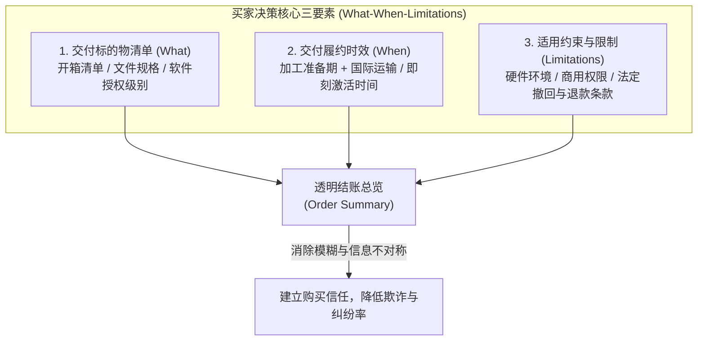

#### 1. 讲清交付标的（What You Get）：清单化与可视化

无论销售何种形态的产品，商品详情页与结账摘要均应提供无可争议的“交付物拆解清单”：
- **实物商品（Physical Goods）**：
  - **明确“包装内含物（What's in the Box）”**：严禁仅展示经过精美渲染的场景图。如果售卖一款智能台灯，必须明确标注是否包含电源适配器（Adapter Included/Excluded）、插头规格（US/EU/UK Plug）、数据线长度及材质。若宣传图中包含非随附的装饰性道具，应显著提示（如 *Accessories shown for illustration only, not included*）。
  - **关键技术物理参数**：长宽高尺寸建议结合目标市场习惯提供英制（Inches）或公制（Centimeters）对照；净重与材质需明确标识；对服装鞋帽品类，建议提供基于实际测量数据的尺码指南（Size Guide），包含胸围、腰围、肩宽的具体推荐区间，而非仅仅标注泛化的 S/M/L。
- **数字资产与设计模板（Digital Files）**：
  - **文件交付物明细**：列出买家下载后将获得的具体文件格式（如 `.PSD`, `.AI`, `.PDF`, `.FIG`）、版本兼容性（如 *Compatible with Figma 2024+* 或 *Adobe Illustrator CC*）、分辨率（如印刷用推荐 *300 DPI, CMYK*）及文件打包总容量（如 *Instant Download: 1 ZIP file, approx. 150 MB*）。
  - **字体与外部素材说明**：若模板中包含第三方商业字体或图库素材，必须明确声明：“*Fonts are not embedded due to licensing; free Google Fonts download links are provided in the documentation.*”。
- **软件与 SaaS 订阅（Software / Subscription）**：
  - **功能权益层级划分（Feature Matrix）**：明确当前购买套餐所包含的具体配额（如可用席位数、每月 API 调用额度、云存储空间容量）；
  - **环境与平台兼容性**：操作系统支持版本（如 *macOS 12+ (Apple Silicon & Intel), Windows 10/11 64-bit*）；是否需要联网激活、是否支持单买断授权或是否需要持续性按月/按年订阅。
- **定制商品与技术服务（Custom Services）**：
  - **交付成果与阶段界定**：如提供跨国定制设计或独立站技术搭建服务，必须列出最终交付成果物（如 *1 set of vector brand logo files + 1 Figma design system file*）；明确规定包含的免费修改轮次（如 *Includes up to 2 rounds of minor revisions*）以及超出范围后的计费规则。

#### 2. 讲清交付时间（When You Get It）：区分处理时效与运输时效

跨国交易中，买家最焦虑的环节往往是“我付款后何时能拿到”。经营者必须区分内部加工准备周期与外部通道时效：

| 业务形态 | 关键时效构成要素 | 推荐前端展示范式与透明度说明 |
| :--- | :--- | :--- |
| **实物跨境发货** | **制作/拣货处理时间 (Processing Time)**<br>+ **国际干线与末端配送时间 (Transit Time)** | 明确区分两者！严禁直接承诺不可控的“5-7 天送达”。<br>推荐范式：*“Processing time: 1–3 business days. Estimated delivery: 7–12 business days via FedEx/DHL. Total estimated delivery window: Oct 28 – Nov 04.”*<br>注明工作日（Business Days）不包含周末及法定节假日。 |
| **即时数字商品** | **系统自动化分发时效 (Instant Fulfillment)** | *“Instant Download: Your secure download link will be available immediately on the confirmation page and sent via email within 5 minutes after payment confirmation.”* |
| **SaaS / 虚拟授权** | **账户激活与密钥派发时效** | *“Instant Access: Your license key and setup instructions will be displayed on-screen and delivered to your billing email immediately.”* |
| **人工定制与代写服务** | **需求确认后排期 + 首稿交付时限** | *“Custom turn-around: First draft delivered within 3 business days after your design brief and assets are submitted and approved.”* |

#### 3. 讲清限制、前置条件与欧盟数字内容法定撤回权豁免（Limitations & Legal Terms）

信息透明不仅关乎体验，更是防范法律纠纷与恶意争议的合规底线：
- **前置使用约束（System & Regional Requirements）**：
  - 硬件/网络门槛：如软件需要独立显卡（GPU）、特定浏览器内核或依赖特定第三方商业 API 密钥（如 *Requires your own OpenAI API key*），必须在结账按钮上方显著提示；
  - 地区/运营商限制：若实物产品电压仅支持 110V，或某些服务在特定法域不可用，需显式声明阻断买家误购。
- **欧盟消费者法定撤回权与数字内容豁免规则（EU Right of Withdrawal）**：
  - 依据欧盟消费者权利指令现行合并文本（[Directive 2011/83/EU 第16条 (m) 款](https://eur-lex.europa.eu/legal-content/EN/TXT/?uri=CELEX%3A02011L0083-20260927) 及第 8(7) / 7(2) 条），面向欧盟消费者的远程销售通常享有 14 天无理由撤回权；
  - **法定豁免适用的三项法定必备前置条件（以非介质承载的纯数字内容为例）**：
    1. **事先明确同意（Prior Express Consent）**：买家必须在履行开始前明确同意立即开始履行合同；
    2. **知晓放弃后果（Acknowledgment of Loss of Right）**：买家必须明确确认，其知晓一旦数字内容开始履行（如开始下载或在线访问），即丧失 14 天法定撤回权；
    3. **持久载体确认（Confirmation on a Durable Medium）**：商家必须在合理时间内（最迟在交付或履行开始前），通过持久载体（如订单确认电子邮件中包含合同内容与买家同意确认文本，或提供不可单方篡改的 PDF 收据）向买家提供合同确认及上述同意与知悉证明。
  - **前端合规交互设计**：
    - 严禁仅在支付按钮下方放置一段不可勾选的静态免责小字！欧盟指导意见明确要求：**买家对丧失撤回权的同意必须具备主动性，并与常规下单支付动作明确区隔**；
    - **标准交互范式**：在面向欧盟买家的结账界面，针对非实体数字内容设置独立的勾选复选框（Checkbox，默认未勾选）：  
      > $\square$ *“I expressly consent to the immediate performance of the contract and acknowledge that I will lose my 14-day statutory right of withdrawal once the digital content download or access begins.”*
  - **重要法理边界**：
    - 针对实体定制商品，适用第 16(c) 款（按消费者要求定制或个性化制作的商品豁免撤回权）；
    - 丧失 14 天法定无理由撤回权，**绝不剥夺买家依据欧盟法定质保指令（Directive (EU) 2019/770）在数字内容存在实质缺陷、损坏或不符合约定时享有的法定救济与维修/退款权利**。

---

## 4.4.2 规格、套餐和定制选项怎么让客户选对？

跨境商品往往具备多重变体属性（颜色、尺码、电压、套餐档位、授权范围）。多选项设计如果缺乏严谨的状态联动与防错校验，极易导致买家“误选不可行组合”或“付款后发现缺货”，造成极其负面的购买体验。

### 4.4.2.1 哪些选项会改变价格、库存或交付结果？

在电商与软件数据建模中，必须将商品选项解构为**独立可售变体（SKU-Level Variants）**与**动态修饰附加项（Dynamic Add-ons / Modifiers）**。不同的选项选择会对系统后台产生不同的连锁反应：

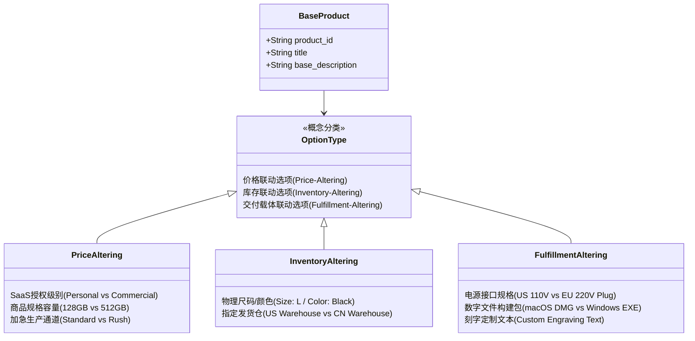

#### 选项对业务系统维度的深度影响矩阵

| 选项类型 | 典型业务实例 | 对价格的影响 | 对库存管理的影响 | 对最终交付结果的影响 | 前端交互反馈要求 |
| :--- | :--- | :--- | :--- | :--- | :--- |
| **规格与物理属性** | 衣服尺码/颜色；硬件设备内存容量（如 16GB vs 64GB） | 高度相关（通常大容量、高级材质价格更高） | **强绑定独立 SKU 库存**。黑色 M 码有货不代表白色 S 码有货。 | 决定仓库物理拣货条码与发运包裹重量。 | 选中时实时更新价格数字；若该变体库存为 0，即时切换按钮为“缺货（Out of Stock）”并阻断加购。 |
| **授权与使用范围** | 数字字体/源码的“个人非商用” vs “商业无限授权” | 决定性差异（商用版价格可能高出数倍） | 通常无物理库存限制，但可能影响企业版专属席位配额。 | 决定随订单附带生成的授权证书文本（License Certificate）及商用维权凭据。 | 在选项旁显著展示不同授权的商业权益对比弹窗，避免客户因看不懂而选择最低价引发侵权纠纷。 |
| **区域与工程标准** | 电子设备电源插头（US / EU / UK / AU）；输入电压（110V vs 220V） | 通常价格相同或略有微小配件成本差异 | 涉及不同规格配件的独立物料库存控制（BOM）。 | **致命交付风险**！若买家选错插头标准，收到后将完全无法使用并直接退货。 | 建议在选项旁配以清晰的插头实物图与适用国家标签，必要时提供基于 IP 的参考提示（允许买家手动更改）。 |
| **数字构建目标** | 桌面客户端软件（macOS Silicon / macOS Intel / Windows / Linux） | 通常统一价格 | 无库存限制 | 决定付款成功后分配的下载二进制包哈希值及安装向导说明。 | 自动探测用户当前浏览器的 User-Agent 智能预选对应操作系统，同时保留手动切换下拉框。 |
| **个性化定制项** | 激光雕刻姓名；专属文字礼品卡留言 | 可设定为免费增值或固定加工费加价（如 +$5.00） | 消耗定制工时，不改变标品主体库存，但可能增加履约工期。 | 必须进入生产制造工单，与订单物理绑定，一旦加工通常不支持无理由退货。 | 输入文字时提供实时字符长度校验（如 Max 20 characters），并展示动态刻字渲染预览。 |

---

### 4.4.2.2 选错或组合不合法时如何提醒和纠正？

在多维属性共存时，极其容易出现**逻辑不合法组合（Invalid Combinations）**。例如：某款户外储能电源仅针对美规 110V 版本提供专属太阳能板快充套装，而欧规 220V 版本暂未开发配套套件；或者某软件的特定功能插件不支持 Linux 操作系统。

如果前端允许买家将这种不存在的组合加入购物车并付款，后果必然是售后人工介入退款、向买家道歉甚至承担违约责任。系统应采用“**事前预防（Prevention）优于事后校验（Validation）**”的防御性交互设计：

#### 1. 互斥与缺货选项的界面状态分级表达

对于不可选或无库存的选项，前端严禁静默响应或在买家点击“加入购物车”时才弹窗报错。应遵循国际无障碍与交互通行准则：

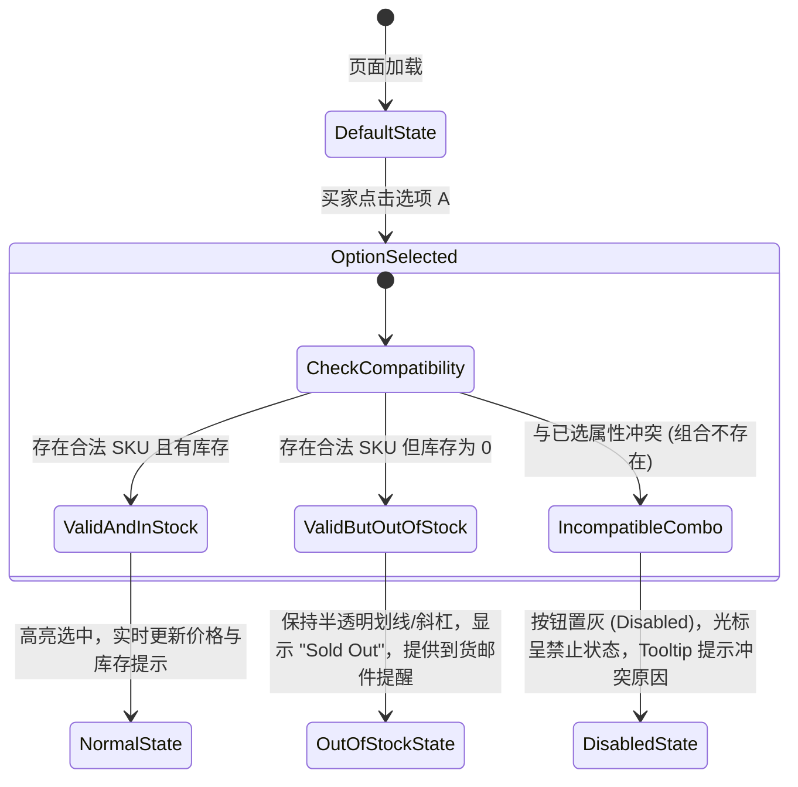

- **正常可选（Active / Available）**：清晰的高亮边框与选中标志，价格与主图联动刷新；
- **组合合法但缺货（Out of Stock）**：保留选项外观，但以斜线划掉或标注轻量角标“*Out of Stock*”。允许点击，点击后加入购物车按钮切换为不可点击的“*Sold Out*”，并可引导买家输入邮箱订阅“*Notify Me When Available*”；
- **物理上不存在的不合法组合（Incompatible Combination）**：当买家选定第一维属性后，系统应**即时动态置灰（Disable）第二维中所有冲突的子项**。例如：选择“Voltage: 220V”后，插头选项中的“US Plug (110V Only)”应自动变为禁用状态，并在鼠标悬浮或轻触时弹出简明气泡提示（Tooltip）：“*This plug option is only available with 110V units.*”；
- **智能自动降级/重选**：若买家先选择了“US Plug”，后切换电压为“220V”，系统应自动清除冲突项并提示：“*Plug selection reset due to voltage change; please select a compatible plug (EU/UK).*”。

#### 2. 购物车与结账前最终确认页的防错重检（Cart Review）

在最终点击“前往结账（Proceed to Checkout）”前，购物车必须以高对比度、清晰的图文排版回显买家选择的所有属性，防范因滑动误触导致的错选：
- **缩略图联动**：购物车中展示的图片必须精确对应买家所选的颜色与款式（例如：买了黑色款，缩略图必须展示黑色，绝不能展示默认的红色主图）；
- **全量变体文字摘要**：如 `Size: M | Color: Matte Black | Plug: US Standard | Warranty: 2-Year Extended`；
- **显式“编辑属性（Edit Options）”链接**：允许买家在不删除商品的前提下，直接在购物车内通过轻量抽屉或弹窗微调规格，避免重新搜索商品造成的流失。

---

## 4.4.3 下单时该让客户填写哪些资料？

结账表单是整个转化漏斗中最脆弱的一环。根据权威国际电商研究机构 [Baymard Institute 长期可用性基准研究报告](https://baymard.com/lists/cart-abandonment-rate)，全球电商购物车平均弃单率在 **65%~70% 左右 [MODEL_ASSUMPTION: 行业基准区间]**，而其中**强制要求买家注册账户（Mandatory Account Creation）**始终位列导致买家直接放弃付款的核心原因之一（约占弃单原因样本的 24%~26%）。

面向海外跨国交易，表单设计的核心哲学是**数据最小化（Data Minimization）与本地化宽容度（Localization Tolerance）**。

### 4.4.3.1 必须注册才能买吗？

绝大部分海外买家（尤其是初次通过独立站或广告引流进站的用户）对向陌生的独立品牌交出密码并创建永久账户存在极强的戒备心理。强制注册不仅增加了心理门槛，更直接打断了即兴消费的冲动。

#### 游客结账（Guest Checkout）与账户体系的适用分流权衡

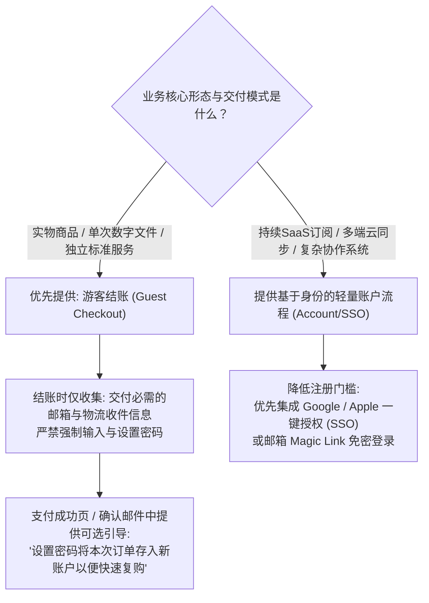

1. **实物商品与一次性数字下载：坚决推行游客结账（Guest Checkout）**：
   - 结账主流程中仅收集履约所必需的联系人邮箱（用于接收订单确认与物流追踪通知）与物流地址；
   - 彻底隐藏“输入密码”和“再次确认密码”输入框；
   - **巧妙引导账户沉淀**：当买家在支付成功页完成交易后，在订单确认成功屏展示友好引导：“*Want to track your order faster next time? Just set a password to save your details for your next visit.*”——此时买家已经完成付款，心理防备降至最低，转化留存率显著高于事前强制拦截。
2. **SaaS 与持续订阅服务：身份需求依业务分流，避免过度注册**：
   - 对于软件与持续云服务，账户是鉴权与数据存储的载体，但这**并不意味着必须在支付前强加繁琐的多字段注册表单**；
   - 降低摩擦的工程方案：优先集成 **Google Sign-In** 与 **Apple ID 一键登录（OAuth 2.0 / OpenID Connect）**，使买家无需手动填写邮箱并验证密码，1 秒完成身份核验；
   - 亦可采用“先结账后通过邮件激活链接设置密码”的流程，避免让长密码复杂度要求阻断结账通道。

---

### 4.4.3.2 地址、电话、日期应该如何适应不同地区？

中国大陆开发者最容易犯的表单设计错误，就是把国内“省/市/区/详细地址”或中国标准 11 位手机号的校验规则，硬套在海外买家身上。各国的邮政体系与地址组织结构存在巨大差异。

#### 国际主流国家与地区的地址及表单差异化规范

依据万国邮政联盟（[Universal Postal Union, UPU 国际地址标准](https://www.upu.int/)）及各国邮政规范，常见核心出海目标市场的地址特征如下：

| 国家 / 地区 | 核心地址层级与排序习惯 | 邮编规范（Postal / ZIP Code） | 典型常见误区与致命表单 Bug |
| :--- | :--- | :--- | :--- |
| **美国 (United States)** | 1. 街道地址（Street Address, 含门牌号）<br>2. 公寓/单元号（Apt/Suite，选填）<br>3. 城市（City）<br>4. 州（State，必须采用 2 位标准缩写，如 CA, NY） | 5 位纯数字（如 90210）或 9 位 ZIP+4 扩展码（如 90210-1234）。 | 误将“州”做成自由文本输入框导致拼写错漏；忽视公寓号（Apt/Suite）独立输入行导致快递被扔在大厅丢失。 |
| **英国 (United Kingdom)** | 1. 门牌号与街道（Building number & Street）<br>2. 地区/乡镇（Locality/Town）<br>3. 城市/邮政镇（Post town）<br>4. 郡（County，英国现代邮政已非强制） | 字母与数字混合的独特格式（如 SW1A 1AA, EC1A 1BB），长度通常为 5~7 位字母数字（中间带空格）。 | **用纯数字正则表达式校验英国邮编**，导致英国买家 100% 报错阻断；强制要求填写“省/州（State/Province）”（英国没有 State）。 |
| **加拿大 (Canada)** | 1. 街道门牌<br>2. 城市<br>3. 省份（Province，如 ON, BC, QC 等 13 个省/地区） | 字母与数字交错的 6 位编码（如 M5V 2T6，遵循“字母-数字-字母 空格 数字-字母-数字”）。 | 限制加拿大邮编只能填数字；未提供加拿大标准省份下拉列表。 |
| **日本 (Japan)** | 习惯先输入 7 位邮编（带连字符 `〒100-0001`），随后由大至小：都道府县 $\to$ 市区町村 $\to$ 丁目番地号。 | 7 位数字（格式通常为 `3位数字-4位数字`）。 | 强迫日本买家按照西方习惯倒着填写地址，且不支持日文全角/半角字符自动兼容。 |

#### 表单国际化工程实践准则

1. **国家选择器置顶驱动动态表单结构**：
   - 表单首行必须是“国家/地区（Country/Region）”下拉选择器，或基于 IP 地理位置自动预选（必须允许买家手动更改）；
   - 一旦用户选择特定国家，**下方表单字段的标签与校验逻辑必须动态适配**：
     - 当选择“United States”时，显示“State”标准下拉菜单（50 州 + 特区），邮编标签显示为“ZIP code”；
     - 当选择“United Kingdom”时，自动隐藏“State/Province”字段，邮编标签显示为“Postcode”并放宽至英文字符校验；
     - 当选择“Singapore”或“Hong Kong”等城市地区时，自动隐藏非必需的省份层级。
2. **电话号码字段的设计宽容度**：
   - 国际电话号码绝不能套用单一国家的格式校验（如严厉限制 10 位或 11 位数字）；
   - **正确做法**：提供带国际区号前缀的下拉选择器（如 `+1`, `+44`, `+49`, `+86`），买家输入本地号码后，系统在前端自动过滤买家多输入的空格、括号或横杠，合成为标准的 [E.164 国际电信格式](https://www.itu.int/rec/T-REC-E.164)（如 `+14155552671`）；
   - **明确收集意图**：在输入框下方标注一行小字：“*Required for delivery updates and courier contact only.*”，缓解买家对电话营销骚扰的担忧。
3. **消除日期显示的歧义性（Date Disambiguation）**：
   - 美式日期习惯为“月/日/年（MM/DD/YYYY）”，而英国、欧洲大陆及澳洲习惯为“日/月/年（DD/MM/YYYY）”，中国习惯为“年-月-日（YYYY-MM-DD）”；
   - 纯数字日期（如 `04/05/2026`）在跨国场景下具有严重误导性（无法分辨是 4 月 5 日还是 5 月 4 日）；
   - **工程准则**：在涉及预计送达日期、租赁周期或生日时，前端回显必须采用**英文缩写月份或全拼**（如 *May 04, 2026* 或 *04 May 2026*），彻底消灭因日期理解偏差造成的客诉。

---

### 4.4.3.3 客户填错或中断，怎样继续完成订单？

买家在填写复杂的结账表单或跳转第三方支付时，经常遭遇外部干扰（如接听电话、网络瞬断、银行 3D Secure 短信验证码延迟、信用卡余额不足）。如果页面刷新后所有填写内容被瞬间清空，买家的挫败感将直接转化为永久流失。

#### 1. 前端表单状态本地缓存与隐私保护边界

- **个人信息（PII）与缓存安全性认知**：
  - 买家填写的**姓名、家庭住址、电子邮箱同样属于个人隐私敏感数据（Personally Identifiable Information, PII）**；
  - 严禁盲目使用长效、无保护的 `localStorage` 无条件长期持久化这些信息！在公共电脑、图书馆或多人共享设备上，长效 `localStorage` 会导致后续使用该设备的其他人员直接看到前序买家的真实姓名与物理住址；同时若前端遭遇跨站脚本（XSS）攻击，`localStorage` 中的数据极易被窃取；
- **安全合规的表单恢复工程方案**：
  - **适量使用会话级存储（`sessionStorage`）**：只存非敏感购物车规格、输入进度等必要短期状态。`sessionStorage`不是加密容器，且同源脚本（包括XSS注入）可读取；标签页恢复行为也可能影响生命周期。姓名、地址、邮箱等属于个人数据，应尽量少采集、限定用途和保存期限，跨会话恢复优先采用经授权的服务端草稿。
  - **显式恢复提示或登录填充**：若需要跨会话保留，应提供显式的“自动填充”提示，并在订单完成结账后**立即执行清除操作（Purge upon Checkout Success）**；
  - **支付卡数据最小接触原则**：轻量首版应避免将明文PAN、CVV/CVC或安全认证数据放进自管浏览器存储/日志，优先采用合规托管支付组件以缩小责任范围。PCI DSS v4.x **3.3.1**关注**授权后不得保存敏感认证数据（SAD）**；但并非声称全球商户唯一合法方式就是PSP iframe。其它经批准的收卡流程需按收单方要求配置相应控制。姓名、邮箱、住址属于个人数据，但并不因其是个人数据就自动属于所有法域定义的特殊敏感类别。

#### 2. 即时内联校验（Inline Validation）与精准纠错提示

传统的“点击提交按钮后页面滚动到最顶端弹出一行红字”体验极其低劣：
- **失焦时即时校验（Validate on Blur）**：在用户刚输入第一个字符时不要过早报错；等待用户离开当前输入框（`onBlur`）后再执行校验；
- **正向反馈与明确指导**：
  - 错误示例：*“Invalid input.”*（买家不知道错在哪）；
  - 正确示例：*“Please enter a valid email address with an '@' and domain (e.g., name@domain.com).”*；
  - 错误提示必须紧跟在对应输入框正下方，搭配清晰的红色轮廓与无障碍 `aria-describedby` 关联。

#### 3. 支付中断与拒付失败的优雅回退与服务端事实核验

当买家在支付网关返回“*Card Declined*（卡被拒绝）”或“*3DS Verification Failed*（3D 安全验证失败）”时：

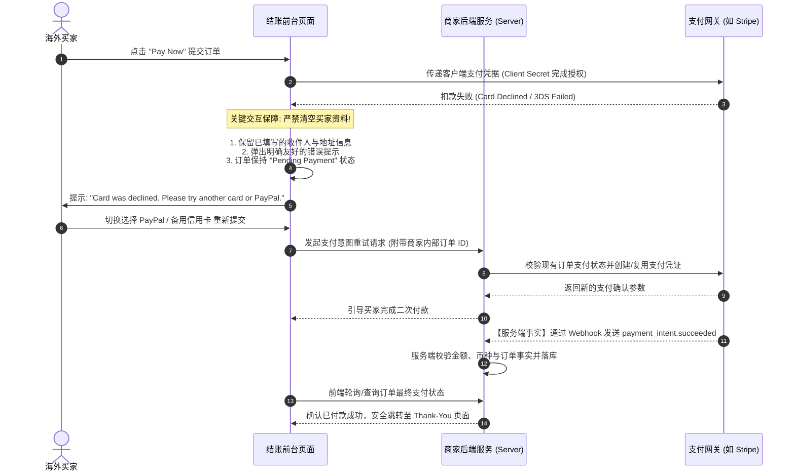

- **锁定表单，保留全部资料**：绝不重置买家的收件地址与购物车；
- **给出建设性解决方案**：除了告知卡被拒绝外，主动提供备选方案：“*Your card was declined by your bank. You can try a different card, or complete your purchase securely using PayPal or Apple Pay.*”；
- **划清客户端跳转与服务端真实支付事实界限**：
  - 前端浏览器重定向并不代表资金已经真正扣款成功！买家可能随时关闭浏览器或伪造前端回调。**系统的订单履约与权限下发，必须严格依赖后端接收到支付网关的官方服务端 Webhook 通知（如 Stripe 的 `payment_intent.succeeded`）或服务端 API 查询确认**；
- **准确理解 Idempotency-Key 与 Client Secret**：
  - Stripe 的 `client_secret` 仅用于前端客户端在托管组件内完成对应 PaymentIntent 的交互，**它不是后端的幂等键（Idempotency-Key）**；
  - 在**支持幂等的API变更请求**上，按具体接口提供`Idempotency-Key`，对**同一请求与同一参数**重试应复用原键而非每次另建。以Stripe **API v1**为例，执行开始后保存首次结果（包括部分错误），密钥在**至少24小时后可被清理**；被清理后的同名密钥再次使用可能视作新操作。**API v2行为另有区别**；同一键不能跨新的PaymentIntent、另一支付服务商或保留期失效后提供全局防重保证。应结合订单级核对和异常补偿。[Stripe官方幂等请求](https://docs.stripe.com/api/idempotent_requests)。
  - 当买家从银行卡切至另一支付方式，或支付状态超时未知，应先按**商户订单ID**核对既有支付对象和成功/处理中/未知状态，再决定是否复用或新建支付意图。按钮防连点、订单互斥和服务商API幂等只能降低重复付款概率，**无法单独保证跨通道或新付款对象不会重复扣款**；不确定的款项须查询可信事实与人工补偿。

---

## 4.4.4 上传照片、文件或定制需求，怎么避免出错？

在个性化定制（Print-on-Demand, POD）、跨国设计外包、3D 打印或涉外法律/商务服务中，往往需要买家提供自备的照片、矢量设计稿、雕刻文本或详细需求文档。

文件上传是导致交期延误与买卖双方拉扯的核心重灾区：买家上传了模糊的手机截图、提交了不受支持的格式、或者在付款后失联未交资料。

### 4.4.4.1 在哪个环节收资料更合理？

采集买家定制资料的时机，直接决定了**结账转化率与后端履约确定性**之间的权衡。常见模式有两种：**付款前直接上传（Pre-Payment）**与**付款后专属通道提交（Post-Payment）**。

#### 定制资料采集环节权衡决策模型

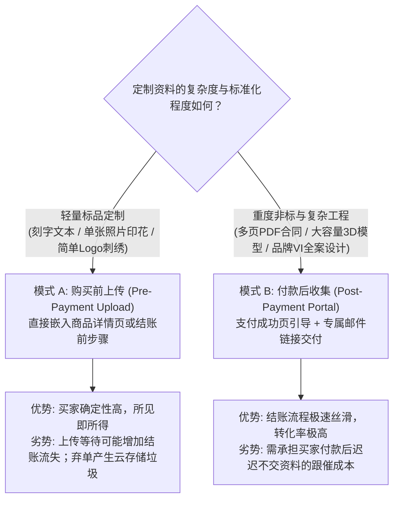

#### 两种模式的深度对比与混合策略实践

1. **购买前上传（Pre-Payment）：适用于高标准化、强依赖视觉确认的轻定制**：
   - *典型场景*：个性化手机壳定制、宠物项圈激光刻字、简单头像抱枕印刷；
   - *交互要件*：提供清晰的实时打样参考（如简单的 2D 切片贴合；复杂的 3D 实时渲染属于可选增强体验）。买家上传照片后，系统能预览裁剪范围，确认效果满意后加入购物车；
   - *技术治理*：对未最终下单的临时上传文件设置云存储生命周期策略（TTL），自动清理 24 小时未结账的垃圾素材。
2. **付款后收集（Post-Payment）：适用于深度定制、专业协作与大体量文件**：
   - *典型场景*：海外独立站品牌整站建站需求表单、工业级 3D 打印切片文件（动辄数百 MB）、跨境商标注册全套证明材料；
   - *交互要件*：支付成功后，在 Thank-You 页面以高优先级大卡片呈现“*Next Step: Submit Your Project Assets*”；同时向其邮箱自动触发一封带专属安全令牌的链接（Tokenized Upload Link）；
   - *合同约定与交期法律边界*：在商品详情页与购买合同中预先清晰约定工期起算条件（如 *Production turnaround begins after customer assets are submitted and verified*）。**需要注意的是，买后的单方免责声明不能无条件豁免法定的消费者违约赔偿责任或第三方平台规则（如 Amazon/Etsy 官方发货时效政策），商家必须在下单前明确公示该履约条款并设置自动逾期提醒机制**。

---

### 4.4.4.2 上传内容怎样核验并让客户更正？

如果任由买家上传任意文件，后端将面临两大灾难：一是买家上传了不符合印刷要求的文件（如 72 DPI 的网络缩略图），生产出来模糊一片导致退货；二是恶意用户上传包含可执行病毒脚本的木马文件，击穿商家服务器。

系统必须构建**客户端前置校验、服务端多层深度防御与受控更正窗口**的全流程防护体系（参考 [OWASP File Upload 验证规范](https://cheatsheetseries.owasp.org/cheatsheets/File_Upload_Cheat_Sheet.html)）：

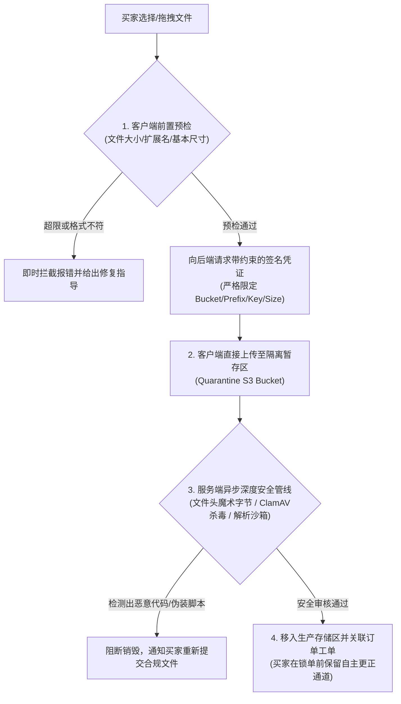

#### 1. 客户端前置轻量校验（Client-side Pre-flight Check）

在文件尚未真正耗费带宽上传至服务器之前，通过前端 HTML5 File API 实施即时阻断并给出极具指导性的错误信息：
- **文件格式白名单**：明确限定仅接收特定扩展名（如 `.jpg, .png, .pdf, .ai`），严禁允许 `.exe, .bat, .sh, .php, .js` 等危险可执行文件被选中；
- **容量上限与下限保护**：例如限定单文件上限为 50MB（避免超大文件拉垮前端会话），下限不得小于 50KB（过滤无效损坏文件）。若超限，即时提示：“*File size is 75MB, which exceeds our 50MB limit. Please compress your PDF or upload via cloud link.*”；
- **图像像素与分辨率预判**：前端通过 `Image()` 对象在内存中读取宽度和高度。若打印物理尺寸要求较高（如建议 300 DPI），而买家上传的图片分辨率偏低，系统应当弹出醒目的黄色建议标语：“*Low resolution warning: Your image resolution appears low. Printing may appear blurry. For crisp results, high-resolution original artwork is recommended.*”，由买家自行确认是否坚持使用或替换高清图。

#### 2. 服务端真实安全防御与隔离管线（Server-side Defense Pipeline）

- **对象存储直传的约束边界（S3 Pre-signed PUT Constraints）**：
  - 采用云端对象存储（如 AWS S3）直传能减轻主服务器带宽压力，但**云存储本身是逻辑访问隔离，不是网络物理断开**；
  - **区分POST Policy与预签名PUT**：S3**预签名POST表单**可以通过POST Policy里的`content-length-range`等条件限制请求；**预签名PUT没有相同的POST Policy条件**，不能把这个字段写成PUT签名的通用尺寸限制。PUT应在服务端授权**订单与具体Bucket/Key**，按实际可用机制在上传前/后校验大小、类型与内容，并将未通过文件隔离清理；签名Content-Type只约束声明头，不保证实际文件类型。注意**相同Key的PUT可能覆盖已有对象**，须用独立不可预测的暂存Key与版本/覆盖保护。所有上传方案均不信任客户端自行输入的订单前缀。[AWS POST Policy](https://docs.aws.amazon.com/AmazonS3/latest/API/sigv4-HTTPPOSTConstructPolicy.html)、[AWS PUT Upload](https://docs.aws.amazon.com/AmazonS3/latest/userguide/PresignedUrlUploadObject.html)。
- **暂存区与生产区隔离（Quarantine Zone）**：
  - 买家直传的文件只能进入私有的“暂存隔离存储桶（Quarantine Bucket）”，**该暂存区严禁配置任何公网读权限，更绝不能被生产车间或办公内网直接自动拉取执行**；
- **文件头魔术字节（Magic Number）与杀毒扫描**：
  - 严禁依赖扩展名判断文件类型。服务端使用文件头魔术字节检测真实二进制格式，排查可疑伪装文件；
  - 调用杀毒引擎（如 ClamAV）对文件进行异步病毒排查。需要清醒认知：**任何自动化杀毒扫描都不是 100% 绝对安全的保证**，系统必须通过无权限沙箱隔离、去可执行权限（No-Execute）及图片安全重新编码（Re-encoding）等综合措施化解解析器漏洞风险；
  - 仅在扫描与安全性检查全部通过后，文件才被允许安全移动至正式订单生产目录供工单调用。

#### 3. 订单锁定前的自助更正通道（Self-service Correction Window）

买家在上传后常常会发现“发错了旧版设计图”。如果必须通过客服邮件往来人工替换，沟通成本极高且极易错装：
- **设立明确的状态分水岭**：在订单进入“生产中（In Production）”或“已发货（Shipped）”状态之前，订单详情页应始终保留“*Replace Uploaded File（替换文件）*”按钮；
- **版本审计与锁定提示**：每次替换均生成明确的时间戳版本号（如 `design_v2_20261019.pdf`）。一旦工厂接单锁定工单，该按钮置灰并明确提示：“*Order is now in production. Asset changes are no longer possible online; please contact priority support immediately.*”。

---

## 4.4.5 客户买完后从哪里查看订单和产品？

海外买家在点击支付后的头 5 分钟，是建立品牌忠诚度或引发焦虑退单的“黄金窗口”。如果支付后页面空白、无明确状态回显、或者后续查不到已购数字文件，买家极易在恐慌中直接联系银行发起拒付（Dispute）。

### 4.4.5.1 客户怎样确认下单成功并知道下一步？

一个具备高确定性的**订单确认体系（Order Confirmation Ecosystem）**，必须由**即时成功落地页（Thank You Page）**与**自动化事务性通知邮件（Transactional Email）**构成双保险闭环。

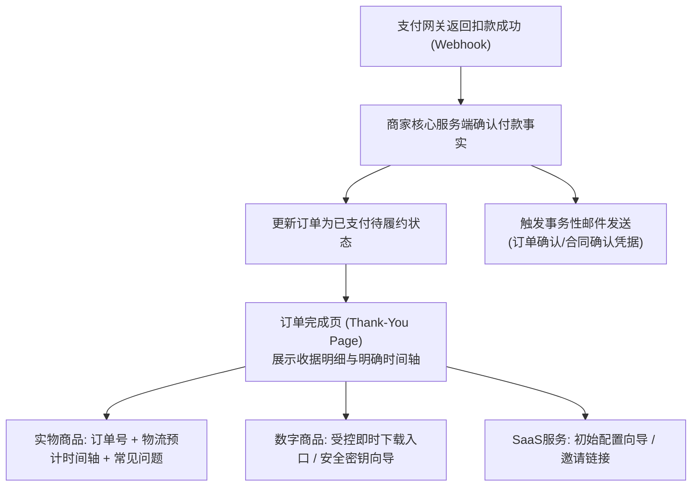

#### 1. 卓越的订单确认落地页（The High-Trust Thank You Page）

当买家完成扣款跳回网站时，页面首屏必须毫无歧义地展示以下关键事实：
- **显眼的视觉确认**：巨大的绿色成功勾选图标搭配大标题：“*Thank you, [First Name]! Your order is confirmed.*”；
- **系统全局唯一订单号**：如 `Order #US-20261019-8821`（支持一键点击复制），买家后续与客服沟通以此为凭据；
- **详尽的收据明细清单（Itemized Receipt）**：
  - 购买商品、变体规格及数量；
  - 账单与小计拆解：商品原价、折扣码扣减明细、运费、消费税（Sales Tax / VAT）、实付总额（货币符号及币种清晰，如 `Total Paid: $59.00 USD`）；
  - 收件人地址与选用的配送方式；
- **明确的“下一步预期时间轴（What Happens Next Timeline）”**：
  - 第一步：*Order Confirmed (Completed)*；
  - 第二步：*Fulfillment in Progress (Estimated dispatch: within 48 hours)*；
  - 第三步：*Shipping Tracking (We will email your tracking link once dispatched)*。
- **数字产品/虚拟授权的安全交付呈现**：
  - 若购买的是标准数字模板，页面可直接呈现受控的“*Download Your Files*”下载入口；
  - 若为高敏感软件许可或企业授权密钥，应结合使用环境提供保护选项（如提供“点击显示（Click to Reveal）”或同步发送至买家安全邮箱，防止公共屏幕直接泄露）。

#### 2. 事务性通知与持久载体合同确认（Transactional Order Confirmation）

事务性通知邮件承担着买家收据存档、回访入口以及法律法规要求的“持久载体合同确认”功能：
- **邮件发送通道与信誉分流**：
  - 事务性通知（订单确认、密码重置）与营销推广邮件（打折促销、活动群发）应在逻辑或域名信誉上严格隔离；
  - **客观认知邮件投递**：中小型初创商家通常应使用专业邮件服务商（如 Postmark、SendGrid、Amazon SES）提供的高信誉共享 IP 池，盲目购买未热身的独立 IP 反而会导致冷启动进垃圾箱；邮件进入收件箱的时效受目标邮局（Gmail、Outlook）反垃圾风控与投递队列影响，应以确保高送达率为核心；
- **发件人与标题专业透明**：发件人名称应为品牌官方名（如 `BrandName Orders <orders@yourdomain.com>`），标题清晰规范：`Your BrandName Order Confirmation (#US-20261019-8821)`；
- **内容完备性**：邮件应完整记载订单明细、实付金额、客户支持渠道，并包含一个受控的在线订单回访链接。

---

### 4.4.5.2 过几天重新回来，怎样安全找到已购内容？

对于一次性游客购买的客户，或数天后需要重新下载数字更新包、查询国际物流进度的买家，商家必须提供既极度便利、又符合现代数据安全规范的“找回入口”。

#### 严正的安全底线警示

> [!CAUTION]
> **严禁仅凭“可遍历订单号”或“明文邮箱”直接暴露客户敏感地址或无限制开放付费数字资产！**  
> 如果系统的订单详情 URL 格式为 `example.com/orders/1001`，黑客只需编写几行自动化脚本从 1001 遍历到 9999，即可批量爬取全站所有海外客户的真实姓名、家庭住址、电话号码与购买记录！这属于严重的安全漏洞（OWASP BOLA / IDOR）。

#### 订单查询与资产找回的分级权限体系

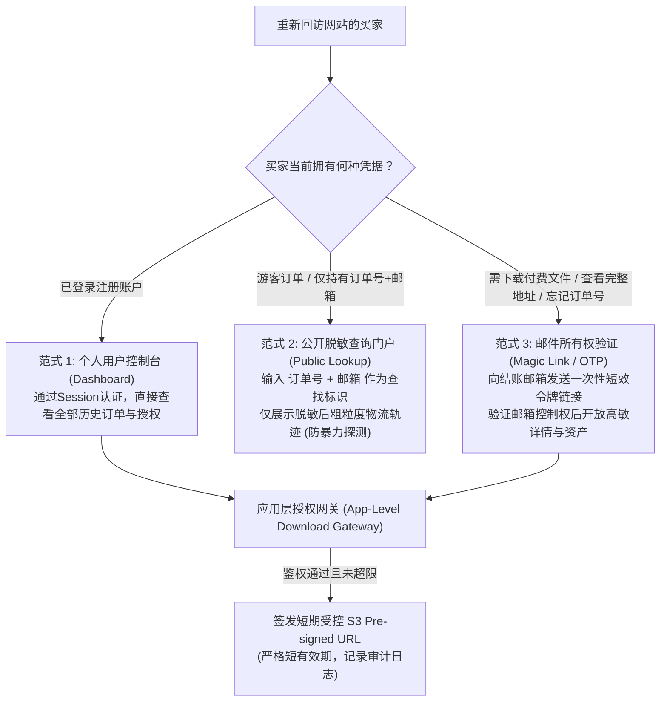

1. **公开订单自查门户（Public Order Lookup Portal）——查找标识与脱敏展示**：
   - 网站常驻“*Track Order*”公开入口，允许输入 `Order Number` 与 `Email Address`；
   - **核心安全准则**：**订单号与邮箱只是“查找匹配标识”，绝不是强多因素身份认证（MFA）！** 攻击者可能通过其他渠道刺探到特定订单号与邮箱；
   - **严格的数据脱敏防护**：在未验证邮箱控制权的前提下，公开查询页面**仅能展示脱敏后的低敏物流轨迹**（如 *Carrier: FedEx, Status: In Transit, Destination: N*** Y***, NY*），**严禁在此页面直接展示买家完整的家庭门牌号、电话号码或直接提供付费数字源码下载大按钮**；
   - **频率限制（Rate Limiting）**：针对该接口实施 IP 与单订单查询频次限制，彻底防范自动化穷举撞库。
2. **邮箱所有权验证与魔法链接（Magic Link / One-Time Token）**：
   - 当买家需要查看完整账单地址、下载付费文件或修改信息时，页面提示：“*For your security, we've sent a secure access link to your email.*”；
   - 系统生成一个高强度密码学随机令牌（Cryptographic Token，具有**单次使用、仅限当前用途、15分钟超短过期时间**特性），向其结账邮箱发送一封一键安全直达链接；
   - 买家点击该链接，证明其真正拥有对该邮箱的控制权，系统在此安全会话内开放数字资产下载与高敏详情。
3. **数字资产防盗链与 S3 预签名 URL 的真实能力边界**：
   - **S3 Pre-signed GET URL 的 Bearer 特性**：
     - AWS S3 等对象存储的预签名下载链接本质上是**临时持有者凭证（Bearer URL）**。在链接过期前，任何拿到该 URL 的人均可发起 HTTP GET 请求；
     - **预签名链接原生并不具备“单一订单最多下载 5 次”的应用层业务配额限制**，也无法从源头上阻止拿到链接的用户在有效时间内将链接转发给他人；
   - **正确的应用层受控架构**：
     - 严禁将长效 S3 链接直接永久写死在网页上；
      - **明确计数对象**：若业务只需限制“每笔订单最多签发5条下载链接/5次下载授权”，可在受控平台/应用层计数后签发短效S3 GET URL。但**签发次数不等于实际GET下载次数**：已签发的Bearer URL在有效期内可以重复使用或转发，后端无法从302后的S3直连请求准确实施逐次配额。若合同规定“文件实际成功下载最多5次”，应选择逐次鉴权且受控交付的应用代理/平台能力，并为断点续传、Range请求、重试和失败下载定义计数方式。普通预签名URL本身不支持一次性使用。[AWS官方FAQ](https://docs.aws.amazon.com/prescriptive-guidance/latest/presigned-url-best-practices/faq.html)。
     - 预签名链接的最大有效期同时受到签发该链接的 IAM 临时凭证（STS）剩余时效的物理约束，设计时需确保签名密钥的生命周期与业务预期对齐。

---

## 4.4.6 海外不同设备的客户能否用得顺？

根据全行业统计，欧美及全球跨境电商流量中，**移动端设备（智能手机与平板）的访问占比普遍达到 65%~80% 左右 [MODEL_ASSUMPTION: 跨境通用流量区间]**。然而，许多国内经营者习惯在宽屏台式机上通过 Chrome 浏览器调试网站，上线后海外移动端买家遭遇按钮按不到、弹出框关不掉、币种理解错误等严重体验事故。

一个真正全球通用的购买体验，必须在**屏幕适配、国际本地化（语言/货币/时区）与极端网络/无障碍环境**下经得起考验。

### 4.4.6.1 页面与关键操作在手机上是否完整？

移动端绝对不仅仅是把 PC 端网页“等比例缩小”，而是需要彻底重构手指触摸交互人体工程学。

#### 移动端核心购买路径适配自检基准

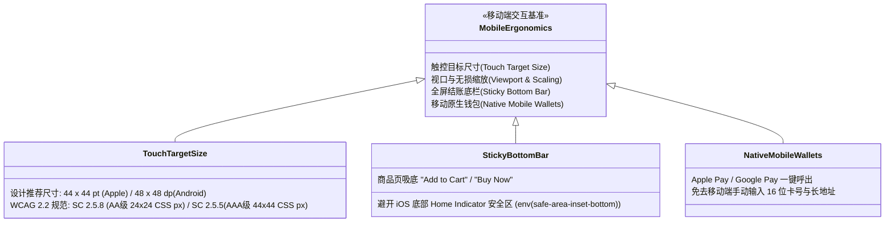

1. **手指触控热区人体工程学与规范辨析（Touch Target Standards）**：
   - **设计平台建议 vs 国际无障碍规范**：
     - [Apple Human Interface Guidelines (HIG)](https://developer.apple.com/design/human-interface-guidelines/) 推荐触控元素物理尺寸不小于 **$44 \times 44\text{ pt}$**（基于点单位）；Google Android Material Design 推荐不小于 **$48 \times 48\text{ dp}$**；
      - [WCAG 2.2成功准则2.5.8（Level AA）](https://www.w3.org/WAI/WCAG22/Understanding/target-size-minimum)通常要求指针目标**至少24×24 CSS像素**，但含间距、等效控制、内联等明确例外；44×44 CSS像素为2.5.5（AAA）增强准则。**WCAG是技术标准，不是全球统一生效的法律尺寸条款**，是否被法律、合同或采购规范要求须按地区和适用主体分别查证。
      - **工程建议**：重要支付/下单按钮可争取44×44 CSS像素作为舒适目标；密集控件按WCAG 2.2 AA的24×24 CSS像素及**适用例外和间距算法**判断，不把所有小于24的按钮一概判定违法；Apple pt、Android dp与网页CSS像素单位也不能直接混用。
2. **常驻吸底行动呼吁栏（Sticky Bottom Add-to-Cart Bar）**：
   - 在商品长详情页中，买家往往需要向下滑动数屏查看参数和评论。系统应在屏幕底部固定一个常驻浮动底栏，始终显示商品当前缩略图、当前总价及醒目的“*Buy Now*”按钮；
   - **适配 iOS 底部安全区域（Safe Area Insets）**：移动端 CSS 必须显式处理全面屏底部的横条指示器（Home Indicator）：
     ```css
     .sticky-checkout-bar {
       padding-bottom: calc(12px + env(safe-area-inset-bottom));
     }
     ```
     防止按钮被系统手势横条遮挡导致买家无法点击。
3. **极力推荐：原生移动钱包支付（Apple Pay & Google Pay）**：
   - 在手机小屏幕上通过软键盘逐字输入 16 位信用卡号、到期日、CVV 及完整的街道账单地址，是移动端结账流失的核心痛点；
   - 接入支持 **Apple Pay** 与 **Google Pay** 的结账组件（如 Stripe Express Checkout Element）。海外买家在 Safari 或 Chrome 浏览器中只需通过指纹或面容 ID（Face ID）双击确认，系统自动拉取系统底层绑定的地址与卡片，将原来需要数分钟的繁琐结账操作大幅压缩至 **10 秒以内 [MODEL_ASSUMPTION: 移动极速结账体验]**，显著提升移动端转化。

---

### 4.4.6.2 语言、货币显示和时区是否造成误解？

当跨国买家浏览非本国母语或非本地货币的网站时，任何模糊的数字表述都会被买家潜意识放大为“欺诈隐患”。

#### 1. 呈现币种、结算扣款与发卡行费用的清晰界定

许多出海独立站为了迎合买家，利用插件将前台价格根据买家 IP 转换为“当地货币显示”（如展示为加元 CAD、欧元 EUR 或日元 JPY）：
- **致命纠纷陷阱（Currency Mismatch Shock）**：如果前台给加拿大买家显示 `C$ 100.00`，但在最终提交银行扣款时，后台因为只支持美元账户，强制按照当时的汇率向买家信用卡扣取了 `USD 73.50`。买家在收到银行扣款短信时看到扣的是外币，且发卡行额外收取了跨国外汇兑换费，买家极易产生汇率受骗感发起拒付；
- **商业展示规范准则**：
  - **支持多币种原生结账（Presentment in local currency）**：如果网关支持，确保从商详页、结账页到最终向支付网关发起的扣款币种与金额完全一致；
  - **单币种基准计价提示**：如果商户仅以基础货币（如 USD）扣款，前台展示当地预估价时，**必须在最终付款按钮旁以高可见度明确提示**：  
    > *“You will be charged in USD ($73.50 USD). The CAD price is an estimate based on current market rates. Your issuing bank may apply its own currency conversion rates or foreign transaction fees.”*  
    *(注：商户可以控制并明确向收单行提交的币种与实扣数额，但无法控制买家发卡银行是否单方加收海外卡跨国交易杂费，明确公示此点至关重要)*。

#### 2. 专业本地化语言与术语去“机翻味”

- 避免直接挂载未经校对的机械网页全局翻译插件（如生硬将“Check out（结账）”翻译成“退房”，把“SKU（存货单位）”生搬硬套）；
- 核心结账交易路径（商品规格名、运输政策、退换货条款、错误提示语）必须由具备本地文化语感的专业人员或经过精细调优的语料校对，确保语法严谨、用词符合欧美本土商业惯例，建立深层信任。

#### 3. 时区透明化与夏令时规则（Timezone & Daylight Saving Time）

在促销活动倒计时（如 Black Friday 限时特惠）、发货截止时间（*Order within next 2 hours for same-day dispatch*）或在线预约定制沟通时：
- **严禁仅标注模糊的“Today”或“Ends at midnight”**；
- **时区命名必须严谨区分夏令时**：
  - 美国东部时间并非全年都是固定的 `EST (UTC-5)`！在每年 3 月至 11 月夏令时期间，其实际适用的是东部夏令时间 **`EDT (UTC-4)`**；
  - **工程推荐**：采用 IANA 标准时区数据库名称（如 `America/New_York`），或在文案中采用通用表达：“*Ends at 11:59 PM ET (Eastern Time)*”；
  - 更优秀的实践：通过前端 JavaScript 脚本动态读取买家本地客户端时区，将时间转换为买家本地时钟展示（如 *Ends in 03h 45m 12s* 动态倒计时），消除时差误判。

---

### 4.4.6.3 网络慢或辅助技术用户能完成操作吗？

欧美许多中低密度地区（如北美中西部农场、郊区移动网络弱信号盲区）以及广大发展中国家买家，经常处于 3G 或高延迟的网络环境下；此外，欧美对**网站无障碍访问性（Web Content Accessibility Guidelines, WCAG）**有着极其严格的行业标准甚至法定诉讼风险（如美国 ADA 法案合规）。

#### 1. 弱网环境下的前端韧性设计（Low-Bandwidth Resilience）

- **杜绝全屏未经优化的“图片轰炸”**：商品主图全面采用现代高效压缩格式（如 **WebP** 或 **AVIF**），利用 HTML `srcset` 响应式分发不同尺寸切片，严禁在移动端直接加载数兆字节的原生巨幅相片；
- **核心结账交互代码轻量化**：避免在结账页加载臃肿的第三方营销追踪脚本与聊天客服插件，确保结账核心表单在 2G/3G 弱网下能在 2 秒内可交互；
- **防重复提交的视觉锁死与服务端互斥（Optimistic Loading States）**：
  - 弱网环境下，买家点击“Pay Now”后由于响应缓慢，极易因焦虑而连续疯狂快速连点；
  - 前端处理规范：买家点击支付瞬间，按钮立即进入 `Disabled` 状态，文案切换为旋转加载动画（*Processing securely...*），物理阻断二次点击；
  - 后端通过订单关联、可信支付状态查询、并发控制、服务商幂等请求与异常对账**降低**重复创建支付对象的风险；遇到网络超时、跨服务商、新PaymentIntent、键过期等情况不得宣称**彻底防止扣款重复**。

#### 2. 国际无障碍标准（Accessibility / WCAG 2.2 AA）核心底线

让视障、弱视或依赖辅助设备（屏幕阅读器 Screen Reader、纯键盘导航）的买家也能顺利完成购买，不仅体现商业包容性，更是规避欧美合规法律风险的重要防线：

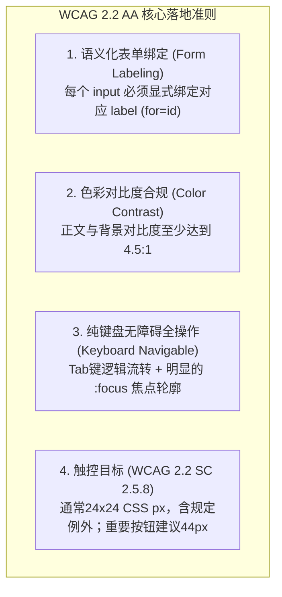

- **显式标签关联（Explicit Form Labels）**：严禁仅依赖 `placeholder`（输入框浅灰色占位符文字）代替真实的 `<label>`！占位文字在买家开始打字后会立即消失，屏幕阅读器往往无法正确解析。必须保证每一个输入框都具备独立的 `<label for="email">`，或提供无障碍专用的 `aria-label`；
- **高对比度色彩规范**：文字与背景之间的色彩对比度必须满足 [WCAG 2.1 成功准则 1.4.3](https://www.w3.org/WAI/WCAG21/Understanding/contrast-minimum.html) 规定的最低 **4.5:1**（大号文字至少 3:1）。绝不能为了追求所谓的极简性冷淡设计，采用浅灰色底搭配超细浅灰文字，导致中老年弱视买家无法看清重要限制条款；
- **全键盘可达性（Full Keyboard Navigability）**：测试时拔掉鼠标，仅用 `Tab`、`Shift+Tab`、`Space`、`Enter` 与 `Esc` 键，应能够完整顺畅地走完“选规格 $\to$ 填表单 $\to$ 关弹窗 $\to$ 提交支付”全流程；所有可聚焦元素在处于焦点状态时，必须具备清晰醒目的物理轮廓线（Focus Ring，严厉禁止在 CSS 中随意编写 `outline: none;`）。

---

#### 欧盟相关消费品页面安全信息检查（R01）

**先判断商品、销售市场及经营角色是否适用欧盟GPSR等规则**。对于确实适用[EU 2023/988 Article 19](https://eur-lex.europa.eu/eli/reg/2023/988)的网上销售，售前页面应清晰核对：

| 字段 | 核对方式 |
|---|---|
| 制造商 | 名称/注册商号或商标以及邮政、电子联系地址 |
| 适用的欧盟责任人 | 非欧盟制造商情形按规则列出责任人的名称及联系方式 |
| 产品可识别性 | 图片、类型和其他产品标识与实际产品一致 |
| 警告和安全信息 | 按适用规定与销售国要求提供可理解的语言信息 |

页面留存实际截图和核验日期。缺少适用字段时，不宜仅用通用免责声明代替；安全事故和召回由4.7处理。

#### 跨境买家最终到门成本与责任（R06）

商品价与运费不自动包含目的国关税、进口税或代理清关费。结账前核对：**谁申报、谁承担税费、到门是否另收费、拒收如何处理、什么地区不可配送**。DDP/DAP等贸易术语须以实际合同和经营资格判断，不得默认所有消费者订单适用单一术语。税法计算属于第三板块，本章处理购买承诺的完整性。

#### 数字产品售前说明与后续支持（R03）

售前明确数字文件与持续提供的软件服务的区别、承诺的兼容性、服务期限、更新入口和停止支持的安排。对于适用欧盟[2019/770指令](https://eur-lex.europa.eu/eli/dir/2019/770/oj/eng)的交易，必要更新（包括安全更新）和缺乏符合性时的消费者补救，应按持续/一次性交付、合理预期及各地实施法确定，不可仅凭经营者声明免除全部责任。实施衔接4.6、4.7及4.9。

---

## 本章自检与跨境购买体验全流程核查清单

在将产品购买页面正式推向海外市场前，经营者与研发团队可对照下表执行全流程体验与安全“冷读自检”：

| 体验阶段 | 核心核查维度 | 合格标准（Pass Criteria） | 常见重大缺陷与风险预警 |
| :--- | :--- | :--- | :--- |
| **买前认知** | 交付物、时效与限制 | 明确列出包装配件/数字格式清单；时效区分制作期与运输期；欧盟数字内容包含独立事先同意勾选框，并通过持久载体确认合同。 | 仅展示渲染概念图；承诺模糊送达时间；在支付按钮下放不可勾选的小字试图单方豁免法定撤回权。 |
| **规格选择** | 变体联动与防错 | 价格、库存与交付标准与选项实时联动；不合法组合即时置灰并提供 Tooltip 说明；购物车清晰回显变体图文。 | 允许将缺货或互斥的不可能组合加入购物车，付款后被迫人工退款；购物车缩略图与所选款式不一致。 |
| **结账输入** | 游客购买与表单本地化 | 游客结账按商品与身份需求决定；仅短期缓存必要非敏感字段，sessionStorage不抗XSS，也不等于已履行隐私义务；避免明文缓存支付卡敏感数据。 | 强制账户与过量资料字段；永久明文保存私人住址；误把缓存方案认作合规凭据。 |
| **定制上传** | 上传时机与内容安全 | S3 POST Policy可设`content-length-range`；预签名PUT不能照搬POST条件，须结合订单授权、上传前后限额、对象覆写控制、隔离扫描与补件流程。 | 声称PUT自带POST大小Policy；同Key覆盖其他订单素材；上传内容未扫描直接送生产。 |
| **购后确认** | 落地页与订单凭证找回 | 通过可信服务端确认付款事实和履约资格；找回资产需邮箱控制权验证或已登录授权；限制签发链接次数不得冒称限制S3 GET实际下载次数。 | 订单号+邮箱直接放行敏感信息；预签名GET链接反复下载却误报配额已受控。 |
| **多端与环境** | 移动端、币种与无障碍 | 移动主操作目标建议44px，WCAG AA通常24×24 CSS像素并有例外；法律要求按司法辖区及主体判断。币种、时区、夏令时、辅助技术与弱网操作要实际验证。 | 把WCAG一律说成全球法律红线；退款/汇率与显示币种混淆；无键盘访问或焦点。 |

---

> **全书导引提示**：  
> 当海外客户通过本章设计的顺畅体验顺利完成购买、拿到了订单确认并知晓了下一步后，商家的后台系统必须具备高可靠的底层承接能力。接下来请进入 **4.5《商品、库存和订单怎么管清楚？》**，我们将深入探讨如何在高并发下单场景下严防超卖、如何通过事务状态机精确管理订单全生命周期、以及如何对后台员工实施最小权限的数据安全隔离。

---

> **正式状态与封板溯源（2026-10-19 / G7语言润色：2026-10-19）**：
> - **正式状态**：`CHAPTER4_FINAL_SEALED / G7_EDITORIAL_OPTIMIZED`
> - **说明**：本章以独立Writer R2完整稿为基线，Reviewer依Owner本轮特别授权直接修复C01–C04及相应图表、自检表错误，**未曾收到Writer R3**。审计依据、真实来源及完整冻结6/13题目一致性证明见[CHAPTER4_SEAL_EVIDENCE_20261019.md](https://github.com/entropy-student/project/blob/b1335eab85c91d111541117a5e723a3894ee907a/cross-border-business/04-product-building/docs/CHAPTER4_SEAL_EVIDENCE_20261019.md)。本文封板是知识正文验收，并非真实支付、文件上传下载、安全、无障碍或法律合规系统实测。
