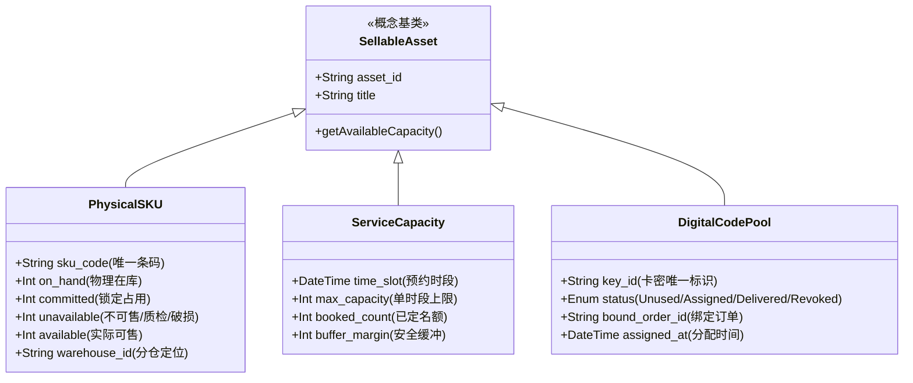
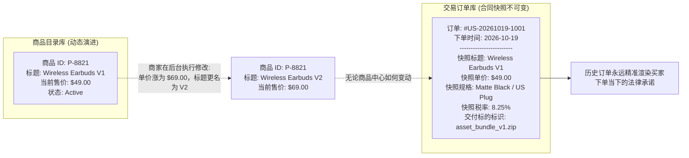
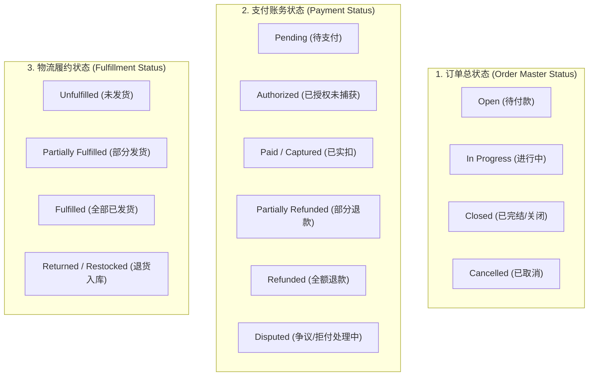
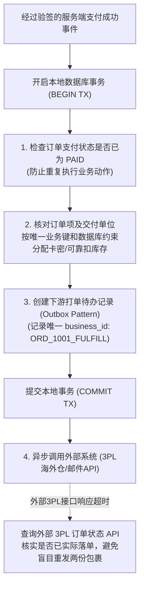
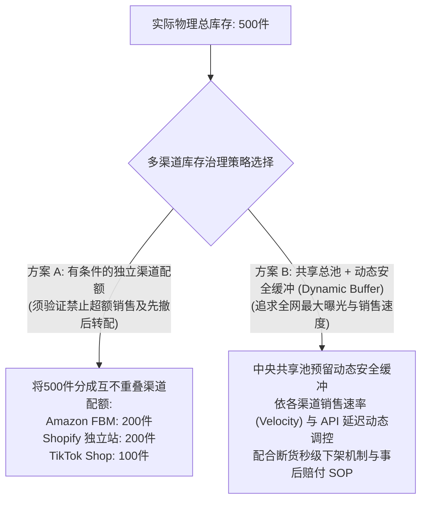
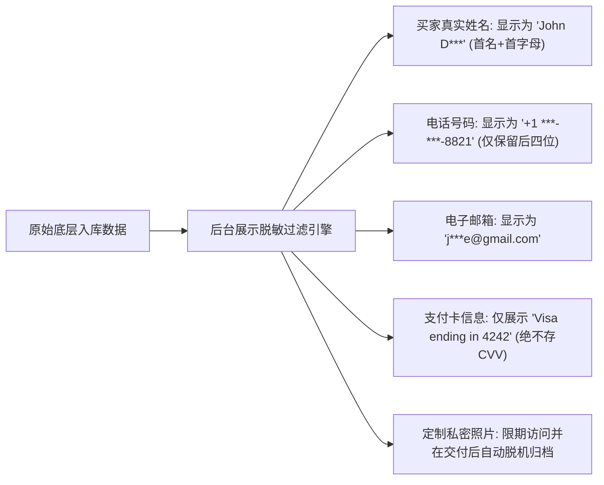

# 4.5 商品、库存和订单怎么管清楚？

在跨境电商与数字化出海业务中，如果说前端销售界面（第 4.4 章）是商家面向海外买家的“门面”，那么后台的商品、库存与订单管理系统，就是决定整个商业机器能否安全、稳定运转的“中枢神经”。

中国大陆个人开发者与中小跨境经营者在业务起步时，往往把精力全部倾注在引流获客与前台展示上，而对后台数据流与业务事实的处理过于简陋。随着单量上升或遭遇并发流量，极其容易爆发一系列致命的“后台灾难”：
- **商品变体与记账混乱**：修改了商品价格或下架了某个颜色，导致已经付款的历史订单在后台显示出错甚至丢数据，买卖双方对原定合同承诺各执一词；
- **订单状态机失控**：没有严格的状态流转规则，未付款就误发货、取消的订单仍被仓库打单发出、或者售后退款后虚拟权益未被及时撤销；
- **付款核对凭感觉**：盲目信任海外买家发来的伪造水单或支付截图直接履约；面对网关重复通知手足无措，导致重复发放卡密或重复出库；
- **并发超卖与多渠道断货**：同时在独立站和第三方平台售卖同一批货，缺乏库存锁定与原子扣减机制，导致多位买家同时付款买走同一件孤品，招致巨额罚款与账号封禁；
- **权限与数据裸奔**：客服、兼职美工与外部仓储共用同一管理员账号，客户明文手机号、家庭住址与信用卡后四位随意导出外泄，面临严厉的国际数据隐私合规审查（如欧盟 GDPR）。

本章将系统拆解商品规格数据建模、历史订单快照、订单状态机、支付异步核对与业务幂等、防超卖并发控制以及员工数据权限隔离的全套后台管理逻辑，帮助经营者在最少资源投入下，构筑一套账目清晰、状态可溯、并发防错且数据受控的后台管理底座。

---

## 4.5.1 商品和可卖数量怎么管？

管理商品的核心不是单纯在后台列出一张商品名称清单，而是要明确每一个可销售单元在物理或数字层面的**独立核算标识（SKU）**、**可卖容量边界**，以及**商品变更时对历史契约的保全机制**。

### 4.5.1.1 每个规格、名额或数字码要怎么分别记账？

无论是实体外贸、软件授权、数字素材还是定制咨询，系统都必须针对不同业态的交付属性建立严谨的记账模型：



#### 1. 实物商品：基于多态库存维度的精确记账（Shopify Inventory States 规范）

在跨境电商实物管理中，绝不能以“这款衣服总共有 100 件”进行模糊记账，必须细化至不可再分的最小存货单位（Stock Keeping Unit, SKU）。

参考国际主流电商系统（如 [Shopify 官方库存状态规范](https://help.shopify.com/en/manual/inventory-and-locations/fundamentals/inventory-states)），成熟的库存核算体系必须严格区分四层物理与逻辑状态：
1. **物理在库库存（On Hand）**：仓库货架上实际清点存在的全部物理件数总和；
2. **已承诺库存（Committed）**：在Shopify库存定义中，通常是未完成履约的订单商品、已占用库存的草稿订单或符合条件的调拨等**被承诺的商品**；自建结账页的临时付款前预留**不必然就是Shopify Committed**，需按使用的平台/API版本分别确认。
3. **不可售库存（Unavailable）**：物理存在但不可用于销售的件数（包括：进货待质检、破损残次品、退货待检验、或商户主动设置的安全留存）；
4. **实际可售库存（Available / Available to Sell, ATS）**：前台系统允许买家继续加购结账的实际净值：
   $$\text{实际可售库存 (Available)} = \text{物理在库 (On Hand)} - \text{已承诺占用 (Committed)} - \text{不可售预留 (Unavailable)}$$

> **业务反例警示**：  
> 假设仓库物理在库有 10 件衣服（On Hand = 10），已有 2 件被待发货订单锁定（Committed = 2），且有 3 件衣服拉链损坏待退回工厂（Unavailable = 3）。若系统简陋地采用 $\text{在库} - \text{锁定}$ 计算，会误算出 8 件可售；而实际真正可供买家购买并交付的库存仅有 $10 - 2 - 3 = 5$ 件！前台若卖出 8 件，必然爆发超卖退单。

- **只在一个业务控制点占用同一份库存**：按Shopify等托管平台已有的订单/库存行为判断，不在付款Webhook里对平台已扣减的可售库存再扣一次。若自建预占，应以订单行项和实际数量为单位保存是否已占用；预占转成已付款待履约一般是**同一占用的状态变化**，不是第二次从Available扣减。超时、支付失败或取消时只释放真实仍存在的占用；已出库/退货、盘点差异按真实仓库事实独立处理。

#### 2. 服务与咨询：基于时间槽与并发容量（Capacity / Slots）的配额记账

对于跨境提供的一对一技术咨询、定制设计排期或线上预约，标的物是**时间与服务产能**：
- **时段槽位记账（Time-Slot Booking）**：将服务时间切分为标准单元格（如每周二下午 2:00–3:00 `America/New_York`，限额 1 人；或每日承接定制手工画稿 3 单）；
- **动态占用与熔断机制**：一旦某时段被下单锁定，该时段状态即刻变更为 `Booked`，前端日历组件对其他买家自动置灰；
- **产能弹性缓冲 [MODEL_ASSUMPTION]**：建议在中小型非标服务中设置约 10%~20% 的工期容错弹性缓冲，避免因前一单客户沟通磨合延误直接导致后续订单全线逾期。

#### 3. 虚拟卡密与激活码：基于独立状态机的码池管理（Code Pool）

对于软件激活码、数字礼品卡或课程兑换码，必须实行**一码一密一状态**的流水账管理：
- **实施路径分流**：
  - *平台模式 / 无代码建站*：可优先采用经过验证的成熟插件（如 Shopify Digital Downloads、WooCommerce License Manager）或安全密钥管理服务（KMS）；
  - *自研系统*：在数据库中建立独立的码池表，严禁直接从文本文件中手动随手复制粘贴；
- **卡密生命周期四段跃迁**：
  - `Unused`（未分配）：处于待命池，未关联任何订单；
  - `Assigned`（已分配/预留）：已被某笔支付成功的订单原子绑定锁定，但系统尚未完成邮件或网页下发；
  - `Delivered`（已发放）：已通过受控通道安全展示给买家，正式计入履约完成；
  - `Revoked`（已作废）：因退款、欺诈或失效而人工或系统作废，无法再次激活。

---

### 4.5.1.2 商品修改或停售，旧订单如何保持原承诺？

在真实的经营过程中，商品信息是持续动态演化的：下周成本上涨商品标价需要从 \$30 调整为 \$50；下个月供货商更换导致商品标题与规格微调；或者某个季节性款式售完后在后台被彻底停售下架。

此时最容易出现的系统架构缺陷是：**订单行项表简单地通过 `product_id` 或 `variant_id` 外键去动态关联查询商品表**。一旦商品信息被修改，买家查看半年前的历史订单时，赫然发现当时的收据价格变成了 \$50，或者由于原商品已被删除，订单详情页直接抛出 404 错误或空白异常！这不仅破坏了法律上的合同凭证，更会直接引发买家的欺诈指控。

#### 核心架构模式：订单行项快照模式（Order Line-Item Snapshot Pattern）

在商业软件与合规电商系统的数据库设计中，必须严格贯彻**合同凭据不可变性（Contractual Immutability）**原则：



#### 落实快照模式的工程与管理准则

1. **下单时全量商业承诺属性静态冗余存储**：
   - 当订单创建的瞬间，系统必须将当前商品的所有关键商业承诺属性**完整复制并持久化**到订单详情表（`order_items`）中；
   - 必须快照的字段包括：下单时的商品标题（`title_at_purchase`）、购买单价（`price_at_purchase`）、所选变体规格明细（`variant_attributes_json`）、结算币种、商品在下单时的关键资产/规格快照，以及当时适用的运费与税费明细；
   - 订单详情页在任何时候展示收据，**只读取订单行项表内部的快照字段，严禁现场重新跨表读取商品主表的最新数据**。
2. **严禁物理硬删除，全面推行软归档（Soft Delete / Archival）**：
   - 淘汰或停售的商品，在数据库中严禁执行 `DELETE FROM products` 操作；
   - 必须通过状态标记将其置为 `Archived`（已归档）或 `Discontinued`（已停售），使其不再在前端商城货架列出，但底层数据保留，以供历史订单关联、财税核查及售后追踪调用；
   - *(注：快照重点保全的是支撑商业合同与履约事实的必要数据，商家并非必须无期限永久保留所有非必要的过时营销图片或宣传文案草稿)*。

---

## 4.5.2 订单从创建到完成该怎么记录？

订单是商业交付的法定契约载体。一笔订单从海外买家点击支付开始，到最终货物被签收或服务完结，中间会跨越银行清算、仓库配货、跨境干线运输及逆向售后等漫长周期。如果状态定义不清或允许随意跳跃，业务逻辑必然陷入混乱。

### 4.5.2.1 至少需要哪些状态，什么时候允许变化？

传统的“单线一维状态机”（如简单的草稿 $\to$ 已付 $\to$ 已发 $\to$ 完成）在真实的跨境业务中极易崩溃。例如：买家购买了 3 件商品，其中 2 件发货、1 件因缺货申请退款，单单一根状态轴根本无法同时准确记录发货与退款的复合事实。

现代成熟订单系统通常采用**多维解耦状态模型（Multi-dimensional Status Architecture）**：



#### 多维状态的核心跃迁与联动边界

1. **订单总状态（Master Status）**：
   - `OPEN`：订单已创建，等待买家完成支付；
   - `IN_PROGRESS`：支付已经确认（或信用订单已核准），订单进入备货、制作或多包裹发货流程；
   - `CLOSED`：主要履约流程已经按商户约定完成的归档标记；**不免除合法退货、部分退款、争议或追偿**，后续事实要记录在退款/售后维度，必要时按授权流程重开工单。
   - `CANCELLED`：未发货前经双方协商取消，或未支付超时取消。
2. **支付账务状态（Payment Status）**：
   - `PAID`：适用于需要先付款的订单，基于可信支付服务端事件/API**确认该笔支付成功**、对应商户及订单ID、金额和币种；**不等于已结算、可提现或银行已到账**，也不代表不需风控/取消及资料审核即可交付。有效B2B授信订单应按合同规定的信用及履约条件判断，不伪装为已付款。
   - `PARTIALLY_REFUNDED`：订单发货后因部分退货退回了部分货款，此时订单主状态仍为进行中或完结，而支付状态独立标记为部分退款；
   - `DISPUTED`：海外买家向发卡行发起争议拒付，系统冻结相关资金状态待抗辩（详见第 4.7 章）。
3. **物流履约状态（Fulfillment Status）**：
   - 独立记录货物的物理移动轨迹，从 `UNFULFILLED` 到 `PARTIALLY_FULFILLED` 再到 `FULFILLED`，与支付状态解耦并行。

---

### 4.5.2.2 取消、部分履约及状态错位怎么标记？

在国际跨国协作中，最容易让数据库出现脏数据的场景往往不是“单件现货正常发运”，而是各种**边缘分支与异步错位**。

#### 1. 部分履约（Split-Order Fulfillment）的双层状态标记

当买家在同一笔订单中购买了 1 件现货服装和 1 件需要预售 15 天的手工定制品时：
- **母订单与子包裹解耦**：系统母订单的履约状态显示为 `Partially Fulfilled`，而底层拆分为两个独立履约记录：
  - 包裹 A：`SKU-001 | Status: Fulfilled | Carrier: DHL | Tracking: #123456`；
  - 包裹 B：`SKU-002 | Status: Unfulfilled / In Production`；
- 买家在前台查询时，能够清晰看到“哪些已经寄出正在运输，哪些还在工厂制作”，彻底避免因发货一部分而引发买家恐慌投诉“漏发缺件”。

#### 2. 取消原因分类化记录（Cancellation Taxonomy）

取消订单绝不能只置一个空洞的 `status = 'cancelled'`，必须强制记录具体的**取消归因与发起方身份**：
- **买家主动原因**：*Customer Changed Mind*（买家改变主意）、*Ordered Wrong Size*（买家下错尺码）；
- **商家原因**：*Out of Stock*（断货超卖无法交付）、*Pricing Error*（标价事故）；
- **风控拦截**：*High Fraud Risk Score*（高欺诈反洗钱拦截，防止黑卡盗刷损失）；
- **取消对库存的联动影响**：只有在未发货且库存实际被占用的情况下，取消操作才允许将占用库存退回至可售库存池；若货物已经出库，严禁系统自动回滚库存！

#### 3. 应对网络乱序与状态错位（Out-of-Order Events）

分布式网络中，外部消息的到达顺序可能颠倒（例如：仓储物流系统的“包裹已出库运单号生成”通知，竟然比支付网关的“付款成功”迟到的 Webhook 还要早到达 1 秒钟）：
- **版本号乐观锁（Optimistic Locking via Versioning）**：订单表设置 `version` 整数列。状态更新时执行 `UPDATE orders SET status = 'FULFILLED', version = version + 1 WHERE id = 1001 AND version = 2`；
- **仅拒绝过期/无效的同一事实事件，不拒绝合法的新售后事实**：按具体支付、物流、售后维度及版本/事件ID确认先后关系，旧的“未发货”不能覆盖已发货，但后续真实退货、部分退款、撤权和人工更正可合法追加；示例`WHERE version=...`执行后必须检查更新行数，冲突则重新读取和判定，而不是无声忽略。

---

### 4.5.2.3 谁能修改订单，修改记录去哪查？

许多初创团队常常因为缺乏审计记录而爆发内部矛盾：客服说是仓管擅自改了客户地址才寄错，仓管说是客服口头通知改的；或者运营人员私自给海外买家把订单金额从 \$100 改为 \$1，借机侵吞公司资金。

#### 1. 建立不可篡改的变更审计日志（Audit Trail）

对关键订单修改须记录谁、何时、经哪一个工单或授权渠道更改了哪些字段、必要的变化摘要以及可审计的原因。**普通审计日志不应无条件保存完整住址、身份证、照片的Before/After原值**；确实需要追溯时，应将原始凭据存入独立受控记录，并设角色隔离、可核查修改与保留期；普通数据库表名本身不会使日志不可篡改。参照[OWASP Logging](https://cheatsheetseries.owasp.org/cheatsheets/Logging_Cheat_Sheet.html)：

```
【订单审计流水示例（对普通日志做数据最小化）】
- Log ID: LOG-9921
- Order ID: US-20261019-1001
- Time: 2026-10-19T03:15:22Z
- Operator Ref: staff_agent_03
- Action: UPDATE_SHIPPING_ADDRESS
- Changed Field: shipping_address.unit (内容不在通用日志明文展示)
- Old/New: [MASKED] → [MASKED]
- Restricted Change Record: CHG-8812 (独立受控记录)
- Reason/Authorized Case: Ticket T-8812
- Review: Only authorized staff may access the underlying address
```

> **隐私与审计安全平衡**：在审计日志记录字段变更时，应针对个人敏感信息（如买家完整电话或修改后的银行卡标记）实施访问权限隔离或必要脱敏，防止审计日志自身沦为隐私泄露的数据洼地。

#### 2. 字段修改的严格权限边界矩阵

订单处于不同生命周期时，允许修改的字段有着严格的红线约束：

| 字段类别 | 未付款阶段（Pending） | 已付款待发货阶段（Paid/Processing） | 已发货阶段（Fulfilled） |
| :--- | :--- | :--- | :--- |
| **收件人与物理地址** | 允许买家或客服自由修改 | **受控修改**：必须由买家发起书面验证请求，由具备权限的客服修改，并即时同步仓库打单系统。 | **绝对禁止直接修改**！包裹已在承运商途中，前端修改毫无意义，必须联系承运商做干线拦截或转运。 |
| **购买商品与变体数量** | 允许增删修改 | **严禁直接修改原订单行项**！若需加购，必须新建补差价订单；若需减购，走正规部分退款流程。 | 绝对不可修改。 |
| **交易金额与税费计算** | 随优惠券或运费规则变动 | **财务数据绝对冻结（Immutable）**！任何金额改动只能通过关联的退款单（Refund）或补价单呈现。 | 绝对不可修改。 |

---

## 4.5.3 怎样核对付款后再交付？

在跨国互联网交易中，“付款”是商家交付商品或开放权益的最核心前置条件。如果缺乏严密的资金与状态核验机制，商家将沦为国际黑产欺诈的受害者。

### 4.5.3.1 客户上传付款截图可以直接发货吗？

> [!CAUTION]
> **绝对准则：严禁以买家在聊天软件、邮件或表单中上传的“银行转账截图”、“汇款凭证水单”或“支付成功截图”作为发货或开通权益的依据！**

#### 跨国支付凭证伪造的残酷现实

在国际贸易与独立站出海中，伪造转账截图是门槛极低的黑产诈骗手段：
1. **浏览器审查元素与图片伪造**：利用 Chrome F12 开发者工具，骗子可以在 10 秒钟内将任意真实的 PayPal、Wise、Zelle 或银行网银界面上的收款人姓名、金额与交易时间修改为商家的资料，并截取高清无破绽的图片；
2. **仿冒邮件通知（Phishing Emails）**：骗子使用高仿域名（如 `service@paypa1-security.com`）向商家邮箱发送一封假冒的“*Payment Confirmed: \$500.00 USD received*”邮件，诱导商家相信款项已到账；
3. **未清算的虚假待结算（Uncleared eCheck）**：部分支付方式支持电子支票（eCheck），买家发起后账面显示“Pending”，但数天后因账户无资金直接跳票（Bounced）。

#### 合法安全的发货核验金标准

无论客户如何催促，履约动作的启动**必须且只能以“商家自主受控的可信渠道事实”为唯一准绳**：
- **线上收单直接支付**：必须在商家官方商户后台（如 Stripe Dashboard）明确查到该笔交易的状态为 `Succeeded / Captured`，或者由经过加密验签的服务端 Webhook 驱动系统自动流转；
- **大额线下 B2B 国际电汇（T/T）**：
  - 在一般直接零售业务中，严禁未到账发货；
  - *(注：在具备正式贸易合同、投保了出口信用险或约定了商业授信条件如 Net 30/60 的正规大额 B2B 贸易中，发货依据依合同约定的信用条款执行，不属于普通线上零售的截图欺诈范畴)*。

---

### 4.5.3.2 通知迟到、重复或不匹配时怎么办？

在线收单系统（如接入 Stripe、PayPal、Adyen）依赖异步 Webhook 将支付结果推送到商家服务器。在跨国复杂的网络环境下，通知异常是常态而非偶发。

#### 1. 通知迟到与买家浏览器等待体验保障（Late Webhook）

由于跨国公网抖动或支付网关内部队列拥塞，Webhook 的送达有时会滞后数十秒甚至数分钟：
- **致命交互失误**：买家在前端付完款跳转回网站，如果前端只傻傻等待 Webhook，页面可能会一直转圈甚至显示“未付款”，导致买家慌乱中重复付款；
- **优雅的“双向同步 + 轮询兜底”机制**：
  - 买家跳转至落地页时，前端向商家后端轮询订单状态；
  - **教学假设建议 [MODEL_ASSUMPTION]**：若轮询等待约 3~5 秒后订单仍为 `PENDING_PAYMENT`，商家后端可主动向支付网关发起同步查询请求（Server-to-Server API Query）（如通过 SDK 调用 Stripe `GET /v1/payment_intents/:id`）；
  - 一旦服务端查询确认网关显示 `status == 'succeeded'`，后端立即就地将订单确认为 `PAID` 并返回前端展示成功，无需被动苦等迟到的 Webhook。

#### 2. 重复通知与可靠落库防崩溃（Duplicate Webhooks & Reliability）

支付服务商为了确保通知送达，在未收到商家服务器返回的标准 `200 OK` 响应时，会采取指数退避算法进行重试（可能会连续投递 3~5 次同一事件）：

> [!WARNING]
> **危险实现漏洞警示**：  
> 若系统采取“先向 `processed_events` 表写入已处理标志并返回 200，随后异步分发履约任务”的逻辑；如果服务器在写完已处理标志后突发宕机崩溃，后续的履约任务从未被写入待办队列！而当支付服务商发起 Webhook 重试时，系统因查到该 `event_id` 已存在直接返回 200 忽略，导致**客户款项已被实扣，但履约任务被永久遗漏丢失**！

- **原子落库与事务保护（Atomic Ingestion）**：
  - 正确架构准则：将**订单支付状态更新、生成履约待办工单、以及记录事件处理状态**，置于同一个**本地数据库原子事务（ACID Transaction）**中；
  - 只有当整个事务成功提交后，才向支付网关返回 HTTP `200 OK`；若任何一步报错崩溃，事务完整回滚，支付网关下次重试时系统可重新执行完整的落库闭环。

#### 3. 严格针对官方事件对象的字段核验（Stripe API 字段规范）

依据 [Stripe 官方 Event 对象规范](https://docs.stripe.com/api/events/object) 与 [PaymentIntent 规范](https://docs.stripe.com/api/payment_intents/object)：
- Webhook 外部顶层为 Event 对象，其负载位于 `event.data.object` 中，且其类型由 `event.type` 决定；
- **严禁虚构全局字段（如错误的 `event.data.amount_captured`）**！
- 当监听 `payment_intent.succeeded` 事件时，目标对象是 `PaymentIntent`，后端核验代码规范如下：
  1. **核验对象状态**：`payment_intent.status == 'succeeded'`；
  2. **核验实际收款金额**：`payment_intent.amount_received == order.total_amount_in_cents`（注：Stripe 采用最小货币单位记账，如 \$10.00 USD 传递值为 `1000`）；
  3. **核验交易币种**：`payment_intent.currency.toLowerCase() == order.currency.toLowerCase()`；
  4. **订单和商户可信关联**：`payment_intent.succeeded` 的`data.object`是PaymentIntent，应核对服务端创建并保存的PI ID与内部订单映射，以及可信写入的`payment_intent.metadata.order_id`（若使用）；**`client_reference_id`是Checkout Session字段，不是PaymentIntent的通用字段**。使用Checkout时从Session核实`session.client_reference_id`、`session.payment_intent`及其对应对象，异步付款还需分辨后续成功/失败事件；始终核对商户、金额、币种、订单及取消/争议状态。[Stripe PaymentIntent](https://docs.stripe.com/api/payment_intents/object) · [Checkout Session](https://docs.stripe.com/api/checkout/sessions/object)。

---

### 4.5.3.3 哪些业务动作只允许成功一次？

在分布式架构与网络重试的背景下，**“业务动作幂等性（Business Action Idempotency）”是保护商家资产不被重复掏空的最后屏障**。即使传输层重复通知被意外漏网，底层核心业务动作也必须具备“执行一次与执行一百次结果完全相同”的防御能力。

#### 绝对只允许成功一次的业务动作清单与实现



1. **卡密分配：按“订单行项＋交付单位”锁定和唯一约束**：
   - `FOR UPDATE SKIP LOCKED`只能避免两个事务拿到**同一条未使用卡密**，不能阻止同一订单的两个并发事务各拿**不同卡密**；`NOT EXISTS`查询不是数据库唯一性保障。
   - 订单可能合法购买同商品多份：在订单核对成功后生成受信任的每份履约单位`fulfillment_units(order_item_id, unit_no)`，单位序号在已核准的数量内。分配关系使用**(order_item_id, unit_no)唯一**和**key_id唯一**：
     ```sql
     -- PostgreSQL 教学性约束示例，需配齐订单/sku外键和真实授权条件
     CREATE TABLE license_assignments (
       order_item_id bigint NOT NULL,
       unit_no integer NOT NULL CHECK (unit_no > 0),
       key_id bigint NOT NULL REFERENCES license_keys(id),
       PRIMARY KEY (order_item_id, unit_no),
       UNIQUE (key_id)
     );
     ```
   - 具体一次分配采用**同一数据库事务**：(a) 锁住该有效订单单位行`SELECT ... FROM fulfillment_units WHERE order_item_id=:order_item_id AND unit_no=:unit_no FOR UPDATE`，检查订单付款/履约资格和数量；(b) 如已有`license_assignments`，直接返回旧分配；(c) 否则从正确商品码池选一条`UNUSED`码`FOR UPDATE SKIP LOCKED`，将其标记`ASSIGNED`，把同一条码的分配写入`license_assignments`，**一起COMMIT**，失败则ROLLBACK。唯一约束冲突时重新核对已存在的业务动作，**绝不能吞掉错误后提交第二张码**。
   - 持久化的`ASSIGNED`是内部已分配，只有客户权益实际可使用且有交付凭据后才标记`DELIVERED`。客户合法购买多件时每单位恰好一张；已退款的卡密是否能撤销和重新售卖，应依使用状态与服务合同判断。
   - 这段DDL和事务描述是**教学性设计，不是可以直接复制生产环境的完整SQL**；需要配套可信订单项/数量外键、回滚与并发测试。纯平台/人工交付可使用具备相同防重效果的平台内建机制或可追溯人工流程。[PostgreSQL唯一索引](https://www.postgresql.org/docs/current/indexes-unique.html) · [事务隔离](https://www.postgresql.org/docs/current/transaction-iso.html)。
2. **外部仓储系统打单指令的真实防重机制**：
   - 很多第三方海外仓（3PL）由于系统老旧，**并不支持原生幂等键**！
   - **防御性调用规范**：向 3PL 提交打单请求遭遇网络超时（Timeout）时，**绝不能未经核查盲目发起重试**；必须先调用该 3PL 的订单查询接口，核验订单号是否已在仓库成功建单；若仓库接口不支持查询，系统必须将任务挂起并移交人工客服排查，防止同一笔订单被仓库重复打单发出两份物理包裹。

---

## 4.5.4 同时有人下单，怎样避免超卖？

“超卖（Overselling）”是电商运营中最恶劣的事故之一。如果库存只有 1 件孤品，由于系统缺乏并发控制，2 位甚至更多海外买家同时扣款成功。最终必然导致无法向其中一位买家发货，不得不向客户道歉退款，极易在海外社交媒体引发差评并遭受支付网关风控处罚。

### 4.5.4.1 下单时预留库存还是付款后扣减？

解决并发竞争的核心，在于对**库存扣减时机（Deduction Timing）**的技术与商业权衡：

#### 两种经典库存扣减策略深度对比

| 决策维度 | 策略 A：下单即预留库存（Reserve on Checkout） | 策略 B：付款成功才扣减（Deduct on Payment） |
| :--- | :--- | :--- |
| **执行机制** | 买家进入结账流程提交订单时，系统即刻将可售库存移入“锁定库存”，同时开启付款倒计时（如 15~30 分钟 [MODEL_ASSUMPTION]）。若超时未付，系统定时任务自动释放库存。 | 下单时不碰库存；只有当支付网关真正扣款成功并回调时，才正式执行库存扣减。 |
| **对买家的核心体验** | **高确定性**。只要在倒计时内完成付款，买家几乎能够确保拿到货，不会遭遇“付完款却被告知没货”的暴怒。 | **存在极高超卖风险**。在爆品秒杀或库存紧张时，多位买家同时在收银台输卡，先输入完的买家抢走库存，稍慢一步但同样扣款成功的买家面临超卖。 |
| **对商家的商业风险** | **面临恶意锁库攻击（Inventory Hoarding）**。竞争对手可以使用自动化脚本批量提交订单但不付款，将你的热门商品库存全部锁死使其他正常买家无法购买。 | **无库存占用成本**。货架永远对真正掏钱的人开放，不需要维护复杂的过期回滚定时任务。 |
| **推荐适用业务场景** | **限量独占标品、定制名额、高客单价奢侈品**。（配合严格的单 IP/单账号下单限频与人机验证）。 | **海量低单价消耗品、供应链补货极其极速的日常普货**。（或者能够接受事后迅速通知客户调拨换货的业务）。 |

#### 防超卖的底层数据库原子操作铁律

许多个人开发者容易写出如下漏洞代码：先 `SELECT stock FROM inventory` 读出库存为 1，判断大于 0，然后在代码层计算 `stock - 1 = 0`，最后 `UPDATE inventory SET stock = 0`。在毫秒级的并发请求下，两个线程同时读取到的数值都是 1，超卖瞬间发生！

- **数据库级原子条件扣减（Atomic Decrement）**：
  无论采用哪种策略，扣减库存的 SQL 语句必须依赖数据库的底层原子互斥锁（参考 [PostgreSQL UPDATE 并发机制](https://www.postgresql.org/docs/current/sql-update.html)）：
  ```sql
  UPDATE inventory 
  SET available = available - 1,
      committed = committed + 1 
  WHERE sku_id = 'SKU_TSHIRT_BLK_M' AND available >= 1;
  ```
- **检查受影响行数（Affected Rows）**：系统根据数据库返回的受影响行数判断：若返回 `1`，代表成功抢到库存；若返回 `0`，代表在提交的瞬间库存已被他人抢光，系统立即向买家友好提示：“*Sorry, this item was just sold out!*”，严厉阻断超卖。

---

### 4.5.4.2 多个渠道同时卖同一件货怎样核对？

现代跨境卖家通常采用“全渠道多店铺”模式：同一批存放在美国海外仓的 500 件智能手环，既挂在 Shopify 独立站，又上架在 Amazon FBM，还同步分流在 TikTok Shop 与 eBay 上销售。

#### 异步多渠道库存广播的物理局限与超卖反例

很多卖家天真地认为：“我只要架设一套中央库存管理系统（OMS），物理库存 500 件，预留 50 件安全缓冲，向 Shopify、Amazon 和 TikTok 分别同步显示可售 450 件，就能保证不超卖。”

> **致命多渠道超卖反例**：  
> 设中央库存展示为 450 件。在黑五促销等峰值流量下，**Shopify 渠道在 1 分钟内售出了 300 件，同时 Amazon 渠道也在该分钟内独立售出了 300 件**。当两个渠道的异步订单通知回传到中央 OMS 时，总售出量已达到 600 件，而实际物理库存仅有 500 件！即使扣除 50 件安全缓冲，依然**不可逆地发生了 50 件的严重超卖**！

#### 多渠道库存治理的双轨方案

针对上述异步物理延迟，商家应依据自身供应链特征选择适用的治理策略：



1. **方案 A：渠道配额条件性隔离（Channel Quota Allocation）**：
   - 彻底防范超卖的最有效方案：将总库存切分为独立的配额池分配给不同店铺。Amazon 卖完其专属的 200 件即显示售罄，绝不触碰 Shopify 的库存；
   - **成立条件**：200+200+100的演示仅当**各平台确实限制超额下单/预售、渠道配额互不重叠、线下库存与仓库损耗已及时计入、配额转移先在原渠道撤回并确认后才放给新渠道**时，能减少跨池重复销售。仍可能存在单渠道超卖、外部平台设置错误、实际盘亏与同步延迟；**不能宣称100%杜绝一切超卖**。代价是不同渠道冷热不均、需协调调拨。
2. **方案 B：中央共享池 + 动态安全缓冲与断货下架（Shared Pool with Dynamic Buffer）**：
   - 若必须共享总池，中央引擎必须根据各平台的销售速率（Sales Velocity）与 API 同步延迟，**动态提高安全缓冲深度 [MODEL_ASSUMPTION]**；
   - 示例的20件阈值为[MODEL_ASSUMPTION]，发送`Stock=0`也**不等于平台已生效或所有在途订单已取消**；应核查服务商允许的库存API、延迟/限流、在途订单与最终销量；动态buffer只能降风险，不能保证零超卖，需配套对账、人工断货和合规客户补救。
   - 建立自动化补救 SOP：一旦不幸发生交叉超卖，系统第一时间触发“预售转单通知”或“补偿优惠券+全额退款”，将客户不满降至最低。

---

## 4.5.5 后台员工能访问哪些客户资料？

很多跨境初创团队在起步阶段，为了省事，老板、全职运营、实习生、兼职客服甚至外部客服外包团队，**全员共用同一个超级管理员（Admin）账号登录后台**。

这种“裸奔”模式极其危险：
- 离职员工随时可以一键导出全站数万名海外客户的真实姓名、邮箱、电话与家庭住址，转手卖给竞争对手或诈骗团伙；
- 兼职人员误操作一键删除了整个商品分类或执行了错误退款，后台查不出到底是谁干的；
- 严重违反欧美各法域针对消费者数据保护的法律强制性规范（如欧盟 GDPR 第 5 条与加州 CCPA 对数据最小化和访问权限的惩罚性条款）。

### 4.5.5.1 客服、仓库和外包需要哪些不同权限？

后台权限架构必须坚决贯彻**最小特权原则（Principle of Least Privilege, PoLP）**与**基于角色的访问控制（Role-Based Access Control, RBAC）**。

#### 跨境后台典型岗位角色权限最小化分配矩阵

| 岗位角色 | 核心职责 | 必须授予的最小必要权限 | 必须坚决严令禁止越权的红线 |
| :--- | :--- | :--- | :--- |
| **超级管理员**<br>*(店主 / 核心技术负责人)* | 全盘业务管理与技术配置。 | 拥有系统全量配置与操作权限；管理员工子账号与组织架构。 | 必须强制开启多因素身份验证（2FA）；严禁在非工作日常设备上保持永久免密登录。 |
| **客服人员（Support Agent）**<br>*(自营客服 / 远程外包)* | 解答买家售前售后咨询、修改配送失误、登记工单。 | 查看订单基础状态、商品明细、物流轨迹；在未发货前修改收件人地址与备注；发起退款初审申请。 | **严禁批量导出客户资料（Export CSV）**；**严禁直接修改商品单价**；**严禁查阅未脱敏的支付卡信息**。 |
| **仓库配货人员（Warehouse / 3PL）** | 打包物理商品、打印面单、录入运单号。 | 查看待发货订单的 SKU 规格、数量、包装体积与收件人寄送地址；回传物流单号并标记发货。 | **严禁查看买家的付款明细、账单金额与银行卡信息**；**严禁查看客户购买的历史其他非本仓订单**。 |
| **兼职美工 / 外包设计开发** | 制作商品图片、编辑商详文案、排查页面展示 Bug。 | 仅限“商品管理中心（Catalog）”的编辑权限与测试沙箱访问权限。 | **绝对禁止访问“订单中心”与“客户中心”任何页面**，其工作完全不应接触任何真实买家数据。 |

#### 账号安全与操作控制准则

1. **一企一人一密一账号**：严禁共用账号！每个员工必须使用以其本人工作邮箱注册的独立子账号；
2. **多因素身份认证（MFA / 2FA）覆盖**：管理后台登录应强制推行多因素认证（如采用手机 TOTP 动态码、FIDO2 安全密钥或邮箱一次性验证码），彻底防范员工因弱密码被撞库导致后台失窃；
3. **员工离职即时注销（Instant Revocation）**：建立人事变动联动制度，员工离职当天第一时间在管理面板一键禁用该子账号并撤销所有已颁发的 API Token 与活跃登录会话。

---

### 4.5.5.2 哪些资料不应直接展示或长期保存？

在数字化合规时代，收集客户信息不仅是资产，更是沉重的合规负债。后台对于敏感数据的处理必须遵循**脱敏呈现（Data Masking）**与**定期销毁（Data Retention & Purging）**原则。

#### 1. 常见数据字段敏感度分级与脱敏处理标准

根据国际通用安全规范（参考 [OWASP API 安全指南](https://owasp.org/API-Security/) 与国际支付卡行业安全标准 [PCI DSS v4.0 Requirement 3.3.1](https://www.pcisecuritystandards.org/) 及 [FAQ 1533](https://www.pcisecuritystandards.org/faqs/1533/)），后台界面对敏感字段的展示规范如下：



- **支付卡数据（Cardholder Data）绝对红线与身份验证辨析**：
  - **严禁存储敏感认证数据（SAD）**：根据 PCI DSS 3.3.1 强制标准，授权后**绝对禁止在任何数据库或日志中存储信用卡 CVV/CVC 验证码、磁条完整数据或 PIN 码**；
  - 支付卡后台**可优先采用最小化显示**，例如经服务商提供的品牌及末四位，**并非PCI对所有系统规定唯一合法显示组合**。授权后敏感认证数据（例如CVV）不得保存，持卡数据的掩码、展示和角色权限按实际PCI适用要求控制；卡号末四位仅可帮助核对交易，不能作为认证因子。
  - **身份认证边界警示**：银行卡卡号末四位在收据与银行账单上广泛明文打印，**它仅能作为交易账目核对的辅助标记，绝不能当作验证客户真实身份的合法鉴权凭证**！
- **联系方式脱敏展示（Masking by Default）**：
  - 客服日常处理订单时，收件人电话号码与邮箱在默认界面下应以星号脱敏显示；
  - 仅在确需打电话联络买家的极特殊场景下，点击“眼睛”图标并二次验证密码后才允许单次解锁查看完整明文，且系统必须在后台记录一条审计日志，防范员工私下截屏盗卖客户资料。

#### 2. 数据生命周期与法定保留期管理（Data Retention & Storage Limitation）

参照[GDPR第5条](https://eur-lex.europa.eu/eli/reg/2016/679/oj/eng)的数据最小化和存储限制原则及[英国ICO相关指南](https://ico.org.uk/for-organisations/uk-gdpr-guidance-and-resources/data-protection-principles/a-guide-to-the-data-protection-principles/storage-limitation/)，**不存在全球统一的照片30–90天销毁、地址一年哈希化的法定时限**。应分业务用途、司法辖区、客户维权、会计税务及合同要求制定保留期，并控制其具体访问权限。
- **定制照片、私密文件及证件**：仅按必要用途收集、隔离存储与授权查看。可以将30–90天作为便于预算与操作的**教学情景 [MODEL_ASSUMPTION]**，但真实删除时间需结合合同返工、质量索赔、法定保留、争议取证及实际法域判断；到期后应考虑对象存储版本、备份和缓存的清理。
- **门牌号与联系电话**：不需要时应停止在日常业务视图呈现或限制访问，**一年后必须做哈希化不是法定义务**；对低熵地址简单哈希不必然匿名。根据物流证明、合同、风控和合法保存用途安排归档或删除。
- **交易/审计记录**：金额、订单快照、退款与必要财务凭据的保留目的不同于私密照片与营销信息，不意味着全部客户PII要永久留存。明文住址变更应避免进入普通日志；必要的受限原始证据单独保护。给每类记录登记用途、地区、保存期限依据、审查人和清除/例外流程，定期复核。

---

#### 先看平台能做什么，再决定是否需要自己开发（R11）

| 关键控制 | 托管平台/插件优先核实什么 | 人工管理的最小证据 | 自研系统才需要实现什么 |
|---|---|---|---|
| 订单与付款事实 | 原生订单、支付对象与退款记录是否分别可查 | 订单号—支付凭证—交付状态对应表 | 可靠事件接收、异常对账和不可重复动作控制 |
| 库存及订阅权益 | 实际库存预占、数字授权及取消规则 | 对应SKU/权益有效期和复核人 | 一致性、并发与多渠道去重 |
| 客服和权限 | 员工角色、导出审计和账号撤销 | 最小可访问人员与交接表 | 最小权限、敏感操作审计、密钥轮换 |
| 故障与补发 | 平台失败记录、手动标记及售后入口 | 先查实际出库/实际开权再补救 | 未知结果隔离、队列与恢复幂等 |

**执行原则**：商家负责检查平台提供的结果及合同义务；仅在平台功能不能满足业务承诺时，才建设额外数据库/队列/定制权限系统。不得把章节中的SQL示例误当所有平台卖家的上线前置作业。

---

## 本章自检与后台业务控制核查清单

在业务正式上线或承接大促流量之前，经营者与研发架构师可对照下表自检后台系统的健壮性：

| 模块领域 | 核心核查维度 | 合格标准（Pass Criteria） | 常见重大缺陷与风险预警 |
| :--- | :--- | :--- | :--- |
| **商品记账** | SKU 独立性与历史快照 | 区分在库/占用/不可售/可售四态；订单表全量快照下单当时的商品标题、单价与规格等合同要素。 | 简化公式漏算不可售残次导致算错库存；修改商品价格导致已付款历史订单金额被篡改。 |
| **状态流转** | 多维状态机与审计安全 | 主状态、付款/履约与售后各自记录；拒绝同维度陈旧事件但允许真实退款退货及纠错；普通审计日志不保存完整门牌号Before/After。 | 一维状态机无法表达部分退款；全局“只前进”吞掉合法售后；日志泄露个人地址。 |
| **付款核对** | 事实真实性与落库原子性 | 不凭截图发货，按支付对象实际字段核实付款、商户订单、金额币种；Checkout Session与PaymentIntent分开；支付成功≠结算或银行到账，订单事件与待办可靠落库。 | 错用PI对象不存在的`client_reference_id`，前端回跳误发、任务漏写。 |
| **并发防错** | 原子扣减与多渠道治理 | 每份占用只扣一次；订单项/单位与码密通过持久唯一约束防重复；跨渠道配额需平台实际严格限额和安全转配，共享buffer不能保证零超卖。 | 两并发事务各锁不同卡密但同一单位重复分配；预占与付款重复扣库存；渠道设置失效超卖。 |
| **权限合规** | 角色最小化与合理保存 | 角色最小权限、MFA/可靠访问控制；SAD授权后不存、末四位不当认证；审计日志避免明文PII，数据期限依用途、适用法规、合同与争议确定。 | 全员用Admin、完整住址写进日志、照片或地址保存年限被误当全球法律。 |

---

> **全书导引提示**：  
> 当后台的商品账目清晰、订单状态严密、付款核对精准且并发防错就绪后，商业契约便正式进入实体或数字的“落地履约期”。接下来请进入 **4.6《怎么把产品交付到客户手里？》**，我们将深入探讨实物供应链备货检验、国际物流与海外仓打单无缝对接、数字文件防盗链秒级下发、以及软件许可激活机制的高效落地。

---

> **正式状态与封板溯源（2026-10-19 / G7语言润色：2026-10-19）**：
> - **正式状态**：`CHAPTER5_FINAL_SEALED / G7_EDITORIAL_OPTIMIZED`
> - **说明**：本章基于独立Writer R2完整稿，由Reviewer依Owner特别授权修复C01–C05及直接关联SQL、图、清单；**没有Writer R3交付**。审计、来源和冻结5/12题目QA见[CHAPTER5_SEAL_EVIDENCE_20261019.md](https://github.com/entropy-student/project/blob/b1335eab85c91d111541117a5e723a3894ee907a/cross-border-business/04-product-building/docs/CHAPTER5_SEAL_EVIDENCE_20261019.md)。文稿验收不等于真实并发、支付、仓储、隐私合规实测。
