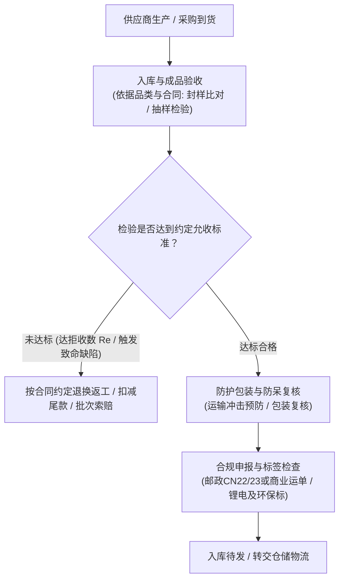
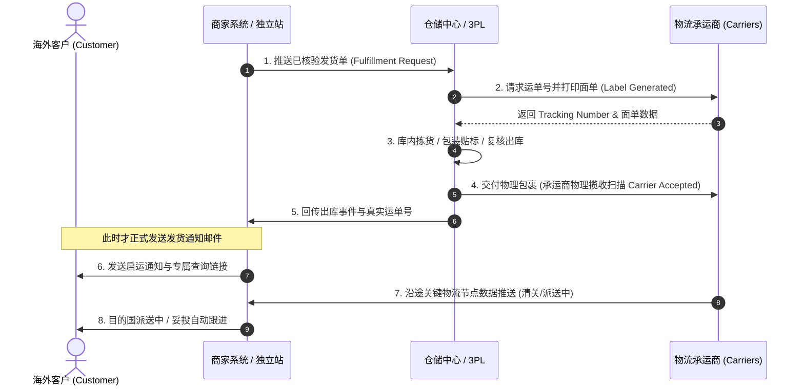
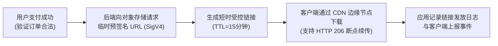
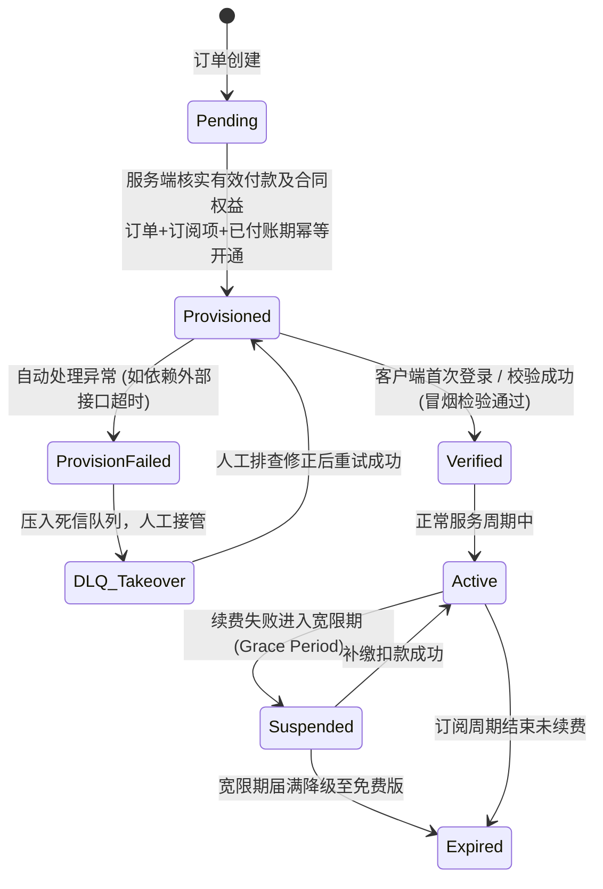
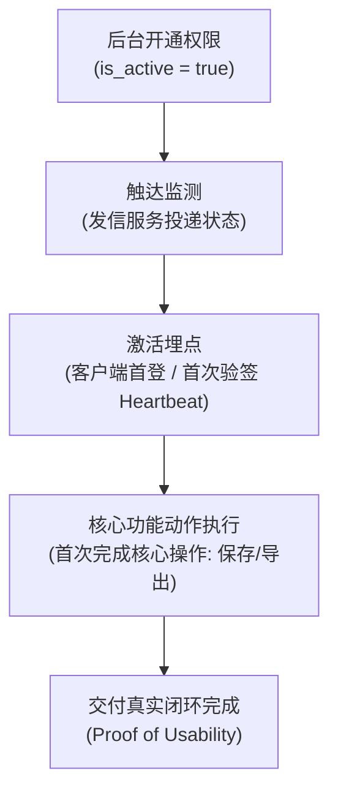
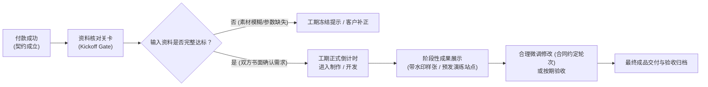
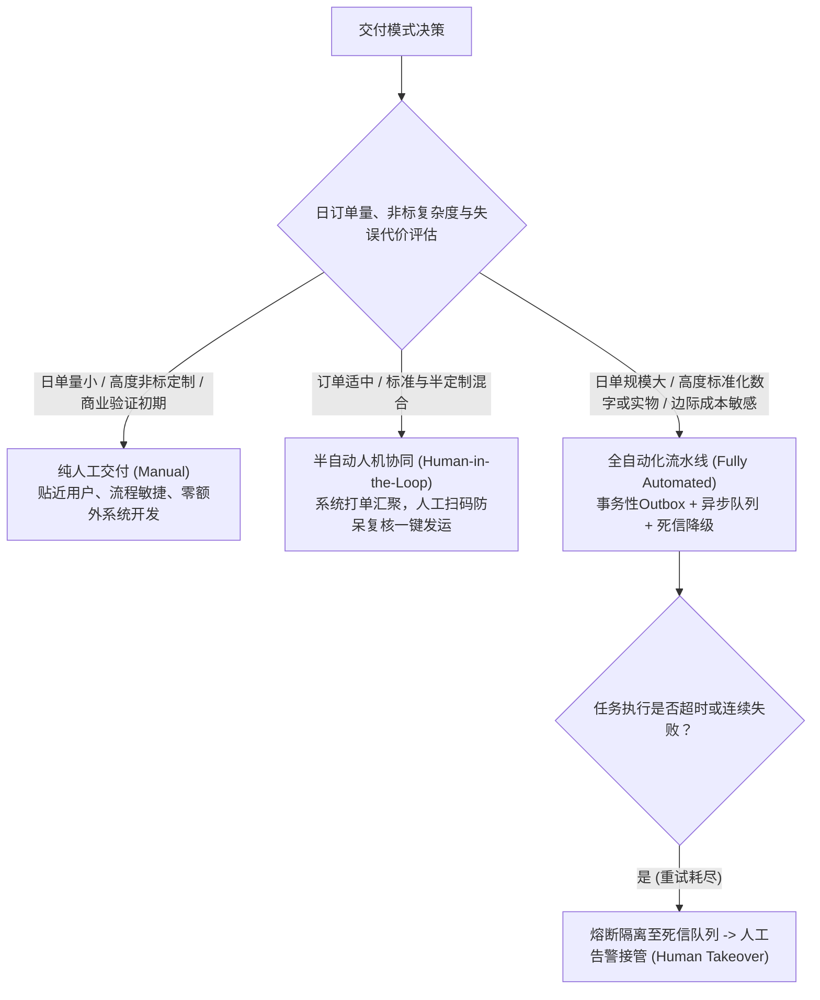

# 4.6 怎么把产品交付到客户手里？

在前一章中，我们已经解决了商品、库存、订单流转以及支付核验的底层逻辑，确保了商家在收到合法的付款通知前绝不盲目备货，也厘清了订单状态在多维正交矩阵下的流转规则。然而，在跨境电商与独立出海业务中，**“客户付款成功”仅仅是交付契约的起点，绝非商业闭环的终点**。

对于中国大陆的个人开发者、独立创作者、跨境出海小微商家以及 B2B 外贸团队而言，交付面临着横跨全球物理空间、网络基础设施、多国海关监管以及不同法律语境的现实挑战：
- 卖实物商品的商家，面临供应商交期管理、跨境长途运输防护、多国海关申报代码（HS Code）归类、带电与环保包装标签合规、海外仓（3PL）与自发货权责划分以及尾程妥投追踪；
- 卖数字文件的创作者，面临跨境网络传输稳定性、对象存储临时链接与 CDN 边缘鉴权机制、下载日志审计有效性以及数字防扩散的真实技术边界；
- 卖软件、SaaS 与会员服务的开发者，面临基于非对称签名的许可证离线校验边界、Stripe 异步支付与订阅周期的幂等开通、设备解绑与授权生命周期管理，以及开通后验证客户真实可用性的可观测性设计；
- 卖定制商品与专业服务的服务商，面临资料准入前置确认、需求变更（Scope Creep）边界、阶段交付验收与消费者权益保护法规的合法适配；
- 而随着订单体量从初期的零星几笔逐步增长，经营者更面临在“全人工处理”、“半自动人工复核”与“全自动流水线”之间的务实权衡，以及外部接口网络超时、任务队列重试与人工接管的高可用架构治理。

本章将系统拆解实物货物、数字资产、软件授权、定制服务四大类业务形态的真实交付全流程，为出海经营者建立一套兼顾成本、控制力、交付确定性与合规安全边界的交付执行体系。

---

## 4.6.1 实物商品备货和质量怎么把关？

> **【本节适用范围：实物出海与外贸电商经营者】**

实物商品跨境交付跨越数千公里甚至上万公里。跨境物流周期长、逆向退货成本极高（往往退运运费远超商品本身货值）。因此，**实物跨境出海的质量管理原则是“前置预防”与“过程防错”，依据商品品类、生产模式与合同约定实施有针对性的质检，绝不能把检验责任推迟到海外客户开箱那一刻**。



### 4.6.1.1 自己生产或采购成品，怎样确定交货标准？

无论是自有工坊组装生产、委托珠三角/长三角代工厂 OEM/ODM 代工，还是在现货批发市场（如 1688）采购成品，交货标准必须**将主观模糊的“质量好”转化为客观、可度量、供需双方书面认可的技术协议与合同条款**。

#### 1. 交付标准的四项核心要素与品类差异

交货标准并非千篇一律，不同品类侧重点截然不同：
1. **技术规格书（Product Specification Sheet）与公差（Tolerances）**：
   明确界定材质牌号、物理尺寸、净重、电气参数等物理指标。所有关键尺寸必须明确标出**工程公差**（例如机械五金件注明 `50mm ± 0.2mm` `[MODEL_ASSUMPTION]`）；注塑件或纺织品应指定国际标准色卡（如 Pantone 潘通色号），并约定色差允许公差范围（如 $\Delta E < 1.5$ `[MODEL_ASSUMPTION]`）。对于服装纺织品，公差重点在于尺码围度偏差（如胸围 $\pm 1.5\text{cm}$ `[MODEL_ASSUMPTION]`）、缩水率及色牢度；对于手工皮具等工艺品，则需在规格书中说明天然皮质纹理不均的合理受控范围。
2. **产前封样（Golden Sample / Master Sample）的适用条件**：
   在委托定制加工或大批量采购中，建议由供需双方制作并共同签字确认**产前封样**（通常双方各执一份留存），用于锁定注塑纹理、喷涂光泽度、装配手感阻尼等难以完全用文字量化的感官特征。但对于现货批发长尾品或小批量柔性采购，制作正式封样的成本可能过高，此时可采用留存高清多角度图纸、关键尺寸对照表及首件实物拍照存档作为折中依据。
3. **目的国市场准入与强制合规要求**：
   交货标准必须融入目的国强制法规：
   - **欧盟电子电气产品按商品适用法规核查**：RoHS、WEEE、CE并非所有电子产品统一套用的清单。应逐项查明商品是否属于相关指令/法规的范围、适用豁免、谁负责登记与符合性声明；**CE标志只针对要求CE的法规所覆盖的产品，不在范围内不应擅贴CE**。参见[欧盟官方CE说明](https://single-market-economy.ec.europa.eu/single-market/goods/ce-marking_en)。
   - 销往美国的电子产品需符合 FCC 电磁兼容规则；涉及儿童玩具或用品必须符合 CPSIA（消费品安全改进法案）对总铅和邻苯二甲酸酯的限值要求；
   - 销往美国加州须依实际化学暴露和适用条件评估Proposition 65。**美国从2025-08-29起暂停对一般进口货物的800美元de minimis低值免税待遇**，不能把国际直邮默认描述为低于800美元就免税；进口申报、税费、政策例外和后续变更须核对CBP现行规则。[CBP官方说明](https://www.cbp.gov/sites/default/files/2025-08/factsheet_suspension_of_duty-free_de_minimis_treatment.pdf)。
4. **外箱包装耐受度要求**：
   明确外箱瓦楞纸板材质（如五层 BC 瓦楞外箱）、抗压耐破强度要求，并在采购协议中约定运输防护责任归属。

#### 2. 抽样检验工具：ISO 2859-1 (AQL) 的方法与判定边界

对于非涉及人身安全重大风险的批量消费品，工业界常采用 **ISO 2859-1:1999（计数抽样检验程序第 1 部分，对应中国 GB/T 2828.1 及美国 ANSI/ASQ Z1.4）** 作为收货验收工具。

抽样检验并非适用于所有商品。对于单价极高的小众仪器或极小批量定制，人工全检更为审慎；对于大批量标准化工业品，抽样检验则是平衡质检成本与质量风险的统计学工具。

在合同约定采用 ISO 2859-1 时，通常将缺陷划分为三个等级：
- **致命缺陷（Critical Defect）**：危及人身安全、违反目的国法律法规的缺陷（如电器漏电绝缘失效、儿童玩具脱落易吞咽小零件）。行业通行设定接收质量限为 **AQL 0**（批次样本中检出 1 件即判定该批次不合格拒收）；
- **严重缺陷（Major Defect）**：导致产品丧失核心功能、显著降低使用性能或直接导致客户退货的缺陷（如无法开机、按键卡死、外壳明显开裂）。常见教学参考设定为 **AQL 2.5** `[MODEL_ASSUMPTION]`；
- **轻微缺陷（Minor Defect）**：轻微工艺瑕疵，不影响使用功能，多数消费者通常不会因此退货（如轻微可擦拭浮灰、底面不显眼细微擦痕）。常见教学参考设定为 **AQL 4.0** `[MODEL_ASSUMPTION]`。

下表以 ISO 2859-1:1999 **一般检验水平 II（General Inspection Level II，正常检验一次抽样方案）** 为例展示抽样样本量与判定阈值：

| 批量范围（Lot Size） | 样本代号 | 抽检样本量（Sample Size） | AQL 2.5 判定阈值 (Ac / Re) `[MODEL_ASSUMPTION]` | AQL 4.0 判定阈值 (Ac / Re) `[MODEL_ASSUMPTION]` |
| :--- | :---: | :---: | :---: | :---: |
| 151 ~ 280 件 | G | 32 件 | 2 允收 / 3 拒收 | 3 允收 / 4 拒收 |
| 281 ~ 500 件 | H | 50 件 | 3 允收 / 4 拒收 | 5 允收 / 6 拒收 |
| 501 ~ 1,200 件 | J | 80 件 | 5 允收 / 6 拒收 | 7 允收 / 8 拒收 |
| 1,201 ~ 3,200 件 | K | 125 件 | 7 允收 / 8 拒收 | 10 允收 / 11 拒收 |

> **判定边界澄清**：
> $Ac$（Acceptance number）为合同约定的最大允许不良品数；$Re$（Rejection number）为拒收判定不良品数。
> 例如：向代工厂采购 1,000 件商品，依表查得样本量为 80 件。随机抽取 80 件检验：
> - 若检出严重缺陷品为 6 件，即达到 $Re = 6$；
> - **这仅代表该批次货物未通过双方约定的抽样验收门槛，合同判定为“不合格拒收”**。这并不等于在数学上证明未抽检的 920 件实物整体必定严重超标。此时商家有权依据合同要求供方全检返工、扣除尾款或换货。
> - **重要合规限制**：抽样检验只能用于常规功能与外观的质量验收，**绝对不能用来替代目的国法律强制的安全检测或高危电气认证**。

#### 3. 商务采购合同中的验收条款

交货标准必须书面固化在采购合同（PO, Purchase Order）中：
1. **验收与付款挂钩**：明确“货物运抵指定仓库并经抽检合格后，方行支付尾款（如 30%~50% 尾款 `[MODEL_ASSUMPTION]`）”。
2. **返工责任与可控延期约束**：若抽检达到拒收阈值 $Re$ 导致返工，返工物流费用与额外工期由供方承担；若因供方原因超期交货，可约定每日按货款总额固定比例（如 $0.5\%$ `[MODEL_ASSUMPTION]`）扣减货款，但应预设不可抗力豁免条款。

---

### 4.6.1.2 发货前哪些质量和包装问题必须查？

出库前的质检排查应根据**产品属性与风险等级**裁剪，建立标准化的质检工位（QC Station）：

#### 1. 外观与关键工艺（Visual & Craftsmanship）
- **表面质量**：依据品类标准检查划痕、污损、缩水、缝纫脱线；
- **丝印与标识附着力测试**：对于需要长期保留安全警示或 Logo 的电子与玩具外壳，可根据 ASTM D3359 标准采用胶带划格剥离试验法（Cross-hatch Tape Test，常见使用 3M 600 号测试胶带）进行附着力抽查，验证印字在汗液或摩擦下是否容易脱落；对于服饰印花，则需抽查拉伸回弹与水洗脱胶风险。

#### 2. 通电与核心功能抽查（Functional Testing）
- **电气类商品**：对于小批量高价值电子产品，发货前建议逐台上电进行基础冒烟测试（指示灯点亮、屏幕无坏点、按键反馈干脆、基础接口充放电）；对于大批量廉价小家电，则按抽样方案通电测试核心发热或运转功能；
- **软件与固件一致性**：确认固件烧录版本与当前出厂要求一致，若带蓝牙/Wi-Fi 配网，抽取样机实际完成一次手机配对验证；
- **非电气类商品**：按服装/家居/工艺品真实危险和合同要求检查拉链、缝合、金属异物及包装；**并非所有服装商品均有全球法律要求逐件过验针机**。有特定客户/儿童安全/供方工艺要求时应按对应程序检验。

#### 3. 包装防震与跌落试验的真实适用性（Packaging Drop Test）
跨境包裹经历长途颠簸与多节点装卸分拣，包装抗冲击能力极为关键。
- **国际标准界定**：国际安全运输协会（ISTA）制定了系列测试规范。**ISTA 1A** 属于非模拟真实环境的基础完整性测试，包含固定振动与自由跌落；**ISTA 3A** 则属于高度模拟真实零担快件运输环境的综合试验（包含随机振动、跌落、气压温湿度变化）。
- **小微商家内部筛选验证**：小微卖家通常缺乏昂贵的专业认证实验室设备，发货前可执行简化的内部**自由跌落筛选测试**作为工艺改进参考：
  - 测试高度参考：针对毛重 $< 10\text{kg}$ 的快件小包，参考跌落高度为 **$76\text{cm} \sim 80\text{cm}$** `[MODEL_ASSUMPTION]`；
  - 跌落测试次序（一角三边六面）：跌落 1 个最脆弱的外箱角、3 条相连棱边、以及 6 个箱面；
  - 评估结果：测试完成后开箱，产品主体无破裂变形，核心功能完好。**注意：此类内部自测仅供工艺防震自查，不能宣称为第三方权威机构出具的正式 ISTA 认证证书**。

#### 4. 称重防呆复核的边界与局限（Weight Check Verification）
称重校验是电商仓储拦截漏件的常用低成本工具：
- 在 ERP/WMS 系统中录入标准打包件的参考理论毛重与允收公差带（如标准重 $350\text{g}$，容许公差 $\pm 3\text{g}$ `[MODEL_ASSUMPTION]`）；
- 出库贴标时经过高精度电子秤。若实测重量严重偏离阈值（如实测仅 $280\text{g}$），系统报警提示开箱检查，防范电源适配器或关键部件漏装。
- **局限性澄清**：称重校验**无法保证 100% 识别所有配件漏发**。如果漏装的小零件（如螺丝、小卡针、说明书纸张）重量远小于外箱瓦楞纸吸湿引起的重量波动或商品本身原料制造公差（例如外箱纸板因天气潮湿吸水增重 $10\text{g}$），称重差值将被完全掩盖。因此称重复核属于防呆辅助手段，不能替代装配工序的操作复核。

---

### 4.6.1.3 缺货或供方延期，如何调整履约计划？

跨境供应链受原材料交期、船期延误、工厂招工等外部因素扰动，缺货与延期在经营中在所难免。**应对延期的核心是遵循合法合规的通知程序与透明预期管理，严禁虚假发货**。

#### 1. 履约调度优先级的业务与法律考量

当有限现货无法满足全部待发订单时，商家需要合理分流，但必须注意：
- **平台时效与合规账户安全**：在严厉考核发货时效的第三方平台（如 Amazon、TikTok Shop），逾期发货会导致迟发率（Late Shipment Rate, LSR）超标甚至触发封店惩罚。在此类渠道上，可优先拨付符合时效截止窗口的订单；
- **履约公平性与承诺优先**：在独立站 DTC 或常规渠道，原则上遵循先进先出（FIFO）原则，尊重先下单消费者的契约期待；对购买加急空运服务或高客单 VIP 订单可建立加急通道，但**不得以此为由无限期挪用已临近法定时限的普通订单现货**。

#### 2. 法定义务与主动沟通流程（以美国 FTC 邮购规则为例）

在面对跨国消费者时，延期通知不能仅靠私下随意应付，需考虑目的国消费者保护法。例如，**美国联邦贸易委员会（FTC）《邮购、互联网或电话订购商品规则》（Mail, Internet, or Telephone Order Merchandise Rule, 16 CFR Part 435）** 确立了严格的法律基线：
- **承诺发货时限**：商家必须在广告或结账时明确宣传的期限内发货；若未明示具体期限，法律推定发货时限为 **30 天**；
- **不可避免延期时的强制通知程序**：
  1. 一旦预见无法在承诺期限（或 30 天）内发货，商家必须在原期限届满前向消费者发送合规延期通知；
  2. 通知必须向消费者提供**明确选择权**：允许消费者同意新的预计发货日期（Revised ETA），或选择**立即取消订单并获得全额退款**；
   3. **FTC及时退款的付款方式区别**：在本规则适用的实物订单取消情形，现金、支票、**第三方发卡信用卡（卖家不是授信方）**和常见其它付款方式通常须按规则在**7个工作日内**退款；**一个账单周期**的特别规则针对**卖家自己为债权授信方**的信用销售，不是所有信用卡支付。参见[FTC原文指引](https://www.ftc.gov/business-guidance/resources/business-guide-ftcs-mail-internet-or-telephone-order-merchandise-rule)。
  4. 商家不能通过单方面强制发送小额优惠券、赠品来剥夺消费者的法定取消与全额退款权利。

#### 3. 严禁虚假填单（Fake Tracking / Carrier Pre-scan）的红线
某些卖家为了规避平台发货超时考核，在仓库尚未拣货甚至根本没有现货的情况下，提前在系统生成运单号并填入平台标记为“已发货（Shipped）”。
- **真实发货与证据分层**：仅创建运单不等于交承运商；实际移交可依据可靠揽收扫描、仓库交接清单、承运收货凭证及实际合同条件核证。扫码可能延迟或漏扫，不能声称所有承运系统无首次扫描都不能通知，或空单号一律导致立即封店。不得虚构承运或投递事实；异常时应核对并如实告知客户。

---

### 4.6.1.4 包装、随附说明和标签怎么检查才不影响交付？

跨境实物包裹需要通过国际航空/海运承运人安检、出口海关以及目的国海关自动化分拣查验。**合规标签是包裹合法通关的必要通行证**。

#### 1. 国际邮政小包申报单（UPU CN22 / CN23）与商业快递报关差异

依据万国邮政联盟（UPU）与世界海关组织（WCO）联合指南（*WCO–UPU Postal Customs Guide*）：
- **CN22 报关签条**：主要用于适用邮政体系中的部分函件、小包，面积较小。**不能把“≤2kg且≤300 SDR”视为所有线路绝对成立的统一分类规则**；2024版WCO–UPU联合指南说明新版表格移除了CN22/CN23原值额门槛并允许符合条件的函件使用CN22。实际仍需按邮政业务类别、最新UPU文件及承运运营商要求选择。
- **CN23 报关单**：表格可容纳更详尽资料，常用于邮政包裹及需较完整申报的邮件。**公开资料存在需动态核对的差异**：2025年UPU Convention Manual部分注释仍引用300 SDR边界；不可将单一年度的注释或旧价值阈值直接认作所有国家、所有产品现行强制要求。出单前以实际受理邮政运营商和目的国现行清单为准；
- **电子预报关数据（EAD, Electronic Advance Data）**：现代国际邮政要求在物理包裹离境前，通过邮政系统预先传输电子申报数据（EAD）。仅贴纸质标签而缺乏系统电子申报的包裹，在进入欧盟或美国邮政网络时将面临滞留或退运；
- **商业快递（DHL、FedEx、UPS）差异**：商业快递不使用 CN22/23 邮政单证，而是采用国际航空运单（Air Waybill, AWB）与多联商业发票（Commercial Invoice），并通过商业报关通道申报。

```
+---------------------------------------------------------------+
|                       CUSTOMS DECLARATION                     |
|                              CN 22                            |
+---------------------------------------------------------------+
| [ ] Commercial Sample    [ ] Documents     [X] Sale of Goods  |
+---------------------------------------------------------------+
| Detailed description of contents:                             |
| 1. Wireless Mechanical Keyboard (ABS Plastic Case)            |
|    Qty: 1    Weight: 0.85 kg    Value: USD 45.00              |
+---------------------------------------------------------------+
| HS Tariff Number: 8471.60            Country of Origin: China |
+---------------------------------------------------------------+
| Total Weight: 0.85 kg               Total Value: USD 45.00    |
+---------------------------------------------------------------+
| I certify that the particulars given in this declaration are  |
| correct and that this item does not contain any dangerous     |
| article prohibited by legislation or by postal regulations.   |
| Date: 2026-10-19            Sender's Signature: [Authorized]  |
+---------------------------------------------------------------+
```

> **申报单避坑要点**：
> 1. **申报性质单选**：商业销售的电商商品，在选项中**只勾选 `Sale of Goods`**，切勿在同一行同时勾选 `Commercial Sample` 与 `Sale of Goods`，否则会被海关质疑报关目的矛盾；
> 2. **真实具体品名**：禁止填报 `Gift`、`Electronic Parts` 等宽泛词汇，必须如实描述物理形态（如 `Wireless Mechanical Keyboard`）；
> 3. **HS 编码（海关编码）规则**：WCO 国际协调制度（Harmonized System）仅前 **6 位数字（如 8471.60）在全球范围内统一归类**。第 7 位及以后的子目编码（如 8 位或 10 位税号）由各目的国海关税则自行制定（例如美国 HTSUS、欧盟 TARIC 体系各不相同）。跨国填报时应确保前 6 位准确无误，具体 8~10 位编码依据目的国税则进行精准归类；
> 4. **禁止蓄意低申报**：低申报一旦被海关大数据估价系统查实，将面临重罚、扣关及信誉降级。

#### 2. IATA 2026 锂电池标签规则与豁免条件（PI967 Section II）

带电消费品空运必须严格遵守国际航空运输协会《危险品规则》（IATA DGR，依据《IATA Battery Guidance Document — 2026》）：
- **商品分类边界**：
  - **UN3481, PI967**：安装在设备内的锂离子电池（Lithium ion batteries contained in equipment，如蓝牙耳机、带电池的智能手环）；
  - **UN3481, PI966**：与设备包装在一起的锂离子电池（如相机附带独立备用电池）；
  - **UN3480, PI965**：纯锂离子电池/电芯（Lithium ion batteries standalone）。**特别澄清：便携式充电宝（Power Banks）在航空运输法规中被明确视为纯电池（UN3480），绝对不是“安装在设备内”的电池，普通航空小包普遍禁运**。
- **PI967 Section II 的重要免贴标例外（F.04 / F.05 / F.06）**：
  根据 IATA 2026 规范，当单个包裹内仅含有**不超过 4 个电芯（Cells）或不超过 2 个电池（Batteries）安装在设备内**，且单票托运（Consignment）中此类包裹不超过 2 件时，或者设备仅安装有纽扣电池时，**该包裹可以豁免张贴锂电池标记（Lithium Battery Mark）**。
- **必须贴标时的规范要求**：
  当超出上述免贴标限额时，外箱必须张贴标准的矩形红白相间斜条纹**锂电池标记**。标记内必须清晰印出对应的联合国编号（如 `UN3481`）。注意：现行 IATA 规范格式中，标记内部仅需展示 UN 编号；以往强制印在标记框内的“24 小时紧急联系电话”已不再是标准标记格式的必备字段。

#### 3. 目的国特定环保与警示标签适用条件
- **法国 Triman 标志与分类指引（Info-tri）**：法国循环经济法（AGEC）要求投放法国市场的家用包装箱与产品贴附 Triman 标志及分类回收说明；
- **德国 LUCID 包装法登记**：销往德国的商品，其包装材料必须在德国中央包装登记处（ZSVR）完成注册并加入二元回收系统（Dual System）；
- **塑料袋防窒息警告（Suffocation Warning）**：依据美国部分州法律（如加利福尼亚、纽约、马萨诸塞等州关于厚度低于一定阈值且开口大于一定尺寸塑料薄膜袋的警示要求）以及主流电商仓储要求，内装服装或配件的塑料袋需印有多语言防窒息警告语，防止婴儿窒息风险。

---

#### 涉及消费品安全时的批次与供应商追踪（R02）

**质量抽检不是召回机制的替代**。对属于目标市场产品安全要求的实物，至少保留：商品/SKU与批次或序列信息、供应商及适用的经济运营商联系方式、入库或出库批次与受影响订单之间的映射、售前警示版本。发现危险迹象时能迅速定位受影响库存与顾客，并将事故移交4.7的停售、报告及召回分支。不要在无适用法依据时对所有数字商品强加实物批次义务。参考：[EU GPSR](https://eur-lex.europa.eu/eli/reg/2023/988)。

---

## 4.6.2 实物订单怎样交给仓库并查物流？

实物履约流程涉及商家系统、仓库作业中心与多段跨境物流承运人（Carriers）的高效协同。



### 4.6.2.1 自发和第三方仓配各负责哪些动作？

跨境电商实物履约主要分为**自发货直邮（FBM / Merchant-Managed Shipping）**与**第三方海外仓/平台仓（3PL / FBA）**。两者的操作流程与责任边界依据商业合同与贸易条款切分。

#### 1. 自发货直邮模式（Merchant-Managed Fulfillment）
- **操作流程**：
  1. 商家在 ERP 或打单系统集成专线物流服务商 API（如云途、4PX、万色、中国邮政 EMS 等）；
  2. 获取国际跟踪号，打印一体化面单（含报关信息与条形码）；
  3. 商家在自有仓库或工作室手工拣货、打包、贴标；
  4. 转交跨境物流商揽收或送交网点。
- **责任与成本特征**：
  - 无需在海外大批量压货，起步资金占用低；
  - 跨境干线运输周期通常在 $7 \sim 15$ 个工作日 `[MODEL_ASSUMPTION]`；
  - 货物在承运人揽收前的损坏由商家自担；揽收后在国际运输途中的丢件与损坏，依据商家与物流承运人签署的**主服务协议**进行理赔（通常为按申报价值赔付但设有最高限额，或按重量克重标准赔偿，未购买运输险的高价值货物可能面临赔付不足）。

#### 2. 第三方海外仓/仓配一体代发模式（3PL Fulfillment）
- **权责分工边界**：
   - **谁进口和缴税由实际贸易条款/合同决定**：补货、头程订舱、进口记录主体、税费缴纳不因用了3PL就自动由商家承担全部；DDP与DAP的义务不同，实际进口商资格和3PL服务范围还需核实。3PL的收货、仓储、拣货、出库与货损/理赔，也应依据服务合同及证据判断，不能概括成3PL承担全部损失。
  - **3PL 仓库责任**：到港集装箱卸货、入库清点验货、上架入位、库内保管；接收系统发货指令后执行波次拣选（Picking）、包装贴标（Packing）、交接给本土快递承运人（如 USPS、FedEx、Royal Mail、DHL Paket）揽收。
- **货损与盘点责任**：
  库内货损或盘亏通常根据 3PL 合同约定的“免赔盘差率”（如 $\pm 0.5\%$ `[MODEL_ASSUMPTION]`）划分，超出部分按约定采购成本赔偿；移交本土快递后的丢失则按承运人服务条款理赔。

#### 3. 两种履约模式的核心维度对比

| 对比维度 | 自发货直邮（Merchant Direct） | 第三方海外仓代发（3PL Fulfillment） |
| :--- | :--- | :--- |
| **库存资金周转** | 灵活。按需采购备货，无海外滞销风险 | 较重。需提前数周海运大批量备货压在海外 |
| **尾程送达时效** | 较长（通常 $7 \sim 15$ 工作日 `[MODEL_ASSUMPTION]`） | 极快（本土发货，通常 $2 \sim 4$ 工作日 `[MODEL_ASSUMPTION]`） |
| **清关与税务模式** | 直邮应按商品、国家、承运方式进行邮政/商业清关，**美国2025-08-29起一般800美元免税门槛已暂停**，不以小额直邮当通用免税方案 | 大宗头程按实际贸易条款、进口人、商品和目的国规则安排申报及税费 |
| **逆向退货处理** | 极弱。退回中国成本过高，多以折价补偿或弃件处理 | 较强。可退回本地海外仓重新质检、贴标换盒后二次上架 |
| **技术对接复杂度** | 简单。对接物流打单软件或专线商标准化 API | 中等。需与 3PL WMS 深度打通商品条码、ASN、推单与出库回执 |

---

### 4.6.2.2 运单产生后，哪些节点要追踪并通知客户？

物流跟踪信息是缓解跨国买家焦虑、防范售后退款纠纷的核心渠道。

#### 1. 单号体系辨析：邮政 S10 与本土转单
- **万国邮联 S10 编码标准**：国际邮政标准小包跟踪号由 **13 位字符**构成（2 位字母服务代码 + 9 位数字序列号与校验码 + 2 位发件国代码），例如 `EE123456789CN`；
- **跨境专线的“转单机制”**：许多跨境专线在国内揽收时提供一个内部专线跟踪号，抵达目的国口岸完成清关交接后，会生成目的国本土承运人的二级派送单号（如 USPS 92 开头的 22 位本土条形码）。**系统在目的国阶段应向客户呈现本土可查的最终派送单号**。

#### 2. 物流生命周期的 5 大核心跟踪节点与通知策略

**关键原则**：运单已创建不等于实际交给承运商。通知可以准确分为“已创建运单”“已交接承运商”“运输中”，具体交接凭证按物流服务、合同与平台规则核查。**首次物理扫描是常见但非所有渠道唯一或必然及时出现的交接证据**，不可让客户端提示越过实际证据。

| 节点代码 | 物流状态里程碑 | 触发条件 | 是否通知买家 | 建议处理方式 |
| :---: | :--- | :--- | :---: | :--- |
| **N1** | **Label Created（面单已生成）** | 系统获取单号，打单完成 | 否 | 仅在后台记录，严禁向客户宣布“已发货”，避免空单号质疑 |
| **N2** | **Carrier Accepted（真实交接）** | 承运扫码或其它合同认可的真实交接凭据 | **按事实确认后建议通知** | 核查仓库交接/收货记录，扫描延迟需对账；不得虚构已交承运 |
| **N3** | **Customs Cleared（目的国海关放行）** | 进口清关完毕，转交本土网络 | 可选 | 跨洋长时效小包可作为中途进展推送，平复消费者等待焦虑 |
| **N4** | **Out for Delivery（派送中）** | 本土快递装车安排派件 | **是（派送提醒）** | 短信或邮件提醒：“包裹预计今日送达，请注意查收” |
| **N5** | **Delivered / Exception（妥投 / 异常）** | 快递员标记妥投或投递失败 | **是（签收关怀/急救）** | 妥投则发送感谢信与售后指南；异常则紧急提示联系自提 |

#### 3. 投递异常（Delivery Exception）的人工介入机制
当物流 API（如 AfterShip、17TRACK、TrackingMore）回传 `Attempted Delivery / Notice Left`（已上门未妥投）或 `Insufficient Address`（门牌号不详）等异常状态时，系统应触发告警，客服应主动向买家发送附带当地邮局/网点地址与包裹提取码的加急邮件，协助客户及时提领，降低退回弃件风险。

---

#### 进口清关与收件人到门费用的交付确认（R06）

发货前用订单记录核对：销售页面约定的税费承担方、实际物流线路及申报主体、承运商收取的清关费用、可能由收件人补交的税金、拒收或退运处理责任。**运单和预缴运费不能自动证明进口税费已经支付**；税率及进口主体资格到第三板块查验。凡与售前承诺不一致，先处理差异并通知客户，再按合同和适用法律选择能履约的线路。

---

## 4.6.3 数字文件怎样安全交付？

> **【本节适用范围：数字文件、虚拟资产与独立创作者】**

数字商品（如设计素材、PDF 电子书、CAD/3D 模型、音频包）具备零边际物流成本的天然优势。但其核心架构难点在于：**如何保证跨国跨洋网络下载的顺畅与断点续传，以及如何理解并应对数字文件在分发后的防扩散现实**。



### 4.6.3.1 链接和账户权限，哪种方式适合我的文件？

数字文件交付通常有三种主流技术路径：

```
[路径 A：无状态直连对象存储预签名 URL (如 AWS S3 Presigned URL)]
+-------------+         1. 请求下载链接          +------------------+
|             | -----------------------------> |                  |
| 客户端浏览器  |                                | 商家应用后端 API  |
|             | <----------------------------- | (校验订单合法性)   |
+-------------+    2. 返回短时签名 URL (如15min)  +------------------+
       |
       | 3. 浏览器直接向云存储发起 GET 请求
       v
+-----------------------------------------------------------------+
| 云端对象存储 (AWS S3 / Cloudflare R2 / 阿里云 OSS)                 |
+-----------------------------------------------------------------+

[路径 B：受保护的 CDN 边缘独立签名体系 (如 CloudFront Signed URLs)]
+-------------+         1. 请求 CDN 签名链接       +------------------+
| 客户端浏览器  | -----------------------------> | 商家应用后端 API  |
|             | <----------------------------- | (基于私钥计算签名) |
+-------------+    2. 返回 CloudFront 签名 URL    +------------------+
       |
       | 3. 请求由 CloudFront 边缘节点就近验证签名并流式分发
       v
+-----------------------------------------------------------------+
| 全球 CDN 边缘缓存节点 (CloudFront / Cloudflare Token Authentication) |
+-----------------------------------------------------------------+

[路径 C：有状态账户门户 (Account-Based Portal)]
+-------------+         1. 登录买家账号 (JWT/Session)    +------------------+
| 客户端浏览器  | --------------------------------------> | 商家应用后端 API  |
|             | <-------------------------------------- | (基于数据库查权)  |
+-------------+       2. 在线渲染资产列表 / 受控应用代理分发   +------------------+
```

#### 1. 三种架构路径深度对比

| 考量维度 | 路径 A：直连云存储预签名 URL | 路径 B：CDN 边缘专用签名体系 | 路径 C：账户门户与应用代理分发 |
| :--- | :--- | :--- | :--- |
| **底层机制** | S3 / R2 原生预签名（SigV4） | CloudFront / CDN 专属签名密钥组（Key Groups） | 用户系统鉴权 + 数据库授权映射表 |
| **研发与运维成本** | **极低**。几行代码即可生成 | 中等。需配置 CDN 边缘私钥与签名分发规则 | 较高。需搭建完整的注册登录与资产中心 |
| **应用服务器带宽** | **零消耗**。数据流不经过应用服务器 | **零消耗**。边缘缓存直接流式下发 | 若走后端代理则**极度消耗带宽与并发** |
| **跨国下载体验** | 依赖源站存储桶所在区域，跨大洲较慢 | **极佳**。全球边缘节点就近加速分发 | 视代理服务器网络节点而定 |
| **安全控制粒度** | 粗粒度（时效内 Bearer 凭据） | 中粗粒度（支持限定 IP、限定时效） | 细粒度（支持在线只读渲染、设备并发限制） |

#### 2. 选型建议
- 对于独立素材包、电子书、离线安装包等一次性交付文件，**优先选择路径 A 或路径 B**（或直接借助成熟托管插件如 Gumroad、Shopify Digital Downloads）；
- 若文件体积巨大且分布全球买家，应采用 **路径 B（如 CloudFront 独立签名 URL）**，以获取边缘就近缓存加速；
- 对于系列视频课、持续更新的模板库、或需要严格在线保护不提供原文件下载的资产，**采用路径 C 账户门户**。

---

### 4.6.3.2 限制有效期或次数真的能防止转发吗？

很多初创开发者容易陷入一个误区：以为将下载链接设置为“有效期 2 小时”或“限制下载 3 次”，就能彻底防范数字资产被盗版与转发。

#### 1. 技术现实的客观边界
- **预签名链接是持有者凭证（Bearer Token）**：在有效期内，任何获取该 URL 的人均可发起 HTTP 请求下载文件；
- **次数限制无法防御本地文件的再次传播**：限制下载次数只能限制**向原站服务器发起下载请求的频率**，防止被恶意盗链（Hotlinking）耗尽带宽。一旦买家成功将文件完整下载并保存到本地硬盘中，买家即可随意打包上传到公开网盘、社交媒体进行二次分享。**限制链接的次数与时效，无法收回买家本地已存在的数字副本**；
- **过度限制可能误伤正常用户**：若设置单次下载上限，当跨国网络发生中断重试时，用户再次点击就会报错“超过下载次数”，导致正常付费客户无法获取文件而引发差评投诉。

#### 2. 多层次数字资产保护与心理威慑手段
对于数字商品，追求“100% 绝对物理防盗”是不现实的，务实的策略是**提高盗版门槛，建立法律与心理威慑**：
1. **轻量化受控标识与水印**：
   在 PDF、图片或工程文件中注入隐式或微小显式的版权授权标识（如生成唯一的授权许可编号 `License ID: lic_9a8f2c`）。
   - **隐私保护注意**：**尽量避免在可公开分发的文件中直接硬编码刻印客户的完整未脱敏明文个人邮箱与真实姓名**。若被盗版扩散，反而会导致客户个人信息（PII）被动泄露。建议使用脱敏邮箱（如 `j***e@domain.com`）或由系统生成的唯一可追溯哈希令牌；
2. **核心业务逻辑云端化（Cloud-Backed Value）**：
   对于工具类源码或插件，将不可替代的最新数据更新、算法处理保留在云端 API 接口中，用户需持有效凭据在线调用，使单纯的静态文件脱离云端后价值大打折扣；
3. **法律救济与 DMCA 下架通道的适用边界**：
   在商品与文件中声明清晰的版权条款。发现公开侵权扩散时，依据美国《数字千年版权法案》（DMCA）或国际知识产权协定，向搜索引擎服务商及合规托管主机服务商递交侵权下架通知（Takedown Notice）。**注意：DMCA 主要对遵守美国法律的主机商与平台具有强制约束力，对部分离岸抗投诉（Bulletproof）主机可能存在执行盲区**。

---

### 4.6.3.3 客户无法下载时如何留有可恢复的记录？

跨洋长途网络抖动频繁，系统必须设计科学的交付记录与补发机制。

#### 1. 明确各层日志能够证明的事实与局限性
在直连对象存储（如 S3 Presigned URL）模式下，**商家后端应用服务器并不直接流经文件二进制数据**。因此：
- 商家 API 日志只能证明**“系统已于某时刻为该订单成功签发了临时有效下载链接”**；
- 云厂商对象存储的服务器访问日志（Server Access Logging，如 AWS S3 Server Logs）属于**异步、尽力而为（Best-effort）交付**的机制，可能存在数小时延迟且在极少数情况下可能遗漏记录；
- 存储端日志记录到 `HTTP 206 Partial Content` 仅代表**存储桶成功响应了客户端发起的分段范围请求**，并不等于买家客户端操作系统已经完整、完好地将整份大文件写入本地磁盘。

#### 2. 下载审计与辅助日志设计（示例）

```sql
-- 教学演示骨架：数字文件分发与签发审计日志表
CREATE TABLE digital_delivery_audit_logs (
    id BIGSERIAL PRIMARY KEY,
    order_id VARCHAR(64) NOT NULL,
    customer_id VARCHAR(64) NOT NULL,
    file_asset_id VARCHAR(64) NOT NULL,
    event_type VARCHAR(32) NOT NULL,            -- 'LINK_GENERATED', 'CLIENT_REPORTED_COMPLETE', 'CLIENT_REPORTED_ERROR'
    presigned_token_hash VARCHAR(64),          -- 预签名特征值哈希，防范原URL泄露
    client_ip VARCHAR(45),                     -- 记录用于异常防刷分析，按隐私策略设置保留期
    user_agent TEXT,
    notes TEXT,
    created_at TIMESTAMP WITH TIME ZONE DEFAULT CURRENT_TIMESTAMP
);

CREATE INDEX idx_delivery_order ON digital_delivery_audit_logs(order_id);
```

#### 3. 大文件或弱网下载：按交付条件核实 HTTP Range（断点续传）
**断点续传并非每份数字小文件、每位使用托管下载平台的商家都必须自行开发的功能。** 对大文件、弱网客户或自控文件服务，优先验证供应商/对象存储是否支持`Range`及正确的`206 Partial Content`；如不支持，评估分卷、可靠重试或受控重新下载，保持实际交付承诺。当海外买家下载 500MB 大文件时，若网络在传输至 400MB 处意外中断，支持断点续传的下载工具可以发送 `Range: bytes=419430400-` 请求头，服务器返回 `HTTP 206 Partial Content` 继续传输剩余数据，避免迫使客户从零重新开始。

#### 4. 客户自助恢复通道设计
1. **订单中心动态生成链接**：在已验证的买家订单详情页，只要订单处于合法完成状态，“下载文件”按钮点击时实时生成新预签名链接（有效时长设置为 $15 \sim 30$ 分钟 `[MODEL_ASSUMPTION]`）；
2. **身份验证前置**：自助恢复必须校验订单关联凭据（如下单邮箱接收验证码），**严禁仅凭一个易于伪造猜测的递增订单编号就直接放行下载**；
3. **客服兜底通道**：对于因本地解压软件损坏或特殊网络受限的买家，客服后台支持由授权人员核实订单真实性后，触发备用受控链接。

---

## 4.6.4 软件和会员功能怎样开通？

> **【本节适用范围：SaaS 开发者、独立软件创作者与会员制站点】**

软件、客户端应用程序与 SaaS 会员的交付，核心是将支付成功的外部业务事实，**安全、幂等、可审计地映射为系统内部的使用权限**，并确保客户在真实异构设备上能够顺利生效使用。



### 4.6.4.1 按已核实订单开通哪种使用资格？

根据交付架构的不同，软件与会员的使用资格主要分为三大类：

#### 1. 客户端/桌面软件：基于非对称签名的许可证（License Key）
- **核心密码学原理：签名验证 $\ne$ 解密**：
  服务端使用**非对称私钥（如 Ed25519 或 RSA-2048 私钥）**对包含许可明文信息的载荷计算数字签名：
  $$\text{Payload} = \{\text{license\_id}, \text{order\_id}, \text{product\_tier}, \text{expires\_at}, \text{hardware\_fingerprint}\}$$
  $$\text{Signature} = \text{Sign}_{\text{PrivateKey}}(\text{Payload})$$
  $$\text{LicenseToken} = \text{Base64}(\text{Payload}) + "." + \text{Base64}(\text{Signature})$$
- **客户端离线校验边界**：
  客户端内置预置的公钥（Public Key）。客户端读取载荷明文，利用公钥执行**验签算法（Verify Signature）**。验签通过证明载荷内容完整且确实来自官方，未被第三方篡改。
- **离线机制的局限性**：
  虽然离线验签可在断网环境下运行，但载荷中的 `expires_at` 本质上依赖客户端本机的系统时钟。若用户断网并恶意回拨系统时钟，或者通过逆向反编译篡改客户端判断逻辑，纯离线机制存在被绕过的风险。因此，高价值软件通常采用**半离线心跳校验（Periodic Online Heartbeat）**，要求客户端在若干天内（如 14 天 `[MODEL_ASSUMPTION]`）至少联网向鉴权服务器同步一次受信任时间与许可证有效状态。

#### 2. SaaS 与 Web 端：角色与属性权限映射（RBAC / Entitlements）
- **事件驱动与幂等开通**：
  由支付服务商 Webhook（如 Stripe `checkout.session.completed` 或 `invoice.paid`）接收事件。
- **特别注意异步付款状态**：在 Stripe 体系中，`checkout.session.completed` 在采用异步付款方式（如银行转账、部分本地延时钱包）时，可能在款项实际到账前即触发（此时 `payment_status` 为 `unpaid`）。**系统必须校验 `payment_status == 'paid'`，或者直接以 `invoice.paid` 事件作为正式生效依据**。

#### 3. 团队与席位制模式（Seat-Based Licenses）
主账号购买包含多席位的企业订阅套餐。系统为主账号开启组织管理权限，由其生成专属受限邀请链接或输入下属企业邮箱，被邀请人注册后自动加入该组织，共享席位配额。

---

### 4.6.4.2 到期、升级或设备更换时如何调整权限？

软件生命周期并非一成不变，必须妥善处理订阅变更与终端迁移场景：

#### 1. 订阅周期与幂等性数据库更新（防范重复延期漏洞）
**同一事件重复执行`NOW()+INTERVAL '1 year'`不会自动累计三年**；真正风险是重复执行使有效期随重试时间漂移、在不正确的付款状态下开通，或因旧事件乱序而覆盖新的已付周期。会员时长必须来自核实的合同、付款和计费期，而非当前时间简单加一年。

**按Stripe API版本核实的Subscription Item计费周期与实际已付发票/支付事实**：自**2025-03-31.basil**起，Stripe移除Subscription顶层`current_period_start/end`，改用`subscription.items.data[].current_period_start/end`。旧版接口可能仍有顶层字段，不能混用版本；周期字段本身不证明付款成功。参见[Stripe API版本变更](https://docs.stripe.com/changelog/basil/2025-03-31/deprecate-subscription-current-period-start-and-end)。

 ```sql
-- 教学性伪SQL：实际需补表结构、外键、事务控制与并发回归测试
-- 先按API版本查Item，核实invoice付款、商户、计划/席位与授权期间
BEGIN;
-- processed_paid_cycles需建立唯一约束
-- UNIQUE(merchant_id, subscription_item_id, paid_invoice_id)
INSERT INTO processed_paid_cycles
 (merchant_id, subscription_item_id, paid_invoice_id, period_end)
VALUES (:merchant_id, :item_id, :paid_invoice_id, :verified_period_end)
ON CONFLICT (merchant_id, subscription_item_id, paid_invoice_id) DO NOTHING;
-- 仅当本次新插入有效账期才更改对应权益，
-- 且必须有版本或单调期间条件防止旧Webhook覆盖新已付期：
UPDATE subscription_item_entitlements
SET period_end = :verified_period_end, tier = :verified_tier
WHERE merchant_id = :merchant_id AND subscription_item_id = :item_id
  AND period_end <= :verified_period_end;
COMMIT;
```

以上演示的是**同一已付账期只处理一次**及**旧通知不能覆盖更新账期**的约束边界；真正实现必须检查“本次INSERT实际插入成功”后才执行UPDATE，不能无条件每次执行两句SQL。升级、降级、退订和退款可能合法缩短或改变权益，须按对应事件/合同做单独转换，**不能盲目用GREATEST覆盖所有业务**。```

#### 2. 扣费失败与宽限期（Grace Period）策略
在订阅制中，信用卡过期或发卡行风控导致续费扣款失败极为普遍（Stripe `invoice.payment_failed` 事件）。
- **宽限期设计**：业务可设定为期 **3 ~ 7 天的宽限期（Grace Period）** `[MODEL_ASSUMPTION]`，期间维持基础功能权限，并在用户界面提示更新付款卡信息；
- **智能催付（Smart Retries）**：启用支付网关在不同时间段的自动重试机制；
- **平滑降级**：若宽限期结束后仍扣费失败，系统再将租户角色降级为免费版（Free Tier），但应保留其历史业务数据一定时限，方便客户随时续费恢复。

#### 3. 计划升级折算（Proration）与 Token 刷新机制
买家从月付方案即时升级为年付方案：
- 支付平台自动折算当月未消耗价值抵扣年付账单（Proration）；
- **Token 权限刷新注意**：由于已签发给客户端的无状态 JWT（JSON Web Token）内容无法被服务端单方面即时篡改，系统应采用“短期 Access Token（如 15 分钟 `[MODEL_ASSUMPTION]`）+ 长期 Refresh Token”，或者在关键接口层对用户有效性进行受控缓存查询，确保升级后在数分钟内无感生效。

#### 4. 客户端设备绑定与自助解绑机制
- **硬件指纹生成（Machine ID）**：客户端获取硬件信息计算单向哈希值；
- **设备数量配额**：通常允许单许可证激活绑定 **2 ~ 3 台设备** `[MODEL_ASSUMPTION]`；
- **自助解绑面板**：在用户账户中心提供已激活设备列表，允许用户自行点击解绑旧电脑；为防范多用户轮流解绑刷号，可设置每月解绑次数上限（如每月限 2 次 `[MODEL_ASSUMPTION]`）。

---

### 4.6.4.3 授权成功怎样证明客户真的能使用？

在软件交付的运维实践中，一个经典的重大盲区是：**系统数据库标记了 `is_active = true`，开发者便想当然地认为交付已经圆满完成**。实际上，客户可能正遭遇严重的交付断裂：
- 激活凭据邮件被海外邮件服务商过滤进垃圾邮箱（Spam Folder）；
- 用户的企业级电脑安装了严格的安全软件，客户端程序被误杀拦截；
- 客户本地防火墙或网络环境屏蔽了授权服务器域名。

#### 1. 交付真实可用性的可观测性埋点



1. **触达层（Delivery Telemetry）**：
   借助专业邮件服务商（Postmark、SendGrid、AWS SES）Webhook 监测邮件是否实际投递成功（Delivered）。若发生软退信或硬退信（Bounce），系统生成预警待办；
2. **激活层（Activation Ping）**：
   记录客户端安装后首次成功向鉴权服务器发起校验请求的时间戳、操作系统环境与客户端软件版本；
3. **核心动作层（Core Value Action, CVA）**：
   监控买家是否在开通后完成软件的核心功能（如建立首个工程、导出首份分析报表）。这是业务层面验证客户确实获得使用价值的关键指标。

#### 2. 静默流失关怀与拒付抗辩证据链
- **零活跃主动关怀**：若付费订单产生后 **48 小时内** `[MODEL_ASSUMPTION]` 系统未检测到任何客户端激活或登录请求，自动化系统可触发一封温和的使用指引邮件，询问是否在安装配置过程中遇到网络困难；
- **防范支付争议（Dispute / Chargeback）的抗辩证据**：
  当买家向发卡行发起“未收到服务（Product/Service Not Received）”争议申诉时，系统留存的客户首次登录时间戳、授权调用记录、访问功能的数据日志，是向金融机构提交有力证据（Compelling Evidence）的重要支持材料。**但需客观认识到：此类技术日志是强有力的抗辩支撑物证，并不能在法律上绝对保证 100% 赢得所有发卡行的争议仲裁**。

---

#### 持续供应的软件和数字服务：更新与救济闭环（R03）

将“买了永久下载文件”“按月访问在线软件”“限期交付数字服务”分别记录供应形式、持续期、最低兼容条件、已承诺功能、必要的安全更新及故障通知办法。对适用[EU 2019/770](https://eur-lex.europa.eu/eli/dir/2019/770/oj/eng)及当地实施法的B2C产品，更新义务与商品的符合性、供给期限和合理预期相关，不是任意承诺“永久升级”，也不能通过格式化免责条款自动剥夺法定救济。出现实质缺陷时先评估使其符合约定的修正可能性，再按适用条件处理价格减让或解除合同，联系4.7售后与4.9持续维护。

---

## 4.6.5 定制商品和服务怎么交付并验收？

> **【本节适用范围：个性化定制实物、外贸定制与专业出海服务团队】**

定制类业务（如个性化激光雕刻实物、定制服饰印花、独立站出海建站外包开发、商业翻译等）客单价高，但由于涉及非标主观审美与需求理解偏差，极易引发争议纠纷。**交付定制业务的核心是确立“需求准入前置”与“程序化验收机制”**。



### 4.6.5.1 开工前哪些条件和资料必须齐全？

在任何工时消耗发生前，必须设立严格的**“开工门槛（Kickoff Gate）”**。

#### 1. 契约成立与工期倒计时的条件关系
- **法律定性**：在合同法原理中，买家付款通常代表合同成立生效；
- **定制工期与补件责任须在合同/下单前讲清楚**：列明必需素材、质量、沟通方式、资料补正与制作起算标准。资料迟交是否顺延要依真实合同与消费者权益判断，**不能一概规定“买家迟交则商家无限期免除全部违约责任”**。

#### 2. 开工前必须核查齐全的资料清单

1. **实物个性化定制**：
   - **按具体印制工艺提供文件**：雕刻/切割可能需要矢量源文件，普通照片冲印可使用满足成品尺寸的位图。**300DPI、CMYK是部分场景的教学示例[MODEL_ASSUMPTION]，并非所有定制商品的强制输入标准**；应允许预览、质量告知和补件。
   - **文字拼写二次核验**：由客户在表单中直接键入纯文本，并在提交前弹出复选框确认：“印制内容将完全复制您所输入的文本，买家自行的拼写、标点或语法错误不属于质量缺陷”；
   - **数码打样效果图（Digital Mockup Proof）签字确认**：自动生成预览渲染图，由买家在线点击“Approve Artwork”确认后，方才排单进入机床雕刻或印花生产。
2. **数字化服务与软件开发定制**：
   - **明确的工作说明书（SOW, Scope of Work）**：逐条界定交付成果（Deliverables）与**明确不包含的范围（Out of Scope）**；
   - **第三方系统凭据的最小权限原则**：若需要客户提供三方系统配合（如支付网关、域名 DNS），**严禁直接索取客户的主账号密码**！必须指导客户创建专用的受限子账号（如 AWS IAM 子用户、Shopify Staff Collaborator 权限），并在交付验收后立即提醒客户吊销临时访问权限。

#### 3. 需求变更（Scope Creep）的防御机制
在项目进行中，客户若提出原 SOW 范围之外的新增诉求，必须启动标准的**变更请求程序（Change Request, CR）**：书面评估新增功能对工期和费用的影响，经买方签署追加预算后方可排入开发，坚决拒绝口头无偿妥协。

---

### 4.6.5.2 交付物如何送达、确认及处理合理修改？

定制成果的交付与验收过程必须遵循程序清晰、留存证据，防范无休止扯皮。

#### 1. 阶段性安全送达媒介
- **实物定制品**：完工后先在标准摄影台拍摄高清全方位细节照及操作视频供客户预览，随后使用全程带挂号追踪的物流承运人发货；
- **数字设计品**：初稿阶段仅交付带有半透明保护水印的预览图，或通过 Figma / 专用平台提供在线只读查看权限，**在客户未正式通过阶段验收前，暂不移交无水印源文件**；
- **软件定制开发**：阶段性成果部署在商家控制的**演练测试环境（Staging Server）**供客户体验测试，未结清款项前不直接部署至买家生产服务器。

#### 2. 合理修改轮次（Revision Policy）与范围界定
- **合同约定修改次数**：合同中必须明确标配的修改轮次数（例如标配 **2 轮微调修改** `[MODEL_ASSUMPTION]`）；
- **微调修改（Minor Revision）**：文字修正、局部排版微调、约定范围内的调色；
- **推倒重来（Major Overhaul）**：全盘颠覆已签字冻结的原设计方向或根本性重构系统架构，此类要求必须作为全新独立需求额外计费。

#### 3. 验收确认条款与消费者保护法的合规边界（关于“沉默验收”的澄清）
在涉外商事与跨国服务交付中，“客户收到成果后长期不回复”是困扰商家的常见难题：
- **概念澄清：不存在全球通用的“法定 7 个工作日 / 168 小时自动沉默验收”**：
  - “7 个工作日”与“168 小时”在时间长度上并不等同（7 个工作日剔除周末与法定节假日，实际跨越 9~11 个日历日，即 216 小时以上）；
  - **法律效力差异**：在面向个人消费者的 B2C 交易中（特别是在欧盟根据《不公平合同条款指令》93/13/EEC 及各成员国消费者法），单方面在格式条款中规定“消费者数日不回复即视为无保留验收合格、自动扣除尾款且放弃一切质保抗辩权”，可能被监管机构或司法仲裁判定为**加重消费者责任、排除主要权利的无效格式条款**；
- **合规操作建议**：
  在合同中可以将“约定反馈期（如交付后 7 个工作日内书面提出异议 `[MODEL_ASSUMPTION]`）”作为合理的**项目推进协作机制**。若期满未收到具体实质意见，系统可发送正式提醒函告知：“如无重大缺陷异议，项目将按计划进入下一实施阶段”。对于重大争议，仍应保留双方复核沟通通道，而非粗暴直接强制划扣争议款项。

#### 4. 终版移交与验收归档（Sign-off & Certificate of Acceptance）
在双方确认验收后，通过邮件或在线工单发送《项目竣工交付确认单》，由买家签署，系统归档交接时间戳，并移交正式交付包（如无水印矢量源文件、商用版权转让确认书）。

---

## 4.6.6 什么时候适合人工、半自动或自动交付？

许多初创独立开发者盲目追求“系统第一天就必须具备全自动无缝交付能力”，结果花费大量精力在复杂的消息中间件与异常重试代码上，而产品甚至还没验证商业价值；反之，某些跨境商家在日订单量突破数百单时仍全靠人工复制粘贴，导致失误率高企。**交付架构的演进，必须与订单规模、错误代价及技术维护成本相匹配**。



### 4.6.6.1 订单量、错误率达到什么程度再自动化？

经营者应依据下述决策框架评估自身的演化路径：

#### 1. 三种交付模式的真实对比与演化梯次

| 评估维度 | 纯人工交付（Manual） | 半自动化（Human-in-the-Loop） | 全自动化流水线（Fully Automated） |
| :--- | :--- | :--- | :--- |
| **典型作业场景** | 收到邮件后人工核对订单、手工打印面单打包；手工发送包含密钥的邮件 | 系统自动汇聚订单并生成面单，人工扫码枪扫码核对 SKU 防呆后一键确认 | 支付事件自动写入任务，Worker 自动请求 3PL 出库或自动签发许可证 |
| **系统建设投入** | **零系统研发成本** | 极低（购买开箱即用的打单 SaaS 插件或简单脚本） | 中高（需构建可靠的持久化任务表、重试补偿、幂等保障及监控告警） |
| **交付耗时特征** | 视人工排班而定，数分钟至数小时 | 单件处理仅需几十秒 | 实物需经仓储排产，**数字商品/软件开通可在数秒至数分钟内完成** |
| **适用业务形态** | 高客单定制、大宗 B2B、新模式探索期 | 具有一定打包规格变化的实物电商、高价值企业软件分发 | 高度标准化的实物爆品海外仓直发、标品 SaaS 会员开通 |
| **演进参考阈值** | **日单 $< 10$ 笔** `[MODEL_ASSUMPTION]` | **日单 $10 \sim 100$ 笔** `[MODEL_ASSUMPTION]` | **日单 $> 100$ 笔** 且失误率需被严格压制在极低水平 `[MODEL_ASSUMPTION]` |

#### 2. 边际成本与自动化投资回报率（ROI）计算模型
是否推行自动化，应基于理性的财务与质量平衡测算：
$$\text{月度自动化净收益} = (\text{节省的人工工时成本} + \text{减少的错漏发索赔损失}) - (\text{自动化软件授权/云服务成本} + \text{系统研发与日常维护分摊})$$
- **按真实成本与风险决定是否自动化，而非固定“强制红线”**：以日单30、人工错单率2%、每笔错单损失50元作**教学假设[MODEL_ASSUMPTION]**，每月30日、每月约900单时损失期望`30×30×0.02×50=900元`。若扫码工具月总成本200元，实际试用可使错误率降至0.5%，则预期每月减少损失`30×30×(0.02-0.005)×50=675元`、净收益约475元（均为[MODEL_ASSUMPTION]）。商家应按真实误发损失、人工成本、维护能力和试运行效果决定是否引入工具；**2%不是全球统一法定/技术阈值**。
  若在订单量不大（如日单 30 笔 `[MODEL_ASSUMPTION]`）的情况下，纯人工操作的**漏发、错发率超过 $2\%$ `[MODEL_ASSUMPTION]`**，频繁引致平台扣分与高额赔偿，此时即便没有达到大规模订单量，也必须强制引入条码扫描校验等半自动防呆工具。

---

### 4.6.6.2 自动任务何时排队、重试或转人工？

在全自动交付流水线中，核心架构挑战在于：**如何保证在外部服务（3PL 接口、发信服务、云对象存储）发生网络抖动或超时时，既不丢单，也不重复触发多次不可逆发货**。

#### 1. 事务性发件箱模式（Transactional Outbox Pattern）消除丢单盲区

初级开发者常犯的一个致命架构错误是：在同一个应用代码块中，先执行数据库事务更新订单状态，然后直接调用外部消息中间件（如 Redis 或 AWS SQS）发送消息：

```
[错误架构反例：外部队列调用与数据库事务割裂]
1. BEGIN DB Transaction -> UPDATE orders SET status='PAID' -> COMMIT DB;
2. [此时服务器突发断电 / 进程 Crash] -> 外部消息尚未发送！
===> 结果：数据库显示已付款，但后台没有任何队列任务生成，该笔订单发生“永久性漏发”！
```

**正确解决方案：事务性发件箱（Transactional Outbox）**：
将待执行的交付任务记录在本地业务数据库的同一张 `outbox_tasks` 表中，与订单更新置于**同一个数据库 ACID 本地事务**中一起提交：

```sql
-- 教学性方案：需在outbox_tasks建立UNIQUE(business_action_key)
BEGIN;
UPDATE orders SET payment_status='PAID',updated_at=NOW()
WHERE id=:order_id AND payment_status<>'PAID';
-- 只有可信核验该订单符合交付条件，才创建对应行项/交付单位待办
INSERT INTO outbox_tasks
 (id,business_action_key,aggregate_id,task_type,payload,status,retry_count,next_run_at)
VALUES
 (gen_random_uuid(),:stable_order_item_action_key,:order_id,'FULFILL_ITEM',
  jsonb_build_object('order_id',:order_id,'unit',:unit_id),'PENDING',0,NOW())
ON CONFLICT (business_action_key) DO NOTHING;
COMMIT;
```
**约束说明**：`business_action_key`需由可信订单行项/履约单位/动作构成，同一动作重复通知只能找回同一任务；合法部分交付或明确授权补发要用不同动作ID。**单靠新UUID不能防重，Outbox也不等于外部出库恰好一次**；Worker还需安全领取/租约、外部幂等请求键、未知结果按外部订单号查询和人工补偿。上面是教学片段而非可直接投产的完整SQL。```
使**订单事实与待办意图在同一个本地事务内提交或回滚**，减少中间崩溃造成的漏任务。但Worker可能在3PL已受理后超时/重启，应按同一外部动作键重试或查询对方受理/出库事实，不能将数据库ACID等同于SQS/Redis/真实仓储的Exactly Once。

#### 2. 外部调用的状态语义辨析与超时处理
- **HTTP 200 不等于物理已发货**：
  当下游 3PL 仓储 API 返回 `HTTP 200 OK` 时，通常仅代表**仓储系统已成功接收并校验了该发运申请（Accepted / Queued）**。系统应将订单履约状态流转为 `FULFILLMENT_REQUESTED`（已报送仓储），只有在后续收到 3PL 回传实际出库物流单号时，方可流转为 `SHIPPED`（已正式出库）；
- **网络超时的本质是“结果未知”**：
  若调用 3PL 接口遇到超时（HTTP 504 或 TCP Read Timeout），**绝对不能在未查明状态前盲目重发**！因为远程仓储可能已经成功扣减库存并生成打包单，盲目重发将导致重复发货双份。系统必须先调用“依据订单号查询外部履约状态 API”，核实状态后再做决策。

#### 3. 指数退避与抖动重试策略（Exponential Backoff with Full Jitter）
当下游接口返回暂时性错误（如 HTTP 429 Too Many Requests 限流，或 HTTP 503 暂时过载）时，严禁使用固定间隔高频重试，必须采用**带随机抖动的指数退避算法**，避免流量尖峰压垮外部服务。

统一算法公式（以基准重试间隔 $t_{\text{base}} = 5\text{s}$，指数倍率 2，上限 $t_{\text{max}} = 120\text{s}$，最大重试 5 次为例 `[MODEL_ASSUMPTION]`）：
$$t_{\text{cap}} = \min\left(t_{\text{max}}, \; t_{\text{base}} \times 2^{\text{attempt}}\right)$$
$$t_{\text{sleep}} = \text{UniformRandom}\left(0, \; t_{\text{cap}}\right)$$

统一重试阶梯推演示例 `[MODEL_ASSUMPTION]`：
- **第 1 次重试**：上限 $5 \times 2^1 = 10\text{s}$，实际随机等待 $0 \sim 10\text{s}$；
- **第 2 次重试**：上限 $5 \times 2^2 = 20\text{s}$，实际随机等待 $0 \sim 20\text{s}$；
- **第 3 次重试**：上限 $5 \times 2^3 = 40\text{s}$，实际随机等待 $0 \sim 40\text{s}$；
- **第 4 次重试**：上限 $5 \times 2^4 = 80\text{s}$，实际随机等待 $0 \sim 80\text{s}$；
- **第 5 次重试**：上限 $\min(120, 5 \times 2^5) = 120\text{s}$，实际随机等待 $0 \sim 120\text{s}$。

#### 4. 死信队列（DLQ）与人工接管（Human Takeover）SOP
当任务历经 5 次重试依然失败时，自动化系统必须立刻执行**熔断隔离与优雅降级**：
1. **持久化隔离**：将该任务标记为 `DEAD_LETTER`（死信），订单履约状态标记为 `DELIVERY_SUSPENDED`（履约挂起），避免故障任务死循环占用工作线程；
2. **多通道告警推送**：通过系统通知、企业微信/钉钉或邮件向运维人员推送告警，附带订单号、最后失败错误码及外部响应报文；
3. **人工接管控制台操作规范**：
   运营人员登录后台操作控制台，在核实排查原因后执行以下操作之一：
   - **重置重试计数重新入队（Retry Task）**：确认外部服务商已恢复后，手动触发重试；
   - **手动线下标记完工（Mark as Manually Resolved）**：若运营人员已通过电话或线下系统手动补发货，可在后台录入实际的外部运单号或补充说明并手动闭环。**必须完整记录操作人员姓名、时间戳与人工处理原因，留存严格的操作审计证据**。

---

## 本章自查清单与实施路径

在完成本章的系统学习后，跨境经营者可对照下表对自身的交付闭环进行逐项自检：

| 检查维度 | 核心核查指标 | 自检标准与达标特征 |
| :---: | :--- | :--- |
| **实物交货标准** | 规格、公差与抽检标准是否成文？ | 具备正式技术规格书（含公差与环保法规要求），按品类合理采用 ISO 2859-1 (AQL) 抽样标准并明晰拒收边界。 |
| **包装合规** | 包装是否经过防冲击验证并合规贴标？ | 包装经过跌落防护评估；合规填报 UPU CN22/23 真实 HS 编码；电池运输严格符合 IATA 2026 PI967 标记及免标条件。 |
| **真实交运凭据** | 包裹是否真正交接给承运商？ | 根据承运扫描或合同有效交接凭据核实实际交运；扫描可能延迟或漏扫，通知须准确区分面单、交接、在途和妥投。 |
| **数字文件安全** | 架构是否匹配文件形态并留有真实审计？ | 区分直连对象存储预签名与 CDN 边缘专属签名；对于大文件、弱网等适用情形按需验证 HTTP 206 断点续传；客观认识到期与次数限制无法阻断本地二次复制。 |
| **订阅与权限** | 订阅账期、权益状态和重复事件能否核对？ | 按实际Stripe API版本读取订阅项周期，关联已付账期并建立业务唯一约束，禁止旧事件覆盖新的真实权益。 |
| **定制服务** | 资料准入与修改验收边界是否明确？ | 实行“需求资料冻结才倒计时工期”规则；合同约定合理修改轮次；审慎制定符合消费者保护法的阶段验收机制。 |
| **异常恢复与补偿** | 已执行/未执行/结果未知能否辨别？ | 按4.5.3所讲本地事务性Outbox或平台可靠待办机制减少漏任务；用持久业务动作唯一键、外部幂等和对账防重复，结果未知时保留人工核验接管。 |

---

> **全书导引提示**：  
> 当你通过本章学会规划实物仓配、数字下载、软件激活和定制验收的标准交付流程，并在真实业务中验证这些流程后，才有依据判断正向履约链路是否打通。然而，跨境交付横跨大洋与异构网络，必然遭遇包裹破损、下载失败、客户退单等各种突发状况。接下来请进入 **4.7《交付出问题了怎么办？》**，我们将全面探讨异常处理、争议应对、逆向退款与交付证据保全。

---

> **正式状态与封板溯源（2026-10-19 / G7语言润色：2026-10-19）**：
> - **正式状态**：`CHAPTER6_FINAL_SEALED / G7_EDITORIAL_OPTIMIZED`
> - **说明**：以独立Writer R2全文为基线，Reviewer依Owner特别授权最小修复C01–C06及直接相关SQL、Mermaid、表格和结尾检查；**未收到Writer R3交付**。完整审计与冻结6H2/16H3题目校验见[CHAPTER6_SEAL_EVIDENCE_20261019.md](https://github.com/entropy-student/project/blob/b1335eab85c91d111541117a5e723a3894ee907a/cross-border-business/04-product-building/docs/CHAPTER6_SEAL_EVIDENCE_20261019.md)。知识文稿封板不等于真实支付、3PL、海关或生产服务已实测或取得法定资质。
