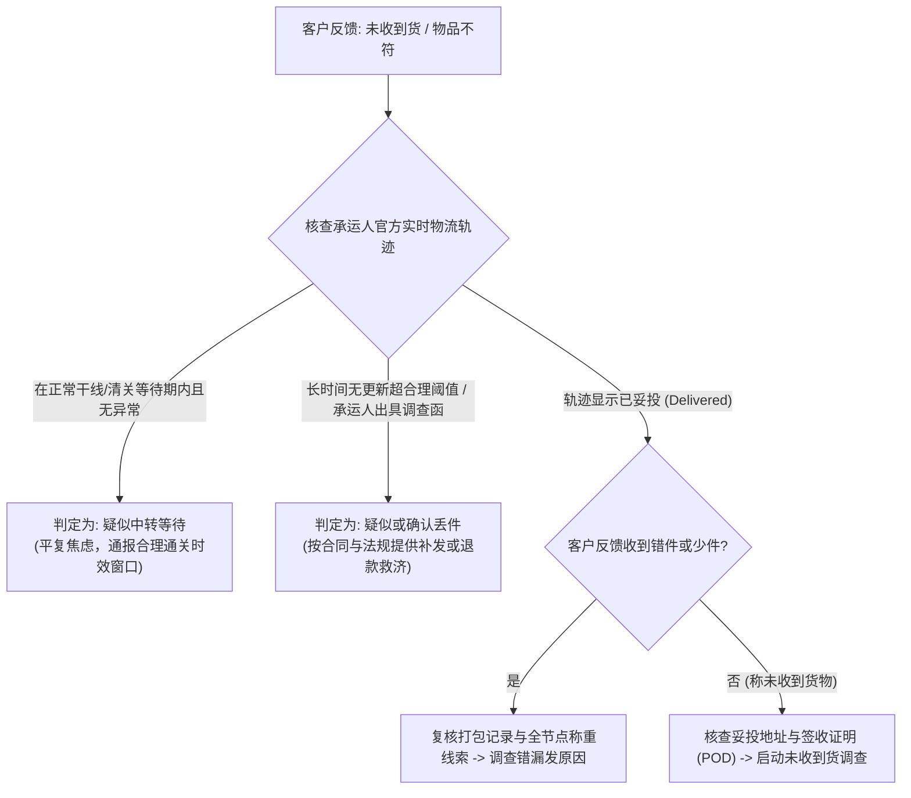
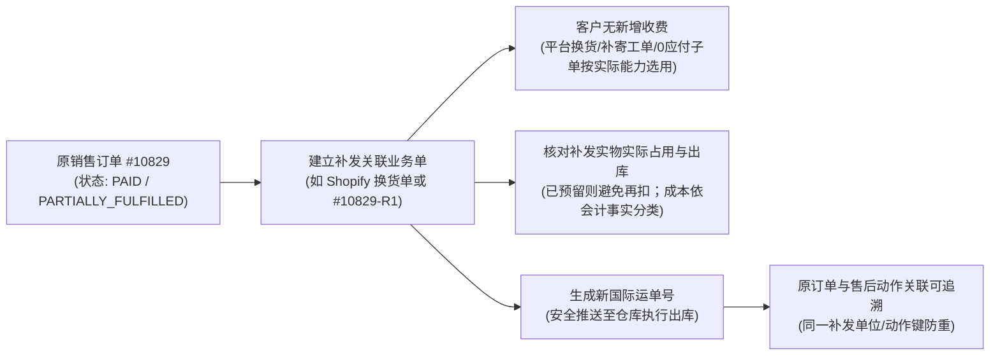
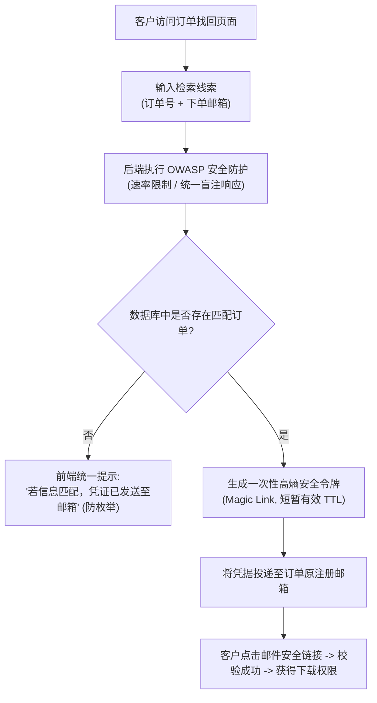
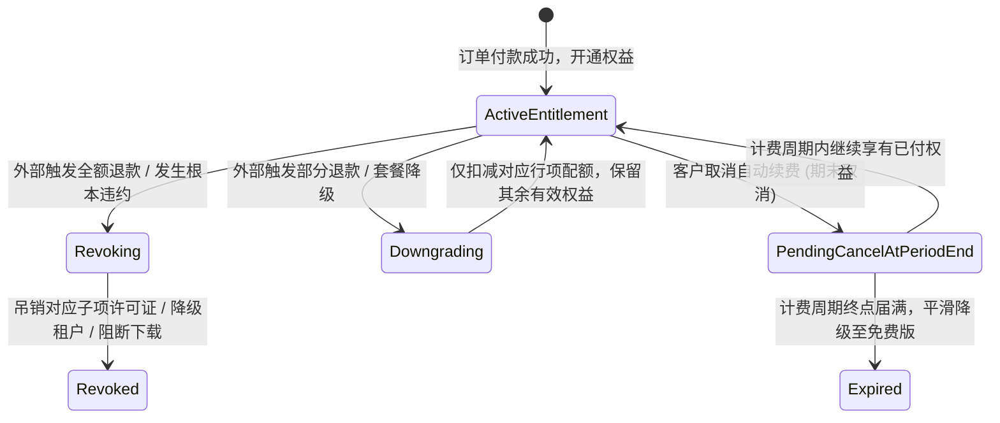
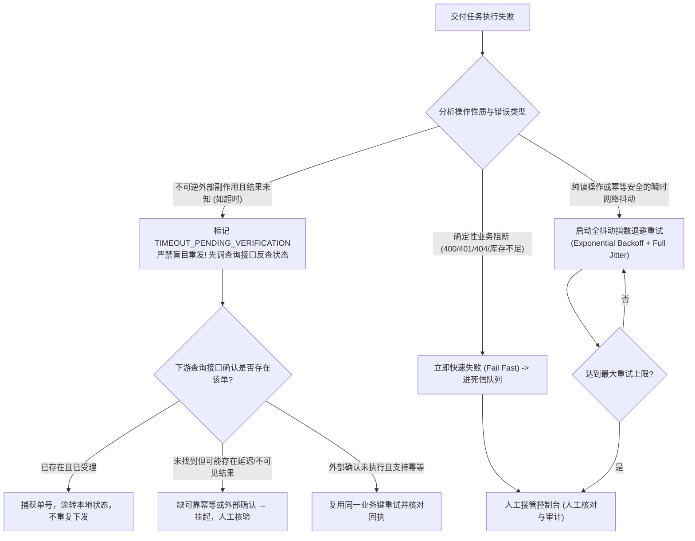
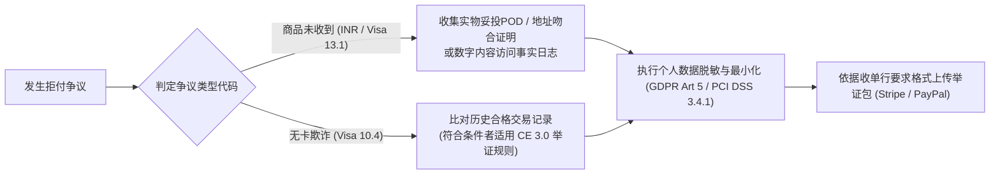

# 4.7 交付出问题了怎么办？

在全球化跨境交付中，经营者需要建立一个客观清醒的系统预期：**随着业务规模与订单体量的增长，交付异常并非偶发过失，而是长物理链路与异构网络交织下的常态事件**。

在前几章中，我们已经搭建了从订单流转、库存扣减、支付核验到正向履约交付（4.6 章）的完整链条。但在跨越数千公里甚至上万公里的物理空间、异构的网络环境、不同的法律管辖区以及复杂的支付规则下，交付链条中的每一个环节都可能发生意外：
- **实物电商领域**：跨国专线包裹轨迹可能在跨洋干线或海关滞留数日毫无更新；物流承运人在最后一百米可能出现派送未妥投、门前被盗或误投隔壁；仓库发货打包可能发生多装漏装、贴错 SKU 面单；甚至补发时因为系统或流程设计不当导致财务重复向客户扣款、或者仓库扣错可用库存；
- **数字商品与软件领域**：客户下单后填错了邮箱域名（如误填为 `gmail.con`），或者邮件被企业级反垃圾网关拦截导致根本收不到订单确认；换了一台新电脑后由于缺乏有效凭据无法恢复已购 License；而如果开发者简单粗暴地允许“只要输入订单号和邮箱就显示全部文件”，整套系统将被黑客编写脚本批量碰撞枚举，造成严重的客户隐私与数字资产泄露；
- **权益管理与退款领域**：客户因自身原因发起取消或退货，但包裹已处于跨国运输途中；或者客户购买了软件后申请部分退款，系统却误将全部核心功能一键吊销；在订阅制业务中，客户点击“取消订阅”后究竟应当立即封停账号、还是保留当前计费周期的剩余权益；
- **自动化流水线领域**：异步任务队列在调用第三方仓储或发券接口时因网络抖动发生超时，系统究竟该自动重试、还是立即告警暂停；如果在超时结果未知的状态下盲目重试，极易向同一客户重复发出双份货物或重复开通两个授权席位；
- **争议抗辩与隐私领域**：当海外买家向发卡行发起争议申诉时，商家必须在法定时限内拿出足以被国际规则认可的客观事实记录，同时又必须遵守目的国数据隐私法规（如欧盟 GDPR）与支付卡产业标准（PCI DSS），不得在举证文件中随意暴露无关人员的敏感个人信息。

本章专为中国大陆个人开发者、独立创作者、跨境出海小微电商及 B2B 定制团队编写。我们将抛弃虚幻的“零故障假设”，聚焦于**交付发生故障后的异常鉴别、安全补救、状态更正、重复执行防御以及证据合规归档**，帮助出海经营者建立一套具有高度确定性与弹性恢复能力的交付异常处置机制。

---

## 4.7.1 漏发、错发或物流异常怎么处理？

跨境物流链条长、节点多，涉及国内揽收、出口报关、国际航空/海运干线、目的国进口清关、本土中转集散以及末端派送。面对海外消费者的质询，**第一步是穿透模糊的抱怨，依据不同可信度的物流事实，精确判定包裹当前处于哪种物理与系统状态**。



### 4.7.1.1 怎样分清物流没有更新、丢件还是错发？

海外买家通常只要超过几天没看到物流轨迹刷新，就会习惯性向客服发送“Where is my order? (WISMO)”甚至直接发起争议。经营者必须建立清晰的判别标准与证据边界：

#### 1. 物流未更新（Tracking Stalled / In Transit Without Scan）
- **客观物理成因**：国际包裹在长距离多式联运中存在多个“信息静默期”。例如：包裹在离开中国机场登上国际货运航班、到抵达目的国机场拆板入库前，中间存在 $3 \sim 7$ 天 `[MODEL_ASSUMPTION]` 的飞行与地面集装箱倒运期；在目的国海关查验环节，若遇口岸随机抽检或法定假期，集装箱滞留清关堆场数天内承运人系统不会有任何新扫描。
- **判断准则**：若包裹处于该专线或邮政服务承诺的**正常服务时效（SLA）容限范围内**，且承运人并未出具异常报警，此状态在大概率上属于正常中转等待，不能直接推定为物理灭失。
- **处置策略**：客服应调取该航线历史同期的平均清关周期数据，向客户透明通报中转节点详情，平复其焦虑感，避免过早盲目补发导致最终客户收到两份包裹。

#### 2. 运输丢件（Lost in Transit）
- **判断准则**：在实操中，丢件的判定具有阶梯性证据强度：
  1. *疑似丢件*：轨迹在某一中转节点停滞时长显著超出合理范围（例如连续超过 $20 \sim 30$ 个自然日 `[MODEL_ASSUMPTION]` 在同一站点无任何后续扫描）；
  2. *正式确认丢件*：承运人系统接口（API）官方回传明确的灭失代码（如 `Lost` 或 `Damaged Beyond Recovery`），或者承运人客服经人工调查后出具了正式的**丢件调查结论书（Loss Investigation Confirmation）**；
  3. **状态码辨析**：注意某些 API 回传的 `Undelivered` 代码往往仅代表末端**“派送未成功（如家中无人、门禁受阻）”**，并不代表物理丢件，必须调取具体子状态描述，严禁直接将其误判为丢失而重复出库。
- **处置策略**：一旦达到合同约定的丢件阈值或收到官方确认，应立即向客户提供重发或退款救济，同时向物流承运人提起货值与运费理赔。

#### 3. 错发与漏发（Wrong Item / Missing Quantity）
- **客观表现**：包裹已顺利送达客户手中，但开箱后商品规格不对（如发错颜色、尺码），或包裹内缺少部分配件、赠品。
- **技术复核手段：出库称重记录比对法**：
  在规范的电商履约流程中，出库称重数据是极具价值的排查线索：
  - **调取比对**：比对仓库出库工位的高精度称重数据（如出库实测毛重 $450\text{g}$）与承运人国际干线称重、以及末端派送扫描时的称重记录（如派送重量 $448\text{g}$）；
  - **证据边界澄清**：
    - 若出库重量本身即为 $280\text{g}$（显著低于理论标准重量 $450\text{g}$），指向**仓库内部少装漏装**的概率极高；
    - 若出库重量吻合，但派送扫描重量显著减少且封箱胶带被动过，指向**长途运输途中遭破损或盗窃**；
    - **重要客观限制**：称重比对是**重要的责任排查线索，但不能单凭称重差值作为绝对法律判责证据**。因为不同称重地点的地磅精度公差、包装箱在潮湿天气下的吸湿增重（可能波动数克至十几克）、以及外包缠膜的增重，均可能造成非人为的称重差异。若涉及高客单错发，仍需结合装箱扫码日志与出库工位监控视频综合核验。

---

### 4.7.1.2 补发要如何关联原单、避免重复扣款或错库存？

在确认丢件或漏发后，“补发货品（Replacement / Reshipment）”是挽回客户满意度的核心手段。不同体量的商家有不同的系统路径，但底层逻辑必须保障**订单链路清晰、不重复扣款、且库存与财务账实相符**。



#### 1. 补发方案的分流实践：平台原生 vs 自建系统
- **路径 A：复用成熟电商平台原生换货能力（如 Shopify）**：
  在 Shopify 等成熟独立站平台中，官方推荐通过订单详情页的**“退货与换货（Return & Exchange）”**或**“编辑订单（Edit Order）”**流程操作。系统会自动创建挂钩原单的换货明细，允许添加补发的替换商品，将补发商品差价调整为零，并在原订单时间轴（Timeline）中完整记录履约历史，无需外部侵入式开发；
- **路径 B：自建 ERP / 数据库主从关联架构**：
  对于自研系统的团队，补发不能直接强行覆盖原单的旧物流单号（这会导致历史凭证灭失），也不能脱离原单新建一个独立的销售单（会导致营收统计虚增）。应当创建专用的**补发子订单（Replacement Order）**：
  - 数据模型中记录 `parent_order_id = #10829`，补发单单号标记为 `#10829-R1`；
   - 对实际无需顾客额外付款的补发要**确保不再触发重复扣款**；可以采用带原订单关联的仓储补寄指令、平台原生换货记录或0应付售后子单，**不强制所有平台必须新建0美元订单**。合法补发多次时应以原行项+交付单位+补发动作序号记录、审核，并有稳定唯一业务键。

#### 2. 库存扣减与售后成本会计归属
- **库存占用必须避免重复扣减**：只在实际补发占用尚未计入库存时再预留/扣减，若平台原生换货/仓储系统已经预占应核对并避免二次扣Available。补发与退货入库各记独立事实；受损退货未验货不可恢复可售。
- **补发成本不能一律认作营业外支出或保修成本**：应依据真实售后性质、合同、适用会计准则与经营主体核算商品、仓储、运输及客户补偿；订单收入不能因新建0应付业务子单而增加。

---

### 4.7.1.3 客户什么时候需要重新确认交付地址或方案？

补发并非盲目将原货物向原地址再次投递。如果第一次投递失败的根本原因出在收件信息不完整或特定承运通道限制上，未经确认直接发货，极易导致**二次退回，造成双倍的运费与货损**。

#### 1. 必须触发客户二次确认的典型场景
1. **因地址不全导致的派送失败（Undeliverable as Addressed）**：
   轨迹明确显示“门牌号缺失（Missing Apt/Suite Number）”、“收件人姓名不详”或“邮编错误”。补发前必须由客服联系客户核实补正；
2. **邮政信箱（P.O. Box）地址与承运渠道**：若想改用其它快递，应先核实具体国家、服务产品及承运人是否支持P.O. Box、要求何种可投递地址；**不能笼统断言全球全部商业快递均不送邮政信箱**。如实际线路不支持，需联系买家确认合法可达替代地址。
   若首次小包因延误导致客户不满，商家希望改用商业快递（如 DHL Express、FedEx）加急补发。然而，**除特定国家的极少数特殊邮政协议外，主流国际商业快递普遍无法投递到各国的 P.O. Box 虚拟邮箱地址**。此时必须要求客户提供具体的实体街道门牌地址；
3. **目的国口岸突发不可抗力**：
   目的国口岸发生罢工、严重自然灾害或战争动荡，原承运通道瘫痪。商家需告知客户并协商是否同意更换其他可用线路或办理退款；
4. **原 SKU 缺货与替代方案确认（Alternative Product Proposal）**：
   若原购买的型号/颜色在供应链端已断货，商家不得擅自用其他商品充数，必须向买家提供明确的替代方案选择（如：同款不同颜色现货、免费升级更高规格版本、或无条件全额退款）。

#### 2. 客户确认流程与地址核实机制
- **核实信息规范**：客服向买家发送地址核对模板，明确指出原地址中疑似缺失的字段（如 Apartment/Unit 号），并引导买家完整提供：收件人、街道门牌、公寓单元、城市、州/省、邮编及联系电话；
- **合理等待期与超时处理**：
  为防范订单无限期悬空，应在通知中设定**合理的反馈等待窗口（例如 5 个工作日 `[MODEL_ASSUMPTION]`）**。但需注意：该等待期属于商户业务操作规范，非普适法定规则。若买家逾期未复，系统应根据适用法律及平台规则，转入主动退款或保留订单暂停履约流程，避免在地址存疑的情况下强行发货。

---

#### 额外分流：怀疑商品不安全时先做风险隔离与召回评估（R02）

**普通漏发、质量不符合同与危险商品召回是三条不同路径**。客户报告冒烟、起火、伤害或其他可能影响安全的异常，不应只按“道歉补发”结束：

1. **先止损**：暂缓相关批次上架、出库和继续销售；向仓库、供货商及相关经济运营商通报，记录危险线索；不在未经评估时要求用户继续使用。
2. **确认范围**：用SKU/批次/供应商/订单映射确定可能受到影响的库存及买家，并核对目的市场及适用安全法规。
3. **决定法定义务**：由负责主体按照当地要求处理主管机构报告、产品撤回或召回、消费者风险告知及补救，不允许将适用的召回义务当作可选客服活动。
4. **留存证据及复盘**：保存真实批次、通知、处置和结果记录；数据访问遵循必要性，完成后核对是否仍存在流通中的受影响商品。

这是针对符合适用安全法规的实体商品的条件性分支，不等于每次普通退货都必须发布召回通知。欧盟参照：[GPSR 2023/988](https://eur-lex.europa.eu/eli/reg/2023/988)。

---

## 4.7.2 客户找不到订单或下载失败怎么办？

在虚拟数字商品（电子书、素材包、3D 模型、独立软件安装包）交付中，“我付了钱但没拿到东西”、“我换了电脑怎么重新下载”是占据相当比例的客服诉求。处理此类问题不仅关乎用户体验，更直接关乎**系统核心数据与客户隐私的安全防线**。



### 4.7.2.1 找订单与证明本人有权访问，是一回事吗？

很多非技术出身的跨境卖家甚至初级工程师，常在这个逻辑节点上犯下灾难性的架构错误：**将“检索订单的索引”与“执行敏感操作的身份凭据”混为一谈**。

#### 1. 概念解耦：检索线索 vs 授权凭据
- **检索线索（Lookup Keys）**：如订单号 `#10829`、收件人姓名、或者公开发布在社交媒体上的交易截图。这些信息在商业流转中经常暴露给海关、货代、快递员及三方插件，属于**低安全强度的半公开数据**；
- **授权凭据（Authorization Credentials）**：如用户的专属登录会话（Session Cookie）、受保护的密码学签名令牌（JWT）、或是能够证明对账户/邮箱拥有直接控制权的强认证。只有持有授权凭据的主体，才具有下载数字资产、解绑机器或变更交付目的地的合法权限。

#### 2. 经典安全漏洞反例：前台“订单号直通车”
某些独立站为了图省事，在前端提供一个表单：用户只要输入 `Order ID: 10829` 和一个邮箱，点击“查询”，页面直接渲染出该订单购买的付费电子书下载链接、软件许可证密钥（License Key），以及客户真实的住宅地址与手机号。
- **遭受攻击推演**：攻击者利用自动脚本编写循环，从 `#10001` 开始自增遍历到 `#20000`，配合常见域名后缀字典进行碰撞。由于表单直接吐出真实数据，攻击者可以在短时间内批量爬取该站客户的个人隐私（PII），并洗劫全站所有数字资产向外网免费扩散。
- **架构铁律**：**前台公开网页表单只能作为“找回申请的收集入口”，绝对不能作为“敏感资产的直接展示出口”**。

---

### 4.7.2.2 无法收邮件或换了设备，如何安全恢复？

在真实世界的跨国交付中，经常出现以下两种高频异常分支：

#### 场景 A：客户下单时填错邮箱或原邮箱彻底失联
客户既收不到初始发货邮件，也无法通过常规找回机制接收邮件验证码。
- **严防“凭收据截图直接改邮箱”的安全陷阱**：
  某些客服人员习惯于让客户发来 Stripe/PayPal 的扣款单号、金额和卡后 4 位，核对一致后就直接帮客户把订单改绑到攻击者提供的新邮箱上。**这是一个高危漏洞**！因为交易单号与扣款截图可能通过邮件转发泄露、或者在公共电脑上被他人获取。
- **正确的安全恢复与改绑流程**：
  1. **辅助线索定位订单**：Stripe 交易号（`pi_`/`ch_`）、实收精确美分金额、卡后 4 位仅能作为客服在后台**检索定位目标订单的辅助线索**，绝不能单凭这些信息直接确认新申请人拥有该资产的合法处置权；
  2. **强身份核验与风控升级**：
     - 若客户拥有原站注册账号，优先要求其登录已验证的原账号发起工单；
     - 对游客且原邮箱完全失联，**不要收集银行短信动态码、3-D Secure验证码、银行App的授权/冲正代码或支付账号密码**，这类资料不是商户普遍可向PSP验证的资产归属凭据。应先检查原站已认证会话、支付平台明确提供且实际可验证的正式客户核验途径；没有可信核验渠道时由有限权限客服升级人工审查、记录授权和风险，**无法可靠核身就暂停改绑或许可转移**。支付单号、金额及末四位仅为找单线索。
     - **风险分级延迟**：对高风险资产改绑可酌情设置如24小时的审核延迟（**教学假设[MODEL_ASSUMPTION]，非通用法定义务**）；尽可能通知原有效联系方式，验证新邮箱所有权并留存限权审计/撤销途径，不把延迟本身当作身份核验。
  3. **数据合规红线**：客服人员在任何情况下**均严禁要求客户提供信用卡完整卡号（PAN）、密码或卡背面安全码（CVV/CVC）**。

#### 场景 B：客户更换新电脑导致本地离线 License 丢失
- **桌面软件的席位重置控制台**：
  为避免每次换设备都找人工客服，应在买家账户中心提供“自助设备管理”功能。用户通过验证码登录后，可查看当前许可证已绑定的机器列表（展示机器命名与最后激活时间），并允许其点击“解绑此设备（Deactivate）”。
- **频率熔断保护**：
  为防范恶意将买断制单人许可证分享给多个好友轮流解绑使用，系统必须设置合理的解绑频次上限（例如：单许可证每月最多允许自主解绑 **2 次** `[MODEL_ASSUMPTION]`），超出配额后强制进入人工审核通道。

---

### 4.7.2.3 如何防止被猜测订单信息的人批量找回？

为了彻底封死黑客利用找回功能进行批量撞库与数据爬取，必须参考 **OWASP（开放式 Web 应用程序安全项目）《找回密码安全备忘单》（Forgot Password Cheat Sheet）** 的工业级安全规范：

#### 1. 响应一致性与时间盲注防御（Prevent Account Enumeration）
无论用户在“找回订单”表单中输入的订单号或邮箱是否存在，系统的前端展示与接口响应报文必须保持**逻辑一致**：
- **正确提示**：“若您提交的订单编号与邮箱信息匹配，系统已向该邮箱发送了安全的数字凭据找回链接，请检查您的收件箱及垃圾邮件夹”；
- **错误反例**：严禁提示“该订单号不存在”或“该邮箱与订单号不匹配”。此类差异化提示直接向攻击者出卖了系统内部的有效订单号，为枚举攻击提供了判别探针；
- **响应时序安全**：在服务端执行逻辑时，无论是否命中数据库，均应保证执行耗时在统计上无显著差异，防范攻击者利用毫秒级的时间差（Timing Attack）进行侧信道盲注推测。

#### 2. 多维度速率限制（Rate Limiting）
在 API 网关层或 Web 应用层（如借助 Cloudflare WAF 或 Nginx 模块）实施多维度滑动窗口限流：
- 对单 IP 地址：限制每分钟最多发起 5 次找回请求 `[MODEL_ASSUMPTION]`；
- 对单目标邮箱：限制每小时最多接收 3 封找回邮件 `[MODEL_ASSUMPTION]`，防止攻击者利用商家的发信接口对客户实施邮件轰炸。

#### 3. 风险自适应验证码（Adaptive CAPTCHA）
在找回表单接入人机验证（如 Cloudflare Turnstile、Google reCAPTCHA v3 或 hCaptcha）。可采用风险自适应策略：对常规低频访问保持静默，当检测到 IP 突发高频或客户端环境存疑时弹出交互式验证码，平衡无障碍访问与自动化脚本防范。

#### 4. 高熵单次魔法链接（Magic Link with Short TTL）
- 发送到客户邮箱中的找回链接，必须携带由密码学安全随机数发生器生成的凭据令牌（如 32 字节高熵随机数：`token = crypto.randomBytes(32).toString('hex')`）；
- 该令牌必须具备**短时失效性（TTL 通常设定为 15 ~ 30 分钟 `[MODEL_ASSUMPTION]`）**与**单次有效性（Single-use Nonce）**，用户点击并成功校验后，系统立即将该 Token 标记为已失效，防范邮件转发泄露后的长期安全风险。

---

## 4.7.3 取消、退款或退货后，产品权益怎么调整？

在电子商务的完整闭环中，**退款不是单纯的资金原路返回，而是涉及“资金流、物料库存流、数字权限流、履约任务流”的多系统正交状态同步**。处理不当将直接引发资金已退但权限未收回、可用库存计算错乱或重复向仓储发运等严重业务故障。



### 4.7.3.1 已发货、未使用与已消费服务应如何分流？

不同交付形态的产品，在发生取消或退款时所对应的物理约束与法律权利截然不同：

#### 1. 实物类商品：已发货 vs 未发货
- **未发货（Unfulfilled）状态下的取消**：
  若仓库尚未开始打单拣货，系统应在本地数据库事务中拦截发货任务，将订单状态更新为 `CANCELLED`，通过支付网关原路退款，并将锁定库存（Committed Stock）原样回滚释放为可用库存（Available Stock）；
- **已发货（Fulfilled / In Transit）状态下的取消请求**：
  国际跨境包裹一旦由干线承运人揽收起运，在物理上往往难以中途召回。根据适用消费者法律（如欧盟远程销售法规），消费者享有法定撤回权，但退回运费的承担需依据商家在售前是否合规向消费者明确披露。若包裹无法中途拦截，通常需待包裹抵达后由买家拒收退运或自费寄回指定海外仓，经仓库清点验货后办理退款。若承运人支持有偿中途拦截，则在拦截成功确认后再行结算。

#### 2. 数字文件与软件：法定撤回权的严格适用条件（以欧盟 CRD 指令为例）
依据欧盟《消费者权利指令》（Directive 2011/83/EU 现行有效文本，特别是 **Article 16(m)** 与 **Article 8(7)**）：
- **法定撤回权豁免的三大法定前提**：
- **付费的非有形介质数字内容消费者合同**：在欧盟CRD适用时，消费者提前开始履约导致撤回权丧失须满足以下规定条件；**持续提供的数字服务与专业服务**可能按不同规则处理，不应直接混用数字内容的例外：
  1. 消费者**事先明确同意（Prior Express Consent）**在法定 14 天撤回期届满前即开始履行交付；
  2. 消费者**明确承认（Acknowledgment）**一旦开始交付即丧失其撤回权；
  3. **至关重要的确认要件（Article 8(7)）**：经营者必须在合理时间内、且最迟在交付开始前，通过**持久介质（Durable Medium，如发送确认邮件）**向消费者提供包含上述同意与承认内容的合同确认书。
- **持久介质不限于电子邮件**：若经营者未按Art8(7)提供包含同意与承认内容的合同确认（如可保存邮件或其它合格**持久介质**），不得仅凭网页勾选认定撤回权已丧失。撤回权例外也不免除质量缺陷/不符合合同的法定救济，适用法域及成员国实施规则需核实。

#### 3. 定制商品与已消费服务：工作量（SOW）折算与违约救济
依据欧盟 CRD 第 16(a) 条（完全履行的服务）及第 16(c) 条（个性化定制实物）：
- 按消费者要求定制或明显个性化的实物可能符合EU CRD 16(c)的无理由撤回例外，**不代表商品瑕疵、未达合同要求就一概不得退款**，具体要依法域、商品及合同核查。
- 对于专业服务/数字服务，应按其实际合同类型区分请求提前履行、已履行部分及完全履行后可能适用的撤回权例外；若在撤回期内合法撤回，收费与退款须按适用法律、事先告知和合法请求/同意确定，不能从数字内容16(m)直接推出服务费不可退。

---

### 4.7.3.2 全额与部分退款，哪些权限需要调整？

支付服务商推送的退款事件（如 Stripe `charge.refunded`）涵盖了全额退款与部分退款等多种形态，系统必须通过事件载荷中的属性进行精准分流：

#### 1. 退款状态的异步性辨析
退款由独立Refund对象及状态组成，必须**核实可信PSP退款对象、商户归属、原订单、金额和币种及成功状态**，并依据合同确定实际需要撤回的**具体权益单位**。退款`pending/failed`并非已退款；“补偿性退款”也可能不需要撤权。多笔部分退款需按**refund ID唯一**重新计算同币种累计金额，不能信任单条通知推断全单退款。

#### 2. 全额退款 vs 部分退款的权限调整矩阵

| 退款形态 | 触发事件与金额判定 | 权限与资产调整规则 | 数据库订单主数据流转 |
| :--- | :--- | :--- | :--- |
| **全额退款（Full Refund）** | 经可信PSP查询确认退款成功，按币种和原支付基数重新计算累计金额 | 只终止**有明确合同/售后依据**需撤销的订单行项和交付单位；独立获授权或依法继续有效的权益不得盲撤 | 付款维度记REFUNDED，订单履约史与售后状态保留，不能仅因金额相等就强制CLOSED |
| **部分退款：多件退一** | 同一订单行项合法购买3份，确认其中一份对应的退款决定 | 仅撤回有记录的`(order_item_id, fulfillment_unit_no)`，不能以行项号撤销其它2份 | 付款维度PARTIALLY_REFUNDED，其余交付/权限仍有效 |
| **部分退款：套餐降级** | 客户从企业版中途降级为个人版，退还未消耗差价 | **调整功能配额**：保留核心基础权限，扣减高级特权（如降低并发数、收回专属席位） | 支付状态：`PARTIALLY_REFUNDED`<br/>订阅状态：更新为新方案 |
| **部分退款：体验补偿** | 因网络短期卡顿，商家主动向客户退款 $20\%$ 作为关怀（Goodwill） `[MODEL_ASSUMPTION]` | **完全不调整使用权**：客户继续享有完整的正常付费权益，严防误撤权引发二次投诉 | 支付状态：`PARTIALLY_REFUNDED`<br/>履约状态：保持 `FULFILLED` |

---

### 4.7.3.3 如何核对撤权、库存和订单都变成正确状态？

退款与售后处理的最核心工程要求是**多系统状态的正交一致性**。正如我们在第 4.5 章中所确立的模型，绝不能用单维状态机揉杂所有业务。

```sql
-- 教学性事务骨架，非可直接投产的完整SQL；预先建UNIQUE(provider,refund_id)
-- 与 UNIQUE(business_action_key)，按订单行项+交付单位记录权益
BEGIN;
-- 可信核验PSP Refund对象: succeeded, merchant/order, currency, amount,
-- 已明确哪一个交付单位应撤权；pending/failed必须停在待确认。
INSERT INTO refunds_applied(provider,refund_id,order_id,amount,currency,status)
VALUES (:provider,:refund_id,:order_id,:amount,:currency,'succeeded')
ON CONFLICT (provider,refund_id) DO NOTHING;
-- 若INSERT未插入新行，表明重复业务事实：必须由程序在此检查并中止状态/撤权动作。
-- 仅首次成功插入时，锁订单/受影响单位并基于已成功退款重新核实累计金额。
UPDATE orders SET refunded_amount=:recalculated_amount,
 payment_status=:trusted_payment_state, updated_at=NOW()
WHERE id=:order_id;
-- 对每一份需要撤回的(行项,交付单位)建立独立持久动作，
-- 补偿性退款如无撤权依据则不创建。
INSERT INTO entitlement_revoke_outbox
 (business_action_key,order_id,order_item_id,unit_no,refund_id,status)
VALUES (:stable_action_key,:order_id,:order_item_id,:unit_no,:refund_id,'PENDING')
ON CONFLICT (business_action_key) DO NOTHING;
-- 这里还有一道不可省的程序分支：
-- IF 本次refund INSERT受影响行数 != 1: 只读回已处理事实、COMMIT并退出；
-- ELSE: 才能锁定订单行项/单位，并执行后面的UPDATE与Outbox INSERT。
COMMIT;
```
**注意：代码是分步骤的教学草图，不是单段可直接执行的完整SQL。** 正式实现须在数据库事务/受信任程序中落实“**只有本次退款事实新增成功才继续**”的分支，处理并发争用、原币种累计金额上限、合法撤权依据和异常回滚。**外部许可证撤权不属于本地ACID事务**：Worker按稳定动作键核对下游结果并执行可重试撤权，未知时人工补偿。全额或部分退款均不得用整订单/整行项一条UPDATE盲目撤所有码。

#### 实物退货的库存回滚红线：验货前严禁直接入库
在实物退货场景中，初级运营人员常犯的错误是：**前台一点击“同意退货”，系统库存自动加上 1**。
- **严重后果**：客户退回的商品可能已经被暴力使用破损、缺少核心包装甚至退回的是一个空盒。系统自动加上库存后，该破损件会被自动分配给下一位新买家，直接制造第二次灾难性的客诉差评；
- **正确库存流转 SOP**：
  退货包裹抵达海外仓后，必须首先进入**“退货待检区（Quarantine / Return Inspection Area）”**。只有当质检员完成拆箱验收并标记为“原包装完好、可二次销售（Resellable）”时，方可执行 WMS 入库操作回滚至可用库存池；若已损坏，则必须系统记入“报废损耗品库位（Damaged / Scrap Location）”，不得回流到销售池。

---

### 4.7.3.4 取消订阅后，剩余使用期和已交付内容怎么算？

在现代跨国软件出海与 SaaS 业务中，“取消订阅（Subscription Cancellation）”的处理方式直接影响到客户满意度与商家的合规法律风险。

#### 1. 行业标准准则：取消自动续费 $\neq$ 立即剥夺已付费权益
- **期末取消是一种常见的商家产品策略，但不是Stripe取消API的默认行为，也不是全球统一法律规则**。若合同允许并选择继续提供已付周期服务，商户需明确设置`cancel_at_period_end=true`，核对当前已付款周期；仅取消自动续费不自动等于立即撤权：
- **业务逻辑**：买家在 10 月 1 日支付了一整年的年付会员费用，其当前计费周期（Current Period）有效期至次年 9 月 30 日。若买家在 11 月 15 日主动在个人中心点击“取消订阅”；
- **权益判定**：**系统通常不应当立即封杀其账户！** 而是通过 Stripe API 将订阅对象的属性设置为 `cancel_at_period_end = true`。买家**依约继续享有其已付费的完整功能特权，直至当前计费周期届满**；
- **到期后的实际权限**：当确实达到已付款有效期且无续费/恢复资格时才按合同平滑降级；不能仅看到`customer.subscription.deleted`就忽略订阅项现有已付权益或旧事件乱序。通知客户、结算以及后续退款独立处理。

#### 2. 即时终止（Immediate Cancellation）的真实 API 行为与退款解耦
在某些场景下（如发生严重违约、客户欺诈、或因重大故障双方协商提前解除契约）：
- 商家可调用 Stripe API 直接终止订阅（`stripe.subscriptions.cancel(sub_id)`）；
- **Stripe取消/余额/现金退款的准确区别**：`POST /v1/subscriptions/{id}` cancel API通常**立即取消订阅**，`prorate`默认**false**，**不会自动生成按比例信用余额或原路退款**；期末取消需更新订阅并明确设置`cancel_at_period_end=true`。是否进行比例账单调整、生成应收/抵扣余额以及是否实际现金退款，取决于API参数、账单和商家依法依约作出的决定；需单独核验Refund对象成功。[Stripe取消API](https://docs.stripe.com/api/subscriptions/cancel)、[取消指南](https://docs.stripe.com/billing/subscriptions/cancel)。

---

#### 法定质量不符合合同：不同于14日无理由撤回与商业保修（R05）

| 客户情形 | 本章先判断什么 | 可能的履约处置 |
|---|---|---|
| 在有效撤回权内不想要商品 | 消费者身份、交易模式、期限、告知/例外 | 依适用法处理退回及退款，并明确退运条件 |
| 商品本身不符合约定 | 是否在法定符合性责任期间内，缺陷类型及举证规则 | 按适用条件维修或更换，符合规定情形时减价或解除合同 |
| 商品可能不安全 | 是否涉及伤害风险、危险批次或官方通报 | 立即进入上方安全隔离、主管部门报告/召回评估 |
| 商家额外承诺保修 | 商业保证条款和法定权利是否并存 | 履行自愿保证，但不得以商业保修压低消费者法定权利 |

在适用[EU 2019/771指令](https://eur-lex.europa.eu/legal-content/EN/TXT/?uri=CELEX%3A32019L0771)与各成员国实施规则的欧盟B2C货物销售中，存在法定符合性责任和按条件选择维修/更换等救济，部分场景有至少两年的责任期间及成员国更有利规定；**不能把“已超过14日”直接作为拒绝全部质量救济的理由**，也不能保证客户对任何小瑕疵均可立即全额退货。注意维修/更换的比例原则、合理期限和由谁承担必要取回费用，并在订单记录中留存处理事实。

对数字内容/服务，适用时转用[EU 2019/770](https://eur-lex.europa.eu/eli/dir/2019/770/oj/eng)的符合性与救济规则，不把实体商品流程原样套用到软件。财务原路退款的执行权限和账务核验仍由第三板块负责。

---

## 4.7.4 自动交付失败或重复执行怎么办？

在由 Webhook 与异步队列驱动的全自动化交付流水线中，最大的架构灾难并不是任务第一次执行失败，而是**在网络超时、机器崩溃或错误重试时，发生重复发货或重复开通**。系统必须具备清晰的重试容错与幂等防御能力。



### 4.7.4.1 任务失败后，怎样决定重试还是暂停？

当自动化 Worker 在调用下游接口（如 3PL 仓储打单 API、数字卡密池发卡接口、邮件服务网关）遭遇报错时，必须根据**操作是否具有不可逆物理副作用**以及**错误类型**实施严格分流：

#### 1. 瞬时可重试错误（Transient / Retryable Errors）
- **典型特征**：由网络通信抖动、下游服务短期负载过高引发的非业务实质性错误。例如：
  - HTTP 429 Too Many Requests（下游频次限流，需读取 `Retry-After` 响应头）；
  - HTTP 502 Bad Gateway / HTTP 503 Service Unavailable（下游网关短暂停机维护）；
- **429/502/503可被视为暂时性失败候选，不代表写操作没执行**。只有只读请求或下游明文支持并已验证相同业务动作键幂等的写请求，才可依`Retry-After`及指数退避限次重试；对于3PL发货/发码等不可逆操作，结果未知时暂停，先查询可信状态、必要时人工接管，**不能仅依HTTP状态码宣称安全重试**。

#### 2. 永久性不可重试错误（Permanent / Non-Retryable Errors）
- **典型特征**：由请求参数非法、业务前置条件不满足引发，盲目重试无法自愈。例如：
  - HTTP 400 Bad Request（发运地址格式解析错误）；
  - HTTP 401 Unauthorized / HTTP 403 Forbidden（API 密钥过期或权限不足）；
  - 业务接口返回明确的 `OUT_OF_STOCK`（卡密池已彻底告罄）。
- **处理策略**：**立即快速失败（Fail Fast），绝对严禁盲目重试！** 死循环重试只会白白耗尽服务器队列资源并打满日志磁盘。系统必须立刻将任务置为挂起状态，推送企业告警，等待人工介入。

---

### 4.7.4.2 怎么确认补交没有重复发货或开通两份？

在所有自动化异常处置中，网络超时（Network Timeout）是最危险的情形。**因为客户端超时，仅仅代表“没有收到响应”，下游系统实际可能已经执行成功！**

#### 1. 超时场景下的“先反查、后重试”（Query Before Retry）
当调用 3PL 仓储创建发运单遭遇超时异常时，系统的真实状态是**“结果未知（Unknown State）”**。
- **最终一致性延迟防范**：
  Worker 在处理超时任务时，必须首先调用下游系统的“按商家单号查询发货状态接口”；
  - **重要技术陷阱**：在大型分布式系统或传统仓储 WMS 中，下游系统的只读查询接口可能存在**主从同步延迟或内部异步消息堆积**，刚超时的订单可能在前几秒查不到！
   - **查无记录不等于保证未执行**：等待5–15分钟仅为`[MODEL_ASSUMPTION]`，接口可能有同步/缓存延迟。必须确认服务商**实际支持**可信的查询、商户参考号唯一性或同动作幂等后才能自动重试；若无法核实，应人工核对，保留未知状态和仓配工单，不从时间窗口推断绝对安全。

#### 2. 业务动作级幂等键与提供商能力边界
- **细粒度幂等键设计**：
  如果订单包含多个相同 SKU 的合法购买项（如客户一单合法购买了 2 件相同商品），幂等键的设计必须精确到具体的订单行项与单位序号：
  $$\text{IdempotencyKey} = \text{SHA256}(\text{order\_id} + "\_" + \text{line\_item\_id} + "\_" + \text{unit\_sequence} + "\_" + \text{action\_type} + "\_" + \text{action\_version})$$
- **客观技术边界澄清**：
必须通过3PL官方文档/合同/实际验收确认其商户参考号唯一约束、幂等保留期及查询方式；**商家自行生成SHA256或传递唯一单号并不保证下游一定做去重**，缺失保障的发货/撤权保留人工接管。

---

## 4.7.5 有人说没收到货，怎样保存交付证据？

在跨境电商的日常经营中，海外买家向发卡行发起争议申诉（Dispute / Chargeback）屡见不鲜。**在国际信用卡组织（Visa、Mastercard）或 PayPal 的争议仲裁规则中，口头辩解毫无效力，只有具备时间戳、客观关联性与真实归属的数据链才能作为有效抗辩证据**。同时，商家在导出与归档证据时，必须严格遵守跨国数据隐私法规，避免因过度暴露敏感信息而引发二次合规灾难。



### 4.7.5.1 哪些订单/物流/使用事实值得保留？

针对不同争议原因代码与产品形态，国际支付争议仲裁所认可的有效证据具有明确的界限与规范：

#### 1. 严格区分：未收到货争议（INR）vs 无卡欺诈（Fraud 10.4 与 CE 3.0）
- **核心概念纠偏：不能将 Visa CE 3.0 笼统套用于未收到货（INR）**：
  - **未收到货争议（INR）**在 Visa 体系中对应 **Dispute Condition 13.1（Merchandise/Services Not Received）**。在此类争议中，核心抗辩目标是证明货物已送达或服务已提供；
  - **Visa Compelling Evidence 3.0 (CE 3.0)** 是 Visa 于 2023 年正式生效的专用规则，其**适用范围被严格限定于 Dispute Condition 10.4（Other Fraud — Card-Absent Environment，无卡环境欺诈争议）**。CE 3.0 允许商户通过提供该卡此前在同一商户处发生的至少 2 笔历史无争议合规交易（且需满足核心要素如 IP 地址、设备指纹或收货地址严格比对一致），在满足特定时间窗口条件下来推翻欺诈指控。因此，**在买家以“未收到货（Condition 13.1）”发起申诉时，不能错配套用 CE 3.0 的历史交易对抗规则**！

#### 2. 未收到货（INR / 13.1）的有效证据清单
1. **实物类商品证据**：
   - 承运人官方追踪记录导出的带有收件人签名的签收证明单（Signature POD）或妥投照片（Photo Proof of Delivery）；
   - 承运人派送记录中的收件地址（城市、州、邮编）与买家结算订单地址**完全一致的比对证明**；
   - 仓库出库复核称重与全程物流称重的一致性记录；
2. **数字文件与软件类证据**：
   - 证明数字内容已可被访问的持久介质确认邮件发送日志；
   - 客户端首次激活时间戳与心跳记录；
   - 客户在平台上执行的核心功能调用日志（Core Value Action Log），证明服务已被实际消费。
- **客观仲裁效力澄清**：上述技术与物流证据是向收单机构与卡组织证明履约事实的核心材料，**但并不构成在法律或商业上 100% 必定赢得所有仲裁结果的绝对承诺**。

---

### 4.7.5.2 怎样导出可理解的事实记录而不泄露不必要的个人资料？

在向支付网关（如 Stripe、PayPal）或金融机构提交举证材料时，经营者常常面临一个两难困境：**不提供详尽信息会被判定为证据不足；但若直接将原始数据未加脱敏整体导出，又会触犯支付卡行业规范（PCI DSS）与数据隐私保护法（GDPR）**。

#### 1. PCI DSS 核心规范条款与界限澄清
在涉及信用卡数据的处理与举证导出中，必须准确理解支付卡产业数据安全标准（PCI DSS v4.0）的不同条款边界：
- **Requirement 3.3.1（敏感认证数据 SAD 禁存）**：授权完成后，**严禁在任何介质上存储敏感认证数据**（包含卡背面三位/四位 CVV/CVC 安全码、完整磁条数据、PIN 码）。在制作举证文件时，**绝对严禁包含任何 CVV/CVC 字段**；
- **Requirement 3.4.1（PAN显示掩码）**：根据适用BIN长度（部分为8位）、品牌及实际角色批准需要执行显示掩码；展示不超过BIN+末四位的一般要求有具体业务授权例外，不能把固定前6后4认作全部银行卡格式的唯一规则。
- **Requirement 3.5.1（存储PAN必须不可读）**：并非唯一方法是加密；满足对应PCI版本和卡品牌适用要求的截断、令牌、加密、符合要求的整PAN强密码学哈希等均可能使用，2025-03-31后涉及哈希还须核对**keyed cryptographic hash**要求。显示掩码3.4.1与存储保护3.5.1须分别核对。[PCI SSC FAQ1492](https://www.pcisecuritystandards.org/faqs/1492/)。

#### 2. 跨国数据最小化准则（以欧盟 GDPR 第 5 条第 1 款 c 项为例）
依据通用数据保护条例（GDPR）的**数据最小化原则（Data Minimisation）**，举证文件中的个人数据必须限于实现申诉目的所必需的最少范围：
- **无关第三方 PII 剥离**：若出具仓库分拣单或多包裹清单，必须严格裁切涂黑同一份底单中出现的其他客户的姓名、电话与私人地址；
- **买家多余敏感信息遮蔽**：对客户的个人身份证号、完整手机号中间位实施脱敏处理。

#### 3. 证据文件的格式与法定留存期规范
- **遵循收单网关的实际格式限制**：
  举证文件必须依据具体支付服务商（如 Stripe、PayPal）的官方格式要求提交（通常支持 PDF、JPEG、PNG 等多附件格式，受单文件大小如 2MB~4.5MB 及总大小限制），**并不存在所谓“必须压缩为单一英文单页 PDF”的统一硬性规定**；
- **分层的数据留存与销毁时限（Retention Schedules）**：
  依据 GDPR 第 5 条第 1 款 e 项（存储限制原则），个人数据的保存期限不得超过实现其目的所需的时间：
   - 财税和争议凭据保存年限应按交易主体/适用法域/数据类别/实际义务核实；**3–7年只是教学示例`[MODEL_ASSUMPTION]`，不是世界统一规定**。减少非必要PII并按有文件依据的存储期限和合法保全例外制定删除计划。
  - 临时性用于申诉排查的非必要详细网络日志，在争议申诉窗口彻底关闭后，应执行安全擦除或匿名化，防范数据长期堆积泄露。

---

## 本章自查清单与实施路径

在完成本章的系统学习后，跨境经营者可对照下表对自身的异常交付处理流程进行逐项自检：

| 检查维度 | 核心核查指标 | 自检标准与达标特征 |
| :---: | :--- | :--- |
| **实物异常判定** | 是否能科学区分停滞、丢件与错发？ | 依据 SLA 容限理性对待中转停滞；以官方灭失代码/调查函判定丢件；将称重比对作为排查线索，避免单凭称重武断定责。 |
| **补发架构合规** | 补发是否能追溯原订单且不重复收费？ | 平台原生换货、关联售后工单或0应付子单均可；补发占用只扣一次，成本科目依实际业务/会计标准分类；外部命令以行项+单位+动作键防重。 |
| **地址与方案确认** | 高危场景是否取得客户重新确认？ | 地址异常、需更换承运或断货等先核实可达地址；P.O.Box是否支持按承运服务/国家确认，合理等待及合法退款安排均依条件判断。 |
| **订单找回安全** | 是否实现“索引线索”与“授权凭据”解耦？ | 遵循 OWASP 规范，前台不直接展示敏感资产；统一响应与合理时序防账号枚举；通过单次高熵短时魔法链接向受控邮箱投递。 |
| **退款撤权正交** | 数字撤回权、部分退款与状态是否自洽？ | 按欧盟CRD具体有偿数字内容/服务及持久介质条件分流；退款对象先核实成功、排重，精确到订单项+交付单位，补偿退款不一定撤权，退货质检后才能回流可售。 |
| **订阅取消治理** | 是否理清自动续费与使用权？ | 期末取消是商户可选策略，Stripe cancel API通常立即取消且prorate默认false；取消续费、账单余额、退款及已付使用期分别核实。 |
| **自动任务容错** | 未知副作用下是否能防止重复交付？ | 429/502/503与超时均可能已有外部执行，查无单不等于未执行；只有下游验证支持的同业务动作幂等或明确未执行证据才安全重试，否则人工接管。 |
| **证据与隐私合规** | 争议证据与PCI规则是否区分？ | INR(13.1)与欺诈10.4 CE3.0分开；PCI 3.3.1禁授权后存SAD，3.4.1是PAN掩码，3.5.1是PAN存储保护；保留期按地区与目的核查。 |

---

> **全书导引提示**：  
> 当你通过本章掌握了应对物流异常、找回资产、合规退款撤权以及保全争议证据的方法后，你就能为交付异常建立更清晰的处置预案；是否真正具备容错和抗风险能力，仍须经过实际验证。在正式面向海外公众开放前，我们必须进行一次全方位的“实战大考”。接下来请进入 **4.8《上线前怎么检查？》**，我们将系统讲解如何针对实物、数字内容、软件及服务等不同交付形态进行最小试买，检查必要的安全条件并演练灾备回滚。

---

> **正式状态与封板溯源（2026-10-19 / G7语言润色：2026-10-19）**：
> - **正式状态**：`CHAPTER7_FINAL_SEALED / G7_EDITORIAL_OPTIMIZED`
> - **说明**：以独立Writer R2完整正文为底稿，Reviewer经Owner特别授权直接修复C01–C07及直接相关SQL、Mermaid和核查清单；**没有Writer R3交付**。全文冻结5/14题目核验及原稿指纹见[CHAPTER7_SEAL_EVIDENCE_20261019.md](CHAPTER7_SEAL_EVIDENCE_20261019.md)。文稿封板不是支付退款、外部仓库、身份核验或法律合规生产环境的实测证明。
