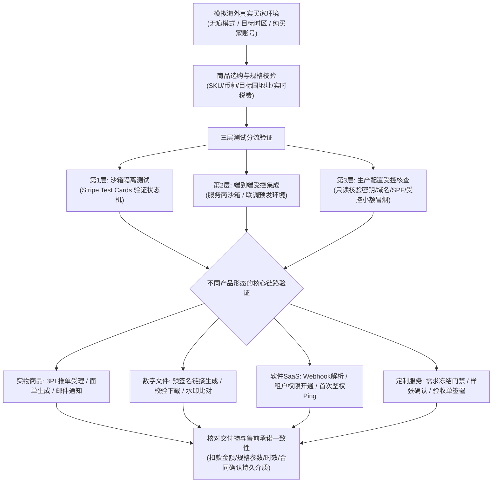
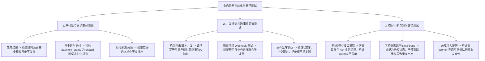
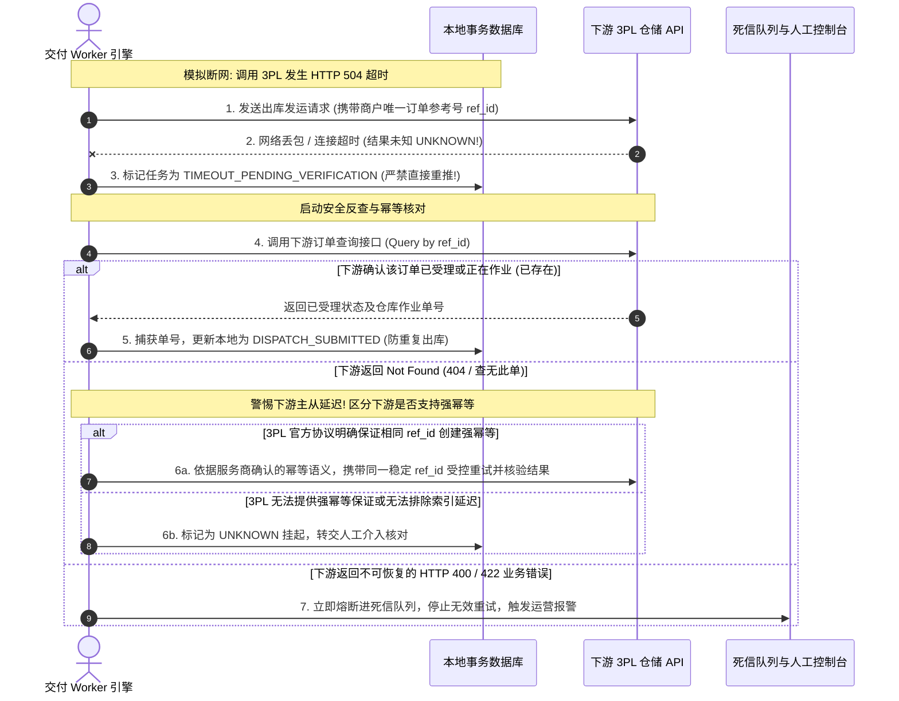
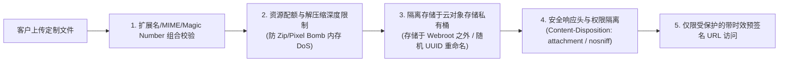
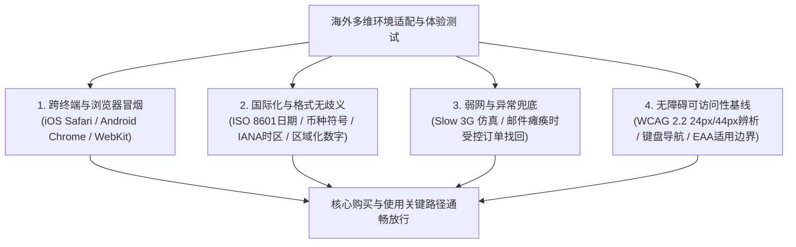
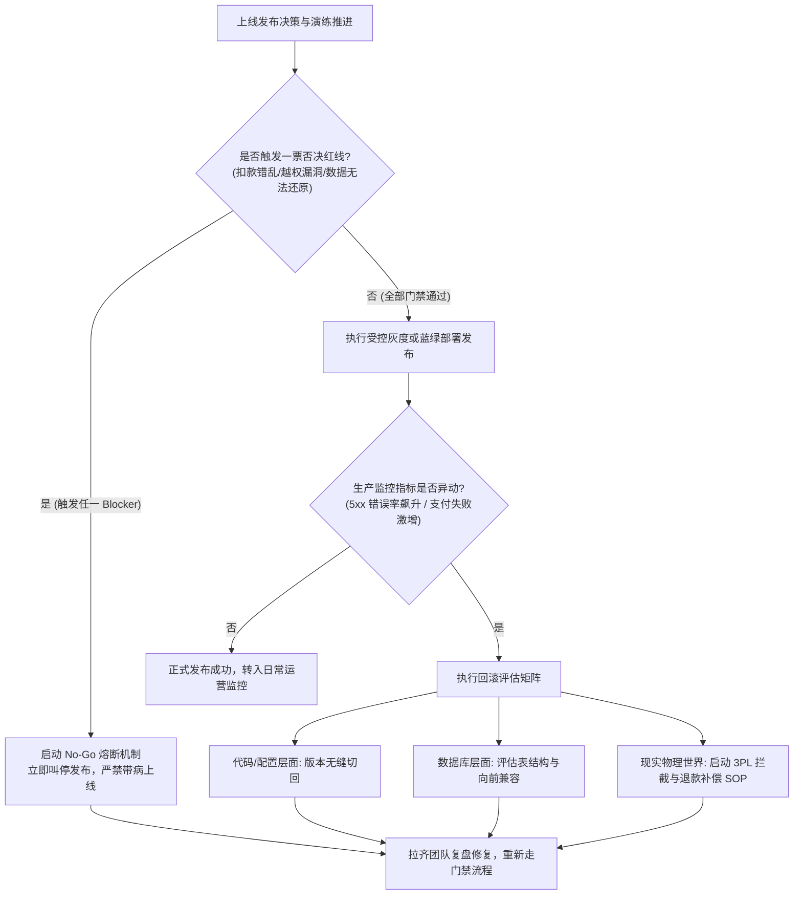

# 4.8 上线前怎么检查？

在跨境出海业务中，系统或店铺正式面向海外公众开放的那一刻，被称为“上线（Go-Live）”。许多初涉出海的独立开发者或小微电商团队会在此刻遇到一个常见误区：**把“代码部署完成”或“店铺后台设置好了”等同于“可以上线了”**。

在缺乏系统性检验的情况下仓促上线，海外客户可能遇到实际故障：
- 客户在手机 Safari 上点击结账，由于货币汇率脚本报错或按钮被底部工具栏遮挡，根本无法提交；
- 异步支付方式（如欧元区常用的 SEPA Direct Debit 或荷兰 iDEAL）在银行清算尚未完成、支付状态仍为 `unpaid` 时，系统就误认为付款成功并向海外仓下发了物理出库单，造成货款两空；
- 用户在订单详情页修改 URL 上的一个数字，竟然能直接下载并查看其他陌生客户的私密定制设计图和家庭住址，触犯欧洲通用数据保护条例（GDPR）与加州消费者隐私法（CCPA）；
- 新版本上线后突发数据库死锁，团队慌乱中执行回滚，却发现备份文件根本无法导入，或者直接把带有真实海外买家敏感隐私的生产备份未经脱敏直接丢给测试人员，造成重大合规泄露。

在前面的章节中，我们已经完整梳理了产品形态（4.1）、首版范围（4.2）、工具复用（4.3）、购买交互（4.4）、订单库存（4.5）、正常履约（4.6）以及售后异常处置（4.7）。**本章承担出海业务的“发布门禁（Release Gate）”职责**：我们要建立一套从买家真实视角出发、覆盖正向试买、负向异常、权限安全、海外多环境适配以及灾难回滚的检验清单，帮助中国大陆开发者和小微商家在按下“正式发布”按钮前，筑牢质量、安全与商业底线。

---

## 4.8.1 怎么像客户一样完整试买一次？

测试出海系统的第一准则，是**彻底脱离“系统管理员”视角，以一个身处目标国家、使用真实海外网络环境与终端设备的“挑剔买家”身份，进行端到端的真实全流程试买（End-to-End Walkthrough）**。

在执行试买时，必须在工程和认知上建立清晰的三层测试边界：
1. **沙箱隔离测试（Sandbox Isolation Testing）**：在支付网关与三方服务提供的测试环境中使用模拟卡号验证接口协议、字段映射与状态机跳转。**沙箱测试通过仅证明“测试链路通畅”，绝不能等同于真实资金结算成功、物理仓库已发货或海外邮件已送达**；
2. **端到端受控集成验证（End-to-End Controlled Integration）**：在预发或受控环境中，将订单流转与实际的下游系统（如邮件服务商、WMS 沙箱环境或预发 Webhook）进行联调，验证跨系统事件传递的完整性；
3. **上线前生产配置只读与受控核查（Pre-launch Production Verification）**：在正式发布前，只读核对生产密钥、DNS 解析、SPF/DKIM/DMARC 邮件发信记录及 SSL 证书状态。若业务确需在生产环境进行真金白银的“小额真实冒烟”（如发起一笔 $1.00 真实扣款并立即原路退款），必须经过严格审批与独立账目标记，**不可强制所有小微商户盲目刷真卡，未在生产真实测试的履约节点必须客观记录为 `NOT_RUN`**。



### 4.8.1.1 不同产品各要经过哪些实际环节？

不同产品形态的履约路径截然不同，试买环节必须覆盖各自的核心交付闭环：

#### 1. 实物类跨境商品（Physical E-Commerce）
- **前置准备**：开启浏览器无痕模式，配置目标市场（如美国、英国或德国）的时区与语言偏好，准备一个未注册过系统管理员权限的全新测试买家邮箱；
- **全链路检验环节**：
  1. *选购加购*：选择指定颜色、尺码变体（Variant），验证规格参数在前端展示、加购载荷与订单行项中是否准确传递；
  2. *地址录入与结构适配*：填写合规的海外目标国地址。**切忌将所有海外地址机械假设为必须包含“Apartment/State/Zip”**——不同国家的地址结构存在客观差异（例如：英国地址的核心在于精准的 Postcode 与街道门牌，无州/省概念；阿联酋等中东部分地区无传统邮政编码，强依赖区域与电话；爱尔兰采用独有的 Eircode；很多欧洲乡村地址并无 Apartment/Suite 字段）。系统必须依据目标销售国实际规则进行字段校验；
  3. *费用计算*：核查系统是否基于收件地实时计算出正确的跨境运费、关税与消费税（Taxes/Duties，如适用 DDP 条款或目标国消费税）及优惠券扣减；
  4. *结账测试*：在沙箱环境中使用支付服务商官方测试卡（如 Stripe 官方提供的 3D Secure 测试卡）完成支付流程；
  5. *履约派单*：确认订单在后台流转为 `PAID` 后，检验向仓储 WMS / 3PL 系统下发拣货单的接口数据包。**必须明确：下游接口返回“已受理（Accepted）”仅代表排队接收成功，不代表仓库已经实际拣货或物理交运**；
  6. *买家通知*：检查买家邮箱是否按顺序收到《订单确认（Order Confirmation）》通知，并在模拟启运后收到包含运单号（Tracking Number）的追踪邮件，确认邮件链接能够正确重定向至承运人官方查询页。

#### 2. 数字文件与素材（Digital Content & Downloads）
- **全链路检验环节**：
  1. *已购资产入口*：买家回到成功页时可显示订单查询/“处理中”状态；只有服务端核实该订单已具备履约资格后才展示下载中心或签发短时预签名链接。不可仅凭前端回跳开通权限；买家关闭页面后也要能从安全订单入口找到资产；
  2. *流式下载验证*：模拟弱网或大文件下载场景，验证下载通道是否支持 HTTP 206 断点续传（Range Requests，若架构采用对象存储原生分发），避免跨国长途传输中断后买家只能从头重传；若采用受控后端代理流式下载，需测试传输超时与内存占用情况；
  3. *数据完整性校验*：下载到本地后，使用哈希工具校验本地文件的 MD5 或 SHA256 哈希值与服务器源文件是否一致，并完整解压测试有无文件损坏或缺少组件；
  4. *动态脱敏水印*：打开下载的 PDF 或设计源文件，检查是否正确注入了该测试订单的脱敏唯一许可证标识（如 `lic_test_982a`），且未泄露未脱敏的买家个人隐私。

#### 3. 软件与 SaaS 会员订阅（Software License & SaaS Subscription）
- **全链路检验环节**：
  1. *周期付款/免费试用演练*：选择月付或年付方案完成沙箱流程，分别测试初期付款已确认、仍待付款及依据合同有效的免费试用；捕获相关 Checkout、Invoice、Subscription 事件，并独立核实其指向的付款事实和有效期。仅收到 `customer.subscription.created` 不证明首次付款成功；
  2. *租户角色开通*：依据已核实付款、有效免费试用或约定的合同授权资格，核对后台用户表与权限事实：应开通的 `PRO`、试用权限及配额生效，不合格的待付款订单不得越权开通；
  3. *客户端真实冒烟*：打开实际的桌面端、移动端 App 或浏览器插件，使用新买家账号登录，向授权鉴权服务器发起首次验签请求（First Auth Ping），验证核心付费功能是否即刻解锁；
  4. *自助手册与凭据*：检查激活邮件中是否包含客户端下载链接、快速上手文档与找回凭据指引。

#### 4. 定制商品与 B2B 交付服务（Custom Products & Professional Services）
- **全链路检验环节**：
  1. *资料准入关卡（Kickoff Gate）*：下单后进入定制信息收集表单，上传测试设计稿并填写定制刻字文本；
  2. *工期倒计时验证*：核对下单前已充分披露且双方有效约定的起算规则；如果约定资料核实后才开始制作，则系统应在资料确认后按约起算；不得假定所有定制/B2B合同均按此规则；
  3. *打样效果确认*：系统是否能生成带水印的虚拟效果图（Digital Mockup Proof），并提供“确认排产”按钮；
  4. *阶段演示与验收归档*：定制服务在演练环境（Staging Server）完成演示，由测试买家在线点击验收，核对《竣工交付单》是否正常归档。

---

### 4.8.1.2 怎样证明测试中交付结果与承诺一致？

“试买成功”绝不等于“屏幕上弹出了一个绿色对勾”，必须建立一份**售前承诺与实际交付物的一致性核对矩阵（Promise vs Delivery Matrix）**，并清晰标记各证据层的测试结论（`PASS`、`NOT_RUN` 或 `UNKNOWN`）：

| 校验维度 | 售前宣传与商户承诺 | 实际测试核验指标与标准 | 验证方法与不一致判罚 | 证据层级与有效性边界 |
| :--- | :--- | :--- | :--- | :--- |
| **扣款金额与币种** | 商品标价 USD $49.00，运费 USD $5.00，税费 $0.00 `[MODEL_ASSUMPTION]` | Stripe 测试后台记录的实收金额必须为 **精确的 5400 cents（USD $54.00）** | 检查支付载荷，若发生多扣税、币种错乱（如将 CAD 扣成 USD），阻断上线 | **沙箱隔离测试验证**：证明扣款算力逻辑无误；不证明真实银行账户资金已完成清算结算 |
| **税费与退款路径** | 结算页承诺展示目标国消费税或进口税明细，支持商家自愿公布的 14 天退款政策（`MODEL_ASSUMPTION`；须逐项核实法定权利与合同） | 涉及征税国家正确计算 VAT/Sales Tax；沙箱发起退款时金额能精确原路计算退回 | 检查税金明细行与退款接口数据包，税额偏差即阻断 | **集成逻辑验证**：证明税费引擎规则生效与退款逆向接口联通 |
| **规格与属性保真** | 买家选择 `Midnight Blue / Size M / 附赠防尘袋` | 后台生成的订单行项与推送到仓库的 SKU 代码应按订单快照严格吻合 | 检查 WMS 推送数据包，若规格丢失或错位，阻断上线 | **数据映射验证**：证明业务层至仓储层规格解析一致 |
| **服务时效与 SLA** | 页面承诺“下单后 24 小时内发出，7~10 个工作日送达” | 订单中心与确认邮件中展示的预计到达时间（ETA）计算逻辑一致 | 检查邮件模板文案与动态计算标签，消除矛盾陈述 | **文案规则验证**：证明买家端展示一致；真实运输时效还受承运人、报关和适用运输条款约束 |
| **法定合同确认书** | 对适用欧盟 CRD 第 8(7) 条的 B2C 远程合同，按法定条件向消费者提供持久介质确认（不自动适用于B2B或所有出海订单） | 在适用的消费者合同中，买家按CRD规定的时点，通过**持久介质（Durable Medium，如可保留并可在适当期限内不变地重现的订单确认邮件或PDF）**收到必要的合同确认与法定信息；消费者撤回权、例外以及数字内容/服务事先同意等按实际交易类型核实 | 检查买家邮箱收件箱，对于确实受该条约束的合同，仅有不可保留的网页弹窗通常不足以完成相应的持久介质确认义务 | **协议内容验证**：证明商户已履行业务交付与法律确认义务 |
| **数字文件可用性** | 宣传中声称“包含 4K 高清原素材与商用授权书” | 下载解压后，素材清晰度真实达标，授权书 PDF 完整无乱码且哈希校验一致 | 人工开箱核验，若文件损坏、缺件或无法解压，判定交付不达标 | **内容质量核验**：证明源资产与买家实际接收内容完全保真 |

---

## 4.8.2 哪些异常情形必须提前测？

真实商业世界中，最考验系统架构与业务逻辑的绝不是一路顺风的正向流程，而是各种网络断裂、时钟抖动、恶意攻击与并发竞争等负向异常。**未经负向测试的异常分支存在未发现故障的风险，严重时可能引发客诉、重复扣款或无法撤回的履约损失**。



### 4.8.2.1 未付款或付款状态未知，会不会发货？

防范错误履约的原则是：**在尚未核实订单具备履约资格前，不得因付款截图、回跳页面或待确认通知自动发货/开通付费权益**。付费订单通常要核实支付成功事实；依法有效的免费试用、无即时扣款的合同信用交付等则按已确认的合同资格授权。**网关确认支付成功 $\ne$ 商户银行账户已结算到账（Payout）**，两者不能混为一谈。

#### 1. 测试用例 A：买家在结账页面直接流失（Abandoned Checkout）
- **操作步骤**：进入结账页后，不输入卡号，直接关闭浏览器标签页，或点击“返回商家”；
- **预期检验标准**：
  1. 系统后台订单状态必须停留在待付款 `PENDING` 或流转为已取消 `CANCELLED`；
  2. **区分平台原生 Committed 库存与自建临时预占**：
     - 若使用成熟 SaaS 平台（如 Shopify），其原生的 `Committed`（已承诺）状态涵盖了已下单未履约、已预留草稿订单或调拨单，有其平台原生的生命周期，并非统一的“30分钟自动释放”；
     - 若为自建独立站或自研结账流程，结账时设立的临时预占库存锁（如 Redis 临时锁定），在超时窗口（如 30 分钟 `[MODEL_ASSUMPTION]`）届满后，必须通过定时任务或事件驱动安全释放为可用库存（Available Stock）。**库存释放必须仅针对“仍有效且未支付的临时预留”，严禁误释放已付款转正订单的库存**；
  3. **绝不能向 3PL 仓库推送物理发货任务，也绝不能签发永久软件许可证**。

#### 2. 测试用例 B：异步付款尚未确权（Asynchronous Payment Pending）
- **客观业务背景**：欧洲常用的 SEPA Direct Debit、荷兰 iDEAL、波兰 BLIK 或部分拉美本地支付，属于异步延时或基于重定向的支付方式。客户在页面点击“确认”后，资金清算需要数小时至数天。依据 Stripe 官方 API 规范，Stripe Checkout Session 对象的 `payment_status` 具有三种明确枚举值：
  - `paid`：按该 Checkout Session 口径付款已满足服务商确认要求；**不表示银行Payout到账，也不必然表示即时扣款**；
  - `unpaid`：按该对象口径付款尚未达到已付条件，可能待付款或异步处理；
  - `no_payment_required`：该Session当前不需要付款，例如 `setup` 模式或安排未来付款的合法场景；**不可仅凭该枚举无条件赠送付费权益**，应核对模式、合同及订阅试用资格。
- **操作步骤**：在 Stripe 测试模式中模拟异步支付方式（如 SEPA Direct Debit），触发初始 `checkout.session.completed` 事件；
- **预期检验标准**：
  1. 系统接收到初始事件时，检查发现 `payment_status == 'unpaid'`，后台订单状态必须流转为 `PAYMENT_PENDING`（付款处理中）；
  2. 系统**必须坚决扣住交付物**，严禁向海外仓派发拣货指令，严禁发放核心权益；
  3. 对采用异步支付的Checkout，收到适用的 `checkout.session.async_payment_succeeded` 后还需核对支付对象、商户、订单、金额币种、风控和履约资格；其他集成模式应以对应官方事件及可信对象的最终付款事实为准。收到明确失败通知或按服务商核实为失败后，才按实际库存占用事实安全释放临时预留；**不能仅凭主观清算超时时间断定失败或重复放货**；
  4. 即使款项最终标记为 `paid`，在实际发货前，系统仍需保留风控校验（Fraud/Risk Review）通道，防止高风险欺诈交易在出库前无法拦截。

#### 3. 测试用例 C：发卡行拒绝与 3D Secure 认证中断
- **操作步骤**：使用 Stripe 专用测试卡号（如模拟 `Card Declined` 余额不足，或模拟 3DS 强身份验证挑战被买家主动放弃或超时）；
- **预期检验标准**：前端界面必须准确捕获发卡行拒绝原因，给出友好的本地化英文提示（如“Your card was declined. Please try another card or contact your bank”），**严禁向用户直接抛出未经处理的后端 500 堆栈错误或数据库底层异常**。

---

### 4.8.2.2 重复提交、迟到事件会不会多扣库存、多发权限？

跨国长途网络延迟高，用户在网络卡顿时反复狂点按钮，以及云服务商在网络抖动时的“至少一次投递（At-Least-Once Delivery）”，必然导致系统遭遇海量的重复请求与事件乱序。

#### 1. 前端防抖与支付意图幂等创建测试
- **测试方法**：在结算页面点击“Place Order”时，使用鼠标快速连击 5 次，或使用自动化脚本在同一毫秒内并发发送 3 个相同载荷的结账请求；
- **预期检验标准**：
  - 前端结账按钮在首次点击后必须立即变为禁用状态（Disabled）并呈现 Loading 状态；
  - 后端创建 PaymentIntent 或 Checkout Session 时，应为同一次**创建请求**使用稳定的 Idempotency Key 并保持参数一致，且在商户侧持久记录订单、支付尝试及服务商支付对象，防止前端并发创建多个付费意图。**Stripe API v1 幂等键可能在至少24小时后被清理**；过期重用可创建新请求，同键异参可能返回错误，不是永久防重复扣款保证。库存应由独立、可追踪的库存占用/转正逻辑确保不二次扣减。

#### 2. Webhook 签名验证与跨事件多维幂等测试
- **安全与隔离测试规范**：**所有 Webhook 压测、重放测试必须在完全隔离的测试环境（Staging）或专用测试接收端进行，严禁使用调试工具直接向生产 Webhook 接收端推送模拟事件，严防生产数据污染！**
- **强制数字验签测试**：测试系统在接收任何 Webhook 请求时，是否首先通过官方 SDK 或底层代码校验请求头中的数字签名（如 Stripe 的 `Stripe-Signature` 配合端点密钥 `whsec_...`）与原始请求体（Raw Payload）。若篡改载荷或签名不符，系统必须坚决返回 HTTP 400 并终止处理。
- **跨事件业务维度幂等验证**：
  - 单纯依靠记录 `event.id`（如 Stripe 的 `evt_xxx`）并建立去重表，只能防御“同一事件 ID 的重复重试”，**根本无法防御指向同一笔业务订单的不同事件或客服人工补发**（例如同一笔订单先后推来了 `checkout.session.completed` 与 `payment_intent.succeeded`，或者后台管理员与系统 Worker 并发处理）；
  - **测试预期标准**：系统底层必须在业务维度实现联合唯一约束或事务排重：例如许可证签发要按 `(merchant_id, order_id, order_item_id, unit_no, action_type)` 或等价稳定**交付单位**建立唯一业务约束，同一订单买两份许可证必须允许两份分别签发，但同一单位的重复事件只能生效一次；订阅续期以已确认的发票/付费周期等稳定事实定义动作身份；3PL以受控仓储任务/履约单位定义一次动作。事件ID去重、支付尝试去重和业务副作用幂等必须分别验证；即使本地记录成功，外部动作也须查询真实结果或人工补偿，**不承诺跨系统绝对恰好一次**。

#### 3. 事件乱序到达防御与状态机合法演进（Out-of-Order Events）
- **测试方法**：人为构造网络乱序场景——先向系统发送一笔订单的退款成功事件（`charge.refunded`），等待系统将订单标记为 `REFUNDED` 且撤销相应权限；延迟 5 秒后，再向系统补发该订单最初的付款成功事件（`checkout.session.completed`）；
- **预期检验标准**：
  - 系统基于状态机版本控制识别出当前订单已处于已退款关闭状态，**坚决拒绝被迟到的付款事件重新激活（消灭“僵尸复活 Bug”）**；
  - **同时注意状态机不能设计为机械的“全局单调不可变”**：系统必须允许合法的售后新事实发生（例如正向流程 `PENDING` $\to$ `PAID`，售后流程 `PAID` $\to$ `PARTIALLY_REFUNDED` $\to$ `REFUNDED`，或出现争议时的 `DISPUTED`）。状态机应当拒绝的是非法逆流与时序倒流，而非阻止合法的后续业务流转。

---

### 4.8.2.3 交付中断能否恢复且不产生重复副作用？

在全自动交付流水线中，服务商必须验证在外界不可控故障发生时，系统的自愈、反查与人工接管能力。



#### 1. 严格区分下游履约状态，切忌凭“受理”断言“已发货”
在与第三方物流仓储（3PL/WMS）对接时，必须建立清晰的状态演进层次：
- `DISPATCH_SUBMITTED`（已向仓库提交受理）：仅代表 3PL 接口接收到了指令，**严禁在此时直接向买家宣布“已发货”或将本地订单标为 `FULFILLED`**；
- `PROCESSING / PICKING`（仓库拣货打包中）：实物正在库内作业；
- `DISPATCHED / SHIPPED`（已出库交运承运人）：实际状态要以仓配/承运商可核实的出库、交运证据为准，**仅生成运单号并不证明实体移交；`FULFILLED` 是各平台可配置的业务状态，不应跨平台机械等同签收**，告知买家已发货前要确认适用节点；
- `DELIVERED`（已妥投送达）：依据物流轨迹回传最终闭环。

#### 2. 下游查询返回 `Not Found` 的未知风险控制
- **致命反例**：当下游调用超时后，Worker 调用下游查询接口，若下游返回 404 Not Found，许多初级开发者会武断认为“下游肯定没收到”，于是立即重新发起一次“创建出库”请求。然而在分布式仓储系统中，下游可能采用了异步入库队列或存在读写分离数据库主从延迟，订单已经进入库内队列但短时间内在查询索引中无法查出。若盲目重发，下游系统一旦缺乏严格的商户参考号排重，将直接打出两份拣货单、**发出两个物理包裹，造成严重的不可逆经济损失**！
- **防御检验标准**：
  - 当下游查询返回 `Not Found` 且之前的外部写结果不确定时，系统必须将其标记为**状态未知（`UNKNOWN`）**，而非“确未执行”；
  - 若 3PL 官方 API 协议明确承诺并可验证基于 `merchant_order_ref` 的创建幂等，才可使用**同一稳定键**限次受控重试并核对真实结果；单纯等待一段时间并不足以证明安全；
  - 若 3PL 官方协议不支持强幂等或无法确认其索引延迟，系统必须坚决暂停自动重试，将任务挂起并转入人工客服/仓管介入核查通道。

#### 3. 区分瞬态网络故障与不可恢复业务错误
- **错误分类测试**：
  - *只读查询或已确认的安全幂等操作*：对 502/503/504、连接超时等可恢复故障，依服务商限流规则与抖动退避策略限次重试；**外部创建出库、退款、改绑等写请求若结果未知，不可仅按HTTP错误码自动重试**。必须先核查既有动作并确认下游具备可验证的同键业务幂等；否则挂起、告警、人工核对；
  - *不可恢复的业务/格式错误*（如 HTTP 400 Bad Request、422 Unprocessable Entity、地址邮编校验彻底失败、违禁品拦截）：**绝对不能盲目重试 5 次**！重试只会持续消耗下游 API 配额并延误排查。系统必须在首次捕获 4xx 业务错误后立即熔断，将任务压入死信队列（Dead Letter Queue, DLQ），触发钉钉/Slack/邮件告警，通知人工介入修正地址。

#### 4. 分布式故障注入（Fault Injection）矩阵检验
为了验证本地事务性发件箱（Transactional Outbox）与消费端容错能力，上线前应在测试环境中完成以下场景的断言：
1. **本地 DB 事务提交前进程崩溃**：模拟在写入业务订单但尚未提交 DB 事务时强制终止进程，断言系统重启后订单与 Outbox 任务均完全回滚，无脏数据；
2. **本地 DB 事务提交后、Worker 发出外部调用前崩溃**：断言服务重启后，后台定时扫描 Worker 能够自动从 `outbox_tasks` 中重新扫出该待办任务并继续派发，保证任务不丢失；
3. **外部已受理但本地确认 ACK 丢失**：模拟 3PL 已经成功接单，但因网络断裂返回的响应未到达 Worker。断言 Worker 重启后能够通过商户参考号反查下游状态，确认既有作业或转人工核对，**不在结果未知时直接二次派单**；
4. **双 Worker 并发争抢同一任务**：模拟两台集群实例在毫秒级同时拉取同一笔待办任务，断言底层通过数据库悲观锁（如 `SELECT ... FOR UPDATE SKIP LOCKED`）或分布式锁确保只有一个 Worker 获得执行权，另一个 Worker 安全跳过；
5. **死信队列（DLQ）重放测试**：模拟人工在后台修正了被拦截的地址错误后，点击“重新执行”，断言该任务能够从死信状态安全恢复并完成流转，且重放不会产生任何副作用。**工程系统追求的是端到端最终一致性与可靠人工兜底，不得宣称绝对的“100% 不丢不重零故障”**。

---

## 4.8.3 客户账号和上传资料安全吗？

在跨境出海业务中，安全与合规不仅是技术问题，更直接关系到商家的法律存亡。一旦发生跨客户数据泄露或恶意文件上传，可能触发安全事件、通知义务与行政监管；例如 GDPR 的处罚上限按具体违法条款、适用主体、情节及主管机关裁量而不同，不能据最高额度推断某次事故的结果。



### 4.8.3.1 客户能否看到别人的订单和文件？

这是 Web 与 API 安全领域最高发的漏洞——**失效的对象级访问控制（BOLA / IDOR, Broken Object Level Authorization）**。

#### 1. 漏洞攻击原理推演
攻击者登录自己的普通账号，其合法拥有的订单号为 `#10829`。攻击者在浏览器地址栏或调用 API 时，故意将参数修改为别人的订单号 `GET /api/orders/10828` 或 `GET /api/download?file_id=5042`。若后端代码仅校验了“用户是否已登录”，却遗漏了校验**“当前登录的用户是否为该订单或文件的合法所有者”**，攻击者便能轻而易举地拖取全站所有客户的姓名、收货地址、电话、已购数字文件与发票。

#### 2. 上线前必须强制执行的 IDOR 越权测试
- **测试环境配置**：创建两个完全独立的测试买家账号：买家 A 与买家 B；
- **测试步骤**：
  1. 买家 A 下单购买商品，生成订单 `#10001`，上传了私人定制设计图 `file_A.pdf`；
  2. 买家 B 下单生成订单 `#10002`；
  3. 使用买家 B 的登录凭据（Cookie / Bearer Token），尝试向后端发起以下请求：
     - `GET /api/orders/10001`
     - `GET /api/orders/10001/invoice`
     - `GET /api/files/download?file_id=file_A_id`
- **合格放行标准**：
  系统必须坚决返回 **HTTP 403 Forbidden 或 HTTP 404 Not Found**，且响应报文中不得泄露任何属于买家 A 的个人数据、商品明细或订单金额。

#### 3. 游客（Guest Checkout）订单访问控制与防枚举遍历
- **严重设计缺陷**：若允许游客免登录结账，部分系统仅凭借自增的订单号（如 `GET /orders/view?id=10001`）提供前台查询。攻击者编写爬虫脚本从 1 递增至 100000，即可在数分钟内脱库所有游客的家庭住址与联系方式！
- **防御检验标准**：
  - 游客订单的对外访问凭据绝对不得使用自增数字 ID，必须生成高熵（至少 128 位随机熵）、不可预测的全局唯一标识符（如 `order_token = uuidv4()` 或加密签名令牌）；
  - 针对订单查询接口设置严格的基于 IP 与邮箱维度的限流机制（Rate Limiting），并配合 Cloudflare Turnstile 等无感人机验证，彻底挫败针对订单号的批量枚举与撞库。

---

### 4.8.3.2 员工能否越权修改订单、导出隐私数据？

内部权限管控（垂直越权与 RBAC 测试）与数据合规是保障企业资产与客户信任的核心。

#### 1. 角色与权限隔离矩阵（Role-Based Access Control, RBAC）
必须严格测试不同权限角色在后台的受控边界：
- **客服人员（Support Role）**：仅允许查看分配给自己的工单与订单脱敏摘要（如姓名与脱敏地址），允许在受控审批下重发通知邮件，**严禁具有导出全量客户数据库权限，严禁查阅或接触支付卡完整明细**；
- **仓库作业人员（Warehouse Role）**：仅允许查看打单发货所需的商品 SKU、收货人姓名与发运门牌地址，**严禁查看商品采购成本底价与客户支付财务明细**；
- **财务人员（Finance Role）**：仅允许查阅汇总对账报表与执行退款操作，**无权随意修改发货地址或下载买家私人定制设计文档**；
- **超级管理员（Admin Role）**：具备系统配置与高阶权限，必须强制开启二步验证（2FA/MFA），防范管理账号因密码泄露被盗用。

#### 2. 操作审计日志（Audit Trail）与 GDPR 数据最小化原则的平衡
在设计与测试操作审计日志时，必须平衡**“追溯内部操作违规”**与**“GDPR 第 5(1)(c) 条数据最小化原则（Data Minimisation）”**：
- **普通系统运行日志（Application / Operational Logs）**：
  - 普通日志避免记录与排障无关的个人信息（如完整电话号码、未脱敏家庭地址），并**不得**记录密码明文、完整支付卡号或敏感认证数据；
  - 普通日志仅记录结构化元数据：操作时间戳（UTC）、操作员 ID（`operator_id`）、业务单据引用（`order_id`）、变更字段名称（如 `shipping_address`）及脱敏后的哈希指纹。
- **高阶安全合规审计追踪（Compliance Audit Trail）**：
  - 当因售后维权或涉税审计确需记录“修改前旧值与修改后新值”时，敏感字段必须执行局部脱敏掩码（如电话记录为 `+1 ***-***-8921`，地址仅记录城市与门牌掩码）；
  - 若确需保留原始加密凭据，该审计记录必须独立存储于具备受限访问控制列表（ACL）的专用安全审计表中，并设定严格的生命周期保留期限（Retention Period），到期后自动执行不可恢复的加密销毁；
- **分层落地与批量导出防御**：
  - *微型团队/SaaS 用户*：合理利用平台原生能力（如 Shopify Staff Roles 限制特定员工的“导出顾客数据”权限并开启 2FA）；
  - *中大型自建团队*：对于高风险批量导出客户数据，可设置双人复核（Maker-Checker）或独立审批；例如超过 100 笔才双审是业务教学阈值 `MODEL_ASSUMPTION`，不是普遍法定或技术硬规则，日志记录推送到外部独立的防篡改日志仓库（如启用 S3 Object Lock 保护的只读存储桶）。

---

### 4.8.3.3 客户上传危险文件或敏感材料时怎么办？

在实物定制、个性化刻字或 B2B 外贸中，经常需要客户上传照片、矢量设计图（AI/EPS）或文档。**若缺乏严密的上传校验，攻击者可直接上传可执行脚本（WebShell），瞬间彻底控制商家的整台服务器**。

参考 **OWASP《文件上传安全备忘单》（File Upload Cheat Sheet）**，不能将单一防御手段误当成万能护甲（例如：仅校验文件头魔数极易被 Polyglot 混合恶意文件绕过；仅靠图像转码可能引发解析器内存溢出 DoS）。上线前必须强制完成以下多层纵深防御体系的验收：

#### 1. 前置类型白名单与多维复合校验
- **测试方法**：
  - 制作一个包含 PHP/JS 恶意脚本的文本文件，伪造其文件名为 `logo.png`，伪造 HTTP 请求头为 `Content-Type: image/png`；
  - 制作一个在合法 PNG 图像头部后拼接恶意代码的 Polyglot 混合文件；
- **防御检验标准**：
  - 后端服务绝不能仅凭扩展名或前端传来的 MIME 类型放行；
  - 应结合允许扩展名白名单、服务端检测的文件类型/签名（例如 PNG 常见签名 `89 50 4E 47 0D 0A 1A 0A`）、安全解析、尺寸/复杂度限额、恶意内容扫描或隔离处置，按图片、文档、压缩包和设计源文件等实际用途采用不同管线。**浏览器传来的 `Content-Type` 可伪造，魔数也可被Polyglot绕过；任一检查或固定三项组合都不足以宣称文件安全**；
  - 对扩展名、实际文件类型、可解析结构或安全策略不合格的上传应拒绝或隔离；多重后缀是风险信号，但应依据经服务端标准化后的白名单及真实解析结果判断，不能单凭文件名推断内容安全。

#### 2. 资源配额限制与解压炸弹（Decompression Bomb）防御
- **防御检验标准**：
  - 在网关层严格限制单文件上传体积上限（如 20MB `[MODEL_ASSUMPTION]`）；
  - 若允许买家上传 ZIP 压缩包，解压解析器必须严格限制解压深度与膨胀比（Decompression Ratio，例如解压后体积不得超过压缩包体积的 10 倍），防止利用“解压炸弹（Zip Bomb）”瞬间撑爆服务器磁盘与内存；
  - 图像解析与转码必须在配额受限的隔离沙箱容器（如具有 CPU 和内存上限的轻量无服务器函数或 Docker 容器）中执行，防范针对底层解析库（如 ImageMagick）的未公开内存溢出漏洞。

#### 3. 存储与执行环境隔离（Storage Outside Webroot）
- **澄清对象存储安全属性**：
  - 不能把未验证的上传内容作为可执行代码部署到 Webroot；优先使用与应用执行区隔离的私有对象存储或应用之外的受控目录。对已有平台内置上传模块应核查其真实隔离能力，不强制所有团队使用另一台物理服务器；
  - 推荐直接使用云对象存储（如 AWS S3、Cloudflare R2）；**注意：对象存储属于基于 REST API 的分布式键值存储，不存在传统 POSIX 操作系统中的 `noexec` 文件系统挂载属性**。对象存储的真实安全依赖于：
    1. 关闭存储桶的公开写入与公开读取权限；
    2. 校验所有实际可访问入口（对象存储原生域、CDN及自有反向代理域）；仅关闭 Static Website Hosting **不足以保证**不可信 HTML/SVG 无法通过其他域名被浏览器解析；
    3. 服务端在向买家或员工提供下载时，在 HTTP 响应头中强制添加安全防护指令：
       ```http
       Content-Disposition: attachment; filename="sanitized_name.png"
       X-Content-Type-Options: nosniff
       ```
       这些响应头可降低浏览器误解释风险，但必须核对代理/CDN最终响应是否正确生效。对不可信主动内容优先通过独立隔离域下载、设置受控内容类型及鉴权，必要时沙箱预览或禁止在线预览；**不保证仅凭两个响应头彻底阻止脚本执行**。

#### 4. 重命名与元数据（EXIF）受控脱敏
- **文件名高熵随机化**：服务端接收文件后，必须彻底废弃用户上传的原始文件名，统一使用高熵不可预测的 UUID 重命名（如 `d3b07384-d113-46d4-a085-uuid.bin`），降低文件名注入及路径遍历风险；路径规范化、存储Key范围校验和权限隔离仍然必需；
- **EXIF 元数据脱敏与业务适配**：
  - 对于常规个人照片或刻字图片，服务端应在转码过程中剥离（Strip）EXIF 元数据，防止泄露买家家庭 GPS 经纬度定位与手机设备序列号等敏感隐私；
  - 若定制业务涉及专业艺术印刷或高精排版，买家上传的设计稿需要保留专有色彩配置文件（ICC Profile）等印前参数，系统应设立受控通道仅保留必要的色彩描述元数据，剥离其余地理与设备标识。

---

## 4.8.4 海外客户能用吗？

出海业务面对的是全球 200 多个国家和地区的用户。他们使用的是异构的设备、不同的浏览器内核、习惯不同的日期币种格式，并且身处高延迟的跨洋跨国网络。**在中国大陆千兆光纤和高端 PC 上跑得通的系统，绝不代表海外真实买家能顺畅使用**。



### 4.8.4.1 主要设备和浏览器的关键动作能用吗？

必须在上线前对全球主流终端进行关键路径冒烟验证：

#### 1. 重点浏览器与系统覆盖矩阵
- **iOS Safari（移动端首要关键场景）**：全球大量高客单消费发生在 iPhone 上。特别排查：
  - Safari 严格的智能防跟踪机制（ITP）是否导致买家的结账 Session、购物车状态或第三方 Cookie 发生意外丢失；
  - 页面滚动或呼出软键盘时，Safari 底部动态浮动的虚拟工具栏是否遮挡了吸底的核心结账按钮（“Proceed to Checkout”）；
  - 页面缩放与点击是否触发 iOS 系统的强制双击放大（需合理设置视口属性 `viewport-fit=cover` 并保持人机工效响应）；
- **Android Chrome**：排查多种异形屏、不同屏幕像素比（DPR）下的自适应流式排版；
- **macOS Safari & Windows Chrome/Edge**：排查桌面端宽屏布局、鼠标悬停状态（Hover）与复杂下拉菜单交互。

#### 2. 移动端触控人机工效（Touch Ergonomics）与 WCAG 2.2 条款澄清
- **W3C WCAG 2.2 标准界定**：
  - **成功准则 2.5.8（Target Size (Minimum) - 级别 AA）**：官方规定交互目标的最小尺寸为 **$24 \times 24\text{ CSS 像素}$**；或者当目标尺寸小于 24px 时，其周边与其他相邻交互元素之间必须留有足够的间距，使得以该目标为中心的 24px 直径圆内不包含其他可交互目标（行内内联文本链接、技术必需要素享有豁免例外）；
  - **成功准则 2.5.5（Target Size (Enhanced) - 级别 AAA）**：要求的才是 **$44 \times 44\text{ CSS 像素}$**；同时 Apple 人机界面指南（HIG）也建议将 44×44pt 作为触控舒适度基准；
- **测试检验标准**：
  - 在移动端界面设计中，建议将核心高频按钮（如“加购”、“付款”、“删除商品”）优先优化至 **$44 \times 44\text{ CSS 像素}$**（作为高标准体验目标）；
  - 以 WCAG 2.2 AA 2.5.8 为评估参考：**目标至少24×24 CSS像素，或符合规范的间距/等效操作等例外**；并非所有控件同时强制尺寸与间距，具体法定义务需按国家、主体与产品核实，严防用户手指误触导致误取消或误扣款。

---

### 4.8.4.2 时间、币种及格式在目标地区有没有歧义？

文字与数字格式的文化差异，是引发跨国客诉与退款的一大隐形杀手。

#### 1. 彻底消灭日期格式歧义（消除斜杠日期陷阱）
- **严重反例**：页面若显示 `Delivery Date: 05/06/2026`：
  - 美国消费者会理解为：**2026 年 5 月 6 日**（月/日/年）；
  - 英国及欧洲大陆消费者会理解为：**2026 年 6 月 5 日**（日/月/年）！整整相差一个月，必定引发严重的履约争议与退款纠纷。
- **合格放行标准**：必须统一采用无歧义的展示格式：
  - 方案一：采用国际标准 ISO 8601 格式：`2026-05-06`；
  - 方案二：采用英文月份拼写或标准缩写：`May 6, 2026` 或 `6 May 2026`。

#### 2. 时区标识规范（IANA Timezone）
所有涉及有效期的场景（如限时折扣截止、预计发货时间 ETA、订阅自动扣款日），绝对不能只写笼统的 `18:00`，必须附带明确的标准时区标识（如 `18:00 EDT (UTC-4)` 或由前端脚本自动换算为买家本机的本地时间并明确注明时区名称）。

#### 3. 币种符号与区域化数字解析/格式化规范
- **明确标明三位 ISO 货币代码**：不要在页面上仅仅孤零零地展示一个 `$` 符号（因为加拿大元 CAD、澳大利亚元 AUD、新西兰元 NZD、新加坡元 SGD 均使用 `$` 符号，极易让非美买家误以为是本国货币结算，导致在扣款实际发生时产生严重的拒付抗辩）。必须明确标注：`USD $49.00` 或 `CAD $49.00`；
- **澄清前端数字“解析（Parsing）”与“格式化（Formatting）”的区别**：
  - **常见认知误区**：误以为 JavaScript 原生 `Intl.NumberFormat` 能够反向解析任意字符串。事实上，**`Intl.NumberFormat` 是一个数值向文本展示的格式化工具，并不具备通用的本地化字符串反向解析为数值的能力**；
  - **区域化数字输入解析准则**：在德语、法语、西班牙语区，习惯使用句点作为千分位、使用逗号作为小数点（例如：`1.500,50 €` 代表一千五百欧零五十欧分）。表单在接收买家输入的数字时，必须依据用户所在的区域语言习惯进行受控解析（例如编写正则或使用经过严格测试的解析库，提取出真实的整数与小数部分），将其转换为标准的机器数值（Float / Integer 基础货币分），严禁简单粗暴地将逗号剔除导致将 `1,500` 错误解析为 `1.5`；
  - **展示端格式化**：在将计算好的标准化数值向买家展示时，调用 `Intl.NumberFormat` 根据买家的 Locale 渲染出最符合其本国阅读习惯的币种与数字排版。

---

### 4.8.4.3 弱网和通知失败会不会阻断取得已购产品？

海外偏远地区、移动蜂窝网络切换或跨洋海底光缆拥塞时，网络抖动极为频繁。

#### 1. 跨洋高延迟弱网仿真测试（Network Throttling）
- **测试方法**：利用浏览器开发者工具（Chrome DevTools Network Tab）或网络代理工具，使用可配置的Slow 3G等网络节流档模拟带宽和往返延迟；如果要测5%丢包（`MODEL_ASSUMPTION`），须使用支持独立丢包注入的网络工具或代理，**不能认为Chrome DevTools的Slow 3G预设自带5%丢包**；
- **预期检验标准**：
  1. 静态资源（CSS/JS/图片）应根据业务体量合理配置缓存或分布式加速节点，确保页面核心首屏内容在弱网下能逐步呈现；
  2. 买家在提交订单或执行重要操作时，界面必须提供清晰的加载反馈（Loading Spinner），超时后呈现友好的重试引导，**坚决杜绝整屏白屏或直接掉出浏览器底层错误页面**；
  3. 大体积数字文件下载应尽可能支持断点续传（HTTP 206），网络意外断开后重连无需从零重新下载。

#### 2. 发信网关瘫痪时的受控订单找回与资产身份验证安全（重点安全门禁）
- **致命安全漏洞防范（重要反例）**：
  - 当第三方邮件服务商（如 SendGrid、Resend）发生故障导致发货通知邮件未送达买家时，许多初级系统为了所谓“买家自助”，在官网提供了一个“输入邮箱与订单号”的找回页面；
  - **严重安全风险**：如果买家只需在网页上输入一个可能被推测的订单号和一个公开邮箱，系统就直接吐出该订单的私密数字资产（如 License Key、未脱敏家庭地址或定制设计图预签名下载链接），**等同于任何人只要知晓或撞库出订单号和邮箱，就能盗取属于他人的全部资产与隐私**！
- **受控身份恢复协议与安全标准**：
  1. **已登录账号通道**：已注册会员必须通过合法登录会话（Cookie / JWT）在“个人订单中心”中查看已购资产与物流轨迹；
  2. **匿名游客的强信道验证**：对于免登录游客，若原发信主渠道故障，必须通过备用受信信道向买家已验证的联系方式（如短信 OTP、备用邮箱）发送高熵、短时有效的单次验证令牌（One-Time Token / Magic Link）；
  3. **信道彻底断裂时的安全阻断与人工核验**：
     - 若所有自动化通知信道均无法使用，**前台公开界面绝对禁止直接下发数字凭据或预签名下载链接**；
     - 未经核实身份的公开查询页面只宜给出不暴露订单是否存在的通用响应；即使脱敏的运单尾号、承运人或活动状态也可能泄露私密订单事实，不能默认可公开展示；
     - 引导买家转入权限受控的人工恢复通道：优先使用仍有效的已验证登录/恢复渠道、服务商可核对的非敏感订单事实，以及多因素风险评估；避免主动收集银行卡流水截图、支付授权码、CVV/3DS或短信动态码。确需提交补充材料时仅收最少信息、允许遮盖无关字段并受控保留；24小时冷静期只能标为 `[MODEL_ASSUMPTION]` 风控措施，不替代核身。**不能证明有权访问就暂停新链接和授权转移**；
     - **安全底线**：若无法确认买家的真实所有权，系统宁可暂时暂停自动交付并引导人工，也绝不能留下免验证直接下载资产的 IDOR 越权后门。

---

### 4.8.4.4 操作不方便的客户也能完成关键步骤吗？

在欧美主流商业市场，网站的可访问性（Accessibility, a11y）不仅是一项优秀的用户体验，更涉及**严格的法律合规底线与商业声誉**。例如：美国《美国残疾人法案》（ADA Title III）催生了大量针对独立站卖家的无障碍集体诉讼；欧洲亦正式颁布了《欧洲无障碍法案》（European Accessibility Act, EAA, Directive (EU) 2019/882）。

#### 1. 法律适用边界与微型企业豁免说明
- **欧洲 EAA 法律适用条件**：EAA 指令虽然要求电子商务服务必须满足无障碍要求，但其**第 4(5) 条明确规定：提供服务的微型企业（Microenterprises providing services，即雇员少于 10 人且年营业额或资产负债表总额不超过 200 万欧元的企业）享有免受该指令特定约束的豁免权**；此外，该指令还包含“不成比例负担（Disproportionate Burden）”抗辩条款；
- **美国 ADA Title III 诉讼风险**：在美国，ADA 诉讼在不同联邦巡回法院的司法实践中存在判例差异。但无论是否构成法定豁免，优化无障碍设计对于提升海外搜索排位（SEO）、降低退款率和拓宽受众群体均具有极高商业价值。

#### 2. 上线前 W3C WCAG 2.2 AA 级基线实操检验
团队在发布前必须依照 **W3C《Web 内容无障碍指南》（WCAG 2.2 AA 级准则）** 完成以下四个维度的检查：

1. **纯键盘可访问性导航（Keyboard Only Navigation）**：
   - *测试方法*：完全拔掉鼠标，仅使用键盘上的 `Tab` 键、`Shift + Tab` 键、方向键及 `Enter` / `Space` 键，尝试从商品详情页浏览变体、加购、进入结算并填写完地址表单；
   - *检验标准*：
     - 每一个当前获得焦点的交互元素必须呈现肉眼清晰可见的高亮外框（Focus Indicator），**严禁在全局 CSS 中滥用 `outline: none` 或 `outline: 0` 抹除焦点样式**；
     - 严禁出现“键盘陷阱（Keyboard Trap）”——即光标焦点陷入弹窗或下拉框后，无法使用 `Esc` 键或 `Tab` 键跳出。
2. **文本与背景色彩对比度（Color Contrast）**：
   - *检验标准*：依照 WCAG 2.2 准则，常规正文文本与背景的色彩对比度必须达到至少 **4.5:1**（大号文字达到至少 3:1）；表单输入框的边框和聚焦状态必须清晰可辨，严禁使用对比度过低的淡灰色浅字，确保在弱光或强光户外环境下依然可清晰辨识。
3. **屏幕朗读器语义化支持（Screen Reader Compatibility）**：
   - *检验标准*：
     - 所有商品展示图必须包含实质性的描述文本（如 ``），纯装饰性占位图标必须显式隐藏（添加 `aria-hidden="true"`）；
     - 每一个输入框必须显式绑定 `<label>` 标签（如 `<label for="customer_email">Email Address</label>`），确保视障用户使用屏幕朗读器（如 NVDA, VoiceOver）时能清晰听到输入项含义。
4. **错误提示与表单协助（Error Identification）**：
   - *检验标准*：表单校验报错时，不能仅仅把边框变成红色（红绿色盲用户无法识别），必须同时伴随文字提示并使用 `aria-describedby` 关联错误描述信息。

---

## 4.8.5 上线失败能退回正常状态吗？

系统发布上线不是一趟单程冒险。一个成熟团队与业余团队的最大区别，就在于**成熟团队在发布前永远先制定详尽的回滚（Rollback）与灾备预案，并真刀真枪演练过如何安全退回正常状态**。



### 4.8.5.1 哪些情况必须暂停上线或撤回版本？

在上线前的最终评审会上，必须设立**发布放行与紧急熔断红线指标（Go / No-Go Decision Gate）**。凡是命中以下六大阻断级缺陷（Blockers）之一者，不论商业催促多紧迫，**必须一票否决、绝对禁止上线（No-Go）**：

#### 必须绝对叫停发布的六大红线指标
1. **资金扣款与状态计算出现偏差**：测试中发生任何一次扣款成功但系统订单未生效、扣除金额与订单总额不符、或者多次重复扣费的现象；
2. **存在高危横向/纵向越权漏洞（BOLA/IDOR）**：买家通过篡改参数能够查阅他人订单详情、客户隐私或下载他人私密设计文件；
3. **库存扣减逻辑缺陷导致并发超卖**：并发模拟测试中，发生库存扣成负数，或因死锁导致整站结算接口崩溃；
4. **文件上传存在任意脚本执行与越权读取风险**：上传接口能够被渗透上传可执行脚本，或缺少鉴权即可被他人批量遍历；
5. **灾备恢复未经实际演练**：生产数据库的备份在隔离演练环境中还原失败、备份文件损坏、或者还原演练导致客户敏感 PII 泄露；
6. **未制定不可逆动作的补偿预案**：团队无人知晓若新版本运行中途崩溃，已向外部海外仓推送的出库单和扣款该如何在线下安全处理。

---

### 4.8.5.2 怎样验证备份、恢复和版本回退确实有效？

“备份文件静静躺在磁盘上”绝不等于“具备恢复能力”。在现实运维中，大量团队在遭遇线上灾难时，才惊恐地发现备份脚本由于权限问题只生成了 0 字节的空文件，或者备份下来的归档因版本不兼容根本无法导入。

#### 1. 数据库真实恢复演练与客户敏感 PII 隔离脱敏标准
- **演练原则**：**没有经过还原演练的备份，在工程上等同于没有备份**；
- **匹配备份格式与恢复工具链**：
  - PostgreSQL 官方工具链中，`pg_restore` 支持 `pg_dump -Fc`（自定义归档）、`-Fd`（目录归档）及 `-Ft`（tar归档）等非纯SQL归档；
  - 若为纯文本 SQL 格式脚本（`pg_dump` 默认输出），必须使用 `psql -f backup.sql` 导入；
- **防止生产备份还原过程中的客户 PII 泄露（重大合规门禁）**：
  - **严重风险**：如果直接把包含真实买家姓名、明文家庭住址、真实邮箱与加密哈希的生产备份还原到共享的开发测试环境中，任何开发与测试人员均能直接查询，严重触犯 GDPR 第 32 条安全处理义务；
  - **合规演练规程**：
    1. 还原演练必须在一个**具有严格网络隔离与权限锁定的临时专用实例**中执行；
    2. 还原完成后，若该环境需要转交常规测试，**必须立即运行自动化数据脱敏（Data Masking）脚本**，将客户姓名、真实邮箱、电话与收件门牌全部替换为伪造的脱敏假数据；
    3. 演练完毕后，该临时数据库实例必须在预定窗口内彻底销毁，并留下销毁审计日志。

```bash
# 教学示例：PostgreSQL 生产归档在物理隔离测试库中的标准化还原与断言演练
# 1. 创建隔离演练目标数据库
createdb -U postgres -h 127.0.0.1 restore_drill_sandbox

# 2. 执行归档还原 (针对 pg_dump -Fc 生成的自定义格式归档)
pg_restore --exit-on-error --clean --if-exists -U postgres -h 127.0.0.1 -d restore_drill_sandbox prod_backup_20261019.dump

# 3. 检查恢复进程退出状态码 (Exit Code 必须为 0)
if [ $? -eq 0 ]; then
  echo "Database restoration completed with exit code 0."
else
  echo "FATAL: Database restoration failed!" && exit 1
fi
```

#### 2. 多层次数据完整性断言、RTO 与 RPO 测算
仅仅依靠命令行返回退出码 0 还远远不够，必须通过自动化测试脚本进行多层次业务断言：
1. **行数与表结构一致性断言**：比对关键业务表（`orders`, `order_items`, `customers`, `inventory_items`）的行数，与备份元数据清单是否严格一致；
2. **跨表外键与孤儿数据检查**：检查是否存在缺失主表的孤儿订单项（Orphaned Rows），验证外键约束完好；
3. **关键业务聚合财务对账**：执行历史成交总额聚合查询：
   ```sql
   -- 验证恢复后数据库的历史订单总金额与备份前记录的账务总额完全一致
   SELECT count(*) AS total_orders, sum(total_amount_cents) AS total_revenue_cents 
   FROM orders 
   WHERE payment_status = 'paid';
   ```
4. **测量恢复时间目标（RTO）与恢复点目标（RPO）**：
   - **RTO（Recovery Time Objective，恢复时间目标）**：指业务事前确定的最大可接受服务中断时长（如目标30分钟，`MODEL_ASSUMPTION`）。演练记录实际端到端恢复耗时（如8分钟，`MODEL_ASSUMPTION`），再与目标比较；数据库导入结束不等于业务完全恢复；
   - **RPO（Recovery Point Objective，恢复点目标）**：指业务事前允许的最大数据丢失时间范围（如目标≤15分钟，`MODEL_ASSUMPTION`）。需以成功且可用的最新恢复点、故障发生时点、数据完整性及WAL归档/复制事实测量实际可能丢失窗口，再与目标比较。每小时备份**不自动保证**最大只丢1小时：备份失败、异地可用性、恢复延迟均会影响；若有有效WAL时间点恢复（PITR），按真实演练证明实际恢复点。

#### 3. 破除“一键无缝瞬时回滚”神话与真实回滚工程规范
在真实生产运维中，“几十秒一键无缝回滚一切”往往只适用于纯前端代码或无状态后端逻辑。**一旦涉及数据库结构变更和外部物理世界动作，绝对不存在一键无痛撤回**：
- **数据库表结构迁移的向前兼容铁律（Expand and Contract Pattern）**：
  若新版本删列（`DROP COLUMN`）或破坏性修改数据类型，回滚旧代码**可能**因依赖旧列而失败！
  - *发布前（Expand 阶段）*：只允许新增可为空或具有默认值的列，绝不直接删除旧字段；
  - *发布中*：新代码同时兼容新旧字段的双写与读取；
  - *稳定数周后（Contract 阶段）*：确认系统彻底稳定、无需回滚后，方才在后续维护窗口中清理废弃旧列。
- **外部物理现实动作的不可逆性与人工补偿 SOP**：
  代码和数据库可以回滚，但在新版本上线的 10 分钟内，**已经通过 3PL 仓储发出的包裹、已经由支付网关划扣的款项、已经发到海外买家邮箱的通知，物理世界是无法通过“Git Rollback”撤回的**。
  - 团队必须为线上发布准备明确的**线下人工补偿标准操作程序（SOP）**：
    1. *仓储紧急截单*：与 3PL 海外仓建立紧急工单通道或电话联络人，确保在系统异常时能在物理打包前截停出库指令；
    2. *异常资金受控退回*：准备 Stripe 控制台单笔或批量原路退款操作指引，并配套买家致歉与说明模板；
    3. *动态功能开关（Feature Flag）*：对于高风险新功能，优先采用可验证的功能开关。出现异常时先评估兼容性、未完成任务和不可逆副作用，再在配置中心关闭相关开关或降级为稳定逻辑，无需贸然重启服务或回滚整个构建镜像。

---

#### 时间有限时先做的五项真实试买（R09/R11）

现有异常、弱网和灾备案例保留作扩展测试；**最小五项是风险分级的入门索引，并不能替代涉及具体安全、财税、消费者权利的全部必要测试**。托管平台卖家可利用后台功能和受控模拟单验证，不要求自己编写状态机或故障注入器。

| 最小测试 | 输入与动作 | 期望可观察结果 | 实测证据/责任人/状态（启动前填写） |
|---|---|---|---|
| T1 买得到、交得出 | 按合同下单并走完整支付和交付 | 订单号匹配；客户拿到正确商品、文件、权限或服务 | 订单记录、有效交付凭据；`NOT_RUN` |
| T2 未付款不能领货 | 未完成支付/授权时尝试领取 | 无付费权益泄漏；合法免费/试用按对应规则独立处理 | 权限查询或测试结果；`NOT_RUN` |
| T3 重复事件不重复履约 | 同一事件重复接收或重复操作 | 不二次发货、不二次扣库存、不错误增加权益 | 平台日志或自建执行记录；`NOT_RUN` |
| T4 他人不能查我的订单 | 以无权访客尝试访问订单/文件 | 不暴露客户资料与受限下载 | 受控验证截图及异常日志；`NOT_RUN` |
| T5 交付中断有恢复 | 通知失败、第三方超时或人工失误 | 核对原结果后才能补救；恢复不产生额外履约 | 故障工单、核对记录；`NOT_RUN` |

填写时增加实际测试日期、使用的平台或环境、测试者、证据链接、遗留风险和是否允许上线；**只有真正观测到结果才能改为PASS**。对实物补测库存/真实揽收，对持续订阅补测续费失败/账期，对大文件或弱网下载按需检查Range/重试（不是所有数字商家必须自己做HTTP 206）。安全召回、欧盟商品法定救济、个人数据事件则需根据业务风险增加对应专门门禁。

---

## 本章自查清单与实施路径

在正式将产品推向海外市场前，出海团队可对照下表执行上线前的终审放行检查。**这是待执行模板，不是本章作者已经实测的结果；初始状态均为 `NOT_RUN`，实际执行后由具备权限的负责人附证据填写。任一高危阻断或关键项目未验证，不可把这张表当作上线PASS证明。**

| 检查领域 | 核心核验指标 | 上线前达标特征与放行标准 | 证据层级与验证状态 |
| :---: | :--- | :--- | :---: |
| **全链路试买** | 是否完成海外买家视角的端到端检验？ | 以海外买家视角完整走通选购、加购、关税、沙箱支付到履约全流程，金额扣款与承诺一致，如合同适用CRD 8(7)，须核实持久介质确认；不适用的合同按各自规则判断。 | `NOT_RUN`（待执行后据实填写 `PASS`/`FAIL`/`UNKNOWN`；保留报告/截图/日志等证据） |
| **负向未付款** | 支付失败或未完成会否阻断发货？ | 取消结账与异步付款未确权（`payment_status == 'unpaid'`）坚决扣住货物；临时库存超时安全释放；发卡行拒绝给出明确友好的本地化英文提示。 | `NOT_RUN`（待执行后据实填写 `PASS`/`FAIL`/`UNKNOWN`；保留报告/截图/日志等证据） |
| **并发与幂等** | 按钮连击与重复事件是否防重？ | 前端具备防抖与幂等键创建；Webhook 强制验签；在测试环境验证基于业务维度的联合排重，重发完全幂等；迟到付款无法篡改已退款订单。 | `NOT_RUN`（待执行后据实填写 `PASS`/`FAIL`/`UNKNOWN`；保留报告/截图/日志等证据） |
| **故障自愈** | 外部接口超时会否造成重复发运？ | 任务依托本地 Transactional Outbox 保障不丢单；超时反查查无此单标记为 `UNKNOWN`，严禁盲目重推；不可恢复 4xx 错误立即熔断进死信。 | `NOT_RUN`（待执行后据实填写 `PASS`/`FAIL`/`UNKNOWN`；保留报告/截图/日志等证据） |
| **访问控制安全** | 客户能否越权访问他人订单与资产？ | 严格通过双买家账号 IDOR/BOLA 越权测试；游客订单防自增遍历；发信瘫痪时严禁免验证直接吐出数字资产与明文隐私。 | `NOT_RUN`（待执行后据实填写 `PASS`/`FAIL`/`UNKNOWN`；保留报告/截图/日志等证据） |
| **内部权限管控** | 员工权限与上传通道是否安全？ | 落实 RBAC 角色隔离；日志区分运行日志与受控审计，落实 GDPR 数据最小化；上传按类型白名单、服务端解析/恶意扫描与访问隔离实施多层防御；不能仅凭MIME/魔数即PASS。 | `NOT_RUN`（待执行后据实填写 `PASS`/`FAIL`/`UNKNOWN`；保留报告/截图/日志等证据） |
| **海外体验适配** | 关键动作、时区币种与网络是否过关？ | 移动端触控按 WCAG 2.2 AA 2.5.8尺寸或间距等例外核验，44×44px可作为体验目标；采用 ISO 8601 或拼写日期消除歧义；受控解析区域化数字；Slow 3G 下无白屏。 | `NOT_RUN`（待执行后据实填写 `PASS`/`FAIL`/`UNKNOWN`；保留报告/截图/日志等证据） |
| **无障碍基线** | 核心流程是否具备基础无障碍能力，并分别核实目标法域义务？ | 核心流程支持纯键盘 Tab 导航，焦点高亮清晰；对比度达标；图片与表单配备语义化标签；准确界定 EAA 微型企业豁免与适用边界。 | `NOT_RUN`（待执行后据实填写 `PASS`/`FAIL`/`UNKNOWN`；保留报告/截图/日志等证据） |
| **灾备与回滚** | 备份是否经过真实还原检验？ | 备份在隔离库中演练还原成功（格式匹配、退出码为0、行数与财务对账一致）；对买家 PII 严格脱敏；制定向前兼容迁移方案与外部物理补偿 SOP。 | `NOT_RUN`（待执行后据实填写 `PASS`/`FAIL`/`UNKNOWN`；保留报告/截图/日志等证据） |


### 事实核验入口与证据边界（Reviewer定向修订，2026-10-19）

本章的金额、时长、阈值及订单编号属于教学示意或 `MODEL_ASSUMPTION`，不是第三方平台的普遍服务承诺。以下一手来源用于核实动态规则；适用时必须再检查商户所在地、客户所在地、API版本、服务商配置及交易形态：

- [Stripe Checkout Session付款状态](https://docs.stripe.com/api/checkout/sessions/object)；[Checkout可靠履约](https://docs.stripe.com/checkout/fulfillment)；[Stripe请求幂等及保留期](https://docs.stripe.com/api/idempotent_requests)。
- [AWS Transactional Outbox](https://docs.aws.amazon.com/prescriptive-guidance/latest/cloud-design-patterns/transactional-outbox.html)；[Shopify库存状态](https://help.shopify.com/en/manual/inventory-and-locations/fundamentals/inventory-states)。
- [OWASP上传安全](https://cheatsheetseries.owasp.org/cheatsheets/File_Upload_Cheat_Sheet.html)；[OWASP安全找回](https://cheatsheetseries.owasp.org/cheatsheets/Forgot_Password_Cheat_Sheet.html)；[OWASP日志安全](https://cheatsheetseries.owasp.org/cheatsheets/Logging_Cheat_Sheet.html)。
- [PostgreSQL pg_restore归档格式](https://www.postgresql.org/docs/current/app-pgrestore.html)；[AWS RTO/RPO目标](https://docs.aws.amazon.com/wellarchitected/latest/framework/rel_planning_for_recovery_objective_defined_recovery.html)。
- [WCAG 2.2 AA 2.5.8及例外](https://www.w3.org/WAI/WCAG22/Understanding/target-size-minimum)；[WCAG AAA 2.5.5](https://www.w3.org/WAI/WCAG22/Understanding/target-size-enhanced)。
- [欧盟消费者权利指令CRD](https://eur-lex.europa.eu/eli/dir/2011/83/oj/eng)；[欧盟无障碍指令EAA](https://eur-lex.europa.eu/eli/dir/2019/882/oj/eng)。

**核验范围**仅为教材知识内容、静态逻辑与可验证的测试方法，不等于真实Stripe交易、仓储出库、生产数据恢复、网络/浏览器兼容测试或对具体企业出具的法律合规验收。
