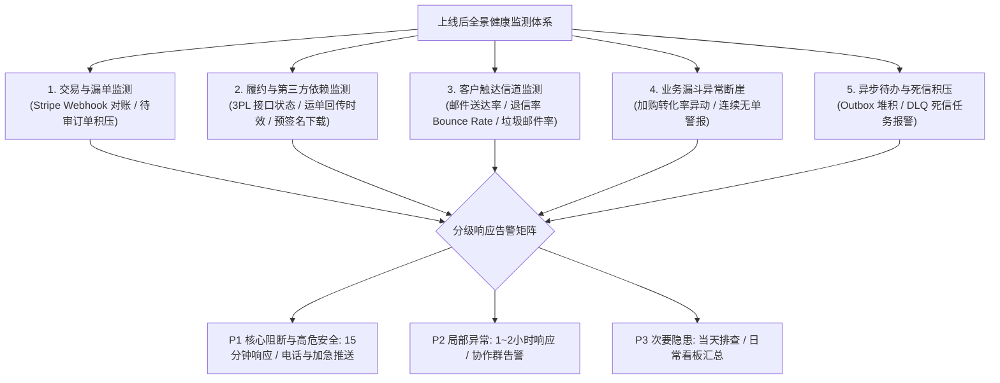
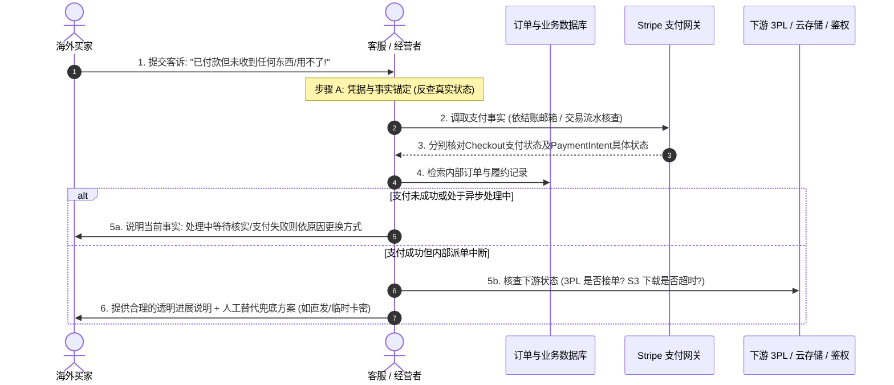
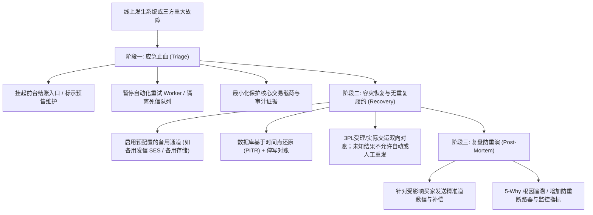
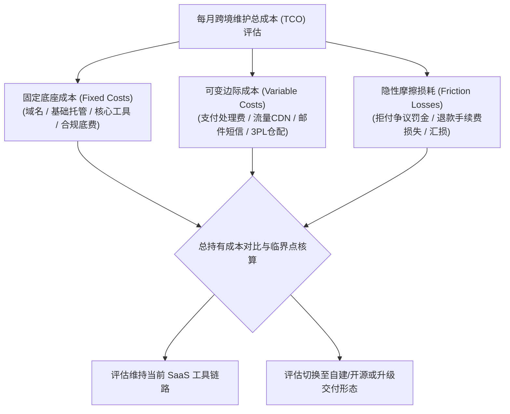
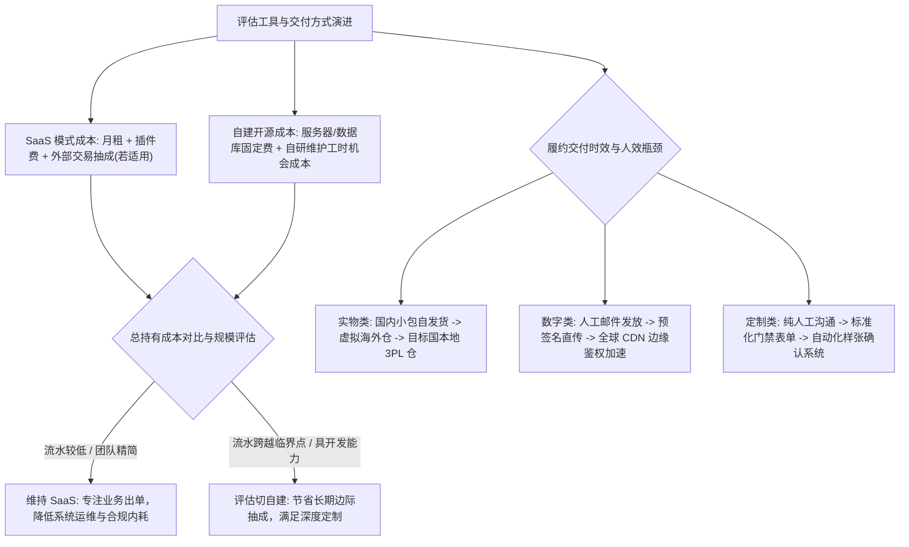
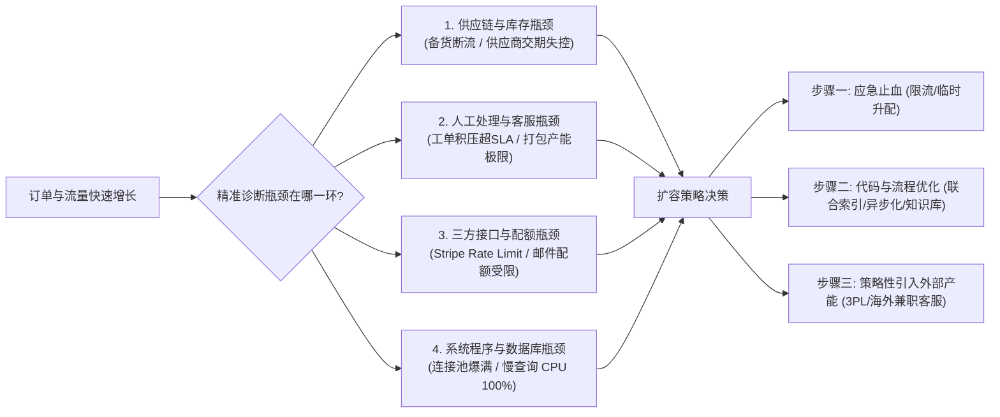
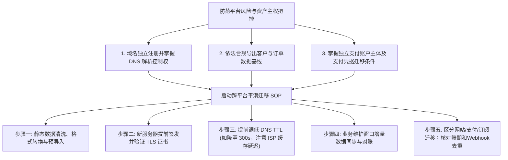
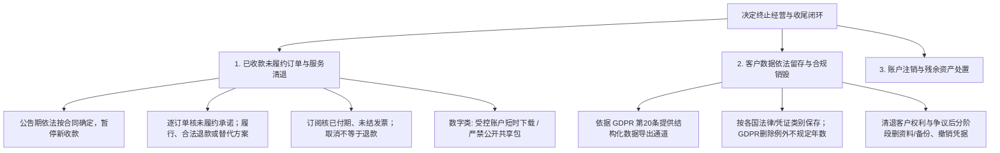

# 4.9 上线后怎么维护和改进？

产品正式面向海外公众开放（Go-Live）之后，真正的跨境经营考验才刚刚拉开序幕。许多初涉出海的独立开发者或中小跨境经营者往往存在一种误区：**以为上线发布是项目的终点，只要网站不崩、服务器绿灯亮着，就可以坐等订单入账**。

然而在真实的全球化商业环境中，上线后的日常运营和持续改进才是决定业务能否良性运转的主战场：
- 网站首页虽然能正常打开（HTTP 200），但底层的支付 Webhook 端点因网络抖动、证书过期或验签失败悄然中断，大量买家扣款成功后系统却迟迟不生成订单，沦为“静默漏单”；
- 跨大洋的时区差异使得海外买家在深夜集中发起求助，客服团队因为缺乏标准化响应机制导致工单积压，买家在缺乏确定性预期的焦虑中直接向发卡行发起交易争议或拒付（Dispute / Chargeback）；
- 依赖的第三方海外仓 WMS 接口突发 504 超时，自动化调度程序由于缺乏幂等与熔断保护盲目重试，导致同一张订单向仓库推送了多次，造成实物包裹重复出库的巨额经济损失；
- 面对纷至沓来的买家需求，团队在个别极端用户的琐碎意见中疲于奔命，不断给系统堆砌冗余功能，却放任核心购买流程的严重体验摩擦无人修复；
- 经营半年后收到云厂商或 SaaS 平台的高额账单，才惊觉某些闲置中间件或低效 API 正在无休止地吞噬原本微薄的跨境利润。

在前八章中，我们已经系统阐述了产品定位、首版门槛、工具复用、购买交互、库存订单、正常履约、售后异常处置以及上线前发布门禁。**本章作为第四部分《产品搭建》的收官之作，承担出海业务“全生命周期持续运营与终局管理”的核心职责**：我们将从实操与决策视角出发，建立覆盖故障主动监测、客诉分流定位、容灾与备用恢复、全景成本核算、需求优先级排序、系统与产能扩容、跨平台迁移避坑以及负责任停业收尾的完整知识体系，帮助中国大陆开发者与中小跨境商家在复杂多变的海外商业环境中筑牢经营防线。

---

## 4.9.1 怎样尽早发现漏单和服务故障？

在分布式与跨国服务架构中，最致命的故障往往不是整站宕机，而是**“隐蔽的业务断裂”**。如果只依靠监控服务器 CPU 是否飙升或前台首页是否可访问，商家往往会在数天后收到几十封愤怒的买家投诉时，才惊觉核心履约流水线早已瘫痪多时。



### 4.9.1.1 除了网站在线，还要监测哪些业务环节？

“网站能打开”仅仅代表静态前端资源或 Web 服务器进程存活，绝不等于买家可以顺利完成购买和使用。中小跨境经营者必须针对以下五大核心业务环节建立主动监控与对账机制：

#### 1. 支付与交易确权对账监测（防范静默漏单）
- **客观技术风险**：支付网关（如 Stripe / PayPal）与商户后端通过异步 Webhook 通信。因跨洋网络抖动、DNS 解析异常、SSL 证书更新遗漏或服务商偶发故障，Webhook 请求可能持续投递失败并耗尽重试次数。此时买家信用卡已被扣款，商户后台却毫无记录；
- **核心监测指标与对账工程实现**：
  1. *Stripe Webhook 投递失败率*：在 Stripe 控制台配置事件告警，当 Webhook 端点连续投递失败或签名校验错误率上升时立即触发告警；
  2. *持久化支付状态与漏单对账（防漏单核心）*：
     - **主链路**：Webhook服务端验签、持久记录、按事件ID去重并按订单/行项/账期/履约单位实施业务动作幂等；监控投递失败，保留已知支付ID与商户订单映射，以便重放和人工补扫。
     - **异步迟达不能只查新订单**：`GET /v1/payment_intents` 的 `created`筛选针对**创建时点**，不是变为成功的时点。例：周一创建、周四才完成的异步付款，周四只查最近24小时创建对象仍会漏单。重叠窗口（如24小时 `[MODEL_ASSUMPTION]`）、游标分页和检查点仅作辅助；对**仍未终结的支付对象ID**定期向服务商逐笔查询，直到得到适当终局或进入人工异常流程，较长故障通过保存的关联ID与提供商历史查询/导出有范围地补扫。
     - **分别核对业务事实**：付款按 PaymentIntent/Charge 或Checkout业务规则核对金额币种与订单和开权；退款按 Refund/Charge、争议按 Dispute、续订按 Subscription/Invoice 分别查询及处理相关事件。`requires_action`、`canceled`是 PaymentIntent 生命周期状态，并**非**退款或争议状态。PaymentIntent `succeeded`不等于银行结算最终入账，也不排除以后退款或争议。
     - **处理差异**：包括“已付款本地无订单”“本地已付而服务商未成功”“已退款仍有权益”“未付费试用却被误收”等，保留异常单、查询依据、人工审批和补偿记录；不宣称对账可100%消除差错。

#### 2. 履约派单与第三方服务接口健康度
- **实物电商**：监测向 3PL 仓储或 WMS 推送出库单的接口响应成功率。重点监控“已付款但超过 24 小时未获取到仓库作业确认单号 `[MODEL_ASSUMPTION]`”以及“已受理但超过 48 小时未回传运单号（Tracking Number）`[MODEL_ASSUMPTION]`”的停滞单量；
- **数字商品**：监测对象存储（AWS S3 / Cloudflare R2）的预签名 URL 生成成功率，以及买家在下载接口上的 HTTP 5xx 错误率；
- **软件 SaaS**：监测授权鉴权服务器的首次验签请求（First Auth Ping）成功率，排查租户角色升级事件是否被正确消费；
- **定制服务**：监控客户下单后进入定制信息收集表单（Kickoff Gate）的完成率，对下单超过 24 小时未提交设计材料的客户进行标记。

#### 3. 客户通知与邮件送达率监测（Communication Health）
- **核心监测指标与服务商阈值参考**：
  - 在发信网关（如 Amazon SES / Resend / SendGrid）后台监控三大核心指标：**送达率（Delivery Rate）**、**硬退信率（Hard Bounce Rate）**与**垃圾邮件投诉率（Spam Complaint Rate）**；
  - 例如可把退信率低于2%、垃圾邮件投诉率低于0.1%作为偏保守的**内部运营预警目标**；SES、Resend、SendGrid等各服务商会按各自政策、账户声誉及时间调整审查阈值，需查当前官方文档。**不是所有供应商共用的统一法律强制数值**；
  - 许多买家反馈“没收到卡密或发货通知”，往往是因为商户未正确配置 SPF、DKIM、DMARC 导致邮件直接被 Gmail 或 Outlook 扔进垃圾箱。

#### 4. 业务指标断崖式异动（Business Metric Anomalies）
- **技术故障的业务端投影**：很多隐蔽的前端 JavaScript 报错（如特定机型 Safari 结账按钮被弹窗遮挡）不会体现在后端服务器监控上，但会直接导致转化率腰斩；
- **基线预警策略**：
  - *加购至结账转化率监控*：当加购到发起结账的比例在短时间内突然下降超过 50% `[MODEL_ASSUMPTION]`；
  - *连续无单保底监控*：依据历史销售规律设立“静默警报”（例如在平时的销售高峰时段，若连续 3 小时整站成交量为 0 `[MODEL_ASSUMPTION]`），系统应自动向值班人员发送提示，触发人工以海外买家视角进行端到端试买冒烟测试。

#### 5. 异步待办任务与死信队列（DLQ）积压量
- 检查本地 Transactional Outbox 待办表或消息队列（Redis / SQS）中积压的任务总数。若未处理任务数持续攀升超过警戒线（如超过 100 笔待办 `[MODEL_ASSUMPTION]`），或死信队列（DLQ）中有新任务流入，表明后台异步消费 Worker 出现死锁、下游服务限流或逻辑崩溃。

---

### 4.9.1.2 谁收到告警、多久内需要人工处理？

很多出海初创团队虽然配置了监控，但所有报警全量灌入一个临时微信群或单个邮箱，久而久之产生严重的**“告警疲劳（Alert Fatigue）”**，关键的致命灾难反而被海量的次要提示所淹没。

为了确保告警真正具备可执行性，必须建立一套面向小微与中小团队的**精简分级告警矩阵（Alert Escalation Matrix）**：

| 故障等级 | 判定标准与典型场景 | 预期人工介入 SLA | 接收人与通知信道 | 降噪与处理策略 |
| :---: | :--- | :---: | :--- | :--- |
| **P1<br/>（灾难阻断与高危安全）** | 1. 整站结算接口瘫痪或大面积报错；<br/>2. Stripe Webhook 全量断联，产生大面积漏单；<br/>3. **发生跨客户数据越权泄露（IDOR）或重大安全合规事件（即使交易流未断也属 P1）**；<br/>4. 核心生产数据库宕机。 | **15 分钟内响应<br/>30 分钟内采取遏制措施** `[MODEL_ASSUMPTION]` | 技术负责人 / 创始人；<br/>手机紧急电话、短信、PagerDuty 或飞书加急拨号。 | 仅限严重阻断交易或重大安全事件触发；严禁在此级别发送非致命预警；首要动作是止血遏制（降级/切维护页），随后从容排查。 |
| **P2<br/>（重要业务级）** | 1. 3PL 仓储接口断网，发货任务积压超限；<br/>2. 邮件服务商退信率激增，批量通知失败；<br/>3. 死信队列（DLQ）任务持续增加（>10 笔）；<br/>4. 连续无单异动预警触发。 | **1~2 小时内介入<br/>4 小时内处置** `[MODEL_ASSUMPTION]` | 运维人员 / 技术协作群；<br/>Slack / Discord / 企业微信运维群专用机器人。 | 聚合发送（每 15 分钟汇总同类报警），避免刷屏；非紧急夜间可设置静音，但在日间必须有人认领处理。 |
| **P3<br/>（次要与隐患级）** | 1. 偶发单笔卡密发送失败入死信；<br/>2. 单个买家特定罕见浏览器显示异常；<br/>3. 云存储容量占用达到 80% 预警；<br/>4. 供应商个别 SKU 库存即将耗尽。 | **工作日内跟进<br/>（4~8 小时内）** `[MODEL_ASSUMPTION]` | 客服专员 / 运营人员；<br/>日常看板、每日邮件摘要（Daily Digest）。 | 禁止向移动端发送强打扰震动或电话；统一归档进日常待办任务清单（Task Backlog）。 |

#### 个人开发者与小微团队的值班机制实操
- **睡眠时段防护策略**：个人开发者无法做到 24 小时紧盯屏幕。合理做法是将手机设置为“专注模式并允许 P1 紧急联系人或特定告警应用绕过静音”；
- **报警自愈与自动熔断**：为 P1/P2 故障配置基础自愈逻辑（如检测到结算接口 500 持续 3 分钟，自动切换为“维护中”展示，防止买家盲目重复付款）；
- **首要动作是“遏制（Containment）”而非立刻定位 Bug**：值班人员收到 P1 告警后的第一反应是止血（如降级、挂出维护提示、切备用通道），随后再排查代码。

---

## 4.9.2 客户说用不了，怎样查原因并解决？

在跨境出海业务中，买家跨越数千公里、身处不同时区，当其遇到问题时，往往伴随着极高的焦虑感。海外买家的反馈通常非常简短或情绪化（例如“I paid but got nothing!”）。如果客服团队缺乏专业定位手段，只会机械回复“请稍等”，极易在数小时内升级为发卡行争议或社交媒体差评。



### 4.9.2.1 如何从客户反馈定位到订单、交付和依赖故障？

面对模糊的客户反馈，必须建立一套标准化的**“三步事实反向锚定与排查法”**：

#### 步骤一：凭据与事实锚定（Fact Anchoring）
- **核实合法所有权，严禁越权给资产**：
  - 许多欺诈者会伪装成买家，仅提供一个公开的邮箱字符串或截图索要激活码。**客服人员绝对严禁仅凭买家自称的口头说辞直接手动下发私密数字卡密或修改发货地址**；邮箱和订单号仅可作为**检索线索**，绝不能作为资产转让的授权依据；
  - **核身与查单分开**：优先采用有效登录会话；无法登录时，可向先前已核验且由买家控制的原邮箱发送短时效、一次性、绑定请求的安全链接，并做频率限制与审计。原邮箱不可用时应按平台官方及内部审批规范升级，无法证明权属时**暂停卡密重发、地址变更与权益转移**。
  - 银行对账单的描述符、扣款金额/时间、订单号、邮箱与付款截图**只能辅助检索**，不构成单独或组合的资产转移授权凭据。不要收集完整银行账单、卡号、CVV或3DS动态码；受争议交易走服务商受控程序。

#### 步骤二：状态机诊断与断裂点逐层下钻（Pipeline Tracing）
凭借核实的线索，依次沿着交易链路向下排查：
1. **核对支付网关事实与对象状态枚举**：
   - **PaymentIntent**：`requires_payment_method`一般表示付款方式缺失或尝试失败，**不是未完成3DS的别名**；`requires_action`说明需依`next_action`完成下一步，可能是3DS或其他动作；`requires_confirmation`待确认，`requires_capture`已授权但未捕获，`processing`仍处理，`canceled`已取消，`succeeded`表示该支付动作成功但不代表不会退款、争议或已结算到银行。
   - **Checkout Session**：`payment_status`可为`paid`、`unpaid`或`no_payment_required`；后者表示本次结账暂不要求支付，可涉及setup模式、延后扣款、合法免费/试用等，**绝不能直接解释为永久免费或无条件发放付费权益**。还须结合`mode`、订单金额、订阅/Invoice状态、试用合同与具体交付资格判断。
   - 客服须从服务端只读查询支付事实并核对金额/币种、归属与业务订单，不凭用户截图或前端回跳开通或撤销权益。
2. **核对内部订单与事务日志**：
   - 检查本地数据库 `orders` 表：
     - *情况 A（待核漏单）*：服务端查询后 Stripe 相关 PaymentIntent / Checkout分别显示 `succeeded` / `paid`，但本地没有匹配业务订单。可能是 Webhook延迟、签名校验失败或映射异常，应先核对支付对象ID、商户订单、金额币种，按业务动作幂等受控补录，不在原因尚未查清时盲目发货；
     - *情况 B（停滞）*：订单存在，状态停留在 `PAID`，但履约任务状态为 `DELIVERY_FAILED`。调取 `outbox_tasks` 表中的错误堆栈信息，排查失败原因。
3. **核对第三方履约与分发依赖**：
   - *实物商品*：调用 3PL 接口查询该订单商户参考号（`merchant_order_ref`），确认是否因地址缺门牌号、邮编格式不合规或库房缺货被拦截；
   - *数字商品*：检查对象存储访问日志，确认买家是否因跨洋长途网络重置导致下载失败；检查预签名 URL 的过期时间是否设置过短；
   - *软件 SaaS*：检查用户中心租户配额表，确认首次鉴权失败是由于客户端版本过旧、本地时钟偏差超标还是 Token 签发错误。

---

### 4.9.2.2 怎样给客户合理的进展、修复或人工替代？

跨境客户遇到故障时最痛恨的三件事：**石沉大海的沉默、生硬推诿的借口、以及完全不给出解决时间的空话**。

#### 1. 结构化沟通四部曲（Communication Framework）
与海外买家沟通时，应遵循客观中性的英文商务沟通规范：
1. **极速确立应答并确认共情（Acknowledge & Empathize）**：
   - 告知买家已明确收到其关于订单 `#10429` 的反馈，团队正在全力核对支付与交付链路，确保客户权益得到妥善保障；
2. **通俗客观地解释问题根因（Transparent Explanation）**：
   - 避免向买家抛出内部生僻的技术黑话（如“Redis connection pool timeout”），而是转换为通俗易懂的商业表述（如“Due to a temporary synchronization delay with our payment confirmation gateway, your digital access was held up unexpectedly”）；
3. **给出合理的时效预期（Definite SLA Promise）**：
   - 依据故障等级给出务实的承诺节点（如“我们将在 4 小时内 `[MODEL_ASSUMPTION]` 向您同步最终排查结果”），严禁给出品质无法兑现的绝对保证；
4. **提供立即可行的人工替代方案（Manual Fallback Delivery）**。

#### 2. 不同产品形态的“人工替代兜底方案”
当自动化系统故障无法在预期内彻底修复时，经受控审批后启动人工兜底通道：
- **数字文件类**：
  - 若前台自动下载链接持续报错，客服核实买家权属后，通过受控安全通道（如生成带密码保护的短时网盘链接，或通过加密客服邮件直接发送附件压缩包）将文件安全下发；
- **软件 SaaS 与会员类**：
  - 若系统 Webhook 未能自动开通权限且已核实付款事实，经管理权限审批并记录审计日志后，客服可在后台执行“手动临时开通”操作，赋予该账号有限期限（如 3 天 `[MODEL_ASSUMPTION]`）与受限配额的高级体验权限，确保买家业务不被中断，随后修复底层账单绑定；**严禁在付款事实完全未核实的情况下随意发放无限制永久权益**；
- **实物商品类**：
  - 若3PL接口故障，先用商户稳定履约动作ID（订单行项、数量及该次交付）核对原API请求、仓库受理单号、拣货/打包/交运事实。**超时、504、Not Found或无承运扫描都不能证明原单未执行**；在结果`UNKNOWN`时同时阻断自动与人工二次建单，联系仓库有权限人员确认并留证。确需人工发货时将同一业务ID写入受控加密离线清单，经过去重、审批后执行，回填状态后再释放Worker，禁止人工绕开唯一动作门禁；
- **商誉维护与补偿动作（Goodwill Compensation）**：
  - 凡是由于系统原因导致交付延误超过预期的，主动向买家发送致歉，并视情况随附一张无门槛折扣券（如“下次加购立减 15%” `[MODEL_ASSUMPTION]`）或将会员服务期免费顺延。

---

## 4.9.3 系统或第三方工具出故障，怎么恢复？

在长期的生产运营中，“不发生故障”是不切实际的幻想。成熟商家的核心能力，是在故障降临时拥有一套**条理清晰的应急抢险与优雅降级标准操作程序（SOP）**。



### 4.9.3.1 无法交付时先暂停什么、保留什么？

抢险的第一准则永远是：**止血优先于排查，保全优先于修复**。

#### 1. 先暂停什么（What to Pause / 熔断降级）
1. **暂停无法兑现的前台结账承诺**：
   - 若实物海外仓全面停工、或核心支付通道崩溃，立即在前台关闭对应 SKU 的即时购买按钮，切换为“Temporarily Out of Stock（暂时缺货）”或开启带有明确发货延期说明的“Pre-Order（预订）”模式；
   - 严禁在已知无法履约的情况下任由前台继续无节制收款，防止积压无法兑现的商业契约责任；
2. **暂停盲目的后台异步重试 Worker**：
   - 若第三方物流 API 或发信 API 正在大面积返回 HTTP 500/504，必须立即在任务调度器中暂停定时出库或邮件重试任务；
   - 盲目的死循环重试不仅毫无意义，反而极易触发第三方服务商的 IP 封锁与频率限制惩罚，甚至导致下游服务雪崩；
3. **暂停具有不可逆破坏性的自动化脚本**：
   - 暂停定时自动注销会员权益、自动取消超期未付款订单等可能发生误判的批量清理脚本。

#### 2. 保留什么（What to Preserve / 现场保全与数据最小化平衡）
1. **保留核心事件索引与受控原始载荷**：
   - 必须平衡**“事故诊断排查”**与**“GDPR / OWASP 数据最小化”**要求：
     - 正常系统日志中仅记录事件 ID（`event.id`）、时间戳、关联订单号与签名校验结果，严禁长期明文存储包含个人敏感信息的完整载荷；
     - 若出于故障诊断需要捕获 Webhook 原始请求载荷，必须存放在经过严格访问控制和加密的受控临时区域，并设定严格的短期保留期限（如 7 天后自动销毁 `[MODEL_ASSUMPTION]`），且调阅必须留下审计记录；
2. **保留未完成任务的原始状态**：
   - 绝对严禁直接执行 `DELETE FROM queue` 清空任务队列。若队列积压过大，应将其临时移动至归档表（Staging/Dead Letter Archive）；
3. **审慎导出内存快照（Heap Dump）**：
   - 内存堆转储包含解密密钥、活跃 Session 及客户敏感数据，且在生产导出时会引发系统瞬时停顿（Stop-the-World）；
   - **Heap Dump 绝非每次故障的常规必做项**，仅在出现严重内存泄漏且常规日志无法定位时，由授权工程师在隔离环境中受控执行。

---

### 4.9.3.2 怎么用备份或备用流程恢复而不重复履约？

当系统从严重崩溃中通过数据库备份或备用流程进行恢复时，最大的次生灾害是**“引发大面积重复履约”**（例如：备份恢复后，旧订单被系统误判为新订单，导致仓库重复发出成百上千个实物包裹，或向老客户重复扣费）。

#### 1. 生产数据库还原标准与安全隔离
- **禁止在生产写入活跃期直接原位覆盖**：
  - 恢复操作必须首先**挂起生产环境的冲突写入（进入只读维护模式）**；
  - 优先在隔离的恢复实例、网络、数据库及权限环境中执行经过演练的PITR，验证备份与数据状态，避免恢复测试影响生产或泄露真实客户数据；**不强制为此购置第二套物理设备**；
- **从权威不可篡改源补齐差量数据（Reconciliation）**：
  - 例如02:00基础备份、10:00发生故障（教学假设），**实际可恢复点取决于WAL归档、PITR有效性与最后完整可还原状态**，不能直接断言02:00–10:00全丢；根据已验证恢复点、RPO目标和账务证据划定补偿区间；
  - 按可恢复点和外部事件持续时间，以本地持久支付ID、Stripe及其他服务商的支付、退款、争议、Invoice记录和外部3PL/权益记录交叉核对，受控补录至`RESTORED_PENDING_AUDIT`（恢复待审核）中间态；已付款未交付、已交运未同步、已退款仍开权等均按独立事实核验，不能直接重开Worker；
  - **严禁直接运行常规 Worker 自动扫描这批订单**。

#### 2. 防范重复履约的四维核对铁律
在对恢复后的订单重新发起交付动作前，必须跨系统核对物理世界的真实进度：
- **实物电商（严谨解耦 3PL 状态）**：
  - 3PL 系统的 `Picking`（拣货中）、`Packed`（已打包）、`Label Created`（面单已生成）**绝不等于货物已出库**；
  - 必须调用 3PL 接口核实承运商实际收货状态：
    - 若仓库显示**已交运承运商（Dispatched / Shipped）**且已有干线扫描轨迹，本地数据库只能回填运单号并更新为已发货，**坚决严禁向 3PL 再次发起创建订单调用**；
    - 若仓库查询`Not Found`、504、超时或尚无承运扫描，原创建请求仍可能在外部成功受理。标记`UNKNOWN`，按同一履约动作ID查询原请求和仓库受理/人工渠道，暂停自动及手动重复建单；只有下游确认未执行或提供可核验同键幂等机制后，才依授权恢复相应动作；
- **数字文件与卡密**：
  - 检查卡密库存表（`license_keys`），调取卡密分配历史日志，排查特定的卡密串号是否在故障前已被发出，严防同一张卡密被分发给两个不同的已付款买家；
- **软件 SaaS 与订阅**：
  - 订阅状态的恢复必须依据 Stripe 订阅对象的实际账期进行幂等操作（`UPSERT`），核验买家是否存在正当延期、试用期或部分退款，**严禁盲目粗暴覆盖买家的合法有效权益**。

#### 3. 第三方依赖灾难时的备用通道切换前提
- **备用邮件网关与云存储切换并非“无缝自动”**：
  - 备用发信通道（如 AWS SES）必须提前配置好独立的 DNS、SPF/DKIM/DMARC 签名，否则贸然切换会导致邮件直接被拒；
  - 备用对象存储必须提前完成权限策略（IAM Bucket Policy）与数据镜像配置，切换必须经过预先演练，确保访问日志与下载鉴权链路完整。

---

### 4.9.3.3 恢复后如何对客户说明并防止重演？

故障恢复绝不以“系统跑通了”为结束，真正的闭环包含**对客户的商誉修复**与**对系统架构的复盘防重演（Post-Mortem）**。

#### 1. 客户沟通准则：精准定向与诚恳透明
- **严禁向未受影响的全量买家滥发群信**：
  - 向全站未受影响的用户盲目群发“系统故障致歉信”不仅无法挽回声誉，反而会人为引发群体恐慌，招致不必要的退款纠纷；
- **针对受损受影响群体的定向安抚**：
  - 严格筛选出在故障窗口期内确实遭遇了交付延迟、卡密未收到或重复扣款的受影响买家；
  - 发送专属的致歉与进展确认信：明确告知其订单当前最新状态（附带真实的追踪链接或补发的卡密），对造成的困扰致歉，并同步附上补偿凭据。

#### 2. 5-Why 根因追溯与系统级防重演工程
团队必须在故障平息后 48 小时内组织一次无指责的复盘会（Blameless Post-Mortem），使用 **5-Why 深入追问法** 追查深层次系统与流程根因：
- **落实防重演四项整改交付物**：
  1. *代码与架构加固*：消除单点依赖，在所有外部 API 调用链路上补充超时（Timeout）与断路器（Circuit Breaker）；
  2. *监控盲区补齐*：针对本次故障中“没有按时发出警报”的环节，在监控平台补上专属指标探针；
  3. *标准操作文档（SOP）更新*：将本次抢险过程中的有效命令、脚本沉淀至内部知识库；
  4. *灾备演练复核*：在下一次发版前，在预发环境重现该场景并断言自愈逻辑有效。

---

## 4.9.4 维护产品每个月花多少钱？

许多初创跨境团队在产品上线半年后，发现流水看似可观，年底一算账却利润薄弱。其核心根源在于对**“跨境产品全景运营成本模型（TCO, Total Cost of Ownership）”**缺乏清醒的动态核算意识。



### 4.9.4.1 固定费用和随订单增长的费用分别有哪些？

出海业务的支出结构可清晰解构为三大版块：

#### 1. 固定费用（Fixed Costs，即使暂无订单也可能持续发生的费用）
1. **域名与 DNS 权威解析**：
   - 商业 `.com` 域名年费约 $12 \sim $15/年（折合约 $1.00 \sim $1.25/月 `[MODEL_ASSUMPTION]`）；
   - Cloudflare 免费版已可覆盖绝大部分小微独立站，企业级高级 WAF 规则费用另计；
2. **SaaS 平台订阅或云服务器（VPS）**：
   - *SaaS 建站路线*：Shopify Basic 官方基准月租约为 $39/月（年付折合约 $29/月）`[MODEL_ASSUMPTION]`；
   - *自建站/开源路线*：轻量云服务器（如 DigitalOcean Droplet / Hetzner / AWS Lightsail 2核4G），费用约为 $10 \sim $24/月 `[MODEL_ASSUMPTION]`；
3. **核心商业插件与协作服务底费**：
   - 专业功能插件（如高级多语言翻译、SEO、自动发票插件），单应用月费通常在 $10 \sim $50/月不等 `[MODEL_ASSUMPTION]`；
   - 基础监控工具（如 Better Stack / Sentry 入门包），约 $0 \sim $30/月 `[MODEL_ASSUMPTION]`；
4. **公司主体维护与合规固定底费**：
   - 海外公司法定秘书服务、税务申报代理年审平摊至每月约 $50 \sim $150/月 `[MODEL_ASSUMPTION]`。

#### 2. 可变费用（Variable Costs，随订单量与访问量线性或阶梯增长）
1. **支付网关交易处理手续费（Payment Processing Fees）**：
   - *Stripe 费率模型（以美区官方标准为例）*：
     - 本土银行卡标准费率为 **2.9% + $0.30/笔**；
     - 以美区公开标准价为例，符合条件的国际卡另加1.5%，如需币种转换另加1%；**不同国家、卡种、支付方式与商户合同费率不相同**，应在当期官方定价与真实账单核对；
   - *严谨数学推演举例*：
     - 对于一笔本土卡 **$5.00** 的小额订单：手续费为 $5.00 \times 2.9\% + \$0.30 = \$0.445$，占订单金额的 **8.9%**；
     - **叠加国际卡附加费+1.5%（但不需汇兑）后，$5订单为$5×4.4%+$0.30=**$0.52（10.4%）**；若同时需要+1%的币种转换费则为$5×5.4%+$0.30=**$0.57（11.4%）**；这是美区特定场景的可复算教学示例，不是通用报价；
     - 在相同美区标准价条件下，**$100订单**：本土卡$3.20（3.2%）；国际卡且不需汇兑$4.70（4.7%）；国际卡且需1%货币转换$5.70（5.7%）。这是三种明确场景的处理费，不等于商户总体平均费率，未计入平台附加费、退款、争议等成本；
2. **云资源流量与用量费（Compute & Storage Transfer）**：
   - AWS S3 存储费（每 GB 约 $0.023/月 `[MODEL_ASSUMPTION]`）；流出公网的流量费（Data Transfer Out，前 100GB 通常免费，超出后约 $0.09/GB `[MODEL_ASSUMPTION]`）；
3. **第三方通信与验证 API**：
   - 邮件发送：Amazon SES 每 1000 封约 $0.10 `[MODEL_ASSUMPTION]`；Resend / SendGrid 提供基础免费额度，超出后约 $20/月起；
   - 跨国短信 OTP（如 Twilio）：向欧美手机发送短信每条约 $0.015 \sim $0.08 `[MODEL_ASSUMPTION]`；
4. **仓储与物流履约费（实物类专属）**：
   - 3PL 库内拣选打包费（Pick & Pack，基础通常为 $2.00 \sim $4.50/单 `[MODEL_ASSUMPTION]`）；超期仓租；实际干线与末端配送运费。

#### 3. 隐性摩擦损耗（Friction Losses）
- **交易争议手续费（Dispute Fee）**：当发生买家拒付争议时，Stripe 美区会对每笔争议扣除 **$15.00** 的争议手续费（不同国家标准不同；若通过抗辩证明有效或符合服务商豁免政策方可能撤回或退款）；
- **退款手续费损失**：在现代主流支付网关规则下，当给客户办理退款时，**最初扣除的支付处理手续费通常不再退还**。频繁退款会导致商户单边承担资金摩擦损失。

---

### 4.9.4.2 什么时候该换工具或改交付方式？

经营不是一成不变的守旧。出海团队应当依据**“总持有成本（TCO）核算公式”**与**“履约产能瓶颈”**动态调整技术与商业架构：



#### 1. 科学评估经济临界点（TCO 决策模型）
- **Shopify 交易费规则澄清**：
  - Shopify的第三方交易费依套餐、地区及处理交易的付款方式判定：第三方网关处理的交易通常额外收取此费（Basic 2%、Shopify 1%、Advanced 0.5%仅为部分套餐示例）；Shopify Payments处理的常规付款通常不收该费，但**2025-05-12及以后创建的商店，使用商店抵扣额或礼品卡支付的相应部分可能收取第三方交易费**；Shopify Payments与第三方并用还有特殊处理费情况。与支付处理费分开列账，不作所有套餐和年份的统一结论；
- **全景 TCO 对比公式**：
  $$\text{TCO} = \text{基础设施/月租} + \text{支付处理费} + \text{插件订阅} + \text{外部交易费(若有)} + \text{研发运维人力成本} + \text{潜在故障风险成本}$$
- **理性决策路径**：
  - *业务验证期（月流水较小）*：SaaS 平台不仅提供交易底座，还承担了基础 PCI DSS 合规（如 SAQ A 范围）与高可用运维。此时团队时间价值应集中在选品与流量转化上；
  - *规模化阶段（月流水持续稳定增长）*：当使用第三方支付产生的平台额外抽成加上高阶插件费用显著超出服务器与专职运维成本时，经严谨测算后再评估迁移至自建系统（WooCommerce / Medusa / 自研系统）。

#### 2. 四大产品形态的交付方式演进阶梯
- **实物类商品**：
  - *起步验证（1~20 单/天 `[MODEL_ASSUMPTION]`）*：国内直邮小包（轻资产，无海外压货资金风险）；
  - *成长期（20~100 单/天 `[MODEL_ASSUMPTION]`）*：集中调拨至国内集运仓，优化干线揽收时效；
  - *规模化（>100 单/天 `[MODEL_ASSUMPTION]`）*：核心爆款 SKU 备货至目标国海外本地 3PL 仓，实现本土 2~3 日达，大幅降低退货率并提升溢价；
- **数字内容类**：
  - 从“受控人工发信”演进至“授权后取得私有对象存储的短时效预签名**GET下载**链接”，再演进至“CDN边缘鉴权分发与可选水印”；买家向商户**上传**资料才使用预签名PUT/POST直传。预签名URL持有者可能转发它，需最小权限、限期和泄露响应，水印也不保证杜绝复制；
- **定制与 B2B 服务类**：
  - 从初期的“纯人工聊天收集需求”，演进至“前台标准化需求收集门禁（Kickoff Gate）与数字化样张在线确认系统”。

---

## 4.9.5 客户的意见和故障，先改哪一个？

产品上线后，经营者的客服后台、社交媒体私信和应用商店评价中，每天都会涌入各种各样的买家声音。如果缺乏科学的优先级决策模型，团队很容易被少数极其大声（Loudest）的个别买家牵着鼻子走，陷入**“按下葫芦浮起瓢”**的研发内耗。

```mermaid
quadrantChart
    title 客户需求与问题优先级四象限模型
    x-axis 低系统性频次 (个别现象) --> 高系统性频次 (普遍共性)
    y-axis 低危害度 (体验瑕疵) --> 高危害度 (阻断交易/重大安全)
    quadrant-1 P1 高频高危优先修复
    quadrant-2 P0/P1 低频高危仍须立即止损
    quadrant-3 P4 低频低危纳入观察
    quadrant-4 P2 高频低危体验优化
    "结账支付报错无法提交": [0.85, 0.90]
    "支付成功但卡密未发放": [0.75, 0.85]
    "单客户越权看到他人隐私(重大)": [0.15, 0.95]
    "找不到下载按钮在哪": [0.80, 0.40]
    "德国客户想要小数逗号排版": [0.70, 0.35]
    "客户要求背景改成粉色": [0.15, 0.15]
    "要求增加极其冷门的支付方式": [0.20, 0.30]
```

### 4.9.5.1 如何区分真实重复问题和个别偏好？

区分“真问题”与“假需求”是产品运营的核心功力：

#### 1. 过滤个别偏好（Individual Preferences / Edge Cases）
- **典型特征**：
  - 某个买家提出：“我希望你们把购买按钮做成我最喜欢的紫色，现在的绿色看起来不顺眼”；
  - 某个海外客户抱怨：“你们为什么不支持我们本地某家极小众村镇银行的专用电子钱包？”；
- **处置准则**：
  - 保持谦逊与专业，在客服回复中礼貌记录并致谢，将其纳入长远评估池（Product Backlog），**绝不立即立项修改**，观察后续是否具备统计学意义上的共性。

#### 2. 识别真实共性问题与重大安全特例
- **共性体验摩擦（High Frequency）**：
  - 多位买家在结账时均留言询问“邮政编码提示 Invalid，但我确实住在这个地址”；
  - 连续多位买家发邮件询问“我付款成功了，但请问在哪里下载我的授权 PDF？”；
  - **处置准则**：表明系统校验存在缺陷或引导层级设计失败，提升为高优先级业务优化；
- **低频但致命的安全与合规特例（Low Frequency, Catastrophic Harm）**：
  - **重要警示**：哪怕**只有一名客户反馈**“我修改 URL 参数看到了别人的订单资料”或“扣款扣了双倍”，**绝对不能因为“发生频次低”而降为低优先级**！这属于最高级别的安全合规漏洞（P0/P1），必须立即由技术负责人介入限权排查。

---

### 4.9.5.2 修故障、改体验和加功能，哪个更紧急？

在资源永远有限的情况下，应遵循**“修故障 > 改体验 > 加功能”（Fix > Friction > Feature）**的指导性排期原则：

#### 第一优先级：修阻断级与高危安全故障（Fix Bugs - 守护生存底线）
- **范畴**：买家无法完成付款、付了钱拿不到货、资金扣减出错、存在横向越权（IDOR）泄露、或系统偶发死锁崩溃；
- **排期原则**：在核心交易链路受阻或存在安全隐患时，研发团队必须优先排除故障，防止损失滚雪球式扩大。

#### 第二优先级：消除共性体验摩擦（Reduce Friction - 提升投入产出比）
- **范畴**：核心功能跑得通，但操作繁琐或提示模糊。例如：结账表单过长、未明确注明时区导致买家误解时效、移动端按钮过小容易误触、缺乏自助下载发票入口；
- **排期原则**：消除摩擦通常能以极小的代码调整，直接改善买家体验并降低客服工单压力（预期转化率与工单改善幅度需依托真实 A/B 测试或数据统计验证 `[MODEL_ASSUMPTION]`）。

#### 第三优先级：加新功能与新形态（Add Features - 探索长期增量）
- **范畴**：支持新的变体属性、上线会员推荐返利、对接替代支付方式、开发复杂的用户积分商城；
- **排期原则**：新功能是双刃剑，会增加系统复杂度与潜在缺陷。唯有在核心交易链路高度稳固、团队拥有充裕带宽、且有充分数据证明具备商业投资回报率（ROI）时，方可以 MVP（最小可行特性）节奏审慎推进。

---

## 4.9.6 订单变多，什么时候需要扩容？

当出海业务迎来流量爆发或爆单时，许多经营者往往盲目加大广告预算，却未曾意识到系统和履约链路已经逼近断裂的临界点。**爆单之后的交付崩塌，对品牌声誉的摧毁力往往远大于没有订单**。



### 4.9.6.1 瓶颈在库存、人工、第三方接口还是程序？

系统性的扩容决策，始于对**全链路短板（The Weakest Link）**的精准诊断：

#### 1. 供应链与库存容量瓶颈（Physical Supply Chain Bottleneck）
- **特征表现**：日单量从 20 单飙升至 200 单，但国内供应商开模交期需要 15 天，海外仓现有现货在 3 天内告罄，大量订单陷入“已付款待采购”状态；
- **诊断结论**：瓶颈在**资金周转与实物备货周期**，系统服务器此时毫无压力，盲目给服务器加配置完全是南辕北辙。

#### 2. 人工服务与客服处理瓶颈（Human Labor Bottleneck）
- **特征表现**：每天涌入数百封客户邮件，而团队只有一名兼职客服。客服邮箱未读积压超过 300 封，平均应答时效从 2 小时严重跌落至 48 小时以上，大量海外买家因等待不耐烦向发卡行发起争议；
- **诊断结论**：单人处理能力的物理极限被击穿（一名熟练客服一天极限处理约 80~100 封复杂英文邮件 `[MODEL_ASSUMPTION]`），瓶颈在**人工作业能力**。

#### 3. 第三方接口调用频率与配额瓶颈（Third-party Rate Limits）
- **特征表现**：程序突然频繁报错 HTTP 429 Too Many Requests。排查发现是 Stripe 的 API 速率限制达到上限，或是发信服务商（如 Amazon SES）将每日发信额度耗尽（Daily Quota Exhausted）；
- **诊断结论**：瓶颈在**外部依赖的服务配额**。

#### 4. 程序架构与基础设施瓶颈（Software & Compute Bottleneck）
- **特征表现**：并发结账人数增多时，数据库服务器 CPU 飙升至 100%，连接池（Connection Pool）耗尽，页面出现死锁崩溃，订单查询耗时从 50ms 恶化至 10 秒；
- **诊断结论**：瓶颈在**程序与数据库性能**。

---

### 4.9.6.2 先优化、加人还是扩容系统？

面对不同维度的瓶颈，成熟团队结合成本与时效进行务实决策：

#### 1. 紧急避险与临时升配（Emergency Containment）
- **灵活性原则**：在突发爆单且系统濒临崩溃的紧急关头，若进行深度代码重构需要数天时间，团队**完全可以且应当优先进行云服务器垂直升配（Vertical Scale-Up）或前置限流**（如将服务器从 2核4G 一键调整为 4核8G，增加少量成本迅速换取喘息空间），确保在线交易不中断，随后再从容排查。

#### 2. 消除低效流程与代码优化（Optimization - 降低长期成本）
- **严禁对动态敏感内容进行公共边缘强缓存**：
  - 为前台公共静态资源（图片、CSS、JS）开启 CDN 边缘缓存；
  - **安全红线**：严禁在 CDN 边缘对包含买家账户个人信息、动态库存、购物车状态及认证结账接口开启公共缓存（Cache Everything），防止引发灾难性的跨客户数据串读！
- **数据库索引与查询调优**：
  - 检查慢查询日志，使用 `EXPLAIN ANALYZE` 分析执行计划，为高频过滤与外键字段建立必要的联合索引；注意索引会增加写入开销，不可盲目滥建；
  - 异步化耗时调用：将结账流程中的发信、外部 3PL 推单移至后台队列，确保接口响应时间在合理范围。
- **建设完备的自助帮助中心（Knowledge Base）**：
  - 在官网与确认邮件中详细列出物流查询、卡密激活指引，通过自助化显著削减常见机械咨询（咨询削减比例需依实际落地统计 `[MODEL_ASSUMPTION]`）。

#### 3. 策略性人力补充与专业外包（Strategic Outsourcing）
- **客服扩容**：引入英语为官方语言的海外兼职客服（如利用 Upwork 招聘菲律宾客服支持欧美时区，时薪约 $4~$8/小时 `[MODEL_ASSUMPTION]`），实现目标国当地白天的无时差快速客服响应；
- **仓储扩容**：脱离家庭作坊式自打包发货，全量切入具有成熟流水线和自动化拣选设备的专业 3PL 仓储。

---

## 4.9.7 平台改规则或停服，怎么迁移？

在跨境出海领域，“平台即牢笼”是无数经营者用血泪换来的教训。无论是依赖第三方建站 SaaS（如封店风险、插件大幅涨价），还是依赖特定海外分销平台（如 Etsy、Amazon 平台规则收紧甚至无预警封号），**缺乏数据与资产控制权的商户，其商业生命完全掌控在他人手中**。



### 4.9.7.1 哪些数据和账户控制权必须提前掌握？

真正的出海商家，从开店第一天起就必须掌握**三大核心资产控制权**：

#### 1. 独立域名所有权（Domain Name Sovereignty）
- **核心控制标准**：
  - 核心主域名（如 `yourbrand.com`）建议独立注册在中立的全球知名域名注册商（如 Cloudflare Registrar、Namecheap 等）；
  - 必须确认拥有域名的最高管理权、EPP 转移授权码（Auth-Code）获取权以及独立的 DNS 权威解析修改权。掌握DNS权不等于随时无损迁移：注册商转移锁定、域名过期、缓存延迟、TLS、平台绑定、数据和支付依赖都可能阻碍切流，应预留双站共存及回退机制。

#### 2. 客户数据与历史订单数据主权（Data Sovereignty & Legal Consent）
- **定期离线归档制度**：建立周期性离线备份机制（如每周导出一次 `[MODEL_ASSUMPTION]`）：
  1. 全量客户名单与购买记录；
  2. 历史交易流水与财务凭证（用于长期的财税抗辩与质保维权）；
  3. 专属定制文件归档；
- **营销许可（Consent）合规红线**：
  - 从平台导出的客户名单**不能擅自用于未获许可的营销邮件轰炸**；要分别核对适用法律、营销处理依据和平台合同：欧盟GDPR及各地ePrivacy营销法规可能要求适当同意或符合例外；**美国联邦CAN-SPAM一般没有商业邮件必须先opt-in的普遍要求**，但规定真实发信信息、实体邮寄地址、可退订与及时处理opt-out等义务，还应核验州法及其他适用规则。迁移时保留合法必要的退订/拒发清单，不能自动重启已退订人的推广；
  - 平台卖家（如 Amazon/Etsy）通常受平台条款约束无法导出买家真实个人邮箱，经营者需客观界定数据归属。

#### 3. 独立支付通道主体与数据迁移限制（Payment Gateway Sovereignty）
- 在符合相关国家与主体准入条件的前提下，优先使用自身合法商业实体开立的独立支付通道（如自主 Stripe / PayPal 账户）；
- **信用卡数据迁移的客观现实**：
  - 不得默认Stripe的绑卡Token、Customer ID或Subscription ID可直接导出到任何其他支付网关并复用。支付方式迁移须由原/目标服务商按PCI、卡组织与平台规则正式协调，核实双方支持、技术映射、客户授权及无法转移的对象，必要时提供安全重新绑卡流程；
  - **重要边界**：卡数据迁移是一项需要双方网关技术协调、受制于收单行与卡组织政策的专业工程，可能涉及卡网络重新认证（Network Tokens / 3DS 重新授权），**绝对不能向团队或买家保证“完全无需买家重新输入即可 100% 自动迁移”**；若技术条件不满足，应准备好引导客户重新绑卡的温和替代方案。

---

### 4.9.7.2 迁移时如何避免丢订单、丢权益？

跨系统平台迁移涉及**网站托管迁移**、**支付网关迁移**与**订阅账务接管**等多重维度。必须严格执行以下**五步平滑迁移标准操作程序（SOP）**：

#### 步骤一：数据清洗转换与新站环境预热
- 在预发（Staging）环境中，将旧系统导出的商品 SKU、客户基础资料和卡密库存进行数据清洗与字段映射，预先导入新站并核验完整性。

#### 步骤二：尽可能前置完成 TLS 证书签发与验证（关键安全门禁）
- **推荐前置验收**：尽可能在DNS切换前通过DNS-01或托管平台支持的验证方式签发/部署证书，测试最终域名匹配、证书链、加载配置、HTTPS访问和回滚；部分托管平台可能必须先完成域名指向才能签发，应制定过渡方案。预先签发**只能降低风险，不能保证绝不出现证书警告或访问故障**；

#### 步骤三：提前调小 DNS TTL 与认知客观缓存延迟
- 在计划正式切换前 48 小时 `[MODEL_ASSUMPTION]`，将域名的 DNS TTL 调小（如从 86400 秒降至 300 秒 `[MODEL_ASSUMPTION]`）；
- **客观技术现实**：依据 RFC 1035，虽然调小了 TTL，但全球部分运营商递归解析器仍可能存在缓存滞后，DNS 切换绝非全球瞬间同步，必须预留过渡观察期。

#### 步骤四：停机维护窗口与增量数据补齐（Delta Sync）
- 选择目标市场访问低谷期挂出计划性维护公告，暂时关闭旧站结账入口；
- 导出最后几小时内产生的**增量订单与最新客户变动**并导入新系统；
- 将域名 DNS 解析修改指向新服务器。

#### 步骤五：订阅接管、密码策略与双向对账
- **先分清变更范围，再逐项验收**：
  - **只换站点且保持原支付账户**：Stripe的PaymentIntent/Subscription仍以原账户为权威；新Webhook需独立验签、映射订单及幂等处理，同一履约单位不能因新旧回调都到达而重复开权/发货；旧端点仅在历史事件可追踪且新端验证后关闭。
  - **换支付账户或换服务商**：必须由双方确认支付数据迁移范围、准入资质和迁移方式；Customer、PaymentMethod、Mandate、Invoice、Subscription等ID通常不能跨系统当同一ID使用。不能复制Token或简单切Webhook来假装完成订阅迁移；迁不动时经用户授权重新绑卡或走人工方案。
  - **避免双收案例**：若客户在旧系统已付费至11月30日（教学假设），11月1日新站不能再次按整月立即扣款而忽视已付期。核对旧Invoice、退款/争议及试用状态，映射有效权益到新站，按照真实合同约定安排新平台首次扣款日，检查旧平台是否仍有未决账单/自动续费；双扣先冻结重复动作并人工核账处理。
  - **回退门禁**：在切流前验证未结支付、迟达事件、退款、争议、订阅账期、开权和客户重新认证，保留限时可追溯双平台对账，成功后才能停用旧系统关键查询能力。
- **密码处理策略**：
  - 因密码采用单向加密哈希（如 bcrypt / Argon2），旧平台若无法导出明文哈希，新系统可采用向老客户发送专属安全激活链接的方式引导设置新密码；若支持算法迁移，可采用首次登录平滑校验升级；
- **迁移后 7 天紧密对账**：迁移后连续 7 天 `[MODEL_ASSUMPTION]` 每日比对两边财务、库存与履约状态，直至完全平稳。

---

## 4.9.8 决定不再经营，怎么妥善收尾？

当项目因战略调整或市场变化决定终止经营时，**如何负责任、体面地关停业务，直接关乎经营者的商业信誉与法律底线**。在跨境出海领域，绝对严禁“直接关机跑路拔网线”——失联会引发海外买家向银行集中发起争议，不仅会招致追索，严重违规倒闭甚至可能被收单行上报至万事达卡 MATCH（Member Alert to Control High-risk Merchants）黑名单系统，影响经营者未来的全球金融开户能力。



### 4.9.8.1 已经付钱的订单、订阅和服务如何安排？

依据国际消费者权益保护法规与商业契约，关停前必须制定详尽的**存量客户清退方案**：

#### 1. 发布正式停业公告与时间表（Notice & Moratorium）
- 按法域、合同和平台规则决定公告时点与送达方式（如提前30天只是`[MODEL_ASSUMPTION]`），对受影响买家留存通知送达证据；
- 明确标注停止接单时间、存量服务最终关闭时间以及客服通道保留时间。

#### 2. 四大产品形态的善后履约与退款安排
- **实物商品（Physical Goods）**：
  - 全力协同 3PL 仓储，将停运前所有已付款订单全部完成打包交运；
  - 无法履约应依法按合同和买家权益选择继续交付、合理替代、部分/全部退款及必要补偿，并留通知。退款优先遵循原支付渠道规则，但混合支付、礼品卡、过期卡、平台余额可能无法全额原路退；应通过支付服务商官方程序或合法验证的替代方式办理，持久记录provider退款单、币种、累计金额和到账/失败状态，防重复和超额退款；
  - 处理海外仓残余库存：委托 3PL 退运回国、折价清仓、或在当地签署正规弃置与销毁协议（Abandonment & Destruction）；
- **软件 SaaS 与订阅服务（Subscriptions）**：
  - 审查每笔订阅的取消方式（立即或期末）、当期已付权益、试用与余额、待处理Invoice、既有欠费、争议和历史优惠。**取消续费、取消订阅、终止服务、实际现金退款是四个不同动作**；Stripe部分待处理账单和Proration不一定随取消消失，须逐笔确认最终结算，防止旧/新平台错误重复扣费；
  - **重要权责界定**：提前停服时应先按适用法律、有效合同及已实际履行的服务，区分已付有效期、剩余额度、一次性交付项目与不可替代的义务；可选择继续履行、依法有效的替代、延长服务或适当退款。**按日比例退仅适用于符合条件的合同和收费结构，不是所有国家和年付业务的强制公式**；退款路径、余额与到账须核实，不能以“取消自动续费”替代清算；
- **数字文件与素材下载（禁止公开免鉴权链接）**：
  - **交付与隐私安全红线**：**绝对严禁向所有历史买家群发公开、免鉴权的网盘共享包**！这会导致买家定制照片等隐私泄露，并使商业资产面临版权扩散风险；
  - 正确做法：在约定的关停过渡期内（如关停后 30~90 天内 `[MODEL_ASSUMPTION]`），保留经买家身份认证的受控下载通道，或下发带时效的受限链接（Presigned URL），并提供专属客服沟通；
- **定制商品与专业服务（Custom & Services）**：
  - 进行中的定制订单加急结项并经买家线上验收归档；未开始或未完成的部分须按消费者保护规则、已生效约定、已交付里程碑及相关实际成本判断应履行或退还的部分；无合法扣除依据时及时退还，不能把一切定制项目套同一退款数额。

---

### 4.9.8.2 客户资料怎样交还、保留或按规则删除？

在项目收尾阶段，经营者必须严格依据数据保护法与财税法规，厘清**“交还”、“保留”与“删除”**的法定边界与落地操作：

#### 1. 客户资料的合规交还（Data Portability / Return）
- **依据 GDPR 第 20 条规定（数据可携带权）**：
  - 仅适用于**“基于买家同意或合同履行”、“采用自动化方式处理”且“由买家自身提供”的个人数据**（并不涵盖商户自身的经营分析算法或属于其他租户的数据）；
  - 在关停前，商家应提供合规的自助导出功能，允许用户以通用、结构化、机器可读的格式（如 CSV 或 JSON）下载其个人数据。

#### 2. 交易证据的法定保留（Lawful Data Retention）
- **准确援引 GDPR 法定留存例外条款**：
  - **Article 17(3)(b)**：明确规定当保留个人数据属于**“遵守控制者所受适用的欧盟或成员国法律项下的法定法律义务”**（如商法典与税法强制要求的会计凭证留存）时，免于执行被遗忘权删除；
  - **Article 17(3)(e)**：明确规定当保留数据属于**“用于法律索赔的主张、行使或抗辩（the establishment, exercise or defence of legal claims）”**时，依法免受被遗忘权约束；
- **法定留存操作规范**：
  - 必须按主体所在法域、税种、记录类别、行业监管和留存起算日分别核定。例如德国HGB §257(4)一般要求第1款第1项的商账/年度财报等保存**10年**，第1款第4项的**记账凭证保存8年**，其他列明商业函件等通常为**6年**，部分受监管机构另有例外；发票也可能受AO/UStG特别义务约束，不能写成“德国商事发票全部10年”。美国等其他法域亦按实际主体和最新法规核对，不能直接套全球统一3–7年；
  - **隔离归档与受限访问**：将成交订单单号、金额明细、开票记录及银行对账凭证单独导出，进行加密后存放在专用的冷存储介质中；
  - 根据特定合法保存目的进行访问隔离、最小字段、加密与到期复核，不应再转为营销用途。GDPR第17(3)(b)和(e)是**分别针对法定义务、法律主张/行使/抗辩的条件性删除例外**，并不自设6–10年保存期，也不意味着所有商业记录都需要法定封存；

#### 3. 敏感数据清理与运行资源的彻底注销
采用**分阶段、可核验的资源和资料收尾**，不能只因当前无未决退款就立即销毁全部账务查询能力：
1. **先处理未完成义务**：逐条清点或合理承接仍可能发生的退款/拒付、税务审计、法定售后、订阅最终发票、平台余额、客户资料请求和合法证据保全；停止新收款不等于可以立刻删除所有对账凭据。
2. **按实际依据区分删除与保留**：不再必要且无合法保留理由的私人照片、设计草稿、过期凭据等应删除或匿名化；仍须留存的交易证据只保留最小字段，限制访问、加密、登记合法依据/到期复核与保存责任人。
3. **覆盖多处副本**：将生产数据库、CDN缓存、日志、对象存储、客服系统、导出件、备份和第三方受托处理者列入清单；可即时清理的删除并留证，不能选择性立即擦除的历史备份以访问隔离与到期轮转/删除控制，恢复时避免重新激活已删除数据。
4. **最后逐步撤销不再需要的账户/密钥**：在退款和争议查询、财税义务及客户剩余权益获得合法受控承接后，才按服务商程序逐步停用支付、邮件、云资源、Webhook与账号，保留必要的只读证据/客服路径及执行日志；经营主体注销须另按本地主管部门程序处理。

---

#### 个人数据事故：先判断影响，再决定通知和补救（R04）

错误公开客户照片、邮件群发泄露收件人、对象存储权限误配和账户越权都需要排查，但**信息安全告警不自动等于一律须72小时报告的个人数据泄露**：

1. **止损和保全**：限制受影响的访问、冻结错误共享路径、保留最小必要的时间线、访问记录与恢复证据，避免把客户资料转存到开放工单；先评估是否仍有持续泄露。
2. **界定身份和事实**：辨别是否涉及个人数据、哪些数据与人数、是否属于保密性/完整性/可用性事故；记录实际控制者、处理者与供应商合同中的通知链。处理者发现事件后通常需按适用规则和协议及时告知控制者。
3. **判定适用通知门槛**：在GDPR适用时，控制者通常应在得知应报告的个人数据泄露后，在可行条件下不迟于72小时向主管机构通知，**除非该事故不太可能对个人权利与自由造成风险**；若可能构成高风险，对受影响个人的通知另有门槛与例外。不能把所有服务宕机或所有安全告警统一算作必报。
4. **补救与留档**：按风险和适用法执行主管部门/客户/平台通知、凭据更换、已公开内容访问撤销、再处理者协调和复发预防。包括不需对外报告的事故，也应按适用规则保存内部决策与处置记录。

参考：[EDPB中小企业数据泄露说明](https://www.edpb.europa.eu/sme/assess-the-risks/data-breaches_en)与[控制者/处理者角色](https://www.edpb.europa.eu/sme/learn-the-basics/data-controller-or-data-processor_en)。其他法域需要单独核实，不能据此提供全球统一时限。

#### 用三项有分母的产品质量指标决定先改什么（R17）

| 指标 | 可核对的最小定义 | 用它做什么决定 |
|---|---|---|
| 支付后未交付率 | 统计窗口内“已确认应履行且超过承诺时限、仍未交付的订单行项数”÷同期“已确认应履行且时限已到的订单行项数” | 检查排队、人工或第三方交付瓶颈 |
| 首次取得核心价值率 | 指定新用户群中“在事先约定时间内实际完成核心任务的人数”÷“具备完成该任务条件的同群新用户人数” | 检查入门指引、文件下载或账号开通是否阻碍获值 |
| 七日未结故障比例 | 统计窗口内“创建超过七日仍未解决的有效故障工单数”÷“截至同一时点创建超过七日的有效故障工单数” | 判断支持排队和修复承诺是否失控 |

上述都是**教学用指标定义**，不是法律阈值、行业通用SLO或真实观测结果；每项必须记录统计窗口、排除取消/已退款无履约义务等情况、避免重复工单，遵守数据最小化。渠道获客、广告ROI属于第五部分。

#### 动态事实核验台账：避免教材准确性随平台变化失效（R13）

对费率、支付准入、物流申报及法规适用条件，采用**正文解释稳定原则＋独立动态台账**：记录“结论/国家与主体/产品类型/套餐或版本/官方原文链接/核验日期/下次检查触发条件/负责人”。变更时优先更新该条事实证据，复查是否影响交付承诺；不能仅因网页上出现新价格就无条件覆盖不同国家商户的合同费率。

| 事实示例 | 适用边界 | 重验条件 |
|---|---|---|
| 支付处理和第三方交易费用 | 商户注册国家、支付方式、套餐、是否使用平台自有支付 | 定价或结算规则变化、服务商账单出现新费项 |
| CN22/CN23及预报关 | 邮政产品、始发/目的地、运营商最新要求 | 邮政规则、目的国海关或邮政服务规则更新 |
| 商品安全、数字内容更新和消费者救济 | 产品类型、销售市场、经营者角色、当期法律 | 新目标市场上线或法规修订生效 |
| 服务商停服或API变更 | 实际功能版本及已使用依赖 | 服务商发布破坏性变更、服务合同终止 |

#### 九章贯穿示例：一单数字定制产品如何真正交付（R10/R11）

**以下是方法示范，所有金额、时限、数量均属`MODEL_ASSUMPTION`，不是实际订单测试。** 示例产品：海外买家上传照片，商家交付一份定制PDF。

| 原章节 | 在同一笔订单上做什么 | 平台原生/人工/自建边界 |
|---|---|---|
| 4.1 产品形态 | 选择数字定制PDF，明确谁是合同销售方与交付方 | 首版可用已有数字商品平台 |
| 4.2 首版范围 | 填一页MVP卡：3张照片、1份PDF、交付时间、拒单条件和补救方式 | 排版与人工质量检查可先人工 |
| 4.3 搭建方式 | 核对支付、私有文件保存、处理商、导出与停服方案 | 优先复用工具，不要求先开发完整SaaS |
| 4.4 下单资料 | 公开上传用途、交付格式、授权和客服联系方式 | 平台表单或受控表单均需实测 |
| 4.5 订单事实 | 对照订单号、合法付款/授权事实、文件版本和交付状态 | 先用托管后台与人工台账；自建时才增加复杂事务 |
| 4.6 实际履约 | 生成、人工校稿，经客户授权的受控入口提供PDF | 发送公开永久链接不等于安全交付 |
| 4.7 异常救济 | 下载失败先核对是否已交付，再安全重发；退款与文件权益分开记录 | 售后可人工处理并留证据 |
| 4.8 上线试买 | 实测付款、未付款不可领货、重复事件、越权访问、失败恢复 | 未执行时只能标`NOT_RUN` |
| 4.9 维护退出 | 月度复核超时交付、单位成本、资料清理和停业时客户权益 | 只有业务增长或风险实际要求时才自动化 |

**横向对照**：实物标品把第4.6步换成批次、真实仓配交运与可能的安全召回；订阅SaaS把第4.6步换成期限内权限/必要更新及取消、剩余已付期处理。两类均不自动要求个人经营者建设复杂的租户架构。跨九章“同一交易事实”贯通才是本案例目的，不应把业务分工叠成必须购买的工具清单。

---

## 本章自查清单与决策闭环

在跨境业务上线后的全生命周期维护中，出海团队可对照下表定期复核关键运营与治理维度的落实情况（表内项目在上线初期待由团队结合自身系统实际执行验证）：

| 维护治理领域 | 核心复核标准与达标特征 | 决策判定要点 | 实际验证状态 |
| :---: | :--- | :--- | :---: |
| **全景故障监测** | 是否具备超越“网站在线”的双向对账与信道监测？ | Webhook持久化/幂等处理、未终结PaymentIntent按ID跨时段查询，Refund/Dispute/Invoice分别核对；邮件和DLQ按实际供应商策略设预警。 | **NOT_RUN**<br/>（待商户系统实测） |
| **告警分级响应** | 告警是否分级明确，是否存在告警疲劳？ | 划定 P1（含重大安全漏洞，15分钟响应）、P2（1~2小时）、P3（工作日）矩阵；P1 支持强提醒，P2/P3 聚合降噪。 | **NOT_RUN**<br/>（待演练检验） |
| **客诉定位与响应** | 是否掌握基于凭据的事实锚定与人工兜底能力？ | 邮箱、订单号与账单线索只用于查单；按PaymentIntent/Checkout各自状态判断，账户/受控核身授权后才允许卡密、地址和权益变更。 | **NOT_RUN**<br/>（待客服流程检验） |
| **容灾与无重复履约** | 灾难恢复后能否杜绝二次发货与多发权益？ | 明确应急止血三步骤；以实际可恢复点和外部状态对账；3PL结果UNKNOWN时阻断自动及人工二次建单，核实原履约动作ID/仓库受理与承运事实后才恢复；复盘落实5-Why。 | **NOT_RUN**<br/>（待灾备演练检验） |
| **成本核算与演进** | 是否准确测算 TCO 并识别工具替换临界点？ | 清晰拆解固定成本、可变费用与拒付手续费损耗；依据月流水与人效阈值科学决策 SaaS 升级或切自建。 | **NOT_RUN**<br/>（待财务台账核对） |
| **需求优先级排序** | 是否坚守“修故障 > 改体验 > 加功能”的指导原则？ | 运用四象限过滤个别偏好；核心阻断与高危安全始终最高优先级；消除共性体验摩擦；克制堆砌新功能。 | **NOT_RUN**<br/>（待排期实践检验） |
| **瓶颈诊断与扩容** | 扩容时是否精准命中供应链、人工、配额或系统短板？ | 严禁无脑加机器；紧急时临时升配止血；动态敏感页严禁公共强缓存；建立知识库降低客服；策略性引入兼职与 3PL。 | **NOT_RUN**<br/>（待生产容量测试） |
| **平台迁移平滑性** | 是否掌握域名主权、合法数据与支付凭据迁移条件？ | DNS/TLS前置验证不保证零故障；分清网站/支付账户/订阅迁移，核实支付方式迁移资质、旧账期/新平台首扣时间、退款/争议及Webhook幂等后才切换。 | **NOT_RUN**<br/>（待迁移演练检验） |
| **负责任停业收尾** | 停业时是否兼顾客户权益清退与法定留存平衡？ | 按法域和合同通知；逐订单处理履行/合法退款，取消续费不等于退款；财税凭证按HGB等实际分类及法定依据留存，GDPR删除例外不提供统一年限；分阶段清理必要副本。 | **NOT_RUN**<br/>（待清盘规程复核） |

**主要一手来源与动态规则校核（2026-10-19）**：Stripe [PaymentIntent状态](https://docs.stripe.com/api/payment_intents/object)、[Checkout状态](https://docs.stripe.com/api/checkout/sessions/object)、[Webhook](https://docs.stripe.com/webhooks)、[订阅取消](https://docs.stripe.com/api/subscriptions/cancel)、[数据迁移](https://docs.stripe.com/get-started/data-migrations/overview)、[美区定价](https://stripe.com/pricing)；Shopify [第三方交易费和抵扣额例外](https://help.shopify.com/en/manual/your-account/manage-billing/billing-charges/types-of-charges/third-party-charges/third-party-transaction-fees)；美国FTC [CAN-SPAM常见问题](https://www.ftc.gov/business-guidance/blog/2015/08/candid-answers-can-spam-questions)；德国 [HGB §257](https://www.gesetze-im-internet.de/hgb/__257.html)；欧盟 [GDPR第17和20条](https://eur-lex.europa.eu/eli/reg/2016/679/oj/eng)；PostgreSQL [WAL/PITR](https://www.postgresql.org/docs/current/continuous-archiving.html)、AWS [Outbox模式](https://docs.aws.amazon.com/prescriptive-guidance/latest/cloud-design-patterns/transactional-outbox.html)。各类费率、司法规则和平台产品能力均应以实际商户地区、合同和实施时点再核验。

*本章封板仅是教材静态知识和方法的审查；未实际执行Stripe扣款/退款、3PL发运、数据库生产恢复、域名与TLS切换或客户数据销毁。上述九项实测门禁默认仍为 `NOT_RUN`，不能将本文的知识QA等同于商户的生产上线验收。*
