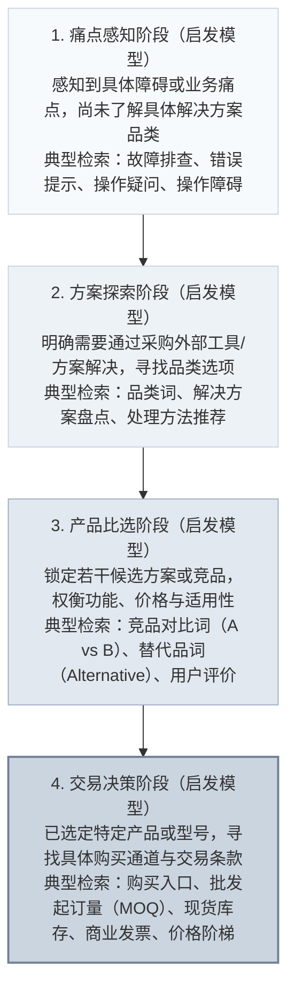
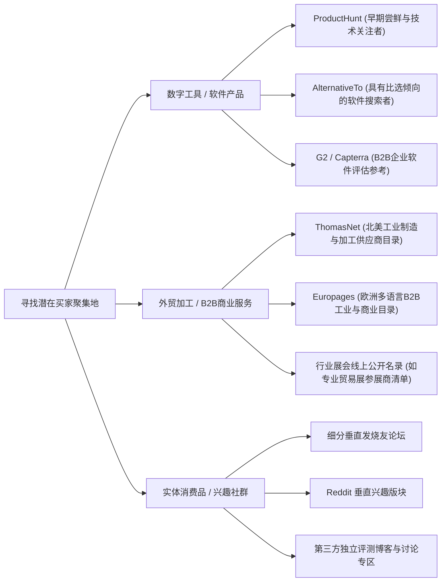
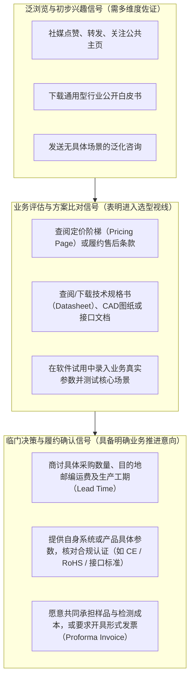
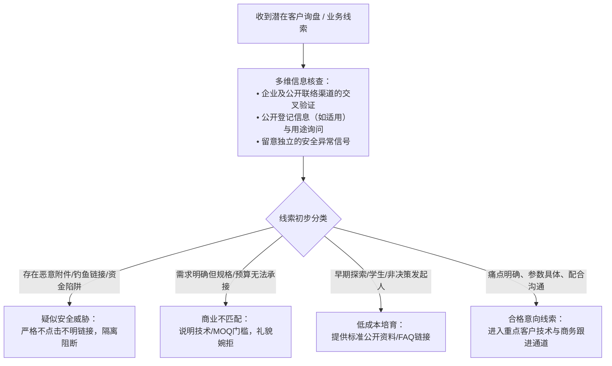
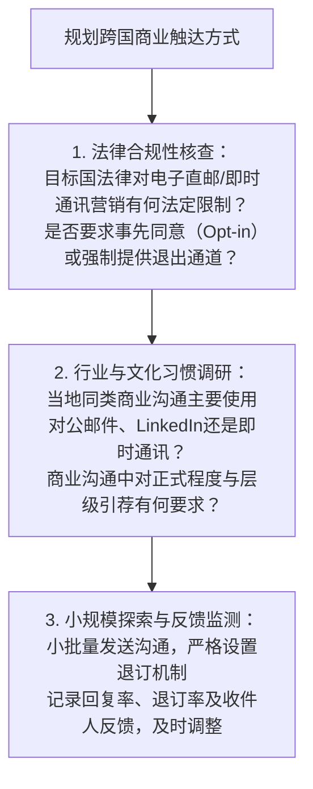

# 我的客户在哪里？

> **正式状态**：`CHAPTER1_FINAL_SEALED / OWNER_AUTHORIZED_DIRECT_REPAIR / 2026-10-18`  
> **面向读者**：中国大陆个人开发者、独立站经营者、跨境平台卖家、小型数字商品及跨境技术/外贸服务团队。  
> **本章核心定位**：在已有产品或已确定经营方向的前提下，系统性寻找并辨别买家活跃的真实场景，建立购买意图识别能力与跨境商业常识，为后续渠道触达打下准确定位基础。

---

## 引言：为什么很多跨境经营者找不到第一批买家？

许多中国大陆的跨境从业者在把产品或服务准备就绪后，往往会遇到获客启动的瓶颈：
- 独立开发者完成了一款实用的跨平台工具并上线海外官网，除少数同行或社区朋友浏览外，长时间未见真实订单；
- 工贸一体的外贸中小企业搭建了多语言独立站，或者跨境电商卖家发布了第三方平台商品页面，却发现自然访问量稀少，少有商业咨询；
- 部分经营者尝试在海外社交媒体进行无差别发帖，或在尚未明确受众意图的前提下进行付费推广，往往导致预算消耗后仅获得少量泛泛关注，未形成可持续的订单转化。

出现这些现象，往往是因为对跨境买家的寻找路径存在认知偏差：
1. **浏览与关注不等于实际购买**：对内容产生兴趣的读者、寻找免费资源的试用者，与面临紧迫业务痛点、具备预算并准备支付对价的付款买家之间，存在明显的决策差异；
2. **场景决定商业意图**：不同类型的买家在产生需求的不同阶段，所使用的检索工具、信息偏好、出没的网络社区和采购入口各有不同；
3. **决策链条因业务形态而异**：个人消费（B2C）通常由单人做出购买决策，而企业级采购（B2B）则往往涉及实际使用者、技术评估人员、业务主管与财务采购人员的多方协同。

本章的教学目标，是帮助跨境经营者基于公开客观的数据网络、行业研究方法与商业逻辑，系统排查买家的真实聚集场景，辨别有效购买信号，理顺企业采购角色，并掌握在不同国家和区域验证本地交易入口与沟通习惯的方法。

---

## 1.1 买家通常在哪里找这类产品？

客户并非凭空出现。在发起采购或完成线上支付之前，买家通常会经历从感知问题、评估方案到挑选具体产品的探索过程。理解买家的寻找路径，是经营者选择展示场景与承接流量的前提。

### 1.1.1 客户会先搜问题，还是直接找产品？

在商业认知与入站营销（Inbound Marketing）实践中，常使用**买家认知阶段模型（Awareness Stages）**作为一种教学启发式工具，辅助分析潜在客户的搜索行为特征。需要说明的是，现实中买家的决策路径往往是非线性的，可能因同行推荐、突发紧急采购或直观冲动而直接进入购买环节。然而，按认知状态梳理搜索词，有助于经营者针对不同意图布局承接页面。



#### 1. 痛点感知阶段：以“问题”与“症状”为切入点
处于此阶段的买家，主要关注自身正在遭遇的具体困难，通常尚未建立品牌或特定品类意识。
- **典型搜索特征**：常采用疑问句、错误代码、操作困扰或业务瓶颈描述。
  - *【示意案例 / MODEL_ASSUMPTION】*：假设开发者制作了一款 Mac 菜单栏休眠耗电排查小工具。处于痛点阶段的用户通常不会检索该工具名称，而是检索类似 `how to find what is draining my macbook battery sleeping` 或 `macos battery drain overnight troubleshooting` 的问题句式；
  - *【示意案例 / MODEL_ASSUMPTION】*：假设一家工贸企业提供防潮缓冲气柱包装袋。海外跨境电商小卖家在遭遇运输破损初期，往往检索 `how to prevent ceramic items breaking during ocean shipping`。
- **对应信息场景**：搜索引擎自然结果前列的技术问答社区（如 Reddit、Stack Exchange、Quora）、品牌官方支持论坛、技术博客及故障排查指引。

#### 2. 方案探索与产品比选阶段：以“品类”与“产品”为切入点
当买家认识到依靠自身手工作业效率过低，决定寻找成熟产品或服务时，检索语言会逐步转向产品名称与商业属性。
- **典型搜索特征**：
  - *品类词与盘点类词汇*：例如 `best battery utility for mac`、`biodegradable protective packaging supplier`；
  - *对比与替代词汇*：当知名头部品牌定价过高或功能繁复时，具备明确替代倾向的买家常检索 `[知名竞品] alternative` 或 `[方案A] vs [方案B]`；
  - *明确商业意图词汇*：包含 `buy`、`wholesale`、`custom manufacturer`、`lead time`、`pricing` 等修饰词。
- **对应信息场景**：软件与 SaaS 领域的评测目录（如 ProductHunt、G2、Capterra）、垂直电商平台（如 Amazon、专类独立站聚合区）、工业与商业采购目录（如 ThomasNet、Europages）。

#### 3. 搜索引擎意图划分与业务差异对照
经营者可**自主使用**“信息获取型（Informational）—商业评估型（Commercial）—交易型（Transactional）”三类搜索意图作为**营销分析的启发性分类**，帮助判断买家可能寻找什么；这不是 Google 官方规定的穷尽分类，也不保证所有搜索都能归入单一类别。Google 官方 [*Search Essentials*](https://developers.google.com/search/docs/essentials) 实际强调的是：网页内容应当面向用户、使用人们会检索的词汇，并遵循搜索技术与反垃圾政策；**该文档并未定义上述三分类**。经营者可结合真实搜索结果和后续客户反馈，逐步校正下表中的预判：

| 业务类型 | 典型买家首发搜索特征 | 常见寻找入口 | 经营者验证与观察方法 |
| :--- | :--- | :--- | :--- |
| **标准实物消费品（B2C）**<br/>（如手机配件、日常户外装备） | **通常偏向直接搜索产品**<br/>买家对需求较为明确，多围绕具体型号、材质与功能特征检索。 | 大型零售电商平台内搜索；Google Shopping；主流社媒商品聚合橱窗。 | **验证方法**：在主流电商平台或搜索引擎输入产品核心词，观察自动补全建议（Autocomplete）中是否以型号、规格、颜色等属性词为主。 |
| **独立开发微型工具 / 数字商品**<br/>（如开发插件、设计模板） | **常先搜问题，再搜工具与替代品**<br/>用户通常为了消除具体工作流堵点，长尾问题与竞品替代词占比显著。 | 开发者技术社区、Reddit 垂直版块、GitHub Issues、AlternativeTo。 | **验证方法**：通过搜索引擎检索相关技术报错语句或功能需求，观察首屏结果是官方文档、论坛讨论帖还是现成商业软件。 |
| **垂直小微 SaaS / 订阅服务**<br/>（如细分行业排班、账单插件） | **问题排查、方案对比与替代词并重**<br/>买家通常已有基础概念，重点评估功能覆盖、定价阶梯与迁移门槛。 | 软件评测与比选网站、行业博主深度评测、ProductHunt 讨论区。 | **验证方法**：检索 `[主要竞品名称] alternative for small business`，观察是否有活跃的同行讨论及评测收录。 |
| **小额定制外贸 / 工业代工（B2B）**<br/>（如非标五金加工、定制包装） | **技术参数咨询与商业采购词交织**<br/>技术工程师通常先查公差规范与材料标准，采购人员随后检索资质与供应链。 | 行业垂直黄页、展会名录、工业技术标准库、专业商业通讯名录。 | **验证方法**：检索 `[产品技术规范/材质] + supplier / manufacturer / OEM / MOQ`，观察前列结果主要为实体生产商、贸易代理商还是行业资讯。 |

---

### 1.1.2 怎么查客户常去的网站和社区？

在资源与预算有限的前提下，中小经营者不宜盲目铺开所有线上渠道。较稳妥的做法是通过成熟竞品已建立的公开网络痕迹与行业垂直信息枢纽，循序渐进地梳理潜在客户的聚集地。

#### 第一步：以成熟竞品为线索逆向排查公开提及
细分领域中已具备一定知名度的竞品，其品牌名称与产品往往已在海外网络中产生讨论与外链。

* **实操方法 1：搜索引擎高级语法检索公开讨论**
  - **排除竞品官方主域，查看第三方讨论**：在 Google 中检索 `"[竞品品牌词]" -site:[竞品官网主域名]`。此方法有助于过滤掉竞品自身的公关宣传，检索到第三方博客、独立评测网站或行业文章中的提及；
  - **检索特定社区内的用户反馈**：
    - 检索 `site:reddit.com "[竞品品牌词]"` 或 `site:reddit.com "[核心业务痛点]"`：观察相关讨论主要分布在哪些具体的 **Subreddit（子版块）**。例如，客户服务支持工具的讨论可能集中于某些电商运营或小微企业运营版块；
    - 检索 `site:quora.com "[相关操作疑问]"`：查看是否存在关于该类问题的解答及同行方案对比。

* **实操方法 2：借助公开第三方流量工具获取引荐线索**
  - 参考 [*Similarweb 官方关于引荐流量（Referral Traffic）的说明*](https://support.similarweb.com/hc/en-us/articles/212849049-Referral-Traffic)，这一指标指访客从其他域名点击链接进入站点的访问。若当前账户的产品功能与访问权限允许，可在其网站分析的 **Incoming Traffic** 模块查看引荐站点与来源行业，把科技媒体、行业论坛、导购页等作为进一步调查的候选入口；**不能仅凭该说明推定免费账户一定能看到完整引荐域名或明细**。若看不到相应功能，可改用公开搜索与竞品被提及的第三方页面核查。
  - **局限性警示**：第三方分析工具所呈现的估算与功能范围随产品版本、账户资格、网站规模和地区而变；**免费功能的具体覆盖范围需以当前页面和账户实际可用功能核实，不能预先保证**。引荐访问不等于真实询盘、付费买家或订单；只能作为公开线索，必须结合具体社区内容与可核查的采购信号继续验证。

#### 第二步：梳理行业垂直目录与专业聚合平台
不同行业往往存在长期形成的专业信息聚合渠道，汇聚了具有明确比选或采购诉求的访客：



#### 第三步：社区健康度与有效互动观察
在发现潜在社区后，切忌未经了解即开展广告发布。许多网络论坛或社群可能存在僵尸化或垃圾信息堆积的情况。在决定投入精力参与之前，建议执行以下几项基础观察：
1. **互动质量观察**：抽样浏览近期的交流帖子。若版面充斥着无真人回复的单向促销外链，通常表明该社区缺乏有效管理；若版面多为针对具体使用痛点的求助，且有详实的经验分享与跟帖互动，表明受众真实性较高；
2. **活跃时效性排查**：结合行业交易频率和季节性观察发帖时间、真实回复与最近的相关需求。若长期没有有效互动，可以下调投入优先级；但低频工业采购、专业协会与季节性产品即使数月不更新，也未必没有高价值买家，应通过其他行业名录、会议活动和询盘情况交叉验证；
3. **社群规则（Rules / Guidelines）核查**：关注社区置顶的准则。越是严格限制生硬推销、要求透明披露身份的高质量社群，其用户信任度通常越高。

---

## 1.2 怎么找到真正想买的人？

在网络环境中，访问、浏览甚至点赞的人数往往远多于近期具备真实购买意愿的客户。中小经营者人力有限，需要学会从潜在意向中识别出具备明确采购或使用意图的线索，并理性处理各类无效信息。

### 1.2.1 哪些行为说明客户更接近购买？

评估客户的购买意图，应综合考察其在交互过程中付出的时间、信息共享程度及沟通深度。单一的表态或孤立的行为往往不构成充分证据，需结合多维信号进行阶梯式观察。



#### 1. 泛浏览与初步兴趣信号
- **行为表现**：在公开社交媒体上点击关注、收藏图文、订阅公开 Newsletter，或下载通用的入门报告。在即时通讯中询问类似“能否简单介绍一下你们的公司”等宽泛问题。
- **业务意义**：表明对方存在微弱注意力，但并不代表其近期有明确预算或立项计划。此时若强行展开高强度推销，通常收效甚微。

#### 2. 方案评估与参数比对信号
- **行为表现**：
  - 访问官方网站时，重点浏览价格方案页面、售后换货政策或服务保障说明；
  - 在工业制造或硬件场景中，主动下载并研读机械公差图、电路图、原材料安全数据表（MSDS）；
  - 在软件或技术服务中，深度使用试用功能并尝试配置实际业务场景。
- **业务意义**：买家正在论证该方案与自身业务的适配度，开始考量技术可行性与预算范围。

#### 3. 临近决策与履约磋商信号
当客户沟通的内容深入到具体交易与交付条件时，通常说明其已具备推进采购的客观需求：
- **涉及明确经营要素的核算**：例如客户主动提及采购批次、期望交付周期、要求计算到达指定港口或邮编的综合物流成本；
- **针对特定标准的符合性核对**：例如询问产品是否通过特定进口国所必需的安全或环保认证标准，或要求确认数据接口能否与现有 ERP/业务系统无缝联通；
- **样品与试样合作意愿**：在跨境实物 B2B 贸易中，海外买家是否愿意通过提供己方快递账号、支付合理样品成本或配合安排视频验厂等方式推进测试，是衡量采购严肃性的重要参考（*需注意：部分有真实采购意向的买家因公司财务报销限制或对初期质量存疑，亦可能在商务条款中协商样品运费承担比例，不可仅凭单一运费分歧完全否定其诚意*）。

---

### 1.2.2 怎样识别低质量询盘和虚假线索？

在日常经营中，海外询盘与留言往往包含正常买家、初期探索者、商业竞争调研以及网络安全威胁。经营者需建立**多信号综合筛查机制**，切忌依据单一特征武断归类，以免误伤真实客户或陷入诈骗陷阱。

#### 常见线索类型与风险特征对照表

| 线索情境分类 | 常见沟通与行为特征 | 底层情况与应对原则 |
| :--- | :--- | :--- |
| **疑似欺诈与安全钓鱼**<br/>(Phishing / Scam) | 留言内容与主营产品完全脱节；声称来自“联合国采购处”或“巨额跨国项目”，但要求必须点击未知外部链接或下载不明附件登录“供应商系统”验证；或要求绕开正常商业渠道进行非合规资金往来。 | **技术与交易风险**：严防网络木马与商业欺诈。坚决不点击不明附件，不输入企业账户密码，遵守安全规范。 |
| **身份与采购用途尚待核实**<br/>(Needs Qualification) | 可能使用公共邮箱、缺少公司签名，或一开始请求整份价目表；也可能暂时无法提供采购批次或终端用途。**这些都不是竞品、虚假买家或欺诈的直接证据**：初创公司、采购助理、个体经营者和早期探索者也可能如此联系。 | **中性核实与分级披露**：先提供公开产品册和通用报价口径，礼貌询问实际用途、规格及后续采购节点；未核实授权前不披露非公开底价和敏感供应链数据。若另有异常链接、伪造身份或付款异常等独立风险，再按风险情况升级核验。 |
| **需求初期探索者**<br/>(Early-Stage / Information Seekers) | 沟通积极但缺乏近期预算安排或立项授权，例如学生做学术项目、基层员工个人兴趣研究。 | **轻量培育**：不投入过多人力提供定制报价，提供公开帮助文档或 FAQ 链接即可，保持友好并归入常规信息池。 |
| **真实但预算或规格不匹配**<br/>(Budget / Spec Mismatch) | 买家有真实痛点，但期望价格显著低于生产成本，或所需起订量远低于工厂生产线门槛。 | **商业边界把控**：清晰告知自身生产限制与最小起订要求，礼貌婉拒或推荐适合的公开标准件，避免无休止的无效拉锯。 |

#### 多信号交叉验证方法与注意事项
在核验潜在买家身份时，应综合利用多种公开合法渠道，并充分理解工具的技术与法律边界：

1. **域名与企业公开注册交叉查验**：
   - 关注发件邮箱域名是否与企业官方域名一致，核对该域名是否解析正常；
   - 参考 [*ICANN 注册数据政策（Registration Data Policy）*](https://www.icann.org/resources/pages/registration-data-policy-2024-02-21-en/)，受全球多地个人数据保护法规影响，**WHOIS/RDAP 公开查询中的域名注册人个人姓名与联系方式常依法进行遮蔽处理。因此，不能仅因 WHOIS 中联系人信息未公开就直接断定企业为虚假实体**；
   - 建议通过目标国官方商业登记系统（例如英国政府官方企业检索通道 [*Companies House Service*](https://find-and-update.company-information.service.gov.uk/)）核验企业注册编号、合法存续状态与注册地址。
2. **多职场与公开信息比对**：
   - 借助公开的企业主页、官方网站及职业社交网络（如 LinkedIn）了解该机构的业务范围；
   - **注意局限性**：公共职场平台上的个人资料存在被仿冒或夸大的可能，个人简介显示特定职位并不等同于其在企业内部获得了正式的对外签约或采购授权。
3. **设置“针对性业务微小问询”辅助识别**：
   - 在首次回复时，随附 1~2 个需要结合实际业务场景作答的专业问题（例如：“请问您的目标安装环境适用的具体功率/电压标准是多少？”、“预计采购的首批应用场景是现有设备替换还是新项目立项？”）；
   - 具体答复有助于了解需求成熟度，但早期真实客户未必知道参数，技术人员以外的采购助理也可能需要内部确认；因此应将回复看作**待核实的线索强弱信号**，不能单凭无法答出专业问题就认定其为虚假客户。



---

## 1.3 企业客户应该先联系谁？

在面向个人消费者（B2C）的商业场景中，需求感知、挑选商品与付款决策通常集中于一人。而在企业级采购（B2B、团队软件工具、外贸工程与工业制造）中，交易往往是由一个包含多重职能的**采购决策中心（Buying Center）**共同参与和推动。如果经营者不能理顺组织内部各角色的诉求差异，容易在非决策环节消耗过多时间。

### 1.3.1 使用者、采购人和付款人可能是谁？

在海外企业中，根据公司治理结构和规模差异，不同角色在采购链条中扮演着不同分工。下表展示了企业采购中常见的几类核心角色及其典型的关注维度：

| 角色分类 | 典型岗位示例 | 核心关注要素（关注点） | 主要风险考量（顾虑点） | 采购决策中的影响力性质 |
| :--- | :--- | :--- | :--- | :--- |
| **实际使用者**<br/>(End User) | 基层操作员工、工程师、技术人员、一线业务员。 | **工作流效率与实用性**：<br/>“操作界面是否友好？能否减少日常重复性工作？” | **使用负担**：<br/>“上手门槛是否过高？是否需要改变现有操作习惯？” | **体验导向与反馈影响**：<br/>通常无预算审批权，但在试用体验阶段的意见对管理层选型有重要参考价值。 |
| **技术/合规把关人**<br/>(Gatekeeper / Technical Evaluator) | IT 运维主管、系统安全架构师、品质工程师、法务合规人员。 | **系统兼容性、安规与法律合规**：<br/>“接口是否兼容？材料是否达标？数据存储是否符合当地法规？” | **系统崩溃与合规处罚**：<br/>“是否引入外部系统漏洞？是否导致合规审查瑕疵？” | **规范审查与条件限制**：<br/>具备按公司合规政策提出整改或叫停的审查职能，负责排除技术与法律风险。 |
| **业务决策人**<br/>(Economic Buyer / Decision Maker) | 部门总监、业务线负责人、运营总经理、小微企业主。 | **投入产出比与经营目标支撑**：<br/>“能否支持部门业务指标？预计多久能显现成效？” | **资源浪费与预期落空**：<br/>“方案实施后若未达预期，可能造成预算损耗。” | **实质决策权**：<br/>掌握部门业务预算与立项主导权，是决定是否推进商业采购的关键人物。 |
| **采购与商务执行人**<br/>(Procurement / Payer) | 专职采购专员、财务部会计/审计主管。 | **商务账期、合规凭单与交易成本**：<br/>“付款方式及账期条款（如对公电汇、开票要求）是否符合财务制度？” | **履约风险与财务合规漏洞**：<br/>“供应商资质是否健全？交付违约如何追偿？” | **商业谈判与付款执行**：<br/>在立项后介入商务条款谈判、压价、资质复核及最终付款执行。 |

> [!NOTE]
> **组织规模与权限分布的关系【示意说明 / MODEL_ASSUMPTION】**：
> 组织内的决策复杂度受企业内部授权制度影响：在小微型团队中，创始人可能统筹兼顾技术选型、商务谈判与财务付款；在中型企业中，各部门经理通常掌控限额内的业务预算，并协同财务共同处理；而在大型跨国企业中，通常执行严格的分权审核流程。**不同行业与公司的权限分配各不相同，经营者在沟通时需通过开放式问答了解对方具体的内部流转方式。**

---

### 1.3.2 哪些角色适合先沟通，哪些负责拍板？

面对企业客户，经营者需要结合自身产品的客单价、部署复杂度和目标客户的规模，权衡切入路径：

```mermaid
flowchart TD
    subgraph PathA["自底向上模式（Bottom-Up）· 常见于轻量工具与低单价软件"]
        A1["接触一线实际使用者（User）"] --> A2["提供易于上手的基础试用或公开说明文档"]
        A2 --> A3["使用者在实际操作中验证有效性，表达内部支持意向"]
        A3 --> A4["提供产品功能清单、技术参数对照及合规资质文件"]
        A4 --> A5["由使用者向部门主管申请采购立项，进入决策流程"]
    end

    subgraph PathB["自顶向下模式（Top-Down）· 常见于大客单制造与高定制服务"]
        B1["接触业务负责人 / 企业主（Economic Buyer）"] --> B2["以商业成效、成本测算与供应链保障为核心进行沟通"]
        B2 --> B3["业务负责人确认立项价值，安排下属技术部门对接参数"]
        B3 --> B4["技术与合规人员核实技术图纸、安规标准及资质"]
        B4 --> B5["转入采购与财务部门推进商业条款及合同签署"]
    end
```



#### 路径一：自底向上切入（Bottom-Up）
- **适用场景**：开箱即用的轻量效率工具、开发者辅助插件、小额标准化零配件。
- **沟通要点**：
  - 重点聚焦于一线工作流程中的具体障碍，展示工具如何帮助其降低手工作业负担；
  - **为内部推荐提供资料支持**：一线员工往往不熟悉采购商务流程，经营者可准备一份清晰的客观资料单页（包含功能清单、系统技术要求、基础价格方案与常见技术问答），方便其在内部向上级主管清晰汇报需求；
  - **避免对员工施加销售压力**：切忌催促一线员工做付款决定，尊重其职权范围，引导其将技术与合规资料转交负责采购或 IT 的同事。

#### 路径二：自顶向下切入（Top-Down）
- **适用场景**：高客单价非标工业制造、大宗原辅料供应、涉及全公司业务流程改造的核心企业系统。
- **沟通要点**：
  - 高管人员通常不关注具体的操作界面细节，核心沟通重点在于：该方案能否配合其业务交付节点、质量控制标准及综合采购预算；
  - **避免空洞的销售承诺**：切忌做出未经验证的“保证绝对安全”、“保证零干扰”、“保证无条件降本”等绝对化宣传；应提供严谨的技术规格书、第三方检测报告、历史交付记录与明确的服务等级承诺（SLA）；
  - **推进多方协作机制**：在获得业务决策人的初步认可后，主动提议与技术把关人（如质量检测员或系统管理员）对接具体技术公差与接口规范，确保方案在执行层顺利落地。

---

## 1.4 不同国家的客户怎么找？

全球市场并非均质的单一整体。不同国家在互联网普及度、主流商业软件生态、贸易合规制度及商业沟通习惯上存在显著差异。经营者在拓展特定海外市场时，必须尊重当地商业规律，开展本地化的入口验证与合规沟通。

### 1.4.1 怎么查当地常用的购买入口？

了解海外具体国家的商业生态，首先要消除“全球所有人均在同一种网站上购物或采购”的刻板印象，依据客观公开的统计数据和行业报告进行核实。

#### 1. 区域主流电商与交易平台分布格局
不同国家和地区的零售与小额批发线上渠道呈现出多元分布特征：

```mermaid
mindmap
  root((常见区域购买入口))
    北美地区 (待验证生态)
      Amazon / Walmart / eBay
      垂直品牌独立站 (DTC)
      行业批发目录
    欧洲部分地区 (待验证生态)
      Amazon 欧洲站点
      Allegro (波兰等中东欧区域常见电商)
      OTTO (德国本土重要电商渠道)
      Cdiscount (法国市场常见电商)
      Bol.com (荷兰比利时常见电商)
    东南亚地区 (待验证生态)
      Shopee / Lazada / TikTok Shop
      Tokopedia (印尼重要本土平台)
    东亚部分地区 (待验证生态)
      Coupang / Naver Shopping (韩国主流渠道)
      Rakuten (乐天) / Amazon JP / Yahoo! (日本)
    拉丁美洲 (待验证生态)
      Mercado Libre (美客多，拉美重要区域电商平台)
      Amazon 墨西哥/巴西等站点
```

> [!IMPORTANT]
> **本地化渠道核实原则**：上述列举的平台仅作为常见候选渠道供经营者开展针对性调查。各平台的真实市场份额、热销品类与规则政策随时间及细分品类（例如消费电子、服装或五金工具）动态演变。经营者切勿预设某一平台在所有品类中均占绝对主导地位，必须针对自身细分品类进行专门核验。

#### 2. 本地购买入口的核验操作指引
经营者可利用以下公开合规途径，调查目标国真实交易入口：
1. **查验权威行业统计与受众访问趋势**：
   - 查阅各国官方商务部门、本地零售联合会或电商行业协会年度发布的公开电子商务白皮书；
   - 可通过 [*Similarweb Top Websites 排名说明*](https://support.similarweb.com/hc/en-us/articles/213856729-Top-Websites) 理解其按**网站访问流量**排序的口径；若公开排行榜支持所需筛选，可在 [*Similarweb Top Websites*](https://www.similarweb.com/top-websites/) 按国家与类别查看候选站点。该排名**不是交易量、活跃买家数、实际订单数或细分品类销售份额**，也不保证所有筛选和历史数据对免费访问者开放；
2. **模拟目标国本地搜索引擎环境**：
   - 在搜索引擎的区域与语言设置中，将搜索结果地区切换为目标国（如 Germany 或 Brazil），界面语言调整为当地法定语言；
   - 输入目标品类的本地母语关键词，观察自然搜索结果前列主要被哪些本地零售平台、独立商城或批发黄页所覆盖；
3. **查验官方工商及行业商业名录（针对 B2B 场景）**：
   - 例如在英国，可通过英国政府 [*Companies House Service*](https://find-and-update.company-information.service.gov.uk/) 交叉核查已找到的企业是否登记及其法定信息。**企业注册档案不说明客户正在何处采购，也不能单独证明登记公司正有采购意愿**；要找买家活跃场景，仍应结合行业活动、专业目录和真实采购讨论；
   - 在欧洲多语言地区，可利用 [*Europages*](https://www.europages.com/) 等传统工业目录，按国家代码和产品类目查找在当地注册的采购商与分销商目录。

---

### 1.4.2 语言与沟通习惯会影响哪些触达方式？

语言表达直接决定了搜索词的准确性，而当地的商务礼仪与通讯法规，则界定了商业触达的合理边界。

#### 1. 语言用词对真实检索词的直接影响
将中文产品名称单纯通过机翻转换为目标国语言，容易产生语意脱节，因为目标国买家日常使用的口语与行业俗称往往与词典直译存在差异：
- **同语言不同国家的表达习惯差异**：
  - *【示意案例 / MODEL_ASSUMPTION】*：即便是同属英语国家，英式英语与美式英语在部分商品与生活词汇上也存在习惯差异（例如在英国常使用 `car boot organiser`，而在美国则普遍使用 `car trunk organizer`；英国租赁多用 `flat to rent`，美国常用 `apartment for rent`）；
- **非通用语种国家的地道用语提炼**：
  - 面向德语、西语、日语或韩语市场时，建议经营者浏览当地销量靠前的同品类公开 Listing 或专业讨论帖，摘录买家公开评价（Reviews）中高频出现的**原生词汇与口语组合**，将其作为构建产品关键词库的基础。

#### 2. 跨国商务沟通方式的法律与文化核验指南

在与不同地区的潜在客户沟通时，经营者应建立“先查法律、再察礼仪、小步测试”的严谨方法：



#### 关键海外商业通讯法规与合规底线

在开展任何商业触达之前，经营者必须严格遵守各法域关于电子通讯营销与个人数据保护的法定要求：

1. **美国 CAN-SPAM Act 合规要点**：
   - 参考美国联邦贸易委员会（FTC）发布的官方合规指南 [*CAN-SPAM Act: A Compliance Guide for Business*](https://search.ftc.gov/business-guidance/resources/can-spam-act-compliance-guide-business)；
   - **法定核心义务**：商业电子邮件（包括 B2B 商业开发邮件）必须如实标注发件人身份（不得伪造 Header/From）、邮件主题不得具备欺骗性、必须在邮件中提供清晰醒目的退出（Opt-out）方式、必须包含发件人真实有效的物理邮寄地址，且必须在收到退订请求后的 **10 个工作日内** 停止向该地址继续发送营销信息；
   - *注意区分*：CAN-SPAM 法定要求的是清晰简便的退出机制，而部分大型邮箱服务商针对海量发信（Bulk Senders）额外设立的技术要求（如邮件头一键退订代码），属于服务商的送达策略，不可将二者混淆。
2. **英国与欧洲地区电子通讯与数据保护规则**：
   - 参考英国信息专员办公室（ICO）发布的直接营销指引 [*ICO Direct Marketing Guidance: Business-to-Business Marketing*](https://ico.org.uk/for-organisations/direct-marketing-and-privacy-and-electronic-communications/business-to-business-marketing/) 以及 [*ICO Electronic Mail Marketing under PECR*](https://ico.org.uk/for-organisations/direct-marketing-and-privacy-and-electronic-communications/guidance-on-direct-marketing-using-electronic-mail/how-do-we-comply-with-the-pecr-electronic-mail-marketing-rules/)；
   - **法律分层认知**：经营者需清楚区分**个人数据保护通用法规（如 GDPR / UK GDPR）**与**电子通讯直销专门法规（如欧盟各成员国对 ePrivacy 指令的国内立法，以及英国的 PECR）**：
     - 在英国 PECR 框架下，对“企业订户（Corporate Subscribers，如有限公司、有限合伙）”与“个人订户（Individual Subscribers，包括个人消费者、个体经营者 Sole Traders 及普通合伙）”的营销规则存在明确法律区分；
     - **先判断法规是否适用，再判断处理依据与电子营销规则**：根据[欧盟委员会《GDPR适用范围》](https://commission.europa.eu/law/law-topic/data-protection/information-business-and-organisations/application-gdpr_en)，欧盟GDPR一般涉及在欧盟设立机构的相关个人数据处理，或**欧盟以外**的机构向**欧盟境内个人**提供商品/服务或监测其行为的处理活动；不能仅因持有一位欧洲居民的工作邮箱就断言全球任何境外企业均自动适用全部GDPR义务。确属适用范围且处理可识别个人数据时，需针对实际目的选择符合条件的合法依据（如同意或经过适当评估的合法利益），并尊重相应权利。**英国UK GDPR的适用范围应独立核对英国法**，电子邮件/短信营销还须另查欧盟各成员国ePrivacy实施规则或英国PECR，不可用合法利益直接替代电子营销的同意/退出要求；
   - **严禁一刀切概括**：欧盟各成员国对于 B2B 商业电子邮件营销的具体国内实施细则存在差异（部分国家要求事先许可，部分国家允许附加条件的异议退出），经营者在向欧洲开展推广前，应查验受众所在国数据监管机构的官方最新说明，**不可简单概括为“所有 B2B 均无需同意”或“所有欧洲营销均完全违法”**。

---

## 本章自检与落地行动清单

读完本章后，在启动下一阶段的具体触达或营销之前，请对照以下四项标准自检：

1. [ ] **买家搜索意图定位**：我的产品现阶段是更适合针对“具体操作问题与错误代码”提供信息型承接，还是更适合针对“竞品比选与替代方案”提供商业型着陆页？
2. [ ] **客户聚集场景核验**：我是否已找到**至少一个与目标买家高度相关且有可核实需求证据的入口**（它也可能是行业目录、协会或采购活动，不一定是社区），并依据行业互动频率、真实讨论、公开采购线索与平台规则检查其价值？如证据不足，我准备怎样继续核验，而非为凑数量随意扩展？
3. [ ] **多信号意向筛查流程**：我是否建立了一套结合参数特异性、履约条件确认与业务适配度的综合筛查方法，既能防范网络钓鱼与套录风险，又能避免因单一表面特征误判潜在客户？
4. [ ] **采购角色与国别合规核对**：如果面向企业客户，我是否梳理出了对口的职能角色及推进逻辑？在面向具体国家开展商业触达前，我是否已查实当地常用交易入口，并全面遵守了所在法域的电子通讯营销与退订法定规则？


---

## 正式封板说明与来源核验边界

本章经Owner于2026-10-18授权Reviewer基于独立Writer R2完整稿进行最小事实修复，并复核冻结问题题干与引用范围后正式封板。文中的：

- a) 买家意识阶段、搜索意图分类与行业案例属于分析方法或教学假设，并非Google定义的统一购买路径；
- b) 第三方网站流量与排名只用于寻找进一步调查的线索，绝不等同客户购买或公开平台功能保证；
- c) 欧盟GDPR、英国UK GDPR/PECR和美国CAN-SPAM的适用资格与具体营销许可须以当时对应法域官方规范核验。

资料核对日期：**2026-10-18**。封板代表教学正文通过结构与知识内容审核，不证明任何特定商家已完成法律合规、真实获客或平台资质审核。详细更改矩阵见配套封板证据文档。