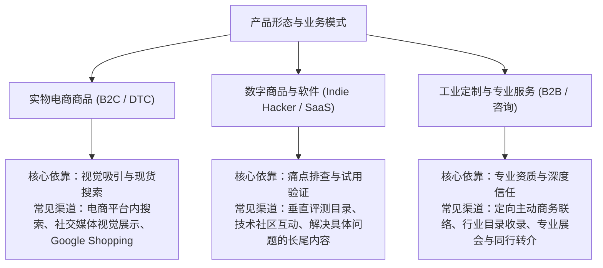
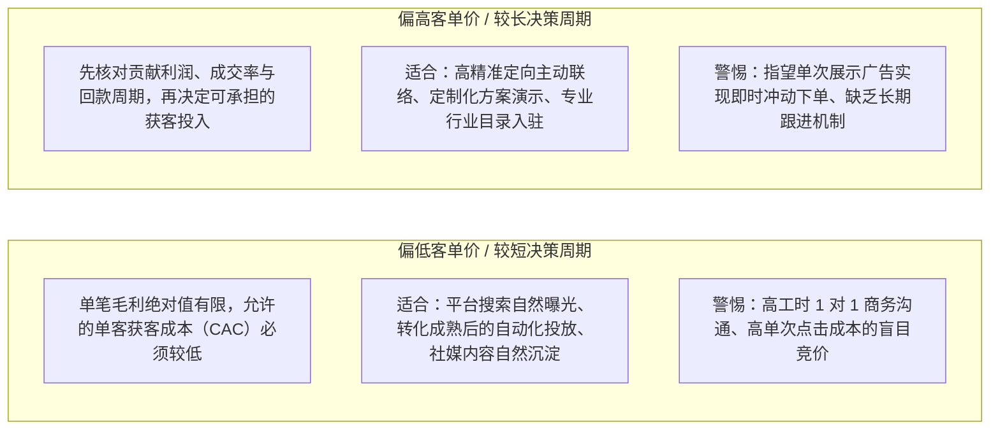
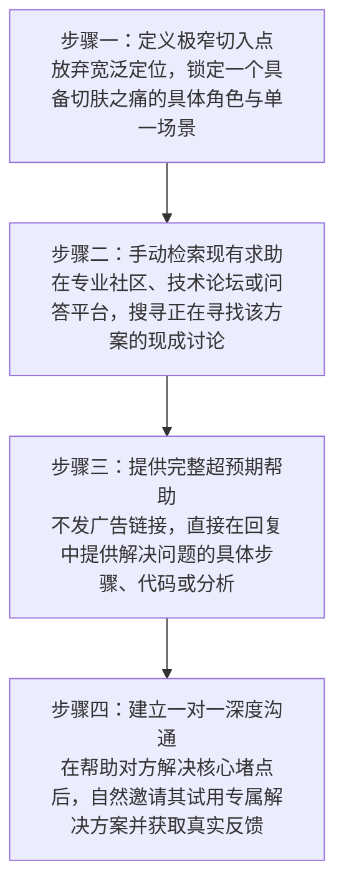
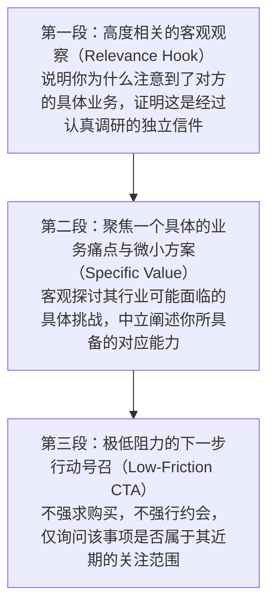
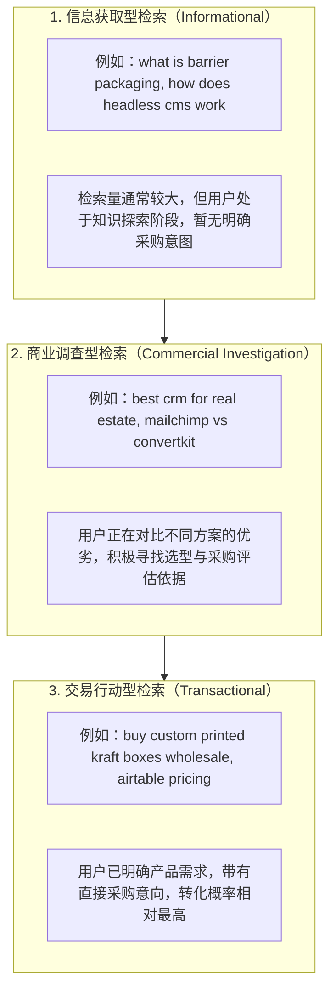
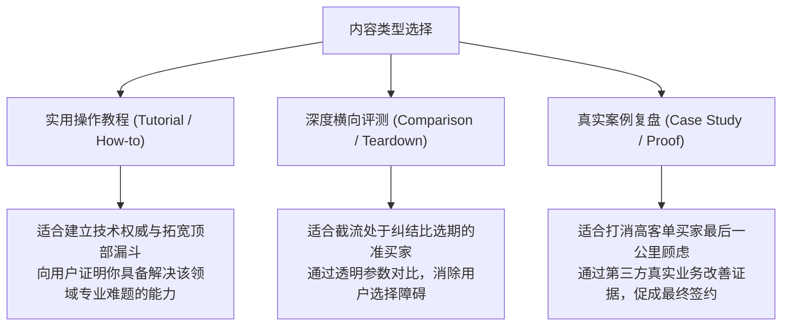
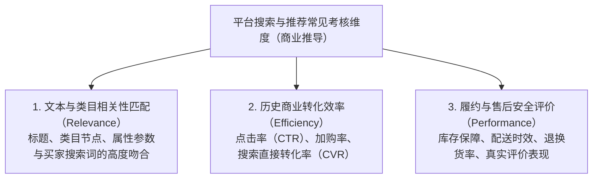
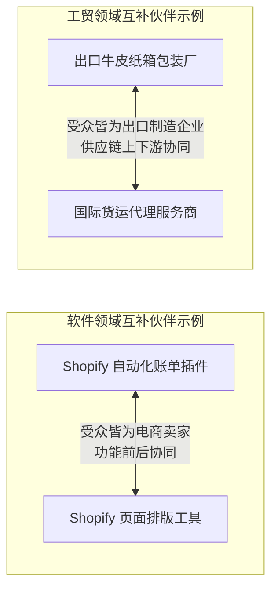
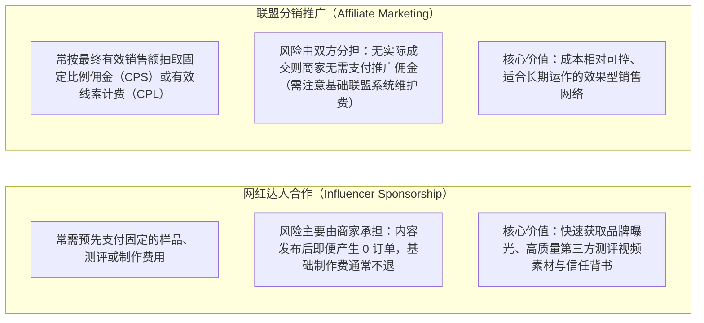
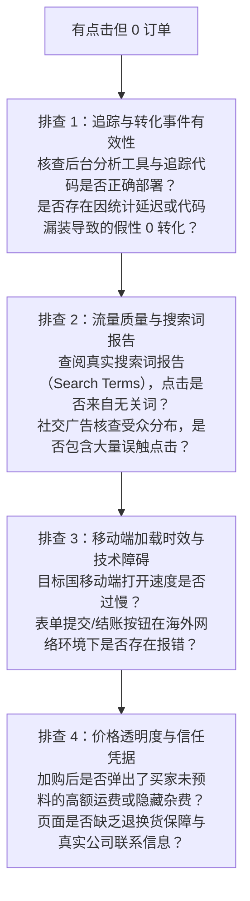

# 我该怎么找到客户？

> **正式状态**：`CHAPTER2_FINAL_SEALED / OWNER_AUTHORIZED_DIRECT_REPAIR / 2026-10-18`  
> **冻结原题**：本章9个二级、22个三级、2.2直接成节；完整框架核心1/一级6/二级35/三级78。  
> **资料边界**：文中标注的模型假设不代表真实投放结果；营销法律与平台广告权限需依目标国家及核验当时政策独立确认。

> **历史稿件状态说明**：旧Writer候选曾使用`CANDIDATE_FOR_REVIEW / STOP_AT_REVIEWER`；该阶段已被本文件顶部`CHAPTER2_FINAL_SEALED`正式状态取代，不是当前执行Gate。  
> **面向读者**：中国大陆个人开发者、独立站经营者、跨境平台卖家、微型 SaaS 与数字产品创作者、小微工贸与跨境服务团队。  
> **本章核心定位**：在第一章完成买家场景识别与意图判断的基础上，系统比较并实操各类跨境获客渠道（主动开发、自然搜索、内容社群、平台曝光、伙伴合作、付费广告及达人分销），掌握低预算冷启动动作与小额投放测试方法，形成兼顾现金、时间与技能的可行经营决策。

---

## 引言：从“知道客户在哪”到“建立第一条获客通路”

在第一章中，我们建立了寻找买家的基本认知：明白了客户在不同意识阶段的搜索行为、如何识别高购买意向的真实线索、企业采购的多角色协同逻辑，以及跨国沟通的本地化规则。然而，许多跨境经营者在明确了“客户在哪里”之后，面对繁复多样的网络营销手段，往往会陷入新的困境：
- 看到同行做 SEO，就盲目投入数月精力撰写文章，结果因选错竞争度与搜索意图，长时间未见流量与询盘，耗尽耐心；
- 听说投广告见效快，就匆忙在 Meta 或 Google 上充值投放，由于未做单位经济测算与承接漏斗排查，短时间内消耗预算却未见正向反馈；
- 尝试群发陌生的商业开发邮件，由于不了解当地法律规范与价值沟通技巧，邮件被服务商拦截甚至导致企业发信域名信誉受损；
- 还有人试图同时运营多个社交平台，结果个人精力严重透支，每个渠道都流于表面，无法形成有效转化。

在资源与人手有限的现实约束下，**获客绝不是把所有渠道都做一遍，而是根据自身产品的商业模式、客单价、购买周期与能力禀赋，筛选出最匹配的 1~2 个主攻渠道，并完成从零到一的闭环验证**。

本章将系统拆解跨境业务中主流获客通路的运作机理、适用门槛、真实成本与执行步骤，帮助经营者在预算紧缺甚至为零的前提下，稳步迈出获客的第一步。

---

## 2.1 哪种获客方式适合我？

没有任何一种获客渠道是适用于所有业务的“万能解药”。选择获客方式的核心原则是**“商业要素与渠道特性的精准匹配”**。盲目追随市场热点，往往会导致资源错配。

### 2.1.1 卖商品、软件和服务，渠道有什么不同？

不同产品形态在交付方式、买家感知门槛和验证成本上存在本质差异，这直接决定了其天然契合的触达路径：

#### 1. 标准实物消费品（B2C / DTC）
- **买家决策机制**：买家对实物商品的外观、规格和功能具备直观的认知，通常不需要复杂的售前教育。决策重点在于产品外观、价格性价比、运费时效以及已有买家的真实评价。
- **匹配渠道特征**：
  - **平台内搜索与类目推荐**（如亚马逊、Shopee 等）：承接具备即时购物意图的存量客流；
  - **社交视觉展示**（如 Instagram、TikTok）：通过短视频或场景图直观呈现产品使用效果，激发潜在兴趣；
  - **Google Shopping 广告**：直接展示商品图片与价格，拦截具有明确购物意图的搜索者。
- **不适合的做法**：对普通标品实物进行冗长的纯文字冷邮件推销，或撰写数千字的宏观行业理论文章。

#### 2. 数字工具与软件产品（Micro-SaaS / 独立开发应用 / 模板）
- **买家决策机制**：软件与虚拟资产不可触摸，买家在付款前最关心“是否真的能解决我的问题”、“是否兼容我的现有工作流”以及“上手是否过于复杂”。
- **匹配渠道特征**：
  - **解决特定问题的长尾搜索内容**：拦截正在寻找特定脚本、工作流模板或报错排查方法的用户；
  - **垂直软件聚合目录**（如 ProductHunt、AlternativeTo、G2）：触达具有主动比选意愿的早期尝试者；
  - **技术社区互动解答**（如 Reddit、GitHub、相关专业技术论坛）：通过提供专业解答自然展示工具价值。
- **不适合的做法**：在无明确意图的宽泛社交媒体上大面积投放缺乏具体演示的纯曝光展示广告。

#### 3. 专精制造、工业定制与专业服务（B2B / 外贸代工）
- **买家决策机制**：客单价高、涉及对公签约与长期履约，决策链涉及技术、采购、财务等多个部门。买家高度关注供应商的工厂资质、生产公差、安规认证与交付稳定性。
- **匹配渠道特征**：
  - **精准的主动商务联络（Outbound Outreach）**：基于公开合规的行业名录，直接联系目标企业的技术或采购负责人；
  - **专业行业黄页与采购目录**（如 ThomasNet、Europages）：建立企业对公采购背书；
  - **行业互补伙伴引荐**：通过非竞争关系的上下游服务商（如货代、报关行、检测机构）引荐真实买家。
- **不适合的做法**：过度依赖纯娱乐性质的短视频平台吸引偶发个人客流，或期望买家通过电商购物车直接下单。

---

### 2.1.2 客单价和购买周期会怎样影响渠道？

客单价（Average Order Value, AOV）、单笔订单贡献毛利（Contribution Margin）与购买决策周期，是约束获客成本的硬性财务边界。

#### 1. 偏低客单价业务的渠道约束【示意演算 / MODEL_ASSUMPTION】
- **财务逻辑**：以一件售价 $30、扣除物料与跨境物流后单笔贡献毛利为 $10 的消费品为例。若采用单次点击成本（CPC）为 $1.00 的付费搜索广告，假设着陆页购买转化率达到 2.5%，则获取一位付费客户平均需要 40 次点击，产生的广告成本（CAC）为 $40，单笔订单亏损 $30。在缺乏成熟复购机制支撑的情况下，该模型在财务上不可持续。
- **渠道取舍**：此类业务可优先尝试边际分发成本较低、能控制单笔获客投入或能建立可核实复购价值的渠道，但是否有效仍须用自己的订单贡献利润与实际获客数据检验。例如：第三方电商平台内部的自然搜索曝光、针对具体型号的长尾自然搜索内容、或按最终有效交易金额计提佣金的分销联盟（Affiliate）。
- **警惕陷阱**：偏低客单价业务不宜投入创始人大量手工时间进行一对一的邮件销售沟通，人工时间成本极易超过商品自身的毛利。

#### 2. 偏高客单价业务的渠道特征【示意演算 / MODEL_ASSUMPTION】
- **财务逻辑**：以年收入 $1,200 的行业 SaaS 工具，或**假设单笔贡献毛利为 $2,000** 的非标加工订单为对比。两者的收入和利润口径不同，不能直接合并计算。部分B2B买家可能需要资质评估、打样或内部审批，实际成交周期应以各自订单记录验证。
- **渠道取舍**：高客单价不等于高利润。年费 $1,200 的 SaaS 是**收入**，还须扣除交付、客服、支付及持续运营等可归属的变动成本；另一示例的外贸订单 $2,000 已假设为**单笔贡献毛利**，二者不可直接当成同样利润。获客还需区分**合格销售线索成本（Cost per SQL）**与**实际成交客户获客成本（CAC）**：在仅以该渠道、同一统计口径计算且不考虑其它销售成本的简化示例中，若每条 SQL 成本 $100、SQL 最终成交率 10%，则仅线索采购对应的预期 CAC 就是 $100÷10%=**$1,000**；加上演示、样品与销售工时后还会更高。能否承受须与实际订单贡献利润、复购净贡献、回款周期及未成交损耗共同比较，不能只凭销售额推断。若核算后合理，才考虑定向商务沟通、打样、产品演示或B2B名录等较重渠道。【MODEL_ASSUMPTION：以上转化率及金额为教学假设，不代表行业事实。】
- **警惕陷阱**：偏高客单价业务不宜寄希望于单次社交广告点击直接促成付款，买家极少在陌生网页上因单次视觉冲击直接支付大额款项，必须建立多阶段的销售跟进与信任支持体系。

---

### 2.1.3 哪些渠道符合我的时间和预算？

获客成本绝不仅仅是账面上支出的广告账单。对于独立经营者和小微团队而言，**创始人的工作工时与技能学习曲线同样是极其昂贵的稀缺资源**。

#### 跨境主流获客渠道的资源投入对照矩阵

| 获客渠道形态 | 资金门槛 | 初始时间与见效周期 | 所需核心技能 | 典型风险与失败代价 | 适合什么阶段的经营者？ |
| :--- | :---: | :---: | :--- | :--- | :--- |
| **精准主动触达** (Cold Outreach) | 极低 （零广告费） | 中等时间投入 （数天至数周见反馈） | 商业调研、痛点提炼、英文专业沟通、合规意识 | 邮件进入垃圾箱；被收件人投诉；发信域名受损 | 资源有限但懂行业，面向 B2B 或小企业客户的启动者。 |
| **搜索引擎优化** (SEO) | 极低~中等 （工具订阅可选） | 较高时间投入 （需积累权重与抓取） | 关键词分析、专业内容撰写、页面技术规范 | 长期投入无排名；算法更迭流量归零；选错竞争度 | 有持续写作耐心、懂技术长尾，不急于短期回本的长期经营者。 |
| **垂直社区互动** (Community / Inbound) | 极低 （零广告费） | 持续日常投入 （需逐步建立声誉） | 深度专业知识、同理心、社群规则理解 | 违反版规被封号；被视为营销号导致声誉受损 | 自身即为产品资深用户，具备技术解答能力的个人创作者。 |
| **付费搜索广告** (Search Ads) | 较高 （持续消耗现金） | 见效较快 （数天内积累测试数据） | 数据分析、受众定向、着陆页优化、预算控制 | 预算快速消耗无转化；遭遇无效点击；获客成本失控 | 具备验证过的转化页面、产品毛利充足且有试错资金的商家。 |
| **平台自然曝光** (Marketplace SEO) | 极低~中等 （需产品库存） | 中等 （需积累初始销售） | Listing 关键词挖掘、首图视觉设计、平台规则认知 | 平台规则突变封店；价格战内卷；严重依赖单一平台 | 依托第三方电商生态起步的纯实物商品卖家。 |

#### 针对小微商家的资源匹配诊断法则
1. **如果你“现金极少，但有充沛的专业时间”**：优先选择**精准主动触达（2.3）**与**高意图社区专业答疑（2.5）**。用自身的时间和专业深度换取第一批种子买家，同时获得最真实的产品反馈；
2. **如果你“全职兼任研发，每周仅能抽出少量时间做市场”**：不宜铺开需要频繁社群互动的矩阵，也不宜盲目全面铺开全站 SEO。优先打磨清晰的产品着陆页，并准备小额预算进行**窄定向的付费搜索广告测试（2.9）**，利用付费流量在短时间内验证核心购买意图；
3. **如果你“急需在短时间内验证是否有正向现金流可能”**：不宜将主要精力寄托在权重积累较慢的自然搜索优化（SEO）上，应优先选择能够主动发起联络的商业客户名单，或利用成熟电商平台已有的中心化搜索流量进行测款。

---

## 2.2 没流量、没预算，先试什么？

> **直接成节说明**：在资源匮乏、网站没有权重、社媒没有粉丝积累、账户没有广告预算的“零冷启动”阶段，商家不应分散精力，而应将所有资源收敛至一个**“最小可行获客动作（Minimum Viable Action, MVA）”**上。

#### 1. 核心战略：通过直接对话获取高信噪比反馈
在商业早期探索阶段，硅谷创业孵化器 Y Combinator 创始人 Paul Graham 曾总结过一个著名观点：“Do things that don't scale（做无法规模化的事）”。对于零预算起步的跨境小微经营者而言，最初的种子客户通常不是通过全自动营销漏斗捕获的，而是依靠创始人**手动、定向、深入地介入具体真实场景**换来的。

#### 2. 零预算起步的四个具体实操步骤

- **第一步：将定位极度收窄**：不要试图做“面向所有独立站卖家的全能工具”或“面向所有工业客户的制造厂”。将范围收窄为具体的角色与明确的单一痛点。例如：*“专门帮助使用特定 Shopify 模版的卖家排查移动端特定字体加载缓慢问题”*，或*“专门为欧美小型精酿咖啡品牌定制可降解排气阀豆袋”*。定位越具体，受众对专业度的信任门槛越低。
- **第二步：主动搜寻“正在发生”的求助信号**：利用搜索引擎的高级语法（如第 1 章介绍的 `site:reddit.com` 或垂直技术论坛），检索特定报错代码、操作困扰或竞品替代方案的提问。这些发帖人在发帖时刻具有极其迫切的解决意图。
- **第三步：提供直接可用的专业价值**：
  - *【示意案例 / MODEL_ASSUMPTION】*：假设开发者制作了一款特定文件格式批量转换脚本。当看到某开发者论坛用户发帖求助“如何将某种非标 JSON 批量转换为特定数据库表格”时，开发者不应简单回复“去买我的工具”，而是应当在回复中直接写出清洗逻辑并附上核心代码片段。在帮助对方成功解决问题的末尾，附带一句中立说明：“如果您日常需要高频自动处理该类文件，我封装了一个开箱即用的小工具，欢迎试用并提出宝贵改进意见”。
  - 这种与提问相关的专业回应**可能**提高可信度，但不保证得到回复，也**不保证免于反垃圾判定**。公开回答、提及自家产品或主动邀请交流前，先查看平台政策与具体社区版规；当社区禁止自我推广或外链时，应只提供独立完整的帮助，不附商业引导或私信骚扰。参考 [Reddit 官方 Spam 帮助](https://support.reddithelp.com/hc/en-us/articles/360043504051-Spam)（更新于2026-10-06）。
- **第四步：获取种子用户的深度反馈与付费意向验证**：
  - 如果对方试用后认可产品价值，可适时提出商业验证：“这项工具目前正处于初期迭代阶段，如果您愿意以早鸟优惠价成为我们的第一批正式用户，我们将为您提供持续的技术支持与优先功能迭代”。
  - 如果用户表示认可但暂无付费意向，应进一步探究原因：是当前痛点不够高频、功能尚有缺失，还是定价策略不匹配？这种深度反馈是指导后续产品与营销迭代的宝贵资产。

#### 3. 设定明确的试验周期与止损边界【示意设计 / MODEL_ASSUMPTION】
零预算并不等于零成本，创始人的精力是最宝贵的资产。经营者应为冷启动试验设定明确的护栏：
- **时间与行动量参考基准**：可将首次验证周期设定在 **2~4 周**，完成约 **30~50 次**有针对性的一对一高质量互动或主动联络；
- **排查与修正逻辑**：如果在完成 50 次深入互动后，完全未能获得任何积极意向，经营者应系统排查以下环节，而非盲目重复低效动作：
  1. *受众样本是否偏差*：沟通的对象是否为实际面临该痛点的决策者？
  2. *价值主张是否清晰*：所描述的解决方案是否切实击中其痛点？
  3. *商业模式是否匹配*：该痛点是否更适合通过免费开源/广告模式变现，而非付费买断？
  4. *触达方式是否恰当*：该类客户是否更习惯于通过搜索引擎主动检索，而非在社区中被动接触？

---

## 2.3 怎么主动联系潜在客户？

主动触达（Outbound / Cold Outreach）是指在客户尚未主动访问你的网站之前，由经营者基于公开合规的商业联系方式，主动发起沟通。对于面向小企业、批发采购及专业服务领域的跨境商家，这是启动周期相对较短、对前期资金依赖较低的通路。

### 2.3.1 从哪里取得可以合法使用的潜客线索？

在海外开展主动商业联络，合规底线是生存的基石。违规抓取个人隐私数据不仅会导致邮件服务商直接封禁发信域名，还可能面临目标国监管机构的严厉处罚。

#### 1. 合法线索来源渠道
经营者应从公开透明的商业渠道搜集线索，而非购买不明来源的黑市数据：
- **政府官方商业登记与公开申报系统**：
  - 例如英国政府官方的 [*Companies House Service*](https://find-and-update.company-information.service.gov.uk/)，可公开查询在英注册公司的法定名称、公开对公联系地址及主营行业代码；
- **官方经贸展会与行业协会公开展商名录**：
  - 国际大型贸易展会（如法兰克福工业展、CES、专业医疗器械展）在官方网站公开发布的参展企业名单，通常包含企业对公联络方式，是开展 B2B 业务的天然真实名单；
- **企业官方公开网站与企业公开社交主页**：
  - 目标企业官网上主动公开的商务合作通道（如 `contact@company.com`、`partnerships@company.com`），或企业在 LinkedIn 上的公开主页。

#### 2. 国际数据保护法规与边界防线
需要特别注意：**企业公开了联系方式，并不等同于经营者可以无限制地向其推送任何营销信息**。在记录和整理潜客名单时，必须知晓各法域的强制性合规要求：
- **区分企业对公数据与个人私有数据**：
  - 参考英国信息专员办公室 [*ICO Direct Marketing: Business-to-Business Marketing 指引*](https://ico.org.uk/for-organisations/direct-marketing-and-privacy-and-electronic-communications/business-to-business-marketing/)，在英国直接营销规则（PECR）下，向“企业订户（Corporate Subscribers，如有限公司）”发送商业邮件的规定，与向“个人订户（Individual Subscribers，包括个人消费者与个体经营者 Sole Traders）”存在严格法定区别；
  - 涉及个人姓名构成的邮箱（如 `john.smith@company.com`）时，在欧盟与英国法域下仍属于个人数据，处理此类数据必须符合 GDPR / UK GDPR 项下的合法处理依据（例如经过平衡测试的合法利益 Legitimate Interests）；
- **技术与反欺诈红线**：
  - 参考 [*ICANN 注册数据政策（Registration Data Policy）*](https://www.icann.org/en/contracted-parties/consensus-policies/registration-data-policy) 与 [*注册数据营销限制政策（Registration Data Marketing Restriction Policy）*](https://www.icann.org/en/contracted-parties/consensus-policies/registration-data-marketing-restriction-policy/registration-data-marketing-restriction-policy-01-07-2024-en/)，受全球隐私法规影响，WHOIS/RDAP 公开查询中的个人注册数据依法被广泛遮蔽，且批量访问协议严格限制用于商业营销；
  - 严禁通过技术手段伪造发信人身份（Spoofing）或使用虚假回信地址。

---

### 2.3.2 第一次开口，怎么说才有回复机会？

海外商务买家每天都会收到各类开发信。绝大多数容易被直接忽略或移入垃圾箱的邮件具有以下特征：以自我为中心、长篇大论自吹自擂、附带巨大附件，并直接要求对方安排 30 分钟通话。

#### 高质量首次商业沟通的核心架构（3 段式原则）

#### 典型沟通对比示例

> ❌ **【错误示范：空洞推销型邮件】**  
> *"Dear Sir/Madam, We are a top factory in China with 20 years experience and best quality ISO certification. We can supply all kinds of packaging at the cheapest price. Please check attached 30MB catalog and let us know when we can have a Zoom call this week."*  
> **败因分析**：称谓模糊无针对性、单向自我宣传、超大附件极易触发安全拦截、过早提出高时间成本请求（开会）。

> ✔️ **【正面示范：客观针对性价值沟通 / MODEL_ASSUMPTION】**  
> *"Hi John, I noticed that [Target Brand] recently launched a line of whole-bean specialty roasts in sustainable packaging—congratulations on the release.*  
> *In small-batch coffee packaging, maintaining nitrogen barrier freshness while using compostable multi-layer films often requires specific one-way degassing valves and sealing parameters. We can share a short comparison of pouch materials and valve specifications for small-batch runs, including what would need to be verified for your packaging requirements.*  
> *I’ve prepared a brief 1-page technical parameter and material comparison sheet. Would it be helpful to email the PDF over for your team's reference, or is your packaging setup already fully dialed in?"*  
> **成因分析**：以**确认真实的目标品牌动态**开场，提出具体技术问题，再请求对方确认是否需要一页资料。示例中的品牌动态、产品能力与可提供材料均为教学假设，实际使用时要逐项核实；**不得照抄虚构客户经历、第三方测试、认证或合规资质**。是否获得回复仍取决于相关性、许可规则和买家意愿。

---

### 2.3.3 没收到回复，怎么跟进和停止？

在商业主动触达中，合理跟进是一种常见的业务礼貌，因为收件人可能恰好在出差、休假或积压待办。然而，**不当或高频的催促会迅速演变为骚扰，导致发信域名被投诉拉黑**。

#### 1. 增量价值跟进节奏设计【示意参考 / MODEL_ASSUMPTION】
- **第 1 轮（第 1 天）**：发出经过针对性调研的首次价值探讨邮件；
- **第 2 轮（约 4~5 个工作日后）**：补充一个轻量增量信息（例如：“顺便附上关于此材料耐温公差的公开测试数据，供贵司工程人员参考”）；
- **第 3 轮（约 8~10 个工作日后）**：从不同维度切入探讨（例如询问小批量测试起订门槛是否符合其当前研发阶段）；
- **第 4 轮（约 15~20 个工作日后）——体面退出确认（Break-up Email）**：明确说明将不再继续联络：“我们理解这可能不符合贵司当前的业务周期，我将不再就此打扰您。未来若有相关技术需求，随时欢迎交流”。

#### 2. 法定停止条件与技术红线
根据美国联邦贸易委员会关于商业电子邮件的法律指引 [*FTC CAN-SPAM Act Compliance Guide for Business*](https://www.ftc.gov/business-guidance/resources/can-spam-act-compliance-guide-business) 及各法域直销规范，经营者必须严格执行停止边界：
1. **严格履行退订与退出请求**：在美国 CAN-SPAM 适用的商业电子邮件中，发件人必须在收到收件人明确的退出请求（如回复“请勿再发”或点击退订）后 **10 个工作日内** 停止向该地址继续发送营销邮件；面向英国及欧盟受众时，依当地直接营销与数据保护法规，应及时响应并停止处理；
2. **建立内部退订名单库（Suppression List）**：所有表达拒绝意愿的邮箱地址必须统一归档隔离，防止后续被其他同事或自动化系统再次误触；
3. **退订通畅性与实体地址披露**：商业邮件中必须包含清晰可见的退出方式说明，以及发件人合法有效的实体邮寄地址（Valid Physical Postal Address）。

---

## 2.4 怎么让搜索客户找到我？

搜索引擎优化（SEO）的本质，是让自己的产品与内容在潜在买家通过搜索引擎寻找答案时，以高度匹配的形式展现在自然搜索结果前列。这是一项典型的“复利型”渠道——前期需要持续的内容与结构沉淀，但一旦形成稳定排名，能够持续承接具有明确意向的主动访客。

### 2.4.1 客户搜哪些词时更可能购买？

很多初创经营者做搜索时，容易盲目争夺宽泛的行业大词（如 `shoes`、`packaging`、`CRM`）。这些词不仅竞争极其激烈，而且搜索意图高度发散，往往多为学术研究、概念了解或随手检索，实际下单意愿通常较低。

#### 搜索意图的三层漏斗模型（营销启发框架）
在信息检索与入站营销理论中，常将用户检索意图划分为三个层次：

- **高商业价值的长尾交易修饰词**：
  小微经营者应当优先关注带有具体业务约束的长尾词：
  - *规格与参数约束*：`MOQ 500`、`lead time 2 weeks`、`for Mac Monterey`；
  - *商业交易意向*：`buy`、`supplier`、`manufacturer`、`pricing`、`wholesale`；
  - *竞品替代与比选*：`[头部竞品] alternative for small business`。
- **流量与转化意图的客观平衡**：即便某些长尾词每月检索量较小，但只要搜索者带有明确的采购意图，其带来的商业转化价值往往远高于无购买倾向的大词。

---

### 2.4.2 产品页和文章各该回答什么？

很多卖家网站转化率不理想，常是因为**页面承接意图混乱**：在需要促进下单的产品落地页堆砌了数千字的宏观理论，或者试图让一篇宽泛的博客指南直接充当产品结账页。

#### 页面职责分工矩阵

| 维度 | 产品与服务落地页（Landing / Product Page） | 知识文章与指南页（Blog / Article Guide） |
| :--- | :--- | :--- |
| **承接的核心意图** | **交易行动型与高商业意向检索** | **信息获取型与商业比选型检索** |
| **买家的核心疑问** | “这能买吗？多少钱？规格是什么？什么时候送到？出问题找谁？” | “这问题怎么解决？有哪些常见方案？各自优缺点是什么？” |
| **必须呈现的要素** | • 清晰的产品定位与核心价值说明 • 详实的技术规格、材质公差、兼容环境 • 价格梯度、采购起订量（MOQ）、现货库存 • 运费说明、退换货条款与安全合规凭证 • 显眼的“购买 / 询价 / 试用”行动号召按钮（CTA） | • 严密的问题排查步骤或技术操作教程 • 多种解决方案的客观对比分析（包含适用边界） • 真实代码片段、操作图示或排坑经验 • 结构清晰的文章目录与逻辑导航 |
| **转化衔接方式** | 直接提供支付结账或提交采购规格表单。 | 在文章内容中，针对具体操作痛点自然附带配套工具或商业服务链接。 |

---

### 2.4.3 搜索竞争很强时，先做哪些内容？

面对已经在搜索引擎前列占据多年权重的大型行业站点，新站点的外链积累和域名权重处于劣势。小微团队应结合自身专业优势，采取**“侧翼包抄”**策略。

#### 三类小站点破局优先内容
1. **针对成熟竞品的客观比选与替代方案页面（Alternative & Vs Pages）**：
   - 商业逻辑：正在搜索竞品替代方案的买家，通常对现有产品的价格、某些特定功能的缺失或服务响应存在痛点，意向明确；
   - 内容要求：客观、公正地列出自己方案与竞品的核心差异，诚实说明自己适合哪些场景、不适合哪些场景。切忌片面抹黑竞品，客观真实的对比反而能树立专业信誉；
2. **解决极细分边缘环境的具体排查指南（Edge-Case Troubleshooting）**：
   - 商业逻辑：大型厂商通常只覆盖通用型帮助文档，往往忽略了特定系统版本、非标硬件接口或特殊业务环境下的特定报错；
   - 围绕巨头未覆盖的“具体错误代码”或“冷门非标场景”撰写详尽解决方案，能够避开大词竞争；
3. **针对特定技术栈或上下游工具的集成配置教程（Integration Guides）**：
   - 商业逻辑：例如撰写“如何在特定电商建站系统或 CRM 中配置某种自动化脚本”；
   - 借助成熟生态的既有品牌认知，为自身工具搭建合法的展现机会。

---

## 2.5 怎么用内容和社区吸引客户？

内容与社区获客（Inbound Marketing）的核心，是通过持续输出具备实用价值的知识、经验与见解，吸引对相关领域有需求的目标人群，并在建立专业信任后自然导向商业产品。

### 2.5.1 教程、对比和案例，哪种更适合？

不同内容形式在不同阶段承担着不同的信任构建使命：

#### 实操取舍准则
- **对于技术与工具类产品**：优先制作**“实操操作教程（Step-by-Step Tutorial）”**，因为用户通常是在动手操作遭遇卡点时寻找内容；
- **对于替代性较强、竞争激烈的消费品或常规服务**：优先制作**“横向拆解对比（Deep-Dive Teardown）”**，帮助客户客观算清综合拥有成本；
- **对于高单价 B2B 外贸与定制开发**：**“真实商业案例分析（Case Study）”**具有极强的说服力。客观记录客户面临的初始困境、采取的解决路径以及客观带来的业务参数改善，有助于打消决策层的履约顾虑。

---

### 2.5.2 在社区里，怎么参与才不会变成广告骚扰？

海外高价值社区（如 Reddit 各垂直版块、Hacker News、Discord 技术群组）对低质营销、自动化灌水和生硬推销抱有很高的警惕性。违规发帖极易被版主（Moderators）删除、禁言，甚至导致产品域名被社区屏蔽。

#### 合规参与社区的核心准则
1. **严格查阅并遵守社区具体版规（Subreddit Rules）**：
   - 参考 [*Reddit 平台通用准则（Reddit Rules）*](https://redditinc.com/policies/reddit-rules) 与历史自推广参考建议 [*Reddit Self-Promotion Guidelines*](https://www.reddit.com/r/reddit.com/wiki/selfpromotion/)；历史指南曾建议用户将自推内容比例保持在很低水平（如 10% 经验参考），而具体到每个独立的 Subreddit，版主团队制定了差异化的具体版规（有的版块完全禁止任何商业链接，有的版块设有每周专门的自荐专帖）；经营者发帖前必须逐字核查所在版块的置顶规则；
2. **在正文中直接提供完整解答，杜绝“外链钓鱼”**：
   - 严禁发布只有简短引语随后强行要求点击外链的帖子；
   - 将解决方案、排错代码或操作图示直接完整写在帖子内，让读者无需离开社区即可获取答案；
3. **主动、透明地披露商业利益关联（Transparency）**：
   - 在提及自己的产品时，主动说明自身身份（例如：*“声明：我是该工具的开发者……”*）；
   - 坦诚面对社区的质疑与技术批评，将讨论重心放在技术架构与业务取舍上。需注意：即便透明披露身份，亦不能保证内容不被版主删除，仍需以遵守版块具体规则为第一准绳。

---

### 2.5.3 内容有人看，怎样引导到购买入口？

拥有阅读量或点赞互动，并不等于获得了商业客户。必须在内容与商业产品之间建立自然、顺畅的连接桥梁。

#### 建立自然转化承接的三种合规路径
1. **提供可落地的“配套实用资源”作为承接**：
   - 在深度长文末尾，提供免费的补充资料（例如：预设工作流模板、排查清单 Checklist、原材料规格对照表）；
   - 读者为了进一步提升效率，会自愿点击进入官网获取该工具；
2. **个人或品牌资料页（Bio）的规范化引导**：
   - 在社交平台（Twitter/X、LinkedIn、Reddit）的个人主页中，用简短客观的语言讲清业务定位，并附带官方主页链接；
   - 当你在社区的专业回答获得认可时，感兴趣的潜在买家会主动点击个人主页了解背景；
3. **尊重平台生态规则与内容形态**：
   - 了解不同社交媒体对正文外部链接的展示机制差异；
   - **“把商业链接放在首条评论”不是规避平台推荐或反垃圾规则的通用技巧。**仅当所在平台及具体社区明确允许相关外链、自我推广和商业披露时，才能选择在正文或评论提供资料链接，并确保披露自身利益关系；不允许时不要绕过版规，通过不含推广的完整专业解答参与，或使用社区许可的个人资料页/官方推广功能。不同社区管理员可按规则移除内容，不能保证保留或推荐。

---

## 2.6 怎么获得平台内的自然曝光？

对于入驻第三方电商平台（如亚马逊、Shopee、Etsy、TikTok Shop 等）的跨境卖家，获客的核心战场在于**争取平台生态内部的公域自然曝光**。

### 2.6.1 平台内搜索与推荐关注哪些信号？

与 Google 等通用搜索引擎不同，**电商平台算法的核心诉求不是满足广泛的信息查询，而是促进商品交易的达成与用户满意度的维系**。

#### 平台自然排序的核心考量维度（行业通用机制）
1. **关键词与属性文本匹配度**：
   - 平台通过检索商品的标题（Title）、属性参数、后台搜索词（Search Terms）以及类目归属，判断商品是否符合用户的检索词；
2. **历史转化率与销售表现**：
   - 平台倾向于展示在同类检索词下点击反馈良好、下单转化稳定的商品；
3. **履约保障与客户满意度指标**：
   - 现货配送时效（如平台官方仓发货）、订单取消率、退款率及用户评价星级对商品的自然曝光存在重要制约。严重的履约或质量问题往往会导致曝光权重下降。

---

### 2.6.2 曝光少时，怎么检查商品展示？

当商品上架后长期缺乏自然曝光，经营者应建立客观的漏斗排查思路：

#### 平台自然曝光排查步骤指引
1. **第一步：排查关键词索引与可购状态（Indexing & Buyability）**：
   - 将商品的主核心词搭配品牌或特定标识输入平台搜索栏，核查商品是否被系统正常索引；
   - 检查商品在目标销售地区的库存是否正常可用，是否因跨区配送限制或账户审核导致暂时不可展示；
2. **第二步：排查主图视觉与点击吸引力（CTR Audit）**：
   - 将自身主图与搜索结果前排同类商品并排对比：在移动端微缩图模式下，主图是否能清晰呈现商品主体形态与核心特征？价格在目标市场是否处于合理竞争区间？
3. **第三步：排查详情信息呈现（Listing Detail Audit）**：
   - 检查副图与视频是否清晰展示了使用场景、尺寸比例或材质细节；文字描述是否解答了买家最常见的疑虑；
4. **第四步：利用小额站内搜索广告验证意图**：
   - 可开启极小预算的站内精准搜索广告，观察商品在核心搜索词下是否能产生真实点击；若产生点击后依然完全无转化，应重点审视商品本身在价格、视觉或评价上的竞争劣势。

---

## 2.7 怎么借合作伙伴带来客户？

合作伙伴引荐（Partner Referral）是指与面向相同目标受众、但自身产品互不竞争的非对头同行建立协作，互相引荐客户。对于小微团队而言，这是借力突破冷启动信任壁垒的高效途径。

### 2.7.1 什么样的伙伴值得互相推荐？

理想的合作伙伴必须满足两个前提：**受众高度重叠**、**核心业务互补**。

#### 筛选优质合作伙伴的三个维度
1. **客群画像一致性**：对方服务的客户类型（如客单价、所处行业、组织规模）与你的目标买家吻合；
2. **产品功能零竞争**：双方产品互不替代，能够在买家的业务链条中形成前后衔接；
3. **商誉与履约可靠度相当**：合作伙伴的产品质量与售后服务水平需经过调研，合作方的严重失误可能会间接影响引荐方的品牌信誉。

---

### 2.7.2 合作前怎么核对线索质量和责任？

许多合作无疾而终甚至产生纠纷，往往是因为前期权责含糊、缺乏合规意识。

#### 建立稳健合作的四个防线
1. **严格遵守数据保护法规，严禁私下倒卖或未经授权共享客户名录**：
   - 若涉及可识别个人的联系人信息，**先核实适用法域及数据是否属于个人数据**，并针对共享目的、来源和接收方判断合法处理依据、透明告知、资料最少化、安全措施及相关权利。以适用的欧盟 GDPR 为例，**同意只是可能的合法依据之一**，也可能存在符合严格条件的其他依据（如经过利益平衡的正当利益），不能一概写成必须取得“知情同意”，更不能因公开可见就认为可任意共享；共享后使用电子邮件/短信等营销，还须独立核查目标国家的电子营销规则和退订/反对权。请参考[欧盟委员会数据处理合法依据说明](https://commission.europa.eu/law/law-topic/data-protection/information-business-and-organisations/legal-grounds-processing-data_en)，本章不替代各法域法律意见；
   - 合规的合作方式包括：各自在允许商业推荐的官方渠道公开推荐对方、共同撰写方案、联合举办公开分享，**优先让有意向的客户自主联系另一方**，尽量不转交客户名单；若确需引荐涉及个人信息，先核实适用的处理依据和必要告知/同意条件，再采取最小范围的合规转交；
2. **明确引荐记录与追溯机制**：
   - 双方约定好专属的合作页面链接（带参数追踪）或专属优惠代码，确保引荐线索统计透明；
3. **明确约定各自独立的法律与履约责任**：
   - 在合作备忘中明确各自对自身产品独立承担质量与售后责任；同时应认识到，即便有合同约定，若引荐了存在明显欺诈或违规的合作方，仍可能面临声誉受损及法律追偿风险；
4. **设立定期复盘与退出机制**：
   - 设定 1~3 个月的试运行周期；如果试运行期间双方引荐的线索转化极低，或发现客户属性不匹配，应按照约定体面停止合作。

---

## 2.8 广告、达人和佣金推广怎么选？

当业务建立了一定的转化基础，并具备一定利润空间后，付费推广将成为快速放量的重要抓手。然而，搜索广告、社交广告、网红达人（Influencer）与分销联盟（Affiliate）的机制截然不同。

### 2.8.1 搜索广告和社交广告适合什么需求？

付费数字广告主要分为两大形态：以搜索广告为代表的**“被动意图拦截”**，与以社交广告为代表的**“主动兴趣激发”**。

#### 搜索广告与社交广告的核心对比

| 核心维度 | 搜索广告（如 Google Search Ads） | 社交媒体广告（如 Meta / TikTok Ads） |
| :--- | :--- | :--- |
| **底层运作机理** | **意图拦截（Demand Capture）** 买家正在主动检索特定词汇，广告按相关性展现。 | **兴趣激发（Demand Generation）** 用户正在浏览社交动态，广告以视觉创意吸引注意力。 |
| **买家心理状态** | 目标明确、正在寻找具体解决方案。 | 处于休闲或泛浏览状态，易受视觉冲击或新奇创意打动。 |
| **适用产品属性** | • 痛点清晰、有明确搜索量的工具与软件 • 工业零部件、紧急维修、专精 B2B 服务 • 替代品明确、有成熟搜索习惯的商业方案 | • 外观独特、视觉表现力强的消费品 • 能够通过短视频生动演示使用前后对比的新奇好物 • 偏向冲动消费型的低客单价实物礼品 |
| **常见计费模式** | 常按点击计费（CPC），亦支持目标转化费用（tCPA）等智能出价。 | 常按千次展示计费（CPM），亦可根据转化目标自动优化竞价。 |

---

### 2.8.2 达人合作与按成交付佣金有何差别？

许多小微商家常混淆“达人赞助”与“分销联盟”，在预算有限的情况下承担了不必要的固定成本风险。

#### 商业背书强制披露法规
无论采取何种商业合作模式，面向海外受众时必须严格遵守商业透明度要求：
- 参考美国联邦贸易委员会官方指引 [*FTC Endorsement Guides: What People Are Asking (16 CFR Part 255)*](https://www.ftc.gov/business-guidance/resources/ftcs-endorsement-guides-what-people-are-asking)，任何接受了免费样品、赞助费或佣金提成的达人与测评者，**必须在发布的内容中清晰、显著地披露利益关联**（例如在视频起始位置明确说明、在文本中使用醒目的 `#ad` 或 `#sponsored` 标签，不得将其折叠隐藏）；
- 严禁要求达人隐瞒商业合作性质假冒普通消费者发布虚假好评。

---

### 2.8.3 什么情况下还不适合花钱推广？

付费广告本质上是一个**“商业放大器”**：它能把已经验证跑通的转化闭环迅速放大，但也能以极快的速度放大业务的各项短板。

#### 启动付费推广前应审慎自检的四项条件
1. **单位经济毛利审视**：
   - 若产品的单笔贡献毛利极低，且当前缺乏经证明的复购数据支撑，广告获客成本（CAC）极易超出毛利，导致单笔亏损；
2. **着陆页转化承接尚未验证**：
   - 若独立站从未产生过任何真实的加购、询盘或注册行为，说明页面在定价、文案、信任凭证或结账流程上可能存在重大障碍，此时买量往往导致预算浪费；
3. **现金流抗风险能力不足**：
   - 广告投放存在试错期与波动性。如果投入的测试预算属于维持基本运营的刚性救命钱，经营者在心理上极易动作变形；
4. **履约与客服承接能力尚未就绪**：
   - 若生产周期极长、库存脆弱或缺乏最基础的客服响应机制，广告带来的突发订单可能迅速转变为退款与投诉。

---

## 2.9 第一次投广告怎么试？

对于初次涉足海外付费广告的中小经营者，切忌盲目大额押注。必须将其视为一次科学实验，通过小额、受控的测试建立数据认知。

### 2.9.1 广告预算上限和止损线怎么定？

小额测试的目标不是指望第一天就赚取高额利润，而是**“以最低可承受的资金代价，验证漏斗的各个环节是否存在硬伤”**。

#### 广告测试预算与单位经济测算模型【示意教学 / MODEL_ASSUMPTION】
在规划小额测试时，必须先算清两个关键指标的数学关系：
$$\text{预期单客获客成本 (Expected CAC)} = \frac{\text{每次点击费用 (CPC)}}{\text{预估购买转化率 (CVR)}}$$
$$\text{预期成交订单数 (Expected Orders)} = \text{总点击量 (Clicks)} \times \text{预估购买转化率 (CVR)}$$

- **案例设定**：
  - 某开发者推出一款年订阅费为 $80 的效率软件，单笔毛利为 $70；
  - 经同类竞价词估算，假设平均点击成本约为 $1.50，着陆页的基准转化率预估为 2.5%；
  - 测算出的预期 CAC = $1.50 / 0.025 = **$60**（低于示意单笔贡献毛利 $70，**只显示约 $10 的初步剩余空间**；还须计入其他获客/服务成本、退款及转化波动，不能据此直接认定商业可行）。
- **测试预算与样本认知**：
  - 若计划在初步测试中获取约 100~150 次有效独立点击，测算的初期测试预算约为：$150 \times \$1.50 = \mathbf{\$225}$；
  - **统计学不确定性提醒**：必须认识到，150 次点击在统计学上仅属于**初步探索性样本**，不能视为高置信度的 A/B 测试；即便真实转化率为 2.5%，由于随机波动，150 次点击下预期获得约 3.75 笔订单，但仍存在约 $2.2\%$ 的概率因纯随机因素产生 0 订单；
- **平台计费机制与止损底线**：
  - **把内部可承受的总测试支出上限（本例 $225）与平台“平均日预算”区分开。**[Google Ads 官方超额投放说明](https://support.google.com/google-ads/answer/1704443)表示，适用的大部分广告系列在特定一天可能消耗**最多约2倍平均日预算**，并受其月度限额规则约束；因此将平均日预算设成总测试预算的1/3或1/2，**不会自动把本次多日测试封顶在 $225**。对于期限明确且创建界面提供此选项的新系列，可以核实并选择[Google Ads 的“广告系列总预算”](https://support.google.com/google-ads/answer/10486938)，按官方规则检查资格及起止日期；已有系列不一定能切换预算类型。若只能使用平均日预算，应按测试天数、可能的单日超投和多系列叠加，设置更保守的预算，并**每天查看实际已计费金额、及时暂停**；暂停与报表/账单可能存在时差，人工止损只是操作性护栏、不是金额保证。若绝不能承担超出内部上限的风险，不应仅依靠平均日预算启动该测试；
  - **阶段性止损底线**：
    1. *点击成本止损*：若消耗达到 $50 却未获得预期点击量，或实际 CPC 远超测算，说明广告关键词或受众相关性极差，立即暂停调整；
    2. *着陆页行为止损*：若消耗达到测试预算的大半，获得了上百次精准点击，但后台统计显示“加购率或试用发起率”为 0，说明着陆页存在转化卡点，应立即停止投放排查页面。

---

### 2.9.2 先测哪些受众和广告内容？

初次投放切忌将预算分散在十几个不同国家、几十组受众和多种素材中，这会导致每组数据样本量极小，完全无法得出有效结论。

#### 极小预算下的“单一变量测试法”
1. **受众与词汇选择：优先测试高相关性词汇**：
   - 搜索广告：根据 [*Google Ads 关键词匹配选项指引*](https://support.google.com/google-ads/answer/7478529)，完全匹配（Exact Match）除完全相同的字词外，还覆盖包含相同含义或意图的紧密变体词（Close variants）。初次测试建议锁定 3~5 个具有明确商业意图的完全匹配词组，暂不开启广泛匹配（Broad Match），防止预算被发散搜索消耗；
   - 社交广告：先查看**目标平台、账户、国家和当前广告目标**实际开放的定位维度；若后台允许，才选1~2项与买家场景相关的兴趣或职位进行小范围测试。**不能假定“竞品主页兴趣”或特定职业头衔在任何平台、账户都可定向**，也不应凭敏感推断规避平台规则；
2. **信息对齐（Message Match）**：
   - 广告文案中所主打的核心卖点，必须在用户点击进入落地页的第一屏（Above the Fold）瞬间以高度一致的内容呼应，避免信息脱节导致访客快速流失；
3. **严格控制测试变量**：
   - 一次只测试 1 个核心变量（例如测试 2 组主打文案，使用相同的落地页），确保能够识别具体变量的优劣。

---

### 2.9.3 有点击没订单，先排查哪里？

“广告产生了一定点击，但完全没有订单或有效询盘”，这是新手经常遇到的困惑。此时必须依照由表及里的客观漏斗顺序进行排查：

1. **第一步：排查追踪事件与统计有效性**：
   - 首先核对网站的数据分析工具（如 Google Analytics、转化追踪代码）是否正确触发；检查是否存在代码安装错误导致的漏记，以及考量是否存在正常的决策延迟；
2. **第二步：核查真实搜索词报告（Search Terms Report）**：
   - 参考 [*Google Ads 关于搜索词报告的使用说明*](https://support.google.com/google-ads/answer/2472708)，查看**搜索词报告中平台向该账户提供的部分实际搜索语句**；报告可能因隐私、低量查询或平台展示机制而**不覆盖全部触发搜索**。对已可见且与业务无关的词，先核实匹配/转化后再考虑加入**否定关键词（Negative Keywords）**，避免误伤有效长尾；
3. **第三步：排查移动端打开时效与脚本故障**：
   - 测试目标国网络环境下的落地页加载速度；若加载时间过长，许多访客在页面尚未渲染完成时即已关闭离开；
   - 亲自在目标国网络环境下模拟完整的表单填写与结账路径，排查是否有特定插件拦截或代码报错；
4. **第四步：排查突兀隐藏费用与信任障碍**：
   - 检查加购后是否弹出了此前未告知的高额运费、杂费或强制要求繁琐注册；
   - 落地页是否缺少清晰退换货保证、资质说明或真实对公联络方式。

---

## 本章自检与落地行动清单

读完本章后，在启动具体的渠道获客行动之前，请对照以下六项标准进行自检复核：

1. [ ] **业务模式与渠道匹配性**：我的产品形态、客单价与购买周期，是否在客观上支持我所选定的渠道？我是否避开了那些在当前阶段难以支撑的昂贵或过度耗时的渠道？
2. [ ] **冷启动最小闭环界定**：在零预算阶段，我是否明确了“做无法规模化之事”的切入点，并设定了合理的试验周期，以真实用户反馈或付费意愿作为排查依据？
3. [ ] **主动联络合规性审查**：如果开展商业开发邮件联络，我的线索是否来源于合法公开渠道？邮件是否提供了清晰的退出机制并包含真实有效的物理地址？
4. [ ] **搜索内容意图聚焦**：我的长尾搜索内容是否紧密围绕商业调查型与交易型的具体痛点展开，而不是耗费时间去争夺转化意图较弱的宽泛大词？
5. [ ] **社群互动专业边界**：在海外社区参与讨论时，我是否做到了在正文直接提供完整解答，并透明披露自身利益关联，严格遵守所在社区版规？
6. [ ] **付费投放试错护栏**：在首次启动付费测试前，我是否理顺了预期 CAC 与毛利的数学关系，理解了小样本测试的不确定性，并设立了明确的阶段性止损指标？
