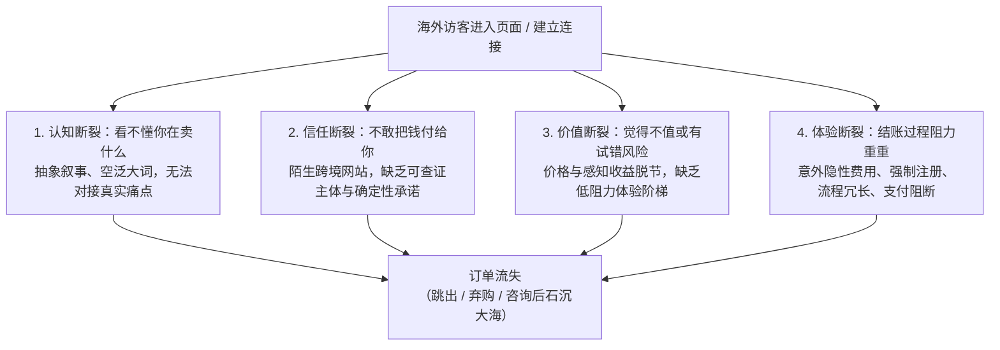
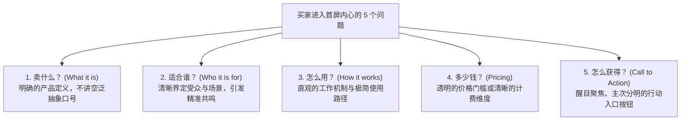
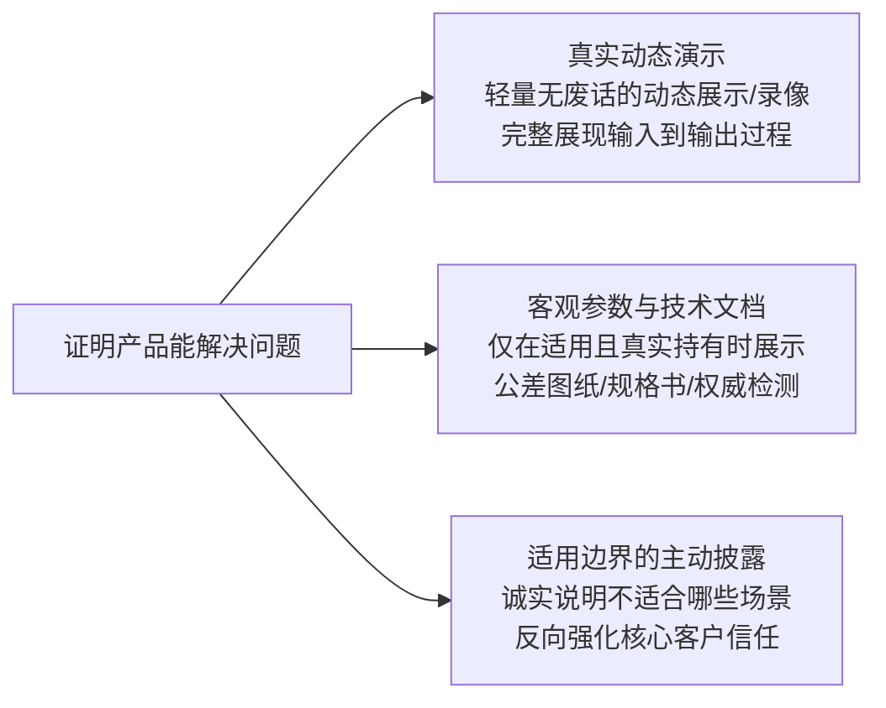
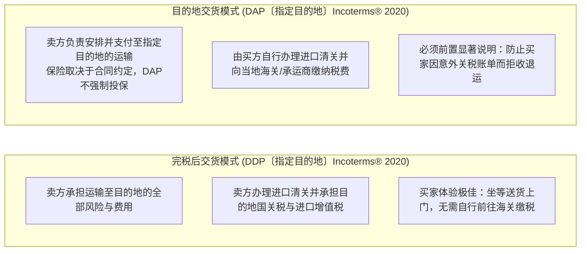
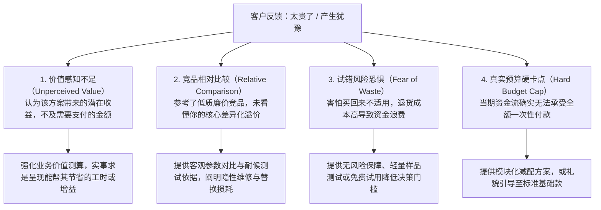
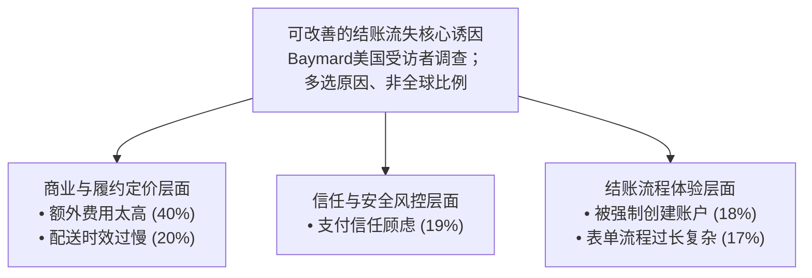
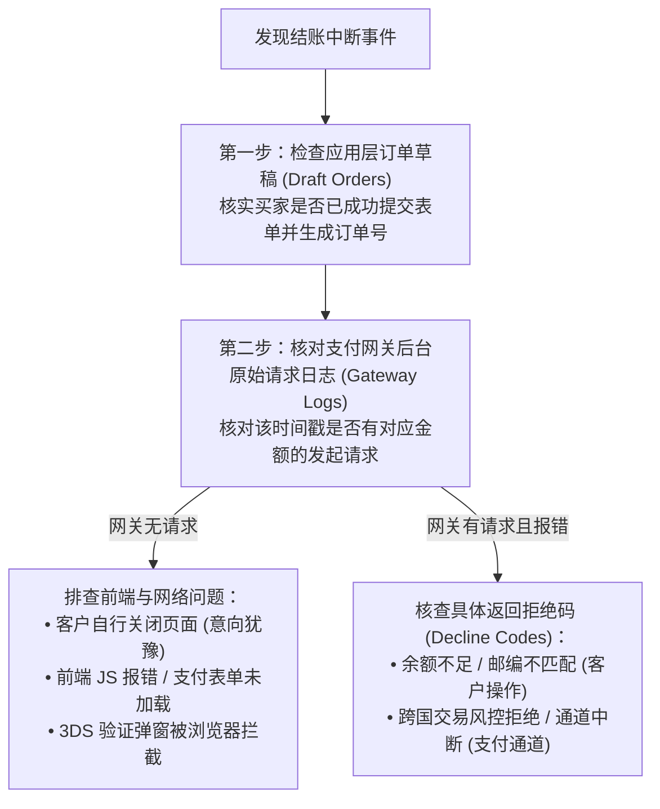
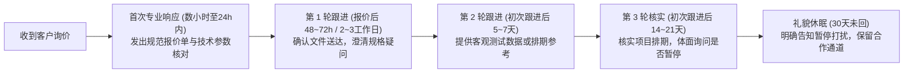

# 客户来了，怎么让他下单？

> **状态**：`G7_EDITORIAL_PASS / OWNER_AUTHORIZED_FINAL_POLISH / 2026-10-19`  
> **适用读者**：中国大陆个人开发者、独立站初创经营者、Micro-SaaS 创作者、小微外贸制造与定制出海商家  
> **核心目标**：当潜在客户已经进入独立站、商详页或咨询窗口后，通过消除认知阻力、构建可查证信任、化解价格异议、消除结账摩擦与推进采购决策，促成真实订单转化。  
> **知识定位**：本章隶属于《跨境业务五板块》第五部分《获客与用户增长》，专注解决“流量到达后的承接与转化”。支付通道技术搭建、离岸税务主体注册及建站底层代码分别由第三、第四板块承载。

---

**【导言】为什么流量来了，却留不下订单？**

许多跨境出海经营者在经历了漫长的选品、搭建网站和广告引流后，最常遭遇的挫败不是“没有访客”，而是“访客来了就走”。

后台统计数据显示有源源不断的点击量，但在购物车、结账页或询盘表单处，数据却呈现断崖式下跌。面对这种局面，经营者往往陷入盲目的“流量饥渴症”——误以为只要砸更多广告费、导入更多流量就能解决问题。

然而，在商业转化的底层逻辑中，**流量只是漏斗的入口，转化率才是决定业务能否盈利的真实杠杆**。一个转化链路存在严重漏洞的店铺，导入再多的流量也只是加速资金的空耗。海外客户之所以在浏览后选择离开，其根本原因通常归结为四个核心断裂点：



本章将系统拆解客户从“进入视野”到“最终付款”的每一个决策节点，提供扎实、可落地且符合跨境合规底线的经营方法。

---

## 3.1 客户能看懂我卖什么吗？

潜在买家点击进入网站或沟通窗口时，其注意力的耐受度通常极其短暂。在进入着陆页的短时间内，若页面无法清晰解答买家的基础疑问，用户可能很快离开。经营者可将“请测试者快速看 3～5 秒后复述产品用途”作为**示意性清晰度测试**，而非关于绝大多数访客行为的统计定律。

### 3.1.1 客户一眼需要看懂哪些信息？

在网页交互与商业转化设计中，存在经典的**“首屏认知法则（Above-the-Fold Clarity）”**。无论访客通过桌面端还是移动端进入，首屏核心区域都应直截了当地解答买家内心的五个基本问题：



#### 1. 卖什么（What it is）：摒弃抽象的行业宏大叙事
- **常见误区**：许多技术创业者或传统外贸工厂，喜欢在首屏放置宏大的愿景口号，例如：*“Empowering Global Supply Chain Synergy”*（赋能全球供应链协同）或 *“Next-Gen Digital Productivity Cloud”*（下一代数字生产力云）。海外买家看到这些抽象词汇，完全无法对应到具体的采购需求。
- **正向实践**：用简练具体的自然语言陈述产品形态。
  - *【示意对比 / MODEL_ASSUMPTION】*：
    - ❌ *“Revolutionizing Cross-border Retail Logistics”*（抽象大词）
    - ✔️ *“Custom Biodegradable Kraft Shipping Pouches for Eco-conscious Apparel Brands”*（明确是定制牛皮纸快递袋，适合环保服装品牌）。

#### 2. 适合谁（Who it is for）：明确边界与应用场景
- 明确指出产品是面向企业级采购、小型团队还是个人创作者，针对的是哪种操作系统、何种生产规模或哪个行业场景。清晰的定位能让目标客户在瞬间产生“这就是为我准备的”确认感，同时也能让不匹配的访客及早分流，减少无效的沟通损耗。

#### 3. 怎么用（How it works）：极简的步骤展示
- 复杂的业务也应提炼出直观的三步逻辑。例如：*“1. 上传现有设计稿 -> 2. 在线确认材料打样 -> 3. 全球直邮交付”*，或者*“1. 安装轻量插件 -> 2. 一键同步订单 -> 3. 自动生成本地化报表”*。消除买家对“上手过于繁琐”的天然恐惧。

#### 4. 多少钱（Pricing）：提供清晰的价格锚点
- 对于标准化实物与通用软件，应直接展示基础售价或价格阶梯；对于高度非标的工业定制与工程服务，若因规格复杂无法统一定价，也应提供**起订基准价格区间（Starting from $X）**、**最小起订量（MOQ）**或**快速需求估算表单**。完全隐藏价格往往会导致对预算敏感的严肃买家因信息不透明而放弃。

#### 5. 怎么获得（Clear Call to Action, CTA）：主次分明、降低决策摩擦
- 首屏的核心行动号召应当视觉突出、层级分明。避免同时并列摆放“立即付款”、“预约演示”、“下载白皮书”、“加入社区”等多个同权重的按钮，过多相互竞争的同级选项会加剧访客的决策疲劳。
- 建议设立一个主行动按钮（Primary CTA，如轻量产品的 *“Start Free Trial”* 或标准实物的 *“Buy Now”*），并在必要时辅以一个低侵入性的次级入口（Secondary CTA，如复杂的非标方案可设 *“Request Custom Quote”* 或 *“View 2-Min Interactive Demo”*），保持引导路径清晰明确。

---

### 3.1.2 怎样证明产品能解决客户的问题？

仅凭主观宣称“我们的产品性能优异、品质可靠”，无法在陌生买家心中建立实证信任。经营者必须通过可验证的形式，展现产品解决具体问题的硬核能力。



#### 1. 真实动态演示（Visual Proof & Interactive Demos）
- **软件与数字工具**：对于软件而言，数千字的说明往往不如一段 **10~15 秒（示例时长）无废话的高清操作录屏（GIF / 极简短视频）** 或免安装的交互沙盒。直接展示用户从面临障碍、执行核心操作，到最后顺利产出结果的完整闭环；
- **工业品与实物外贸**：展示产品在真实工业环境下的工作状态镜头、高精度微距结构特写，以及与常见参照物并排摆放的真实比例，消除买家对“实物与图片不符”的疑虑。

#### 2. 客观技术参数与可查证文档
- 在网页中提供规范的技术数据表（Datasheet）、接口兼容性文档或 CAD 尺寸图纸供买家直接查看或下载；
- **真实持有原则**：对于化学品安全说明书（MSDS/SDS）、带电产品安规认证（如 CE, FCC, RoHS）或特定材质检测报告，**仅在所售产品依法确有监管要求、且商家真实持有时方可据实展示**。严禁将特种类目证书作为全行业通用标配，更严禁无资质伪造或挪用他人质检报告。

#### 3. 坦诚披露适用边界与产品局限（Limitation Disclosure）
- 敢于主动告知客户“本方案不适合哪些场景”，是建立深度信任的高级策略。
- *【示意案例 / MODEL_ASSUMPTION】*：某跨境 SaaS 工具在功能介绍下方明确写道：*“适用场景：月订单量在 500~10,000 单的小型独立站卖家；局限提示：暂不支持多仓跨国协同与复杂的 ERP 深度定制”*。这种诚实的披露不仅不会吓跑真买家，反而能让完全符合适用范围的客户倍感踏实与安心。

---

## 3.2 陌生客户为什么信任我？

跨国互联网交易天然存在着“陌生人劣势（Stranger Penalty）”。当海外客户面对一个从未听说过的中国卖家网站时，他们最底层的担忧往往是：“这是不是一家假冒钓鱼网站？付款后不发货怎么办？到货后发现损坏或尺寸不对找谁处理？”

### 3.2.1 新店没有评价，该用什么证明自己？

新上线的独立商城、新推出的软件或初创外贸企业，由于缺乏长期沉淀的公共评价记录，面临着信任冷启动的严峻考验。此时，必须依靠**可核验的客观事实**替代虚幻的口碑。

#### 1. 真实、合规的经营主体信息（Verifiable Legal Identity）
在官方网站的页脚（Footer）与“About Us”页面，依法合规披露经营主体凭证，同时兼顾开发者个人隐私安全：
- **企业与商业主体信息**：依据目标市场法律法规及独立站平台规则展示可查验信息。具有注册实体的企业可公开公司注册名称及工商登记号（例如在英国经营可附带英国政府官方 [*Companies House Service*](https://find-and-update.company-information.service.gov.uk/) 的可公开查验注册号，在欧洲面向 B2B 客户可提供 VAT 识别号）；
- **商业联系渠道与地址合规**：清晰列出官方对公客服邮箱、客服在线时间说明，以及合规的商业办公地址或注册代理地址。**对于中国大陆个人开发者与微型初创团队，切勿直接在公共网页公开个人家庭住宅地址，应依法使用合规的商业联系渠道或注册代理地址，在保障法律合规的同时防范个人隐私泄露**；
- **真实的团队与研发背景**：展示创始人或核心工程师的真实工作场景、专业项目背景或公开开源项目链接。在技术与专业服务领域，公开立项初心与研发细节的透明度，能迅速拉近人与人之间的心理距离。

#### 2. 原型测试记录与种子用户真实反馈（Beta Logs & Seed Feedback）
- 即使没有海量的公开订单评价，也可以展示在产品研发与小规模内测期间，真实行业用户的客观反馈；
- 展示经过受访人知情同意的真实沟通截屏（脱敏商业隐私后）、产品打样过程中的版本迭代对比，以及针对早期测试者提出的具体改进记录；
- **合规红线警示**：
  - 依据美国联邦贸易委员会官方指引 [*FTC Endorsement Guides (16 CFR Part 255)*](https://www.ftc.gov/business-guidance/resources/ftcs-endorsement-guides-what-people-are-asking)，若评价者与商家存在实质利益关联（如赠送免费样品、折扣或佣金），必须在显著位置予以清晰明确的披露；
  - 依据 FTC 2024 年正式生效的 [*《消费者评价与推荐规则》（Consumer Reviews and Testimonials Rule, 16 CFR Part 465）*](https://www.ftc.gov/business-guidance/resources/consumer-reviews-testimonials-rule-questions-answers)，**严禁伪造虚假评价、虚构消费者推荐、强制压制真实负评或通过利益操纵员工刷评**。违规者在美国法域面临高额民事罚金及禁令处罚，各大电商与社交平台亦会依据用户服务协议实施严厉的店铺封禁风控。

---

### 3.2.2 运费、到货时间和额外费用该怎么说明？

在跨境实物交易中，**隐蔽运费与模糊的到货时效，是引发购物车弃购的首要诱因**。

#### 1. 运费政策的前置与透明呈现
- **前置提示免费运费门槛**：在全站顶部通知栏（Announcement Bar）或产品主图下方，明确提示配送范围与运费规则（例如：*“US Standard Shipping $5.99 / Free on orders over $60”*）；
- **运费估算计算器（Shipping Calculator）**：在产品页面或购物车阶段，允许买家输入目标国邮编后直接预估运费，避免客户一路填写完所有个人信息后，在结账最后一步被突兀出现的高额运费劝退。

#### 2. 区分工作日与自然日的交付时效区间
- 绝大多数海外买家能够理解跨国运输需要时间，他们真正不能接受的是**“不可预期的漫长等待”**；
- 避免使用“快速发货（Fast Shipping）”等模糊主观词汇，应提供具有操作性的时间区间，并明确区隔**“订单处理/生产工期（Handling / Production Lead Time）”**与**“在途物流运输时限（Transit Time）”**；
- 列明合作的国际承运商（如 DHL, FedEx, UPS 或主流跨境专线），并提供订单发货后配备的全程在线追踪单号（Tracking Number）承诺。

#### 3. 关税与进口税费责任的明确界定（DAP 与 DDP）
在跨境实物零售与批发中，涉及目的地国家清关关税（Customs Duties）与进口增值税（Import VAT / Sales Tax）的承担责任划分。国际商会现行有效的官方规范为 [*ICC Incoterms® 2020 规则*](https://iccwbo.org/business-solutions/incoterms-rules/)（共 11 个正式术语，包括 EXW, FCA, CPT, CIP, DAP, DPU, DDP, FAS, FOB, CFR, CIF；请注意：**DDU 是历史版本的旧称，并非 Incoterms 2020 的正式术语**，若在合同中沿用必须明确补充具体约定）。现代跨境独立站与外贸合同主要涉及以下两种交货责任模式：



> [!IMPORTANT]
> **透明告知与经营边界**：
> 1. **告知责任**：若采用未完税交货模式（如 DAP），必须在结账按钮旁及“Shipping Policy”中以醒目文字提示：*“Please note: Orders shipped outside the origin country may be subject to local import taxes and customs duties, which are the responsibility of the recipient upon delivery.”* 缺乏此项提示极易引发恶意的跨境信用卡拒付（Chargeback）。
> 2. **税费代征与关务分工**：在现代跨境零售中，部分平台或独立站插件（如 Shopify Markets）可在结账时预估代收买家所在国的消费税/增值税（如欧盟 IOSS 机制下的代收申报）。但这属于税务代征通道，与卖方是否拥有目的地国清关进口人资质属于不同法律层次。进口清关、关税及税务责任的专业核验应主要参照第三部分《支付、税务与经营主体》、目的地国家海关与税务部门及合资格代理；第二部分《网络环境搭建》不负责关务合规，本章核心在于**向买家进行清晰、确定性的前置告知，杜绝因信息隐藏而导致的弃单与纠纷**。

> **实操指引｜T7**：买家端币种、运费、税费及退货说明的跨国交易走查。见 [共用经营实操附录 T7](https://github.com/entropy-student/project/blob/main/cross-border-business/05-acquisition-growth/docs/APPENDIX_OWNER_APPROVED_GROWTH_PRACTICE_V1_20261019.md) 对应小节。


---

### 3.2.3 售后承诺怎么写，既清楚又能兑现？

一份措辞严谨、边界清晰的退换货政策，是打消买家下单顾虑的“定心丸”。

#### 1. 健全的退换货政策（Return & Refund Policy）四要素清单
1. **明确申请时限窗口**：自收货签收之日起算（例如“支持 14 天或 30 天内申请退换”）；
2. **界定商品可退换的合理状态**：说明退货所需的商品完整性要求（如原包装保留、配件齐全；允许买家为了检查商品性质与功能进行必要的合理开箱查验，但不可存在人为磨损或故意破坏）；
3. **退回运费的承担主体规则**：先区分商品瑕疵/错发的法定救济、消费者依法行使的无理由撤回，以及商家额外提供的自愿退换政策。对适用欧盟远程销售14天撤回权的订单，消费者原则上可承担直接退回成本，**但商家必须在订立合同前明确告知；未提前告知则由商家承担**。发生商品瑕疵或错发时，应按适用的法定救济及商家责任处理，不可简单归到“买家自付”。其他法域另核；
4. **退款处理时限与路径**：分别列明法定撤回、瑕疵救济及额外商业承诺的期限。对于适用欧盟远程合同14天撤回权的交易，**经营者原则上须在收到撤回通知后14天内退还已收款项**（通常含最便宜标准配送方式的原始运费，若买家自行选昂贵配送，其超出部分可不退）；销售实物时，商家可将退款暂缓至**收到退货或收到买家寄回证明，以先发生者为准**，不可一律以“退回商品检验合格后才开始几个工作日退款”取代法定规则。对于超出必要检查而造成的商品价值减损，可依法评估，不等于取消撤回权。退款方式通常与初始支付方式一致，除非消费者明确同意其他方式且不承担额外费用。

#### 2. 各法域法定最低权益与商家自愿承诺的区别
在面向特定海外区域开展经营时，必须注意当地的强制性消费者保护法律底线，商家的退款条款不得单方面克扣法定权益：

- **欧盟法定退换体系**：
  - **14 天法定无理由撤回权（Right of Withdrawal）**：依据 [*欧盟消费者权益指令（Directive 2011/83/EU）*](https://eur-lex.europa.eu/legal-content/EN/TXT/?uri=CELEX%3A32011L0083) 及欧盟官方 [*Your Europe - Guarantees and returns*](https://europa.eu/youreurope/citizens/consumers/shopping/returns/index_en.htm)，在欧盟境内开展 B2C 远程商品销售时，消费者依法享有自收货之日起**至少 14 天的法定无理由撤回权**。
  - **数字内容例外的法定生效条件**：对于无介质交付的纯数字内容（如软件激活码、电子素材下载），并非商家单方面声明“已发货/已激活”即可免除退款！依据 Directive 2011/83/EU 第 16(m) 条，只有在**“消费者在开始履约前提供了事先明示同意（prior express consent）”**且**“明确确认已知晓一旦开始履约即丧失法定撤回权（acknowledgment of losing the right of withdrawal）”**，并由商家向消费者提供合规确认凭据后，方可依法免除 14 天撤回权。另有依法按消费者具体要求制作、明显个性化的商品，以及**因健康或卫生原因不适宜退回且交付后已被拆封**的密封商品等特定撤回权例外；不能把普通现货自行称为“定制”，也不能仅因使用了密封包装便否认撤回权。
  - **至少 2 年的法定商品质量合规保证（Legal Guarantee of Conformity）**：依据欧盟官方指引 [*Your Europe - Guarantees for consumers*](https://europa.eu/youreurope/citizens/consumers/shopping/guarantees/index_en.htm)，欧盟消费者购买的商品享有至少 2 年的法定质量瑕疵救济保障。若收到的商品有瑕疵、损坏或与销售描述严重不符，消费者依法有权要求免费维修、更换，或在合理情形下要求退款或降价。这与 14 天无理由撤回属于不同层次的法定权利。
- **英国消费者权益法（Consumer Rights Act 2015）**：
  - 依据英国政府官方指南 [*Consumer Protection Rights (GOV.UK)*](https://www.gov.uk/consumer-protection-rights)，面向英国消费者销售的商品必须具备满意质量（Satisfactory quality）、符合特定用途（Fit for purpose）并与描述一致（As described）。若商品不符，买家在收到商品 30 天内享有短期的法定全额退款权（Short-term right to reject）。
- **商家自愿商业承诺（Commercial Warranty）**：商家额外提供的“30天无忧退换”或“终身有限保修”属于商业增值承诺，必须在履行法定最低标准的基础上执行，不得利用不平等的格式条款剥夺买家法定权益。

---

## 3.3 客户嫌贵或犹豫怎么办？

在销售沟通过程中，“太贵了（Too expensive）”是客户最常用的抗拒说辞。许多初入跨境的商家一听到客户嫌贵，第一反应就是慌忙打折让利，这往往直接摧毁了微薄的利润空间。

### 3.3.1 客户说贵，究竟在担心什么？

商业心理学表明，买家口中的“贵”往往是一种防御性的综合表象。经营者必须穿透表象，诊断其背后的真实症结：



#### 四类价格异议的应对策略
1. **应对“价值感知不足”**：
   - 将沟通重心从“强调自己的生产成本”转移到“测算为客户业务带来的潜在增益”；
   - *【示意演算 / MODEL_ASSUMPTION】*：向客户说明：“购买该排班自动化工具每月支出 $50。假设其能帮店长每周优化约 4 小时的工作流，以当地假定时薪 $18 折算，理论等值工时价值约为每周 $72（按月均 4.33 周计约 $312 理论等值工时）。但需客观指出：**工时节省在实际财务中能否转化为真实现金净结余，取决于客户是否能将节省的时间用于直接创收或减少了实际加班支出**。向客户解释时应实事求是，避免作出未经核实的确定性现金收益保证”。
2. **应对“低价竞品比较”**：
   - 引入**总拥有成本（Total Cost of Ownership, TCO）**概念；
   - *【示意案例 / MODEL_ASSUMPTION】*：向客户客观解释：“市面上低价替代品可能在耐候性与使用寿命上存在妥协。我们产品通过了特定的耐候加速老化测试（可提供客观测试记录），能有效降低因频繁断裂返修而产生的额外工时与更换成本”。严禁在无事实依据的情况下断言竞品劣质，或开出缺乏供应链检测支撑的绝对免维护承诺。
3. **应对“试错风险恐惧”**：
   - 通过提供明确的退款保证（Money-back Guarantee）或提供小额打样测试，把买家的试错成本压降至其心理安全阈值以内。
4. **应对“真实预算限制”**：
   - 尊重对方的预算底线，不盲目降价自贬身价，而是通过**“减配法”**调整合作结构（例如：“如果您当前的立项预算在 $800 以内，我们可以先去掉定制包装与优先工期选项，交付核心功能模块”）。

---

### 3.3.2 演示、试用和不同套餐什么时候有用？

降低决策门槛需要借助具体的销售承接工具，但工具的使用必须匹配恰当的业务阶段。

#### 1. 免费试用（Free Trial）的设计边界
- **时间限制型试用（Time-Limited Trial，如 7~14 天体验期，视业务周期调整）**：
  - *适用场景*：功能完整、需要全团队协同体验的中轻度 SaaS 工具；
  - *关键机制*：在试用期内提供轻量引导，帮助用户尽快完成能产生真实可用结果的操作，缩短**首次价值时间（TTFV，Time to First Value）**；以预先定义且可核验的有效行为判断是否完成**激活（Activation）**。这与主观感到产品有价值的“顿悟时刻（Aha Moment）”相关，但注册、点击按钮或空白结果本身不代表激活。可参见共用实操附录 T4 的SaaS最小激活卡。若用户始终未完成关键操作，应先排查权限、导入与引导障碍，再判断是否需要继续试用或跟进。
- **功能受限型免费（Freemium，如永久免费基础版，高阶功能付费）**：
  - *适用场景*：具有天然网络传播属性、边际服务成本极低的单兵工具；
  - *关键机制*：免费版必须具备完整可用的基础闭环，但将高并发、团队协作、自定义品牌去除等高阶价值卡在付费墙后。

#### 2. 产品演示（Product Demo）的场景抉择
- **录屏与交互式自助演示（Self-Serve Interactive Demo）**：
  - 适合功能直观、操作标准化且买家偏好自主探索的标准化工具或零售商品；
- **真人线上演示（Live Demo）的综合权衡**：
  - 是否提供 1 对 1 真人演示，并不取决于死板的客单价门槛，而应综合权衡**产品复杂度、客户决策风险、销售获客成本（CAC）与预估客户生命周期价值（LTV，即 Lifetime Value，计算模型详见第四章第4.5节）**。
  - 对于业务流程改造复杂的工具，即使客单价仅为数百美元，在冷启动阶段为关键客户提供 15 分钟线上演示，也是促成首批样板客户并收集一手反馈的高价值手段；而对于功能清晰的成熟标品，强推真人演示反而会增加买家的决策负担。

#### 3. 阶梯式定价套餐设计（Good-Better-Best Tiers）
三档式套餐是帮助买家明确自身需求梯次的经典价格设计模型【示意模型 / MODEL_ASSUMPTION】：

| 套餐层次 | 定位与目标受众 | 定价与功能设计逻辑 | 在销售体系中的战略使命 |
| :--- | :--- | :--- | :--- |
| **基础版（Good / Starter）** | 个人创作者、微型初创团队、探索期用户。 | 满足核心基础需求，设立用量或高级功能限制，定价门槛低。 | 拓宽客户漏斗入口，降低首单成交阻力，储备未来升级客户。 |
| **专业版（Better / Pro）** | 生产力核心主力买家。 | 功能完备、包含效率倍增的高阶功能，突出展示为高性价比推荐款。 | **主打利润与现金流来源**，价值感显著超越基础版。 |
| **企业版（Best / Enterprise）** | 大中型机构、对合规、安全、SLA 有严苛要求的企业。 | 定价较高，包含专属客服、定制 SLA、单点登录（SSO）与专属支持。 | **充当价格锚点（Price Anchor）**，衬托专业版价值；同时承接高预算客户。 |

> [!NOTE]
> 套餐之间的真实销量分布因行业垂直度与客群结构而异，并不存在“80%的客户必然购买专业版”等普适硬性规律。经营者应基于上线后的真实订单数据与升级流向进行动态迭代。

---

## 3.4 客户到付款前为什么离开？

数据统计表明，将商品放入购物车之后最终未完成付款的比例普遍居高不下。分析结账路径中的断点并加以修复，是提升整体订单量最直接的杠杆。

### 3.4.1 隐藏费用和额外步骤会造成哪些流失？

全球著名的电子商务用户体验研究机构 [*Baymard Institute 关于购物车与结账流失的长期实证研究*](https://baymard.com/lists/cart-abandonment-rate) 汇总了电商弃购率研究，并另有针对**美国在线消费者**的弃购原因调查。以下“原因比例”是特定调查的受访者自报数据，**并非全球买家比例**，也不能机械套用于不同国别、平台或B2B业务：
- **基础行为背景**：在该调查中约 **42%** 的美国在线消费者报告曾因“只是随便看看 / 还没准备好下单（Just browsing / not ready to buy）”，这属于自然浏览行为；
- **对于排除纯浏览原因后、报告结账放弃原因的该调查美国受访者**，以下各项为多选式自报原因的比例（同一人可有多项，**不应加总成100%**）：
  - **额外费用过高（Extra costs too high: 运费、税费、附加手续费等）**：占比高达 **40%**，常年位居可改善弃单原因第一位；
  - **交付时效过慢（Delivery was too slow）**：约 **20%**；
  - **不信任网站安全性 / 顾虑信用卡安全（Didn't trust the site with credit card info）**：约 **19%**；
  - **被强制要求创建账户（The site wanted me to create an account）**：约 **18%**；
  - **结账流程过长或过于复杂（Checkout process was too long / complicated）**：约 **17%**。



#### 改善结账路径的三项经营动作
1. **全面推行游客结账模式（Guest Checkout）**：
   - 允许首次到访的客户仅输入收货邮箱与收货地址即可直接付款；在客户完成付款后的感谢页面（Thank You Page），再顺理成章地引导其：“只需设置一个密码，即可一键将本次订单关联为会员账户并追踪物流”，把注册摩擦从付款前挪至付款后；
2. **遵循数据最少化原则精简表单字段**：
   - 移除所有与实物配送或在线交付无关的表单行（例如去掉非必填的“公司名称”、“传真号”、“客户来源问询”）；对于数字软件下载，仅保留“电子邮箱 + 支付信息”两个核心要素；
3. **实行全流程价格透明化（Upfront Cost Display）**：
   - 严禁在点击“最终支付”的前一秒才突然叠加高额运费和税费。让买家在购物车阶段就清楚看到包含运费的总金额，消除被欺骗感。

---

### 3.4.2 怎样区分客户犹豫和付款故障？

许多经营者看到结账中断，容易武断地将其全部归结为“客户嫌贵犹豫”或“支付通道坏了”。实际上，数据指标只是线索，必须通过假设排查树（Hypothesis Tree）综合比对多方证据。



#### 犹豫与故障的假设排查对照表

| 诊断线索 | 意向未决 / 客户心理犹豫线索 | 支付通道阻断 / 技术故障线索 |
| :--- | :--- | :--- |
| **前端交互轨迹** | 访客在结账页面反复停留；在不同配送选项之间多次切换；多次尝试输入优惠券代码；中途返回购物车修改商品数量。 | 访客在点击提交支付后短时间内报错离开；高频连续点击支付按钮伴随界面无响应；或控制台存在前端 SDK 加载异常。 |
| **网关日志与状态码** | 支付网关系统未产生任何发起请求记录，**或**记录显示买家尚未完成必要身份交互即主动离开页面。 | 支付网关后台记录了明确的发起请求，并返回明确的银行端或网关端失败代码（按实际支付服务商官方文档解读）：<br/>• *3DS Authentication Failed / Timeout*（3D 安全验证超时）；<br/>• *Card Restricted / Risk Blocked*（发卡行跨国交易安全拦截）；<br/>• *Invalid Expiry Date / CVV Mismatch*（客户输入卡信息校验失败）。 |
| **经营处置与业务分工** | 优化价格与信任信息；在法域合规前提下审慎进行挽单跟进；提供多币种展示以消除汇率不确定性。 | **协同技术与支付板块**：收集具体的报错日志、客户国家与卡种信息，转交**第三板块（支付机构）**排查通道设置，或转交**第四板块（技术基建）**排查前端报错。 |

> [!CAUTION]
> **排查边界与证据原则**：
> 1. “网关后台没有请求日志”并不等于绝对能断定是客户犹豫放弃——前端脚本报错、网络中断、支付 SDK 初始化失败或 3DS 验证弹窗被拦截同样会导致请求根本无法送达网关。在缺乏前端监控日志时，应将具体根因客观标记为 `[UNKNOWN / NEEDS_VERIFICATION]`。
> 2. 经营者切勿尝试在未经授权的录屏工具中窥探买家的真实支付凭据，支付底层排错应交由专业支付网关后台日志承载。

---

### 3.4.3 没有复杂工具，怎么发现流失环节？

许多中小微商家没有预算采购昂贵的大型行为分析软件，但这并不妨碍使用基础客观的方法定位流失卡点。

#### 三种低成本实操排查方法
1. **建立极简的转化漏斗看板（Funnel Metrics）**：
   - 无论使用何种基础统计系统（如免费的 Google Analytics 或独立站自带分析后台），每周持续监测关键节点的留存比率。对于标准实物独立站，典型四阶漏斗如下：
     $$\text{商详页浏览 (View Item)} \xrightarrow{\text{加购率}} \text{加入购物车 (Add to Cart)} \xrightarrow{\text{发起率}} \text{发起结账 (Initiate Checkout)} \xrightarrow{\text{付款率}} \text{支付成功 (Purchase)}$$
   - 观察哪两个环节之间的流失率异常高。若加购率高但发起结账率极低，问题通常出在购物车页面的运费展示或结算引导上；若发起结账率高但付款率极低，问题通常出在表单摩擦或支付方式兼容性上；
   - *【业务适配提示】*：上述漏斗为标准实物电商设计，**不可直接生搬硬套至纯咨询 B2B 外贸（通常为：询盘发起 -> 方案/样品确认 -> 正式签约）或 SaaS 工具（通常为：注册试用 -> 顿悟激活 -> 商业付费）**，应根据自身业态设计适配看板。
2. **邀请目标国真实用户的启发式走查（Heuristic Walkthrough）**：
   - 寻找 2~3 位身处目标市场的海外熟人、同行或聘请普通测试者进行定性启发式走查（注：此类走查属于定性发现界面设计漏洞的低成本手段，非统计学显著样本）；
   - **数据安全与隐私红线**：**严禁在走查中使用或录制测试者的真实信用卡号、CVV 码或个人私人敏感信息！** 走查必须在**沙盒测试环境（Sandbox / Test Mode）**中使用官方虚拟测试卡进行。若使用录屏工具，必须开启敏感字段自动遮蔽（Masking），并事先获得测试者的明确知情同意。
3. **设置合规的弃单关怀邮件（Abandoned Cart Recovery Email）**：
   - **严格的法律合规前提**：弃购挽回邮件在许多海外法域（如英国 PECR、欧盟 ePrivacy 指令）被定性为**直接电子营销（Direct Marketing）**。**绝不可认为“买家在表单填了邮箱就等于自动拥有发送营销邮件的合法权利”！**
   - 依据 [*英国信息专员办公室 (ICO) 2026年4月更新的电邮营销指引*](https://ico.org.uk/for-organisations/direct-marketing-and-privacy-and-electronic-communications/guidance-on-direct-marketing-using-electronic-mail/how-do-we-comply-with-the-pecr-electronic-mail-marketing-rules/)，若要合法利用“软选择加入（soft opt-in）”机制发送弃单邮件，必须**同时严格满足**以下条件：
     1. 商家**自己直接**取得联系方式，且发生于销售或真正的**销售洽谈**中：例如消费者主动询价、申请试用、明确提出购买相关问题；**仅浏览页面、单纯留下邮箱、无关咨询不自动构成销售洽谈**。放弃购物车是否达到该条件仍须看实际行为及当时收集过程。
     2. 只为**本商家的相同或类似产品、服务**进行营销，不将名单借给第三方推广不相关商品。
     3. **在取得联系方式时**，已明确提供简单、免费的拒绝营销机会，用户没有选择拒绝。
     4. **每封营销邮件**应清楚识别发送商家，并提供简单、免费的退出方式，例如可用的取消订阅链接或按指示回复退订；**不把技术意义上的“一键退订链接”写成所有英国商业邮件的统一法定强制形式**。
     5. 必须同时评估英国PECR适用的订户类型及英国个人数据保护规则；**不满足soft opt-in全部条件时，不应把弃购邮件当作可自动发送，通常需要事先符合要求的同意或其他适用规则**。欧盟成员国另需按各自电子营销规则核验，不能直接照搬英国PECR。
   - *【合规话术示范 / MODEL_ASSUMPTION】*：*“Hi John, we noticed you left some items in your cart. Was there any technical issue, or can we help answer questions about shipping and dimensions? If you no longer wish to receive these reminders, click Unsubscribe below.”*

---

## 3.5 咨询或报价后怎么推进？

在 B2B 贸易、工业代工或定制软件服务中，订单往往不是通过购物车自动完成的，而是始于客户主动发起的一次邮件或表单咨询。许多经营者的通病是“报完价就陷入死寂”，任由订单流失。

### 3.5.1 客户问完没下单，该何时跟进？

面对已经主动咨询过的意向客户，后续跟进（Follow-up）的核心在于**提供增量业务价值**，而不是单纯催促进度。



#### 梯度跟进时效与沟通要点【示意设计 / MODEL_ASSUMPTION】
以下跟进节奏为典型中低客单价定制或标准 B2B 询价的参考示例，实际业务应根据客户立项周期与采购紧急度灵活调整：
- **首次响应（黄金窗口期）**：越快越好。在跨境商务中，若能在收到询盘的数小时内（结合客户所在时区的工作时间上午，最迟不超 24 小时）发出详实专业的正式回复，往往能在买家货比三家的初始阶段建立第一印象优势；
- **第一轮跟进（发出报价后 48~72 小时 / 2~3 个工作日）**：
  - *沟通目标*：确认报价文件是否被收件人正常接收（排除被邮件过滤器拦截的可能），并主动询问报价中的材质、规格或交付条件是否与其实际需求存在出入；
- **第二轮跟进（初次跟进后 5~7 天）**：
  - *沟通目标*：避免空洞询问“考虑得怎么样了”，而是提供增量参考资料（例如：“顺便附上一份我们针对该材料的表面处理耐磨测试记录，供贵司工程团队内部评审时参考”）；
- **第三轮跟进（初次跟进后 14~21 天）**：
  - *沟通目标*：询问客户该项目当前的整体采购排期是否有所调整，主动提供帮助；
- **体面休眠边界（报价后 30 天仍无实质回复）**：
  - 发送最终确认邮件告知其报价单有效期，并说明将不再主动发信打扰，欢迎未来随时联络。如果客户已明确表示“已选定其他供应商”，应大度表示感谢并建立友好关系，切忌情绪化纠缠。

---

### 3.5.2 如何给客户一个明确的下一步？

很多报价单发送后石沉大海，是因为邮件末尾只有一句空洞的“期待您的回复（Looking forward to your reply）”，把决策与行动的全部思考负担甩给了买家。专业的沟通应当**为客户铺设极低阻力的具体台阶**。

#### 1. 结构规范的正式报价单（Professional Quotation Sheet）要素
一份能直接促成决策的正式报价文件应当具备标准化商业格式：
- 明确标注**报价有效期（Quotation Validity Period）**，建立自然的决策时间约束；
- 明确适用的国际贸易术语（Incoterms® 2020 规则，如 DAP 或 DDP）、计价货币、包装规格与装箱重量体积预估；
- 附带形式发票草案（Proforma Invoice Draft），并明确列出定金比例、付款方式与生产工期。

#### 2. 提供具体、可量化的行动建议（Actionable Next Steps）
在邮件末尾，根据客户当前的决策阶段，提出明确的“微小推进动作”：
- *【小批量测试情境 / MODEL_ASSUMPTION】*：*“If the technical drawing meets your requirements, our workshop can arrange a 2-piece physical sample run this week for your fitment testing. Should we prepare the sample invoice?”*（不强求直接下单 5000 件，而是提议安排 2 件样品测试）；
- *【方案比选情境 / MODEL_ASSUMPTION】*：*“If you need to present this to your project director, I can prepare a 1-page executive summary comparing the material specs and cost breakdown. Would that be helpful?”*（主动为对接人提供向管理层汇报的简报资料）。

---

## 3.6 多人参与购买，怎么跟进？

在大型企业采购、多岗位协同的 B2B 项目中，订单决策通常不是由最初和你沟通的单个人独立决定的，而是由一个包含了使用者、技术主管、财务与高层管理者的**决策团队（Buying Committee）**共同审批。经营者必须学会应对多角色的利益博弈与漫长的采购周期。

### 3.6.1 不同决策角色最关心什么？

企业内部的不同职能角色，在评估同一套采购方案时，其关注的核心利益与风险防线截然相反：

```mermaid
mindmap
  root((企业采购角色关切))
    实际使用者 (End User)
      关注：工作流改善与操作便利性
      担忧：界面复杂、增加多余工作量
      策略：提供简洁直观的操作演示
    技术把关人 (IT / Engineering)
      关注：规格兼容、数据安全与安规标准
      担忧：引入安全漏洞、系统崩溃事故
      策略：提供严谨检测报告与合规资质
    业务决策人 (VP / Dept Head)
      关注：投资回报率 (ROI) 与业务目标
      担忧：项目烂尾、预算浪费影响考评
      策略：量化降本增效成果与业务产出
    采购与财务 (Procurement / Finance)
      关注：商业账期、合同合规与压价空间
      担忧：供应商资质瑕疵、发票与税务审计风险
      策略：提供规范商业条款与正规凭证
```

#### 四大核心角色的跟进策略
1. **基层使用者（End Users）**：
   - 他们是方案的直接操作者。虽然他们通常没有预算审批权，但他们对方案的体验反馈对上层决策具有极强的参考意义。跟进时应重点聚焦于产品如何帮助他们消除繁琐手工作业，并提供极其易懂的操作指南；
2. **技术与质量把关人（Technical Gatekeepers）**：
   - 他们通常需要防范技术与质量事故及其责任。跟进时切忌空谈商业情怀，必须提供规范的接口技术文档、在真实持有时提供第三方检测报告，并清晰说明发生异常时的技术支持响应机制；
3. **经济决策人（Economic Buyers）**：
   - 部门负责人或预算批准者往往关注商业回报，也可能同时重视实施风险、合规与可维护性。跟进时应提供清晰的“商业论证简报（Business Case Summary）”，客观说明投资该方案预计能为部门业务目标带来的效率提升或采购优化；
4. **采购与商务人员（Procurement）**：
   - 他们可能从寻源或立项早期即参与，也可能在后续商务谈判阶段介入，视采购制度而定。跟进时应展现正规合规的商业合作姿态，准备好完备的商业主体注册凭据、对公账户信息、合规税务资料及履约保证条款。

---

### 3.6.2 成交周期很长，怎样维持进展？

面对长达数周甚至数月的长决策周期，很多销售人员容易陷入两个极端：要么完全放弃联络，任由线索在漫长等待中被遗忘；要么高频发信催促进度，引起客户强烈反感。长周期的正确推进原则是：**以节奏感与顾问式价值维持持续存在**。

#### 1. 建立双方共识的协同推进里程碑（Mutual Action Plan, MAP）
在初次意向明确后，主动与主要对接人梳理并确认项目的整体推进时间表【示意模型 / MODEL_ASSUMPTION】：
- 明确划分各阶段节点：*“1. 技术图纸核实（第 1 周） -> 2. 原型样品测试（第 2~3 周） -> 3. 内部商务法务评审（第 4 周） -> 4. 签署合同与排产启动（第 5 周）”*；
- 有了共同确认的时间表，经营者的每一次跟进都在按既定节点推进，而非无由头的仓促催逼。

#### 2. 在等待期保持“低频但高价值”的专业存在
- 在客户内部走审批流程的静默期，经营者可以保持适当的轻量互动（例如每隔 1~2 周，视项目整体周期灵活掌握）；
- 每次互动应附带新的有益信息，例如：分享一条与该客户行业相关的海外最新技术标准变动解读、一条关于该原材料国际运价波动的市场动态参考，或分享一篇同行类似应用场景的客观案例；
- 始终以“行业专业顾问”的姿态出现在客户的邮箱中，让客户在做出最终决策时，优先选择表现最稳定、最专业的供应商。


#### 3. 赋能内部倡导者（Empowering the Internal Champion）
- 在长周期采购中，你的对接人（通常是项目发起工程师或业务骨干）需要在公司内部替你争取预算并向大老板汇报；
- 主动为其提供支持：“为了协助您在下周的部门例会上汇报该方案，我为您整理了一套包含核心数据对比与实施排期的单页汇报幻灯片，您可以直接取用”；
- 把对接人打造成内部的“项目英雄”，往往是攻破复杂企业大单的关键钥匙。

---

**【关键动态规则核验提示】**

- **欧盟B2C远程销售的14天撤回、退款时点、原始标准配送费与退件费告知**：参照欧盟官方商家指南 https://europa.eu/youreurope/business/selling-in-eu/selling-goods-services/ecommerce-distance-selling/index_en.htm 。撤回权和商品瑕疵救济、商家额外退换承诺需分开核对。
- **英国弃购及其他电子营销的soft opt-in**：参照ICO官方指引 https://ico.org.uk/for-organisations/direct-marketing-and-privacy-and-electronic-communications/guidance-on-direct-marketing-using-electronic-mail/how-do-we-comply-with-the-pecr-electronic-mail-marketing-rules/ 。仅提供邮箱不构成完整的发送许可。
- **Baymard弃购研究**：https://baymard.com/lists/cart-abandonment-rate ；整体弃购率汇总与美国在线消费者自报原因不是同一个调查分母。
- **DAP和DDP责任**：https://academy.iccwbo.org/incoterms/article/incoterms-2020-dap-or-ddp/ ；DAP没有强制为买方安排保险的义务，合同另有约定除外。

**【本章自检与落地行动清单】**

读完本章后，在审视自身的转化承接流程时，请对照以下六项标准进行系统性自检：

1. [ ] **首屏信息清晰度审查**：陌生海外访客在进入着陆页的极短时间内，是否能清晰看懂“卖什么、适合谁、怎么用、多少钱、怎么获得”？是否消除了所有空洞抽象的大词口号？主次 CTA 是否层次分明？
2. [ ] **跨境交付与费用全透明**：我的运费政策、交付时效区间及关税税费责任（DAP/DDP）是否在付款前得到了清晰明确的提示？是否消除了导致客户弃购的隐性费用突袭？
3. [ ] **合规与无风险售后承诺**：我的退换货政策是否满足了目标销售地区的法定最低权利（如欧盟 14 天冷静期撤回权、欧盟至少 2 年法定瑕疵保证及英国 CRA 2015 规定）？对于纯数字内容是否合规落实了“明示同意与确认丧失撤回权”的例外条件？
4. [ ] **异议诊断与分级承接工具**：面对嫌贵的客户，我是否能客观识别其背后的真实心理顾虑（价值感知不足 vs 竞品比选 vs 试错恐惧）？在测算价值时是否避免了未经证实的确定性现金收益保证？我的试用、演示或阶梯式套餐是否具备合理的梯度边界？
5. [ ] **结账流失路径排查**：我是否开启了游客结账并精简了非必要表单？当发现结账中断时，我是否能结合前端报错、订单草稿与支付网关日志建立假设排查树，客观区分意向犹豫与技术阻断？若发送弃购挽单邮件，是否严格符合所在法域的 soft opt-in 营销合规条件？
6. [ ] **B2B报价推进与多角色跟进**：在发出报价后，我是否为客户设计了明确具体的下一步台阶？在面对多人参与的企业采购时，我是否针对使用者、技术把关人与经济决策人准备了差异化的论证资料？是否建立了双方共识的推进里程碑（MAP）？

> **实操指引｜T4**：B2B 从询盘、资格、报价/样品到赢输单的商机推进看板。见 [共用经营实操附录 T4](https://github.com/entropy-student/project/blob/main/cross-border-business/05-acquisition-growth/docs/APPENDIX_OWNER_APPROVED_GROWTH_PRACTICE_V1_20261019.md) 对应小节。

