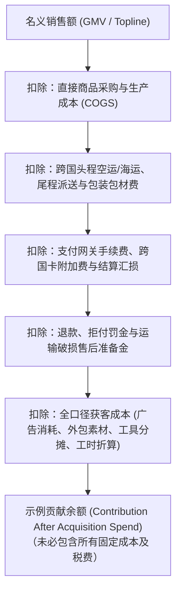
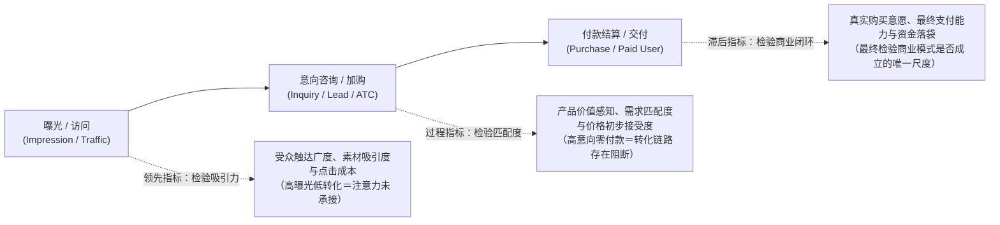
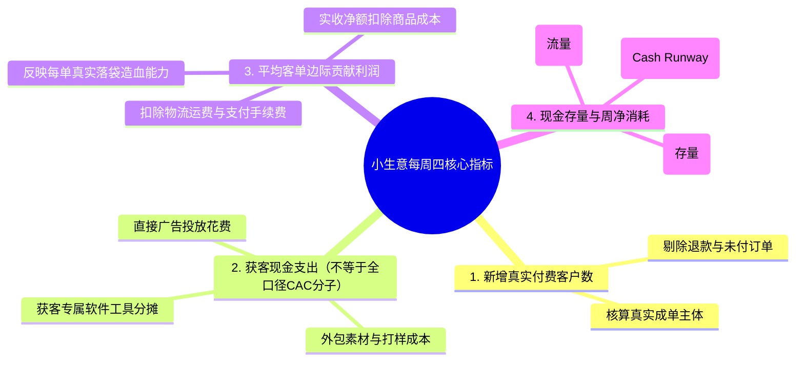
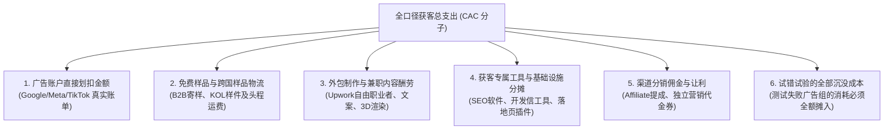
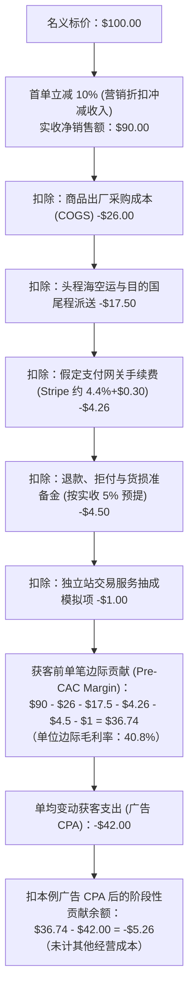
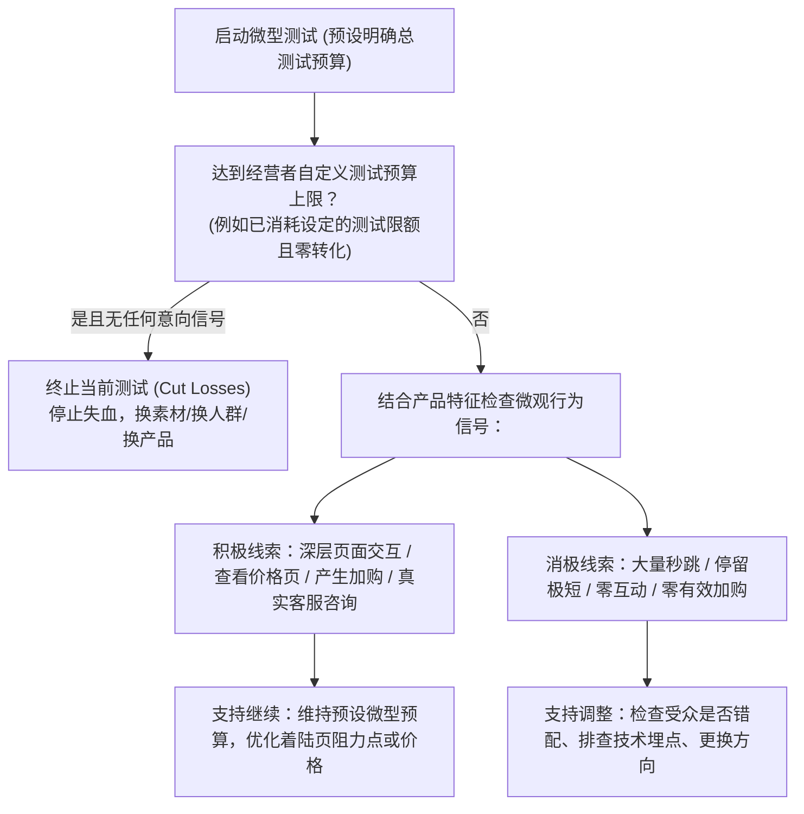

# 找客户到底划不划算？

> **内容核查**：2026-10-20完成经营知识与教学口径定向复核；使用数据前须核订单、财务与时间窗。历史审查状态见交接文档。

> **适用读者**：中国大陆个人开发者、跨境独立站初创经营者、Micro-SaaS 创作者、小微外贸制造与定制出海商家  
> **核心目标**：建立清醒的单位经济模型（Unit Economics）与科学算账能力，甄别有效商业指标，掌握低成本渠道归因方法与局限，核算全口径获客成本（True CAC）与单笔边际贡献利润（Contribution Margin），保守评估客户生命周期价值（LTV）与资金回本周期，并在样本数据匮乏时建立理性的继续、调整与止损护栏。  
> **知识定位**：本章隶属于《跨境业务五板块》第五部分《获客与用户增长》，专注解决“获客投入的商业核算、效果评估与财务风控”。宏观选品机会由第一板块承载，具体渠道获客操作与页面促单转化已分别在第二、第三章展开，会员复购留存机制与团队规模化运作则留待第五、第六章深化；底层法定报税与支付接口配置归属第三、第四板块。

---

**【导言】为什么销售额节节攀升，口袋里的钱却越来越少？**

在跨境出海与数字出海的真实世界中，许多初创者最刻骨铭心的挫折往往不是“完全卖不出去”，而是“明明每天都在出单，月底一算账却发现净亏损越来越大”。

后台仪表盘上，总销售额（GMV）、访客流量和订单笔数看起来欣欣向荣；然而，银行账户里的可用流动资金却在快速缩水。面对这种困局，很多经营者容易陷入致命的“规模幻觉”——误以为当前亏损只是因为“体量还不够大”，盲目借贷或追加广告投放，试图通过放量把固定成本摊薄，结果却在失控的现金流断裂中轰然倒闭。

商业经营的第一铁律是：**营业额是虚荣，净利润是清醒，现金流才是生存（Topline is vanity, profit is sanity, cash is reality）**。在跨国贸易与全球软件销售中，从客户看到广告到最终形成可持续利润，中间横亘着层层损耗与隐形成本：



如果一笔订单在扣除所有变动履约与获客成本后，边际贡献利润是负数，那么订单量每增加一倍，实质上只是把失血的速度加快了一倍。本章将帮助你彻底撕开表层繁荣的迷雾，用扎实的数学计算、严谨的成本口径和冷静的概率思维，厘清获客到底“划不划算”，为小本生意的跨海远征构筑牢固的财务护栏。

---

## 4.1 应该看哪些获客数字？

数据是商业决策的眼睛，但过多的冗余数据反而会导致经营者的失明。面对分析后台中成百上千个指标，中小商家必须学会去伪存真，紧扣具有真实商业意义的核心数据。

### 4.1.1 曝光、咨询和付款分别说明什么？

在一个完整的商业漏斗中，不同阶段的数据指标承担着截然不同的知识责任，经营者必须分清“过程指标”与“结果指标”的本质区别。



#### 1. 曝光量与访问量（Impressions & Traffic）：领先指标，检验前端吸引力
- **数据内涵**：展示了你的信息被潜在人群看到的频次（曝光）以及吸引目标用户点击进入着陆页的人数（访问）。
- **商业指示意义**：
  - 它反映的是前端营销漏斗开口的大小与素材吸睛程度（点击率 CTR、单次点击成本 CPC）；
  - **核心警示**：曝光量属于典型的**领先指标（Leading Indicator）**。充足的访问量只是成交的必要前提，绝非充分条件。脱离了后链路转化率的高曝光，往往只是在为平台广告系统贡献利润。数以万计的社交媒体互动、点赞或跳出率极高的页面浏览量，属于典型的“虚荣指标（Vanity Metrics）”，不能直接支撑生存。

#### 2. 意向咨询与加购（Inquiries, Leads & Add-to-Cart）：过程指标，检验产品与需求的匹配度
- **数据内涵**：在实物独立站表现为商品加购（Add to Cart）与发起结账（Initiate Checkout）；在 B2B 工贸表现为询盘表单提交、邮件咨询或即时聊天发起；在 Micro-SaaS 表现为注册账号与启动免费试用。
- **商业指示意义**：
  - 它反映了用户在看完你的首屏信息、产品规格与定价后，产生的主动探索与购买倾向；
  - **排查路径（可能原因 -> 可核验线索 -> 下一步动作）**：
    - *现象 A：高曝光、极低加购/咨询*。可能原因：受众定位偏差（引来非目标受众）或首屏信息模糊。可核验线索：页面平均停留过短、跳出率过高。下一步动作：优化受众定向、重构首屏价值主张；
    - *现象 B：高加购/咨询、零最终付款*。不同业态具有不同线索：
      - *实物零售*：可能存在结账意外费用突袭、目标国本地支付方式缺失、或运费门槛过高。排查结账漏斗与弃购明细；
      - *B2B 工贸定制*：买家通常需要样品确认、技术图纸二次审核及内部审批流，零即时付款属于正常的长周期现象，需核验询盘跟进记录与样品进度；
      - *Micro-SaaS 软件*：用户在试用期内未触发“顿悟时刻（Aha Moment）”，或功能复杂度超出预期。排查用户在软件内的核心功能使用深度。

#### 3. 付款与成交（Paid Customers & Confirmed Orders）：滞后指标，检验商业闭环的终极尺度
- **数据内涵**：扣除欺诈订单、未付款草稿与即时取消后，资金真实扣减并进入清算流程的最终成单量。
- **商业指示意义**：
  - 付款属于**滞后指标（Lagging Indicator）**。它是前置所有产品、定价、文案、信任与渠道运营综合作用的最终结果；
  - 只有产生了真实资金转移的付款动作，才代表客户用真金白银为你提供的解决方案投了赞成票。一切未付款的“口头夸赞”、“强烈购买意向”或“功能好评”，都不可作为判断获客划算与否的财务依据。

---

### 4.1.2 小生意最先跟踪哪几个数？

许多独立开发者和初创卖家一上来就试图搭建包含数十个维度的复杂商业智能（BI）看板，结果每天花费数小时在数据清洗上，陷入了“分析瘫痪（Analysis Paralysis）”。

对于资源极其匮乏的小生意，首要原则是：**用一张极简的电子表格，每周固定追踪四个最核心的真实商业数字**。



#### 极简跟踪看板结构与实操范例【示意模板 / MODEL_ASSUMPTION】

经营者无需采购昂贵的企业级数据软件，利用免费的Google Sheets或Excel即可建立高效看板。**四项是现金经营快照，不是全口径经济CAC**；在决策账本中另核创始人工时价值、其他合理分摊的获客资源及同群观察期，不应将两者写成相同的指标：

| 追踪维度 | 字段名称 | 统计口径说明 | 假想数据范例 (Week 42) | 经营预警与行动线 |
| :--- | :--- | :--- | :---: | :--- |
| **产出端** | **净新增付费客户数 (Net Paid Customers)** | 当周首次完成真实支付的新客户去重总数（剔除已全额退款及测试单）。 | **12 人** | 若连续两周环比下跌超 30%，检查流量渠道或转化路径异动。 |
| **投入端** | **获客现金支出（Cash Acquisition Outlay；非全口径CAC）** | 当周广告账户消耗 + 当周外包兼职费用 + 获客工具周分摊费 + 寄样运费。 | **$480** | 严格对照当周预算红线，超支必须有明确的合理测试假设。 |
| **单均造血** | **单笔平均边际贡献 (Average Contribution Margin)** | （当周实收净销售额 - 商品成本 - 包装物流 - 支付手续费 - 售后准备金）÷ 订单数。 | **$28.50** | 核心生死线：若单订单贡献为负须立即调查；与每新客户CAC比较时，先把客户、订单数及其观察窗口对齐，不能直接把两个不同分母的均值相减。 |
| **资金安全** | **可用资金存量与周净流出 (Cash Stock & Burn)** | 资产存量：Stripe、PayPal 及公司银行户头可立即动用的真实提现可用余额（$4,250）；流量：当周净现金流（-$350）。 | **存量 $4,250<br/>净流出 -$350/周** | 真实资金跑道 (Runway) = 可用存量 ÷ 周均净流出 = $4,250 ÷ $350 ≈ 12 周。本例若可用资金跑道约12周，若进一步缩短至例如8周，可先开展现金流压力测试；8周不是适用于所有行业的扩量禁令。 |

> [!NOTE]
> **口径边界与同期法局限**：
> 1. **简化同期法（Blended Concurrent Ratio）**：以本周数据为例，若用当周支出除以当周新客（$\$480 \div 12 = \$40$），属于**现金支出÷同期新客数的快速观察比率**，既不含非现金工时，也不是可直接称作全口径CAC的金额。只有在短购买周期、来源匹配且费用范围清楚的零售业务中才可谨慎作辅助判断；对于 B2B 外贸与 SaaS 工具，当周支出主要在为未来蓄水，而当周成单来自前期线索，必须采用**同群追踪法（Cohort Tracking）**，严防同期错配导致的误判。
> 2. **客户数与订单数的区隔**：若某客户当周下了 2 笔订单，新客户数为 1，订单数为 2。单订单贡献毛利与单客户总贡献必须分别核算，不可混为一谈。

> **实操指引｜T3**：最小事件字典、订单去重键与获客指标台账。见 [共用经营实操附录 T3](https://github.com/entropy-student/project/blob/main/cross-border-business/05-acquisition-growth/docs/APPENDIX_OWNER_APPROVED_GROWTH_PRACTICE_V1_20261019.md) 对应小节。


---

**三种口径不该相减的微例（MODEL_ASSUMPTION）**：某观察窗有2名新付费客户、合计4笔已付款订单，每笔**获客前**贡献为20美元，本期对应新客获客投入60美元。**每订单贡献**=20美元；**每新客全口径CAC**=60÷2=30美元；**每个新客在同一窗口的平均获客前贡献**=4×20÷2=40美元。因一位客户可能下多单，直接计算“20－30=-10美元”混用了订单和客户的分母；对齐窗口后的示意余额是40－30=10美元/新客，尚未计未列成本。若订单与客户不属于同一群组/时间窗，连这一比较都不能直接做。

**数据有效性验收**：看板、UTM、GA4和广告转化事件是**报告**，不是收款凭证。正式算CAC之前，应按附录T3的**模拟测试事件矩阵与三单对账反例**核对：一次购买有唯一订单号、币种/价值、退款回写与重复事件处理；平台营销订单、订单系统状态、支付服务商结算及可用现金须分开记录。缺失字段写UNKNOWN，不以报表推测真实收款。[共用实操附录T3](APPENDIX_OWNER_APPROVED_GROWTH_PRACTICE_V1_20261019.md)。

## 4.2 订单到底来自哪个渠道？

如果不知道订单究竟是哪一个宣传动作带来的，经营者就无法决定该向哪里继续投钱，更无法知道该关掉哪个无效渠道。

### 4.2.1 不用复杂系统，怎样记录订单来源？

在没有自建庞大数据中台的前提下，中小出海商家完全可以依靠成熟、标准化且低成本的“三件套”记录订单来源：

#### 1. 规范的 UTM 参数体系（Urchin Tracking Module）
UTM 是互联网行业通用的来源标记机制。互联网工程任务组 [*IETF RFC 3986 统一资源标识符 (URI) 语法规范*](https://www.rfc-editor.org/rfc/rfc3986) 确立了 URI 查询参数的标准结构与百分号编码（Percent-Encoding）规则；Google 官方指南 [*Google Analytics 4 网址参数与广告系列活动最佳实践*](https://support.google.com/analytics/answer/10917952) 则规范了 UTM 参数在分析后台的承接标准。

规范的 UTM 链接由五个标准化维度构成：

```
https://yourstore.com/product?utm_source=reddit&utm_medium=post&utm_campaign=winter_launch&utm_term=ergonomic_chair&utm_content=photo_review
```

- **`utm_source`（来源平台，必填）**：标明流量来自哪个具体平台或网站，如 `google`, `reddit`, `facebook`, `newsletter`, `x`；
- **`utm_medium`（营销媒介，必填）**：标明推广的承载形式，如付费点击 `cpc`、自然社媒发帖 `organic`、电子邮件 `email`、KOL 合作 `influencer`、论坛软文 `community`；
- **`utm_campaign`（具体战役/活动，必填）**：标明特定的营销活动或产品批次，如 `blackfriday2026`, `v2_launch`, `freelancer_bundle`；
- **`utm_term`（受众定位/关键词，选填）**：用于记录搜索广告关键词或特定的受众定位代号；
- **`utm_content`（素材版本/A-B分流，选填）**：用于区分同一页面上的不同按钮位置或不同素材，如 `video_blue`, `text_link_footer`。

> [!TIP]
> **技术编码与营销命名约定的区别**：
> - 依据 RFC 3986，URI 查询参数中包含经 UTF-8 百分号编码的中文字符（如 `%E6%B5%8B%E8%AF%95`）在技术规范上是合法的；
> - 但在跨国营销实操中，各大海外广告平台、第三方短链接生成器及自动化报表工具在处理非 ASCII 编码时极易出现转码截断、字符解析异常或报表错乱。因此，**行业最佳实践是统一遵循命名约定：全小写英文字母、无空格、以下划线 `_` 或连字符 `-` 连接**，并建立全团队固化的参数字典。

#### 2. 渠道专属优惠码（Exclusive Coupon Codes）
对于播客音频赞助、YouTube 达人视频合作、线下行业展会交流等无法直接通过点击链接追踪的场景，**专属优惠码是抗技术屏蔽的定性归因工具**。
- 为特定博主或合作渠道生成专属码（例如针对博主 Peter 生成 `PETER10`，享受 10% 折扣）；
- 在独立站后台查看该优惠码的实际兑换次数与销售额。由于优惠码直接嵌入在交易结算的订单元数据中，不会受到浏览器隐私插件、第三方 Cookie 拦截或跨设备切换的影响。
- **客观局限**：专属优惠码存在“被转发现象”——买家可能将优惠码发布在海外折扣聚合网站（如 RetailMeNot、CouponBirds）或社群论坛中，导致非该渠道的自然访客也使用了该码，引起归因污染。

#### 3. 结账后零方数据微型调研（Post-Purchase Zero-Party Survey）
在用户完成付款后的感谢页面（Thank You Page），设置一个仅包含一道单选题的极简调查框：
- *“您最初是在哪里听说我们的？(How did you first hear about us?)”*
- 选项设计：`[ ] Reddit 论坛讨论`、`[ ] 朋友或同行推荐`、`[ ] Google 搜索`、`[ ] YouTube 评测视频`、`[ ] 专业播客/新闻邮件`、`[ ] 其他`；
- **核心价值与局限**：这种由客户在交易达成后自愿填写的“零方数据（Zero-Party Data）”，能有效捕捉被现代数字跟踪系统彻底漏掉的**“暗社交（Dark Social）”**（如 WhatsApp 私信、线下展会口口相传）。但经营者需认识到其存在**回忆偏差（Recall Bias）**——买家可能混淆最先看到与最后下单的渠道，只能作为定性宏观辅助，而非绝对精确的因果测量。

---

### 4.2.2 客户接触多个渠道后，怎么分功劳？

在真实的商业世界中，客户的采购决策很少是一蹴而就的。

一个海外 B2B 采购经理或高客单消费者，可能在 **第 1 天** 刷 Reddit 时偶然看到你的评测贴（触点 A）；**第 5 天** 在 Google 搜索行业关键词时点击了你的搜索广告（触点 B）；**第 12 天** 被社交媒体重定向广告再次提醒（触点 C）；最终在 **第 20 天** 通过你发出的折扣邮件链接完成了下单（触点 D）。

面对这条多触点旅程，经营者该如何分配各个渠道的获客功劳？


#### 1. 传统归因模型的先天偏见与 GA4 现状
根据 [*Google Analytics 4 关于归因模型与数据驱动归因的官方技术说明*](https://support.google.com/analytics/answer/10596866)，主流归因模型存在明显的认知盲区：
- **最后点击归因（Last-Click Attribution）**：把 100% 的功劳完全算给临门一脚的“邮件渠道（触点 D）”，容易误导经营者错误砍掉前端种草与搜索预算；
- **首次点击归因（First-Click Attribution）**：把 100% 的功劳完全算给开局的“Reddit 帖子（触点 A）”，抹杀了后续跟进与促单工具的推力；
- **模型演进说明**：历史上曾存在的“线性归因（Linear）”与“时间衰减归因（Time-Decay）”虽然平摊功劳，但本质上依然基于主观规则。**自 2023 年 11 月起，Google Analytics 4 已正式在报表中停用首次点击、线性、时间衰减与基于位置归因模型**，当前 GA4 主要提供**数据驱动归因（Data-driven Attribution）**与**付费/自然最后点击归因（Last-click）**。中小商家在理解跨渠道功劳时，应将旧模型作为思维概念参考，而非现行后台可选项。

#### 2. 现代追踪壁垒与“无法完美归因”的客观现实
现代跨国互联网环境存在强大的技术阻断机制：
- **隐私保护与跨站追踪限制**：依据 Apple 官方技术白皮书 [*WebKit Tracking Prevention Policy (ITP)*](https://webkit.org/tracking-prevention/)，主流移动端与桌面浏览器对跨站点追踪 Cookie 进行了全面封杀，客户端本地存储生命周期被大幅压缩；
- **跨设备切换（Cross-Device Fragmentation）**：用户在公司用手机看到产品，晚上回家在个人电脑上通过隐身模式直接输入域名购买，这一过程切断了绝大多数无埋点追踪链路；
- **平台黑盒与围墙花园（Walled Gardens）**：Meta、Google、TikTok 各自在封闭生态内报告归因。由于各家都倾向于采用对自己最有利的统计窗口（例如将“浏览后 1 天内成单”也计入功劳），把各平台报告的转化数直接相加，往往会远远超过独立站实际的总订单量。

> [!IMPORTANT]
> **中小商家的实用归因哲学：低成本方向性观察，严防武断因果**
> - **不要强求绝对精准**：客观承认不存在完美的归因工具。UTM 数据和平台报表只能作为“宏观趋势参考”，而非严密的法庭证据；
> - **低成本方向性增量观察（Directional Heuristic Observation）**：评估一个渠道是否真正有效，中小商家可采用小幅度调整测试（例如在某一相对稳定的经营周期内，将某渠道预算适度下调 30%~50%，观察全站总订单量的变化趋势）。
> - **科学因果推断的严密边界**：严格的增量测试（Incrementality Testing）需要设置同期的对照组（如跨区域配对测试 Geo-testing）、控制季节性波动与其他渠道的干扰，并留足客户决策周期的观察窗口。**单凭一次为期两周的前后自然对比，由于存在市场波动与转化延迟，绝不能声称构成了“统计学显著的因果验证”**。经营者应保持审慎，结合多触点辅助路径、定性调研与小步微调综合研判，切忌单凭一次波动就武断判死一个重要渠道。

---

## 4.3 获得一个新客花了多少？

计算获客成本看似简单（总支出除以客户数），但绝大多数商家在核算时都严重低估了分子，导致在盲目乐观中走向亏损。

### 4.3.1 哪些费用不能漏算？

**全口径真实获客成本（Fully Loaded CAC）** 的分子，必须涵盖为推动新客转化而发生的一切直接与间接资源消耗：

$$\text{全口径真实 CAC} = \frac{\text{特定周期内为获取新客投入的全部资源总成本}}{\text{该周期内获得的真实新付费客户总数}}$$

必须纳入全口径核算的六项核心成本清单如下：



1. **广告账户实际划扣金额（Ad Spend）**：
   - 包含广告投放的本金，以及境外广告支付可能伴随的跨国信用卡手续费、本地数字广告服务税（Digital Services Tax）；
2. **免费样品与跨国样品物流（Sample & Shipping Costs）**：
   - 寄送给潜在 B2B 买家进行质检测试的样件产品生产成本，以及通过 DHL/FedEx 寄往海外的高昂国际快递运费；
   - 寄送给海外社媒红人用于无偿开箱测评的样品货物价值；
3. **外包制作与兼职内容酬劳（Freelancer & Creative Production）**：
   - 在 Upwork、Fiverr 等平台雇佣海外母语博主撰写评测文章、拍摄短视频、进行本土化校对的直接劳务报酬；
   - 委托专业工作室制作产品 3D 渲染图、交互动图的制作支出；
4. **获客专属工具与 SaaS 订阅分摊（Marketing Tool Stack）**：
   - 为获客专门采购的软件工具月度订阅费（例如：Ahrefs/Semrush 等 SEO 调研工具、Apollo/Hunter 等外贸拓客工具、Klaviyo 等营销邮件系统）；
5. **渠道分销佣金与独立营销让利（Commissions & Marketing Incentives）**：
   - 支付给海外返利网、分销联盟客（Affiliates）的按单提成佣金；
   - **关键防双计原则**：若首单优惠已经在销售收入端直接冲减（例如标价 \$100，首单立减 \$10，实收净额直接按 \$90 确认），则**绝对严禁在 CAC 费用分子中再次将这 \$10 折扣重复计入**！若仅在**内部经营分析**中并列展示标价 \$100 和 \$10 优惠补贴，必须与实际交易对价 \$90 勾稽，保证折扣只计算一次；这**不意味着可为财务报表或税务目的自行将优惠后交易确认成 \$100 收入**，应按实际合同、适用会计准则和税务规定处理；
6. **失败试验的试错沉没成本（Failed Experiment Sunk Costs）**：
   - **重大核算陷阱**：很多初学者在计算 CAC 时，喜欢在广告后台挑出“唯一跑通的那一组”，宣称“我的获客成本只有 \$15”。这是严重的自欺欺人！当期另外 4 组完全没有产生订单、白白烧掉 \$200 的失败测试组消耗，必须一并算入当期的获客总支出中。

#### 核心指标口径严格辨析表

严禁在内部沟通与算账时混淆以下四类口径，否则将直接导致错误的商业决策：

| 指标名称 | 缩写 | 计算公式 / 定义 | 本质含义与适用场景 | 假想数值对比【示意 / MODEL_ASSUMPTION】 |
| :--- | :---: | :--- | :--- | :---: |
| **每次点击成本** | **CPC** | 广告花费 ÷ 点击次数 | 衡量前端买量效率的流量成本，无法证明用户意向。 | **$0.80** |
| **每条线索成本** | **CPL** | 广告与获客花费 ÷ 收集到的线索数 | 衡量潜在买家建立联系的成本（如获取一个邮箱/咨询）。 | **$12.00** |
| **指定转化动作成本** | **CPA** | 归属该转化目标的广告花费 ÷ 该目标的有效转化次数 | 转化动作必须事先定义：购买CPA、注册CPA、有效询盘CPA不可混称；仅当目标为购买订单时才能用订单数作分母。广告CPA不等于全口径新客CAC。 | **$35.00（示例：购买CPA）** |
| **全口径获客成本** | **CAC** | （全部获客综合支出）÷ 净增新付费客户数 | **真实的商业底盘指标**，唯一能衡量获取一个全新商业主体代价的尺度。 | **$85.00** |

---

### 4.3.2 自己的时间该怎么算进成本？

个人独立开发者、微型团队创始人最常犯的自我麻痹错误是：**“反正是我自己干的，我没有发工资，所以我的获客成本是零”**。

这种“免费劳动力假象”会导致极其危险的战略误判。如果一个获客渠道（例如每天在各个论坛手动发帖 6 小时）每月只能带来 2 个微薄订单，看似没有消耗一分钱现金，但创始人实际上已经沦为极其廉价的流水线苦工，彻底丧失了迭代产品、探索高价值渠道的机会。

#### 1. 机会成本（Opportunity Cost）的两种务实估算方法
即使在早期不向自己发放实际现金薪水，在对渠道做商业可行性评估时，也必须将自身工时折算为**经济成本**：
- **市场基准替代法（Market Replacement Method）**：
  - *逻辑*：如果雇佣一个合格的海外自由职业者或兼职人员来完成你当前的获客动作（如写软文、回社媒、整理线索），每小时的市场公允工资是多少？
  - *【示意演算 / MODEL_ASSUMPTION】*：以假定的海外初级兼职时薪 **$15/小时** 作为教学参数（注：实际中不同国家、不同专业技能岗位的市场费率差异巨大，专业文案可能达 \$30~\$50/小时，基础数据录入可能为 \$8~\$10/小时）。若你每周投入 20 小时进行冷邮件拓客，其等值市场人力成本为每周 $\$300$（每月约 $\$1,300$）；
- **专业技能机会成本法（Professional Opportunity Method）**：
  - *逻辑*：如果你把这些时间投入到自身擅长的核心专业领域（如承接外部软件开发、工程外包设计），你每小时能够稳定创造的收入是多少？

#### 2. “现金流账本”与“决策账本”的双轨核算
经营者必须学会同时管理两本账：
- **现金流账本（Cash Flow Ledger，关注即时生存）**：
  - 在银行流水中，自己的工时确实没有发生实际现金流出。这正是个人小团队在冷启动期相对于大企业的最核心优势——**低现金消耗率（Low Cash Burn Rate）**，能让你在没有外部融资的情况下活得更久；
- **决策账本（Decision Ledger，关注商业模式能否立足）**：
  - 在评估“这个渠道到底值不值得做大”时，必须强制计入工时成本。
  - *【决策边界】*：如果一个渠道在计入自我工时折算后，算出来的真实 CAC 高达 $\$150$，而产品单笔利润只有 $\$30$、且没有复购，那么这个渠道在商业逻辑上就是**完全不成立的死路**。它只是在靠创始人的无偿劳作勉强维持“有单出的虚假繁荣”，一旦创始人精力耗尽，业务将立刻崩塌。

> **实操指引｜T3**：历史全口径 CAC 与新增动作可避免成本的两本账。见 [共用经营实操附录 T3](https://github.com/entropy-student/project/blob/main/cross-border-business/05-acquisition-growth/docs/APPENDIX_OWNER_APPROVED_GROWTH_PRACTICE_V1_20261019.md) 对应小节。


---

## 4.4 订单增加，为什么还可能亏钱？

很多跨境卖家在经历了一次爆单之后，非但没有实现财富自由，反而背上了巨额负债。核心根源在于缺乏对**单笔边际贡献利润**的清晰测算，并在扩量过程中踩中了现金垫付的致命暗礁。

### 4.4.1 扣完产品和履约成本，一单剩多少？

**边际贡献利润（Contribution Margin, CM）** 衡量的是每多卖出一件商品或一个订阅，在扣除全部随销量变动的直接成本后，真正留下来能够用于支付房租、固定工具以及形成纯利润的资金。

为防止指标混淆，严谨的单位经济核算必须清晰区隔两个层次：
1. **获客前单笔边际贡献（Pre-CAC Contribution Margin）**：
   $$\text{Pre-CAC CM} = \text{实收净额} - \text{商品采购成本} - \text{包装与物流运费} - \text{支付网关手续费} - \text{售后退款与货损准备金} - \text{平台交易提成}$$
2. **扣除本例广告CPA后的阶段性单笔贡献余额（After-Ad-CPA Contribution）**：
   $$\text{After-Ad-CPA Contribution} = \text{Pre-CAC CM} - \text{本例广告花费除以对应归因订单数（广告CPA）}$$
   **与全口径CAC不同：**此值尚未扣除可能存在的内容制作、获客工具、样品、销售人力等成本。若比较“每新客户全口径CAC”，应先统一客户和订单的归属及观察期，不可与每订单贡献不加区分直接相减。

#### 典型跨境实物出海订单剥离过程【示意演算 / MODEL_ASSUMPTION】

以一件名义标价为 **$100** 的典型跨境独立站产品为例，让我们逐层剥离其真实的利润留存：



> [!NOTE]
> **本算例的假设条件与防重复核算说明**：
> 1. **费率假设**：支付手续费 -\$4.26 基于 Stripe 美国公开卡费率（标准 2.9% + \$0.30，国际卡额外 +1.5%，假设买卖双方同币种无额外换汇费，核算为 $\$90 \times 4.4\% + \$0.30 = \$4.26$）；平台抽成 -\$1.00 为独立站基础交易技术费模拟项（如未满足免抽成条件的 Shopify 店铺，自建 WooCommerce 等开源独立站通常不产生该项）。具体费率受商户所属法域及具体合同约定影响；
> 2. **防双计确认**：由于 \$10 折扣已经在实收销售额（\$90）中冲减，后置扣除的 \$42.00 仅代表直接向广告平台支付的单均买量成本（CPA），未重复计算折扣；
> 3. **应计亏损与现金兑现**：在扣除生产、物流、通道费与损耗金后，该产品实际留存给营销的全部空间只有 **$36.74**。面对 \$42.00 的广告 CPA，本模型列明的每笔订单将产生 **-\$5.26 的阶段性贡献差额**。该数值**没有涵盖**其他获客工具、人力、素材、固定经营费用、所得税或真实退款偏差；也不代表最终会计净利润。若仅假设200笔订单的成本、归因与收入均与本例完全相同，则合计**模型贡献差额为 -\$1,052**；实际现金流入流出还取决于广告和物流账期、结算、储备金与退款，不能宣称这笔损失必然已在当日兑现。

---

### 4.4.2 销售额增长，哪些情况反而更危险？

为什么销售额快速增长，往往伴随着极高的暴毙风险？在跨境与数字出海业务中，存在三大加速死亡的结构性陷阱：

#### 1. 边际获客成本递增陷阱（The Diminishing Returns of Ad Scaling）
- 广告算法系统在日预算 \$30 时，能极其精准地在核心受众中捕获成本极低的最优质流量；
- 当经营者误以为可以线性推演，将预算猛增至日均 \$300 甚至 \$1,000 时，系统被迫向外围泛人群扩量竞价。这**可能**引起点击率下降、竞价成本上升、边际获客成本（Marginal CAC）抬高；具体变化受广告学习阶段、受众扩展、创意更新和竞争环境影响，也可能暂时改善，必须使用实际数据逐级验证。原本每单赚 \$5 的生意，在扩量后获客成本瞬间跃升 \$15，直接将全局拉入巨额亏损。

#### 2. 现金流周转脱节黑洞（Cash Flow Desynchronization）
这是制造型外贸、实物独立站最致命的死因：
- **应付账款与垫资在前**：订单暴增 5 倍，意味着你必须立刻向供应商支付 5 倍的原材料货款定金，必须当即向国际物流商全额垫付高昂的跨国航空快递运费；
- **资金回款与风控压资在后**：
  - 跨境实物交付面临跨国干线运输、清关查验与末端派送等自然周期，资金回收存在天然时滞；
  - 海外支付网关对新爆发的交易高度警惕。依据 [*PayPal 官方关于账户储备金的说明文档*](https://www.paypal.com/us/brc/article/account-reserves)，当商户出现交易量激增、争议率上升或缺乏长期信用记录时，支付网关有权配置**账户储备金（Account Reserves）**机制（例如设立循环储备金 Rolling Reserve，按比例扣留特定周期的交易款项作为风险准备金；官方常见的设置示例为扣留每笔交易 10% 达 90 天，具体比例、类型及期限由支付机构依据商户风险个案评估确定）；
- **资金链断裂时刻**：账面净资产看起来是盈利的，但银行账户里的活钱在周转过程中被供应链货款与物流运费垫光。一旦发不出货或付不起下批订单的定金，业务将立刻陷入瘫痪。

#### 3. 售后与客服成本的非线性失控（The Support Quagmire）
- 当订单量维持在小规模时，创始人自己顺手就能回复邮件、处理偶尔的尺码咨询；
- 订单量放大 10 倍后，若国际物流遭遇偶发延误或客服响应出现滞后，海外买家发起**信用卡拒付（Chargeback / Dispute）**的概率将显著上升；
- **行业合规监控体系**：依据 [*Visa官方 VAMP Fact Sheet*](https://corporate.visa.com/content/dam/VCOM/corporate/visa-perspectives/security-and-trust/documents/visa-acquirer-monitoring-program-fact-sheet-2025.pdf)，核心VAMP比率按**适用的银行卡非面对面交易**计数：**（TC40欺诈事件数 + TC15争议事件数）÷ TC05已结算交易笔数**，还受特定排除项影响；它不等同于“商家单纯拒付率”。截至2026年10月，官方文件脚注说明：自**2026年4月1日**起，亚太、加拿大、欧盟与美国的**商户Excessive门槛为至少150个基点（1.5%）**，并附有**月度欺诈和争议合计至少1,500件**等识别条件；拉美及中东、欧非其他地区条件不同，且要区分**收单机构整体监控阈值**和商户阈值。实际风控费、准备金或服务限制由卡组织要求、收单机构和支付服务商的适用规则决定，**不能根据单一0.9%—1%的“全球统一红线”推断自动处罚或停用**。卖家应及时核查收单商通知及最新Visa区域规则，改善履约与争议管理。

---

## 4.5 老客户未来能值多少钱？

如果首单必须承受获客亏损，唯一的翻盘希望就在于老客户的复购与长期留存。然而，盲目乐观地拔高客户长期价值，是导致无数创业者自我催眠的剧毒鸦片。

### 4.5.1 怎么估计复购和续费可能带来的利润？

**客户生命周期价值（Customer Lifetime Value, LTV）** 指的是一个客户在与你保持商业关系的全部生命周期内，预计能为你带来的**边际贡献毛利总和**。

#### 1. 保守测算 LTV 的基本公式与纠偏
- **通用电商与复购型业务模型**：
  $$\text{LTV} = \text{首次订单获客前贡献毛利} + \sum_{t=1}^{n} \left( \text{第 } t \text{ 次复购的留存概率} \times \text{第 } t \text{ 次复购的平均贡献毛利} \right)$$
- **SaaS 与订阅制业务理论极限定理（无限期稳定流失假设）**：
  $$\text{LTV}_{\text{贡献}} \approx \frac{\text{每用户月均收入（ARPU）} \times \text{贡献利润率}}{\text{月度客户流失率}}$$
  或者在分子**已经**是每用户月均贡献利润时：
  $$\text{LTV}_{\text{贡献}} \approx \frac{\text{每用户月均贡献利润}}{\text{月度客户流失率}}$$
  上述仅适用于留存概率按固定月流失率递减、月均收入与贡献利润率近似稳定、假设期限足够长的**简化期望模型**。不得将“已经算出的贡献毛利”再乘一次利润率，也不代表具体客户实际未来付款。

#### 2. 避免高估 LTV 的三大认知防线
1. **必须用“获客前边际贡献毛利”计算，严禁用“销售收入”计算**：
   - 很多自嗨的算式直接将客单价乘以复购次数（例如：“客单价 \$100，平均买 3 次，LTV 就是 \$300”）。这是致命的数学谎言！客户第三次购买时，你依然要采购商品、支付物流运费和网关手续费，真实能用来收回初始获客成本的只有贡献毛利（如 \$35 × 3 = \$105）；
2. **严防“生存偏差”与早期数据失真**：
   - 上线前两个月由于基数极小，退订率可能看起来很低。但随着时间推移，用户热情退潮、信用卡过期、竞品出现，真实的流失率往往会发生变动。在缺乏长期同群组（Cohort）留存数据时，**经营者必须对复购频次与留存时长保持保守预期**，切忌按最佳前两周数据直接线性推演未来 12 个月；
3. **不同获客渠道的客户质量天差地别**：
   - 通过大额免单打折活动吸引进来的“羊毛客”，其后续复购率往往极低；而通过专业技术内容自主寻来的客户，其留存周期可能更长。严禁将全渠道客群混为一谈。

---

### 4.5.2 多久才能收回获客支出？

哪怕一个客户的理论终身价值很高，如果你需要 3 年才能把获客成本收回来，你的企业大概率在第 6 个月就会因为现金断流而夭折。这就是为什么**回本周期（CAC Payback Period）**在小生意的财务考量中，权重远远高于虚无缥缈的 LTV。

#### 1. 回本周期测算模型与期望回收演进【示意演算 / MODEL_ASSUMPTION】
- **业务情境**：某出海 Micro-SaaS 工具，订阅费用为每月 **$29**；
- **履约成本**：扣除服务器 API 接口费、第三方集成成本与支付手续费后，单月边际毛利为 **$22**（边际毛利率约 76%）；
- **全口径获客成本 (CAC)**：平摊广告、内容外包及测试消耗后，获取一名正式付费订阅新客的 CAC 为 **$110**；
- **静态回本周期测算（零流失理想假设）**：
  $$\text{静态回本周期} = \frac{\text{真实 CAC}}{\text{月度单均边际贡献}} = \frac{\$110}{\$22} = 5.0 \text{ 个月}$$
- **同群组（Cohort）期望贡献回收演进（引入 10% 月度固定流失率）**：
  - 上述 5 个月是在“该客户 100% 不退订”的理想假设下成立的；
  - 假定一组客户的月度流失率为固定的 **10%**（即每个月都有 10% 的现有付费用户取消订阅，第 $t$ 个月的客户留存概率为 $(1 - 0.10)^{t-1}$）；
  - **各月累计期望毛利回收计算**：
    - Month 1: $\$22 \times 1.0 = \$22.00$（累计 \$22.00）
    - Month 2: $\$22 \times 0.90 = \$19.80$（累计 \$41.80）
    - Month 3: $\$22 \times (0.90)^2 = \$17.82$（累计 \$59.62）
    - Month 4: $\$22 \times (0.90)^3 = \$16.04$（累计 \$75.66）
    - Month 5: $\$22 \times (0.90)^4 = \$14.43$（累计 \$90.09）
    - Month 6: $\$22 \times (0.90)^5 = \$12.99$（累计 \$103.08）
    - Month 7: $\$22 \times (0.90)^6 = \$11.69$（累计 \$114.78）
  - **重要统计边界**：上述计算反映的是**整个 Cohort 群组的平均期望资金回收进程**（**在第7个按月计费/结算时点**累计期望贡献首次超过 \$110；若仅作连续展示，线性插值约6.6个月，并不代表第6.6个月真实有一笔现金到账），**绝非保证每一个独立个体客户都在 6.6 个月回本**。实际上，在第 5 个月前退订的约 34% 的客户直接造成了获客亏损，其实际缺口是由留存周期更长的忠诚客户在后续月份的毛利来填补的。

```mermaid
gantt
    title Cohort 群组期望现金流回收演进【示意模型 / MODEL_ASSUMPTION】
    dateFormat  X
    axisFormat  第 %s 月
    section 群组期望现金流
    初始全口径获客支出 (CAC -$110)       :active, 0, 1
    第1-3个月：深度失血期 (累计回收<$60)  :crit, 1, 3
    第4-5个月：盈亏平衡逼近期 (累计回收<$90):done, 3, 5
    第7次按月结算：累计期望贡献超过$110 :after crit, 5, 7
```



#### 2. 中小微出海生意的安全红线考量
经营者应根据自身现金储备与业态特征确立稳健的财务底线：
- **实物电商与非标工贸：优先以“首单盈利或盈亏平衡”为基准**：
  - 中小跨境电商在缺乏巨额融资的情况下，外部供应链与物流充满变数，任何清关延误、同行竞争或平台政策变动都会打碎复购预期。因此，纯一次性消费品或低复购品类，边际贡献利润在首单发出时就应力求为正；若具有天然高复购属性（如特定易耗耗材），方可审慎放宽首单让利；
- **数字产品与 SaaS：将真实回本周期严格匹配自身的现金跑道（Cash Runway）**：
  - 软件产品边际成本低，允许利用后续月份收回投入，但回本周期必须小于自身的现金安全垫。若账面流动资金仅够支撑 4 个月，回本周期长达 8 个月的渠道就属于危及企业生存的高危渠道。

> **实操指引｜T3**：小样本下复购、续费与同群留存观察表。见 [共用经营实操附录 T3](https://github.com/entropy-student/project/blob/main/cross-border-business/05-acquisition-growth/docs/APPENDIX_OWNER_APPROVED_GROWTH_PRACTICE_V1_20261019.md) 对应小节。


---

## 4.6 数据太少，该继续还是停？

绝大多数个人开发者和小微商家，在面对新渠道或新产品时，最大的痛苦就是**“数据极度匮乏”**。每天只有可怜的几十个点击，偶尔撞大运来了一单，随后又是连续几天的沉寂。在这样微小的数据量下，该怎样理智判断？

### 4.6.1 少量点击或订单为什么容易误判？

在统计学中，这是典型的**“小数定律陷阱（Law of Small Numbers）”**——人类大脑有一种天然的倾向，即把极小样本中的偶然模式，错误地当成了全局的确凿规律。

#### 1. 二项分布的纯随机噪声（Binomial Random Fluctuations）
假设一个着陆页在真实世界中的长期潜在转化率是极其健康的 **2%**（假定每次点击为独立同分布试验）。
- 如果你只投放了 **100 次点击**：
  - 依照二项概率质量函数公式 $P(X=k) = \binom{n}{k} p^k (1-p)^{n-k}$：
  - **恰好出现 0 次转化（即 1 单都没有）的概率高达约 $13.26\%$**！
  - **恰好出现 1 次转化的概率约为 $27.07\%$**；
  - **恰好出现 2 次转化的概率约为 $27.34\%$**；
  - **出现 3 次及以上转化的概率超过了 $32.33\%$**！
- **残酷的现实启示**：在仅有 100 个点击的微小样本下，无论你看到的是“连续 3 天零订单”还是“第一天就爆了 2 单”，**绝大多数情况下都处于纯粹的二项随机噪声区间**。如果你在 100 个点击没出单时就断然判定产品必死，或者在撞大运来了 2 单时盲目贷款加杠杆扩量，都是在被统计随机性严重戏弄。

#### 2. 决策时滞（Conversion Lag）与转化窗口错位
- 海外买家（尤其是客单价在 \$50 以上的实物或企业级软件）从初次点击到最终掏出信用卡，往往需要经过几天的思考、对比或与团队沟通；
- 很多广告组在第 1 天看没有任何转化，但买家在第 4 天通过收藏夹回访并下单。如果你每天都在根据当天的即时数据频繁开闭广告组，不仅打乱了机器学习模型，更可能扼杀了正在酝酿中的真实订单。

---

### 4.6.2 哪些信号支持继续测试或换方向？

既然不能过早轻率放弃，也不能毫无底线地烧钱死撑，经营者就必须建立一套**由自身设定的测试预算护栏与情境化微观行为信号灯**。



#### 1. 设立经营者自定义的试验预算硬上限（Experiment Budget Cap）
在启动任何测试前，在纸上明确写下本次测试可承受的最大亏损额度，而非随着每天的情绪随意充值：
- **预算设定考量**：结合自身现金流承受力、预估 CPC 与目标获客门槛进行倒推（例如：若目标单均成单成本为 \$25，经营者可根据自身风险偏好将本次测试的总预算上限设为 \$50~\$75，即 2~3 倍目标成本作为探索限额）；
- 持续监测广告后台已计费消耗及实际归因窗口；**纸上写的总测试预算不是投放后台的自动硬封顶**，部分广告计划可能按平台规则在某日花费超过平均日预算。一旦实际累计消耗达到内部可承受的测试上限、且没有有价值的意向信号，应及时人工暂停并复核；不要以为系统必然会在预设数字处自动停下。把止损交给预设规则，彻底杜绝赌徒式的盲目追加。

#### 2. 结合品类特征捕捉微观行为信号（Micro-conversion Signals）
当付款数据尚未出现时，通过分析着陆页上的微观用户行为，辅助研判继续推进的价值：

| 用户行为指标 | 值得继续探索优化的积极线索 | 提示应当果断调整或排查的消极警报 | 情境化反例与特殊边界说明 |
| :--- | :--- | :--- | :--- |
| **页面停留时间与交互深度** | 访客平均有效停留时间较长、滚动浏览大部分正文，可能表明有人在深入阅读，但不能直接证明有购买意愿。 | 大量访客停留不足5秒（秒跳）可能提示进入人群或页面承接存在问题，亦需先核对埋点和业态。 | **反例**：冲动型低价快购商品，用户可能 30 秒内直接下单；B2B 大宗设备买家可能快速找到联系方式即关闭网页转入线下邮件沟通；前端统计代码未正确触发也会造成虚假的高跳出率。 |
| **关键路径推进动作** | 出现多次展开技术规格表、使用运费计算器、查看价格表或发起加购。 | 点击仅发生在顶部导航或无关空白区域，未产生任何向购买漏斗推进的意向交互。 | **反例**：极简一页流软件工具，核心按钮只有一个，若用户未点击可能仅因定价不清晰，而非完全不感兴趣。 |
| **定性咨询与互动** | 收到真实海外买家的即时聊天咨询、邮件询问发货目的国或技术定制参数。 | 零留言、零邮件，只有毫无意义的机器人垃圾推销。 | **反例**：对于几十美元的标准化标品，买家习惯自主购买，不产生咨询属正常现象；而对于 B2B 定制工贸，即使几百个点击中仅有 **1 封针对交期和材质的严肃询盘**，其商业论证价值也极其显著。 |

---

**【本章自检与落地行动清单】**

在决定下一个获客动作、评估当期账目或面对纠结的测试数据时，请对照以下六项标准进行清醒自查：

1. [ ] **现金快照与决策账本分开**：我是否用新付费客户数、**现金获客支出**、单笔获客前贡献和可用现金/周净流出来管理现金安全，并另按同群及工时等合理分摊成本核算**全口径CAC**，没有把$480÷12这样的同期现金比率误叫成CAC？
2. [ ] **订单来源与支付对账**：我是否区分访问/购买事件、订单状态、网关实付及退款，并按唯一订单号去重、保留UNKNOWN？我的全网推广链接是否规范实施了遵循统一英文小写命名的 UTM 参数？在无法通过链接跟踪的渠道（如播客、红人、暗社交），我是否布置了专属优惠码或结账后零方问卷作为定性辅助？我是否清醒认识到多触点归因不存在绝对完美，并不单凭单次前后波动武断定论？
3. [ ] **全口径 CAC 真实核算**：在计算获客成本时，我是否把样品物料、外包制作、获客软件分摊以及**测试失败广告组的全部沉没消耗**完整计入了分子？面对销售额中已冲减的折扣，我是否严格做到了**不重复扣除**？面对自我工时，我是否在决策账本中按照市场替代或专业机会成本进行了理性衡量？
4. [ ] **单笔边际贡献彻底穿透**：我是否精确核算了扣除出厂采购价、物流包装费、实际支付通道手续费与售后损耗金之后的真实毛利？我是否确保单均边际贡献能够覆盖变动获客成本？我是否对扩量可能带来的边际成本递增与现金流周转脱节做好了防范预案？
5. [ ] **老客长期价值保守估计**：在计算 LTV 时，我是否坚持用“获客前贡献毛利”而非“总营业额”进行测算？在评估回本周期时，我是否理解其反映的是 Cohort 群组的平均期望回收，而非每个个体必然回本？我的回本节奏是否严格匹配自身的流动资金跑道？
6. [ ] **小样本决策设立理性护栏**：在样本量仅有几十到上百个点击时，我是否时刻警惕“小数定律”的二项分布随机噪声？在启动测试前，我是否提前设定了自定义的最大试验预算上限？我是否懂得结合产品品类特征，通过微观行为线索与定性真实咨询客观研判继续还是调整？


**【补充核验：数字和会计口径说明】**

- **Visa VAMP**：官方核验 [Visa Acquirer Monitoring Program Fact Sheet（脚注含2026-04-01修订）](https://corporate.visa.com/content/dam/VCOM/corporate/visa-perspectives/security-and-trust/documents/visa-acquirer-monitoring-program-fact-sheet-2025.pdf)。指标、地区和最低事件数必须一起核验，不使用统一拒付率红线。
- **折扣与收入**：参照 [IFRS Foundation—IFRS 15](https://www.ifrs.org/issued-standards/list-of-standards/ifrs-15-revenue-from-contracts-with-customers/) 的交易价格原则；本章只说明教学管理口径，实际法定财务/税务处理须依适用准则和经营主体确定。
- **贡献与利润**：本章$36.74−$42=−$5.26仅是列示的货品/履约/支付/预计退损及**广告CPA**后的阶段性差额，不等于扣完所有获客投入及固定支出的净利润；订阅期望回本也非真实现金已经到账的保证。