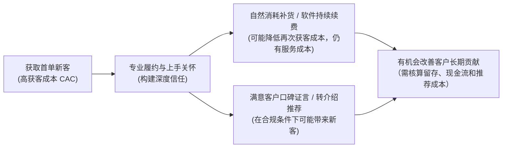
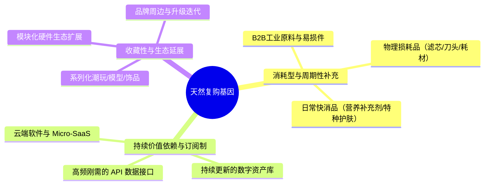
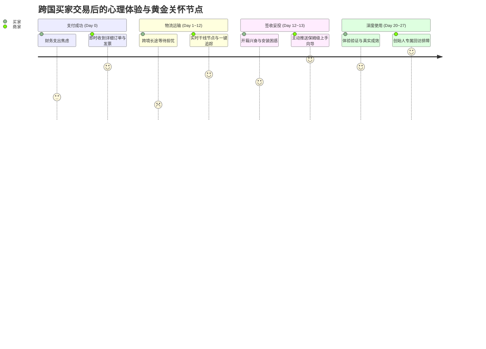
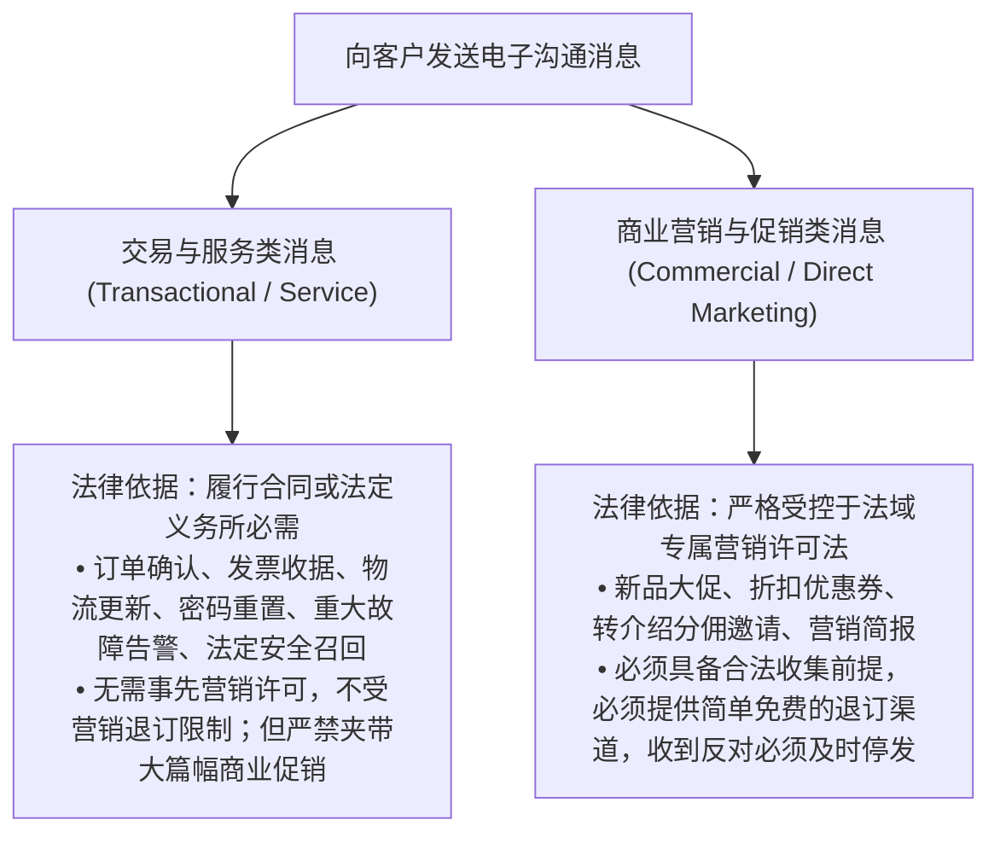
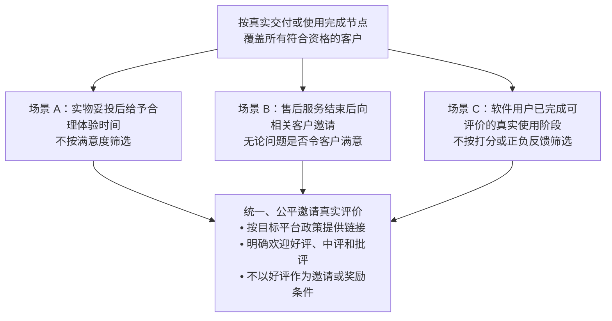
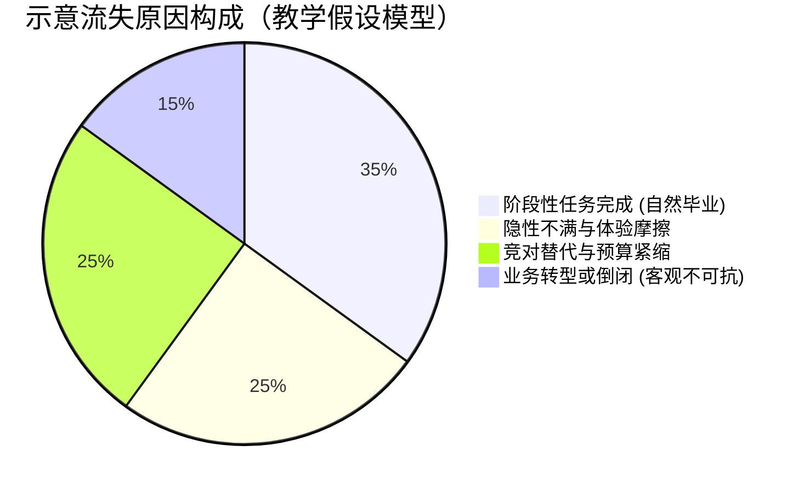

> **状态**：`G7_EDITORIAL_PASS / OWNER_AUTHORIZED_FINAL_POLISH / 2026-10-19`
# 怎么让老客户再买、带来新客？

> **2026-10-20 最小知识补强说明**：依据Owner本轮授权，仅在既有问题下补充教学、选型与验收信息；冻结题干、顺序及历史G7审查结论不变。新来源核验日期及执行边界见本板块来源索引。

> **适用读者**：中国大陆面向海外的个人开发者、Micro-SaaS 创作者、跨境独立站初创经营者、小微外贸制造与定制出海商家  
> **核心目标**：从“做一锤子买卖”转向“精细化客户终身经营”，科学判别自身生意的复购潜力，掌握交易履约全周期的关怀与跟进时机，严格遵守跨国电子营销许可（UK PECR / EU GDPR / US CAN-SPAM）与数据退订底线，合规推进续费补货与合理增购，建立符合 FTC 法律红线的真实评价征集与双向转介绍机制，并在客户流失时建立理性的原因诊断与体面退出机制。  
> **知识定位**：本章隶属于《跨境业务五板块》第五部分《获客与用户增长》，专注解决“老客户关系维护、复购与续费促成、真实评价与口碑转介绍、以及客户流失应对”。宏观选品机会由第一板块承载，初始获客渠道开拓与着陆页促单由第二、第三章展开，获客财务核算与单位经济模型由第四章厘清，系统化获客扩张与团队规模化则留待第六章升华；底层离岸公司财税申报与邮件服务器 SMTP 技术配置由第三、第四板块承载。

---

**【导言】为什么存量客户是跨境生意的真正生命线？**

在前四章的系统推演中，我们深入剖析了如何从零寻找海外客户、促成首单成交，并用严格的数学模型核算了单笔订单的边际贡献利润。

第四章的残酷计算揭示了一个客观规律：在跨国获客成本（CAC）水涨船高的今天，单靠获取新客的首单利润，小微出海商家往往只能勉强做到保本甚至发生微亏。如果每一次出单都要重新投入高昂的广告费或从零去陌生市场拓荒，经营者的现金流与个人精力迟早会被无休止的“获客跑步机”彻底耗尽。

对有持续需求的跨境小企业，**复购/续费（Retention & Expansion）**与**真实转介绍（Referral & Word-of-Mouth）**可能成为收入来源之一；其效果仍取决于产品周期、服务成本、营销许可与实际客户反馈。

然而，“做老客”绝不等于向买家邮箱无休止地狂轰滥炸促销广告，更不等于把所有商品都生搬硬套成订阅制。跨国经营涉及不同国家的商业习惯、个人隐私保护法规与评价监管红线。本章将帮助你建立一套专业、体面、高度合规且可持续的老客经营体系。

---

## 5.1 我的生意适合做复购吗？

许多初入出海的经营者一听到“复购”二字，就盲目制定月度返修或邮件促销计划，结果往往招致买家的厌烦与批量退订。做好老客经营的第一步，是清醒地审视自身产品是否具备复购的客观属性。

### 5.1.1 哪些产品天然容易回购或续费？

复购不是靠营销手段凭空创造出来的，它深深根植于产品的物理属性与业务使用场景之中。在跨国贸易与数字出海中，天然具备高复购基因的产品通常具备以下三大特征之一：

#### 1. 消耗型与周期性补充产品（Consumables & Replenishment）
- **核心逻辑**：产品在使用过程中会发生不可逆的物理损耗，用户为了维持既有生活或生产状态，必须周期性地重新采购。
- **典型品类**：
  - *DTC 独立站*：替换型滤芯、咖啡豆、小众护肤品、宠物周期用品、3D 打印耗材；
  - *B2B 外贸制造*：激光切割机喷嘴、数控机床专用刀具、工业润滑密封件、包装定制膜。
- **运营要害**：精准掌握客户的**物理消耗周期**，在库存见底前的窗口期发起适时提醒。

#### 2. 持续价值依赖与订阅制（Utility & Continuous Subscription）
- **核心逻辑**：客户购买的不是某次性的交付结果，而是持续解决某项特定业务问题的“能力通道”。一旦中断订阅，其日常工作流或业务系统就会受阻。
- **典型品类**：
  - *独立开发者 / Micro-SaaS*：自动化数据抓取工具、跨境物流追踪 API、Shopify 转化率插件、针对特定行业的小型 CRM。
- **运营要害**：让软件深度嵌入客户的核心生产力链路，持续输出稳定价值，建立极高的工作流转换成本（Switching Cost）。

#### 3. 收藏性、升级性与生态配件（Collections & Ecosystem Expansion）
- **核心逻辑**：产品本身虽非日用品，但具备系列化扩展、审美认同或强烈的发烧友属性。
- **典型品类**：
  - *精品电商*：定制机械键盘与个性键帽、手工皮具系列、复古户外露营装备、模块化桌面收纳。
- **运营要害**：打造统一的设计语言与品牌社群认同，让老客户在购买一件核心单品后，持续产生“补齐整套生态”的自发欲望。

---

### 5.1.2 一次性产品还能怎样获得后续价值？

如果你的主营产品是低频耐用品（例如：大型商用设备、客制化家具、高客单价电子仪器、或一次性售断的单机版软件工具），多数单个终端消费者在短期内重复购买同款主机的频率可能较低，但B2B企业仍可能为不同部门、批次或更换设备重复采购。这是否意味着老客户毫无后续价值？

**绝对不是。** 成熟的跨境经营者会通过以下四条路径，从一次性产品中发掘出可观的长尾复利：

| 模式 | 核心思路 | 落地实操案例 | 适合的目标读者 |
| :--- | :--- | :--- | :--- |
| **专用耗材与配件** (Parts & Consumables) | “剃须刀与刀片”模式：主机微利或保本售出，依靠专属配件与易损件获取长期高毛利。 | 销售定制工业木工雕刻机（主机 $3,000，一次性买卖），后续持续提供专机专用的合金雕刻铣刀包与吸尘管嘴。 | B2B 工贸一体商家、跨境精密硬件卖家 |
| **延保与维保合约** (Extended Warranty & Care) | 将实物交易升级为“风险对冲保障”：在质保期满前提供付费延长保修或全天候技术护航。 | 独立开发者提供的生产设备维护记录工具（一次性授权 $299），次年可选择以每年 $49 购买模板更新与数据同步维护服务；未经用户授权不得擅自续费。 | 个人独立开发者、精密仪器制造商 |
| **关联生态增购** (Cross-selling Ecosystem) | 围绕客户的核心使用场景，延伸横向配套产品，解决周边痛点。 | 销售客制化人体工学办公升降桌后，向老客户推荐专属磁吸理线槽、桌下主机托架与降噪脚垫。 | DTC 精品独立站经营者 |
| **老客转介与品牌背书** (Referrals & Testimonials) | 耐用品往往决策门槛极高，老客户的真实背书是促成陌生新客下单最强有力的催化剂。 | 客户购买定制工业烤箱后，邀请其拍摄 2 分钟车间实际运行短视频，提供原厂备用发热管作为感谢，并放置在官网首页。 | 全品类跨境经营者 |

#### 1. 提供原厂专用配件、易损件与耗材（Parts & Consumables）
一次性硬件产品往往自带“配件黏性”。如果副厂配件无法保证公差精度或存在安全隐患，买家天然更倾向于在原购买渠道补购原装件。主动在客户使用 6 个月或 1 年时，推送专属易损件检修包，往往具备极高的转化率。

#### 2. 提供延保服务与专属技术支持合约（Extended Warranty & Service Care）
对于工商业买家，设备停机一天的损失可能远超机器本身的价值。针对这一痛点，在标配质保（如 1 年）即将届满前 30 天，向买家提供可选的“次年核心部件直邮延保计划”，不仅能贡献纯利润，更能极大锁定买家黏性。

#### 3. 围绕同一使用场景进行关联生态增购（Cross-selling into the Ecosystem）
老客户买走一件高单价商品后，其围绕该商品的整体使用场景往往尚未完全完善。基于第一单建立的交付信任，为其精准推荐尺寸相符、风格一致、能提升整体使用体验的生态周边，往往能实现零广告费的二次转化。

#### 4. 将高满意度转化为新客转介与品牌背书（Referrals & Testimonials）
低频高单价生意的核心突破口在“口碑裂变”。由于这类商品的潜客信任成本极高，老客户的一句客观评价或一段开箱视频，其成交转化力往往胜过上千美元的搜索广告投放。

---

## 5.2 交易结束后怎么保持联系？

许多新手跨境卖家的沟通模式极端两极化：要么“客户付完款后就人间蒸发”，直到包裹送达也没有任何指引；要么“刚收完钱就急不可耐地发送大促海报”，在买家尚未收到包裹时就群发促销轰炸。

这两种做法都会严重透支海外客户的信任。在交易完成后，建立一套有节制、有温度、遵守国际法规的跟进节奏，是存量运营的基石。

### 5.2.1 买完后，什么时候联系客户有帮助？

买家从付款到熟练使用产品，会经历一段明显的心理波动曲线。在正确的节点主动提供帮助，能将初期的焦虑感转化为深度的忠诚度：

#### 1. 节点 1：支付成功与订单确认（Immediate Order Confirmation）
- **触发时机**：支付网关回调成功后的数秒之内（系统自动化触发）；
- **核心价值**：消除跨国线上支付的财务不安全感；
- **必备内容**：清晰列明订单编号、商品清单、实付明细、预估发货时间、售后专线邮箱，并明确告知发货后将如何通知买家。严禁在确认函中塞入无关的新品推销。

#### 2. 节点 2：物流发出与实时节点推送（Shipping Notification & Tracking）
- **触发时机**：包裹完成打包交运、生成国际运单号并被第一程扫码时；
- **核心价值**：缓解跨境长途运输（通常需 7~15 天）的信息黑洞焦虑；
- **必备内容**：提供国际承运商名称、运单追踪号、一键直达的实时轨迹查询链接，并主动提示可能涉及的海关清关常识。对于 Micro-SaaS，此节点等价于“账户即时激活邮件与 API Key 凭证生成向导”。

#### 3. 节点 3：妥投签收与保姆级上手指南（Delivery Check-in & Onboarding Guide）
- **触发时机**：物流系统显示“Delivered（已妥投）”后的 24 小时内【注：若依赖各平台或邮政 API 状态回传，需注意时延或未扫码波动，建议文案加入缓冲防冲突提示】；
- **核心价值**：在客户满怀期待开箱的第一时间，指导其正确安装与上手，**将由于操作不当引发的差评与退款扼杀在萌芽状态**；
- **必备内容**：3 分钟极简视频操作链接、PDF 快速安装图解、常见新手踩坑排障 FAQ，以及专属技术客服通道。

#### 4. 节点 4：深度使用回访与隐性问题排查（Satisfaction Check）
- **触发时机**：妥投后的第 7~14 天（软件产品为激活后的第 3~7 天）；
- **核心价值**：排查用户在日常使用中遇到的轻微瑕疵，防止不满情绪在沉默中发酵；
- **沟通基调**：以“产品创始人寻求改进建议”的谦逊姿态展开，例如：“您好，您的设备已运行了一周，各项参数是否达到您的预期？是否有任何我们需要改进的细节？”

---

### 5.2.2 哪些消息必须尊重同意与退订？

许多国内转型出海的商家最容易触犯的严重法律雷区，就是误以为**“客户曾经向我买过一次东西，我就有权将其邮箱或电话加入营销库，永远向其群发促销短信和邮件”**。

在跨国数据合规监管下，必须严格厘清“交易服务类消息”与“直接营销类消息”的法律边界，并在不同的海外法域严格执行退订纪律：

#### 1. 英国 ICO 与 PECR 规则下的“软选择加入（Soft Opt-in）”红线
依据 [*英国信息专员办公室 (ICO) 官方电邮直接营销指南*](https://ico.org.uk/for-organisations/direct-marketing-and-privacy-and-electronic-communications/guidance-on-direct-marketing-using-electronic-mail/how-do-we-comply-with-the-pecr-electronic-mail-marketing-rules/)，向英国个人受众（Individual Subscribers）发送电子邮件或短信直接营销时，若依赖“软选择加入（soft opt-in）”法定豁免，依据 PECR 第 22(3) 条必须**同时严格满足**以下五大要件：
1. **本人直接获取（Directly obtained from the individual）**：电子联系方式必须是在向该客户销售商品/服务、或就潜在销售进行实质商业洽谈（如询价）的过程中，直接从该客户本人处获取的（严禁使用第三方购买或爬虫抓取的名单）；
2. **在销售或洽谈过程中取得（In the course of a sale or negotiations）**：必须是在真实的购买交易或明确的购买咨询谈判环节中采集；
3. **仅限自身类似商品或服务（Own similar products or services only）**：营销内容必须严格限于推广商家自身经营的、且与原先购买具有合理关联的类似商品或服务；
4. **收集时给予免费简单的拒绝机会（Simple, free opportunity to opt out at collection）**：在最初采集客户联系方式时，已给予清晰、免费、简便的拒绝选项（例如结账页未默认勾选的营销复选框，或醒目的退出说明）；
5. **每条后续营销消息均给予免费简单的退出机会（Simple, free opportunity to opt out in every subsequent message）**：在随后发送的每一封营销邮件或短信中，均必须提供简单、免费的拒绝或退订途径（例如醒目的退订链接，或回复“STOP / 退订”）。

- **独立法定义务提示**：在消息中清楚明示发件人的真实企业身份与有效联系方式，是 PECR 第 23 条（以及电子商务法规）下的普遍性独立法定义务，不能掩盖或隐匿身份。
- **特别法域界限提示**：英国 ICO 指南依据的是英国本地 PECR 法规，**绝不能将英国 ICO 指南当成欧盟 27 个成员国通用的法律依据**！在欧盟内部，虽然欧盟《电子隐私指令》（ePrivacy Directive 2002/58/EC 第 13 条）包含类似的豁免框架，但各成员国均有独立的本土转化法律（如德国《反不正当竞争法》UWG § 7 对软选择加入的适用条件极其苛刻、法国 CPCE 等）。向欧盟不同国家受众发信，必须分别核对其所在国的本土电子营销法律。

#### 2. 欧盟 GDPR 与电子隐私（ePrivacy）法规底线
依据 [*欧洲联盟委员会关于合法处理个人数据法律基础的官方指南*](https://commission.europa.eu/law/law-topic/data-protection/information-business-and-organisations/legal-grounds-processing-data_en)：
- 商业促销属于直接营销行为。根据欧盟 GDPR 第 21 条第 (2) 款，数据主体享有针对直接营销个人数据处理的**绝对反对权（Absolute Right to Object）**；
- **退订的法律效力与抑制名单**：一旦客户提出退订（无论是点击退订链接还是发信要求退出），商家必须**无条件、及时停止针对该客户的所有直接营销类处理**，不得要求其提供理由，不得设置阻拦障碍。商家应将该邮箱移入内部“营销抑制名单（Suppression List）”，防止系统日后再次误发；
- **服务消息与未来重新同意的边界**：
  - **合法履约消息照常发送**：客户退订营销，绝不等于解除基础服务合同。商家依然可以依法向其发送订单发票、物流跟踪、安全告警、账户凭证与法定召回等交易履行通知；
  - **重新许可的可能性**：若客户日后主动在个人账户中勾选重新开启促销推送，商家可基于该项新的明确同意恢复发信，并非“终身不可逆转”。

#### 3. 美国 FTC CAN-SPAM Act 的合规要求
依据 [*美国联邦贸易委员会 (FTC) CAN-SPAM 企业合规指南*](https://www.ftc.gov/business-guidance/resources/can-spam-act-compliance-guide-business)，面向美国受众发送**商业电子邮件（Commercial Electronic Mail）**必须遵循六大铁律：
1. **真实的主题行与头部路由**：严禁在邮件主题行使用欺诈、误导性词汇；
2. **显式广告标识**：必须以清晰易懂的方式告知收件人这是一封商业广告；
3. **实体有效邮政地址**：**邮件页脚必须包含商家合法的实体物理邮寄地址（Valid Physical Postal Address）**，可包含合规注册的街道地址、邮政信箱（P.O. Box）或合规的商业邮寄代理地址；
4. **无障碍退订机制**：必须在邮件中提供醒目、清晰的电子退订指示（如直接可点的退订链接或回信退订方式），且退订机制在邮件发出后至少 30 天内持续有效；
5. **法定时效处理**：必须在收到退订请求后的 **10 个工作日内**完成系统移除；
6. **退订永久免费**：严禁向退订用户收取任何手续费，严禁要求其提供除邮箱以外的任何多余个人隐私。
- **注意渠道差异**：CAN-SPAM 的上述 10 工作日与实体地址规则专门针对商业电子邮件，海外短信（SMS）与电话呼叫则受美国《电话消费者保护法》（TCPA）及运营商 CTIA 准则管辖，退订要求通常更为严苛（如必须支持回复“STOP”立即生效）。

> **实操指引｜T6**：营销触达触发条件、退订抑制和故障控制。见 [共用经营实操附录 T6](https://github.com/entropy-student/project/blob/main/cross-border-business/05-acquisition-growth/docs/APPENDIX_OWNER_APPROVED_GROWTH_PRACTICE_V1_20261019.md) 对应小节。

---

#### 何时才需要独立的营销自动化工具？

| 阶段 | 最小可行方案 | 什么时候升级／什么时候不该升级 |
|---|---|---|
| 只有少量真实订单 | 先使用店铺/支付平台已有的**交易确认与履约通知**，合规且低频的营销由经营者手工执行并记录同意/退订 | 不能因为有客户邮箱就自动建立群发营销；订单确认与促销是不同用途 |
| 需要按实际许可和购买节点分群 | 在可用且符合主体/法域/平台资格时评估成熟邮件服务商（如Klaviyo、ActiveCampaign） | 先实际验证许可来源、价格/套餐、模板、停止发送、退订抑制和重复事件 |
| 多系统且存在频繁漏发/重发 | 再按需考虑Make/Zapier或合规自建集成，并保留人工暂停/审核 | 若原生后台已足够或无法核对退订名单，暂不增加系统复杂度 |

**验收**：选一种真实有资格使用的方案，让测试账号分别进入“合法可收服务通知／可收营销／已退订营销”状态，确认允许消息发送、禁止消息被抑制、失败重试不无限重复。仅以经营验收为目标；域名发信认证、Webhook与实际系统实现归第②/④板块。相关法域与发送者政策见[来源索引](SOURCE_REGISTER_AND_TERMS_20261019.md)。

## 5.3 怎么促成续费和再次购买？

促成老客户再次掏钱，依靠的是对客户业务需求的精准预判与无摩擦的履约体验，而非饥饿营销式的大促狂欢。

### 5.3.1 何时提醒续费、补货比较合适？

提醒的时机如果过早，会被买家当成垃圾骚扰；提醒的时机如果过晚，买家在断货焦虑下往往已经转投了本地竞争对手。

#### 1. 消耗型实物商品的“动态补货时钟模型”【示意模型 / MODEL_ASSUMPTION】
对于周期消耗品，可依据以下数学模型估算基础提醒时钟：

$$\text{最优补货提醒时间点} = \text{预计总使用周期天数} - (\text{跨国物流交付天数} + \text{买家决策与安全缓冲天数})$$

- **实操演算案例【示意参数 / MODEL_ASSUMPTION】**：
  - 假定某出海品牌销售的一款定制净水滤芯为双月装规格，理论设计使用周期为 **60 天**；
  - 假定从中国发往欧美的跨境专线物流与干线清关通常预估为 **12 天**【注：物流时效在旺季可能动态波动，属于 UNKNOWN / NEEDS_VERIFICATION，需预留冗余】；
  - 预留买家查看邮件、复购决策与周末处理缓冲期 **5 天**；
   - **触发时间点【MODEL_ASSUMPTION】**：按60－12－5＝43天，可将客户妥投后的**第43天**设为内部提醒评估节点；**只有具备目标法域、渠道所要求的营销同意或其他适用许可（如满足全部要件的英国soft opt-in），才发送含促销／补购内容的消息**；客户退订后不得以“服务通知”之名继续投放营销。
  - **话术基调**：提供“一键原样复购（1-Click Reorder）”专属快捷链接，并主动提示物流时效：“您的滤芯预计还剩约 2 周用量。鉴于跨国派送通常需要约 10~14 天，建议您本周安排补充，确保生活用水不受影响”。
- **客观局限性提示**：上述模型为经营者基准参考。每位消费者的实际使用频次、家庭人口各异，不可强行假定所有买家的消耗速度完全一致。理想做法是在邮件中附带“推迟两周再提醒我”或“我已不需要”的灵活选项。

#### 2. SaaS 与数字订阅服务的合规预警与取消保障
对于软件与数字服务，自动续费（Auto-Renewal）是维系现金流的关键，但在合规设计上必须保持极高的透明度：
- **前置扣款预警通知（Cadence / MODEL_ASSUMPTION）**：
  - 对于年度长周期订阅，业内良好合规实践是在正式扣费前的 **15~30 天内**发送清晰的预付款邮件；对于月度订阅，若涉及价格或权益调整，必须提前书面告知；
  - 邮件中应以大号清晰字体标明：即将在何时扣费、扣费金额是多少、扣款账户信息，以及**取消订阅的直达操作途径**；
- **关于 FTC Click-to-Cancel 规则撤销的法律澄清与现行合规底线**：
  - **重要法治动态**：美国联邦第八巡回上诉法院于 **2025 年 7 月 8 日**正式裁决**撤销（vacate）**了 FTC 于 2024 年修订的负面选项规则（即著名的 Click-to-Cancel 联邦专项行政法），FTC 并在 **2026 年 3 月 13 日的联邦公报（Federal Register, 2026-04952）** 中确认了该项规则的撤销状态。因此，不能将该项全联邦统一的“点击即取消”行政规章当作 2026 年依然有效的统一现行法律依据，也不能断言在取消流程中设置简单的多步调查问卷就绝对构成联邦违法；
  - **为什么便捷取消依然是商家的核心生命线？**
    1. **FTC Act 第 5 条一般反欺诈管辖权依然存在**：FTC 依然有权依据其基础法律，对在订阅取消过程中使用隐蔽欺骗、虚假说明或极端恶意阻碍手段（Deceptive or Unfair Practices）的商家提起执法诉讼；
    2. **美国各州自动续费法律（State ARL）管辖极严**：例如加州《自动续费法》（California ARL, Cal. Bus. & Prof. Code § 17600 et seq.，经多次修正持续强化）等州级法律，依然明确强制要求商家提供醒目的扣款前披露、对年度订阅提前提供续期通知（如提前 15~45 天），并**强制要求提供简便、清晰的在线取消机制（如直观的取消按钮或在线退订渠道）**；
    3. **卡组织与支付服务商的合规风控**：周期扣费商户应核对适用的卡组织、收单机构与支付服务商订阅规则，提供符合条件的取消渠道。隐藏取消入口可能增加争议与拒付风险；但**不能用统一的“0.9%～1%拒付率”断言自动处罚或永久冻结**。Visa VAMP按欺诈与争议事件综合计数、交易笔数、地区、适用日期及最低事件数等因素监控；Stripe、PayPal和收单机构另有账户风控与处理流程，详见已封板第四章的风险口径。
- **实操建议**：保持取消通道清晰直观，绝不故意隐匿退订入口，绝不强制客户拨打越洋电话；在退出流程中可诚恳询问退出原因（如 1~2 个简单单选），但必须保证客户可以顺利自主完成退订。

---

### 5.3.2 什么情况下适合推荐升级或其他产品？

增购（Up-selling）与交叉销售（Cross-selling）的核心不是“向老客户推销更贵的东西”，而是**“在客户面临业务规模升级的新痛点时，主动为其提供更高阶的生产力方案”**。

#### 1. 甄别适合增购推荐的“绿色信号”
向老客户发起升级推荐，必须以客观的使用数据为依据，严禁在客户情绪脆弱时冒进：

| 推荐升级的“绿色信号”（时机成熟） | 绝对禁止推销的“红色禁区”（严禁打扰） |
| :--- | :--- |
| **用量与资源消耗接近上限**：SaaS 用户的活跃席位或 API 调用配额已持续达到 80%~90%【示意阈值 / MODEL_ASSUMPTION，需视自身产品自测】；工贸客户的原材料提货频次明显加快。 | **客户正在遭遇未解决的服务故障**：用户正因软件 bug 提交紧急工单，或正因跨国包裹延误在与客服争执。 |
| **主动发起高阶功能咨询**：客户主动在邮件中询问：“你们是否支持多仓跨国协同？是否支持导出特定格式的报表？” | **客户刚经历退货或产品换新**：客户对初始产品的信任尚未完全修复，此时推销新产品会引发严重反感。 |
| **业务周期取得里程碑胜利**：客户刚刚使用你的系统完成了一次大促活动，并在回访中表达了高度肯定。 | **客户处于长期低活跃或沉睡状态**：注册后基本未登录，此时盲目推销高阶套餐毫无转化可能。 |

#### 2. 基于价值进阶的专业升级邀请【话术示范 / MODEL_ASSUMPTION】
当观察到客户用量饱和时，发送一份基于客观数据、充满顾问式专业度的建议：

> *“Hi Marcus,*  
> *We noticed that your team has successfully synced over 8,500 inventory events this month, approaching the 10,000-event threshold on the Starter tier.*  
> *To prevent automated webhook throttles as your store expands into the European market, upgrading to our Pro Plan unlocks unlimited real-time sync, custom mapping, and 24/7 dedicated Slack support. We’ve enabled a 7-day complimentary preview of the Pro features on your account—no automated charge. Feel free to explore how it handles your peak load.”*

这种基于客观数据、提供免费试用预演、且明确不发生自动扣款的推荐，不仅不会被当成推销，反而能彰显团队对客户业务成长的密切关注。

---

## 5.4 怎么让满意客户介绍新客？

满意老客户的主动推荐，是跨境获客中转化率极高、信任极稳固的优质渠道。但在请求评价与设立推荐机制时，必须严守国际合规红线与反垃圾底线。

### 5.4.1 什么时候向客户请求真实评价？

**公开评价的邀请应面向符合资格、实际体验过产品或服务的客户，以真实使用完成或服务交付节点为依据，不能只筛选预计会给好评的人。** 对个别主动表达赞赏的客户，可在取得其许可后另行请求将经历制作成官网客户证言；这与第三方平台上的公平索评不是同一流程。

- **极简请求模板【话术示范 / MODEL_ASSUMPTION】**：
  > *“Hi Liam, we hope you have had enough time to try the custom bracket after delivery. We invite customers who have used our product to share an honest review on [Target Review Link]. Positive, neutral, and critical feedback are all welcome, and no reward depends on your rating. Your experience can help other makers make informed decisions.”*
- **平台账号与门槛说明**：提供评价链接时，需注意目标平台的机制。如果引导去自己的独立站，可提供免登录简易表单；如果引导至 Google Reviews 或 Trustpilot 等第三方公开平台，买家通常需要登录其个人平台账号方可提交，文案应给予告知，切忌做出“无需任何登录一键秒评”的不实承诺。

---

### 5.4.2 老客户怎样方便地推荐朋友？

想要老客户自发介绍新客，必须消除推荐过程中的一切认知负担，并在财务测算上守住毛利底线。

#### 1. 双向激励机制（Two-Sided Referral Model）的设计逻辑【示意模型 / MODEL_ASSUMPTION】
- **心理机制分析**：若仅给予老客户单向佣金返现，老客在向同行推荐时容易产生“拿朋友关系变现”的心理顾虑；若将激励设计为**“双向互惠特权”**，推荐人便能以“为同行争取专属迎新福利”的积极心态发起分享。
- **严谨的单笔单位经济模型测算【示意模型 / MODEL_ASSUMPTION】**：
  - **基础财务参数设定**：
    - 假定商品标准客单价（List Price / AOV）为 **$120**；
    - 假定商品及履约变动成本（COGS & Variable Delivery）为 **$60**（原价基础毛利率为 50%）；
  - **激励方案配置**：
    - *新客首单迎新特权*：凭专属推荐链接立享 **15% 折扣（即优惠 $18）**，新客实付收入为 **$102**；
    - *老客推荐回馈*：新客成单且度过退货犹豫期后，老客账户自动记入 **$20 账户储值金/下次采购抵用券（Store Credit）**；
  - **边际贡献利润严格核算**：
    - 新客首单扣除变动成本后的毛利贡献为：$\$102 - \$60 = \$42$；
    - **储值金经济学成本界定**：老客的$20储值金属于未来可能兑现的奖励，不能在发放时简单当作已支出的$20现金，也不能未经适用会计准则判断就认定为全额法定负债。为评估活动承受力，本例**另为奖励预留全额$20的保守预算**；未来若发生兑换，应记录真实抵扣及对应履约成本，避免同一奖励重复扣费：
      $$\text{本例扣除奖励预留后的剩余贡献空间}=\$42-\$20=\$22$$
    - **测算结论【MODEL_ASSUMPTION】**：新客本单实际收到$102，扣本例商品与履约变动成本$60后，**奖励前阶段贡献空间为$42**；再为$20储值金预留预算后的**剩余空间为$22**。这不代表$22已实现现金净利润、实际法定负债确认或保证老客一定复购；尚未扣支付手续费、退款、税费及其他获客支出，应继续按第四章统一口径核对。

#### 2. 工具路径的极简设计与合规红线
- **极简路径**：在用户账户中心生成专属唯一推荐短链（Unique Referral Link），支持一键复制；
- **反垃圾与隐私红线（Anti-Spam）**：推荐分享必须是由老客户自主发起、自愿发送给其真实认识的朋友或同行。**严禁要求或诱导用户导入整个通讯录，严禁系统自动向未经许可的第三方邮箱静默群发推荐邮件**，否则将严重违反 CAN-SPAM 及海外隐私直销法规；
- **利益关联披露责任（FTC 16 CFR Part 255）**：根据美国 FTC 广告背书指引，当推荐人享有推荐奖励（如 $20 储值金）时，必须在分享文案中醒目披露利益关系（例如自带标签：“*Use my link to get 15% off, and I will receive store credit*”）；
- **平台规则区隔：评价 ≠ 真实成交转介绍**：第三方公开评价平台和电商平台可能严禁或严格限制**有偿评价、评价倾向激励、选择性索评**；但符合披露义务的成交推荐、联盟佣金或自有站优惠是否允许，应分别查核**具体交易平台、站外营销及推荐计划条款**。Google Reviews是评价平台，并非商品成交平台；不能据评价规则推出“全球所有第三方交易渠道都禁止推荐返佣”。

---

### 5.4.3 提供奖励时，怎样避免评价造假？

**先检查发布评价的平台是否允许任何评价奖励：若平台禁止，哪怕奖励与好评、中评、差评无关也不能提供。** 对可允许的场景，再独立核查当地法律、评价真实性、与评价倾向无关及必要的商业利益披露。美国FTC对中立奖励的边界**不等于**Amazon等平台给予商家奖励换评的许可；成交转介绍佣金须另核渠道规则，不与公开评价奖励混为一谈。

这是中国大陆出海卖家面临监管处罚和平台封店最惨烈的重灾区。很多在国内习惯了“好评返现 5 元”的卖家，将这套违法操作照搬至海外，直接招致灭顶之灾。

#### 1. 区分“公开独立评价（Reviews）”与“广告代言证言（Endorsements）”
在欧美法律框架下，二者具有完全不同的法律定性：
- **消费者独立评价（Consumer Reviews）**：发表在第三方公开平台（如 Google Reviews、Trustpilot、Etsy）或电商产品页上的客观买家留言。其核心法律要求是**独立性与真实性**；
- **广告代言与商业证言（Endorsements & Testimonials）**：商家在官网上作为营销宣传物料使用的案例故事、客户证言或网红体验。

#### 2. 深入剖析美国 FTC 2024 年正式生效的《消费者评价与推荐规则》（16 CFR Part 465）
依据 [*FTC 官方法规权威解答*](https://www.ftc.gov/business-guidance/resources/consumer-reviews-testimonials-rule-questions-answers)，该项法规于 **2024 年 10 月 21 日**起全面生效，赋予了 FTC 对违规商家直接处以巨额法定民事罚金（单项违规罚款可高达数万美元）的执法权。商家必须精准把握法条边界：

1. **严禁编造虚假评价（Fake Reviews, § 465.2）**：严禁伪造不存在的买家账户刷评、雇佣水军编写虚假好评、或使用 AI 批量生成虚假体验；
2. **严禁条件式激励评价（Conditioned Incentives, § 465.4）**：
   - 法规明确禁止任何**明示或暗示必须给出正面评价、特定星级、或表达特定情绪才能获得奖励的行为**（例如：*“只要给五星好评就返现 $10”* 或 *“凭好评截图领取免费配件”* 属于明确的违法行为）；
3. **评价压制与误导性呈现的法律界限（Review Suppression, § 465.7）**：
   - **§ 465.7 明确禁止的行为**：严禁使用毫无根据的法律恐吓、人身威胁或虚假指控来阻止买家发表负面评价或强迫删评；严禁在自身独立站上宣称“展示了全部真实买家评价”，但实际上暗中依据星级或负面情绪系统性隐匿、扣留负评；
   - **法条豁免与合理过滤（§ 465.7(b)）**：**法律并未强制商家必须无条件发布任何垃圾内容！** § 465.7(b) 明确豁免：商家完全有权扣留或删除包含商业机密、诽谤侮辱、骚扰辱骂、淫秽色情、种族歧视、违法违规内容，以及**商家有合理解由认定为纯属虚假、垃圾营销或与产品服务完全无关的评论**；
4. **关于“评价门控（Review Gating）”与第三方平台禁令的区分**：
   - 所谓评价门控，是指通过前期问卷筛选，对给出 4~5 星的买家自动引导至公开平台留评，而对 1~3 星的买家拦截在私密表单处理；
   - 在 FTC 执法实践中，如果商家声称公开评价代表了所有客户的整体满意度，门控行为可能构成 FTC Act 第 5 条所规制的虚假与误导性商业做法；
   - **更关键的直接风险在于第三方平台规则**：Google Reviews、Amazon、Trustpilot 等主流平台在其开发者与商家守则中**全面且独立地严厉禁止 Review Gating 行为**。一旦被平台检测到预筛选漏斗，将直接导致评级清零或商户封号。

#### 3. FTC 广告背书指引（16 CFR Part 255）的披露要求
依据 [*FTC 广告背书指南 (16 CFR Part 255)*](https://www.ftc.gov/business-guidance/resources/ftcs-endorsement-guides-what-people-are-asking)：
- 如果商家为买家提供了免费样品、大幅折扣或佣金分成，买家公开发表的使用体验必须在醒目位置**以清晰、不容忽视的方式披露这种实质性利益关联（Clear and Conspicuous Material Connection Disclosure）**，例如标注 `#Sponsored` 或明确说明 *“Product provided for honest review”*；
- 披露必须置于用户一眼能看清的显眼位置，严禁隐藏在折叠标签或漫长的免责声明深处。

#### 4. 合规征集评价的安全底线
中小出海商家若想合法合规地激励客户发表反馈，必须坚守以下原则：
- **奖励先核准入、再谈无倾向性（Unconditioned）**：**仅当评价发布平台明确允许相关奖励，且目标法域法律允许时**，才考虑抽奖或积分；绝不能将FTC关于评价倾向的条件理解为平台允许奖励。满足前提后，才可明确声明：**“无论您给出的是好评、中评还是差评，只要留下诚实的真实使用反馈，均可获得相同权益”**；
- **尊重客观评价分布**：切忌追求 100% 毫无瑕疵的虚假全五星。适度的、诚恳的建设性中差评与商家专业的售后回复，反而能让海外消费者深信评价的真实性，显著提升整体转化信任。

---

## 5.5 客户不再买了怎么办？

面对客户流失，许多跨境卖家的反应要么是陷入被忽视的自尊受挫，要么是死缠烂打地发送更廉价的折扣邮件。这两种极端都无法解决业务的实质问题。

建立一套理性的成因诊断机制与体面退出流程，是出海生意的必修课。

### 5.5.1 客户不买，是不需要还是不满意？

客户停止续费或不再复购，背后隐藏着完全不同的商业事实。经营者必须通过数据排查与轻量回访，精准界定流失的真实归因：

上述35/25/25/15仅为**演示分组用的MODEL_ASSUMPTION**，不是全球客户流失原因调查比例。仅凭表象不能确定动因，应结合访谈、续费周期、服务记录等核查。

#### 1. 四类流失原因的证据诊断
1. **类型一：阶段性任务完成（自然毕业，Graduation）**
   - *客观表象*：客户过去高频使用，某一天突然停止，并在后台导出了全部数据；
   - *真实实质*：客户购买你的工具或耗材就是为了完成某个特定阶段性项目（如完成海外特定合规审计、完成单期外贸展会展台搭建）。项目胜利交工，需求自然终结；
   - *应对定性*：这是健康的自然流失，客户对产品高度满意，是未来转介绍和新项目回流的黄金种子。
2. **类型二：隐性不满与体验摩擦（Unspoken Dissatisfaction）**
   - *客观表象*：客户在遇到某次客服对话、某次物流延误或软件版本更新后，使用活跃度断崖式下跌，且并未提交退款投诉；
   - *真实实质*：海外买家往往极少在邮件中大发雷霆，他们更倾向于“用脚投票”，默默承受糟糕体验后彻底离开；
   - *应对定性*：必须由创始人或技术负责人发起高优先级的一对一私信排查，主动认错并提供补救方案。
3. **类型三：遭遇竞对替代（Competitor Displacement）**
   - *客观表象*：客户活跃度平稳过渡到零，或直接在退订问卷中坦言迁移至某知名竞品；
   - *真实实质*：竞争对手在特定核心功能、本地化支付或集成生态上提供了更优解；
   - *应对定性*：吸收竞品优势，记录产品缺口（Feature Gap），切忌诋毁竞对。
4. **类型四：客户业务已终止或暂时缩减（需核实）**
   - *可能的证据*：客户明确告知停业、可核实的企业状态或采购计划终止；邮箱退信本身不足以证明停业。
   - *处置*：尊重客户已确认的经营变化；原因未证实前不得直接推定资金链断裂。
5. **类型五：非自愿支付流失／原因未知（Involuntary Churn）**
   - *客观信号*：扣款失败、信用卡到期或银行拒付、支付账户异常；这些都**不能单独证明客户业务倒闭**。
   - *处置*：先按实际支付失败代码排查并提供合法且必要的更新支付方式/账单补救路径；区分服务性账单通知与须有营销资格的促销，不对已退订客户持续骚扰。

---

### 5.5.2 什么时候该挽留，什么时候该放手？

挽留不是毫无底线的纠缠。经营者必须建立清晰的经济学与服务边界：

#### 1. 挽留与放手的决策边界矩阵【示意模型 / MODEL_ASSUMPTION】

| 客户当前情境 | 经营处置决策 | 适用的具体动作与话术 |
| :--- | :---: | :--- |
| **因短期资金紧张或业务淡季暂停** | **适度挽留（保留连接）** | 提供“暂停计费 1~3 个月并保留全部历史数据配置”的选项，或者提供不含增值特权的基础降级款，避免直接彻底流失。 |
| **因上手遇到操作困难或轻微配置摩擦** | **全力挽留（服务补救）** | 安排技术负责人或创始人直接发起 15 分钟线上远程协助，排障并提供专属配置向导，变危机为信任契机。 |
| **客观需求已终结（项目已完成/已转行）** | **果断放手（体面致意）** | 立即停止一切营销打扰，真诚感谢其过去数月的支持，祝贺其项目顺利完成，并告知数据导出方式。 |
| **客户明确要求取消订阅、关闭账号或删除资料** | **坚决放手（严格合规）** | 不得故意拦截符合条件的取消请求；**取消续费、关闭账号与个人数据删除是不同操作**。分别按合同及适用法律处理，说明必要的数据保留范围和申诉/删除途径。 |

#### 2. 法定义务与商业挽留的不可动摇边界
**经营者必须铭记的核心法律边界**：
- **商业放手绝不等于免除法定售后责任**：商家判定某位客户“在商业上不值得继续投入挽留成本”，仅仅意味着**停止对其进行主动的销售沟通与营销投入**。
- **法定与合同责任依法处理**：无论客户是否流失，适用的**保修、法定撤回权、召回、应退款项及个人数据主体权利**均不能因商家不愿挽留而擅自取消。但**GDPR删除权并非绝对**：须核验请求并在法定期限内答复，若为遵守依法保存交易/税务记录的义务、处理法律请求等仍须处理的数据，可按适用例外保留必要部分并告知理由。客户停止订阅≠立刻抹掉所有账户和履约记录；退订营销不影响依法必要的交易、安全通知。

#### 3. 体面放手（Graceful Exit）的长期复利价值
退出流程的设计，是检验一个出海团队成熟度的试金石：
- **流程透明顺畅**：提供简便易寻的在线取消途径，绝不强制客户拨打越洋电话；
- **保障数据尊严（Data Portability）**：为数字客户提供完整的历史数据一键导出备份通道，告知数据在后台的安全保留天数；
- **充满温度的最终确认函【话术示范 / MODEL_ASSUMPTION】**：
  > *“Hi Daniel,*  
  > *Your subscription has been successfully canceled, and no further charges will be made. Your workspace data will remain safely archived for the next 45 days should you ever need to retrieve it.*  
  > *Thank you sincerely for partnering with our workshop over the past 9 months. If your business ever requires specialized fabrication support in the future, our door is always open.*  
  > *Wishing you and your team continued success!”*

**反直觉的商业事实**：一个在离开时受到尊重、退订体验顺畅的海外客户，未来遇到新需求时**可能**愿意回流，也**可能**向同行分享真实体验；这并不是高概率保证，商家应尊重退出、观察实际推荐结果，不强行联系：“那是一家非常专业、正规、尊重用户的中国团队，值得信赖”。

---

**【本章自检与落地行动清单】**

在开展老客维护、设计复购与转介绍流程时，请对照以下六项标准进行系统自检：

1. [ ] **业务复购属性清醒定性**：我的产品到底属于周期消耗品、SaaS 订阅、还是低频耐用品？面对一次性产品，我是否放弃了无效的促销打扰，转向原厂配件、服务合约或转介绍推荐？
2. [ ] **交易后服务节奏分层**：在客户下单后，我是否建立了“订单凭证 -> 物流追踪 -> 妥投上手指南 -> 使用满意度排查”的渐进式关怀路径？在客户收到货的前几天，我是否严格克制了推销新产品的冲动？
3. [ ] **营销许可与退订底线审查**：我的系统是否严格区分了“交易服务消息”与“商业营销消息”？面向英国用户，我发送的促销是否严格符合 ICO PECR soft opt-in 五项法定要件？面向欧洲用户，我是否尊重了其针对直接营销的绝对反对权并建立了抑制名单？面向美国用户，商业邮件页脚是否包含真实物理地址，并保证在 10 个工作日内处理退订？
4. [ ] **促成续费与增购契机把握**：对于消耗品，我是否基于真实物理消耗周期设立了动态补货时钟？对于订阅产品，我是否在扣款前发送了透明通知？在知晓 FTC 2024 Click-to-Cancel 修订规则被司法撤销的背景下，我是否依然坚守了便捷在线取消这一防御州法与支付风控的黄金实践？
5. [ ] **评价征集与转介绍合规红线**：我是否在合理的使用或服务完成节点，公平邀请所有符合资格的客户留下真实评价，而不是只向预计会好评的人索评？我是否核对转介绍奖励的合理性、未来兑换预算、每单贡献空间及实际成交来源？我是否严格遵守了 FTC 16 CFR Part 465 规则，彻底杜绝了“好评返现”、“条件式好评奖励”及违法门控？我的转介绍链接是否附带了实质性利益披露与反垃圾保护？
6. [ ] **流失原因诊断与体面放手**：当老客户不再购买时，我是否能客观区分其是需求自然终结、预算紧缩还是体验受挫？当客户心意已决时，我是否区分订阅取消、账号关闭及法定数据删除申请，并依法处理可适用的保留例外？我是否明确知晓商业放手绝不免除法定保修与召回责任？

**【动态规则核验与适用来源说明】**

本章涉及的Visa VAMP风控不等于统一“拒付率红线”，请以[Visa VAMP官方说明](https://corporate.visa.com/content/dam/VCOM/corporate/visa-perspectives/security-and-trust/documents/visa-acquirer-monitoring-program-fact-sheet-2025.pdf)及实际收单账户规则核对。公开索评应遵循[FTC索评指引](https://www.ftc.gov/business-guidance/resources/soliciting-paying-online-reviews-guide-marketers)及目标平台规则，避免仅向预期好评者发起邀请。欧盟委员会明确[个人数据删除权有法定例外](https://commission.europa.eu/law/law-topic/data-protection/information-individuals_en)。上文涉及的优惠券、物流和利润均为教学假设；必须以实际交易、当期监管及合同核实。