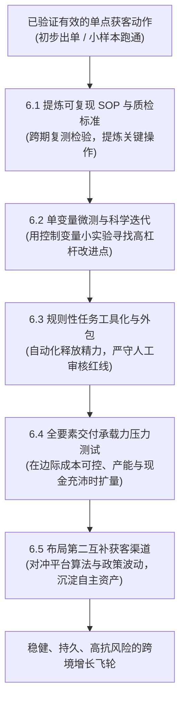
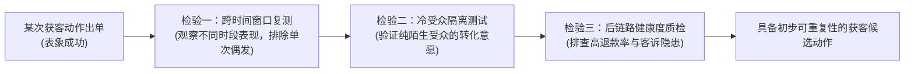
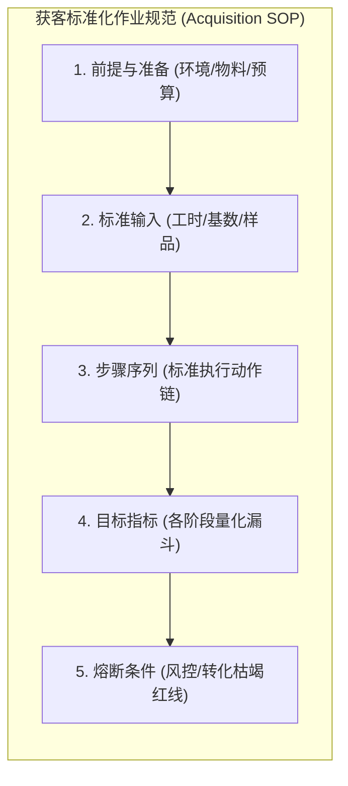
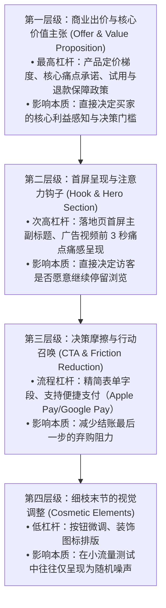
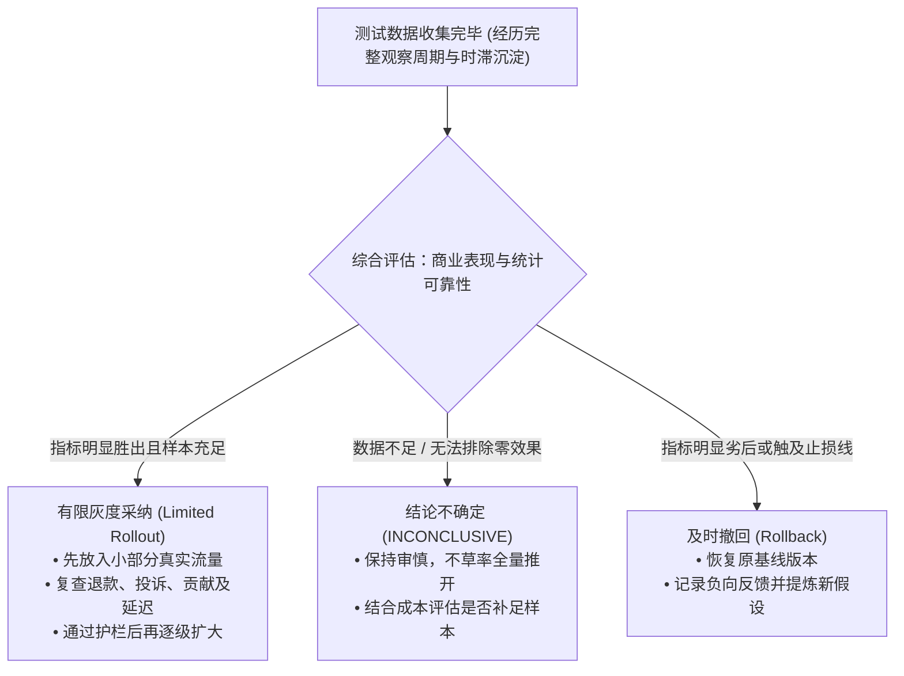
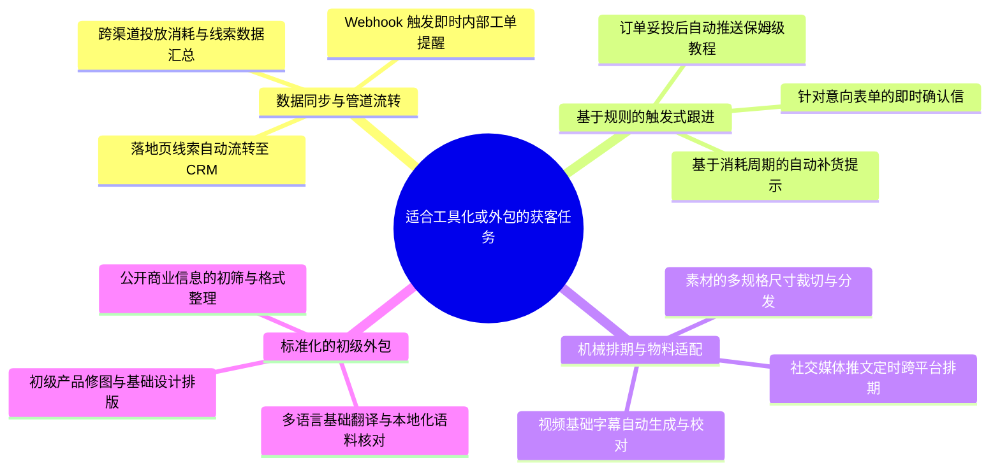
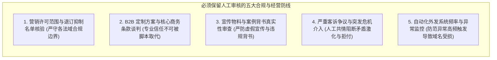
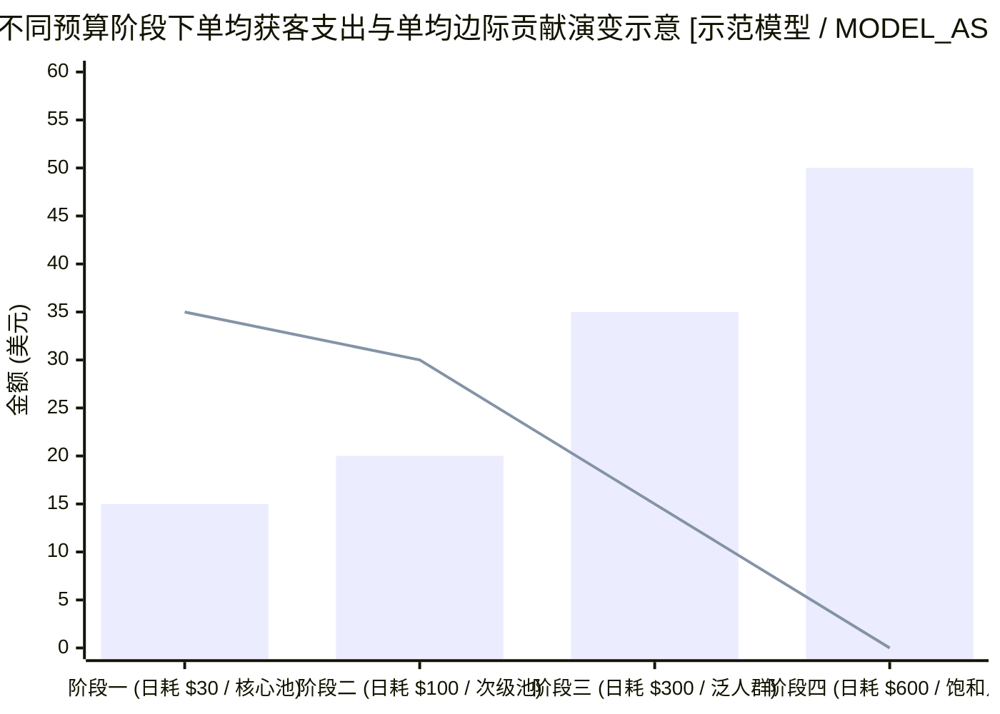
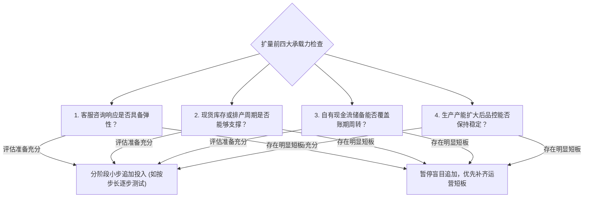
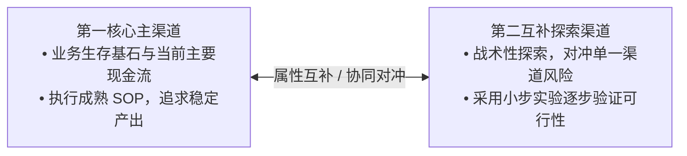

> **状态**：`G7_EDITORIAL_PASS / OWNER_AUTHORIZED_FINAL_POLISH / 2026-10-19`
# 有效的获客方法怎么做大？

> **2026-10-20 最小知识补强说明**：依据Owner本轮授权，仅在既有问题下补充教学、选型与验收信息；冻结题干、顺序及历史G7审查结论不变。新来源核验日期及执行边界见本板块来源索引。

> **适用读者**：中国大陆面向海外的个人开发者、Micro-SaaS 创作者、跨境独立站初创经营者、小微外贸制造与定制出海商家  
> **核心目标**：从“随机碰运气式偶发成单”跃迁至“可复现、可度量、可持续的系统化规模增长”，建立可执行的获客 SOP，掌握科学的单变量测试方法，构建人机协同的合规自动化体系，开展扩量前的交付承载力压力测试，并搭建抗风险的双渠道经营矩阵。  
> **知识定位**：本章隶属于《跨境业务五板块》第五部分《获客与用户增长》的最终收官章节。在第一章明确“客户在哪里”、第二章开拓“海外获客渠道”、第三章突破“促成首单成交”、第四章算清“边际经济账本”、第五章闭环“存量留存与口碑转介绍”后，本章直面用户增长的终局命题——**如何将已经跑通的有效获客动作稳步做大，实现业务的持续滚雪球发展**。宏观商业机会由第一板块《机会挖掘与市场判断》承载，网络与账号环境由第二板块《网络环境搭建》承载，海外支付网关与离岸主体税收由第三板块《支付税务与经营主体》承载，网站技术与底层服务器集群由第四板块《产品搭建》承载。

---

**【导言】从单点出单到系统化规模增长的跃迁**

在前五章的循序渐进中，我们完成了从海外潜客画像定位到首单成交、财务核算与老客维系的全流程闭环。

许多中国出海商家在渡过最初的“零出单”危机后，往往会遭遇更严峻的“增长迷雾”：某篇 Reddit 帖子偶然获得了较多关注并带来了订单，但下周重复发帖却毫无反响；某组 Meta 广告在每日 $20 预算时表现尚可，但将预算直接拉升至 $200 时，获客成本激增导致亏损；或者团队疲于应付每天的手工发帖与客服咨询，创始人沦为业务杂务的“人力电池”，稍一停歇订单就断流。

真正的“做大（Scaling）”，绝不是盲目地将广告预算粗暴乘以十倍，也不是雇佣外包去全网无序群发骚扰信息。规模化是一种**工程化的系统能力**——它要求我们将偶发的转化提炼为可复现的 SOP，用科学的对照实验替代拍脑袋决策，借助工具与自动化释放核心精力，并在扩大投入前严密验证后端供应链、客服与现金流的承载力。

本章将为你拆解一套适合个人独立开发者与中小跨境团队的“轻量级做大指南”，帮助你在保持健康的现金流与身心健康的前提下，将有效的获客方法稳步推向规模化。

---

## 6.1 哪些获客动作值得重复做？

在跨境获客中，“重复”是规模化的前提。但如果重复的是一个建立在巧合、漏洞或暂时性红利上的动作，重复不仅无法带来增长，反而会迅速放大亏损与时间成本。

### 6.1.1 怎样确认一次成功不是碰运气？

小微出海商家最常陷入的认知陷阱，就是把“偶发事件的正面结果”直接归结为“自身策略的可复制能力”。想要确认某次获客成功是否真正具备可重复性，建议对其进行三道“脱水检验”：

#### 1. 检验一：跨时间窗口复测（Consistency across Time Windows）
- **警惕外部顺风期混杂**：黑色星期五（Black Friday）、圣诞大促、突发行业热点、或海外特定公共假期，天然会带来买家购买意愿的高涨。在大促期间跑出的优秀转化率，往往是外部宏观购买欲望的集中释放，不一定代表该获客素材在日常平销期同样有效；
- **脱水复测方法**：在特殊节点退去后的常规平销期，保持相同的获客动作与合理预算再次测试。如果在常规时段内，转化成本与线索反馈仍在预期波动区间内，才初步表明该动作具备常态生存能力。

#### 2. 检验二：陌生冷受众隔离（Audience Isolation）
- **警惕早期种子用户的支持偏误**：很多独立开发者在将产品发布到 Product Hunt、Hacker News 或特定技术社群时，第一批付费买家往往带有浓厚的极客支持意愿或早期尝鲜心态，他们对产品瑕疵容忍度高、购买决策快；
- **脱水复测方法**：将获客动作投放到完全不了解你个人背景的外部广义冷流量市场（如针对具体痛点关键词搜索的陌生买家）。如果完全陌生的海外真实客户依然愿意为你掏钱，才能证明该获客逻辑具有普遍商业吸引力。

#### 3. 检验三：后链路健康度质检（Post-Purchase Quality Check）
- **警惕以高代价换取表面出单的假繁荣**：很多时候，某种获客方法看似获客成本极低、出单迅速，但随后却带来了严重的售后与财务隐患：
  - *案例 A（DTC 独立站）*：通过超低价清仓广告引流，虽然短期快速出单，但买家对物流时效极其敏感；跨国平邮一旦出现正常干线延误，买家便集中向支付通道发起争议投诉（Dispute），导致商户争议率大幅上升，触发支付通道风控审查；
  - *案例 B（SaaS 软件）*：通过过度夸大功能的宣传吸引了大量用户试用，但次月流失率极高，客服邮箱被大量退款工单塞满。
- **真成功标准**：通过该获客渠道带来的新客户，其客诉率、退换货率以及复购表现，应处于健康可控的经营水平线之内。

---

### 6.1.2 一套获客方法至少要记录什么？

未经记录的获客经验，充其量只是经营者大脑里的模糊直觉；一旦团队试图寻找兼职协助，或者隔了数月想要重启，往往细节全失、无法复现。

一套最小可行（MVP）的获客 SOP（Standard Operating Procedure），建议系统固化以下五大核心要素：

| 核心维度 | 必须明确记录的关键内容 | 经营实操示例（以 B2B 定制出海定向联络为例）【示意模型 / MODEL_ASSUMPTION】 |
| :--- | :--- | :--- |
| **1. 前提与准备** (Prerequisites) | 启动该动作必须具备的账号状态、工具配置、素材物料与前置环境。 | - 账号准备：合规注册且具备一定行业互动基础的海外社交账号，遵守平台服务协议； - 工具物料：已准备好 1 份 PDF 工艺选型白皮书，企业邮箱具备标准发信配置； - 预算上限：每周试错投入不超过 $50。 |
| **2. 标准输入清单** (Inputs) | 执行单次或单周动作所投入的具体资源要素（工时、物料、联系量）。 | - 人力工时：每周固定投入 2~3 小时调研潜在采购画像； - 联络基数：每周定向发送约 30~40 封高度个性化的技术咨询信； - 物料支持：根据买家公开工程图纸提供初步公差可行性分析 2~3 份。 |
| **3. 步骤化执行动作** (Step-by-Step Actions) | 明确无歧义的动作序列，规定“何时做”、“做什么”、“怎么应对反馈”。 | - Step 1: 筛选符合目标行业标签（如海外机械设计工作室）的业务联系人； - Step 2: 结合其公开项目技术需求，撰写一对一咨询破冰信； - Step 3: 若对方数日内未回复且该渠道允许，发送 1 次简短跟进； - Step 4: 若表达采购意向，1 个工作日内由技术人员跟进具体报价。 |
| **4. 预期量化指标** (Expected Outputs) | 衡量执行是否走样的工作流参考指标（根据品类与渠道自测设定）。 | - 联络响应指标：目标好友/联络接受率约 20%~30%，初步回复率约 8%~12%【示意指标 / MODEL_ASSUMPTION】； - 潜在商机成本（CPL / SQL）：单条有效工程询盘的直接获客支出控制在合理目标线之内； - 成交转化（CAC）：最终转化为打样或批量采购订单的综合获客成本。 |
| **5. 熔断与停止条件** (Kill Switch & Stop Conditions) | 出现何种异常情况必须无条件立即暂停排查，守住安全底线。 | - **平台风控熔断**：单日遭遇平台验证码拦截或频繁警示，立即停止外发并排查操作频率； - **转化枯竭熔断**：连续两周大量触达但回复率为零，暂停并重构破冰话术与价值定位； - **质量异动熔断**：客诉率突破预设警戒线，立即叫停前端宣传并核实买家预期偏差。 |

**SOP 沉淀的核心价值**：SOP 的目的在于将个人灵感转化为组织资产。哪怕创始人临时需要处理突发事务，将这份文档交付给有一定基础的团队成员，对方依照规范也能执行出稳定水准的结果。如果某项获客动作完全依赖创始人的“即兴发挥”而无法形成文字逻辑，它就暂时还不具备做大的基础。

> **实操指引｜T6**：可重复执行的轻量内容与获客作业 SOP。见 [共用经营实操附录 T6](https://github.com/entropy-student/project/blob/main/cross-border-business/05-acquisition-growth/docs/APPENDIX_OWNER_APPROVED_GROWTH_PRACTICE_V1_20261019.md) 对应小节。

---

## 6.2 怎么通过小测试改进效果？

获客体系初步建立后，追求效果提升绝不是靠“凭空脑暴一套全新方案并孤注一掷”。最成熟的做法，是通过低成本、可控制的小实验，逐步识别有效的改进点。

### 6.2.1 每次测试应该先改变哪一点？

小团队做测试最容易犯的错误，就是“同时修改所有要素”——既修改了视频前几秒的呈现，又更换了受众国家，还把落地页定价做了调整。这样测出来的结果，无论是效果变好还是变坏，你都**无法准确归因到底是哪个要素起到了关键作用**。

#### 1. 坚持单变量测试思路（Single-Variable Hypothesis）
在单次对比实验中，**应尽可能保证核心测试变量之外的外部环境（受众属性、版位、时间周期）保持同等条件**，一次只改变且仅改变一个关键变量，以便对测试结果做出较为清晰的归因。

#### 2. 测试变量的“杠杆层级”
很多初学者把大量时间耗费在微调按钮颜色等细枝末节上，而忽视了底层价值主张对转化的巨大影响。实验应由高杠杆层级向低杠杆逐步推进：

#### 3. 规范的结构化测试假设模板【示范模型 / MODEL_ASSUMPTION】
在启动测试之前，建议书面记录规范的假设陈述，避免事后凭感觉解释：

> **实验假设陈述**：  
> “我们认为针对 **[欧洲独立站的 DIY 机械装配爱好者]**，将落地页首屏的主标题从 **[强调产品材质：‘High-Precision CNC Machined Aluminum Brackets’]** 改为 **[强调解决具体问题：‘Reduce Printer Vibration in 5 Minutes: Bolt-On Rigidity for Your 3D Printer’]**，将会使 **[落地页加购率（Add-to-Cart Rate）]** 获得明显提升，因为 **[业余玩家关注的直接痛点是减少机身共振以提升打印成功率，而非单纯了解金属牌号]**。”

---

### 6.2.2 怎么避免把波动当成试验效果？

在跨境获客的小规模测试中，最大的假象莫过于“随机自然波动冒充有效改进”。以下四种常见的混杂干扰，小微团队在分析数据时需要特别注意：

#### 1. 小样本随机波动的干扰（Sample Size & Random Variance）
- **统计学客观现实**：在测试样本量较小时，转化事件极易受到偶然性影响。例如两个测试版本各自只有几十次点击，A 版本出了 1 单（转化率数个百分点），B 版本出了 0 单（转化率 0%），这在小样本二项分布中属于常见的随机波动范围，绝不意味着 A 版本显著优于 B 版本；
- **操作建议**：在转化样本量积累充分之前，不可轻率断言某版本存在决定性优势。样本量充足程度取决于基准转化率高低、期望检测出的最小差异幅度（Minimum Detectable Effect, MDE）以及所设定的统计置信水平。

#### 2. 日历与周内周期性波动（Day-of-Week Seasonality）
- **海外工作与生活习惯节律**：欧美受众在周内不同时段的行为模式存在天然差异。例如：
  - *B2B 采购*：周二至周四通常是查阅技术资料、回复询盘的高峰；周末多数企业处于休假状态；
  - *DTC 消费*：周五发薪日晚间至周末往往呈现更活跃的在线浏览与下单行为。
- **操作建议**：测试周期的设计应尽量覆盖完整的自然周（如连续 7 天或 14 天作为观测窗口）【示意参数 / MODEL_ASSUMPTION】，避免使用“前半周数据”直接对比“后半周数据”。

#### 3. 转化时滞与归因滞后（Attribution & Conversion Latency）
- **长决策周期的客观存在**：对于客单价相对较高（如超过 $100）、功能复杂的工业品、定制品或 SaaS 年付产品，海外客户从初次接触广告到最终决策付款，往往需要经历多方对比或内部审批，决策周期可能长达数日乃至数周；
- **操作建议**：如果在测试刚启动的前 2~3 天看到暂无订单，切忌武断判定素材失败，必须结合该品类的平均转化滞后周期进行跨期归因观察。

#### 4. 外部宏观与平台竞价混杂（External Confounders）
- **外部环境的动态变化**：测试期间可能恰好遇上广告平台系统更新、竞争对手临时加大出价抢量、或者当地发生极端天气导致物流预期改变等外部扰动；
- **操作建议**：尽可能利用广告系统自带的**同周期随机分流测试功能（Split Testing / Control Group）**，让不同素材在相同的时间段和同一竞价大盘内同时参与竞价，以最大程度对冲外部大盘波动。

---

### 6.2.3 试验结果出来后，如何决定保留或撤回？

当测试周期结束、数据积累完毕后，经营者需要将**商业决策阈值**与**统计显著性检验**区分开来，建立理性的评估与应对路径。

#### 1. 明确区分“商业行动阈值”与“统计显著性”
- **商业行动阈值（Business Decision Thresholds）**：这是商家根据自身经营诉求自主设定的期望目标（例如：要求新素材使转化率相对提升至少 15%~20%，才值得承担系统改版与供应链切换的边际成本；单线索成本若超出目标值 50% 则触发止损）【示意模型 / MODEL_ASSUMPTION】；
- **统计可靠性检验（Statistical Significance）**：这是通过统计学方法检验“观测到的提升是否仅仅由随机噪声引起”。如果测试流量过小、置信区间跨越零点，即使名义提升率看起来很高，在科学上也属于**“结论不确定（INCONCLUSIVE）”**，不能直接宣称取得了确证性成功。

#### 2. 后链路全流程综合审视
评估测试结果时，不能仅盯住前端单个浅层指标的变动：
- **前端虚高而全链路受损**：某组素材通过过于耸动的文案使点击率（CTR）明显上升，但落地页跳出率极高、最终成单极少，综合获客成本反而变差——这种改动应及时撤回；
- **前端平稳而利润率提升**：某次优化将产品打包价上调，咨询量虽略有放缓，但由于客单价提升且订单变动成本比例下降，单笔贡献净收益反而改善——这种调整值得深入复盘并保留。

#### 3. 建立团队“实验知识库（Experiment Playbook）”
无论测试结果是达到预期还是被证明无效，都建议将以下要点记录在案：
1. 本次测试的核心假设是什么？
2. 实际观测到的关键数据与样本规模如何？
3. 产生该结果可能的买家心理或业务动因是什么？
4. 后续测试应规避哪些假设陷阱？  
持续积累真实的实验记录，能够帮助团队逐步建立起贴合自身品类的获客认知壁垒。

> **实操指引｜T6**：一页实验卡：假设、观察窗口、指标与撤回条件。见 [共用经营实操附录 T6](https://github.com/entropy-student/project/blob/main/cross-border-business/05-acquisition-growth/docs/APPENDIX_OWNER_APPROVED_GROWTH_PRACTICE_V1_20261019.md) 对应小节。

---

## 6.3 哪些获客工作适合自动化？

随着业务出单增加，团队精力容易被海量机械琐事所分散。要想稳步做大，需要将规则明确的重复工作交给工具或外包，同时将高风险环节牢牢保留在人工把关之下。

### 6.3.1 哪些重复任务适合交给工具或外包？

在获客与增长链条中，凡是**“规则明确、路径机械、无需复杂商业谈判裁量”**的工作，都适合逐步实现工具自动化或规范化外包：

#### 1. 跨系统数据流转与管道自动化（Data Pipeline Automation）
- **实操场景**：用户在独立站落地页提交样品申请或需求表单后，通过自动化集成工具（如 Zapier、Make 或自研 Webhook 接口），自动在 CRM 系统中生成联系人档案并添加活动标签，同时向内部业务群组发送通知，避免人工反复搬运数据引发的遗漏与延迟。

#### 2. 基于事件触发的生命周期跟进（Lifecycle Drip Automation）
- **实操场景**：使用专业合规邮件或消息系统（如 Klaviyo、ActiveCampaign），基于用户真实行为触发跟进：
  - 用户成功支付 $\rightarrow$ 自动触发带有订单明细与技术支持联系方式的确认函；
  - 物流系统显示妥投 $\rightarrow$ 自动推送产品快速安装指南与新手常见问题 FAQ；
  - 在用户拥有营销许可的前提下，在合理周期触发补货提示【注：需符合第五章所述动态补货逻辑】。

#### 3. 基础素材多规格适配与初级外包（Asset Outsourcing）
- **实操场景**：主视觉或核心演示视频拍摄完成后，需要针对不同渠道（如 YouTube、Instagram、LinkedIn）适配多种宽高比例和封面图。制定清晰的排版规范后，可通过正规海外兼职平台（如 Upwork、Fiverr）委托初级技术人员完成标准裁切与基础校对，并由内部执行成品抽检。

---

### 6.3.2 哪些动作必须保留人工审核？

在推进自动化的过程中，切忌追求脱离实际的“全自动无人驾驶”，更不得使用恶意群发工具开展无差别骚扰。以下高风险环节，**必须保留严格的人工审核与人工介入（Human-in-the-Loop）**：

#### 1. 营销许可范围与退订抑制名单（Consent Verification & Suppression Lists）
- **跨国营销合规差异**：
  - *美国 CAN-SPAM Act*：商业电子邮件虽未要求通用的事前双重 opt-in，但严格要求标头真实、禁止误导性主题行、必须包含真实有效的物理邮政地址、必须提供有效退订途径并在 10 个工作日内处理退订；
  - *英国 PECR 与欧盟各国法规*：面向个人消费者的直接营销邮件具有严格的事前许可或 soft opt-in 适用限制；
- **必须人工审核的事项**：在导入外部联系人批次或启动营销推送前，**必须由人工核验名单的合法来源与订阅属性**，并抽检系统是否已完整剔除历史退订用户（Suppression List），严禁使用网络爬虫全网批量抓取陌生邮箱后直接进行无差别群发。

#### 2. 大客户定制方案与关键商务谈判（High-Stakes Negotiations）
- **商业现实**：在涉及高客单价的企业级采购、工业定制或长周期合同中，海外企业买家极其看重供货稳定性、图纸工艺公差以及定制付款条款。
- **必须人工审核的事项**：自动化流程可以辅助收集客户初期需求表单，但具体的技术方案审核、正式对外报价单、交付周期承诺及商务折扣，**必须由具备相应专业能力的业务人员亲自把关与沟通**，绝不能依赖机械的自动回复脚本。

#### 3. 宣传物料真实性与评价展示审查（Truth-in-Advertising & Review Integrity）
- **监管红线**：根据美国 FTC 2024 年正式施行的《禁止虚假消费者评价与证言规则》（16 CFR Part 465）以及广告背书指引（16 CFR Part 255），禁止编造虚假买家评价、禁止条件式好评奖励；背书人若存在实质性利益关联，必须进行清晰显著披露；
- **必须人工审核的事项**：在官网展示客户评价、合作案例或产品功效数据时，**必须经由人工复核原始沟通背景与授权依据**，不得放任 AI 工具自动虚构看似专业的买家证言或夸大宣传。

#### 4. 严重客诉与争议事件的即时人工接管（Crisis Escalation）
- **风控防线**：当买家在售后沟通中表达强烈不满、提及产品安全隐患、或要求向发卡行发起争议申请时，系统必须立即暂停自动模板回复，转由专业人工客服接管沟通，主动核实事实并提供合理解决方案，防止矛盾升级。

#### 5. 自动化外发频率与系统运行监控（System Health Monitoring）
- **技术安全防线**：自动化流程必须设立日常人工巡检机制。主流邮件服务商（如 Gmail、Yahoo）对发件人的垃圾邮件投诉率有严格的技术指引（例如保持在低投诉水平区间，防止超过 0.3% 的警戒线）；人工需定期检查触发逻辑，防止因代码死循环或参数配置错误向单一客户高频重复发送消息，避免域名信誉受损。

---

## 6.4 什么时候可以扩大投入？

“看到出单就立刻将预算拉大十倍”，是许多初创团队陷入财务困境的常见诱因。规模扩张并非简单的线性放大，随着投入增加，业务的边际效益往往会呈现递减规律。

### 6.4.1 预算或人力增加后，为什么可能更贵？

许多商家感到困惑：在小预算测试时获客成本表现良好，但当大幅追加预算时，平均获客成本（CAC）却明显走高，利润空间被严重压缩。

这种现象通常是由跨国获客中的三大边际递减因素所驱动：

#### 1. 核心意向受众的逐步饱和（Audience Exhaustion）
- **受众分层规律**：在特定细分市场中，需求最为迫切、决策阻力最小的“池底核心用户”规模是相对有限的；
- **扩量影响**：在较小预算下，算法更容易触达这批高意向群体；但随着预算规模扩大，系统不得不逐步向意向相对模糊的外层泛人群渗透，整体点击与转化意愿自然有所稀释，带动平均获客成本走高。

#### 2. 竞价拍卖机制的边际抬升（Auction Dynamics）
- **竞价市场规律**：在 Google、Meta 等以实时竞价（RTB）为基础的广告生态中，特定关键词或优质展示位的高意向流量供给是有限的；
- **扩量影响**：为了在相同时间窗口内争取更多曝光，竞价系统往往需要调高出价以赢得更多拍卖竞逐，容易引起千次展示费用（CPM）与点击成本（CPC）的边际上浮。

#### 3. 组织协同与外包管理摩擦（Organizational Overhead）
- **人力增加的沟通成本**：当团队开始招募外部兼职来分担客服或内容制作时，培训指导、需求确认、质量抽检以及返工修改都需要占用管理精力；若团队流程尚未成熟，人均综合产出可能出现摊薄。

#### 4. 科学扩量的财务判定法则：监控已列出直接边际贡献差额
在考虑增加预算或人力时，可以先测算**不同观察阶段的已列直接贡献差额**。它帮助判断追加支出后账面表现有没有改善；但若没有同期可比对照，不能把订单变化**因果地归功于新增广告预算**。例如自然搜索、邮件活动、季节波动与成交时滞都可能同时改变订单数。下列算式首先是经营上的**观察差额**，不是严格的广告增量效果实验：

$\Delta \text{观察期已列贡献} = \Delta \text{已列净收入} - \Delta \text{已列商品履约成本} - \Delta \text{已列获客费用}$

- **测算范例【示范模型 / MODEL_ASSUMPTION】**：
  - 假定商品每单实际收入 $100、商品采购及直接履约变动成本 $50（获客前单均基础毛贡献 $50）；在**同一观察日，1名付费获客的新客户产生1笔首单**，四阶段CAC均仅指每名新客的广告支出，不计折扣、退款等其他项目；
  - **阶段 A $\rightarrow$ 阶段 B（日耗由 $30 增至 $100，增量广告支出 $\Delta C_{ad} = \$70$）**：若新增订单 3 单（增量净收入 $\Delta R_{net} = \$300$，增量直接履约成本 $\Delta C_{var} = \$150$）：
    $$\Delta \text{直接贡献差额} = \$300 - \$150 - \$70 = +\$80 > 0$$
    *说明：在本模型已列直接成本范围内，扩量增加 $80 贡献空间；这不是已到账现金，也不等于扣除全部成本后盈利。*
  - **阶段 B $\rightarrow$ 阶段 D（日耗由 $100 增至 $600，增量广告支出 $\Delta C_{ad} = \$500$）**：若B阶段为5单、D阶段根据图中 $600/$50=12$ 单，则新增订单 **7单**（增量净收入 $\Delta R_{net} = \$700$，增量直接履约成本 $\Delta C_{var} = \$350$）：
    $$\Delta \text{直接贡献差额} = \$700 - \$350 - \$500 = -\$150 < 0$$
    *说明：B阶段当日已列贡献为 $5\times(\$100-\$50)-\$100=\$150$，D阶段为 $12\times(\$100-\$50)-\$600=\$0$，所以增量贡献较B阶段减少 $150。此为模型中的贡献差额，不是已发生现金亏损或最终净利润；是否暂停扩量，应结合既定风险护栏、结算时滞和实际数据判断。*
- **观察差额不等于因果增量**：上述阶段A/B/D的订单量和预算是同一日的教学假设；计算成立只说明这些阶段的**已列贡献差异**，无法证明“额外订单均由额外广告带来”。若业务条件允许，可用同期合理随机分组、地区分组等增量实验（须检查受众交叉、时滞、季节和执行可比性），比较“扩量与未扩量”的差异；条件不足则明确记录**因果效果UNKNOWN**，只做受控的小步扩量。上述算式还缺支付网关费、退款、客服等潜在增量成本，不应把账面正值当最终盈利。

---

### 6.4.2 订单增加前，如何确认交付接得住？

业务规模扩张不仅考验前端获客能力，更考验后端的全链路承载力。在加大推广投入前，建议对自身运营体系开展四项维度的承载力压力测试：

| 承载力核查维度 | 潜在的运营风险 | 扩量前建议确认的应对准备【示意模型 / MODEL_ASSUMPTION】 |
| :--- | :--- | :--- |
| **1. 客服与咨询承载力** (Support Capacity) | 订单增长后售前与售后咨询激增，若响应严重滞后，容易引发买家疑虑与弃购退款。 | - 评估当前人手能够高质量处理的日常工单上限； - 梳理常见咨询 FAQ 并完善自助帮助文档； - 准备好具备基本业务常识的兼职后备人手，以应对短期咨询高峰。 |
| **2. 供应链与现货缓冲** (Supply Chain & Inventory) | 推广带来较多订单，但工厂排产或跨境物流补货周期较长，导致缺货断供，引发买家投诉。 | - 遵循“以库存和实际交期规划推广节奏”原则； - 了解核心零部件或代工厂的产能弹性与供货周期； - 若采用预售模式，必须在页面显著位置真实说明交付周期，避免承诺无法达成的时效。 |
| **3. 现金流周转储备** (Working Capital & Reserves) | 广告与备货通常需要即期支付，而跨境结算存在账期；若突发销售激增，支付服务商可能根据账户情况设立准备金，导致账面盈利但流动资金吃紧。 | - 测算现金周转周期（Cash Conversion Cycle, CCC），确保自有可用资金能够覆盖日常运营与备货周转； - 作为压力测试假设，建议内部预估部分资金缓冲以应对支付平台可能的审核或准备金要求，防范资金链断裂。 |
| **4. 生产与品控一致性** (Quality Control Baseline) | 订单激增导致生产端赶工，如果质检不严造成不良率上升，会引发批次性退换货，侵蚀利润并损害口碑。 | - 与供应商明确质量验收标准与不良品处置责任； - 设立出货前抽检机制，不因追求交期而放松核心品控标准。 |

> **实操指引｜T6**：扩量前的贡献、交付、现金与回退门槛。见 [共用经营实操附录 T6](https://github.com/entropy-student/project/blob/main/cross-border-business/05-acquisition-growth/docs/APPENDIX_OWNER_APPROVED_GROWTH_PRACTICE_V1_20261019.md) 对应小节。

---

## 6.5 怎样避免依赖单一渠道？

把整家企业的获客来源完全维系在某一个单一外部平台上，在面临外部规则调整时往往会处于被动境地。

### 6.5.1 主要平台不给流量时，有哪些风险？

过度依赖单一获客渠道（无论是特定第三方电商平台、单一搜索引擎 SEO、或是某个社交广告平台），通常面临以下三类潜在风险：

#### 1. 算法调整与流量波动（Algorithmic Volatility）
- **平台算法机制**：平台推荐算法会根据自身商业目标与生态竞争持续迭代；
- **潜在影响**：依赖自然排名的独立站可能因搜索引擎核心算法调整而出现流量变动；依赖特定社媒推荐的账号也可能因为内容标签或推荐机制的变化而出现互动起伏。

#### 2. 账号与平台规则风险（Platform Policy Risk）
- **跨国运营合规要求**：海外平台依托自动化风控机制保障交易安全，对账号操作频率、支付信息变动等较为敏感；
- **潜在影响**：广告账户或商户中心若遭遇误判或风控复核，申诉沟通通常需要一定时间周期。若企业缺乏其他获客通路，期间业务线索可能直接受挫。

#### 3. 流量获取成本的长期趋势（Traffic Cost Trends）
- **市场竞争演进**：随着成熟平台内同赛道商家的不断涌入，广告位与曝光机会的竞逐往往更趋激烈，获客单价在较长周期内通常呈现上浮态势；
- **经营启发**：如果商家无法建立自主的买家复购与存量连接，全部依赖公域买量，长期利润空间容易受到挤压。

#### 4. 稳固防线：在合规前提下沉淀自有数字资产（Owned Media）
规避单一平台波动的根本思路，是建立可控的长期客户连接：
- **合理沉淀第一方许可资产**：在符合第三方平台经营规则的前提下（例如：遵守亚马逊、Etsy 等平台禁止站外违规导流的政策），通过官方售后服务、产品使用指南或独立站会员权益，引导买家自愿订阅官方合规邮件（Email List）或加入品牌社区；
- **资产的自主性与维护**：第一方许可联系名单虽不直接受单一社交算法分发限制，但仍需遵守各法域隐私法规（如 GDPR 数据删除权）及主流邮箱提供商的送达率规范。用心维护客户信任，才是企业最坚固的护城河。

---

### 6.5.2 什么时候应该测试第二条获客渠道？

多渠道布局并不意味着在业务早期盲目铺开。过早分散有限的人力与资金，往往导致两个渠道都无法深入掌握。

#### 1. 谨慎开启第二渠道的阶段判断
- **主渠道未建立可预测转化时**：如果当前主要的获客途径尚未跑通基本的转化逻辑、线索成本难以把控，此时盲目开辟新渠道往往只会加速资源消耗；
- **资源严重受限的极早期阶段**：在个人精力或资金极为有限时，集中精力在单一高契合度渠道上摸清全流程，通常比广撒网更具可行性。

#### 2. 考虑测试第二渠道的参考信号
当业务出现以下迹象时，探索第二渠道往往更为稳健：
1. **主渠道流程相对稳定**：主渠道已提炼出成熟的 SOP，日常获客动作可规律化运行；
2. **经营现金流可承受试错投入**：主渠道能够提供相对平稳的现金流入，预留出的小规模测试预算即使未达预期，也不会冲击企业生存基本盘；
3. **团队具备适度富余精力**：有明确的责任人能够抽出时间深入研究第二渠道的平台规则与受众习惯；
4. **主渠道平台集中风险显著**：若主渠道高度依赖单一不可控平台，即使主业务仍在成长期，适度开展低成本备用渠道探索也具备对冲意义。

#### 3. 渠道对冲配置策略（Channel Hedging Matrix）
在选择第二获客渠道时，建议遵循**“属性互补与对冲”**的思路：

| 第一主渠道属性 | 建议搭配探索的第二渠道类型 | 互补与对冲的逻辑考量 |
| :--- | :--- | :--- |
| **主动搜索捕获型** (Intent / Pull: 搜索广告 / 关键词 SEO) | **社交发现激发型** (Discovery / Push: 社媒信息流 / 视频展示) | - 搜索渠道专注于承接已知需求的用户； - 社交渠道有助于向潜在人群激发原本未意识到的需求，二者形成前后链路互补。 |
| **即时付费买量型** (Paid Ads: 竞价广告投放) | **长青内容与合作网络** (Evergreen & Partnerships: 深度评测 / 联盟分销) | - 付费广告能够快速验证假设、见效直接； - 优质内容与分销合作则具备更长期的长尾效益，有助于平抑买量成本波动。 |
| **第三方平台店铺型** (Marketplaces: Amazon / Etsy 等) | **品牌自营独立站** (Direct-to-Consumer: 自主独立网店) | - 平台自带成熟流量和买家信任基础； - 独立站在遵守合规的前提下，有助于自主沉淀品牌形象与直达客户。 |

#### 4. 精力分配参考法则【示范模型 / MODEL_ASSUMPTION】
在探索第二渠道的过程中，建议采取审慎的资源配置比例：
- **主要资源（如 70%~80% 的精力与资金）** 继续聚焦于已跑通的核心主渠道，保障业务生存基本盘的持续稳定；
- **适度资源（如 20%~30% 的精力与预算）** 作为探索性投资，用于在第二渠道开展小规模验证。待新渠道逐步验证具备稳定的转化逻辑后，再有序调整投入比重。

---

**【本章落地行动清单与经营复盘】**

在将有效的获客方法稳步做大的过程中，请对照以下六项标准进行定期的系统复盘：

1. [ ] **获客动作可复现性检验**：我当前的出单是建立在真实的客户痛点与因果逻辑上，还是源于偶发的大促或外部热点？我是否已将核心流程沉淀为一份清晰的 SOP？
2. [ ] **科学单变量测试习惯**：在尝试优化获客效果时，我是坚持一次只改变一个高杠杆变量，还是在混乱地同时修改多处要素？我是否明确记录了实验假设陈述？
3. [ ] **避免统计波动误判**：我是否为测试留出了合理的观察样本与整周时间周期？面对样本量不足的数据，我是否保持了审慎，避免将正常随机波动误判为改进效果？
4. [ ] **人机协同与合规底线**：我是否已将机械的数据录入和规则跟进交给了自动化工具？在营销许可核验、高价值商务谈判、宣传物料真实性与客诉争议处理上，我是否牢牢保留了人工把关？
5. [ ] **扩量前的承载力压力测试**：在追加获客投入前，我是否核算了直接边际贡献差额的变化规律？我的客服负荷、现货库存、质检一致性以及现金流周转，是否具备应对订单增长的承载弹性？
6. [ ] **反脆弱双渠道布局**：我的业务是否过度依赖于某一个外部流量来源？我是否在主渠道相对平稳的前提下，用适度的探索预算布局了属性互补的第二获客渠道，并将客户关系合规沉淀在自主阵地中？
