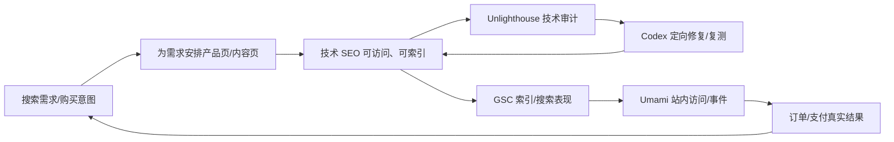

# SEO 专题知识与免费工具选型｜讨论归档（2026-10-26）

> **定位**：第五板块《获客与用户增长》第二章 §2.4 的独立专题学习笔记与工具选型记录，面向跨境独立站、个人博客、Micro-SaaS、API 站。  
> **状态**：OWNER_REQUESTED_DISCUSSION_ARCHIVE / NON_FROZEN_SUPPLEMENT；不新增冻结章节、不变更正式教材题树，不代表网站已经完成审计、获得收录、排名或订单。  
> **核对日期**：2026-10-26。功能、费率、配额、运行要求随版本和套餐变化，操作前以各项目官方文档为准。  
> **现行课程链接**：[第二章《我该怎么找到客户？》§2.4](CHAPTER2_FINAL_SEALED.md)；[五板块总导航](../../README.md)。

## 0. 一页速览：结论、已保留项目和待选事项

**SEO（Search Engine Optimization，搜索引擎优化）的经营核心：让有需求的潜在客户在搜索时发现网站，进而访问、了解、询盘、注册或付款。**

SEO 不等于购买搜索广告：自然搜索通常不向搜索引擎支付每次点击费，但需要内容、技术维护、分析及时间投入；收录和排名没有保证。付费搜索广告可以购买展示/点击机会，停止投放后相应广告流量通常也会停止。

**本轮明确保留的 3 个工具：**

| 工具 | 对应职责 | 使用形式 | 成本 | 当前决策 |
|---|---|---|---|---|
| [Unlighthouse](https://github.com/harlan-zw/unlighthouse) | ② 技术 SEO 的自动检查（非一键修复） | Windows/本地 CLI；亦可自行云端运行 | MIT 开源，软件免费；本地运行无需 VPS | **保留，首选** |
| [Google Search Console](https://search.google.com/search-console)（GSC） | ① 已出现的真实搜索词 + ② 抓取/收录验证 + ⑤ 搜索表现 | Google 官方云端网页 | 免费，不需部署 | **保留，首选** |
| [Umami](https://umami.is/) | ⑤ 网站访问、来源、事件与转化分析 | 优先官方云端 Hobby；也可自托管 | 云端免费额度内 $0；自托管软件免费，但有基础设施成本 | **保留，首选云端免费版** |

**注意**：这是“三个工具被保留”，并非“SEO 的三个模块已经完全解决”。GSC 不是全网关键词发现器；Unlighthouse 不代替开发者修代码；Umami 无法独立证明某次具体订单由自然搜索产生。

**尚未最终选型**：③ 内容 SEO 辅助工具；④ 外部权威、真实引用与信誉建设工具。① 关键词研究也只被 GSC **部分覆盖**。

**低成本原则**：先不为 SEO 单独购买 VPS；Unlighthouse 需要时在 Windows 打开运行；GSC、Umami 先使用官方云端免费服务。内容和外链工具不为凑“每个模块都有软件”而强行部署。

---

## 1. SEO 到底解决什么问题：五模块与一条获客链路

**总问题：如何让潜在客户通过搜索引擎发现网站，并最终成为客户？**

| 模块 | 要解决的子问题 | 为什么会有这个问题 | 应采取什么动作 | 当前工具覆盖 |
|---|---|---|---|---|
| ① 关键词研究（Search Intent） | 客户到底搜索哪些词、意图是什么？ | 网站所有者用自己的语言描述产品，未必是用户真实搜索用语；搜索量大不代表购买意图强 | 研究目标国家/语言、真实搜索结果、长尾词、商业意图；按搜索意图安排页面 | GSC 可见已获得展示的查询，**不能完整发现尚未排名的市场需求** |
| ② 技术 SEO | Google 能否发现、抓取、渲染、理解并索引网页？ | 禁止索引、权限、JS 加载、服务器错误、孤立页面等会阻碍搜索系统 | 校验可访问性、robots/noindex、Sitemap、内链、Canonical、渲染、性能等 | Unlighthouse 检测 + GSC 验证；实际修复需插件/开发 |
| ③ 内容与页面 SEO | 页面为何值得在某个查询下出现并被点击？ | 标题、页面意图、内容质量和用户问题不匹配；竞品答案更好 | 为目标意图制作产品页/教程/对比/真实案例，写清标题、流程、证据、CTA | **待选型**；Yoast 免费版等只做有限辅助 |
| ④ 外部权威与信任 | 为什么搜索系统和客户更认可网站？ | 新站缺少真实口碑、引用、品牌认知与外部发现入口 | 真实经验、原创数据、合作推广、自然引用、真实评价 | **暂无可靠“一键建立信任”的免费项目** |
| ⑤ 数据与转化 | 搜索展示、点击，最后有没有带来注册/询盘/付款？ | 曝光、点击、订单、退款和利润不是同一个指标 | GSC 看搜索侧；Umami 看站内行为；订单/支付系统核实净收入 | GSC + Umami 为基础，付款还须订单数据 |

**推荐顺序**：研究需求 → 确保技术可抓取/可索引 → 建立对应页面 → 积累真实外部信任 → 测量并迭代。技术先修复阻断项；关键词研究和内容制作应彼此配合，不是“技术做完后才能研究用户”。

**① 与 ③ 为什么像重复？**  
① 回答“用户搜什么”：例如 `personalized birthday magazine`；③ 回答“你的哪个页面怎样满足它”：展示模板、上传照片流程、价格、成品、FAQ、制作入口。前者决定**值得争取的需求**；后者决定**交付怎样的搜索结果页面**。

### 1.1 SEO 与 SEM/PPC

- **SEO 自然搜索**：争取非广告搜索结果的位置，点击通常不收取搜索平台 CPC；前期慢、结果不确定、优质页面可能形成长期入口。
- **付费搜索广告**：通过预算、地区、搜索词等条件投放；通常按点击等计费，启动相对快但预算持续支出。
- **经营选择**：SEO 可作为长期可积累渠道，但不宜承担唯一的早期付费意愿验证；可与小额测试广告或直接客户验证结合，按实际产品决定。

---

## 2. 技术 SEO：Google 为什么可能根本找不到或读不懂页面？

把 Google 想象成图书馆：技术 SEO 负责让“书”被发现、打开、阅读、入库；不是让书自动排到借阅推荐第一位。

**典型流程**：发现 Discovery → 抓取 Crawling →（必要时）渲染 Rendering → 判断是否索引 Indexing → 查询时排序/展示 Serving。

**状态必须区分**：网站可访问 ≠ 被 Google 抓取 ≠ 被收录 ≠ 有查询展示 ≠ 有点击 ≠ 有订单。

### 2.1 具体故障场景与处理

| 场景 | 用户看到的现象 | 为什么发生 | 怎么排查、解决 |
|---|---|---|---|
| 1. 网站“把 Google 拦在外面” | 网页正常对用户显示，搜索却长期没记录 | 页面带 `noindex`，需要登录，或访问策略挡住 Googlebot | 在 GSC URL 检查查看索引原因；确认页面公开可访问；核查 noindex、HTTP 状态、防火墙/Cloudflare；`robots.txt` 主要管理抓取权限，**不是可靠的去索引指令** |
| 2. 人能看见，爬虫看不全 | API 单页应用在浏览器内容丰富，但抓取/render 后主要文本缺失 | 主要内容依赖客户端 JS、脚本失败、请求受阻或只在交互后加载 | 在 GSC 看渲染后的 HTML；为重要内容提供可抓取 URL、服务端渲染 SSR 或静态预渲染 SSG；允许必要的 JS/CSS 资源 |
| 3. 新页面是“孤岛” | 新增 30 篇文章，只有部分被发现 | 站内无入口/内链，URL 无外部引用，没有有效 Sitemap | 添加导航/上下文内链，生成并提交 `sitemap.xml`；检查目标 URL 能访问；**提交 Sitemap 不保证收录或排名** |
| 4. 抓取时网站故障 | 浏览器偶尔正常，Google 记录 5xx 或抓取错误 | 服务器不稳定、CDN/防火墙误拦截、错误跳转、DNS/TLS 等 | 修复 5xx/重定向链，检查服务器和 CDN 日志、可用性，并在修复后复查 URL |
| 5. 重复内容/首选 URL 混乱 | 多个网址显示近似页面，Google 选择了另一个版本 | HTTP/HTTPS、参数页、分页、重复落地页和 Canonical 冲突 | 统一导航链接和必要的重定向，设置正确 `rel=canonical`，检查 GSC 选择的规范页 |

技术检查项：`title`、`meta description`、`robots.txt`、`noindex`、`sitemap.xml`、Canonical、可抓取站内链接、HTML/JS 渲染、HTTP 响应、Schema.org 结构化数据、移动端体验和 Core Web Vitals。标题与摘要是搜索结果呈现的**候选信号**，搜索引擎可自行改写；速度也不是排名的单一决定因素。

**一个重要澄清**：所谓“静态部署”不等于网页不能有动画。静态 HTML/CSS/JS 依然可以有丰富动效；SEO 关注搜索系统能否读到关键内容。Cloudflare 托管静态前端和做好 SEO 不冲突。

**实操优先检查顺序**：站点能访问 → 核查禁抓/禁索引 → GSC URL 检查 → 检查渲染和内链/Sitemap → 批量跑 Unlighthouse → 修复后再检查。不要因为 Lighthouse SEO 分数 100 就以为必然会有流量。

官方参考：[Google SEO 入门](https://developers.google.com/search/docs/fundamentals/seo-starter-guide)、[开发者 SEO 指南](https://developers.google.com/search/docs/fundamentals/get-started-developers)、[Sitemap 说明](https://developers.google.com/search/docs/crawling-indexing/sitemaps/overview)、[Search Console URL 检查](https://support.google.com/webmasters/answer/9012289)。

---

## 3. 内容 SEO：为什么被收录，依然没有排名、点击和客户？

把 Google 当成书店：技术 SEO 解决“能入库”，内容 SEO 解决“有人寻找某个问题答案时，为什么推荐这一页”。

| 具体场景 | 错误示范 | 真正的问题 | 如何解决 |
|---|---|---|---|
| 1. 名称不符合用户语言 | 页面只有 `Welcome to Birthday Studio`；用户搜 `create personalized birthday magazine` | 用户和搜索系统无法清晰判断页面在提供什么 | 用描述性标题、清晰正文、产品能力和价格，让页面直答搜索意图 |
| 2. 内容只是宣传 | 用户搜“如何在线制作生日杂志”，页面却只有“我们是最好的服务” | 没有回答做法、样品、时间、成本、限制 | 提供制作步骤、截图、实例、模板、预览、定价及 FAQ |
| 3. 大词竞争过强 | 新站只有一篇泛泛的 `Best Birthday Gifts` | 知名媒体和成熟电商已有大量高质量候选页 | 先做更具体的长尾需求，如“送男友的个性化生日杂志”，用真实产品特色竞争 |
| 4. 页面类型错配 | 用户想“马上购买”，进来却是万字理论文章 | 信息需求与交易意图混淆 | 比选/教程给文章页；价格、规格、试用、支付入口给产品页 |
| 5. 批量同质化内容 | AI 一次生成数十篇换词文章，内容相似、无实测 | 缺少原创经验和新增价值，可能不符合搜索质量要求 | 少而精：真实研究、测试、案例与清晰的目标用户场景 |

**搜索意图常见三层**：信息型（what/how）→ 商业比较型（best/vs/alternative/review）→ 交易型（buy/pricing/create/order）。不意味着所有用户严格按这三步走。

**要记住**：内容 SEO 不等于频繁发文章、关键词堆砌、把全部目标词塞进每一个页面。真正的对象是用户搜索需求和页面提供的答案。

**当前内容工具候选**：[Yoast SEO](https://github.com/Yoast/wordpress-seo) 的 WordPress 免费版能提示目标关键词使用、可读性、标题/描述等；[The SEO Framework](https://github.com/sybrew/the-seo-framework) 偏重轻量自动化技术配置，内容分析较依赖特定扩展。两者都不是跨所有站点自动判断“内容是否真正有竞争力”的通用方案。**内容 SEO 工具仍未定案**。

---

## 4. 工具全集：本轮讨论过的八个项目

**分类规则**：
- **检测工具**发现风险，不自动修改网站；
- **配置工具**为对应 CMS/框架生成 SEO 信息；
- **监控工具**追踪搜索效果，不能代替内容创作。

| 开源项目 | 主要问题 | 怎么解决 + 额外能力 | 免费范围 | 可能付费/限制 | 怎么用 |
|---|---|---|---|---|---|
| [Unlighthouse](https://github.com/harlan-zw/unlighthouse) | 网站有多少 SEO/性能问题不知道 | 自动枚举/抽样网页，调用 Lighthouse，汇总 SEO、性能、可访问性报告 | MIT；本地 CLI 免费 | 运行机器/浏览器资源；本体不提供“付费才能修复”的功能 | Windows 安装 Node.js 后运行 `npx unlighthouse --site https://example.com`；把报告交 Codex 定向修复 |
| [The SEO Framework](https://wordpress.org/plugins/autodescription/) | WordPress 各页面 SEO 配置繁琐 | 自动标题、描述、Canonical、Robots、Sitemap、基本 Schema/分享标签；支持 WooCommerce | WordPress 免费插件及免费扩展 | Focus、Monitor、Local 等部分扩展要付费；2026-10-26 官网 Pro 价格 **$7/月按年付、2 站点** | WP 后台安装启用 → 检查全局设置 → 产品/文章页按需覆写 |
| [Yoast SEO](https://github.com/Yoast/wordpress-seo) | WP 内容如何围绕目标查询编辑 | 编辑器关键词、可读性建议、标题/摘要、Sitemap、Schema | 核心插件免费开源 | 多目标词、内部链接建议、重定向、部分 AI 辅助等 Premium；2026-10-26 官网标 **$118.80/年（未税）/站点** | WP 后台启用 → 为文章指定目标词 → 按分析建议人工修改 |
| [SerpBear](https://github.com/towfiqi/serpbear) | 关键词在 Google 的位置如何变化 | 定期调用搜索结果抓取 API 或自有代理，监测排名、历史曲线、通知；可接 GSC、Google Ads 研究 | 应用代码开源，可 Docker/本地自建 | **取 Google SERP 数据不保证免费**；抓取 API、代理可能收费。官方文档示例含部分第三方免费额度，额度会变 | 部署 → 添加域名/国家/关键词 → 选抓取服务 → 定期复查 |
| [sitespeed.io](https://github.com/sitespeedio/sitespeed.io) | 网站慢在哪里？ | 真实浏览器测试、Core Web Vitals、加载录像、HAR 瀑布图、长期性能监控 | 免费开源，本地/Docker 可用 | 持续监控时的计算、数据存储或第三方服务成本 | Docker 或 Node 运行 → 阅读 HTML 报告 → 修复慢资源 |
| [Lychee](https://github.com/lycheeverse/lychee) | 网页/Markdown 中隐藏很多 404 或失效链接 | 批量检查链接和邮箱地址，支持报告、GitHub Actions、Docker | 免费开源 | CI 运行资源与托管平台额度；特殊网站可能阻止检测 | `docker run --rm lycheeverse/lychee https://example.com` 或扫描项目目录 |
| [Nuxt SEO](https://github.com/harlan-zw/nuxt-seo) | Nuxt 网站每项 SEO 都要手写 | 集成 Robots、Sitemap、Schema.org、Meta、OG 图片、链接检查等 | MIT，Nuxt 模块免费 | 独立 Nuxt SEO Pro 监测服务官网标 **$59/月起、5个站点**，查看实时销售状态/候补；不影响免费模块 | **仅 Nuxt 技术栈**：`npx nuxt module add seo` |
| [Halo Sitemap](https://github.com/halo-dev/plugin-sitemap) | Halo 网站缺少 Sitemap | 自动提供 `/sitemap.xml`，便于搜索引擎发现 URL | GPL-3.0，官方免费插件 | 不包括完整 SEO 审计和内容优化；当前插件要求 Halo ≥2.22.7 | Halo 应用市场装 Sitemap → 访问 sitemap 地址 → 可提交到 GSC |

### 4.1 两个易混淆点

1. **Halo 完整 [SEO 工具集](https://www.halo.run/store/apps/app-FNGbT)** 与免费的 Halo Sitemap 不是同一个插件。前者提供抓取日志、页面分析、重定向、Schema 等更多功能，但官网标为 **Halo 专业版/商业版专享**；没有选为当前免费方案。
2. **Yoast SEO 与 The SEO Framework** 都是 WordPress SEO 插件，通常只装其中一个，不应重复输出规范链接、站点地图及 Meta 标签。Nuxt SEO 只属于 Nuxt 生态，不能直接给 Halo/普通 React/Next.js 站当通用插件。

### 4.2 第二组：非“开源 SEO 项目”但实用且免费

| 服务 | 做什么 | 免费/部署边界 |
|---|---|---|
| [Google Search Console](https://search.google.com/search-console/about) | 网站所有权验证；URL 检查；索引、查询、页面、国家、展示、点击、CTR、平均位置 | Google 官方**免费云端服务**；不需要本地/VPS |
| [PageSpeed Insights](https://pagespeed.web.dev/) | 在线快速检测单个网页的速度和 Lighthouse 类指标 | 免费在线，无需安装；与 Unlighthouse 全站批量审计不同 |
| [Umami Cloud](https://umami.is/pricing) | 网站访问、来源、事件、转化与行为分析 | 2026-10-26 官方 Hobby **$0/月：1 个站点、每月 100,000 事件、6个月数据保留**；Pro 标 **$20/月起**，包含更多站点、事件与 API 等 |
| [Umami 自托管](https://github.com/umami-software/umami) | 自己持有统计系统 | 开源软件免费；若要服务器常驻，部署及维护有成本 |

**不要混淆数据口径**：GSC 的“展示”是在 Google 搜索结果中被看到；Umami 的“访问”是已经进站的行为；付款是否成功、退款是否发生要核对支付/订单系统。某些统计可能因同意机制、广告拦截或时区而存在差异。

---

## 5. 最短使用方法：不买 VPS，先跑通前三个工具

### 5.1 Unlighthouse：在 Windows 本地扫描

1. 安装满足项目要求的 Node.js（核验时要求 **≥22.18.0**）；确保可运行 `node -v` / `npx -v`。
2. 打开 PowerShell：
   
       npx unlighthouse --site https://example.com

3. 等待本地浏览器报告，先看影响抓取、索引和重要产品页的异常，另看性能、可访问性。
4. 把问题清单交给 Codex：明确“仅修有证据的问题；输出受影响文件和验证步骤；不得改动现有业务支付逻辑”；部署变更后再次扫描。
5. 扫完关闭本地进程；**不需要购买 VPS，不需要电脑长期开机**。多站点按需逐个跑。

**局限**：它主要做 Lighthouse 类审计，不是 Google 实际索引数据库，也不能保证排名或自动生成高质量营销内容。需要在线只测一页时，用 PageSpeed Insights 更省事。

### 5.2 Google Search Console：官方免费云端

1. 登录 [Search Console](https://search.google.com/search-console)；添加站点/域名资源。
2. 按流程进行域名所有权验证（例如在 Cloudflare DNS 中增加 Google 要求的 TXT 记录；验证后保留记录）。
3. 在 URL 检查工具逐个查首页、核心产品页、重要文章：被抓取？被索引？规范页面是谁？是否有错误？
4. 有 Sitemap 时在对应功能提交地址（如 `https://example.com/sitemap.xml`）；查看状态，**提交不等于一定会索引**。
5. 使用效果报告按查询、页面、国家、时间查看展示、点击、CTR、平均排名；刚建站没有数据时先确认索引与时间窗。

**使用方式**：直接网页使用，不安装、不部署、不买服务器。它报告的是网站自身已经出现在搜索中的查询，不能作为“所有潜在关键词需求”的完整列表。

### 5.3 Umami：先用官网云端免费套餐

1. 注册 Umami Cloud Hobby。
2. 创建 1 个网站，获取统计脚本。
3. 将脚本接入网站允许修改的前端模板/页面；发布后打开网站检查是否产生访问事件。
4. 按需定义表单提交、开始结账、完成订单等事件；真实购买需与订单/支付侧交叉验证，避免把按钮点击当成交。
5. Hobby 超出适用的网站数/事件量/保留期或需要高级 API 等功能时，再比较 Pro 与自托管的总成本。

**与 GSC 分工**：Search Console 看“怎么从 Google 找到”；Umami 看“进站后做了什么”。先不自建 Umami 服务。

---

## 6. 针对已有三类网站，应该怎么配

| 网站技术栈/项目 | 推荐组合（前期） | 为什么 |
|---|---|---|
| **Halo 个人博客** | Halo 官方免费 Sitemap + Unlighthouse + GSC；按需接 Umami | 先实现网页发现、检查、真实索引与流量观察；不购买 Halo 专业版工具集 |
| **WordPress + WooCommerce（生日杂志等）** | The SEO Framework **或** Yoast 免费版 + Unlighthouse + GSC + Umami | 插件处理 SEO 基础配置；扫描检测遗漏；查询与订单闭环另做 |
| **SPW API / 其他自定义前端** | Unlighthouse + Codex + GSC +（按需 Umami） | 按原框架修复；若技术栈是 Nuxt 再考虑 Nuxt SEO；若是 Next.js/Astro 使用对应原生 SEO 配置，别盲装 Nuxt 模块 |

**优先级**：先让重要网页能索引、能解决用户问题，再考虑持续运行 SerpBear 或复杂 sitespeed.io、Lychee 监控；工具不能代替内容商业价值判断。

---

## 7. 建议的可复用 SEO 工作流与最小验收

**最低可交付证据**：
- 页面 URL、核验日期、目标国家/语言、目标查询、页面类型；
- GSC URL 状态：可访问/可抓取/已索引/展示/点击——分别记录；
- Unlighthouse 报告及每项问题的“修复前/修复后”对照；
- Umami 访问与已定义事件；有付款时对照实际订单/退款/实收；
- 结论：下一轮是“修技术阻断”、“补内容”、还是“目标词没有需求/需要重新定位”。

**四周的学习/起步安排（不是效果保证）**：
- 第 1 周：GSC 验证、Sitemap、URL 检查、Unlighthouse 找出高优先级技术问题；
- 第 2 周：从目标市场搜索结果、GSC 与真实用户讨论收集候选词，筛出 3–5 个优先意图；
- 第 3 周：制作/改造关键产品页、真实案例、FAQ、教程；检查移动端、标题、内链和技术指标；
- 第 4 周：对照搜索曝光、点击、注册和订单，决定下一轮修改；新站可能尚无足够统计数据，别把零展示直接当内容失败。

**用于经济性判断的示意算式（MODEL_ASSUMPTION）**：
- 月自然搜索点击 ≈ 搜索展示量 × CTR；
- 月订单 ≈ 自然搜索有效访问 × 付费转化率；
- 对应贡献毛利 ≈ 订单数 × 每单贡献毛利（仍要另外扣 SEO 的制作和维护投入，并处理退款）。
- 假设展示 10,000、CTR 3%、付费转化率 2%、每单贡献毛利 20 美元，则约 300 次点击、6 笔订单、120 美元贡献毛利；**只是数学演示，不是流量、排名或营收预测**。

---

## 8. 开源与付费边界：为什么“免费”不能只看 GitHub

1. **工具开源免费** ≠ 对应数据源/API 免费。例如 SerpBear 可以免费部署，但 Google SERP 抓取服务可能收费。
2. **SEO 插件免费版** ≠ 全部扩展免费。TSF、Yoast、Nuxt 的免费/高级模块需要分开判断。
3. **云服务免费层** ≠ 无限网站与无限保留。Umami Hobby 有站点数、事件量、保留期限制。
4. **本地运行免费** ≠ 云服务器需要长期常驻。Unlighthouse、Lychee、sitespeed.io 可按需运行，GSC 已是云端服务。
5. **“自动检测”不等于“自动解决”**。Unlighthouse、sitespeed.io、Lychee、SerpBear 主要输出问题或指标；Codex/插件/人工需对目标站进行对应改动。
6. **技术 SEO 好** ≠ 一定被收录、排名靠前或成交。关键词、内容、竞争、信誉和转化必须另看。
7. **SEO 不能只做外链或买链接**。应优先真实引用、可靠内容和合法合规的品牌传播，不用批量购买低质外链。
8. **报价、配额和版本可变**。本文明确记录的是 2026-10-26 官方页面观察，实际订阅以付款页面为准。

---

## 9. 2026 年 AI 搜索：SEO、AEO、GEO 关系

- **SEO**：常规搜索结果中的可发现性与自然流量。
- **AEO**：让内容更容易直接回答具体问题。
- **GEO**：希望内容在生成式 AI 搜索/回答中得到合理引用或可见性。
- **共通基础**：可访问、可索引、准确可信、结构清楚、有真实新增价值。Google 对 AI Overviews / AI Mode 的官方指导强调，基础 SEO 仍然适用；**无需为进入这些功能额外创建特殊标记或“AI 必备文件”**。
- **不建议**因为 GEO 概念流行就购买大量未经验证的所谓“AI 自动排名/自动引用”工具。AI 提及、传统展示、点击、实际付款应分开观察。

官方来源：[Google AI 功能与网站](https://developers.google.com/search/docs/appearance/ai-features?hl=zh-cn)、[Google 生成式 AI 搜索优化指南](https://developers.google.com/search/docs/fundamentals/ai-optimization-guide)。

---

## 10. 讨论决策记录：已定、未定、不要遗漏

| 讨论议题 | 当前结论 |
|---|---|
| SEO 核心是什么？ | 让搜索中的潜在客户找到网站；商业目标不是空泛浏览量，而是最终有效客户 |
| 技术 SEO 与内容 SEO 的区别？ | 技术解决“能否读到/索引”；内容解决“是否匹配需求、值得展示和点击” |
| 为何 Google 找不到网站？ | noindex/登录限制/爬虫拦截、JS 渲染缺失、孤立页/无入口、服务器故障、Canonical 冲突等 |
| 为何已经收录还没有排名？ | 内容与搜索意图不符、没有解答、竞争太强、交易页与文章页职责错配等 |
| 五模块已覆盖几个？ | ①部分、②有检测工具、⑤有分析工具，合计**3 个模块有初步工具对应**；③④未定。绝非三个模块完全解决 |
| 哪三个工具最后保留？ | Unlighthouse、Google Search Console、Umami（非八个项目全部保留） |
| 内容 SEO 工具有吗？ | 有 Yoast 等 WordPress 场景工具，但仍缺跨框架、能真正评价答案质量的通用免费方案；暂列待研究 |
| ①与③是否重复？ | 不重复：①选择市场搜索需求；③创造和优化解决该需求的页面；相互衔接 |
| 前两个项目如何运行？ | Unlighthouse：Windows 本机命令，按需开启，不常驻；GSC：官方免费云端，不需部署 |
| 第五模块怎么办？ | Umami 先采用云端免费 Hobby，暂不在本机/VPS 部署 |
| 当前是否要买 VPS？ | 为这套 SEO 起步链路**不需要**购买 VPS；正式网站自身的托管是另一个问题 |
| 后续最值得研究什么？ | ①尚未覆盖的长尾关键词/竞争机会研究，以及③内容 SEO 的免费、跨技术栈方案 |
| 什么时候加 SerpBear？ | 已有一批值得长期追踪的关键词、GSC 基础数据仍不满足需求时再部署 |
| Halo SEO 工具集是不是免费？ | 完整版是官方专业版/商业版专享；免费方案用官方 Sitemap + 通用检测工具 |
| AI 搜索是否要单独付费优化？ | 暂不需要；先把基础 SEO、独特内容与数据闭环做好 |

### 后续可独立研究的两个未完成方向

1. **关键词研究**：如何在网站几乎没有搜索数据时，免费发现目标国家的真实搜索词、商业意图、竞争强度与需求量；搜索量只是线索，最终要以用户询盘/付费验证。
2. **内容 SEO**：有没有跨 Halo / WordPress / 静态站的免费开源系统，可以做已有页面内容分析、目标关键词匹配、搜索意图检查、内链建议、竞品覆盖对比；注意不要假设 AI 批量产文能自动提高排名。

---

## 11. 官方资料与工具入口索引（2026-10-26 核验）

**Google 官方**：
- [SEO Starter Guide](https://developers.google.com/search/docs/fundamentals/seo-starter-guide)
- [SEO for Developers](https://developers.google.com/search/docs/fundamentals/get-started-developers)
- [Sitemaps](https://developers.google.com/search/docs/crawling-indexing/sitemaps/overview)
- [Search Console](https://search.google.com/search-console/about)
- [Search Console URL Inspection](https://support.google.com/webmasters/answer/9012289)
- [AI Features and Your Website](https://developers.google.com/search/docs/appearance/ai-features)

**本轮保留工具**：
- [Unlighthouse README](https://github.com/harlan-zw/unlighthouse#readme)
- [Search Console](https://search.google.com/search-console)
- [Umami 官网定价](https://umami.is/pricing) / [Umami GitHub](https://github.com/umami-software/umami)

**备选项目与定价来源**：
- [The SEO Framework 官方插件](https://wordpress.org/plugins/autodescription/) / [价格](https://theseoframework.com/pricing/)
- [Yoast SEO 开源仓库](https://github.com/Yoast/wordpress-seo) / [Premium](https://yoast.com/product/yoast-seo-premium-wordpress/)
- [SerpBear](https://github.com/towfiqi/serpbear) / [集成与数据采集费用](https://docs.serpbear.com/integrations/) / [Docker](https://docs.serpbear.com/deployment/running-locally-with-docker/)
- [sitespeed.io](https://github.com/sitespeedio/sitespeed.io)
- [Lychee](https://github.com/lycheeverse/lychee)
- [Nuxt SEO](https://github.com/harlan-zw/nuxt-seo) / [Pro](https://nuxtseo.com/pro)
- [Halo 官方免费 Sitemap](https://github.com/halo-dev/plugin-sitemap) / [应用商店](https://www.halo.run/store/apps/app-QDFMI)
- [Halo 商业 SEO 工具集](https://www.halo.run/store/apps/app-FNGbT)
- [PageSpeed Insights](https://pagespeed.web.dev/)

**关联教材**：
- [本板块 §2.4：搜索意图、内容/页面分工、长尾关键词、首次索引验收](CHAPTER2_FINAL_SEALED.md)
- [跨境业务知识库第五板块 README](../README.md)
- [共用实操附录 T2–T7](APPENDIX_OWNER_APPROVED_GROWTH_PRACTICE_V1_20261019.md)
- [来源与术语索引](SOURCE_REGISTER_AND_TERMS_20261019.md)

> **归档说明**：本文件是对 2026-10-26 一轮 SEO 教学、案例、开源工具及最终选择的整合归档；“待研究”表示尚无 Owner 确定方案，不擅自宣称已有成果或投入生产。课程框架、冻结章节与行政封板状态以现行唯一交接为准。
