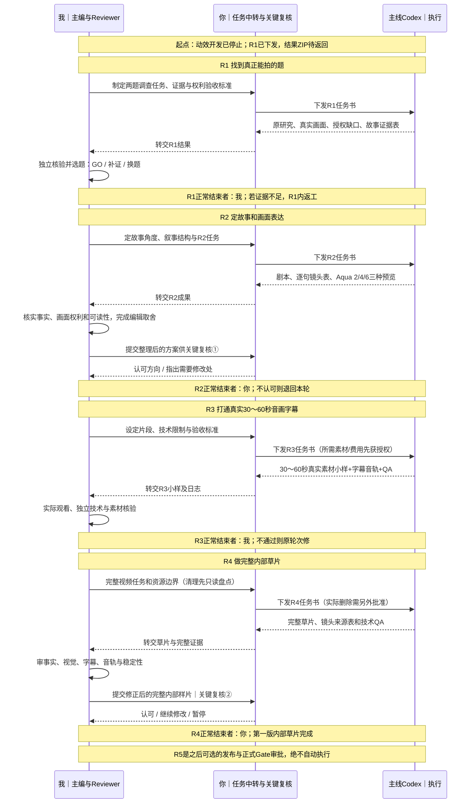

# Curious World Studio｜主线四轮任务流转泳道 v2（支线收尾后的目标流程）

> **2026-10-16有效进度覆盖历史时态**：R2编辑已PASS，R3内部音画样片Owner已授权但未执行，见[当前状态](CURRENT_STATE.md)、[当前R3 Gate](PROD_R3_CW0005_INTERNAL_AV_SAMPLE_GATE_2026-10-16.md)。下文“R1待结果”等为2026-10-11流程规划快照，不是待执行指令；R4/R5仍待单独许可。

> **更新：2026-10-11 · Owner 要求重新绘制“每一轮谁先、谁中间、谁最后，怎么转交”**。
>
> **当前实际进度（2026-10-11更新）：** MW-07 Genie最终精修已由Reviewer独立检查，为KEEP候选（Owner常速签收待完成），Mac支线停止新增开发；**主线R1任务已由Owner正式下发，正在等待Codex结果ZIP**。本图从支线收尾后的纯主线阶段画起；任务下发不代表完成，GitHub更新不会自动执行本地Codex。
>
> **预计最少 4 轮，交付内部可观看的第一支完整草片（非发布）**；受素材使用权、叙事可行性、音画测试、环境稳定性影响，可能额外返工。按原权限约定，Owner 主要做 **2 次正式内容复核**，费用、具体删除、外联、版权风险和发布/Gate 晋级等事项仍要额外单独批准。

## 一、3条主线泳道的实际任务交接（时间从上往下）

> **关键解释：** 图中的每一次“你转交”是当前工具条件下真实需要的传递动作：我会在聊天里给你任务书，你发给本地 Codex；Codex执行后你把结果贴回来，我再独立Review。**这不是要你替我决定选题或每句脚本**。不需要付费、外联等敏感授权时，日常编辑结论由我先作出。

## 二、每一轮谁先、谁中间、谁最后？

| 轮次 | 我先做什么 | Codex 中间做什么 | 谁最后拍板 | 本轮交付 |
|---|---|---|---|---|
| **R1 选题/权利** | 我指定对比角度、证据标准、候选优先级 | 核论文、找可观看的真实动作、逐片查使用权、三段叙事是否成立 | **我决定**GO/HOLD/换题；你仅中转 | 已审选题+素材风险清单 |
| **R2 故事/视觉** | 我决定故事角度、命题承诺、Aqua 2/4/6表现方式 | 剧本、镜头/旁白/出处逐句对齐、3个独立HTML视觉小样 | **你关键复核①**；我先审核再给你 | 一期完整制作蓝图 |
| **R3 小样/技术** | 我定义真实30–60秒片段与声画验收标准 | 已授权真实素材+云配音（如获允许）+单行字幕+合成QA | **我决定**通过或原轮返工 | 可实际观看/听的30–60秒片段 |
| **R4 完整草片** | 我决定节奏和镜头安排、负责完整交付标准 | 在清理盘点/必要授权后整合全片、来源台账、QA | **你关键复核②**；我先筛除重大缺陷 | 第一版完整内部视频草片 |

**每轮固定循环：** `我定义任务 → 你转交 → Codex执行 → 你带回 → 我审核 →（不通过就修改本轮）→（达到本轮准出标准才进入下一轮）`。R2/R4还需要你审美、方向和最终效果的额外复核。

## 三、最少轮次与条件分支

- **4轮是最短“内部完整草片”路径，不是硬性SLA，也不是4轮完成商用发布。** R1若两题均无可用合法画面，停在R1换题；R2审美或故事未通过，留在R2；R3音画同步/内存/版权出问题，留在R3；R4正式视觉/事实/权利不足，留在R4。
- **R1当前已由Owner下发，但结果尚未返回**：执行依据为 [P4_MAIN_R1_EDITORIAL_STORYFIT_RIGHTS_GATE_2026-10-11.md](../p4-g1/P4_MAIN_R1_EDITORIAL_STORYFIT_RIGHTS_GATE_2026-10-11.md)，只读比较 CW-0002大象与CW-0005爆米花；**现在无需重发任务，本次GitHub状态变更不代表R1执行完成。**
- **R2的Aqua规范已写、尚无实现**：[3＋1中的2/4/6轻量视觉语法](P4_VISUAL_GRAMMAR_3PLUS1_RESEARCH_AQUA_246_2026-10-11.md)。这些视觉示例不是另加4轮，是R2的**同一轮交付**。
- **支线完成后不再出现在这个泳道中**：本地MW07修复已下发但尚未完成；结果独立验收后封存Mac动效库，不开第三批；不自动把窗口动画放进正式B。
- **R4的清理权限**：先只读盘点CWS项目文件及证据保护，清理是否需要和是否删除具体项分开；**真实删除必须在执行之前由Owner批准精确清单**。不得为了赶轮次自行清理。
- **R5（可选、在R4之后）**：正式Gate / 版权终核 / 发布许可，不在4轮内部视频结果里，也不会自动开。

## 四、简明操作习惯

每轮我只向你发三件事：**①本轮Codex任务书；②我审核后的通过/退回结论；③当确实需要你审美或授权时的一页摘要/可看片段。** Codex的其他运行日志、文件哈希和细节由我阅读，不让你反复做Reviewer的工作。

**最新决策优先顺序**：已选 Research Aqua A/B、3真实素材渠道＋1只允许2转场/4布局/6信息字幕、默认真实16:9媒体、不能伪造科研证据、不能使用没有权利的素材；M2源码已合并但G1尚未正式PASS、G2未授权。本文只是交接流程，不提升任何正式Gate权限。
