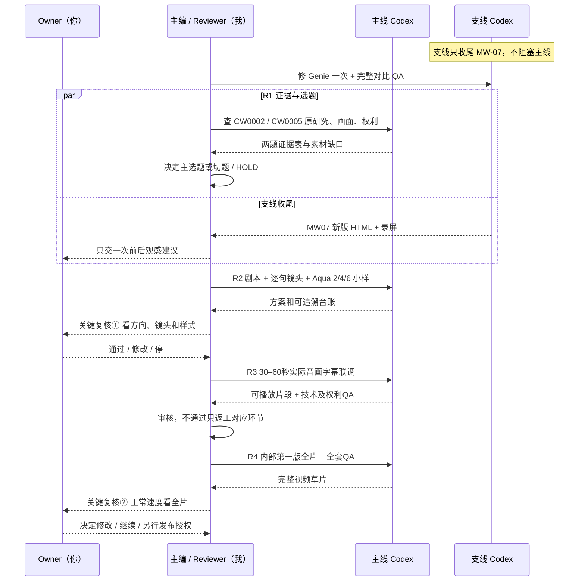

# Curious World Studio｜主线四轮协作泳道与审批分工 V1（2026-10-11）

> **Owner 最新协作决定**：「我们把支线修完，专心推主线」；「涉及决策类的事情，肯定要你来定，我复核」；希望知道**最少几轮**和每个人的职责。  
> **生效范围**：明确内容项目的协作和下一次任务的工作顺序；不赋予代理超出既有授权的付费、外联、版权豁免、删除、正式发布、绕过 G1/G2 或合并未经审查生产代码的权限。  
> **下游状态区分**：主线M2工程源码合并、M2候选视频QA，不等于正式一期G1 PASS；第一批Mac V2 Owner原则认可，第二批3个KEEP候选+MW07视觉HOLD，暂不正式加入B。已选STYLE_LOCK和3+1/2/4/6合同保持原样。

## 一、工作室角色（精简成4条泳道）

| 泳道 | 固定职责 | 有权直接做的决定 | 必须升级Owner/停机 |
|---|---|---|---|
| **我 / 主编兼 Reviewer** | 确定候选顺序、故事角度、视频节奏/信息密度、2/4/6画面策略与验收标准；审查Codex实际证据、决策GO/CONDITIONAL/HOLD、维护GitHub唯一状态 | 可自行裁决**编辑层**选择、对未达标准内容退回、根据客观资料从CW0002切换到CW0005；向Codex签发**已授权范围内**的只读执行方案 | 不能凭创意批准版权、付费/外联/删除/上传/发布、正式代码集成、G1/G2跃迁；重大范围变更交Owner |
| **主线 Codex / 执行** | 只按每轮任务书做原研究查证、候选镜头内容与授权台账、剧本时间线、正式Aqua视觉小样、音频/字幕与渲染QA；回报事实及阻塞 | 在任务明示范围内复测、只读检索、制作隔离小样、出证据清单 | 不自行选题晋级、不发“研究视频有权”结论、不越界下载/生成付费音频、不擅自进入正式生产 |
| **你 / Owner** | 仅复核我提交的关键方案与实际成片，偏好/审美/最终是否上线由你决定 | 默认不参加脚本每句和技术小修的日常选择 | **关键Gate审查**：第一阶段后的创作方案/真实版权及小样所需资源授权；最后的完整样片/发布决策。权利不明、要付费、联系机构或删除文件必须单独明确批准 |
| **支线 Codex / 动效库收尾** | 只做MW07 Genie局部精修，保留其他3项和首批历史证据，交Reviewer对比确认后收尾 | 独立HTML/QA证明；不得修改主线 | Owner最后看动画是否达到审美；没达到只修MW07，不继续无限添加模板 |

**单轮定义**：`我明确任务→主线Codex执行→我独立Reviewer检查和决定是否推进`，不是“聊天消息数”或本地编译次数。**默认用户只看两次重点成果**：①剧情/镜头计划候选，②第一版完整可看影片；若出现需许可/付费/发布/删除/法律争议，则增加额外授权节点。Reviewer做大部分编辑选择，Owner有最终复核权。

### 主线时序泳道（每个回合=执行+独立Reviewer）

## 二、最短四轮拿到一版能完整观看的内部样片（不是发布日期保证）

| 主线轮次 | 主线Codex具体交付 | Reviewer（我）如何取舍 | Owner何时介入 | 准出门槛 |
|---|---|---|---|---|
| **R1：选题+证据（只读）** | **CW0002大象** vs **CW0005爆米花** 一手论文/实际行为画面/链接/rights可追溯对照；按至少3个有效证据Beat列出素材缺口，含观众承诺和事实错误风险 | **我定优先题与反证**，据三关 `LINK_FOUND/CONTENT_VERIFIED/REUSE_RIGHTS_VERIFIED` 及视觉素材“能看见行为”判断 `STORYFIT_GO / CONDITIONAL / HOLD`；没有合法素材就换备选，不能假通过 | **通常不需要Owner微决策**；如两题均缺核心视频/版权，告知后调整范围 | 不是找到网址就算过；允许 `HOLD_ASSET_GAP` 并回到R1，不修改未审题库 |
| **R2：先做节目设计** | 预期观看收获、三次不同证据推进、完整旁白初稿、逐句`line_id↔beat↔shot↔rights↔subtitle`对照、**Aqua 2/4/6三个轻量HTML预览**，先不用未授权真实媒体 | 我敲定标题承诺/取舍，检查原文有无夸大、镜头是否替旁白服务；视觉和剧本可读再提交Owner | **第1次关键复核**：看一页企划+分镜/句子对照与2/4/6模板，确认方向/风格；凡需下载权利未知片、付费TTS也须单独授权 | 有三段独立推进、素材链、权益可查；A/B仅两状态、B满幅不遮证据、只用2/4/6 |
| **R3：可播片段联调** | 在允许的资源内做一个**30–60秒有内容的竖切测试片段（vertical slice，非竖屏视频）**：真实来源可用素材、既有Aqua壳、合适TTS或经授权云音色、严格单行中文字幕、FFmpeg/Remotion机器QA、证据索引 | 我独立检查真1×观看、旁白/字幕对齐、权利、音量、B画面可读、前次6x内存资源风险；技术或观感不佳就有限返工本轮 | **默认由我内部验收**；如云TTS调用收费/素材授权缺失，必须先获Owner明确授权，不能偷偷绕过 | 30–60秒足以证明整条音画和素材链可用，但**不自动宣布完整G1 PASS** |
| **R4：第一支内部完整草片** | 在正式生产前的CWS专属**只读清理盘点→如确需删除先获Owner精确批准**后，按R3已实测的模板制作**自然时长**的全片；附逐帧来源/版权/音画/字幕/机器QA、风险与回滚清单 | 我先做事实、视觉、动态、技术与版权报告，能修的编辑小问题让Codex返工；达标才提交Owner | **第2次关键复核**：Owner完整1×观看并给“保留/修改/停止”，另行决定是否进入发布/正式Gate | **`FIRST_FULL_INTERNAL_CUT_READY_FOR_OWNER`**，不是`PUBLICATION_APPROVED`或自动授权G2/G3 |

**最短情况**：R1首次即有清楚的行为素材和合法复用证据、R2剧本方向无大改、R3音轨+素材+字幕一次成功，**4轮拿到第一版能完整观看的内部草片**。发布需要**R5：Owner最终确认具体授权与平台发布证据/成片终审**，不能说“4轮自动上线”。这不是保证：研究录像许可未知、TTS费用/环境、既有第184帧偶发失败、并发内存压力，都可能使某轮返回 HOLD、加轮。不要用固定时间或视频时长勉强完成。

## 三、并行/顺序与首个实际指令

- **并行支线最后一次**：独立Codex只修MW07的视觉条带、自己保留原版；Reviewer复核并请Owner看改前/改后，签收即关闭整条Mac窗口动效新增线；其他三项保持KEEP候选待必要时实际看，**不启动Wave3，不影响主线R1**。
- **主线从R1立即推进**：先用【[P4_MAIN_R1_EDITORIAL_STORYFIT_RIGHTS_GATE_2026-10-11.md](../p4-g1/P4_MAIN_R1_EDITORIAL_STORYFIT_RIGHTS_GATE_2026-10-11.md)】做CW0002与CW0005的只读证据/影像比选；R1不收费、不下载无许可研究原片、不跑Remotion、不修改题库。
- **后续**：R2才把已出草案的 [Aqua 2/4/6正式B视觉语法](P4_VISUAL_GRAMMAR_3PLUS1_RESEARCH_AQUA_246_2026-10-11.md) 做三个简洁HTML。不要在R1先做无内容漂亮模板、也不要等支线四个全过才研究论文。
- **停机/切题规则**：一手事实不支撑标题、三证据节点不成立、真实核心行为片段不能证明被允许复用、或只找到“泛大象日常素材”却要冒充研究实录 → `HOLD / RETURN_ASSET_GAP`；Reviewer根据证据自动改看CW0005，不需要Owner手动每天决策。需要付费、版权豁免或外联，STOP请Owner。

## 四、可交接的一句话

`MAC_WAVE2_FINALIZE_MW07_ONLY_IN_PARALLEL / MAIN_R1_STORYFIT_RIGHTS_READONLY_NEXT / EDITORIAL_DECISIONS_REVIEWER_LEADS_OWNER_REVIEWS_MILESTONES / 4_ROUNDS_BEST_CASE_TO_INTERNAL_FULL_CUT / NO_AUTOMATIC_PUBLISH`。

**约束仍生效**：正式素材3＋1（研究原始/OpenMontage/yt-dlp获取+轻量2/4/6），1920×1080@30、Aqua A/B无C、字幕单行、无AI画实物/重复镜头/伪研究、M2/G1仍无正式PASS、G2未授权。任何更改都必须独立证据/Owner许可。
