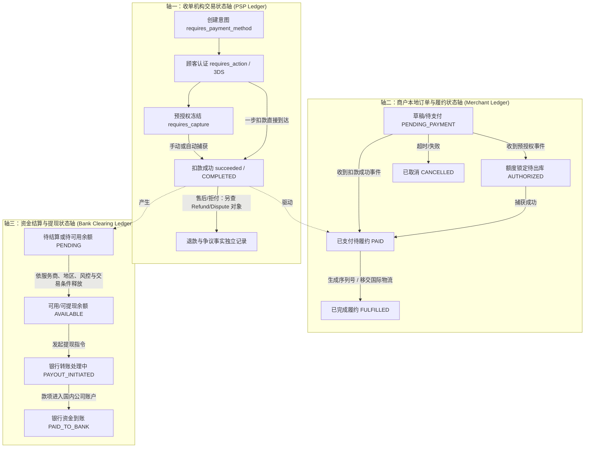
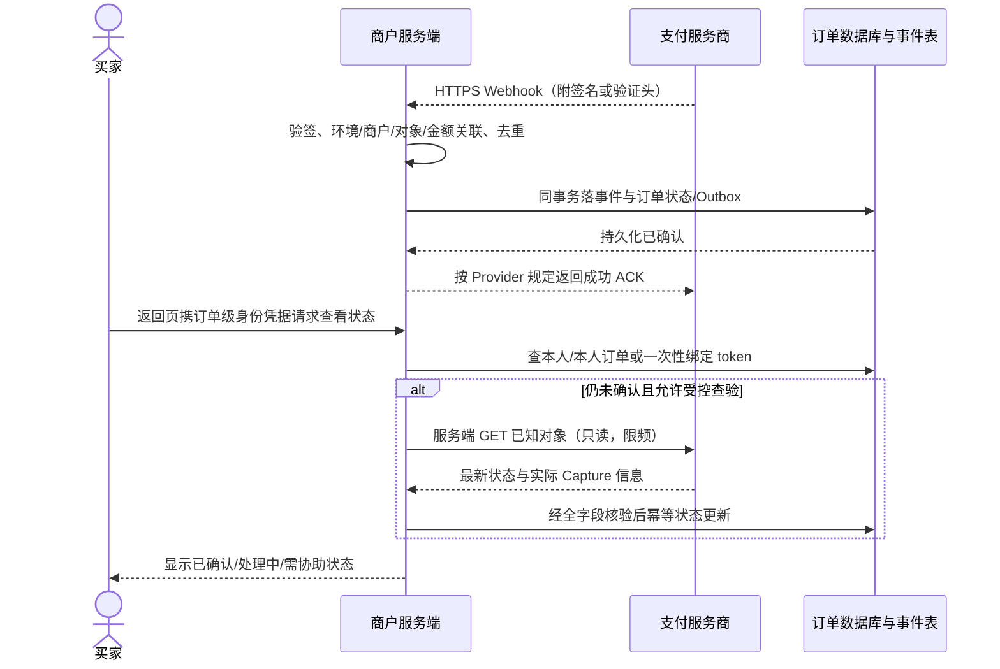
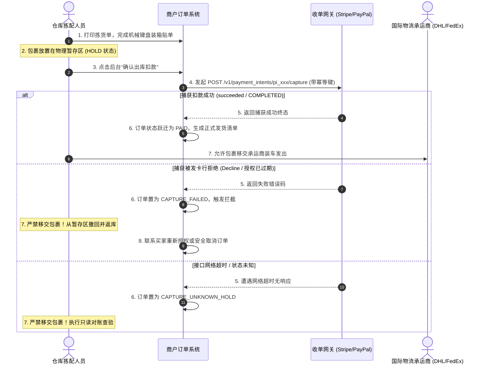
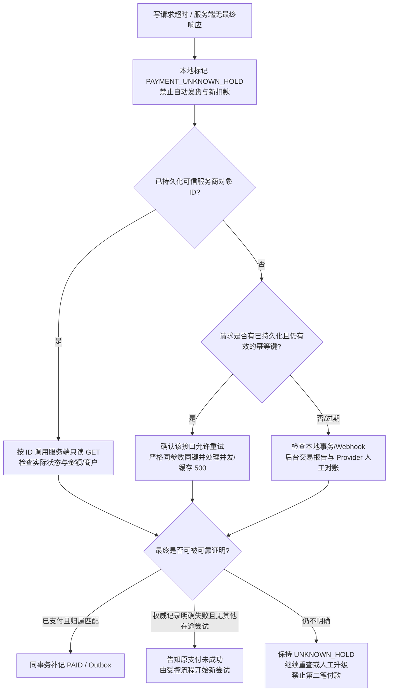

# 第四部分 支付处理｜如何确保每笔交易正确收款、不出差错？

## 引言：一笔跨国订单在技术后台的“真实接力赛”

在跨境商业经营中，许多刚起步的独立开发者和中小商家常有一种朴素的直觉：“顾客在结账页面点击付款，页面跳出了绿色的‘支付成功’提示，钱就肯定到账了，我就可以发货了。”

然而在真实的商业支付体系中，这种直觉潜藏着巨大的财务与资损风险。

顾客在浏览器前端点击“立即支付”按钮，仅仅是一场跨国技术与金融“接力赛”的发令枪。从买家在巴黎、旧金山或东京的手机屏幕上敲下指纹，到中国大陆卖家的独立站系统执行发货，数据报文需要跨越买家发卡行、卡组织跨境网络、收单机构防欺诈网关、商户 Webhook 接收服务器以及本地数据库。在这短短数秒到数十秒的链路中，任何一处网络丢包、并发竞态、超时重试或黑客篡改，都会导致“前端看似付款成功，网关却未扣款”或“网关明明扣了钱，本地系统却漏了单”的单边账困境。

在深入支付处理的底层逻辑之前，必须树立三条清晰的认知分水岭：
- **“前端浏览器跳转或参数提示”不等于“商户服务端确认收到支付终态”**；
- **“收单机构扣款成功（Captured）”不等于“资金已经安全提取至国内银行卡”**（资金最终清算与合规提现属于第五部分）；
- **“收到一条 Webhook 异步报文”更不等于“商品或服务已经可靠无误地交付给了顾客”**。

为了让讨论具备明确的商业推演依托，本章将继续延用前序章节贯穿的**两个互为镜像的假设商业情境**：
- **情境 A（纯软件/SaaS 出海）**：**深圳灵动软件工作室**。持有真实中国大陆有限责任公司执照（注：其实际海外收单账户开通与主体准入资质遵循第一部分，在此标为 UNKNOWN 待商户核验，本章假定其已具备收单通道），销售单价 29 美元买断工具或 29 美元/月订阅制。商品依靠在线即时生成激活码交付，重点应对“自动即时扣款、防 1 分钱篡改、防并发重复发码、按月订阅自动扣款续期”。
- **情境 B（高客单实物 DTC 品牌出海）**：**东莞极光工坊**。同样持有大陆企业执照（注：其实际海外收单与多币种设置属于 UNKNOWN 待商户核验，本章假定其已具备收单通道），自主设计分体式人体工学机械键盘（客单价 120 美元）。商品从大湾区直邮全球，涉及跨国物理运输，重点应对“在符合支付方式和授权期限条件时采用预授权、出库前确认捕获、缺货受控撤销以及网络超时状态核验”。

无论你是使用 SaaS 托管独立站（如 Shopify）、开源建站插件（如 WooCommerce），还是自主开发后端 API 的团队，本部分都将系统攻克交易处理中的四大核心关卡：
1. **状态流转真相**：理清收单网关、本地订单与资金清算三条独立状态轴，建立正确的交易时序认知；
2. **可信核验体系**：掌握防范“1 分钱篡改”与“沙盒假单混入”的双通道服务端核验准则；
3. **安全履约时机**：厘清数字发码、实物发货与循环订阅的触发条件，建立业务幂等与防重机制；
4. **异常排查手册**：建立防范重复扣款的三级屏障，掌握网络超时、单边账与退款争议的标准化处置规范。

---

## 1. 顾客点了付款按钮后，会发生什么？

### 1.1 付款显示处理中、已授权、已扣款或失败，分别是什么意思？

#### 核心概念的日常语言解析

当顾客在结账页输入卡号并点击提交后，支付网关后台的运作与日常商业体验高度相似：

1. **已授权（Authorized / Hold）**：
   - **日常比喻**：相当于入住涉外酒店或租车时，前台在你的信用卡上刷了一笔“预授权押金”。
   - **金融事实**：发卡行并未真正将这笔钱划拨给商户，而是在买家的信用额度中**暂时冻结**了这笔金额，在具体支付方式和授权有效期内为后续捕获提供条件，但不保证任意时刻或超期捕获都成功。在买家的手机银行账单上，这笔钱通常显示为“待入账（Pending）”。
2. **已捕获（Captured，不等于 Settled）**：
   - **日常比喻**：相当于离店退房时，酒店核对账单无误，正式刷卡结账，押金转化为真实消费。
   - **金融事实**：服务商确认已完成本次捕获或扣款请求；相关资金随后仍要经历清算、服务商余额分类、结算与提现，不能由 `Captured` 推断立即进入“可提现余额”或银行到账。
3. **处理中（Processing / Pending）**：
   - **日常比喻**：相当于跨行转账刚提交，或者买家在手机上被弹出的 3D Secure（3DS）短信验证码界面卡住，系统正在等待发卡行或本地银行清算网络的最终回执。
   - **金融事实**：支付尚未到达终态。**“处理中”不等于付款失败**，商家不得仅因前端等待超时就催促买家重新付款。
4. **失败（Failed / Declined）**：
   - **日常比喻**：POS 机提示“余额不足”或“交易被拒绝”。
   - **金融事实**：发卡行拒绝了该笔交易（如余额不足、触发风控拦截、卡片过期），或者买家在 3DS 认证界面直接点击了取消。应区分支付意图可更换付款方式继续付款与具体尝试已失败；以网关实际对象状态、订单关联及重试策略决定下一步。

#### 商业支付三条平行状态轴模型

在许多初学者的误区中，支付处理常被想象成一条单向直线的链条。但实际上，支付处理由**三条相关但相互独立的并行状态轴**构成，分别记录在不同的系统账本上：



- **轴一（收单机构交易状态轴）**：记录在收单服务商（如 Stripe [S01]、PayPal [S08]）的云端账本上，权威反映这笔交易在国际卡网络中的资金流转状态；
- **轴二（商户本地订单与履约状态轴）**：记录在商户的独立站或电商系统数据库中，权威反映商品库存、发票、激活码或物理包裹的交付进度；
- **轴三（资金结算与提现状态轴）**：记录在收单服务商结算余额与境内外银行之间，反映不同服务商、交易类型及风控条件下的余额释放与提现过程（本轴属于第五部分核心范畴）。

**核心商业认知**：
商户的履约动作（发货或下发软件序列号）是在**轴一到达扣款成功终态（`succeeded` / `COMPLETED`）后，触发驱动轴二由 `PAID` 跃迁至 `FULFILLED`**。这一动作发生时，轴三的银行资金到账往往还需要数天时间。绝不能等到银行资金落地国内才发货，更不能在轴一尚未确认为扣款终态前就盲目发货。

#### 不同支付对象的状态核验对照

必须先确认你比较的是**同一种对象**：Stripe `PaymentIntent` 是支付意图；Stripe `Checkout Session` 是收银台会话；PayPal `Order` 是订单意图；PayPal `Authorization` 是已批准的资金授权；`Capture` 才记录捕获结果。不同服务商的枚举值不能简单按同一行等号连接。[S01][S08][S09][S13]

| 阶段 | Stripe（PI 或 Checkout） | PayPal（Orders v2 / Payments v2） | 商家的决策 |
|---|---|---|---|
| 未付/待客户操作 | PI `requires_payment_method` / `requires_action`；Checkout Session 可能仍开放 | Order `CREATED` / `PAYER_ACTION_REQUIRED` / `APPROVED`（买家已批准） | 均不构成已捕获款项，不能直接发货 |
| 处理中 | PI `processing`；异步付款仍待完成 | 底层 Capture 可能为 `PENDING` | 保持等待，不认定失败，不催第二笔付款 |
| 已授权待捕获 | PI `requires_capture` 且捕获额度有效 | `AUTHORIZE` intent 的订单执行 **`POST /v2/checkout/orders/{order_id}/authorize`** 后产生 Payments Authorization 对象；核实其有效授权状态 | 可在商业安排允许时备货，仍未满足发货前的实际捕获条件 |
| 已捕获 | PI `succeeded` 或由 Checkout 对应 PI 确认成功；异步会话要再检查底层支付 | `CAPTURE` intent 走 `POST /v2/checkout/orders/{order_id}/capture`；`AUTHORIZE` intent 走 **`POST /v2/payments/authorizations/{authorization_id}/capture`**，检查返回 Capture `COMPLETED` | 再验证实收金额/币种/商户/唯一订单绑定以及风险规则；通过后才推进待履约 |
| 失败/撤销 | 依据 PI 当前状态及可否重试处理 | 不同 Order、Authorization、Capture 对象状态各异，不能统一映射 `VOIDED` | 分对象核查后停止或恢复，不把某个对象失败推断为所有请求失败 |

**PayPal 三步示例：** 买家批准订单（`APPROVED`）≠ 资金授权。`intent=CAPTURE`：创建订单→买家批准→调用 Orders Capture→读取底层 `captures`。`intent=AUTHORIZE`：创建订单→买家批准→调用 Orders Authorize→获得 `authorization_id`→调用 Payments v2 Authorization Capture→读取 `capture_id`/状态。需要校验 `purchase_units` 的 `reference_id`/商户 `payee.merchant_id`，以及**实际 captures 金额与币种**；存在多 `purchase_units`、分次捕获、退款/部分捕获时按照合同定义核对全体记录，不能只读数组第 0 项。[S08][S13]

**Stripe 两个对象：** Checkout Session 的 `client_reference_id` 与支付意图的 `metadata.order_id` 是不同字段；不可把 `client_reference_id` 当成 PaymentIntent 固有字段。取 Session 所关联的真实 PaymentIntent，核对其 `amount_received`、`currency`、`livemode`、服务商账户归属和实际状态。`checkout.session.completed` 不必然等于所有异步付款都已成功，异步类型须依据后续成功事件或可信查验确认。[S01][S05]

#### 两大商业情境的扣款模式取舍与前置条件

**决定是否采用 Manual Capture 的不是“软件/实物”这个标签，而是支付方式能力、授权可捕获期限、发货 SLA、平台功能和费用协议。** Stripe 官方列出的可分离授权方式包括卡、Affirm、Afterpay、Cash App Pay、Klarna 以及符合条件的 PayPal；部分银行扣款方式（例如 iDEAL）不支持。[S02] 手动捕获并非每个 Shopify/Woo 插件或商户账户都可用，应在商户管理后台和具体服务商产品矩阵核实。

| 判断步骤 | 深圳灵动软件（29 美元数字商品） | 东莞极光工坊（120 美元实物） |
|---|---|---|
| 买家付款后期望 | 通常即时获取许可或订阅权益 | 需要仓库拣货、质检、打包，再交承运人 |
| 默认业务建议 | 支持的渠道采用即时捕获，待成功核验后发码 | **两种方案都可行**。若库存可靠且支持合规先收费，可即时捕获；若可控地先备货后扣款且支持授权，才考虑延迟捕获 |
| 若选择延迟捕获 | 应说明何时真正捕获，通常不适合即时数字交付 | 必须在网关可读的实际到期时间前捕获（Stripe 卡交易可参考 `capture_before`）；错过时须重新取得合法支付授权，不能强扣 |
| 要求核验的限制 | 计费模式、产品权限、风控判定、交易环境 | 卡品牌与 CIT/MIT 分类、不同钱包/BNPL 规定、支持的分捕获、履约时限、授权期与延长条件、取消/退款成本、对账要求 |

Stripe 卡非现场交易一般有数日授权窗口，具体随品牌、持卡人发起/商户发起、地区及扩展授权而变化；部分 BNPL 也有独立规则，因此不能统一承诺“7 天”，更不能宣称“所有 BNPL 不支持”。PayPal 自有 Orders Authorize 流程有其授权窗口与优先捕获规则，与 Stripe 内集成 PayPal 的规则不一定一致。[S02][S09][S13]

**取消仅授权订单**：若确认仍在可撤销的授权阶段，按该产品接口取消/撤销；买家端额度恢复时间依发卡行决定。手续费是否返还、是否产生网络/平台费用，以具体合同为准，不能保证“取消一定零成本”。

**风险最小操作示例：** 极光工坊只在已经验证 Manual Capture 支持、仓库可在授权有效期内质检完毕、后台可识别 `capture_before` 的前提下，使用“预授权→包裹 HOLD→发起捕获→可信确认 Capture 成功→放行交承运商”。超时、失败、部分捕获或过期都维持 HOLD，先核验与处理差额，再决定补授权、调整订单或取消。

## 2. 如何判断交易是否真正成功？

### 2.1 应该查什么记录，才能确认这张订单确实付了多少钱？

#### 客户端“成功假象”与最高发漏洞剖析

在出海独立站的技术故障与被黑客攻击案例中，绝大部分资损源自**过度信任前端浏览器回传的数据**。

##### 漏洞一：防范“1 分钱篡改漏洞”（Amount Tampering）
- **黑客手法**：灵动软件的正常售价为 `$29.00 USD`。攻击者在结账表单提交时，截获并篡改 HTTP 请求参数，将待付金额修改为 `0.01` 美元。由于部分简陋自建系统未在服务端核对金额，收单网关顺畅扣除了 1 美分并返回成功，系统直接下发了价值 29 美元的正版软件。
- **防御准则**：服务端核验必须将网关回传的实付金额与本地数据库的应收金额做严格强比对：
  $$ \text{网关实付金额 (amount\_received)} == \text{本地数据库应收金额 (expected\_amount)} $$
  若存在哪怕 1 美分的微小偏差，系统坚决不予发货，立刻挂起订单进入欺诈审计流程。

##### 漏洞二：防范“币种套利漏洞”（Currency Mismatch）
- **黑客手法**：攻击者将结算货币从 `USD` 篡改为 `JPY`（日元）。收单网关扣除了 `29` 日元（折合实际价值不足 0.20 美元）并回传扣款成功。
- **防御准则**：必须校验币种字段：`currency.toLowerCase() === 'usd'`。金额与币种必须作为不可分割的复合体同步核验。

##### 漏洞三：防范“沙盒测试假单混入生产”（Environment Spoofing）
- **黑客手法**：攻击者利用收单机构公开的测试密钥或伪造的沙盒环境凭据，向商户生产环境发起支付请求或模拟 Webhook 投递。
- **防御准则**：服务端在生产环境处理通知时，必须严格校验报文环境标识（如 Stripe 报文中的 `livemode === true` [S01]）。若 `livemode` 为 `false`，生产系统直接丢弃并告警。

##### 漏洞四：防范“串单与重放盗刷”（Order Replay & Cross-claiming）
- **黑客手法**：黑客自行真实支付了 29 美元购买了一份授权，拿到合法的网关流水号 `pi_123`；随后伪造请求，将该流水号提交给系统中的另一张未支付订单 `ORD-888`，试图骗取第二份软件。
- **防御准则**：本地数据库订单表必须在网关流水号字段上建立**唯一索引（UNIQUE KEY）**。当第二笔订单尝试绑定相同的 `pi_123` 时，数据库将直接抛出唯一键冲突异常，阻断冒领。

#### 区分不同收单机构的接口权威字段契约

| 核验对象 | 关键身份与金额字段 | 真正要核对什么 |
|---|---|---|
| Stripe `PaymentIntent` [S01] | `id`、`metadata.order_id`（由服务端设置）、`amount_received`（最小货币单位）、`currency`、`livemode`、`status` | 该账户、该环境、该订单的实际支付对象是否成功，实收是否满足约定应收金额（考虑合法部分支付/退款的特殊业务规则） |
| Stripe `Checkout Session` [S05] | `id`、`client_reference_id`、`payment_intent`、`payment_status`、`amount_total`、`currency` | 会话是否对应本地订单，关联的 PI 是否达到**适合该支付方式的成功终态**；不能把会话 ID 当 PI ID |
| PayPal `Order` [S08][S13] | `id`、`intent`、`purchase_units[*].reference_id/custom_id/payee` | 买家批准与商户真正捕获要分开；订单归属与商户 `merchant_id`、币种和订单映射不冲突 |
| PayPal `Authorization` + `Capture` [S13] | 授权 ID、Capture ID、`status`、`amount.value`/`currency_code`、`final_capture` 等依 API 版本和交易类型的字段 | 按全部实际 capture 记录核对扣款终态、金额与币种，不使用 `purchase_units[0].amount` 代替实际支付数 |

以服务商实际返回的当前 API 版本及商户合同为准，不将某个字段的存在推断成自动履约许可。金额对账先使用服务端固定报价和实际捕获记录，再处理合法折扣、部分捕获或税额差异；`1 分钱` 攻击意味着金额小于服务端应收时必须拒绝交付，异常资金另按退款流程处理。

#### 架构协同：两条互补可信通道与前端回跳防护



**Webhook 是公网 HTTPS + 消息签名或服务商验证机制，不是“私有专线”也不是“用签名加密了正文”。** Stripe 通常验证 `Stripe-Signature`；PayPal 按官方要求校验签名头、证书或其验证接口，并绑定正确的 Webhook ID。[S05][S11] 校验签名之后还必须检验账户/环境、订单关联、金额币种、允许的状态转换与事件去重；在本地提交成功（或识别已提交的重复事件）后才按服务商要求 ACK。通知可能重放、乱序或延迟，需有后台定期对账与补偿查询。

返回页不是付款证据。**游客购买**可用不可预测、短期有效、订单绑定的查询凭据，而不是必须让买家事先注册。对登录态与游客 token 均要求订单归属校验、限频、防枚举；前端传来的任意支付 ID 不可用于领取他人商品。若平台自带插件或 MoR 代为核验，应在其后台确认“实际付款”及对应交付记录，必要时抽检失败和补发测试，不能只看到“结账成功”就假定全部自动可靠。

---

## 3. 怎么确保付钱之后，商品或服务正确交付？

### 3.1 什么时候发货、开通服务或续订权益，才不会弄错？

#### 三类典型业务形态的履约时机准则

不同业务形态对履约时机与交付动作的安全要求存在本质区别：

##### 1. 数字单次售卖（灵动软件 29 美元买断工具）
- **触发时机**：收单网关确认 `succeeded` / `COMPLETED` 终态到达；
- **交付动作**：本地原子事务核销激活码库存，将订单置为 `PAID`，并通过发件箱异步向买家邮箱投递 License 激活码。

##### 2. SaaS 循环计费订阅（灵动软件每月 29 美元）：按真实订阅和已付账期授权

固定把 `expire_at += 30 天` 会受月份长度、重试和补缴影响；但也**不能**把 `invoice.lines.data[0].period.end` 当作任何账单的统一会员到期时间：首行可能是一次性费用、折算调整或另一产品，invoice line 字段路径还会随 Stripe API 版本变化。[S07][S14]

安全做法是把**客户、subscription、invoice、与目标权益有关的订阅项/产品、账期、服务商事件**都保存在本地，且通过服务端核验：

1. 以服务端收到的 `invoice.paid` 等受支持事件作为触发**重新核验**的信号；确认该 invoice 已结清，关联的 subscription 确为预期商户、客户、计划和状态；Stripe 官方示例对发放权限会核对订阅 `active` 状态，试用、暂停、欠费及取消场景须按产品政策逐项处理。[S07]
2. 从**与所购权益/订阅项真实关联的账期或 entitlement** 推导服务可用范围，而不是取第一个账单行；对 proration、多个订阅项、免费试用、账单信用额、升级降级、补缴与取消分别定义规则。字段路径与状态名称使用固定的实际 API 版本验收。
3. 同一 invoice ID/事件 ID 与某一权益期建立唯一记录；数据库事务内采用受控状态转移和版本/期末时间比较，**旧事件不可覆盖更晚的已核准权益状态**。重放只认作已处理，不能每次增加一个月。
4. `invoice.payment_failed` 不意味着“一定要宽限 3–7 天”，`customer.subscription.deleted` 也不是唯一降级信号。宽限、催缴、终止取决于商家产品政策和服务商当前 subscription 状态（如 `past_due`、`unpaid`、`paused`、`canceled`、`trialing`）及可用 entitlement；到期与撤销动作本身必须幂等并留下客服可查的凭据。

**两条反例：** 如果旧的 9 月付款成功事件在 10 月续费之后才送达，不得把 10 月权益缩回 9 月；如果某张账单首行是升级补差价，不得按其一段短暂折算期缩短整个会员服务。

##### 3. 跨境实物商品（极光工坊 120 美元键盘）：物理出库交接时序封闭
对于采用两步扣款的实物跨境电商，仓储出库与捕获接口必须遵循严格的先后时序：



**实物履约安全红线**：
严禁在仅打印了物流面单或生成了运单号后就直接将包裹交接给承运商！**必须且只能在网关 Capture 接口返回确凿的成功终态（或 Webhook 确认扣款入账）后，才允许向国际快递承运人移交实物包裹**。若捕获遇到失败或超时，包裹必须留在商户暂存区实施拦截，防范货物与资金双重两空的重大资损。

---

#### 商家责任边界与工程实现分层架构

针对不同经营形态的商家，其底层履约与防重设计的责任边界存在清晰分工，不可一概而论：

| 商家技术形态 | 代表系统 | 底层技术实现者 | 商家核心操作与日常巡检职责 |
|:---|:---|:---|:---|
| **托管独立站** | Shopify, SHOPLINE, BigCommerce | 平台负责其已承诺的托管交易处理；不代表所有插件/物流/外部履约自动有跨系统事务 | 1. 按支付方式、合同和后台功能设置授权/捕获，不能默认常规实物一律 Manual；<br>2. 检查订单财务状态、授权到期和发货事件日志；<br>3. 试测取消、重试与第三方插件错误的人工处理渠道。 |
| **开源建站 + 支付插件** | WooCommerce, Magento | 开源支付插件处理 API，商家自管主机运行环境 | 1. 确保服务器定时任务（如 WP-Cron）可靠运行，避免异步任务积压；<br>2. 检查 Cloudflare 等 WAF 防火墙未误拦截网关 Webhook IP；<br>3. 避免在结账高并发期间执行可能锁死 MySQL 表的大型备份任务。 |
| **自研后端开发** | 自建微服务 (Go / Node / Java / Python) | 商家技术团队完全自主实现 | 1. 负责 Webhook 密码学验签与防重放，严禁在本地存储 CVV 等敏感认证数据（SAD） [S12]；<br>2. 负责本地数据库事务状态机与 CAS 条件更新；<br>3. 负责可靠发件箱模式与下游履约业务幂等键控制。 |
| **名义销售商（MoR）** | Lemon Squeezy, Paddle（依合同核验） | MoR 按服务协议承担特定销售、税务、争议职责；开发者仍负责产品/交付/许可与自身义务 | 1. 核对 MoR 负责的地区、税种、拒付及退款条款；<br>2. 按 MoR 签名事件核对交易归属、金额与交付回执；<br>3. 记录退款/争议后是否需撤销权益，避免把“托管”误认为全部责任转移。 |

##### 自研团队必修：业务幂等与发件箱防重架构（面向开发者）

**支付成功、本地数据库提交和外部发码/物流/邮件是三份不同的证据。** 仅用 SQL `UPDATE ... WHERE status='PENDING'` 或 CAS 不能证明外部只执行一次；Worker 可能在下游成功但本地还没收到回执时崩溃。

最小可靠模型：

```sql
-- 示意：实际类型、外键、锁和金额校验按数据库设计补全
-- UNIQUE(provider, provider_capture_id)：一笔真实捕获不可认领多张订单
-- UNIQUE(order_id, fulfillment_kind, fulfillment_version)：同一订单权益只建一个交付意图
BEGIN;
-- 示例为 PostgreSQL 方言，要求事前已验证交易商户、订单、金额、币种及环境
WITH moved AS (
  UPDATE orders
  SET status = 'PAID', payment_id = :capture_id
  WHERE id = :order_id AND status IN ('PENDING_PAYMENT', 'AUTHORIZED')
  RETURNING id
)
INSERT INTO fulfillment_outbox(order_id, fulfillment_kind, fulfillment_version, state)
SELECT id, 'license', 1, 'READY' FROM moved
ON CONFLICT (order_id, fulfillment_kind, fulfillment_version) DO NOTHING;
-- 若 moved 为空，检查既有订单/支付/Outbox 真相，不新建外部履约意图
COMMIT;
```

Outbox 必须与本地订单状态在**同一事务**落库；Worker 对每个唯一意图追踪 `READY/IN_PROGRESS/CONFIRMED/UNKNOWN`、下游请求 ID、回执及尝试次数。数据库事务成功只意味着“可以派工”，不等于邮箱已收到或物流已发走。

- **下游支持原生幂等键**：使用其官方支持的 `Idempotency-Key` 或订单关联字段；同键同参执行，并在重放后核对服务商回执。不能凭空假设所有邮件、WMS、授权码平台都支持 `X-Fulfillment-Key`。
- **下游不支持原生幂等**：尽可能由**本地唯一库存与发码系统**先原子生成并永久关联激活码，同单重试复用同一份凭据；邮件可重发**同一封确认内容**但不重新消耗许可。仓储使用唯一出库指令、可查签收/出库回执和对账；若上次出库是否成功不明，订单转 `UNKNOWN` 人工核验，不能“先查不到再发一次”。
- **异常边界**：先查询实际下游结果并判定 `NOT_EXECUTED / CONFIRMED / UNKNOWN`；`UNKNOWN` 不重放不可逆交付。在日志中分别记录授权、扣款、本地提交、派工和外部回执，供售后撤权与重复出库调查使用。

---

## 4. 遇到重复扣款、漏单等付款异常怎么办？

### 4.1 顾客反复付款或网络超时，怎样避免重复扣款和重复订单？

#### 屏障一：接口幂等键只能降低重试风险，不能取代对账

商户 POST 创建、捕获或退款时应先在本地持久记录**稳定业务请求 ID、业务对象、完全一致的参数与幂等键**，按该服务商对应接口确认是否支持幂等与保留窗口。[S04][S10]

- Stripe `Idempotency-Key`：官方说明初次请求已开始执行时，结果（包括部分 `500`）可能被缓存；超过一定时间（一般至少 24 小时后可移除）旧键不能再当作防重复保障；参数校验尚未开始执行、同键并发冲突等情形不必然记录结果。[S04]
- PayPal `PayPal-Request-Id`：仅适用于具体受支持 API，保留时长可依接口不同；**同键并发可能第二笔失败**，同键重试仍需检查远端现态。[S10]
- 若初次 HTTP POST 在执行中断，成功与否仍为 UNKNOWN；网关对象 ID 已知时优先按 ID 只读查询，未知时先查本地可靠映射、Webhook 日志、服务商后台/事务报告，必要时联系 Provider 排查。

#### 屏障二：超时后的安全决策树



**不能把 Stripe Search API 查无结果当成“确证网关从未扣款”**：Stripe 官方说明搜索具有传播延迟，不能用于要求严格一致性的刚写入核验。[S15] 同样，Webhook 没到、幂等键过期、`500` 重放、同键并发冲突，都不构成未扣款证明。只有在核实原尝试已终结且不会晚到成功后，才能明确告知买家另行发起付款。买家界面优先显示“仍在核实”，并提供客服渠道。

### 4.2 出现付款与订单不一致时，如何查明原因并纠正？

#### 场景一：有支付流水，但本地无有效订单（Orphan Payment / 孤儿支付）
- **故障现象**：收单网关后台实实在在扣了买家 29 美元，但商户数据库中找不到该订单或订单仍显示为未支付。
- **常见根因**：买家扣款后立即关闭了浏览器；同时商户服务器刚好在该时刻遭遇部署重启或公网瞬断，导致网关推送的 Webhook 遭遇 502/503 错误未被成功接收入库。
- **标准化排查与补救步骤（严禁纯凭 Webhook 元数据盲目发货！）**：
  1. **发起权威只读查验**：提取该支付对象的唯一交易 ID（Stripe `pi_xxx` [S01] 或 PayPal Capture ID [S08]），由服务端向收单网关发起受控只读查询（如 `GET /v1/payment_intents/{id}`），核实该交易在网关账本上的真实状态确为 `succeeded` / `COMPLETED`，且实付金额与币种完全无误；
  2. **防重复认领校验**：在本地数据库中核查，确认该 `payment_id` 此前**未曾绑定到系统内任何其他订单**，防范同一笔扣款流水被恶意伪造的报文复用冒领；
  3. **已知待付订单的受控补录**：若报文关联的 `order_id` 在本地数据库中存在且处于 `PENDING` 待付状态，通过受控的管理事务，将已核验的 `payment_id` 写入订单，驱动状态机跃迁至 `PAID`，并补发序列号；
  4. **未知孤儿记录的人工核验**：若本地数据库完全找不到任何相关待付草稿记录，**严禁仅凭 Webhook 中携带的客户端未经验证的 metadata 盲目自动交付高价值资产**！系统应在数据库中生成一条受控的“待人工核验孤儿支付记录”，记录交易 ID、金额、买家邮箱与网关原始凭据，由客服人工核实买家身份后受控补建合规订单。

#### 场景二：本地订单显示已付款，但网关没有钱（Fake Success / 虚假发货）
- **故障现象**：本地数据库记录订单为“已付款”且软件序列号已发码，但收单网关后台没有任何资金入账。
- **常见根因**：接口安全防线被击穿！黑客伪造了前端跳转参数，或向未开启签名校验的测试 Webhook 接口发送了伪造的 JSON 报文。
- **紧急阻断与修复步骤**：
  1. 立即在内部管理后台**吊销（Revoke）**该订单下发的软件序列号或云端访问权限；
  2. 检查 Webhook 接口代码：**是否彻底落实了签名密码学校验？**（Stripe HMAC-SHA256 签名 [S05] 或 PayPal 证书链验签 [S11]，严禁在生产环境跳过验签）；
  3. 检查接口是否缺乏金额与币种强比对，修补漏洞并对历史订单进行全量审计比对。

#### 场景三：重复扣款、退款在途和银行争议

买家显示“两笔扣款”，先查看每笔是**待入账授权、真实捕获、被银行冲正、退款处理中还是正式争议**。银行界面出现两行未必是重复实际结算。必须以网关对象和卡组织/银行记录区分：

| 核验到的状态 | 应采取的行动 | 不能做的事 |
|---|---|---|
| 第二笔只是可撤销的授权，未实际捕获 | 通过适用产品撤销授权，解释持卡人待入账记录消失受银行控制 | 不要对未捕获授权再下达“退款”或保证立即解冻、零费用 |
| 第二笔实际已捕获且不应收取，尚无正式争议 | 根据商家政策及合同发起**一笔有唯一关联的原路退款**，保留退款对象 ID；跟进 pending/succeeded/failed | 不要同时发起多笔退款，也不要把请求受理当银行已入账 |
| 买家发起查询（inquiry）或正式争议（dispute/chargeback） | 先判定阶段、原因、截止日期、冻结/扣账事实、该款是否已退或在途，核对与服务商合同；若确实错扣且无申诉理由，可按流程接受，若证据支持则按规则回应或抗辩 | **不要统一规定“必须接受争议”**，不要在争议流程之外再次退款造成双退；费用是否发生、金额、可退性因产品地区而不同 [S06][S16] |
| 退款 `pending` / `succeeded` / `failed` | 根据网关真实结果与支付方式说明、补发凭证、失败后受控处理；等待发卡行记账并记录追踪号可用状态 | 不保证任何固定日期、金额一定到账，也不提供虚构参考号 |

**退款参考号和到账：** Stripe 退款可能显示为原扣款冲正，另一些退款有 ARN、STAN、RRN 等不同参考号，某些交易不支持 ARN；ARN 可能最多约 **7 个工作日**才可取得，不存在“第 3 天必有固定 23 位 ARN”的跨产品保证。[S06] 商家可第一时间提供退款 ID 和官方状态截图；参考号出现后再提供；长时间未到账需按支付方式、发卡行与服务商工单协查。**退款成功不代表银行立刻入账，退款失败也不能长期被当成已解决。**

**后续售后衔接：** 捕获成功后若又产生退款、争议或资金回拨，本地 `FULFILLED` 不会自动倒退；软件要检查合同和法律条件后撤销权益、实物订单保留发货证据和退货追踪，并按第⑥部分售后规则执行，避免直接删账掩盖历史。

---

## 5. 支付处理决策工具与排查手册

### 工具一：支付/履约状态对照表

| 服务商可信事实 | 本地状态建议 | 商家的行动 |
|---|---|---|
| 未付款、买家还在认证或仅 PayPal `APPROVED` | `PENDING_PAYMENT` | 不交付；展示仍待付款/授权 |
| Stripe PI `requires_capture` 或已取得 PayPal Authorization 对象 | `AUTHORIZED_HOLD` | 检查金额与可捕获期限，可拣货，不交承运人 |
| 任一相关对象 `processing`/`PENDING`，或超时无终态 | `PAYMENT_UNKNOWN_HOLD` | 不重新发起扣款，不交付，按可信对象与日志查验 |
| Stripe PI 已成功捕获或 PayPal Capture `COMPLETED`，并且商户/订单/实际金额币种与风险规则匹配 | `PAID` → 持久化履约意图 | 可按合同履约，记录外部回执；这**不代表余额立即可提现** |
| 明确撤销、过期或失败且已排除在途成功尝试 | `CANCELLED` / `PAYMENT_FAILED` | 受控释放库存、解释失败，需要时重新获得付款授权 |
| 捕获后发生退款/争议/回拨 | `POST_PAYMENT_EXCEPTION`（或独立售后状态） | 不抹去支付历史，核验退款/拒付与实际交付并按第⑥部分处理 |

### 工具二：支付异常排查卡

| 故障 | 首要事实核验 | 安全动作与责任 |
|---|---|---|
| 孤儿付款 | 服务商对象 ID、当前状态、实际金额与币种、商户和订单关联、唯一认领 | 已知订单可受控补录及补履约；未知订单转人工身份/订单核对，不凭 metadata 自动发货；技术/客服 |
| 假成功 | 签名、账户/环境、关联付款 ID、已交付凭据 | 隔离高风险权益/停止未出库包裹，修复后审计；安全/财务 |
| 重复授权或重复实扣 | 分清 authorization vs capture vs refunded vs dispute；查原单与退款 | 撤销可撤授权、确认重复扣款则受控退款；已争议则由争议流程处理且防双退；客服/财务 |
| 首次创建超时且无 ID | 已记录幂等键及参数、已知事件/账单、Provider 实际结果 | UNKNOWN_HOLD；搜索空结果不证明未扣款；工程/财务 |
| 捕获失败或过期 | Capture 返回的实际原因、授权到期和 WMS HOLD | 不交承运人；重新获合法授权或取消；仓储/财务 |
| 已付款、Worker 成功却回执丢失 | 下游 License/WMS 实际回执、唯一履约键、是否有原生幂等 | UNKNOWN 时先查再决定是否重试；工程/运营 |

### 工具三：沙盒/故障注入验收矩阵（不得用真实买家反复扣款代替测试）

| 编号 | 场景 | 必须观察的网关及本地状态 | 合格行为 | 责任 |
|---|---|---|---|---|
| TC01 | 29 美元一次性软件正常扣款 | PI/Capture 成功；本地只产生一个交付意图 | 用户拿到与订单绑定的激活码，有唯一回执 | 开发/运营 |
| TC02 | 120 美元现货手动捕获，成功/失败/超时 | 授权有效期、Capture 结果、HOLD 及交承运人日志 | **只有确认捕获成功才放行**；失败/未知继续 HOLD | 仓储/开发 |
| TC03 | 手动捕获不支持或授权过期（含部分 BNPL） | 服务商返回能力与时限 | 回退为合规可用的替代支付/履约方案，不强扣 | 运营/开发 |
| TC04 | 改成 0.01 USD 或错币种 | 网关实际对象与应付服务端报价不匹配 | 拒绝履约，异常资金进入对账 | 安全 |
| TC05 | 测试环境事件投到生产或签名错误 | 环境、验签结果、DB 未被更改 | 拒绝写入，记录异常，原事件重放不产生副作用 | 安全 |
| TC06 | PayPal `APPROVED` 但未 AUTHORIZE 或 CAPTURE | 只有 Order `APPROVED`，没有可信 Capture | 不发货；完成正确 intent 流程后重新核验 | 开发/财务 |
| TC07 | 同一 Capture 事件并发重放、跨订单冒领 | 唯一 Capture ID、订单金额、商户账户 | 数据库一次合法 PAID/Outbox，第二次幂等或隔离 | 开发 |
| TC08 | 两次月付事件乱序、首行是 proration | 订阅 ID、invoice ID、与权益匹配的 line、当前订阅状态 | 旧事件不覆盖新权益，账期不被错误缩短/延长 | 开发/运营 |
| TC09 | Worker 成功但 ACK 丢失、下游无幂等能力 | 本地 Outbox UNKNOWN 与实际下游回执 | 复用许可或先人工对账，不重复不可逆出库 | 开发/仓库 |
| TC10 | 首次 POST 超时无 ID、过期键、并发同键、缓存 500 | 本地尝试记录、远端状态及 Webhook | UNKNOWN 不启动第二笔付款；进入受控对账 | 开发/财务 |
| TC11 | 已退款/在途/失败或已有争议 | Refund 状态与 Dispute 阶段、同单是否有多笔退款 | 无二次退款；失败继续处理；保留售后证据 | 客服/财务 |
| TC12 | 退款追踪号不存在或迟延 | 退款 ID、ARN/STAN/RRN 是否可用 | 提供真实凭据，不承诺固定天数和长度 | 客服 |

**验收记录至少包含：** 前置账号/业务模式、模拟输入、Provider 沙盒对象 ID（脱敏）、服务商状态、订单/Outbox/下游回执、负向条件、期望与实际差异。以上是需要执行的验收计划，**不是本稿已完成真实沙盒测试的声明**。

---

## 结语与跨章衔接：从订单履约完成到资金真正落袋

至此，通过第四部分严密的技术与业务协同设计，一笔跨国商业订单在技术后台的惊险“接力赛”已经安全抵达中点：
- 我们通过**三条独立状态轴模型**，彻底认清了收单网关、本地订单与资金清算的边界；
- 我们通过**双通道服务端可信核验**，建立了抵御 1 分钱篡改、沙盒混入与伪造签名的坚实防线；
- 我们针对**数字软件、SaaS 订阅与跨境实物**，确立了严格的履约时序准则，并依靠业务幂等键解耦了外部副作用；
- 我们针对**网络超时与重复扣款**，确立了“状态不明保持 HOLD、优先按 ID 只读核验、必要时人工对账”的安全处置决策树，并厘清了争议拒付的金融边界。

然而，当商户后台显示订单为 `PAID`，仓库键盘已经发出，软件序列号已经下发，对于中国大陆的跨境经营者而言，整个商业闭环依然尚未走完：
- 收单网关后台显示的可用美元余额（Gateway Balance），究竟需要经历怎样的国际卡清算结算周期（Settlement Period）与滚动保证金（Rolling Reserve）扣押才能被允许发起提现？
- 面对中国大陆的外汇合规监管要求，海外收单账户里的资金怎样才能在适用的身份、外汇与银行规定下合规结汇至可用银行账户？
- 提现过程中隐藏着哪些中间行手续费（Intermediary Bank Fee）、外汇汇率兑换损耗（FX Markup）与合规申报责任？

关于跨国资金如何合规清算、安全提现与低成本结汇归国，全书将在**第五部分《资金结算与到账｜如何更快、更省、更安全地拿到钱？》**中展开全景拆解。

---

## 附录：官方参考资料与适用边界清单

> 核验日期：2026-10-17。下列是技术事实的核验入口而非对任何中国大陆主体开通 Stripe/PayPal、银行结汇资格或特定费用的承诺。各产品 API 版本、商户合同、国家和支付方式差异均须在实际落地时复核。文中业务案例是假设，不等于真实案例的生产验收。

- **[S01] Stripe PaymentIntent 对象**：<https://docs.stripe.com/api/payment_intents>。支持 PI 状态、`amount_received`、`currency`、`livemode` 等对象事实，不代表结算可用余额。
- **[S02] Stripe Place a hold on a payment method**：<https://docs.stripe.com/payments/place-a-hold-on-a-payment-method>。明确支持的付款方式（包含部分 BNPL）、卡 CIT/MIT 差异、`capture_before` 及扩展授权条件；不支持所有交易统一 7 天。
- **[S03] Stripe Capture PaymentIntent**：<https://docs.stripe.com/api/payment_intents/capture>。允许捕获符合状态的 PI；是否部分捕获/多次捕获需看产品和具体交易支持。
- **[S04] Stripe Idempotent requests**：<https://docs.stripe.com/api/idempotent_requests>。缓存成功/失败结果、时限及并发与验证未执行的例外；不能代替本地订单幂等和状态对账。
- **[S05] Stripe Webhooks**：<https://docs.stripe.com/webhooks>。签名验证、重复投递、异步事件与处理原则；Webhook 为 HTTPS 消息，签名不等于报文加密。
- **[S06] Stripe Refunds and Disputes**：<https://docs.stripe.com/refunds>、<https://docs.stripe.com/disputes/responding>。退款 pending/succeeded/failed、冲正、ARN/STAN/RRN 和争议接受或提交证据；具体费用应查对应商户地区与合同，不以美国费率覆盖中国卖家。
- **[S07] Stripe Subscription Webhooks**：<https://docs.stripe.com/billing/subscriptions/webhooks>。`invoice.paid` 后核对订阅状态及不同生命周期事件；不规定“发票首行永远是会员终止时刻”或通用 3–7 天宽限。
- **[S08] PayPal Orders API overview**：<https://developer.paypal.com/api/rest/integration/orders-api>。区分订单创建、买家批准与实际扣款。
- **[S09] PayPal Authorization Honor Period**：<https://developer.paypal.com/payment-methods/auth-honor/>。适用 PayPal 自身授权产品与相关时限，不等于每种卡/Stripe 集成 PayPal 的规则。
- **[S10] PayPal Idempotency**：<https://developer.paypal.com/api/rest/reference/idempotency/>。`PayPal-Request-Id` 支持依接口而异，需注意同键并发。
- **[S11] PayPal REST Webhooks**：<https://developer.paypal.com/api/rest/webhooks/rest/>。按照官方机制校验事件真实性及 Webhook ID、凭据，不只凭公网域名认定签名可靠。
- **[S12] PCI SSC Merchant Guidance**：<https://www.pcisecuritystandards.org/faqs/1092/>。支付外包仍有商户安全责任；敏感认证数据保存另依 PCI DSS 当前标准，不直接存储 CVV/CVC。
- **[S13] PayPal Expanded Checkout Orders API**：<https://developer.paypal.com/api/rest/integration/orders-api/api-use-cases/advanced/>。明确 `CAPTURE` 与 `AUTHORIZE` 两种 intent；`/orders/{id}/authorize` 返回授权后，后续捕获走 `/v2/payments/authorizations/{authorization_id}/capture`。
- **[S14] Stripe Invoice line item**：<https://docs.stripe.com/api/invoice-line-item/object>。`period` 可涵盖折算和不同账单项；应核实对应订阅项和实际 API 版本。
- **[S15] Stripe Search PaymentIntents**：<https://docs.stripe.com/api/payment_intents/search>。明确禁止将有传播延迟的 Search 当作严格一致性的即时 read-after-write 核验。
- **[S16] Stripe Respond to disputes**：<https://docs.stripe.com/disputes/responding>。区分接受/抗辩、阶段和举证期限；费用以商户服务协议为准。