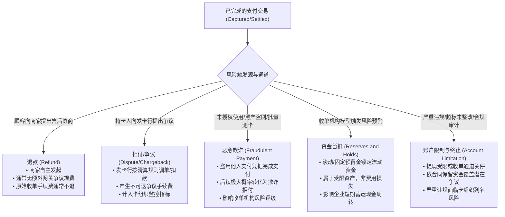
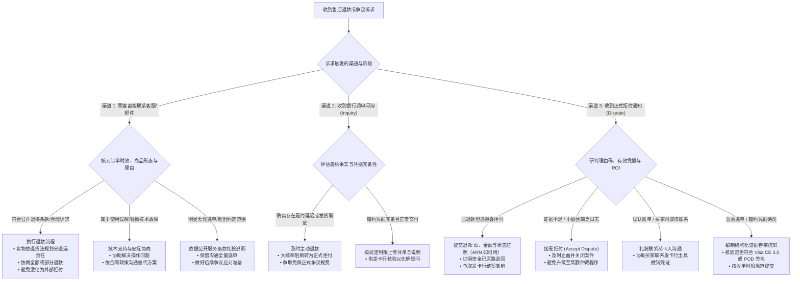
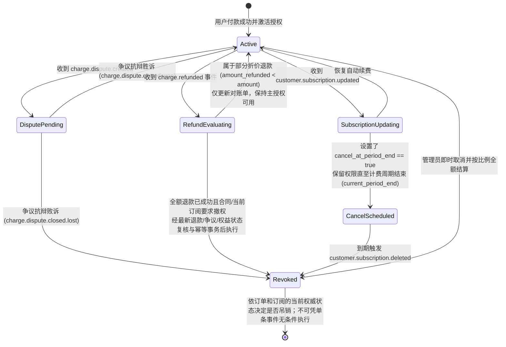
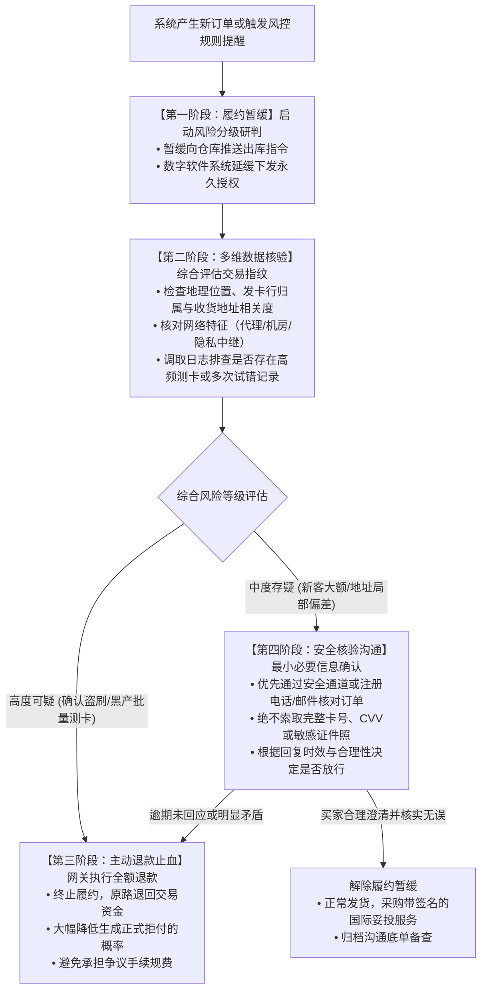
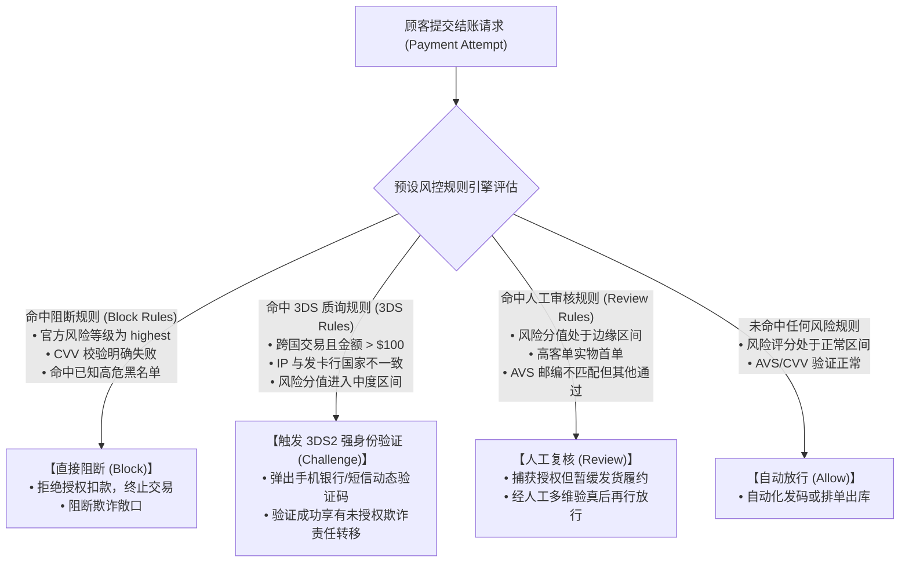
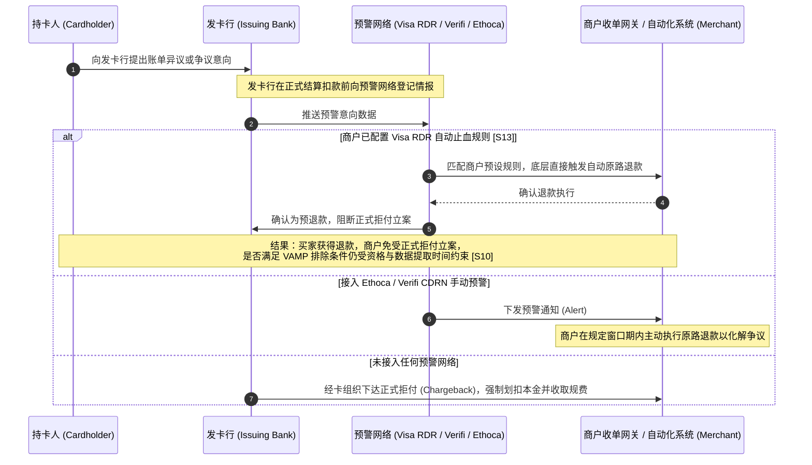
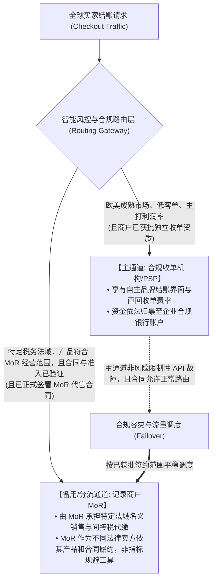

# 第六部分 售后与资金风险｜如何减少并妥善处理退款、拒付及资金风险？

## 引言：跨国收单的“暗礁区”——交易成功只是风控与售后的起点

在全书前五部分中，我们系统搭建了一家商业企业从 0 到 1 的跨境收款全生命周期体系：
- 在第一至第三部分，我们系统完成了收款方案的战略选型、技术接入规范与结账体验漏斗优化；
- 在第四部分，我们深入支付处理底层，通过状态机解耦、Webhook 签名验真、业务幂等与防重复扣款屏障，确保了每一笔订单被正确授权与捕获；
- 在第五部分，我们穿透了从网关可用余额到跨国银行出金、外汇合规申报与阳光结汇的层层清算迷雾，让真金白银安全记入了企业的银行账户。

然而，在真实的跨国商业航道中，资金进入银行账户绝不意味着交易风险的终结。恰恰相反，当商户点击“确认发货”或系统自动下发“软件激活码”的那一刻，商户刚刚驶入了跨境商业支付最险象环生的**“售后与资金暗礁区”**。

许多初入跨境出海领域的个人独立开发者、独立站品牌卖家和小微外贸商家，往往抱有三种极其危险的朴素直觉与认知误区：
1. **“交易成功且已提现，钱就落袋为安、永远属于我”的永久性幻觉**：
   国际卡组织（Visa、Mastercard、American Express 等）赋予了全球持卡人法定与行业维度的保护救济机制——**拒付（Chargeback）**。持卡人通常可在交易发生后 120 天内（部分涉及未履约或重大欺诈的特定场景甚至可依据卡组织争议规程延长）向其发卡行申请调查并撤销交易。即使商户早已将款项提取至国内银行账户，收单机构依据商户服务协议（MSA）依然会在网关生成**负余额（Negative Balance）**，从商户后续结算款项乃至绑定的保证金账户中追索冲抵；
2. **“退款只是一键原路返回，无非这笔生意没做成，并无额外代价”的零成本幻觉**：
   在主流收单体系中，退款从来不是无损的对称逆向操作。主流收单机构（如 Stripe、PayPal）普遍实行“退款不退交易处理手续费”的商业规则 [S01, S06, S09]。一笔退款不仅意味着预期的商品销售毛利落空，商户还要实际承担原始收单处理费、可能的跨境附加费与多次货币兑换利差；对于实物电商，更将面临国际头程运费、退货质检成本与海关退运摩擦；对于数字软件，若未做好服务端鉴权联动，还可能面临“授权码已被买家复制留存、软件继续被使用”的数字资产流失；
3. **“我不卖假货、诚信经营，账户就绝对安全，欺诈与冻结与我无关”的无辜者免疫幻觉**：
   在跨境网络黑产体系中，合规经营的中小商户往往是被利用的对象。犯罪团伙可能利用暗网窃取的被盗卡信息到独立站进行自动化“测卡”或套现；亦有消费者在正常履约后发起“第一方欺诈/友善欺诈（Friendly Fraud）”，收到商品或使用软件后声称“未授权扣款”以逃避付费。一旦商户在收单机构处的争议指标或欺诈指标超出卡组织监控阈值（如 Visa VAMP 计划 [S10] 或 Mastercard ECP 计划 [S12]），收单机构将依规启动**风险预留金（Reserve）、提现限制乃至终止服务**，使企业的跨境现金周转面临严重考验。

在支付金融与商业风控底层，必须牢固树立一个根本认知：**“收单扣款成功只是风险敞口的开启，唯有平稳度过退款周期、争议追索期与卡组织监控周期，一笔商业收入才真正转化为企业净资产。”**

为了让所有风险度量、损失精算、争议答辩与防欺诈策略具备扎实具体的实战依托，本部分继续延用全书贯穿的**两个互为镜像的假设商业情境**（注：两主体在境外收单通道与跨境结算工具的实际准入资格均标为 UNKNOWN 教学假设，不代表其已获批特定境外通道）：
- **情境 A（纯软件/SaaS 出海）**：**深圳灵动软件工作室**。持有中国大陆有限责任公司营业执照，销售单价 29 美元买断工具或 29 美元/月订阅制设计软件。商品依靠在线即时发码交付，无物理物流报关单，核心售后痛点是“防范买家获取激活码后恶意发起‘未授权交易’拒付、自动化退款后的授权即时吊销与防白嫖机制、按月循环扣款的取消合规、以及小额高频交易下的争议率监控”。
- **情境 B（高客单实物 DTC 品牌出海）**：**东莞极光工坊**。持有大陆外贸制造企业执照，自主设计分体式人体工学机械键盘（客单价 120 美元）。商品从大湾区直邮全球个人买家，涉及跨国物理运输与售后退换，核心售后痛点是“高昂的跨国逆向物流运费与海关退运摩擦、收货后恶意虚假‘未收到货（INR）’拒付、卡组织签收凭据（POD）抗辩标准、以及海外退货仓（3PL）质检与残值折价处理”。

无论你是使用 Shopify/WooCommerce 开设独立站的跨境电商卖家，还是通过自建站出海的独立开发者与软件团队，本部分都将系统拆解售后与资金安全的四大核心防线：
1. **风险全景与损失链**：透视退款、拒付、欺诈、暂扣与冻结的本质机制，建立多层级损耗精算模型；
2. **退款争议与权益处置**：掌握售后分流黄金决策树、卡组织理由码破解法、强力抗辩证据链（含 Visa CE 3.0 专项实操），建立数字权益吊销与实物逆向物流（RMA）闭环；
3. **欺诈与冻结应急响应**：建立疑似欺诈订单的分级研判处置 SOP，掌握资金暂扣与账户冻结的深度诊断与解冻申诉规范；
4. **日常风控与韧性架构**：掌握 3DS2 责任转移及除外边界、早期预警（RDR/CDRN/Ethoca）、日常证据链留存矩阵与多通道容灾切换架构。

---

## 1. 商家通常会面临哪些交易和资金风险？

### 1.1 退款、拒付、诈骗付款、资金暂扣和账户冻结，会造成什么损失？

#### 核心概念透析：五类售后与资金风险的本质差异与触发链路

在跨境支付业务中，“客户不满意要退钱”与“银行发起争议撤回资金”在法律关系、资金流向和技术链路上有着本质区别。新手商家若将退款、拒付与欺诈混同处理，极易在运营与对账中发生决策误判。我们首先对跨境商家面临的五大资金风险建立明确的业务定义：



##### 1. 退款（Refund）
- **业务实质**：退款是**商户主动**（或经与买家协商一致后）通过收单系统向买家返还已收取的全部或部分交易款项。
- **发起方与控制权**：商户拥有控制权。商户可在收单管理后台点击操作，或由商户服务端调用收单机构的 Refund API（如 Stripe Refunds API [S01]）。
- **处理路径与时效**：收单机构将退款指令提交至银行清算网络，通常需要 5 至 10 个工作日入账持卡人账单。若买家原卡已注销或过期，发卡行通常会在其账户内部将款项转入关联新卡或活期结算账户 [S01]。
- **费用特征**：主流收单平台通常不额外加收“退款操作费”，但**原始交易产生的处理手续费（如 Stripe 的 2.9% + $0.30 [S06] 或 PayPal 相应商业交易处理费 [S09]）不会退还给商户**；常规退款本身不产生卡组织争议规费。
- **与拒付的重叠竞态（关键认知）**：**主动退款并不保证 100% 阻断后续拒付**！若持卡人在商户退款尚未完成跨行清算入账的在途期间向发卡行提交了争议，或者发卡行因系统通信延迟未能及时匹配退款记录，发卡行仍可能对该笔交易下达正式拒付（Dispute on a refunded transaction [S03]）。商户在此类情况下应按该服务商的争议流程，提供退款 ID、时间、金额与状态等可核对凭据；只有实际生成时才补充 ARN、STAN 或 RRN，并避免重复退款。

##### 2. 争议与拒付（Dispute / Chargeback）
- **业务实质**：拒付是由**持卡人直接向其发卡行（Issuing Bank）**提起的正式付款撤销与调查请求。持卡人主张该笔交易存在欺诈未授权、货物未送达、服务与描述实质不符，或在取消周期性订阅后仍被持续扣款。
- **生命周期演进**：
  1. **问询/调单（Retrieval Request / Inquiry）**：部分发卡行或收单机构在正式扣款前发起的交易信息核查。商户在此阶段若能及时澄清或与买家达成退款共识，通常可避免产生正式拒付规费与拒付记录；
  2. **正式拒付（First Chargeback）**：发卡行立案，通过卡组织清算网络将交易金额自收单机构扣除，收单机构依据商户协议自商户可用余额中划扣等额本金，并**加收一笔不可退还的争议处理费（Dispute Fee）**（如 Stripe 美区标准为 $15 美元 [S02]，Paddle Billing 现行标准为 20 USD/GBP/EUR 或 40 CAD/AUD [S07]，Lemon Squeezy 为 $15 美元 [S08]，PayPal 标准为 $8 至 $16 美元 [S09]）；
  3. **商户抗辩（Representment）**：商户若认为持卡人主张与事实不符，可在规定时限内（通常 7 至 21 天，依收单机构与卡组织规定）提交由发卡行审核的反驳证据卷宗；
  4. **仲裁程序（Pre-arbitration & Arbitration）**：若抗辩后发卡行或商户收单行继续坚持主张，争议可升级至卡组织仲裁。仲裁败诉方除承担本金损失外，还须承担卡组织高额仲裁处理费（单笔通常达数百美元，依卡组织当期规章核定）。
- **指标影响**：一旦正式拒付立案，无论后续抗辩是否挽回本金，该笔交易通常均会计入收单机构及卡组织当期监控体系的争议笔数统计基数。

##### 3. 欺诈交易（Fraudulent Payments）
- **业务实质**：未经合法持卡人授权而使用其支付信息完成的交易，在跨境收单中主要呈现四类形态：
  - **第一方欺诈 / 友善欺诈（First-Party Fraud / Friendly Fraud）**：合法持卡人或其家庭成员实际完成了消费，但在收到货物或享用数字服务后，出于遗忘账单、纠纷或恶意逃单心理，向发卡行虚假声称“银行卡被盗刷”或“未收到商品”；
  - **第三方真实盗刷（True Fraud / Stolen Card）**：黑产团伙通过钓鱼网站、撞库或数据泄露获取他人完整信用卡信息，在商户独立站批量下单购买高流通性实物或数字资产后销赃。真实持卡人发现账单异常后，几乎必然触发盗刷拒付；
  - **测卡试卡攻击（Card Testing / Carding）**：黑产自动化脚本利用结账页面缺乏校验的漏洞，以高频次尝试数以千计的卡号及安全码有效性，导致商户短时间内产生海量失败交易日志与 API 摩擦；
  - **账号劫持（Account Takeover, ATO）与三角套现欺诈（Triangular Fraud）**：欺诈分子盗取正常用户账号后修改配送地址下单，或在第三方平台以低价吸引顾客后使用盗刷卡片在商户独立站代客下单。

##### 4. 资金暂扣（Reserves & Holds）
- **业务实质**：收单机构基于实时风控模型，认为商户当前的退款率、突发交易增速或类目风险高于基准水平，依商户协议对部分资金设置的保护性暂扣措施，用于抵御潜在的未履约与拒付违约风险 [S03]。
- **形态与会计属性**：
  - **滚动预留金（Rolling Reserve）**：按每日流水的一定比例（如 5%–10%）扣留，在约定的滚动周期（如 90 天至 180 天）届满后按日释放。
  - **固定预留金（Fixed Reserve）**：要求账户维持特定额度的最低保证金，低于该额度时收款自动留存直至补足。
  - **会计属性澄清**：**预留金属于商户所有的受限流动资产（Restricted Cash），在性质上是存管保证资金而非直接费用损失**。其核心负面影响在于抽紧企业的短期营运现金流。

##### 5. 账户限制与协议终止（Account Limitation & Termination）
- **业务实质**：收单机构对高风险或合规异常账户采取的阶梯式管控措施：
  - **功能受限（Payouts / Charges Restricted）**：临时暂停出金提现，或暂时关闭前端结账功能，要求商户限期补交资质凭单或改善售后指标；
  - **协议终止与风险保留期**：收单机构决定终止提供收单服务。依据商户协议，收单机构通常会在一定期限内（合同通常约定最长可至 180 天以覆盖卡组织常规追索窗口，个案以协议为准）保留部分或全部余额，用于结算期间发生的退款与拒付扣款，最终是否及何时释放资金以合同、风险结案、未决退款/争议、负余额和法律保留义务为准；**不保证期满自动划款**；
  - **卡组织不良商户数据库列名（如 Mastercard MATCH / Visa VMAS）**：Mastercard MATCH 等列名依收单方适用的卡组织列名原因、规则和程序判断；**非普通退款率上升就自动列名，也不能保证任何个案会立即上报**。合规经营商户的常规个案拒付或资质审核失败不应夸大为必然列名。

---

#### 全景损耗传导模型：从单笔扣费到企业现金流断裂的风险级联反应

在商业经营中，如果将“扣款被撤回”与“现金净亏损”等同计算，会导致财务核算的重复计算或指标失真。我们对单笔交易在退款与拒付下的资金变动建立严格分层的核算框架：

##### 1. 单笔直接经济变动的会计分层
当一笔交易发生逆向变动时，必须区分**现金净变动**与**相对正常成交的预期利润落差**两个口径：

| 变动层级 | 正常退款场景的账务特征 | 拒付（败诉）场景的账务特征 |
|:---|:---|:---|
| **交易本金现金流** | 原路退回买家；本期净销售额冲减 | 银行强制划扣买家；本期净销售额冲减 |
| **收单处理手续费** | **不退还**（如 Stripe 2.9% + $0.30 依分取整规则扣除）[S06] | **不退还**；初始结算时已被实际扣减 |
| **争议手续规费** | **无** | **依收单机构加收 $15 至 $20 美元**（败诉时不退）[S02, S07] |
| **已耗资产与物料成本** | 实物可经逆向物流回收残值；软件产生成本折损 | 实物商品通常已被欺诈者占有且无法追回，全额沉没；数字资产无形损失 |
| **履约与物流费用** | 损失发货运费；商户可能须额外承担退货运费与二次质检费 | 发货国际运费全额损失；无货物退回 |
| **汇兑折算利差** | 发生多币种转换结算时，买入卖出利差构成净损耗 | 涉及强制平账时的换汇价差摩擦 |

##### 2. 国际卡组织监控计划的现行合规框架（Visa VAMP 与 Mastercard ECP）
商户的争议率若超出合理区间，除单笔损失外，将面临卡组织层面的系统性治理措施：
- **Visa 收单机构监控计划（Visa Acquirer Monitoring Program, VAMP）** [S10]：
  Visa 自 2025 年 6 月起整合旧 VDMP/VFMP 等计划，现行 **VAMP 核心指标是单一的笔数比率**：`（TC40 欺诈报告笔数 + TC15 争议笔数）÷ TC05 已结算交易笔数`，并按 Visa 数据提取时点和资格条件排除符合规定的预争议解决事件及 CE 3.0 合格欺诈报告。**不能用独立 DTR/FSR 或欺诈金额比率替代此官方公式**。Visa 官方 2025 fact sheet 注脚显示：在亚太（AP）、加拿大、欧盟及美国，自 **2026-04-01** 起过量商户门槛为 **≥150 bps（1.50%）且月度欺诈与争议合计至少 1,500 笔**；拉美加勒比地区为 ≥150 bps 且至少 1,500 笔，中东欧中东非地区为 ≥220 bps 且至少 150 笔并涉及金额 ≥75,000 美元。**这些是相应计划的进入条件，不是小商户可放心冲到 1.49% 的安全线**。收单机构另有面向自身组合的门槛和合同管理权，其内部预警线不统一，商家须查看对应地区、清算口径、当期收单通知并做好整改 [S10]；
- **Mastercard 超额拒付计划（Excessive Chargeback Program, ECP）** [S12]：
  Mastercard 现行规则以**当月发生的争议笔数除以前一个自然月的成功销售交易笔数**作为 Chargeback Ratio 计量口径，设定 Tier 1（标准门槛通常为 1.5% 且当月争议达 100 笔）及后续升级梯队，超标商户面临逐月递增的合规评估规费。

##### 3. 综合损失精算公式与双口径定义
在企业财务核算模型中，明确区分现金流与利润变动公式：

```
【单笔退款在交易发生至撤回期间的净损耗近似模型（不含可追回库存价值；非现金流量表标准分类）】
ΔCash_refund = - ( F_proc + F_ship_out + F_ship_ret + F_fx + F_restock + C_consumed )
其中：
- F_proc: 网关收单原始处理费（不可退部分）；
- F_ship_out: 首次发货国际物流运费及包装辅料；
- F_ship_ret: 逆向物流退运运费（若商户承担）；
- F_fx: 多币种兑换结算时的实际汇差损失；
- F_restock: 仓库二次检验、重新贴标与折旧翻新损耗；
- C_consumed: 交付过程中已实际消耗不可收回的算力、接口或物料成本。

【单笔拒付败诉的资金净损耗近似模型（从原交易到账至本金冲回后的全过程，另计确已支付的损耗）】
ΔCash_chargeback = - ( F_proc + F_dispute + F_ship_out + C_cogs_lost + F_fx + C_admin )
其中：
- F_dispute: 收单机构收取的争议处理手续费（如 Stripe $15，Paddle $20 等）；
- C_cogs_lost: 实物货物灭失或无法追回的生产制造成本（BOM）；
- C_admin: 整理抗辩材料消耗的人工与管理综合摩擦成本。
（注：收到的订单本金 P_order 在拒付中被发卡行划回，净额为 +P_order - P_order = 0，不应在现金净变动中再次扣减为双倍损失。）

【相对正常成交的预期利润落差 (Opportunity / Profit Gap)】
Profit_Gap = Expected_Net_Profit - Net_Result
即：若该笔订单正常履约本应实现的净利润，与最终发生退款/拒付后的净财务结果之差。
```

---

#### 多元商业模式下的权责归属矩阵：PSP、平台、MoR 与 B2B 银行转账

不同出海模式在面对退款与资金风险时，法律主体、操作权限和最终损失承担方完全不同：

| 维度 | 自建独立站直连 PSP<br/>（如 Stripe / 自有收单通道） | 跨境电商平台入驻<br/>（如 Amazon / eBay 等平台） | 记录商户（MoR 模式）<br/>（如 Paddle Billing / Lemon Squeezy） | 传统外贸 B2B 银行电汇<br/>（如 SWIFT 国际电汇） |
|:---|:---|:---|:---|:---|
| **法律卖方主体** | **商家自身**（独立法人） | **商家自身**（在平台规则框架内） | **MoR 服务商**（MoR 对外作为交易的法律售卖方）[S07, S08] | **商家自身**（贸易合同买卖双方） |
| **收单账户归属** | 商家自有独立收单账户 | 平台统一清算账户池 | MoR 统一收单商户账户 | 商家开户银行账户 |
| **退款操作发起权** | 商家在后台或经由 API 自主发起 | 商家后台操作，平台在纠纷中可依据保障规则介入裁决 | 商家发起，或 MoR 客服依据代售服务条款依规处理 | 需商家通过开户行协助办理退汇，非单向撤销 |
| **拒付抗辩主体** | **商家亲自整理证据并向网关上传** | 平台系统辅助处理，扣费与绩效指标由商家承受 | **Paddle Billing 由平台主导争议处理，卖家证据提交能力依其实际产品流程 [S07]**；Lemon Squeezy 表示一般由其处理拒付、向支付方提供可获取信息 [S08]；**卖家是否可直接上传材料为 UNKNOWN，应联系客服核实** | 罕见卡组织拒付；涉嫌欺诈或制裁由银行合规审查 |
| **拒付规费与损失承担** | **全额由商家承担**（本金+争议规费） | **全额由商家承担**；且计入平台卖家绩效指标 | **争议规费仍从商家待结收益中扣减**（Paddle 20 USD/EUR/GBP [S07]，Lemon Squeezy $15 [S08]）；败诉扣减本金 | 无卡组织争议规费；但承担退汇电讯摩擦费 |
| **资金预留与风控执行** | PSP 直接针对商家账户设置预留金或限制 | 平台执行统一放款账期、账户保证金与冻结 | MoR 监控商家拒付率；超标时依规暂扣款项或终止合作 | 银行依据外汇管理法规与反洗钱政策审核单据 |

##### 深度破局：区分不同 MoR 平台的真实规则与责任边界
在 SaaS 和数字工具出海中，许多开发者采用 Paddle 或 Lemon Squeezy 等 MoR 服务商。商户必须厘清其真实业务边界：
1. **费用并非完全免除**：根据 **Paddle Billing 现行官方文档** [S07]，一旦发生拒付，商户须承担标准为 **20 USD / 20 GBP / 20 EUR 或 40 CAD / 40 AUD** 的争议费用；**Lemon Squeezy** [S08] 则明确收取 **$15 美元** 争议费。若争议败诉，相关交易本金亦在结算中予以扣除；
2. **抗辩机制存在平台分化**：
   - 在 **Paddle Billing** 体系下，平台主导争议抗辩，商户遵守其实际说明；不假定卖家能自行向发卡行提交抗辩材料 [S07]；
   - 在 **Lemon Squeezy** 等平台下，官方文档仅能确认 **Lemon Squeezy 通常负责处理拒付并尽可能提供材料**；没有证据证明卖家可在后台直接上传抗辩文件。卖家应保存交付与沟通记录，按平台支持渠道提供；具体权限 `UNKNOWN` [S08]；
3. **法律义务与知识产权边界**：MoR 代为履行的是名义销售方在特定国家地区的间接税申报代缴责任。**商品本身的知识产权合规、实质性功能瑕疵、消费者知情权保障与底层数据合规责任**，依然全部由实际提供软件或服务的开发商承担。

---

#### 贯穿案例全真推演：两类出海商家的假设损耗演练

我们对全书贯穿的两家典型出海企业进行双口径财务推演（注：以下费率、物流及成本参数均为教学示范假设，实际应以商户签约协议为准）：

##### 案例 A：深圳灵动软件工作室（$29 美元数字软件/SaaS 订阅）
- **业务情境**：销售单价 $29 美元的桌面效率工具买断 License，或提供 $29/月的按月订阅服务。用户在线支付后由系统自动发码或开通权限，单用户边际云端算力与发码服务成本设为 $1.00 美元。
- **示范费率假设**：假设签约基准收单费率为 2.9% + $0.30 美元，跨境卡附加费 1.5%（合计 4.4% + $0.30）；单笔争议处理规费 $15 美元；换汇利差损耗设为 1.2%。

**单笔费率按分取整计算**：
$29.00 \times 4.4\% = \$1.276 \rightarrow$ 舍入至 **$1.28 美元**；加上固定费 $0.30，**收单处理费实扣 $1.58 美元**；初次扣款商户网关入账净额为 $\$29.00 - \$1.58 = \$27.42\text{ USD}$。

**对比推演 1：正常退款场景（用户购买 3 天后友好申请退款）**
1. 资金进出流向：
   - 初始实收款项入账：+$27.42 USD（扣除手续费 $1.58 后）；
   - 网关向买家原路返还本金：-$29.00 USD；
   - **收单手续费不退还**：$1.58 USD 成为已付成本；
   - 已消耗云端算力成本：$1.00 USD；
   - 跨币种平账汇差损耗（示范值）：$0.35 USD；
2. **最终财务核算**：
   - **直接现金净变动（ΔCash）**：`+$27.42 - $29.00 - $1.00 - $0.35 = -$2.93 USD`；
   - **相对正常成交的预期利润落差（Profit Gap）**：
     - 正常履约预期净利润：`$29.00 - $1.58 - $1.00 = +$26.42 USD`；
     - 利润落差：`+$26.42 - (-$2.93) = $29.35 USD`（即未实现的 $29 营收加 $0.35 汇兑损失）。

**对比推演 2：恶意友善欺诈拒付场景（用户使用软件后发起“未授权交易”拒付且商户申诉败诉）**
1. 资金进出流向：
   - 初始实收款项入账：+$27.42 USD；
   - 发卡行强制划扣本金：-$29.00 USD；
   - **收单机构扣除争议处理规费**：-$15.00 USD [S02]；
   - 已消耗云端算力成本：-$1.00 USD；
   - 应对争议整理材料的综合工时成本（折合）：-$5.00 USD；
2. **最终财务核算**：
   - **直接现金净变动（ΔCash）**：
     `+$27.42 - $29.00 - $15.00 - $1.00 - $5.00 = -$22.58 USD`；
   - **相对正常成交的预期利润落差（Profit Gap）**：
     `+$26.42 (预期利润) - (-$22.58 实际净果) = $49.00 USD`；
   - *财务解读*：遭遇一笔恶意拒付，商户直接发生 **$22.58 美元的净现金流出**；相对于正常履约，企业产生 **$49.00 美元的商业利益落差**（包含全额失去的 $29 营收、$15 争议罚金与 $5 管理消耗）。

---

##### 案例 B：东莞极光工坊（$120 美元跨境直邮机械键盘）
- **业务情境**：销售自主研发的客单价 $120 美元人体工学机械键盘。产品从大湾区直邮欧美买家。每把键盘工厂制造成本（BOM + 组装）为 $45 美元，深圳直邮欧美专线特快头程运费为 $22 美元（含包装）。
- **示范费率假设**：假设签约基准费率同上（4.4% + $0.30）；单笔争议规费 $15 美元；海外 3PL 仓退货验货及二次贴标费 $10 美元/件；逆向退回海外仓本土运费 $18 美元。

**单笔费率按分取整计算**：
$120.00 \times 4.4\% = \$5.28$；加上固定费 $0.30，**收单处理费实扣 $5.58 美元**；初次扣款商户网关入账净额为 $\$120.00 - \$5.58 = \$114.42\text{ USD}$。

**对比推演 1：正常退货退款场景（买家在自愿退换期内退回海外 3PL 合作仓）**
1. 资金进出流向：
   - 初始实收款项入账：+$114.42 USD；
   - 网关向买家原路返还货款：-$120.00 USD；
   - 收单处理费不可退：$5.58 USD 沉没；
   - 发货头程国际运费（已消耗）：$22.00 USD；
   - 逆向退货本土运费（商户政策提供免运退货）：$18.00 USD；
   - 海外仓质检翻新与重新贴标费：$10.00 USD；
   - 货物重新入库，恢复为可用库存（制造成本 $45 未灭失，仍以存货形态保留）；
2. **最终财务核算**：
   - **直接现金净变动（ΔCash）**：
     `+$114.42 - $120.00 - $22.00 - $18.00 - $10.00 = -$55.58 USD`；
   - **相对正常成交的预期利润落差（Profit Gap）**：
     - 正常履约预期净利润：`$120.00 - $5.58 - $45.00 - $22.00 = +$47.42 USD`；
     - 利润落差：`+$47.42 - (-$55.58) = $103.00 USD`（由于退货运费及二次处理成本产生，且未能实现原销售额）。

**对比推演 2：跨国恶意拒付“未收到货物（INR）”（键盘已妥投，买家拒付且货物灭失）**
1. 资金进出流向：
   - 初始实收款项入账：+$114.42 USD；
   - 发卡行强制划扣本金：-$120.00 USD；
   - **收单机构扣收争议罚金**：-$15.00 USD [S02]；
   - 头程国际运费全额损失：-$22.00 USD；
   - **实物机械键盘彻底灭失**（买家占有且不退还，BOM 制造成本全损）：-$45.00 USD；
   - 国际抗辩材料翻译与整理消耗（折合）：-$8.00 USD；
2. **最终财务核算**：
   - **直接现金净变动（ΔCash）**：
     `+$114.42 - $120.00 - $15.00 - $22.00 - $45.00 - $8.00 = -$95.58 USD`；
   - **相对正常成交的预期利润落差（Profit Gap）**：
     `+$47.42 (预期利润) - (-$95.58 实际净果) = $143.00 USD`；
   - *财务解读*：面对一笔 $120 美元的实物恶意拒付，东莞工厂直接产生 **$95.58 美元的净现金流出**；相对于正常履约，企业商业利益落差达到 **$143.00 美元**（包含 $120 标价营收丢失、$15 规费与 $8 摩擦消耗）。工厂必须随后售出至少 3 把键盘并保持完全正常履约，才能弥补这一单带来的直接现金损失。

---

## 2. 顾客要退款或发起付款争议，该怎么办？

### 2.1 顾客要退钱或发起拒付时，该退款、协商还是申诉？

#### 售后与争议分流黄金决策树（Triage Decision Matrix）

面对买家提出的退款要求或发卡行发来的争议警报，经验不足的商家往往走入两个极端：要么“一律全额秒退款”，导致被恶意白嫖者榨干利润；要么“一律硬刚申诉到底”，导致浪费大量人力并招致高额仲裁风险。

成熟的商业支付运营必须依托标准化的分流决策树，依据客诉发生的**渠道、所处阶段、理由真实度与财务期望值**，精准选择处置策略：



##### 场景一：顾客在独立站/邮件直接提出退款诉求（直接客诉）
- **核心目标**：以合理商业成本将纠纷化解在商户体系内部，**降低客诉升级为发卡行拒付的概率**。
- **标准化处置流程**：
  1. **首响应时效管理**：客服应建立及时的响应机制（建议在 1 个工作日内作出专业、温和的首次响应）。长周期未响应是诱发持卡人转向银行投诉的重要推手；
  2. **诉求属性甄别与处置**：
     - *服务/软件故障*：若因激活码下发延迟、系统环境不兼容或下载链接异常，首选快速提供可用授权补丁或配置指引；
     - *实物不满意*：若东莞极光工坊的买家因键盘轴体手感不符合预期提出退换，应主动提供合规退货指南，或依自愿退换政策提出折价保留方案（例如：“我们愿意为您直接返还 30% 款项，您可以继续保留键盘，免去跨国寄回的周折”）；
     - *符合政策的退款*：若买家符合公开退款承诺，应及时通过网关后台操作退款，并向买家提供退款 ID、金额、日期及状态；仅在该笔退款生成 ARN、STAN 或 RRN 时提供相应可追踪编号。

##### 场景二：收到网关调单问询（Retrieval Request / Inquiry）
- **核心目标**：把握正式拒付立案前的化解窗口。
- **机制特征**：问询通常是发卡行在持卡人对账单产生疑问时发起的先行信息索取。在此阶段，款项通常尚未被强制扣划，亦未产生卡组织正式拒付规费：
- **操作要领**：如果核查发现发货存在严重延误、已无库存或存在欺诈嫌疑，应在问询截止日前**主动执行全额退款**，通常可有效阻断正式拒付的生成；若核实已经合规交付且妥投，应迅速上传商业发票、物流跟踪号和交付凭证。

##### 场景三：收到正式拒付通知（Formal Dispute / Chargeback）
- **核心目标**：评估申诉投入产出比（ROI），采取合规处置。
- **决策底线**：网关一旦立案，交易本金被划扣，争议规费已产生。此时应依据客观凭据理性分流：
  - **已退款交易遭遇拒付（Disputes on a Refunded Transaction）** [S03]：若商户在拒付立案前已执行了退款，但因清算时差或发卡行未及时关联，发卡行仍下达了拒付。商户此时**绝不可不予理会**，应按实际网关允许的方式提交退款交易 ID、金额、退款状态与时间；**ARN 并非每笔退款都提供**，可用时补充 ARN、STAN 或 RRN，证明款项已原路退回，促使发卡行结案纠正；
  - **小额或缺乏有效凭据的争议**：对于 $29 美元的数字产品，若缺乏完整的设备日志或登录记录，人工组织卷宗的综合成本可能超过订单本身，应选择 **Accept Dispute（接受拒付）**及时关闭案件，避免激化升级；
  - **凭据扎实的高客单订单**：对于 $120 美元实物键盘，且持有买家亲笔签收单（POD）与完全匹配的配送记录，应坚决按规范组织证据卷宗进行申诉（Representment）。

---

#### 核心服务商与卡组织全链路状态对照矩阵

为避免对不同阶段的计费、效果与时限产生混淆，下表系统梳理了退款、问询、预警与正式争议的全链路状态对照：

| 业务处理阶段 | 触发源与发起方 | 收单机构余额状态变动 | 产生的手续规费 | 结果可逆性与对卡组织指标影响 | 商户核心操作要领与操作禁忌 |
|:---|:---|:---|:---|:---|:---|
| **常规退款<br/>（Refund）** | 商户在管理后台或经 API 主动发起 [S01] | 可用余额扣减退款本金；原路退回买家 | 原始交易处理费通常不予退还 [S01, S06]；一般无额外退款操作费 | 买家入账通常需 5–10 工作日；**不保证 100% 免疫后续在途拒付** [S03] | 先提供退款 ID/金额/状态；追踪编号可用时再提供；**禁忌：答应买家要求通过外部私人账户退款** |
| **调单问询<br/>（Inquiry / Retrieval）** | 发卡行因持卡人账单疑问发起信息索取 | 资金通常暂不强制划扣（依收单机构规则） | 主流收单平台通常不收正式争议规费；部分专用接口按合同收取微量查询费 | 属于非正式阶段；若未妥善澄清，发卡行可升级为正式拒付 | 及时全额退款或上传发票物流单；**禁忌：超过回复截止时限不予理会** |
| **早期预警<br/>（Ethoca / Verifi CDRN）** [S13] | 预警网络截获持卡人向银行投诉的情报 | 余额不发生变动（由商户决定是否拦截退款） | 预警服务商按成功拦截通知计费（依签约服务商资费，标为 UNKNOWN） | 商户在时限内主动退款可规避正式拒付立案；超期可能失去预警处置窗口，**不必然**转为拒付 | 立即拦截未发货物并执行退款；**禁忌：已收到告警仍抱侥幸心理发货** |
| **快速争议解决<br/>（Visa RDR）** [S13] | Visa 清算网络底层依商户预设规则自动触发 | 自动扣减订单本金原路返还买家 | 收取 RDR 处理费（低于正式拒付规费与仲裁风险，具体按签约服务商核定） | 若确实在正式争议前按规则成功解决，可能满足 VAMP 排除条件；**以资格及数据提取时间为准，不承诺零影响** [S10] | 需通过适格收单行或争议管理平台配置规则；**禁忌：高货值订单未设上限盲目全退** |
| **正式拒付<br/>（Chargeback）** | 发卡行依据持卡人主张正式立案扣划 [S02] | **强制扣除交易本金，并冻结/扣除争议手续费** | 争议费是否扣收、退还或另有反驳费**依平台、法域和套餐**（Stripe $15 [S02], Paddle 20 USD/EUR/GBP [S07], Lemon $15 [S08]） | 计入卡组织监控体系基数；商户抗辩若胜诉可追回本金，规费依各平台政策处理 | 7–21 天内上传单份结构化证据卷宗；**禁忌：提交无关杂乱截图或伪造签名** |
| **卡组织仲裁<br/>（Arbitration）** | 抗辩后发卡行或商户收单行升级至卡组织终裁 | 争议本金持续冻结；待仲裁决议执行划拨 | 败诉方承担高额仲裁处理费（通常达数百美元，依卡组织规约核定） | 卡组织争议裁决委员会终审裁决；对清算网络各方具有终局约束力 | 仅在证据无懈可击且订单金额显著高于仲裁风险时推进；**禁忌：盲目赌博申诉** |

---

#### 拒付抗辩的核心逻辑与卡组织理由码（Reason Codes）解析

在卡组织清算规章中，发卡行必须按具体的**理由码（Reason Code）**提交争议。发卡行与收单机构依据既定规程审核凭据，商户必须针对理由码要求组织证据：

##### 卡组织四大核心争议大类及抗辩重点对照表

| 争议分类 | Visa 常见理由码 [S08] | Mastercard 常见理由码 [S12] | 核心抗辩逻辑与关键采信证据 |
|:---|:---|:---|:---|
| **欺诈类<br/>（Fraud）** | **10.4**（无卡环境下其他欺诈）<br/>**10.3**（未授权环境） | **4837**（无卡欺诈交易）<br/>**4863**（持卡人未识别） | • 证明通过了 3DS2 强身份验证且符合责任转移条件 [S04]；<br/>• 提供符合 Visa CE 3.0 规约的关联交易凭单 [S11]；<br/>• AVS 账单地址与收货地址一致性核验凭据。 |
| **授权类<br/>（Authorization）** | **11.1**（未取得有效授权代码）<br/>**11.3**（超额或晚于时效扣款） | **4808**（授权授权码问题） | • 提供收单网关返回的有效 Authorization Code 与时间戳；<br/>• 证明实际捕获扣款金额未超出授权核准额度。 |
| **处理差错类<br/>（Processing Errors）** | **12.5**（金额错误 Incorrect Amount）<br/>**12.6**（已通过其他方式付款） | **4834**（重复交易 Duplicate） | • 证明多次扣款对应独立订单（不同购物车编号、独立发货包裹）；<br/>• 若确实属于系统并发误扣，应核对退款记录并予认诺。 |
| **消费者纠纷与履约<br/>（Consumer Disputes）** | **13.1**（未收到商品 Merchandise Not Received） | **4853**（货物未送达 Goods Not Delivered） | • 提供承运商官方物流轨迹截图；<br/>• **带买家签名的妥投凭据（POD）**及邮编匹配记录；<br/>• 证明实际交付地址与订单指定地址一字不差。 |
| **质量与退订纠纷<br/>（Quality / Cancellation）** | **13.3**（货不对板/缺陷 SNAD）<br/>**13.7**（已取消的周期性计费） | **4853**（描述不符或取消订阅后继续扣款） | • 结账页服务条款与退换规则明示快照及买家确认日志；<br/>• 扣款前发送的自动续费提醒邮件投递记录；<br/>• 证明买家在拒付前未曾向客服申请退货的沟通底单。 |

##### 申诉抗辩的投入产出比（ROI）精算模型
商户在决定是否提交抗辩证据时，应通过以下期望值模型进行财务决策：

$$E[\text{Representment}] = P_{\text{win}} \times P_{\text{order}} - C_{\text{labor}} - P_{\text{arb\_risk}} \times C_{\text{arbitration}}$$

其中：
- $P_{\text{win}}$: 预估申诉胜诉概率（依据证据完备度与理由码属性客观评估）；
- $P_{\text{order}}$: 涉诉订单可挽回本金；
- $C_{\text{labor}}$: 团队调取、翻译与组卷的综合工时成本；
- $P_{\text{arb\_risk}}$: 胜诉后发卡行升级仲裁的概率；
- $C_{\text{arbitration}}$: 卡组织潜在的仲裁规费成本。

---

#### 强力抗辩证据链（Compelling Evidence）与 Visa CE 3.0 专项实操

发卡行审核人员依据卡组织证据章程核实材料。长篇主观陈述会被发卡行判定无效，商户必须提供符合证据标准的结构化凭单：

##### 1. Visa Compelling Evidence 3.0（CE 3.0）现行标准与核验规则 [S11]
Visa 推行的 **Compelling Evidence 3.0（CE 3.0）** 旨在治理无卡交易（CNP）环境下针对“10.4 欺诈（其他欺诈—无卡环境）”的友善拒付漏洞：

- **核心法定条件（必须全部满足）**：
  1. **历史交易资格**：在当前涉案**争议提起日（Dispute Date，非交易发生日）**之前的 **120 天至 365 天之间**，该持卡人使用**同一卡号（PAN）**在**同一商户（Same Merchant Descriptor/ID）**处完成了**至少 2 笔**无欺诈报告、无有效欺诈争议**的历史交易；Visa FAQ 允许某些有过**非欺诈争议**的交易在满足其他条件时作为历史样本**的成功交易；
  2. **核心要素匹配规则**：涉案交易必须与这两笔合格历史交易分别共享**至少 2 项相同的核心数据要素**，且其中**必须包含 IP 地址或设备 ID 之一**：
     - ① IP 地址（IP Address）；
     - ② 设备指纹或唯一设备识别符（Device ID / Fingerprint）；
     - ③ 用户账号登录凭据（Customer Account ID / Login）；
     - ④ 物理收货地址（Physical Delivery Address）。
  3. **数据证据链核验与系统提交流程**：商户须通过支持 CE 3.0 数据接口的收单行或工具（如 Visa Resolve Online - VROL）结构化上报这 3 笔交易的原始授权代码、时间戳与对齐字段；
- **业务效果与适用边界**：经 Visa 清算规则引擎验证合格后，涉案交易的欺诈赔付责任转由发卡行承担（Liability Deflection），VAMP 中的合格 CE 3.0 欺诈报告是否可在数据提取时排除，须按 Visa 规则、案件结果及提取时间确认，**不保证所有 CE 3.0 申报立即消除监控记录** [S10]。*注意：CE 3.0 仅适用于特定的 10.4 欺诈理由码，对于“未收到商品（13.1）”或非 Visa 网络的交易完全不适用。*

##### 2. 实物电商（东莞极光工坊 $120 键盘）抗辩证据卷宗架构
东莞极光工坊若遭遇“13.1 未收到货物”或盗刷争议，应按以下顺序结构化组织证据：
1. **结账风控凭单**：收单后台返回的 AVS（地址验证）结果为全匹配，CVV 校验为 Pass 的记录；
2. **承运商签名交付凭证（Signed Proof of Delivery, POD）**：
   - 包含快递单号（Tracking Number）、官方承运商（如 DHL Express/FedEx）；
   - **收件人亲笔签名影像（Signature Image）**，签名与订单收件人拼写吻合；
   - 官方物流跟踪时间线，显示从中国大湾区发运、到达目的国海关至最终妥投的完整节点时间戳与目的地邮政编码；
3. **订单详情与配送地址对比单**：证明发运单标签地址与买家在结账时填写的 Shipping Address 完全一致；
4. **报关装箱底单**：海关申报单（CN22/CN23）、装箱单及载有对应独立 S/N 序列号的键盘出库记录。

##### 3. 数字产品与 SaaS（深圳灵动软件 $29 软件）抗辩证据卷宗架构
深圳灵动软件若遭遇“未授权交易”或“取消订阅后扣款”争议，应提交以下证据：
1. **条款明示与同意日志（Clickwrap Log）**：买家在结账时勾选同意服务协议的系统日志，精确记录点击时间戳、IP 地址及对应服务条款的版本标识；
2. **账号与邮箱验真凭证**：注册账号时的电子邮箱验证记录（Double Opt-in 日志），且证明账单邮箱与账号系统一致；
3. **软件交付与使用遥测凭据（Telemetry Logs）**：
   - 软件安装包下载服务器的访问日志（包含 IP、User-Agent、下载完成状态）；
   - License Key 在授权服务器上的**首次在线激活时间戳与绑定的硬件设备指纹**；
   - 软件在争议发生前后在用户设备上持续运行并与服务器通信的在线心跳日志（Heartbeat Logs），证明其实际占有并使用了服务；
4. **订阅预告凭证（针对周期性计费纠纷）**：在续费扣款前依合规政策向买家发送的《自动续费提醒邮件》投递成功回执。

---

#### 拒付答辩实战规范：标准答辩文书架构与格式化组卷

发卡行审核人员处理案件节奏快，抗辩材料必须整理为**单份结构化 PDF 文件**（通常要求小于 5MB），并在首页附上一封清晰专业的英文答辩综述函（Cover Letter）。

##### 标准拒付答辩综述函（Cover Letter）示范模板

```
[Dispute Rebuttal Cover Letter Template]

To: Dispute Review Department / Cardholder Issuing Bank
Merchant Name: Dongguan Aurora Studio Co., Ltd. (东莞市极光工坊科技有限公司)
Website: https://www.aurorakeyboards.com
Transaction Date: 2026-08-15 14:22:10 UTC
Disputed Amount: $120.00 USD
Case / Dispute ID: dp_example_120_case_8872
Cardholder Name: Johnathan Doe
Card Brand & Last 4: Visa ending in 4321
Reason Code: Visa 13.1 - Merchandise Not Received (未收到商品)

EXECUTIVE SUMMARY & REBUTTAL STATEMENT:
Dear Dispute Analyst,

The merchant is formally disputing the claim of "Merchandise Not Received" regarding the transaction referenced above. The merchant has fulfilled the order in accordance with standard trade practices and agreed customer terms.

As evidenced in the attached exhibits:
1. ORDER FULFILLMENT & ADDRESS MATCH (Exhibit A):
   The cardholder purchased an Ergonomic Mechanical Keyboard on 2026-08-15. The cardholder specified the shipping address: 123 Maple Street, San Jose, CA 95123, USA. The gateway AVS check passed with full street and ZIP match.
2. CARRIER PROOF OF DELIVERY WITH DIRECT SIGNATURE (Exhibit B):
   The shipment was dispatched via DHL Express (Tracking #: 9876543210). The parcel was successfully delivered on 2026-08-20 at 11:45 AM local time.
   Exhibit B contains the official Carrier Proof of Delivery (POD) bearing the direct signature of "J. Doe" at the exact specified destination address.
3. CUSTOMER ACKNOWLEDGMENT (Exhibit C):
   On 2026-08-22 (two days post-delivery), the customer emailed support from the registered account email address confirming the item was received and inquiring about switch lubrication.

CONCLUSION:
The compelling evidence conclusively proves that the goods were safely delivered to and signed for by the cardholder. The claim of "Not Received" is factually invalid. We respectfully request that the disputed transaction funds be reversed and returned to the merchant.

Sincerely,
Risk Operations Team, Dongguan Aurora Studio Co., Ltd.
```

##### 组卷三大注意事项：
1. **突出核心证据**：每张证据图必须附带中英文标题（如 `Exhibit B: Carrier Proof of Delivery with Signature`），并在关键数据行（如姓名、地址、IP）上**使用黄色背景清晰高亮**；
2. **严守时限要求**：收单网关给出的抗辩截止时间（Due Date）是以系统所在时区严格计算的硬性截止线，逾期系统将自动关闭入口，建议至少提前 2 个工作日完成提交；
3. **确保证据真实性**：严禁提交任何伪造的签名或运单，造假一经查实将直接导致合规评级降级或商户协议终止。

---

### 2.2 退款后，商品、会员资格或订阅服务需要怎么处理？

#### 纯数字产品与 SaaS 服务的权益撤销与状态机同步（深圳灵动软件情境）

在第四部分中，我们论证了“付款捕获与业务履约的时序解耦”。在售后逆向流程中，**“收到退款回调”绝不能简单粗暴地等同于“直接吊销全部用户权益”**。若技术架构缺乏对部分退款与订阅周期的细分判断，极易误伤正常付费用户或引发资损。

##### 1. 业务系统状态机与部分退款防护设计
在 Stripe 等现代支付 API 中，`charge.refunded` 事件在**部分退款（Partial Refund）**时同样会触发（此时 `charge.refunded` 属性为 `false`，而 `charge.amount_refunded < charge.amount`）。因此，服务端消费 Webhook 时必须严格区分全额与部分退款：



##### 2. 异步 Webhook 的并发、幂等与负面用例防御规范
在真实的跨国网络通信中，事件可能发生乱序、重复投递或局部失败。系统必须建立严格的防御策略：
- **幂等性核验**：本地处理退款事件时，应以 `event.id` 去重消息，以 `refund.id`+订单号及退款对象终态维护**业务幂等**，分清重复通知与不同退款对象。若数据库已记录该退款事件已处理，直接返回 HTTP `200 OK`，避免重复执行业务撤销；
- **退款失败事件监听（`refund.failed`）**：在部分特殊场景（如清算网络冲正失败），退款可能会失败。该事件只能触发**待核验队列**：先读取退款对象最新状态、该订单累计成功退款、其他争议、订阅账期、已取消记录及当前权益，再通过原有受控业务事务判定是否补偿；**不得单凭 `refund.failed` 自动恢复或覆盖已经合法终止的权限**，有冲突时转人工；
- **事件乱序防御**：若先收到 `charge.refunded`（部分退款），后收到延迟到达的 `customer.subscription.updated`，**不要仅凭 Webhook `created` 时间排序**：回读服务商权威退款/订阅/争议对象，用订单权益版本号和幂等事务计算目标权益，旧事件只归档不重放副作用；无法确认当前权益则挂起人工复核。

##### 3. 桌面离线激活码与本地软件授权的回收路径
对于深圳灵动软件这类运行在客户端的桌面软件，退款发生后，买家本地依然可能存有激活密钥。企业应采取分层授权管控：
- **在线心跳验证（License Heartbeat）**：客户端软件在联网状态下，定期向授权服务器发起静默校验请求（如每 7 天一次）。若检测到该 Key 在服务端已被标记为 `REVOKED_REFUND`，本地客户端提示授权已失效，自动转为只读或受限试用模式；
- **时效性加密 Token（Expiring License Tokens）**：系统下发的不是永久静态字符串，而是由服务端私钥签名的短期动态 Token（如有效期 30 天）。客户端每月联网自动刷新签名，退款用户的 Token 将被拒绝续签；
- **吊销黑名单推送（Revocation List）**：对于深度离线用户，商户可将失效激活码内置于软件后续的小版本常规更新补丁中，买家一旦联网升级即自动失效。

##### 4. 循环订阅退订与按比例退款（Proration）策略
对于月度订阅制（$29/月）：
- **周期结束停用（Cancel at Period End - 推荐）**：买家在当期第 10 天点击取消订阅，系统设置 `cancel_at_period_end = true`，不退还当期已收的 $29 美元，允许买家继续使用剩余 20 天权益，到期自动停用。这是国际软件订阅行业最普遍、最不易产生纠纷的规范模式；
- **即时退订并按比例退款（Immediate Prorated Refund）**：若因服务故障协商即时退订，系统计算剩余未使用天数对应的折算金额（如退还 $19.33 美元），网关退款成功后，**立即切断其云端同步与高级 API 访问权限**。

---

#### 跨境实物电商的退货全流程管控（RMA）与逆向物流（东莞极光工坊情境）

对于东莞极光工坊等制造出海企业，跨国实物退换货涉及海关申报、国际运费与二次检验，必须建立标准的**退货授权（RMA）**体系。

##### 1. 退货授权机制（RMA, Return Merchandise Authorization）
- **规范原则**：买家在退货前须在独立站提交申请，经客服审核符合退换条件后，系统签发唯一的 **RMA 编号** 及退货指引面单；
- **退回中国大陆境内的法律与清关摩擦**：
  - 根据中国海关现行进境货物监管规定，跨境直邮商品退回境内属于“货物进口”。若直接通过商业快件（DHL/FedEx）退回东莞工厂，海关将依法征收进口关税与增值税；
  - 若申请退运免税，企业必须提供原出口报关单、退货协议、外汇退款凭证并办理复杂的品质检验检疫与退运申报手续。对于中小散单直邮包裹，**退运回国的综合代理清关成本往往超过机械键盘本身的价值**。

##### 2. 逆向跨境物流的三大处置路径抉择
针对跨国退件，企业应依据商品残值与逆向运费权衡分流：
- **路径一：退往主要销售目的国海外 3PL 合作仓（主力推荐）**：
  东莞极光工坊在主要市场（如美国加州、欧陆核心区）签约具备逆向处理能力的 3PL 仓储。买家将键盘寄往当地合作仓。海外仓工人负责开箱验货、测试按键、重新包装贴标，作为本地现货重新上架销售或折扣出清；
- **路径二：折价补偿 / 只退款不退货（Returnless Refund）**：
  若逆向运费加海外仓处理费预计超过 $35 美元，而键盘出厂 BOM 成本为 $45 美元，强行要求寄回在经济上并不划算。客服可主动协商折价方案：“对于给您带来的不便我们深表歉意，若您愿意保留，我们立即为您返还 40 美元，您可以继续使用或转赠朋友”。此举不仅阻断了逆向运费损失，更可有效化解买家情绪；
- **路径三：就地环保废弃**：
  若货物在运输中发生严重物理破损已无维修价值，客服在核实买家提供的破损照片后，可指导其在当地环保处置，直接执行退款，避免产生无意义的仓储搬运费。

##### 3. 全球消费者保护法规遵从与政策明示（欧盟 Directive 2011/83/EU 与美国 FTC 规则）
- **欧盟消费者权益指令（Directive 2011/83/EU）** [S14]：
  - *实物退货与暂缓退款权（Article 13(1) & 13(3)）*：根据该指令第 13(1) 条，商家应在获知消费者撤回决定之日起 14 天内退还款项；**但根据第 13(3) 条，针对销售合同，除非商家主动提出自行上门取货，商家有权暂缓退款，直至“收到退回的商品”或“消费者提供了已将商品寄出的有效证明”（whichever is the earliest，以先到者为准）**。因此，商户在欧盟法下不能无条件无限期拖延退款至仓库验货完毕，一旦消费者提供了有效的承运商寄出底单，法定的暂缓退款前提即行解除；
  - *数字内容撤回权例外条款（Article 16(m) & Article 8(7)）*：对于非有形介质提供的数字内容，根据第 16(m) 条，仅在满足下列条件时方可依法豁免 14 天撤回权：
    1. 消费者明示同意在撤回期内开始履行；
    2. 消费者确认其因此将丧失撤回权；
    3. **根据第 8(7) 条，商家必须在持久介质（如电子邮件确认信或合同确认文档）上向消费者提供关于该合同的确认，包括上述明示同意与确认事项的记录**。深圳灵动软件必须在购买确认邮件中包含该合规确认文本，单凭结账页勾选框而在持久介质上缺乏确认并不满足欧盟合规标准；
- **美国联邦贸易委员会（FTC）30 天发货规则** [S15]：
  实物电商独立站必须在网站宣传的时限内发货；若未承诺具体时效，必须在订单生成后 30 天内发货。若发生延误，必须在规定期限内主动征得消费者同意，否则必须主动全额退款。

---

## 3. 遇到欺诈交易、资金冻结等问题怎么办？

### 3.1 发现疑似诈骗订单或资金被冻结，应该先做什么？

#### 疑似欺诈订单的分级研判与应急处置 SOP

在跨境电商与独立站出海运营中，从订单支付捕获到持卡人察觉账单异常，通常存在短暂的业务处置窗口期。

如果商户能在此窗口期内借助风控工具识别异常并采取合理措施，就能以最小代价化解潜在的资损与账户风险：



##### 1. 第一阶段：履约暂缓与风险分级（Fulfillment Hold）
- **实物电商（东莞极光工坊）**：对于命中风控规则的订单，ERP 系统将订单状态置为 `RISK_HOLD`，锁定库存，**暂缓打印面单并拦截出库**。若包裹刚交接给国际快递，应评估承运商的拦截召回（Package Intercept）机制；
- **数字软件（深圳灵动软件）**：系统避免直接签发永久买断密钥。可下发带有短期有效期的临时试用 Token（如 48 小时），并在后台提示：“系统正在完成国际交易风控安全核验，在此期间您的全功能试用已激活，正式授权将在核验后下发”。

##### 2. 第二阶段：多维数据核验与客观研判
风控人员应综合多维特征交叉印证，避免单一标签的武断误判：
- **网络指纹分析**：通过 IP 数据库识别是否属于数据中心机房 IP（Hosting IP）、商业代理或匿名出口。*注意：机房 IP 并不等于 100% 欺诈，苹果 iCloud 隐私中继（Private Relay）或跨国跨区办公 VPN 亦可能呈现数据中心特征，须结合其他行为综合判定*；
- **地理三要素对齐**：对比“下单网络 IP 所在地”、“账单国家（Billing Country）”与“配送收件国家（Shipping Country）”。若三者横跨不同大洲且收件人姓名与持卡人完全脱节，风险等级显著升高；
- **支付尝试频率（Card Velocity）**：检查收单日志中该客户端指纹是否在短时间内存在连续尝试多张不同卡号、反复输错安全码的特征。

##### 3. 第三阶段：主动退款止血与风险化解
- **处置原则**：若核查确认为高危盗刷或批量测卡订单，**商户应果断在收单后台执行全额原路退款（Full Refund）**；
- **主动退款的商业价值与边界**：
  1. *大幅降低拒付概率*：主动退款使资金原路返回，多数发卡行在交易撤回后不再受理持卡人对本金的索赔；
  2. *规避争议规费*：避免正式立案后被收单机构扣除 $15 至 $20 美元的不可退争议手续费；
  3. *保护监控指标*：在卡组织争议监控体系中，正常退款不计入争议笔数基数；
  4. *客观边界提示*：**主动退款并不构成 100% 绝对免疫拒付的法律担保** [S03]。若发卡行端在退款清算前已启动争议，或退款发生网络异常，发卡行仍可能记录争议，商户须留存退款证明对账。

##### 4. 第四阶段：顾客安全核验的隐私与合规边界（严禁索取敏感证件）
对于中度存疑订单（如海外留学生使用国内卡代付实物键盘），商户可进行必要的真实性确认，但必须严格恪守个人信息保护（PIPL / GDPR）法律边界：
- **安全沟通准则**：通过买家注册的电子邮箱发送简明的订单核实邮件，请其确认订单收件人与详细配送地址；
- **合规绝对红线**：**严禁要求买家在未加密邮件中发送完整的信用卡正反面照片、CVV 安全码、银行账户对账单原件或带清晰隐私信息的个人身份证照！** 要求买家提供明文银行对账单不仅存在严重的隐私合规风险与被钓鱼嫌疑，更容易遭到合规消费者的强烈反感与举报；
- **替代安全核验法**：可通过网关支持的 3DS 二次验证挑战、向注册手机发送单次验证码（SMS OTP），或请买家核对其支付卡片所属机构及末尾 4 位卡号（仅限后四位掩码）。

---

#### 资金暂扣与账户冻结的深度诊断与解冻应急指南

收到收单机构关于提现限制（Payouts Paused）或账户审查（Account Limitation）的通知，往往意味着商户的交易模式触发了风控警戒。

面对账户风险，商户应依据规则展开系统化诊断与专业申诉：

##### 1. 深度诊断：精准辨析四类风控根因

| 审查类型 | 常见官方提示特征 | 底层触发原因 | 处置策略与重点证据方向 |
|:---|:---|:---|:---|
| **主体资质与合规复核类<br/>（KYC / KYB / AML）** | 提示补充身份、税号或实体登记材料；提现受限但可能保留收款通道 | • 企业法人有效证件过期或变更；<br/>• 最终受益人（UBO）股权信息未完整穿透；<br/>• 境外登记主体地址存疑或税号未核验。 | 按要求规范补充官方登记文件、公证翻译件及地址证明，通常审核通过后即可恢复正常。 |
| **交易增速与履约风控类<br/>（Velocity & Spikes）** | 提示检测到交易量突增；部分资金被移入 Reserve 预留金 | • 订单量突增数倍触发未履约风险模型；<br/>• 单笔交易金额显著超出历史平均水平；<br/>• 收单机构评估商户存在交付违约风险。 | 提交供应链真实采购发票、海外仓库存证明及物流妥投履约指标，证明具备充足履约交付能力。 |
| **争议指标超标类<br/>（Dispute Thresholds）** | 提示争议率接近或超过预警红线；要求限期提交整改方案 | • 争议笔数或欺诈比率触碰收单机构内部警戒线；<br/>• 触发卡组织 VAMP 或 ECP 监控指标 [S10, S12]；<br/>• 大面积物流延误引发多起客诉。 | 提交商业级 CAPA（纠正与预防计划），部署 3DS2 验证规则与争议预警工具，压降新增争议。 |
| **违规品类与侵权合规类<br/>（Acceptable Use Policy）** | 终止提供收单服务；依合同约定保留资金覆盖潜在追索 | • 涉嫌销售侵权仿品或未经授权品牌商品；<br/>• 业务类目触及收单机构禁售清单；<br/>• 遭遇知识产权权利人正式法律维权函（TRO）。 | 针对误判提供完整正品授权链；若确实违规，配合合规清理并协商后续结算周期（个案以合同为准）。 |

##### 2. 收到限制通知后的“三要三不要”行动准则
- **【三要】**：
  1. **立即备份全量账目与订单底单**：登录后台导出完整的 `Balance Transactions` 流水、全部争议清单、订单详情与物流单号；
  2. **梳理履约凭据与供应链台账**：系统化整理近 90 天内所有发货订单的承运商官网妥投记录及签名 POD 凭据；
  3. **在规定时限内组织专业材料**：由熟悉跨境支付规则与英语商务沟通的主管负责撰写清晰、客观的申诉公文。
- **【三不要】**：
  1. **切勿恐慌性大面积全额退款**：盲目全额退款不仅无法证明清白，反会导致原始收单手续费全额净亏，并坐实“商户无法履约”的风控判定；
  2. **切勿立刻注销并批量开设关联马甲账户**：收单风控系统依托关联图谱（包含设备硬件指纹、法人身份证、开户银行账户、域名 WHOIS 及代码特征）进行多维比对。违规连带开设的新账户会被系统迅速识别并联动处置，甚至加剧列入 MATCH 等不良记录的风险；
  3. **切勿轻信所谓“付费代捞黑产中介”**：宣称“认识收单高管可内部解冻”的中介通常属于网络诈骗，不仅造成二次财产损失，更会泄露企业底层财务与客户数据。

##### 3. 专业解冻申诉卷宗（Appeal Dossier）的标准编制规范
向收单机构风控委员会提交的申诉卷宗应当是严谨的商业合规说明文件，建议包含四大核心模块：

1. **企业法律主体与实体经营真实性证明**：
   - 企业营业执照官方公证翻译件、法定代表人有效身份证件高清彩色扫描件；
   - 企业实际办公场地的租赁合同或近期公用事业账单（Utility Bill）；
   - 企业境内外对公银行对账单，证明具备稳健的流动性与持续经营基础。
2. **供应链交付真实性与海外现货凭据（化解“虚拟空包”担忧）**：
   - **采购与代工证明**：东莞极光工坊提供工厂采购原材料的增值税专用发票、代工装配合同；
   - **海外仓现货库存**：海外 3PL 仓储系统出具的实时库存报表（WMS Inventory Sheet）及带货架箱唛的高清实拍照片；
   - **历史履约大盘指标**：近 60 天发货订单的完整 Excel 清单，载明每单物流单号与承运商官网查询链接，展现良好的整体妥投履约率。
3. **客户服务与售后处理闭环底单**：
   - 独立站前台明示的《退换货政策（Return Policy）》与《服务条款》截图；
   - 客服系统近 90 天运行指标报表（展示及时的平均首次响应时长与纠纷协商记录）。
4. **商业级 CAPA（Corrective and Preventive Action Plan，纠正与预防行动计划书）**：
   - *问题根因客观剖析（Root Cause Analysis）*：客观说明前期因特定营销推广或物流节点延误导致纠纷上升的具体成因；
   - *已实施的补救动作（Immediate Corrective Actions）*：对存在延误的订单已主动联系买家说明情况，对合理诉求已妥善退款或补发；
   - *长效预防风控加固架构（Long-term Preventive Controls）*：说明企业已加装 3DS2 强身份验证挑战规则，配置了自动化防欺诈检测引擎，并根据供应链产能设置了合理的每日销售限额。

##### 4. 账户协议终止与资金保留期的合规处置
若收单机构最终维持终止服务的决定：
- **资金保留期的合同约定**：收单机构依据商户服务协议（MSA），通常会保留资金一定期限（合同通常约定最长可至 180 天以覆盖卡组织潜在的争议追索期，具体期限依合同与商户风险评估而定）。后续**仍须**扣除应扣项目、核对未决争议及保留义务，核实服务商是否允许释放和结算、何时到账；若资金继续留置，应索取协议条款及账户余额变动证据并依法申诉，不能假定到期必付；
- **业务过渡与自救**：企业必须依托**在展业初期已依法完成合规审批并正式签约的合法备用通道（如已获批的 MoR 服务或第二独立收单渠道）**接续业务，维持经营连续性。

---

## 4. 平时怎么减少收款风险和损失？

### 4.1 哪些订单或付款异常，需要商家提前警惕？

#### 异常订单特征图谱与风险信号评分模型（Risk Scoring Signals）

成熟的跨境电商运营团队绝非在拒付发生后才被动应对，而是在结账阶段通过多维风控指标，建立分级的风险评估机制。

多项异常信号产生重叠共振时，交易存在欺诈或后续争议的风险度将显著提高：

```mermaid
mindmap
  root((异常订单风险特征图谱))
    网络与地理指纹
      机房数据中心 IP (Hosting) 须结合场景研判
      高匿名代理 / Tor 节点
      下单 IP、账单国与收货国多重大洲跨度偏差
    身份与联系方式
      一次性临时匿名邮箱 (@tempmail等)
      键盘随机敲击乱码姓名/地址
      无有效通话记录的虚拟电话号码
    交易行为与诉求
      短时间内高频次测卡尝试
      顶格大批量不问参数下单
      不计成本强制要求极速空运
      支付成功后立即要求更改收件地址
    支付工具底层特征
      同一设备多次输错 CVV 后扣款
      无 3DS 保护的境外无记名预付卡
      AVS 账单地址与邮编不匹配 (No Match)
```

##### 1. 网络与地理指纹特征（Geographical & Network Signals）
- **数据中心机房 IP（Hosting / Datacenter IP）**：订单来源于云计算服务器机房（如 AWS EC2、DigitalOcean 等节点）。*风控辨析：机房 IP 常见于自动化爬虫或黑客跳板，但也可能是苹果 iCloud 隐私中继（Private Relay）或企业远程办公用户，须结合其他字段综合判定，避免简单一刀切误杀*；
- **高度匿名代理与 Tor 出口节点**：买家使用高隐匿性代理，意图掩盖真实的跨国物理网络坐标；
- **地理三要素显著撕裂**：下单网络 IP 位于发展中国家，账单地址位于北美，而配送收件地址位于转运集运仓，且发卡行位于另一大洲，存在显著的非正常离散特征。

##### 2. 身份与行为画像特征（Identity & Behavioral Signals）
- **一次性临时邮箱域名**：买家使用阅后即焚的匿名临时邮箱服务（如 `@guerrillamail.com`、`@10minutemail.com` 等），缺乏真实的长期联系渠道；
- **乱码与无意义地址字符**：收件人姓名或地址呈现明显的自动化批量生成或键盘盲打特征（如 Name: `Asdfgh Qwerty`，Street: `1111111111 St`）；
- **“跳地址”欺诈（Address Change Scam）**：买家结账时故意填写与发卡行账单地址完全吻合的信息以顺畅通过 AVS 验证；付款成功后数分钟内，立即通过即时聊天或客服邮件声称“手滑填错，要求紧急更改配送至全新地址”。**若客服未核验直接修改并发货，发货底单（POD）将与网关原始收件地址脱节，一旦遭遇拒付商户将失去重要抗辩依据**。

##### 3. 交易偏好与支付工具特征（Transaction & Card Signals）
- **测卡机器人攻击（Card Testing Attacks）**：结账接口在数分钟内涌入大量小额尝试（如 $1–$2 美元）或针对同一商品密集并发扣款，伴随极高比例的“无效卡号”、“过期”或“CVV 校验失败”报错。黑产利用商户接口测试批量盗刷卡片；
- **CVV 反复暴力试探**：同一卡号连续多次输错 CVV 代码后最终通过，表明操作者持有卡号但在尝试猜测背面安全码；
- **加急配送高流通实物**：不计物流成本强制要求最昂贵的特快空运（如 Priority Overnight），且要求配送至公共储物柜或转运仓，黑产意图在持卡人发觉前尽快拦截实物。

---

#### 智能化风控规则引擎的实战搭建（以 Stripe Radar 规则为例）

针对规模化订单，商户应在收单网关底层配置分层分流的自动化风控规则：



##### 风险处置教学伪代码与 Radar 规则语法区别 [S05]：

在 Stripe Radar 规则引擎中，规则采用专有的属性键值语法进行编写。以下先示范**业务判定伪代码**，不代表当前账户已开通 Radar for Fraud Teams：

```text
【教学用判定伪代码——不是 Stripe Radar 可复制规则】
IF provider_confirms_highest_risk OR CVC_result == fail:
    hold_or_block_after_account_capability_review()
ELSE IF order_amount >= internal_review_amount AND address_or_device_signals_inconsistent:
    place_order_on_manual_review_queue()
ELSE IF payment_method_supports_3DS AND heightened_risk AND 3DS_is_appropriate:
    request_3DS_through_supported_provider_flow()
ELSE:
    continue_standard_provider_fraud_checks()
```

**官方规则语法的单一示例（仅作语法说明，不建议无条件照搬）**：Stripe 文档使用 `Block if :cvc_check: = 'fail'` 等形式，其中字段是 `:cvc_check:` 而非 `:cvv_check:`。规则中的动作在 Dashboard 按阻断、人工审查、请求 3DS 分别配置；字段可用性、账户套餐、支付方式、合法地区限制及规则优先级须按具体 Stripe 产品核验并先回测。原 `65/40` 风险分数、`100/250` 金额均属**企业自定义假设**，没有官方统一阈值。[S05]

*运维注意事项：上线任何自定义拦截规则前，必须通过收单平台提供的“规则测试与历史数据回测（Backtesting）”功能进行模拟，评估误伤率（False Positive Rate），防止将合法消费者误判拦截。*

---

### 4.2 平时该做哪些防护、保存哪些证据、准备什么备用渠道？

#### 3DS2 协议与责任转移（Liability Shift）的精细化运用

在跨境支付风控体系中，**3D Secure 2.0（3DS2）** 构成了重要的安全基石与抗辩凭据：

##### 1. 3DS2 运行机制：顺畅验证（Frictionless）与质询验证（Challenge）
- **顺畅流（Frictionless Flow）**：收单网关与商户 SDK 在结账后台静默向发卡行传递环境特征数据点（包括设备指纹、时区、显示分辨率等）。若发卡行风控算法核验认为风险极低，**无需持卡人输入任何验证码即可快速核准交易**；
- **挑战流（Challenge Flow）**：若系统检测到环境异常或金额较大，页面安全拉起发卡行的官方认证界面，要求持卡人输入短信动态码（OTP）或在发卡行手机 App 内完成生物识别确认。

##### 2. 责任转移（Liability Shift）的成立边界与除外情况 [S04]
- **什么是责任转移？**
  根据国际卡组织清算规程：在传统的无 3DS 保护交易中，一旦发生“未授权欺诈（Fraud）”拒付，损失默认由商户全额承担；
  **当一笔交易成功通过了 3DS2 验证（无论是经历了 Challenge 还是发卡行决定走 Frictionless 顺畅通过），该交易后续产生的“未授权欺诈（Fraud / 理由码 Visa 10.4 / Mastercard 4837）”赔偿责任依法从商户转移至买家发卡行（Issuing Bank）**！
- **必须警惕的五大责任转移除外边界（关键盲区）**：
  1. **非欺诈类争议完全不生效**：若买家以 **Visa 13.1（未收到商品）**、**13.3（货不对板）** 或 **13.7（取消周期扣款）** 理由发起拒付，3DS 责任转移**完全不适用**，商户依然须提供签名 POD 或服务使用日志进行抗辩；
  2. **顺畅流下部分卡组织的例外政策**：根据 Stripe 官方 3DS 问答说明 [S04]，某些区域性卡组织或特种卡在走 Frictionless 验证时，若发卡行未完全支持责任转移规则，发生欺诈争议时责任可能不发生转移；
  3. **商业采购卡与未参计划的机构**：某些跨国企业公司卡、政府采购卡或未加入 3DS 目录服务器的境外小微金融机构，发卡行可能排除在责任转移体系之外；
  4. **周期性扣款商户发起交易（MIT）**：在订阅后续按期自动扣款（Merchant-Initiated Transactions）时，由于买家未在当期参与实时认证，除非符合特定关联免密规则，否则后续扣款不自动享有责任转移；
  5. **商户端主动申请豁免的责任回弹（TRA Exemption）**：若商户主动向网关申请“交易风险分析豁免（TRA Exemption）”以跳过强验证，一旦发卡行同意豁免，**欺诈赔偿责任依法回弹至商户自身承担**。

---

#### 争议早期预警系统（EWS）与快速争议解决（RDR / CDRN）

为改变传统拒付处理中被动立案与承担罚款的局面，行业衍生出了争议早期预警网络：



##### 1. Visa Verifi RDR（Rapid Dispute Resolution）机制 [S13]
- **技术原理**：RDR 是 Visa 官方深度整合于清算底层的自动化争议阻断工具。商户通过适格收单行或服务商预设规则（例如：对金额小于特定限额的欺诈类争议自动退款）；
- **运行成效**：当持卡人向银行申请争议时，Visa 网络底层直接匹配规则并触发原路退款，**在正式 Chargeback 生成前予以化解，其 VAMP 排除资格仍须按 Visa 规则及数据提取时间确认** [S10]。商户是否发生 RDR 规费及对应金额以签约产品与规则为准（`UNKNOWN`）；成功处理可减少部分争议风险，但不保证完全避免计划门槛；
- **配置禁忌**：高客单实物订单不宜盲目配置无上限全退，应结合客单价精细设置条件。

##### 2. Mastercard Ethoca Alerts 预警网络 [S13]
- **机制与窗口**：覆盖全球多家发卡行的反欺诈情报共享网络。在持卡人报失或提出账单异议后的规定时间窗口内向商户推送通知，商户可在此窗口期内拦截未发货包裹并主动在后台退款，从而避免转化为正式拒付。

##### 3. 账单描述符（Statement Descriptor）的规范优化
大量第一方友善欺诈往往是因为持卡人在查看银行月度对账单时，无法识别扣款主体的缩写名称，从而误以为被盗刷并致电银行。
- **优化准则**：在收单后台将 Statement Descriptor 设置为买家一眼可识的格式：`网站品牌名*核心商品名-客服网址/电话`；
  - *软件示例*：`LINGDONG*DESKTOP-APP cooltools.io`
  - *实物示例*：`AURORA*KEYBOARD aurorakeyboards.com`
- 规范透明的账单名称能够显著减少因对账误解引发的无谓拒付。

---

#### 证据留存全景矩阵与数据合规生命周期

商户必须建立常态化的业务底单留存机制，同时严格恪守数据合规底线：

##### 1. 跨境支付证据留存全景矩阵

| 业务类型 | 必须常态化自动留存的核心证据链条 | 推荐留存载体与系统归属 | 建议最低留存时效 |
|:---|:---|:---|:---|
| **通用支付风控层** | • 结账下单 IP 地址、User-Agent、设备指纹 ID；<br/>• 网关返回的 AVS 匹配码、CVV 校验状态、3DS CAVV/ECI 凭证；<br/>• 包含买家姓名与完整订单号的商业发票（Invoice）。 | 网关日志、云端日志审计系统、ERP 订单数据库 | **至少 180 天至 1 年**（覆盖卡组织常规追索窗口） |
| **纯数字与 SaaS 层<br/>（深圳灵动软件）** | • 结账页服务条款 Clickwrap 勾选时间戳日志与版本哈希；<br/>• 注册邮箱 Double Opt-in 验证时间戳；<br/>• 软件安装包下载服务器 Access Log；<br/>• License Key 首次在线激活硬件机器码与在线 Heartbeat 遥测日志；<br/>• 周期性扣款前发送的《自动续费提醒邮件》投递成功回执。 | 用户账号中心、授权服务器数据库、邮件服务商投递日志 | **账户注销后至少 180 天** |
| **实物制造 DTC 层<br/>（东莞极光工坊）** | • 国际快递承运商官方发货底单；<br/>• **包含收件人亲笔签名的官方妥投凭据（Signed POD 影像）**；<br/>• 中国海关出口申报单据（CN22/CN23/报关底单）；<br/>• 仓库出库带有唯一 S/N 序列号与面单的包装称重记录；<br/>• 客服系统中买家咨询与确认收件的完整沟通记录。 | WMS 仓储系统、承运商 API 电子回单库、客服工单系统 | **货物签收之日起至少 1 年** |

##### 2. 证据留存中的法律合规与隐私红线
在留存证据时，出海企业必须受到中国《个人信息保护法》（PIPL）、欧盟《通用数据保护条例》（GDPR）及 PCI-DSS 的严格合规约束：
- **PCI-DSS 绝对合规红线 [S15]**：**任何商户系统、本地数据库或日志文件中，绝对严禁明文存储持卡人的敏感认证数据（SAD），包括 CVV/CVC 安全码、PIN 码及磁道完整数据；卡号仅可展示和存储脱敏掩码格式（如仅保留前 6 位与后 4 位，其余全用星号屏蔽）**。违反 PCI-DSS 将面临卡组织的巨额合规罚金与清退风险；
- **GDPR 合规与数据最小化原则**：在应对欧盟买家的“数据被遗忘权”删除申请时，依据 GDPR 第 17(3)(e) 款，**商户为“确立、行使或抗辩法律主张（Defense of legal claims）”之目的，有法定权利在争议追索期内继续依法保留必要的交易流水与交付凭单**，但必须做好访问权限隔离并在追索期满后执行安全销毁。

---

#### 韧性支付架构：主备通道设计与动态流量路由（Multi-PSP & MoR Routing）

对于依靠跨境收款生存的出海企业，依赖单一收单渠道往往伴随着较高的业务中断风险。一旦唯一通道发生网络故障、风控审查或指标预警，企业的全球销售与广告投放可能受到直接冲击。

然而，企业在规划主备收单架构时，必须恪守**合规前置原则**，绝不可脱离实际准入资质与法律要求谈论所谓“动态秒切”：



##### 1. 主备通道构建的法定前置原则（承接第五章基线）
- **资质证明先行原则**：商户绝不能假定任何收单通道随时“开箱即用”。中国大陆有限责任公司与个人卖家在开通 Stripe 等境外收单通道时，受制于服务商严格的法定开户要求（需要合格的境外主体登记证明、境外银行同名账户、真实业务办公地址等）；
- **严禁利用备用通道规避监管风控（Anti-Circumvention Rule）**：**备用通道的设计初衷是业务容灾与区域合规适配，绝对不得用于规避卡组织对原商户的风险监控**。若一家商户因拒付率超标或涉嫌欺诈被主收单机构关停，企图通过壳公司马甲在备用通道继续售卖同类违规商品，不仅会被收单机构的关联算法秒级封禁，还可能遭拒绝服务、合同终止或依满足条件的卡组织规则被列名；**是否列名不能推定**。

##### 2. 动静结合：主备双轨制的合规运营范式
- **主通道（承接主要健康流量）**：
  若企业已依法完成境外主体合规搭建并签约直接收单通道（如已获批的直连 PSP），主要承接来自核心市场的低风险、老客户复购流量，以获取更高的毛利率和品牌独立性；
- **备用与缓冲通道（MoR 渠道或第二持牌跨境渠道）**：
  在正式签署《商家代售协议》的前提下，接入 Paddle 或 Lemon Squeezy 等 MoR 渠道。商户仅可在产品及地域被 MoR 明确接纳、消费者知晓法律销售主体、已有有效合同及结算路径的条件下，将适格订单以独立 MoR 销售流程成交。**不应因地区客群争议率高或主通道受到风险限制而将订单转入 MoR 来稀释监控指标**；普通技术故障下切换也须先确认付款未发生，避免重复扣款。

---

## 5. 售后与资金风险实操工具箱

### 工具一：跨境支付售后与争议处置全景自检与排查表（Post-Payment Risk Checklist）

在面对售后诉求或风控异常时，运营团队应按以下标准化自检清单逐项排查，并依据规则要求执行闭环操作：

| 触发场景 | 风险等级 | 第一时间核心排查项 | 标准化处置操作与动作要领 | 推荐时效与责任人 |
|:---|:---:|:---|:---|:---:|
| **顾客邮件申请退款** | 🟢 低 | • 订单是否在公开退换条款约定期限内；<br/>• 商品是否已出运或授权是否已激活；<br/>• 是否存在合理功能故障或使用误解。 | • 符合政策：网关发起 Refund，提供退款 ID 和状态；追踪编号以实际可用为准；<br/>• 存在误解：24 小时内由技术客服介入安抚沟通；<br/>• 实物退货：签发 RMA 编号，指引寄至合作海外仓。 | 1 个工作日内<br/>一线客服专员 |
| **收到银行调单问询<br/>（Retrieval / Inquiry）** | 🟡 中 | • 调单所列理由类型（欺诈/未收到/重复）；<br/>• 承运商物流轨迹是否存在严重滞后；<br/>• 调取数据核实是否存在被盗刷特征。 | • 履约确实存在瑕疵：**主动执行全额退款**，争取在立案前关闭案件以避免争议规费；<br/>• 正常履约：按要求上传发票、物流单号及出库底单。 | 依通知时限（通常 3–7 天）<br/>风控主管 |
| **收到正式拒付通知<br/>（Formal Dispute）** | 🟠 高 | • 核验理由码（如 Visa 10.4 / 13.1 等）；<br/>• 评估涉案金额与申诉胜诉期望值；<br/>• 检索历史交易是否符合 Visa CE 3.0 条件。 | • 凭据缺失/极小额订单：选择 Accept Dispute 及时止血；<br/>• 已退款但遭遇拒付：提交退款 ID、状态、金额、时间及可用的参考号，按实际平台答辩流程办理；<br/>• 证据充分：编制单份结构化 PDF 并在截止日前上传。 | 依各平台截单期（7–21 天）<br/>风控与法务主管 |
| **疑似欺诈高危订单<br/>（Radar Alert）** | 🔴 极高 | • IP 归属、发卡行与配送地址是否存在显著跨洲离散；<br/>• 是否命中测卡高频失败记录；<br/>• 是否使用高匿名代理或临时匿名邮箱。 | • 第一步：**暂缓打单发货，软件延缓签发永久授权**；<br/>• 第二步：通过注册邮箱核验配送收件基本信息（严禁索取卡号/CVV/敏感身份证件）；<br/>• 确认盗刷或逾期未回应：**执行全额退款止血**。 | 2 小时内挂起<br/>1 个工作日内核验 |
| **收到提现限制通知<br/>（Payouts Paused）** | 🚨 紧急 | • 辨别成因：KYC 资料过期 vs 交易增速过快触发审计 vs 争议率触碰红线；<br/>• 盘点受限资金与账户正常营运周转头寸。 | • 立即备份导出历史流水、账单明细与妥投记录；<br/>• 严禁注销并批量开设关联马甲小号；<br/>• 编制包含企业资质、进货发票、现货凭单与 CAPA 计划书的专业申诉卷宗。 | 2 个工作日内组织提交<br/>企业负责人/财务负责人 |

---

### 工具二：实物商品与数字商品抗辩证据准备清单（Dispute Evidence Preparation Checklist）

当商户决定对非事实争议发起抗辩（Representment）时，发卡行依据卡组织证据规范审核。请按商品形态准备对应凭据：

```
【实物制造 DTC 电商抗辩证据清单（东莞极光工坊情境）】
□ 1. 交易捕获与风控凭单：收单系统生成的支付详情单（包含 AVS Match 状态、CVV Pass 状态、交易日期与交易 ID）；
□ 2. 订单详情快照：独立站后台订单明细，标明收件人姓名、电话及与 AVS 吻合的配送地址；
□ 3. 承运商官方证明（核心证据）：
    □ DHL/FedEx 等官方承运商物流跟踪记录，显示起运、中转及妥投时间线；
    □ 承运商官方出具的《交付凭证（Signed POD）》，载有清晰收件人亲笔签名影像；
    □ 妥投地址邮编与订单收货地址邮编 100% 匹配核对凭据；
□ 4. 海关申报与出库凭据：中国海关申报单（CN22/CN23/清单）及商业发票，载有对应独立 S/N 序列号；
□ 5. 条款明示快照：结账页截屏，展示清晰明示的《运输时效声明》与《退货政策》；
□ 6. 客户沟通往来：客服系统中买家咨询包裹进展或确认收到商品的往来邮件记录。

【纯数字产品与 SaaS 订阅抗辩证据清单（深圳灵动软件情境）】
□ 1. 条款合规勾选与持久介质确认（欧盟合规必须）：
    □ 买家在结账时勾选同意《服务条款》与《退款政策》的底层系统日志（包含时间戳、IP 与条款版本标识）；
    □ 依据欧盟 2011/83/EU 指令在持久介质（如订单确认邮件）中向买家送达的明示同意与自愿放弃撤回权确认凭证 [S14]；
□ 2. 身份与账户一致性凭据：
    □ 用户注册时的电子邮箱验证记录（Double Opt-in 时间与激活日志）；
    □ 账单支付邮箱与系统登录账号一致性核对；
□ 3. 数字化交付与使用遥测凭单（核心证据）：
    □ 软件安装包下载服务器 Access Log（HTTP 200 成功响应、下载客户端 IP 与 User-Agent）；
    □ 授权服务器上该 License Key 首次在线激活的硬件设备指纹与时间戳；
    □ 软件在用户设备上持续运行并与服务器通信的在线心跳记录（Heartbeat Telemetry Logs）；
□ 4. 周期性订阅合规预告凭证（针对 13.7 周期扣款纠纷）：
    □ 续费扣款前向买家有效送达的《自动续费提醒邮件》投递成功回执；
    □ 独立站后台个人中心清晰可见的“一键取消订阅”操作界面截图。
□ 5. Visa CE 3.0 专项证据包（若适用 10.4 欺诈理由码）[S11]：
    □ 在当前涉案争议提起日（Dispute Date）前 120 至 365 天内，该卡在商户处完成的 2 笔无争议历史合格交易流水凭据；
    □ 证明涉案交易与历史合格交易共享至少 2 个匹配要素（其中必须包含 IP 或设备 ID 之一）。
```

---

### 工具三：卡组织高风险监控预警指标与费率损耗精算模型（Dispute & Loss Financial Model）

在跨境支付风控中，商户应按月度监控核心风险指标，建立数学化安全预警底线：

#### 1. 国际卡组织现行监控体系指标对照表

| 监控计划名称 | 核心计量公式 | 适用对象与行业参考警戒线 | 超标触发机制与合规后果 |
|:---|:---|:---:|:---|
| **Visa VAMP** [S10] | **综合笔数率** = （TC40 欺诈笔数 + TC15 争议笔数）/ TC05 已结算交易笔数；预争议解决/CE 3.0 合格事件是否排除，以资格与数据提取时点为准 | **2026-04-01 起 AP / 加拿大 / EU / US 过量商户门槛：≥150 bps（1.5%）且 ≥1,500 笔/月**；LAC ≥150 bps/≥1,500 笔；CEMEA ≥220 bps/≥150 笔且金额 ≥$75,000；收单行大盘另有标准，具体地区与合同需核验 | Visa 依计划监测收单机构与适用商户，超标可能需要整改、附加监督或限制；**不可拿旧 VDMP、金额 FSR 或内部自设线冒充现行门槛**。 |
| **Mastercard 超额拒付计划<br/>（Mastercard ECP）** [S12] | $$\text{Ratio} = \frac{\text{当月收到的全部 MC 拒付笔数}}{\text{前一个月全部成功的 MC 销售交易笔数}} \times 100\%$$ | **Tier 1 标准门槛**：<br/>通常为 1.5% 且当月争议 $\ge 100$ 笔（个案依卡组织规约执行） | • 列入 ECP Tier 监控名单；<br/>• 收单机构加收逐级合规评估费；<br/>• 持续超标面临通道清退风险。 |
| **月度退款率<br/>（Refund Rate）** | $$\text{Rate} = \frac{\text{当月全额退款及部分退款总金额}}{\text{当月总交易销售金额}} \times 100\%$$ | **不存在统一官方“安全退款率”**；商户可基于自身品类、历史数据和服务商合同设置预警值（如自定 5%/10%，不是法定阈值） | • 触发收单网关内部风控模型；<br/>• 收单机构可能按商户风险及协议设定预留金，比例不统一；<br/>• 限制提现出金排期。 |

*注：Visa VAMP 使用适用范围内当期 TC05 已结算笔数，并综合 TC40/TC15 笔数及合规排除条件；Mastercard ECP 的计算窗口与指标按其当前规则及收单通知核实。**案例内的订单拒付率仅作商家内部观测值，不等于自动触发卡组织 VAMP/ECP 的正式入选判断。***

#### 2. 月度拒付资损风险压力测试测算表（以深圳灵动软件为例，月销 3,000 单，客单价 $29）

```
【月度交易假设基线】
- 月度销售总量：3,000 笔软件授权；
- 月度总营业额：$87,000.00 USD；
- 基准收单手续费（假设国内标准卡 2.9% + $0.30）：
  单笔按分取整：$29.00 × 2.9% = $0.841 → $0.84；加上固定费 $0.30 = $1.14 USD/笔；
  3,000 笔总手续费：3,000 × $1.14 = $3,420.00 USD（严格数学取整核算）；
- 单笔争议处理规费：$15.00 USD/笔；
- 单笔拒付败诉直接经济损失：-$22.14 USD/笔（$1.14 手续费 + $15 争议费 + $1 云资源 + $5 人工成本；本金冲回只计一次）。

【情境一：稳健风控状态（争议率 0.2%，月发生 6 笔拒付且败诉）】
- 扣回本金总额：6 × $29 = $174.00 USD（冲减销售营收）；
- 争议处理规费：6 × $15 = $90.00 USD；
- 原始手续费、资源及管理损耗：6 × ($1.14 + $1.00 + $5.00) = $42.84 USD（仅三项，不含争议费）；
- **月度直接净现金流出总额**：6 × $22.14 = **$132.84 USD**；
- 状态评估：6/3,000=0.2% 仅表示该示例的内部拒付订单占比，**不能直接替代 VAMP 的综合计数及最低笔数口径**。

【情境二：遭遇黑产攻击或欺诈激增（争议率上升至 1.2%，月发生 36 笔拒付且败诉）】
- 扣回本金总额：36 × $29 = $1,044.00 USD（冲减销售营收）；
- 争议处理规费：36 × $15 = $540.00 USD；
- 原始手续费、资源及管理损耗：36 × ($1.14 + $1.00 + $5.00) = $257.04 USD（仅三项，不含争议费）；
- **月度直接净现金流出总额**：36 × $22.14 = **$797.04 USD**；
- **收单机构设定 10% 滚动预留金（流动性受限，非直接损益费用）**：
  $87,000.00 × 10% = $8,700.00 USD 资金在该教学假设中被限制使用（释放时间及条件依合同，**不是永久损失也不保证按时释放**）；
- 是否达到特定收单机构内部警戒线或卡组织计划门槛须另核，商户可主动准备 CAPA 与资金预案；
- 状态评估：按模型直接经济损失为 $797.04 美元，但若**假设**平台对该月销售额实施 10% 预留，高达 $8,700 美元的营运现金流会暂时受限，严重影响企业供应链与广告投放周转。
```

---

### 工具四：跨境独立站新手十大致命风险误区及纠偏指南（Top 10 Beginner Pitfalls）

| 误区编号 | 跨境出海新手的典型错误直觉 | 真实的金融底层与法律事实 | 标准化正确纠偏做法 |
|:---:|:---|:---|:---|
| **误区 1** | “买家只要发邮件说想退货，我就必须无条件延后到海外仓验货合格才退款。” | 欧盟 2011/83/EU 指令第 13(3) 条明确规定：除非商家自行取件，否则在收到退货**或消费者提供寄出凭证**（以先到为准）时，法定暂缓权即告结束。 | 依销售法域细化政策：在欧盟法下，买家提供有效挂号寄出底单后应在法定时限内退款，避免违规招致监管处罚。 |
| **误区 2** | “只要开启了 3D Secure 验证，店铺就绝对免除所有拒付赔偿。” | 3DS 责任转移**仅豁免欺诈类争议**；对于“未收到商品（13.1）”或“货不对板（13.3）”等履约纠纷，责任转移完全不适用。 | 3DS 是防盗刷工具；实物必须配合“承运商带签名 POD 凭据”，数字产品必须配合“条款勾选记录与在线心跳日志”。 |
| **误区 3** | “拒付既然发生了，我就必须硬刚到底，每一单都花费大量精力申诉。” | 小额且缺乏系统日志的数字订单申诉胜诉期望值往往为负，盲目硬刚可能导致高额管理摩擦甚至升级仲裁风险。 | **建立期望值分流线**：对缺乏凭据的小额订单果断选择 Accept Dispute 止血；对高客单有铁证订单组织精锐卷宗抗辩。 |
| **误区 4** | “我卖的是软件没有实体快递单，所以银行一定会判买家赢，申诉完全没用。” | Visa CE 3.0 与系统遥测日志具有卡组织认可的合规效力，消极放弃会导致商户被恶意白嫖团伙列为攻击目标。 | 健全自动化日志系统（Clickwrap、邮箱激活、硬件指纹、Heartbeat），对符合 CE 3.0 条件的争议积极发起抗辩。 |
| **误区 5** | “我的收单账号被限制了，我立刻换套邮箱和域名重新注册一个小号接款。” | 收单机构依托关联图谱（设备指纹、法人身份证、对公银行账户、网银信息）秒级关联，小号将被连带封禁并加剧风险。 | **严禁多开小号规避风控**；保持冷静，按规范向收单机构提交包含企业资质、进货发票、海外仓证明与 CAPA 的专业申诉卷宗。 |
| **误区 6** | “买家声称原银行卡销户了，要求我通过私人 PayPal 或电汇退款，这很人性化。” | 国际经典“双头套现骗局”：私下汇款后，被盗刷银行卡仍可能通过发卡行发起正式争议，造成双重现金损失。 | **优先使用支付服务商规定的原路退款机制**，不要自行向私户或不相关账户二次汇款；原卡失效时按支付服务商与发卡行提供的**受控官方替代路径**处理，能否自动入新卡需逐笔核验。 |
| **误区 7** | “账单描述符随便填一个公司注册名字就行，能扣款成功就行。” | 模糊陌生的账单代号会导致大量持卡人在核对账单时误以为遭遇盗刷，直接致电银行发起友善拒付。 | 严格采用 `品牌名*核心商品名-客服网址/电话` 格式（如 `LINGDONG*APP cooltools.io`），消除账单辨识摩擦。 |
| **误区 8** | “为了提高独立站转化率，结账页越快越好，不要展示任何退款协议和条款。” | 缺乏显式协议确认（Clickwrap），在发卡行抗辩时将被判定“未履行事先告知义务”，且触犯欧盟持久介质确认要求。 | 付款按钮旁设置清晰条款提示语，并在向买家发送的订单确认邮件（持久介质）中包含完整的条款确认文本。 |
| **误区 9** | “使用 Paddle 或 Lemon Squeezy 等 MoR 模式，一切争议规费与风险就完全由平台承担了。” | MoR 依然会将每笔 20 USD/EUR/GBP（Paddle）或 $15（Lemon Squeezy）的争议规费从商家结算款中扣减，且争议超标面临停款。 | 认清 MoR 仅为合规售卖与税费代缴方；商户自身依然是商品质量、售后沟通与争议率控制的第一责任人。 |
| **误区 10** | “我们业务规模小，只要一个收单通道能收款，就随时可以秒切到备用通道。” | 未经合规准入与合同签署的所谓备用通道根本不可用；且企图通过备选通道规避主通道监管风控属于违规行为。 | 秉持“先证明主体/资质/银行/合同可用才谈备选”原则，合规部署“直连优质 PSP + 适格签约 MoR”的双轨韧性架构。 |

---

## 结语：将风控与售后构筑为商业出海的核心竞争力

在跨境商业出海的征途中，许多创业者往往倾注全力于流量投放与前端销售额的快速扩张。

然而，决定一家跨境出海企业究竟是昙花一现还是基业长青的，从来不仅取决于前端的拓展速度，更取决于底层**售后治理的韧性与资金安全护城河的厚度**：
- 在本部分中，我们厘清了“扣款成功不等于资金落袋”的金融本质，穿透了退款、拒付、欺诈、暂扣与限制的清算逻辑，纠正了双倍计算损失的错误核算口径；
- 我们构建了**售后与争议分流决策树**与**全链路状态对照矩阵**，准确对照了 Visa VAMP 监控框架与 CE 3.0 现行规则，为中国出海企业提供了规范的抗辩卷宗编制范式；
- 我们理顺了**纯数字权益细分处置与实物跨境逆向物流（RMA）闭环**，明确了欧盟 Directive 2011/83/EU 与美国 FTC 消费者保护法的合规边界，修复了部分退款与全额退款在状态机中的误杀缺陷；
- 我们确立了**疑似欺诈订单的分级研判处置 SOP** 与账户受限诊断指南，解析了 3DS2 责任转移的除外边界、早期预警网络（RDR/Ethoca）与基于真实准入资质的主备多通道架构。

当你的企业能够从容应对异常交易与盗刷风险，能够在发卡行抗辩中以规范证据维护自身合法权益，能够让每一笔退款在清晰合规的逆向流程中受控平息，风控与售后便不再是成本中心的负累，而是升华为企业在全球竞争中不可替代的**核心商业壁垒**。

然而，当商业订单在前端平稳履约、售后争议在底层受控收敛之后，跨境企业的长期经营依然面临着更高维度的商业治理考验：
- 企业在海外通过不同币种收到的营业款，在财务报表上应该如何科学核算真实的毛利与净利？如何对冲多币种汇兑摩擦？
- 面向中国境内税局以及欧美主要销售目的国的税务机关（如欧盟 IOSS 增值税、美国各州销售税 Nexus），企业究竟承担哪些不可推卸的法定纳税义务？
- 如何在每日成千上万笔订单、网关手续费流水与跨国银行到账回单之间，建立自动化的高精度多级勾稽对账总账体系？

全书将在终篇——**第七部分《财务与合规经营｜如何长期、低成本、合规地管理收款业务？》**中，为你全景解开跨境企业财务核算、全球税务遵从、总账勾稽与通道长期优化的高维经营密码。

---

## 附录：官方参考资料与适用边界清单

> **Reviewer 事实复核日：2026-10-17。** 本轮属公开资料文稿级核对，未进行真实支付、退款或争议沙盒验证。以下官方一手文档构成本部分技术事实、卡组织规则与商业决策的权威核验入口。跨国金融监管条例、收单网关资费与卡组织规章处于动态演进中，商户在实际展业时必须以具体商户服务协议（MSA）及有权机关当期最新法规为准：

- **[S01] Stripe 官方商户指南与技术文档：退款机制与手续费退还规则（Refunds Overview and Policy）**
  - **官方链接**：<https://docs.stripe.com/refunds>
  - **支持论断与适用边界**：证实收单机构执行退款时，原始交易产生的处理手续费（Processing Fees）通常不予退还；明确了退款通常需 5 至 10 个工作日入账持卡人账单；系统定义了全额退款、部分退款（`charge.refunded` 触发但 `refunded` 属性为 `false`）与针对已注销/挂失卡片由发卡行内部重定向的运行规则。
- **[S02] Stripe 官方风控指南：拒付生命周期与争议规费标准（Disputes and Fraud Management）**
  - **官方链接**：<https://docs.stripe.com/disputes>
  - **支持论断与适用边界**：界定了拒付从 Inquiry（调单问询）到 Chargeback（正式拒付）与 Representment（抗辩）的生命周期；明确规定美区标准争议处理规费为每笔 $15 美元；明确抗辩时限通常为 7 至 21 天，逾期系统自动关闭提交入口。
- **[S03] Stripe 官方风控与支持文档：已退款交易发生争议与争议规费政策（Disputes on a Refunded Transaction & Dispute Fees FAQ）**
  - **官方链接**：<https://support.stripe.com/questions/disputes-on-a-refunded-transaction-faq?locale=en-GB> 及 <https://support.stripe.com/questions/dispute-fees-faq>
  - **支持论断与适用边界**：权威证实已退款的交易依然可能遭遇持卡人发卡行发起的争议（由于网络清算时差或发卡行未及时关联冲正），纠正了“退款必然绝对阻断争议”的误区；支持商户以退款 ID、金额、时间及状态核对；ARN/STAN/RRN 仅在相应退款可获取时使用；明确争议规费扣收规则。
- **[S04] Stripe 官方开发与支持文档：3D Secure 2 协议机制与责任转移边界（3D Secure & Frictionless Liability Shift FAQ）**
  - **官方链接**：<https://docs.stripe.com/payments/3d-secure> 及 <https://support.stripe.com/questions/liability-shift-with-frictionless-flow-for-3d-secure-v2-%283ds2%29?locale=en-GB>
  - **支持论断与适用边界**：详细说明了 3DS2 强身份验证的技术规范；权威阐释了责任转移（Liability Shift）仅适用于未授权欺诈纠纷（Fraud / 理由码 Visa 10.4 / Mastercard 4837），对于“商品未收到（13.1）”或“货不对板（13.3）”等履约纠纷完全不适用；界定了顺畅流下部分卡组织的例外、商业卡及 TRA 豁免下的责任回弹风险。
- **[S05] Stripe 官方风控白皮书与规则引擎：Radar 规则编写与机器学习反欺诈（Stripe Radar Documentation & Rules 101）**
  - **官方链接**：<https://docs.stripe.com/radar> 及 <https://stripe.com/guides/radar-rules-101>
  - **支持论断与适用边界**：阐释了基于全球交易指纹的机器学习风控评分体系（0–99 分）；介绍官方 Radar 规则语法、`:cvc_check:` 等字段及账户权限限制，正文风险判定代码为不可直接复制的伪代码；规范了 Allow（放行）、Review（人工复核）、Block（阻断）与 3DS Challenge 规则的编写范式。
- **[S06] Stripe 官方定价与费率规范（Stripe Pricing and Fees）**
  - **官方链接**：<https://stripe.com/pricing>
  - **支持论断与适用边界**：公布了美区标准卡交易基础处理费（2.9% + $0.30 USD）、国际卡跨境附加费（+1.5%）与货币转换费率；确立了每笔交易按分取整的结算规则；具体商户适用的阶梯协议依其开户法域签约为准。
- **[S07] Paddle Billing 官方商户指南：拒付规费、风控政策与自动化抗辩机制（Understanding Chargebacks with Paddle）**
  - **官方链接**：<https://www.paddle.com/help/manage/risk-prevention/understanding-chargebacks-with-paddle>
  - **支持论断与适用边界**：明确规定 Paddle Billing 体系下单笔拒付收取的规费标准为 **20 USD / 20 GBP / 20 EUR 或 40 CAD / 40 AUD**；证实 Paddle Billing 通过其争议处置流程办理抗辩；商户按 Paddle 当前要求提供可用资料，**不能将独立商户自行上传答辩文件当作默认流程**；澄清 MoR 模式下争议规费与败诉本金仍从卖家结算款中扣减。
- **[S08] Lemon Squeezy 官方商户指南：退款、拒付与费用扣减规范（Refunds & Chargebacks on Lemon Squeezy）**
  - **官方链接**：<https://docs.lemonsqueezy.com/help/payments/refunds-chargebacks>
  - **支持论断与适用边界**：明确了 Lemon Squeezy 平台的争议规费为 $15 美元；规定了一旦发生拒付，争议本金与规费将直接从商户待结算余额中扣减；说明平台通常自行处理拒付并向支付方提交可获取的信息；**未证明卖家后台存在直接上传抗辩文件功能**。
- **[S09] PayPal 官方商户协议：争议流程、拒付规费与卖家保障计划（PayPal Merchant Disputes and Seller Protection）**
  - **官方链接**：<https://www.paypal.com/us/business/accept-payments/disputes> 及 <https://api-c.paypal.com/c2/business/paypal-business-fees?locale.x=en_C2>
  - **支持论断与适用边界**：明确规定了调解中心（Resolution Center）20 天协商期与升级为 Claim（索赔）的机制；公布了标准争议费与高争议率惩罚规费标准；界定了卖家保障计划对于实物发货签名凭据（POD）与数字交付证明的适用条件。
- **[S10] Visa 官方 Perspectives 与规约：收单机构监控计划（Visa Acquirer Monitoring Program - VAMP 2025 Fact Sheet）**
  - **官方链接**：<https://corporate.visa.com/content/dam/VCOM/corporate/visa-perspectives/security-and-trust/documents/visa-acquirer-monitoring-program-fact-sheet-2025.pdf> 及 <https://corporate.visa.com/en/about-visa/support-center/visa-rules.html>
  - **支持论断与适用边界**：权威证实 Visa 将历史分立的 VDMP（争议监控）与 VFMP（欺诈监控）整合为统一的 **VAMP 监控体系**，明确 VAMP 官方单一综合笔数公式 `(TC40+TC15)/TC05`、预争议及 CE3.0 条件性剔除、2026-04-01 的部分地区商户门槛和月度最低笔数条件；澄清卡组织面向收单机构实施监控，收单机构依合同对商户执行合规管理与整改要求。
- **[S11] Visa 官方技术与准备指南：通过 Compelling Evidence 3.0 治理第一方欺诈（Visa CE 3.0 与 Merchant FAQ）**
  - **官方链接**：<https://usa.visa.com/content/dam/VCOM/regional/na/us/support-legal/documents/evolution-of-compelling-evidence-merchant-faqs-mar2023.pdf>
  - **支持论断与适用边界**：权威定义了 CE 3.0 现行法定标准：针对 10.4 欺诈理由码，商户须提供在**争议提起日（Dispute Date，非交易日）前 120 至 365 天内**同一卡号在同一商户完成的 2 笔无欺诈活动/有效欺诈争议的历史交易；某些有过非欺诈争议的交易仍可能合格，且匹配 IP/设备 ID 等至少 2 项核心要素；说明特定欺诈争议的 CE 3.0 资格、责任处理及与 VAMP 的条件性排除；结果须按服务商和数据提取时点核实。
- **[S12] Mastercard 国际卡组织商户规则：理由码体系与超额拒付监控计划（Mastercard Rules and Chargeback Guide）**
  - **官方链接**：<https://www.mastercard.us/content/dam/mccom/global/documents/chargeback-guide.pdf>
  - **支持论断与适用边界**：界定了万事达卡理由码分类体系（4837, 4808, 4834, 4853 等）；明确了超额拒付监控计划（Excessive Chargeback Program, ECP）的门槛指标（严格以当月拒付数除以前一自然月成功交易总数计算），确立了违规评估规费与处置机制。
- **[S13] Verifi 官方指南：CDRN 争议化解网络与 Visa RDR 快速争议解决（Verifi CDRN & Rapid Dispute Resolution）及 Ethoca 预警网络**
  - **官方链接**：<https://www.verifi.com/solutions/rapid-dispute-resolution/> 及 <https://www.ethoca.com/solutions/ethoca-alerts>
  - **支持论断与适用边界**：说明 RDR 可依预设规则处理符合条件的争议前请求，是否及时退款、产生费用及被排除出 VAMP 统计均取决于实际处理结果、合同和数据提取时点；Ethoca Alerts 也不保证每条通知必然产生正式拒付。
- **[S14] 欧洲联盟消费者权益指令（EU Directive 2011/83/EU on Consumer Rights）**
  - **官方链接**：<https://eur-lex.europa.eu/legal-content/EN/TXT/?uri=CELEX%3A02011L0083-20260927>
  - **支持论断与适用边界**：第 13(1) 条规定退款法定时限为获知撤回起 14 天内；**第 13(3) 条明确规定商家有权暂缓退款，直至“收到退回货物”或“消费者提供已寄出凭据”（以先到者为准）**；第 16(m) 条结合第 8(7) 条明确规定数字内容免除 14 天撤回权的前提是消费者明示同意、知情确认并**由商家在持久介质（如确认邮件）中提供书面确认记录**。
- **[S15] PCI SSC 数据安全标准 (v4.0)、美国 FTC 30 天互联网发货规则与中国法律规范**
  - **官方链接**：<https://www.pcisecuritystandards.org/>、<https://www.ftc.gov/business-guidance/resources/selling-internet-prompt-delivery-rules> 及 <https://www.gov.cn/flfg/2013-10/25/content_2515601.html>
  - **支持论断与适用边界**：PCI-DSS v4.0 刚性界定商户严禁明文存储 CVV/PIN 等敏感认证数据（SAD），卡号必须脱敏掩码展示；FTC 30 天规则规范无明示时必须 30 天内发货；中国《消费者权益保护法》第二十五条规范网购七日无理由退货及数字化商品、拆封软件等法定豁免。

---

### UNKNOWN 专项声明与核验边界表
根据 R1 审核原则与 Gate 规范，本部分中所有因涉及特定商户私有合同、未公开算法或动态监管准入而**无法在离线环境下直接核实的参数与结论**，均已显式标注为 `UNKNOWN` 或 `MODEL_ASSUMPTION`，严禁编造伪造事实：

| 事项 / 参数分类 | 正文中具体涉及的内容 | 核验状态与处理口径 | 说明与风险提示 |
|:---|:---|:---:|:---|
| **商户特定境外收单资质** | 深圳灵动软件（大陆企业）与东莞极光工坊（外贸工厂）是否能直接获批开通境外直接收单账户（如 Stripe 直接开户） | **UNKNOWN**<br/>（教学示范假设） | 根据 Stripe 官方支持国家清单，中国大陆企业目前不处于直接支持之列；两家企业的实际收单通道须按其境外主体架构、第三方法律准入及服务商当期政策逐案核实。 |
| **示范费率与争议手续费** | 深圳软件 $29 订单与东莞键盘 $120 订单中涉及的 4.4% + $0.30 费率及 $15 争议费 | **MODEL_ASSUMPTION**<br/>（模型示范参数） | 以上费率为公开基准资费模型；商户实际适用的阶梯费率、跨境附加费、大客户定制折扣及特定国家货币转换费，以商户实际签约的《商户服务协议（MSA）》为准。 |
| **收单机构内部风控算法阈值** | 收单系统具体基于多少笔测卡失败直接触发冻结；滚动预留金扣押的具体百分比（如 5% 或 10%） | **UNKNOWN**<br/>（平台商业机密） | 收单机构从不对外公开具体动态拦截阈值；正文中提及的“评分 > 65 阻断”、“10% 预留金”均是**没有官方统一依据的教学假设**，实际比例依商户风险评级通知单为准。 |
| **具体跨境物流退件时效与运费** | 东莞极光工坊退运回中国境内的具体免税报关审批周期及特定快递公司单票退运代理规费 | **UNKNOWN**<br/>（个案物流动态） | 退运免税涉及属地海关对原产地、原包装与外汇凭据的实质性查验，费用与周期受航运市场与口岸政策动态影响，企业应在出海前咨询专业报关行。 |
| **早期预警服务单笔规费** | Visa RDR 与 Ethoca Alerts 针对特定商户收取的单笔服务费（具体数额 `UNKNOWN`，不得使用行业统一区间） | **UNKNOWN**<br/>（依签约集成商核定） | 预警网络通常通过适格收单行或第三方争议管理平台（如 Chargeflow、Chargeback Gurus）集成提供，费率取决于商户签约月交易量与合同套餐。 |
| **欠发达地区发卡行 3DS 责任转移争议** | 某些区域性小微农信合作社发行的借记卡在走 Frictionless 验证后的责任转移判定 | **UNKNOWN**<br/>（卡组织个案裁决） | 责任转移依赖卡组织清算代码（CAVV/ECI）；若发卡行未完全对接目录服务器或发生预仲裁争议，最终以 Visa/Mastercard 争议裁决委员会的个案仲裁意见为准。 |